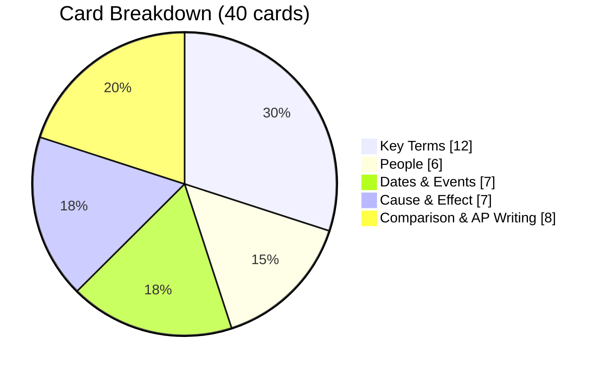

# AP World History: Modern — Topic 1.1 Developments in East Asia from c. 1200 to c. 1450 · Flashcards

> Source: Based on the College Board CED · Textbook incorporated (Topic 1.1 reading)

---

## 1. Key Terms

- [ ] **What were the civil service examinations, how did the Song change them, and why is the system called a meritocracy?**

▶ Answer
Tests on the Confucian classics, poetry, and policy essays used to choose government officials. They began under the Sui and Tang, but the Song greatly expanded them, added the palace exam before the emperor, and used anti-cheating rules (covered names, recopied answers). Emperor Song Taizu widened education so young men of the lower economic classes could compete. Because officials earned their posts by merit, the system was a meritocracy, with more upward mobility than any other hiring system of its time, though the poor stayed vastly underrepresented.

- [ ] **Who were the scholar-gentry, and where did they rank in Song society?**

▶ Answer
Confucian-educated, often landowning men who passed the civil service exams and served as officials or led local society. They were a new class created by the growth of the bureaucracy, soon outnumbered the hereditary aristocracy, and became the most influential class. Below them ranked farmers, artisans, and merchants. Merchants had low status because Confucians valued hard work and creating value, and merchants only exchanged goods.

- [ ] **What is the Mandate of Heaven?**

▶ Answer
The belief that Heaven gives a virtuous ruler the right to rule. If the ruler governs badly (floods, famine, rebellion), Heaven can withdraw the mandate and a new dynasty can replace him.

- [ ] **What is Neo-Confucianism?**

▶ Answer
A revival of Confucianism led by Zhu Xi. The textbook calls it a syncretic system that combined rational thought with ideas from Daoism and Buddhism and stressed ethics. It taught that a universal principle (li) runs through all things and stressed filial piety and social order. Zhu Xi's version became the exam curriculum in 1313, and it spread to Korea, Vietnam, and Japan. The textbook dates its rise to 770–840; many accounts trace its roots to Tang thinkers such as Han Yu but say it took its full form under the Song.

- [ ] **What is filial piety?**

▶ Answer
The Confucian duty of children to respect, obey, and care for their parents and ancestors (for example, long mourning and ancestor veneration). The textbook defines it as family members putting their own desires below those of the male head of the family and the ruler, which helped the Song keep its rule. It spread across East Asia to Korea, Japan, and Vietnam.

- [ ] **What was foot binding, and what does it show about women's status?**

▶ Answer
From a very young age, girls' feet were wrapped so tightly that the bones did not grow naturally. It became common among aristocratic (elite) families during the Song as a sign of status that suitors desired. It shows the strong patriarchy of Song society, because it restricted women's movement and their part in public life. Foot binding was banned in 1912.

- [ ] **What is Chan (Zen) Buddhism?**

▶ Answer
A syncretic Mahayana school that fused Buddhist doctrine with Daoism (monks even translated dharma as dao, "the way"). It seeks enlightenment through meditation and direct experience rather than studying scripture. Called Chan in China and Zen in Japan, where it became popular with samurai in the Kamakura period. It stayed popular with ordinary Chinese even after the Tang closed monasteries.

- [ ] **What was Champa rice?**

▶ Answer
A fast-ripening, drought-resistant rice from Champa (central Vietnam), introduced some time before the 11th century. The Song government distributed the seed in 1012. It let rice grow on lowlands, riverbanks, and hills, and in some areas it allowed two crops a year (summer and winter), sometimes three.

- [ ] **What was the Grand Canal, and how did the Song improve it?**

▶ Answer
An inexpensive, efficient inland waterway, first completed under the Sui (c. 610), that linked the Yangzi and Yellow rivers. The Song improved it with pound locks (984), and the Yuan later extended it north to Beijing. It carried rice and goods from the south to the north and helped make Song China the most populous trading area in the world. The textbook says it extended over 30,000 miles; many accounts give about 1,100 miles for the canal itself.

- [ ] **What is proto-industrialization? Give a Song example.**

▶ Answer
Production for the market before mechanized industry, based in homes and communities using simple equipment rather than factories and complex machinery. Song China had it earlier than Western Europe. Example: artisans made steel in widely dispersed smelting sites supervised by the imperial government, and they also made porcelain and silk for trade.

- [ ] **What were the tributary system and the kowtow?**

▶ Answer
Under the tributary system, which began under the Han, neighboring states paid money or goods to honor the Chinese emperor and received trade access and recognition in return. It cemented China's power but also brought stability and trade for all sides. Envoys performed the kowtow, bowing until the head reached the floor. The textbook lists Japan, Korea, and Southeast Asian kingdoms as Song tributaries; many accounts say Japan sent no tribute under the Song after ending official missions in 894.

- [ ] **What is sinification?**

▶ Answer
The assimilation of Chinese traditions and practices by neighboring peoples. Japan, Korea, and Vietnam benefited from being close to China, but each had to decide how much to adopt while keeping its own culture. Even Vietnam, which resisted China most, experienced sinification.

## 2. People

- [ ] **Who was Zhu Xi?**

▶ Answer
The most important Neo-Confucian thinker (1130–1200). His commentaries on the Four Books became the official basis of the civil service exams from 1313 and spread Neo-Confucianism across East Asia.

- [ ] **Who was Zhao Kuangyin (Emperor Taizu)?**

▶ Answer
The general who founded the Song Dynasty in 960. To prevent coups, he put civil officials above military commanders, which made the Song stable but militarily weak. The textbook also credits him (as Song Taizu) with widening education so that lower-class young men could compete in the civil service exams.

- [ ] **Who was Bi Sheng?**

▶ Answer
A Song inventor who created movable type printing in the c. 1040s. Printing made books, including Confucian texts for the exams, cheaper and more available.

- [ ] **Who was Kublai Khan?**

▶ Answer
The Mongol ruler who declared the Yuan Dynasty in 1271 and conquered the Southern Song in 1279. He kept a Chinese-style bureaucracy but put Mongols above Chinese, and he honored the Tibetan monk Phagpa.

- [ ] **Who was Yi Seong-gye (King Taejo)?**

▶ Answer
The Korean general who founded the Joseon Dynasty in 1392. Joseon made Neo-Confucianism its official ideology, restricted Buddhism, and sent tribute to the Ming.

- [ ] **Who was Lê Lợi?**

▶ Answer
The Vietnamese leader who drove out the Ming occupation and founded the Lê Dynasty in 1428. The Lê adopted Neo-Confucian government while staying independent of China.

## 3. Dates & Events

- [ ] **960**

▶ Answer
Zhao Kuangyin founds the Song Dynasty, with its capital at Kaifeng. The textbook says the Song replaced the Tang; many accounts note that the Five Dynasties period (907–960) came in between.

- [ ] **1127**

▶ Answer
The Jurchen (Jin) capture Kaifeng. The Song court flees south and the Southern Song begins, with Hangzhou as its capital (formally named capital in 1138).

- [ ] **1185 and 1192**

▶ Answer
The Minamoto win the Genpei War (1185), which many accounts treat as the start of the Kamakura shogunate. In 1192 the Minamoto were named shogun (military ruler), the date the textbook uses. Japan kept its emperor, but he had little power.

- [ ] **1271 and 1279**

▶ Answer
Kublai Khan declares the Yuan Dynasty (1271). The Southern Song falls to the Mongols (1279).

- [ ] **1368**

▶ Answer
Zhu Yuanzhang (the Hongwu Emperor) founds the Ming Dynasty, which restores Confucian exams and the bureaucracy.

- [ ] **1392**

▶ Answer
Yi Seong-gye founds the Joseon Dynasty in Korea, a Neo-Confucian state.

- [ ] **1428**

▶ Answer
Lê Lợi drives the Ming out of Vietnam and founds the Lê Dynasty.

## 4. Cause & Effect

- [ ] **Cause → Effect: What did Champa rice lead to?**

▶ Answer
Two crops a year in some areas, together with better farming methods (manure, irrigation and terraces, heavy plows), created a food surplus. China's population roughly doubled (passing about 100 million); the textbook says China grew from about 25 percent to nearly 40 percent of the world's population. This supported bigger cities, more workers, and more trade.

- [ ] **Cause → Effect: How did the Grand Canal affect the Song economy?**

▶ Answer
It linked the rice-rich Yangzi south with the political north. Pound locks made it more efficient, so rice and goods moved cheaply, which tied the economy together and fed the capital.

- [ ] **Cause → Effect: How did the civil service exams and the growing bureaucracy affect Song government?**

▶ Answer
Officials chosen by merit in Confucian learning formed a loyal scholar-gentry class and a stable bureaucracy, which strengthened the early Song. However, wealthy families still had an advantage, and women were excluded. By the end of the Song, the bureaucracy was so large and so well paid that its cost began drying up China's surplus wealth, which weakened the empire.

- [ ] **Cause → Effect: How did Confucian and Neo-Confucian ideas affect women in Song China?**

▶ Answer
Confucian tradition expected women to defer to men, and the textbook says this patriarchy strengthened under the Tang and Song. Neo-Confucian stress on female chastity discouraged widows from remarrying, and foot binding became common among aristocratic families, which restricted women's movement and public life. Women could still keep a dowry and produced silk at home.

- [ ] **Cause → Effect: What did the growth of iron and steel production lead to?**

▶ Answer
Coal ("black earth," used in China since the 4th century B.C.E.) fueled blast furnaces that made cheap cast iron, and the Chinese learned to remove carbon from it to make steel for bridges, gates, anchors, pagodas, Buddhist figurines, and farm tools. This gave China the world's greatest manufacturing capability, raised food production, and is an example of proto-industrialization.

- [ ] **Cause → Effect: How did Song money policies (paper money and paid labor) affect the economy?**

▶ Answer
Commercialization and heavy copper coins made large trades hard, so the government took over merchants' notes and issued state paper money (jiaozi, 1020s). The Song also paid workers to build roads and irrigation canals instead of forcing them to labor, which put more money in circulation and promoted a commercial economy. Later overprinting of paper money caused inflation, which helped weaken the Yuan.

- [ ] **Cause → Effect: How did the Mongol conquest change Chinese government?**

▶ Answer
The Yuan kept the bureaucracy but ranked Mongols and Central Asians above Chinese and suspended the exams until 1315. After the Yuan fell, the Ming (1368) restored Confucian exams and the bureaucracy.

## 5. Comparison & AP Writing

- [ ] **Compare: How did Neo-Confucianism differ from earlier Confucianism and from Buddhism?**

▶ Answer
Like Confucianism, Neo-Confucianism focused on this world, ethics, family, and government. Unlike earlier Confucianism, it added a theory of the universe (li) borrowed partly from Buddhism and Daoism, which made it syncretic. Unlike Buddhism, it rejected leaving family life to seek nirvana.

- [ ] **Compare: Theravada vs. Mahayana vs. Tibetan Buddhism**

▶ Answer
Theravada: personal spiritual growth through silent meditation and self-discipline; monastic; Sri Lanka and Southeast Asia (strongest there). Mahayana: spiritual growth for all beings and service; bodhisattvas help others; open to laypeople; China, Korea, Japan, Vietnam (strongest in China and Korea), with schools such as Chan/Zen and Pure Land. Tibetan: Mahayana-based, focused on chanting, with rituals and lamas; Tibet and Mongolia. All three share the Four Noble Truths and the Eightfold Path.

- [ ] **Compare: How did Japan, Korea, and Vietnam respond to Chinese influence?**

▶ Answer
Japan, separated by sea, could control its contacts. Its Heian court emulated Chinese politics, art, and literature and took characters and Buddhism, but Japan kept Shinto, chose officials by birth, and developed a feudal shogunate. Korea, which shares a land border, adopted most closely: a Chinese-style centralized government, exams (958), and a Neo-Confucian Joseon state (1392), though its powerful aristocracy kept the exams closed to peasants. Vietnam adapted Chinese writing, the bureaucracy, and exams (1075) but had the most adversarial relationship, defeating the Mongols and expelling the Ming (1428).

- [ ] **Compare: How was Japanese feudalism similar to and different from European feudalism?**

▶ Answer
Similar: both had very little social mobility and hereditary hierarchies (Japan: serfs, samurai, daimyo; Europe: serfs, knights, nobles). Different: Japan's daimyo were in reality more powerful than the emperor or the shogun, while Europe's monarch stood above the nobility. Their codes differed too: bushido stressed frugality, loyalty, the martial arts, and honor unto death; chivalry stressed duty to countrymen, God, and women. The textbook's picture of all-powerful daimyo fits the later Ashikaga and Warring States periods better than the Kamakura period.

- [ ] **Compare: How did Vietnamese society differ from Chinese society?**

▶ Answer
Vietnamese women had more independence in marriage (and property rights) and rejected foot binding and polygyny. The Vietnamese preferred nuclear families, while the Chinese lived in extended families. Vietnamese scholar-officials owed more loyalty to village peasants than to the emperor and often led revolts against oppressive government. These differences help explain Vietnam's strong resistance to Chinese power.

- [ ] **AP Short Answer: Explain one way the Song Dynasty used traditional methods to maintain its rule.**

▶ Answer

**Claim:** The Song used Confucianism and an imperial bureaucracy to maintain and justify its rule. 
**Evidence:** The Song expanded the civil service exams on the Confucian classics, so scholar-gentry officials chosen by merit ran the government, and the emperor claimed the Mandate of Heaven. 
**Reasoning:** Officials trained in Confucian loyalty depended on the state for their status, and Confucian ideas of filial piety and respect for a benevolent ruler made obedience a moral duty, so the dynasty stayed stable.

- [ ] **AP Short Answer: Explain one effect of innovation on the Song economy.**

▶ Answer

**Claim:** Agricultural innovation, especially Champa rice, caused rapid economic growth in Song China. 
**Evidence:** Fast-ripening Champa rice allowed two harvests a year in some areas (summer and winter), sometimes three, and China's population roughly doubled to over 100 million. 
**Reasoning:** A food surplus freed more people to work in manufacturing and trade, which supported huge cities such as Hangzhou and a commercial revolution in silk, porcelain, and iron.

- [ ] **AP Long Essay Thesis: Evaluate the extent to which Chinese cultural traditions shaped East Asian states from c. 1200 to c. 1450.**

▶ Answer

**Claim:** Chinese traditions shaped East Asian states to a large extent, but each state adapted them, so the degree of sinification varied. 
**Evidence:** Korea's Joseon made Neo-Confucianism its state ideology, and Vietnam's Lý and Lê adopted Confucian exams and bureaucracy. However, Japan kept Shinto, chose officials by birth, and was ruled by a feudal shogunate; Korea's aristocracy kept the exams closed to peasants; and Vietnam fought Chinese rule and kept nuclear families and greater rights for women. 
**Reasoning:** Neighbors borrowed Chinese ideas that strengthened their own rulers, such as exams and Confucian loyalty, but rejected ideas, such as Chinese political control or the Mandate of Heaven, that threatened their independence or local traditions.

