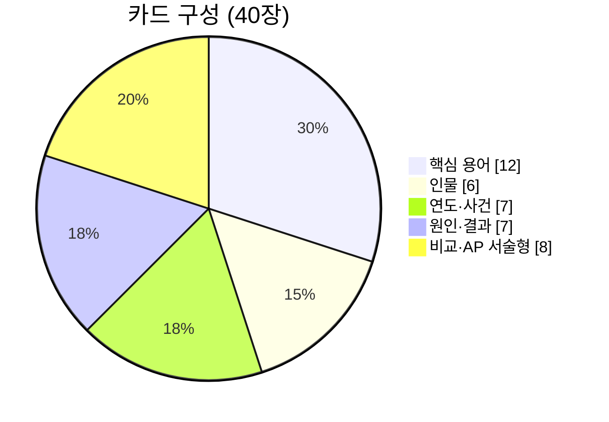

# AP 세계사: 모던 — 토픽 1.1 동아시아의 발전, c. 1200–1450 (Developments in East Asia from c. 1200 to c. 1450) · 플래시카드

> 출처: College Board CED 기준 · 교재 반영 (교재 Topic 1.1)

---

## 1. 핵심 용어

- [ ] **과거제 (Civil service examinations)란 무엇이며, 송나라는 이를 어떻게 바꾸었고, 왜 능력주의 (Meritocracy)라고 부르는가?**

▶ 정답
관리를 뽑기 위해 유교 경전, 시, 정책 논술로 치른 시험이다. 수·당 때 시작되었지만, 송이 크게 확대했다. 송은 황제 앞에서 치르는 전시 (Palace exam)를 더했고, 부정 방지 규칙(이름 가리기, 답안 옮겨 쓰기)을 썼다. 송 태조 (Song Taizu)는 하층 계급의 젊은 남성도 시험에 도전할 수 있도록 교육 기회를 넓혔다. 관리가 능력으로 자리를 얻었기 때문에 이 제도는 능력주의였고, 당시 어떤 채용 제도보다 신분 상승의 기회가 많았다. 다만 가난한 사람은 여전히 관료 사회에서 매우 적었다.

- [ ] **사대부 (Scholar-gentry)는 누구였으며, 송 사회에서 어떤 위치에 있었는가?**

▶ 정답
과거에 합격해 관리가 되거나 지역 사회를 이끈, 유교 교육을 받고 대개 땅을 가진 남성들이다. 관료제가 커지면서 생겨난 새로운 계층으로, 곧 세습 귀족 (Aristocracy)보다 수가 많아졌고 가장 영향력 있는 계층이 되었다. 그 아래에는 농민, 장인 (Artisans), 상인이 있었다. 유교는 성실한 노동과 가치 창출을 존중했는데 상인은 물건을 교환하기만 했으므로, 상인의 지위는 낮았다.

- [ ] **천명 (Mandate of Heaven)이란 무엇인가?**

▶ 정답
하늘이 덕 있는 통치자에게 통치권을 준다는 믿음이다. 통치자가 잘못 다스리면(홍수, 기근, 반란) 하늘이 천명을 거두고, 새 왕조가 그를 대신할 수 있었다.

- [ ] **성리학 (Neo-Confucianism)이란 무엇인가?**

▶ 정답
주희가 이끈 유교 부흥 사상이다. 교재는 성리학을 합리적 사고와 도교·불교의 사상을 결합하고 윤리를 강조한 혼합적 (Syncretic) 체계로 본다. 모든 사물에 보편적인 이 (理, Principle)가 있다고 가르쳤고, 효와 사회 질서를 강조했다. 주희의 학설은 1313년에 과거 시험 교과가 되었고, 성리학은 한국, 베트남, 일본으로 퍼졌다. 교재는 성리학이 770–840년에 발전했다고 쓴다. 많은 설명에서는 그 뿌리를 한유 (Han Yu) 같은 당나라 학자에게서 찾지만, 완성된 것은 송나라 때라고 본다.

- [ ] **효 (Filial piety)란 무엇인가?**

▶ 정답
자식이 부모와 조상을 존경하고, 따르고, 보살펴야 한다는 유교의 의무다(예: 오랜 상례, 조상 숭배). 교재는 가족 구성원이 자기 바람을 남성 가장과 통치자의 바람 아래에 두는 의무로 정의하며, 이것이 송의 통치 유지에 도움이 되었다고 본다. 효는 동아시아 전역의 한국, 일본, 베트남으로 퍼졌다.

- [ ] **전족 (Foot binding)이란 무엇이었으며, 여성의 지위에 대해 무엇을 보여 주는가?**

▶ 정답
아주 어릴 때부터 여자아이의 발을 뼈가 자연스럽게 자라지 못할 만큼 꽁꽁 묶는 풍습이다. 송나라 때 귀족(상류층) 집안에서 구혼자들이 원하는 신분의 상징으로 흔해졌다. 여성의 이동과 공적 생활 참여를 제한했기 때문에, 송 사회의 강한 가부장제 (Patriarchy)를 보여 준다. 전족은 1912년에 금지되었다.

- [ ] **선종 (Chan / Zen Buddhism)이란 무엇인가?**

▶ 정답
불교 교리와 도교가 섞인 대승 불교 (Mahayana Buddhism)의 혼합적 (Syncretic) 학파다(승려들은 다르마 Dharma를 도 Dao, 곧 "길"로 번역하기도 했다). 경전 공부보다 명상과 직접 체험으로 깨달음을 구한다. 중국에서는 Chan, 일본에서는 Zen이라 불렀고, 일본에서는 가마쿠라 시대에 사무라이 (Samurai)에게 인기를 얻었다. 당나라가 사원을 폐쇄한 뒤에도 중국의 일반 백성 사이에서 인기를 유지했다.

- [ ] **참파 벼 (Champa rice)란 무엇이었는가?**

▶ 정답
참파 (Champa)(베트남 중부)에서 11세기 이전 어느 때 들여온 빨리 익고 가뭄에 강한 벼다. 송 정부가 1012년에 볍씨를 나눠 주었다. 저지대, 강둑, 언덕에서도 벼를 기를 수 있게 했고, 일부 지역에서는 1년에 두 번(여름과 겨울), 때로는 세 번 수확할 수 있게 했다.

- [ ] **대운하 (Grand Canal)란 무엇이며, 송은 이를 어떻게 개량했는가?**

▶ 정답
수나라 때(c. 610) 처음 완성되어 양쯔강과 황허강을 이은 값싸고 효율적인 내륙 수로다. 송은 갑문 (Pound lock, 984)으로 운하를 개량했고, 뒤에 원나라가 북쪽 베이징까지 연장했다. 남쪽의 쌀과 상품을 북쪽으로 실어 날랐고, 송나라 중국을 세계에서 인구가 가장 많은 교역권으로 만드는 데 기여했다. 교재는 길이가 3만 마일이 넘는다고 쓰지만, 많은 설명에서는 대운하 자체를 약 1,100마일로 본다.

- [ ] **원산업화 (Proto-industrialization)란 무엇인가? 송나라의 예를 들어라.**

▶ 정답
기계화 산업 이전에 공장과 복잡한 기계가 아니라 간단한 도구로 가정과 마을에서 시장을 겨냥해 생산한 것이다. 송나라 중국은 서유럽보다 먼저 원산업화를 겪었다. 예: 장인 (Artisans)은 황실 정부의 감독 아래 여러 곳에 흩어진 제련소에서 강철을 만들었고, 교역을 위해 도자기와 비단도 만들었다.

- [ ] **조공 체제 (Tributary system)와 고두 (Kowtow)란 무엇이었는가?**

▶ 정답
한나라 때 시작된 조공 체제에서 주변 나라는 중국 황제를 기리며 돈이나 물건을 바쳤고, 그 대가로 교역 기회와 승인을 얻었다. 조공은 중국의 힘을 굳혔지만, 모든 참여국에 안정과 교역도 가져다주었다. 사신들은 머리가 바닥에 닿을 때까지 절하는 고두를 했다. 교재는 일본, 한국, 동남아시아 왕국들을 송의 조공국으로 쓴다. 많은 설명에서는 일본이 894년에 공식 사절을 끝낸 뒤 송에는 조공을 바치지 않았다고 본다.

- [ ] **중국화 (Sinification)란 무엇인가?**

▶ 정답
주변 민족이 중국의 전통과 관습을 받아들여 동화되는 것이다. 일본, 한국, 베트남은 중국과 가까워서 이익을 얻었지만, 각자 자기 문화를 지키면서 얼마나 받아들일지 정해야 했다. 중국에 가장 강하게 저항한 베트남에서도 중국화는 일어났다.

## 2. 인물

- [ ] **주희 (Zhu Xi)는 누구였는가?**

▶ 정답
가장 중요한 성리학자다(1130–1200). 그가 사서 (Four Books)에 단 주석은 1313년부터 과거 시험의 공식 기준이 되었고, 성리학을 동아시아 전역에 퍼뜨렸다.

- [ ] **조광윤 (Zhao Kuangyin, 송 태조 Emperor Taizu)은 누구였는가?**

▶ 정답
960년에 송나라를 세운 장군이다. 쿠데타를 막기 위해 문관을 무관보다 높은 자리에 두었다. 그래서 송은 안정되었지만 군사적으로 약했다. 교재는 그가(송 태조로서) 하층 계급의 젊은 남성도 과거에 도전할 수 있도록 교육 기회를 넓혔다고도 쓴다.

- [ ] **필승 (Bi Sheng)은 누구였는가?**

▶ 정답
c. 1040년대에 활자 (Movable type) 인쇄를 발명한 송나라 사람이다. 인쇄술 덕분에 과거용 유교 경전을 비롯한 책이 더 싸지고 흔해졌다.

- [ ] **쿠빌라이 칸 (Kublai Khan)은 누구였는가?**

▶ 정답
1271년에 원나라 (Yuan Dynasty)를 선포하고 1279년에 남송을 정복한 몽골의 통치자다. 중국식 관료제를 유지했지만 몽골인을 중국인보다 높은 신분에 두었고, 티베트 승려 파스파 (Phagpa)를 받들었다.

- [ ] **이성계 (Yi Seong-gye, 태조 King Taejo)는 누구였는가?**

▶ 정답
1392년에 조선 (Joseon)을 세운 고려의 장군이다. 조선은 성리학을 공식 이념으로 삼고, 불교를 억눌렀으며, 명나라에 조공을 바쳤다.

- [ ] **레러이 (Lê Lợi)는 누구였는가?**

▶ 정답
명나라의 점령을 몰아내고 1428년에 레 왕조 (Lê Dynasty)를 세운 베트남의 지도자다. 레 왕조는 중국에서 독립을 지키면서도 성리학식 정치를 받아들였다.

## 3. 연도·사건

- [ ] **960년**

▶ 정답
조광윤이 카이펑을 수도로 송나라를 세웠다. 교재는 송이 당을 대신했다고 쓴다. 많은 설명에서는 그 사이에 5대 10국 (Five Dynasties and Ten Kingdoms) 시대(907–960)가 있었다고 본다.

- [ ] **1127년**

▶ 정답
여진 (Jurchen)의 금나라가 카이펑을 함락했다. 송 조정은 남쪽으로 피신했고, 항저우를 수도로 한 남송이 시작되었다(공식 수도 지정은 1138년).

- [ ] **1185년과 1192년**

▶ 정답
미나모토 가문 (Minamoto clan)이 겐페이 전쟁에서 이겼다(1185). 많은 설명에서는 이때를 가마쿠라 막부의 시작으로 본다. 1192년에는 미나모토가 쇼군 (Shogun, 군사 지도자)에 올랐고, 교재는 이 연도를 쓴다. 일본에는 천황이 남아 있었지만 힘이 거의 없었다.

- [ ] **1271년과 1279년**

▶ 정답
쿠빌라이 칸이 원나라를 선포했다(1271). 남송이 몽골에게 무너졌다(1279).

- [ ] **1368년**

▶ 정답
주원장 (Zhu Yuanzhang, 홍무제 Hongwu Emperor)이 명나라 (Ming Dynasty)를 세웠다. 명은 유교식 과거와 관료제를 되살렸다.

- [ ] **1392년**

▶ 정답
이성계가 한국에서 성리학 국가인 조선을 세웠다.

- [ ] **1428년**

▶ 정답
레러이가 베트남에서 명을 몰아내고 레 왕조를 세웠다.

## 4. 원인·결과

- [ ] **원인 → 결과: 참파 벼는 어떤 결과를 가져왔는가?**

▶ 정답
일부 지역의 1년 두 번 수확과 개선된 농사 방법(거름, 관개와 계단식 밭, 무거운 쟁기)이 함께 식량을 남게 했다. 중국 인구는 약 두 배로 늘었다(약 1억 명 돌파). 교재는 중국 인구가 세계 인구의 약 25퍼센트에서 거의 40퍼센트로 늘었다고 쓴다. 이는 더 큰 도시, 더 많은 노동자, 더 많은 교역을 뒷받침했다.

- [ ] **원인 → 결과: 대운하는 송의 경제에 어떤 영향을 주었는가?**

▶ 정답
쌀이 풍부한 양쯔강 유역의 남쪽과 정치 중심인 북쪽을 이었다. 갑문 덕분에 운하가 더 효율적이 되어 쌀과 상품을 싸게 옮길 수 있었다. 그래서 경제가 하나로 묶였고 수도에 식량이 공급되었다.

- [ ] **원인 → 결과: 과거제와 커지는 관료제는 송의 정치에 어떤 영향을 주었는가?**

▶ 정답
유교 학식에 따라 능력으로 관리를 뽑으면서, 충성스러운 사대부 계층과 안정된 관료제가 생겼고 이는 송 초기를 강하게 만들었다. 하지만 부유한 집안이 여전히 유리했고, 여성은 제외되었다. 송 말기에는 관료제가 너무 커지고 봉급도 후해서 그 비용이 중국의 잉여 재산을 말리기 시작했고, 이것이 제국을 약하게 만들었다.

- [ ] **원인 → 결과: 유교와 성리학의 사상은 송나라 여성에게 어떤 영향을 주었는가?**

▶ 정답
유교 전통은 여성이 남성을 따르기를 기대했고, 교재는 이런 가부장제가 당과 송 시대에 더 강해졌다고 쓴다. 성리학은 여성의 정절을 강조해 과부의 재혼을 막았고, 귀족 집안에서 전족이 흔해져 여성의 이동과 공적 생활이 제한되었다. 그래도 여성은 지참금 (Dowry)을 재산으로 가질 수 있었고, 집에서 비단을 만들었다.

- [ ] **원인 → 결과: 철과 강철 생산의 증가는 어떤 결과를 가져왔는가?**

▶ 정답
석탄(기원전 4세기부터 중국에서 쓴 "검은 흙 black earth")을 연료로 쓴 용광로가 값싼 주철 (Cast iron)을 만들었다. 중국인은 주철에서 탄소를 빼내 강철을 만드는 법을 익혀 다리, 성문, 닻, 탑, 불상, 농기구를 만들었다. 이 덕분에 중국은 세계 최대의 제조 능력을 갖추었고, 식량 생산도 늘었다. 이는 원산업화의 한 예가 된다.

- [ ] **원인 → 결과: 송의 화폐·노동 정책(지폐 Paper money와 유급 노동)은 경제에 어떤 영향을 주었는가?**

▶ 정답
상업화로 거래가 커졌는데 구리 동전은 무거워 큰 거래가 어려웠다. 그래서 정부가 상인들의 어음을 넘겨받아 국가 지폐(교자 Jiaozi, 1020년대)를 발행했다. 송은 또 도로와 관개 수로 공사에 백성을 강제로 동원하는 대신 임금을 주었고, 그래서 시중에 도는 돈이 늘어 상업 경제가 성장했다. 뒤에 지폐를 너무 많이 찍어 인플레이션 (Inflation)이 생겼고, 이는 원나라를 약하게 만든 원인 중 하나가 되었다.

- [ ] **원인 → 결과: 몽골의 정복은 중국의 정치를 어떻게 바꾸었는가?**

▶ 정답
원나라는 관료제를 유지했지만, 몽골인과 중앙아시아인을 중국인보다 높은 신분에 두고 1315년까지 과거를 중단했다. 원나라가 무너진 뒤 명나라(1368)가 유교식 과거와 관료제를 되살렸다.

## 5. 비교·AP 서술형

- [ ] **비교: 성리학은 이전의 유교, 그리고 불교와 어떻게 달랐는가?**

▶ 정답
성리학은 유교처럼 현세, 윤리, 가족, 정치에 초점을 두었다. 이전의 유교와 달리, 일부는 불교와 도교에서 빌려 온 우주에 관한 이론(이 理)을 더해 혼합적 (Syncretic) 성격을 띠었다. 불교와 달리, 열반을 위해 가족을 떠나는 것을 거부했다.

- [ ] **비교: 상좌부 불교, 대승 불교, 티베트 불교**

▶ 정답
상좌부 (Theravada): 고요한 명상과 계율을 통한 개인의 정신적 성장. 승려 중심. 스리랑카와 동남아시아(이곳에서 가장 강함). 대승 (Mahayana): 모든 존재의 정신적 성장과 봉사. 보살 (Bodhisattva)이 다른 사람을 도움. 일반 신자에게도 열려 있음. 중국, 한국, 일본, 베트남(중국과 한국에서 가장 강함). 선종, 정토종 같은 학파. 티베트 불교 (Tibetan): 대승에 기반하고 염송 (Chanting)에 초점을 두며 의례와 라마를 중시함. 티베트와 몽골. 세 종파 모두 사성제 (Four Noble Truths)와 팔정도 (Eightfold Path)를 공유함.

- [ ] **비교: 일본, 한국, 베트남은 중국의 영향에 어떻게 대응했는가?**

▶ 정답
일본은 바다로 떨어져 있어 교류를 조절할 수 있었다. 헤이안 조정은 중국의 정치, 예술, 문학을 본받고 한자와 불교를 받아들였지만, 일본은 신토 (Shinto)를 지켰고, 출신으로 관리를 정했으며, 봉건 막부 (Feudal shogunate)를 발전시켰다. 국경이 맞닿은 한국은 가장 가깝게 받아들였다. 중국식 중앙 집권 정부, 과거제(958), 성리학 국가인 조선(1392)이 그 예다. 다만 강한 귀족층 때문에 과거는 농민에게 닫혀 있었다. 베트남은 중국의 문자, 관료제, 과거제(1075)를 변형해 받아들였지만 가장 적대적인 관계였다. 몽골을 물리쳤고 명을 몰아냈다(1428).

- [ ] **비교: 일본의 봉건제는 유럽의 봉건제와 어떻게 비슷하고 어떻게 달랐는가?**

▶ 정답
비슷한 점: 둘 다 신분 이동이 거의 없었고 세습 위계였다(일본: 농노, 사무라이 Samurai, 다이묘 Daimyo. 유럽: 농노, 기사, 귀족). 다른 점: 일본의 다이묘는 실제로 천황이나 쇼군보다 강했지만, 유럽에서는 군주가 귀족 위에 있었다. 규범도 달랐다. 무사도 (Bushido)는 검소, 충성, 무예, 죽음에 이르는 명예를 강조했고, 기사도 (Chivalry)는 동포, 신, 여성에 대한 의무를 강조했다. 다이묘가 가장 강했다는 교재의 설명은 가마쿠라 시대보다 뒤의 아시카가 시대와 전국 시대에 더 잘 맞는다.

- [ ] **비교: 베트남 사회는 중국 사회와 어떻게 달랐는가?**

▶ 정답
베트남 여성은 결혼 생활에서 더 독립적이었고(재산권도 있었음), 전족과 일부다처제 (Polygyny)를 거부했다. 베트남인은 핵가족 (Nuclear family)을 선호했지만, 중국인은 대가족으로 살았다. 베트남의 학자 관료는 황제보다 마을 농민에게 더 충성했고, 억압적인 정부에 맞서 자주 반란을 이끌었다. 이런 차이가 베트남이 중국의 힘에 강하게 저항한 이유를 설명해 준다.

- [ ] **AP 단답형: 송나라가 전통적 방식으로 통치를 유지한 방법 하나를 설명하라.**

▶ 정답

**주장:** 송나라는 유교와 황제 관료제를 이용해 통치를 유지하고 정당화했다. 
**근거:** 송은 유교 경전으로 치르는 과거제를 확대해, 능력으로 뽑은 사대부 관리들이 정부를 운영하게 했다. 황제는 천명을 내세웠다. 
**설명:** 유교식 충성을 배운 관리들은 자기 지위를 국가에 의존했다. 또 효와 자애로운 통치자를 존경해야 한다는 유교 사상이 복종을 도덕적 의무로 만들었다. 그래서 왕조가 안정을 유지했다.

- [ ] **AP 단답형: 혁신이 송의 경제에 끼친 영향 하나를 설명하라.**

▶ 정답

**주장:** 농업 혁신, 특히 참파 벼가 송나라의 빠른 경제 성장을 이끌었다. 
**근거:** 빨리 익는 참파 벼 덕분에 일부 지역에서는 1년에 두 번(여름과 겨울), 때로는 세 번 수확할 수 있었고, 중국 인구는 약 두 배로 늘어 1억 명을 넘었다. 
**설명:** 식량이 남자 더 많은 사람이 제조업과 교역에 종사할 수 있었다. 이것이 항저우 같은 거대 도시와 비단, 도자기, 철의 상업 혁명을 뒷받침했다.

- [ ] **AP 논술형 논지: c. 1200–1450년 중국의 문화 전통이 동아시아 국가들을 어느 정도 형성했는지 평가하라.**

▶ 정답

**주장:** 중국의 전통은 동아시아 국가들을 크게 형성했지만, 각 나라가 이를 변형했기 때문에 중국화 (Sinification)의 정도는 달랐다. 
**근거:** 한국의 조선은 성리학을 국가 이념으로 삼았고, 베트남의 리 왕조와 레 왕조는 유교식 과거와 관료제를 받아들였다. 그러나 일본은 신토를 지키고 출신으로 관리를 정했으며 봉건 막부가 다스렸다. 한국의 귀족층은 과거를 농민에게 열지 않았다. 베트남은 중국의 지배에 맞서 싸웠고, 핵가족과 여성의 더 많은 권리를 지켰다. 
**설명:** 주변 나라들은 과거제와 유교식 충성처럼 자기 통치자를 강하게 만드는 중국의 사상은 빌려 왔다. 하지만 중국의 정치적 지배나 천명 사상처럼 독립이나 고유 전통을 위협하는 것은 거부했다.

