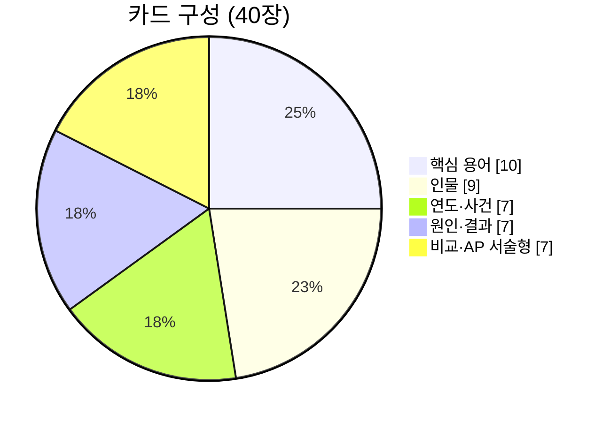

# AP 세계사: 모던 — 토픽 1.2 다르 알 이슬람의 발전, c. 1200–1450 (Developments in Dar al-Islam from c. 1200 to c. 1450) · 플래시카드

> 출처: College Board CED 기준 · 교재 반영 (교재 Topic 1.2)

---

## 1. 핵심 용어

- [ ] **다르 알 이슬람 (Dar al-Islam)이란 무엇이며, 정치적으로 분열한 뒤에도 교재가 이를 하나의 지역으로 보는 이유는?**

▶ 정답
"이슬람의 집"이라는 뜻으로, 무슬림이 다스리고 샤리아가 법과 사회를 이끈 지역이다. 1200년 무렵 알안달루스에서 북인도까지 이어졌지만, 더는 하나의 국가가 아니었다. 교재는 이곳이 하나의 문화 지역으로 남았다고 강조한다. 교역이 상품과 생각을 퍼뜨렸고, 샤리아를 함께 쓰면서 비슷한 법 체계가 생겼으며, 바그다드, 코르도바, 카이로, 부하라 (Bukhara)의 학문 중심지(교재의 "큰 대학 (Great universities)")가 새로운 생각을 나누었다.

- [ ] **이슬람의 다섯 기둥 (Five Pillars)은 무엇인가?**

▶ 정답
(1) 샤하다 (Shahada), 신앙 고백 (2) 살라트 (Salat), 하루 다섯 번의 기도 (3) 자카트 (Zakat), 가난한 이를 위한 자선 (4) 사움 (Sawm), 라마단 기간의 금식 (5) 하지 (Hajj), 메카 순례. 이 실천들은 서로 매우 다른 지역의 무슬림에게 같은 일상 실천을 만들어 주었고, 하지는 여러 지역의 무슬림을 한자리에 모았다.

- [ ] **샤리아 (Sharia)란 무엇이며, 울라마 (Ulama)는 누구였는가?**

▶ 정답
샤리아는 쿠란 (Qur'an)과 하디스 (Hadith, 무함마드의 말과 행동)에 바탕을 둔 이슬람 법이다. 카디 (Qadi, 재판관)가 법정에서 적용했고, 가족, 교역, 상속, 범죄를 다스렸다. 울라마는 종교와 법을 연구한 학자들로, 마드라사 (Madrasa)에서 가르치고, 통치자에게 조언했으며, 통치자에게 종교적 정당성을 부여했다.

- [ ] **수니파 (Sunni)와 시아파 (Shia)는 왜 나뉘었는가?**

▶ 정답
632년 무함마드가 죽은 뒤 누가 공동체를 이끌어야 하는지에 대해 의견이 달랐기 때문이다. 다수인 수니파는 공동체가 뽑은 칼리프를 받아들였다. 시아파는 지도권이 알리 (Ali)와 그 후손에게 있다고 믿었다. 예: 아바스 왕조는 수니파, 이집트의 파티마 왕조는 시아파였다.

- [ ] **수피즘 (Sufism)이란 무엇이며, 대부분의 무슬림이 신앙에 다가간 방식과 어떻게 달랐는가?**

▶ 정답
이슬람의 신비주의 전통이다. 많은 무슬림은 쿠란 연구 같은 지적 활동에 힘썼다. 반면 수피는 배움으로는 닿을 수 없다고 믿은 진리를 깨닫기 위해 내면 성찰 (Introspection)을 중시했고, 명상, 시, 음악, 춤을 썼다. 수피즘은 초기 우마이야 칼리프조 (Umayyad Caliphate)가 사치를 좋아한다고 여겨진 데 대한 반응으로 시작되었을 수 있다. 수피 선교사들은 때로 지역의 종교 요소를 이슬람에 섞었고, 이 방식으로 많은 개종자를 얻었다.

- [ ] **딤미 (Dhimmi)는 누구이며, 지즈야 (Jizya)는 무엇이었는가?**

▶ 정답
딤미("보호받는 사람들")는 무슬림 지배 아래의 비무슬림으로, 주로 유대인과 기독교인("경전의 백성 (People of the Book)")이었다. 자기 종교를 믿고 자기 지도자와 법정을 유지할 수 있었지만, 지즈야라는 특별세를 냈고 몇 가지 제약을 받았다.

- [ ] **1055년 이후 술탄 (Sultan)과 칼리프 (Caliph)의 역할은 어떻게 달랐는가?**

▶ 정답
술탄은 정치·군사 권력을 가졌다. 칼리프는 종교적 권위를 지켰지만 주로 명목상의 지도자였다. 교재는 아바스 왕조의 최고 지위가 수니파의 최고 종교 권위로 낮아졌다고 쓴다. 교재는 셀주크 지도자 투그릴 베그 (Tughril Beg)가 "스스로 술탄이라 칭했다"고 쓴다. 많은 설명에서는 아바스 칼리프가 그에게 그 칭호를 주었다고 본다.

- [ ] **맘루크 (Mamluk)란 무엇이었으며, 왜 대부분의 노예보다 높이 오를 수 있었는가?**

▶ 정답
주로 중앙아시아 출신 튀르크인인 노예 군인이다. 이슬람은 무슬림과 다른 유일신 신자(유대인, 기독교인, 조로아스터교도)를 노예로 삼는 것을 금지했기 때문에, 노예는 아프리카, 키예프 루스 (Kievan Rus), 중앙아시아에서 들여왔다. 소년들을 사들여 개종시키고 정예 기병으로 훈련했다. 맘루크는 군인으로, 뒤에는 관료로도 일했기 때문에 출세할 기회가 더 많았다. 1250년 맘루크 장교들이 이집트에서 권력을 잡고 맘루크 술탄국 (Mamluk Sultanate)을 세웠다.

- [ ] **지혜의 집 (House of Wisdom)이란 무엇이었는가?**

▶ 정답
아바스 왕조 바그다드의 이름난 도서관이자 학문의 중심지로, 알마문 (al-Ma'mun, 재위 813–833) 때 가장 번성했다. 먼 곳의 학자들까지 이곳에 모여 그리스, 페르시아, 인도의 저작을 아랍어로 번역했다. 1258년 몽골의 약탈 때 파괴되었다.

- [ ] **히잡 (Hijab)과 하렘 (Harem)은 무엇이었는가?**

▶ 정답
히잡은 단정하게 옷을 입는 실천이나 특정한 머리 가리개를 뜻하며, 대부분의 무슬림 여성이 지켰다. 머리와 얼굴을 가리는 것은 중앙아시아와 비잔티움 제국의 오래된 관습이었고, 이슬람 아래에서 더 굳어졌다. 하렘은 집안에서 아내, 첩, 그 자녀를 위해 따로 마련한 거처로, 성장하는 도시에서 달라진 여성의 지위를 상징했다.

## 2. 인물

- [ ] **알 콰리즈미 (al-Khwarizmi)는 누구인가?**

▶ 정답
아바스 왕조 바그다드의 수학자(c. 780–c. 850)다. 그의 책에서 대수학 (Algebra, al-jabr)이라는 말이, 그의 이름에서 "알고리즘 (Algorithm)"이라는 말이 나왔다. 0을 포함한 인도-아라비아 숫자 (Hindu-Arabic numerals)를 퍼뜨렸다.

- [ ] **이븐 시나 (Ibn Sina/Avicenna)는 누구인가?**

▶ 정답
페르시아의 의사이자 철학자(980–1037)다. 그가 쓴 『의학 정전 (Canon of Medicine)』은 수백 년 동안 유럽 대학의 교과서로 쓰였다.

- [ ] **오마르 하이얌 (Omar Khayyam)과 루미 (Rumi)는 누구인가?**

▶ 정답
셀주크 시대의 페르시아 작가 두 사람이다. 오마르 하이얌(1048–1131)은 수학자, 천문학자, 시인으로, 3차 방정식을 기하학적으로 풀었고, 더 정확한 달력을 만드는 데 참여했으며, 『루바이야트 (Rubaiyat)』로 유명하다. 셀주크 코니아 (Konya)의 수피 시인 루미(1207–1273)는 『마스나비 (Masnavi)』에서 신을 향한 영혼의 사랑을 노래했고, 그의 제자들이 메블레비 (Mevlevi) 교단("빙빙 도는 데르비시")을 세웠다.

- [ ] **이븐 루시드 (Ibn Rushd/Averroes)는 누구인가?**

▶ 정답
철학, 법학, 의학을 연구하고 아리스토텔레스에 대한 자세한 주석을 쓴 코르도바 (Córdoba) 출신의 카디이자 철학자(1126–1198)다. 라틴 유럽은 그를 "주석가 (the Commentator)"라고 불렀다. 그의 저작은 마이모니데스에게 영향을 주었고, 마이모니데스는 다시 토마스 아퀴나스 (Thomas Aquinas)와 스콜라 철학 (Scholasticism)에 영향을 주었다.

- [ ] **마이모니데스 (Maimonides)는 누구인가?**

▶ 정답
코르도바에서 태어나 카이로에서 의사로 일한 유대인 철학자(1138–1204, 교재는 c. 1135–c. 1204)다. 이븐 루시드의 영향을 받아, 아랍어로 쓴 『방황하는 자들을 위한 안내서 (Guide for the Perplexed)』에서 아리스토텔레스의 논리와 성경 해석을 하나로 엮었고, 토마스 아퀴나스에게 영향을 주었다. 그는 다르 알 이슬람 안에서 유대교가 계속 번성했음을 보여 준다.

- [ ] **나시르 알딘 알투시 (Nasir al-Din al-Tusi)는 누구인가?**

▶ 정답
천문학, 법학, 논리학, 윤리학, 수학, 철학, 의학에 기여한 페르시아 학자(1201–1274)다. 몽골 통치자 훌레구 (Hulagu) 아래에서 마라게 천문대 (Maragha observatory, 1259년 설립)를 이끌었는데, 교재는 이 천문대를 세계에서 가장 앞선 천문대라고 부른다. 행성 운동 모델인 "투시 커플 (Tusi couple)"을 고안했고, 삼각형의 변과 각에 관한 연구로 삼각법 (Trigonometry)이 독립된 과목이 되는 바탕을 놓았다. 교재는 그를 바그다드의 "황금기"에 놓는다. 많은 설명에서는 그가 1258년 이후 주로 마라게에서 활동했다고 본다.

- [ ] **훌레구 (Hulagu)는 누구인가?**

▶ 정답
1258년 바그다드를 약탈하고 아바스 칼리프조 (Abbasid Caliphate)를 끝낸 칭기스 칸의 손자다. 일 칸국 (Ilkhanate)을 세웠고, 알투시의 마라게 천문대도 후원했다.

- [ ] **이븐 할둔 (Ibn Khaldun)은 누구인가?**

▶ 정답
북아프리카의 역사가(1332–1406)다. 『무캇디마 (Muqaddimah)』에서 왕조가 일어나고 무너지는 이유를 설명했고, 역사학 방법론 (Historiography, 역사가의 연구 방법을 연구하는 분야)과 사회학 (Sociology)의 창시자 가운데 한 명으로 널리 인정받는다.

- [ ] **아이샤 알바우니야 ('A'ishah al-Ba'uniyyah)는 누구인가?**

▶ 정답
다마스쿠스의 수피 시인이자 신비주의자로, 20세기 이전 가장 많은 작품을 남긴 무슬림 여성 작가였을 수 있다. 무함마드를 기리는 긴 시 『신뢰받는 이를 찬양하는 맑은 영감 (Clear Inspiration, on Praise of the Trusted One)』은 그녀의 폭넓은 학식을 보여 준다. 교재는 그녀의 생몰년을 1460–1507년으로 쓴다. 많은 참고 자료는 그녀가 1517년에 죽었다고 본다.

## 3. 연도·사건

- [ ] **732**

▶ 정답
투르 전투 (Battle of Tours)에서 프랑크 군대가 무슬림 군대를 물리친다. 무슬림 군대는 711년 스페인을 침공해 코르도바를 수도로 삼았다. 투르 전투는 서유럽으로의 빠른 이슬람 팽창이 멈춘 한계선이 되었지만, 무슬림은 그 뒤 약 7세기 동안 스페인 일부를 다스렸다.

- [ ] **1055**

▶ 정답
투그릴 베그가 이끄는 셀주크 튀르크 (Seljuk Turks)가 바그다드에 들어가고, 정치권력은 술탄에게, 종교적 권위는 칼리프에게 남는다. 교재는 투그릴이 스스로 술탄이라 칭했다고 쓴다. 많은 설명에서는 칼리프가 그 칭호를 주었다고 본다.

- [ ] **1085**

▶ 정답
기독교 왕국 카스티야 (Castile)가 톨레도 (Toledo)를 점령한다. 이후 톨레도는 아랍어 저작을 라틴어로 번역하는 중심지가 된다.

- [ ] **1206**

▶ 정답
튀르크계 노예 출신 장군 쿠트브 웃딘 아이바크 (Qutb al-Din Aibak)가 북인도에 델리 술탄국 (Delhi Sultanate)을 세운다.

- [ ] **1250**

▶ 정답
맘루크 장교들이 이집트에서 권력을 잡고 맘루크 술탄국(1250–1517)을 세운다.

- [ ] **1258**

▶ 정답
훌레구가 이끄는 몽골군이 바그다드를 약탈하고, 마지막 아바스 칼리프를 처형하며, 지혜의 집을 포함한 도서관들을 파괴한다. 교재는 이때 셀주크의 지배도 끝났다고 쓴다. 많은 설명에서는 대셀주크 제국이 이미 1194년에 끝났고, 셀주크의 룸 술탄국은 1308년까지 몽골의 속국으로 남았다고 본다.

- [ ] **1260**

▶ 정답
쿠투즈 (Qutuz)와 바이바르스 (Baybars)가 이끄는 맘루크군이 아인잘루트 전투 (Battle of Ain Jalut)에서 몽골군을 물리친다. 이 승리로 몽골은 이집트에 들어오지 못했고, 메카와 메디나가 지켜졌으며, 새로 생긴 맘루크 술탄국은 명성을 얻었다. 1261년 맘루크는 정당성을 굳히려고 카이로에 아바스 왕조의 "그림자 칼리프 (Shadow caliph)"를 세웠다. 교재는 몽골이 "이집트에서 저지되었다"고 쓰지만, 전투는 팔레스타인에서 벌어졌다.

## 4. 원인·결과

- [ ] **원인 → 결과: 아바스 칼리프조는 왜 분열했고, 그 뒤 무엇이 나타났는가?**

▶ 정답
원인: 제국이 너무 넓어 다스리기 어려웠고, 총독들이 독립했으며, 경쟁 칼리프조(코르도바, 파티마 왕조)가 생겼고, 칼리프들이 튀르크계 노예 군인에 의존했다. 교재는 바깥의 네 도전 세력(맘루크, 셀주크, 십자군, 몽골)과 경제적 경쟁 (Economic competition)도 든다. 교역이 더 북쪽의 길로 옮겨 가자 바그다드는 부를 잃고 운하를 고치지 못했다. 결과: 셀주크, 맘루크, 델리 술탄국처럼 대부분 튀르크계 민족 (Turkic peoples)이 지배한 새로운 이슬람 국가들이 나타났다.

- [ ] **원인 → 결과: 셀주크는 어떻게 십자군 (Crusades)의 원인이 되었는가?**

▶ 정답
교재는 셀주크가 기독교 순례자의 성지 출입을 제한했다고 쓴다. 또 만지케르트 전투 (Battle of Manzikert, 1071) 승리로 셀주크에게 아나톨리아가 열렸고, 비잔티움 황제가 교황에게 도움을 청했다. 교황 우르바노 2세 (Pope Urban II)가 1095년 제1차 십자군을 일으켰고, 십자군은 1099년 예루살렘을 점령했다. 많은 설명에서는 비잔티움의 지원 요청을 더 강조하며, 순례길이 막혔다는 이야기는 십자군 설교에서 과장되었다고 본다.

- [ ] **원인 → 결과: 1258년 몽골의 바그다드 약탈은 어떤 결과를 낳았는가?**

▶ 정답
아바스 칼리프조가 끝났고, 지혜의 집을 포함한 도서관들이 파괴되었다. 문화의 중심은 카이로와 델리 같은 도시로 옮겨 갔다. 이슬람 문명은 살아남았다. 몽골의 일 칸들은 뒤에 이슬람으로 개종했고 알투시 같은 학자를 후원했다.

- [ ] **원인 → 결과: 상인과 수피는 무슬림 군대가 정복하지 않은 곳까지 이슬람을 어떻게 퍼뜨렸는가?**

▶ 정답
이슬람 사회는 상인을 존중했고(무함마드와 그의 첫 아내 하디자도 상인이었다), 일부 상인은 선교사로 파견되기도 했다. 상인들은 사하라 횡단 교역로와 인도양 교역로를 따라 서아프리카(말리 (Mali)), 동아프리카(스와힐리 (Swahili) 해안), 동남아시아(믈라카 (Malacca))에 이슬람을 전했다. 수피들은 지역 문화에 적응했기 때문에 많은 사람이 개종했다. 통치자와 상인이 먼저 개종하는 경우가 많았고, 이슬람은 지역 전통과 섞였다.

- [ ] **원인 → 결과: 맘루크 술탄국을 부유하게 만든 것은 무엇이며, 뒤에 무엇이 그들을 약하게 만들었는가?**

▶ 정답
맘루크는 이집트와 홍해의 향신료 교역을 장악했고, 이슬람 세계와 유럽 사이의 면화와 설탕 교역을 맡았다. 포르투갈과 다른 유럽인들이 새로운 바닷길을 열자(c. 1500년 이후) 교역이 이집트를 비켜 갔고 맘루크의 힘은 약해졌다. 1517년 오스만 제국이 이들을 정복했다.

- [ ] **원인 → 결과: 다른 문화에서 배운 것은 이슬람 학문과 유럽에 어떤 영향을 주었는가?**

▶ 정답
"지식을 구하라, 중국에 가서라도."라는 말을 따라 무슬림 학자들은 그리스 저작을 아랍어로 번역했고, 인도 수학(유럽인이 뒤에 "아라비아 숫자"라고 부른 숫자 포함)과 중국의 제지술 (Papermaking)을 받아들였다. 유럽인은 무슬림을 통해 그리스 학문, 인도 수학, 제지술을 얻었고, 종이는 유럽에서 생각을 퍼뜨리는 데 꼭 필요했다.

- [ ] **원인 → 결과: 톨레도의 번역 활동은 기독교 유럽에 어떤 영향을 주었는가?**

▶ 정답
1085년 이후 크레모나의 제라르도 (Gerard of Cremona) 같은 학자들이 아랍어 저작(아리스토텔레스, 프톨레마이오스, 이븐 시나, 이븐 루시드)을 라틴어로 번역했다. 유럽은 아리스토텔레스를 되찾았고, 토마스 아퀴나스는 대학에서 스콜라 철학을 세웠으며, 이 학문은 뒤에 르네상스의 밑거름이 되었다.

## 5. 비교·AP 서술형

- [ ] **비교: 셀주크, 맘루크, 델리 술탄국의 공통점과 차이점은?**

▶ 정답
공통점: 셋 다 아바스 왕조가 분열하면서 일어나 다양한 주민을 다스린 수니파, 튀르크계 주도 국가였다. 차이점: 셀주크는 페르시아인 관리를 쓰며 칼리프의 이름으로 술탄으로서 다스렸고, 세력이 서중국 가까이까지 이르렀다. 맘루크는 세습 없이 이집트를 다스린 노예 군인이었고, 몽골을 물리쳤으며, 홍해·면화·설탕 교역으로 부유해졌다. 델리 술탄국은 인도에서 무슬림 소수가 힌두교도 다수를 다스린 국가였다.

- [ ] **비교: 아바스 칼리프조에서 계승 국가로 넘어가면서 다르 알 이슬람의 정치권력은 어떻게 바뀌었는가?**

▶ 정답
변화: 아랍인과 페르시아인 지도자를 둔 채 다르 알 이슬람 대부분을 다스린다고 주장한 한 명의 칼리프 대신, 튀르크계 군사 엘리트가 이끄는 여러 술탄국이 생겼다. 이들의 튀르크계 뿌리는 뒤의 오스만, 사파비, 무굴 제국으로 이어졌다. 학문의 중심도 바그다드에서 여러 곳(카이로, 코르도바, 부하라, 마라게, 델리)으로 퍼졌다. 연속성: 샤리아, 아랍어 학문, 페르시아식 행정, 종교적 상징으로서 칼리프에 대한 존중이 이어졌다.

- [ ] **AP 단답형: c. 1000년 이후 새로운 이슬람 국가가 일어난 원인 하나를 설명하라.**

▶ 정답

**주장:** 아바스 칼리프조의 분열은 튀르크계가 이끄는 새로운 이슬람 국가들이 일어날 수 있게 했다. 
**근거:** 아바스 칼리프들은 튀르크계 노예 군인에 의존했고, 먼 지방을 통제하지 못했으며, 교역이 북쪽으로 옮겨 가면서 바그다드는 부를 잃었다. 1055년 셀주크 튀르크가 바그다드를 장악했고, 그 지도자가 술탄으로 다스리는 동안 칼리프에게는 종교적 권위만 남았다. 
**설명:** 칼리프에게 더 이상 실제 군사력과 경제력이 없었다. 그래서 튀르크계 군사 지도자들이 칼리프를 종교적 명목상 지도자로 남겨 둔 채 정치권력을 잡을 수 있었다.

- [ ] **AP 단답형: c. 1200–1450년 이슬람의 신앙과 실천이 다르 알 이슬람의 사회에 준 영향 하나를 설명하라.**

▶ 정답

**주장:** 이슬람 법은 무슬림 국가가 유대인과 기독교인을 대하는 방식을 결정했다. 
**근거:** 유대인과 기독교인은 "경전의 백성"으로서 딤미가 되었다. 이들은 자기 종교, 지도자, 법정을 유지했지만 지즈야를 냈다. 마이모니데스 같은 유대인 학자들은 코르도바와 카이로에서 활약했다. 
**설명:** 샤리아는 세금을 받는 대신 비무슬림을 보호했다. 그래서 다양한 종교 공동체가 무슬림 지배 아래에서 살아남았다. 동시에 세금과 사회적 이점 때문에 이슬람으로의 점진적 개종이 일어났다.

- [ ] **AP 단답형: 이슬람이 다르 알 이슬람 여성의 지위에 준 영향 하나를 설명하라.**

▶ 정답

**주장:** 이슬람은 여성에게 몇 가지 법적 권리를 주었지만, 가부장적 제약은 남았고 도시에서 더 커졌다. 
**근거:** 여성은 신부의 아버지가 아니라 신부에게 주어진 지참금 (Mahr)을 포함한 재산을 가질 수 있었고, 일정한 조건에서 이혼을 요구하고 재혼할 수 있었다. 무함마드는 여아 살해 (Female infanticide)를 금지했다. 그러나 법정에서 여성의 증언은 남성의 절반으로 인정되었고, 도시 상류층 사이에서 베일 착용, 격리, 하렘이 퍼졌다. 
**설명:** 샤리아가 여성의 재산과 가족 관련 권리를 보호했기 때문에 여성의 법적 지위는 어떤 면에서 이전보다 강해졌다. 하지만 도시가 커지면서 사회 관습이 여성의 바깥 생활에 새로운 제약을 더했다.

- [ ] **AP 단답형: 다르 알 이슬람의 지적 혁신이 낳은 결과 하나를 설명하라.**

▶ 정답

**주장:** 다르 알 이슬람의 지적 혁신은 기독교 유럽에 지식을 전했다. 
**근거:** 지혜의 집은 그리스 저작을 아랍어로 번역했고, 이븐 루시드의 아리스토텔레스 주석은 마이모니데스에게, 이어 토마스 아퀴나스에게 영향을 주었다. 1085년 이후 톨레도의 학자들은 이 저작들을 라틴어로 번역했다. 
**설명:** 무슬림 학자들이 고대 학문을 보존하고 넓혔다. 그래서 이 학문이 스페인을 거쳐 유럽에 전해졌을 때, 토마스 아퀴나스 같은 유럽 사상가들이 이를 활용해 대학에서 스콜라 철학을 세울 수 있었다.

- [ ] **AP 논술형 논지: c. 1200–1450년 아바스 칼리프조의 분열이 다르 알 이슬람의 정치권력을 어느 정도 바꾸었는지 평가하라.**

▶ 정답

**주장:** 분열은 누가 정치권력을 가졌는지를 크게 바꾸었지만, 이슬람의 종교·법 전통은 이어졌다. 
**근거:** 튀르크계 술탄이 칼리프를 대신해 실제 통치자가 되었다. 셀주크는 1055년 이후 술탄으로 다스렸고, 맘루크는 1250년 이집트를 장악했으며, 델리 술탄국은 1206년에 세워졌다. 그러나 이 국가들은 샤리아를 유지했고, 울라마에 의지했으며, 카이로의 맘루크 "그림자 칼리프"처럼 칼리프에게서 정당성을 얻으려 했다. 
**설명:** 군사력은 튀르크계 엘리트에게 넘어갔지만, 그들은 여전히 이슬람의 정당성이 있어야 다스릴 수 있었다. 그래서 정치권력은 바뀌었지만, 통치의 종교적 바탕은 그대로 남았다.

