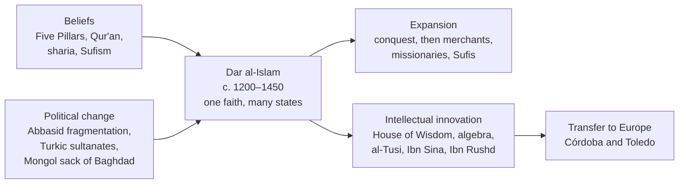
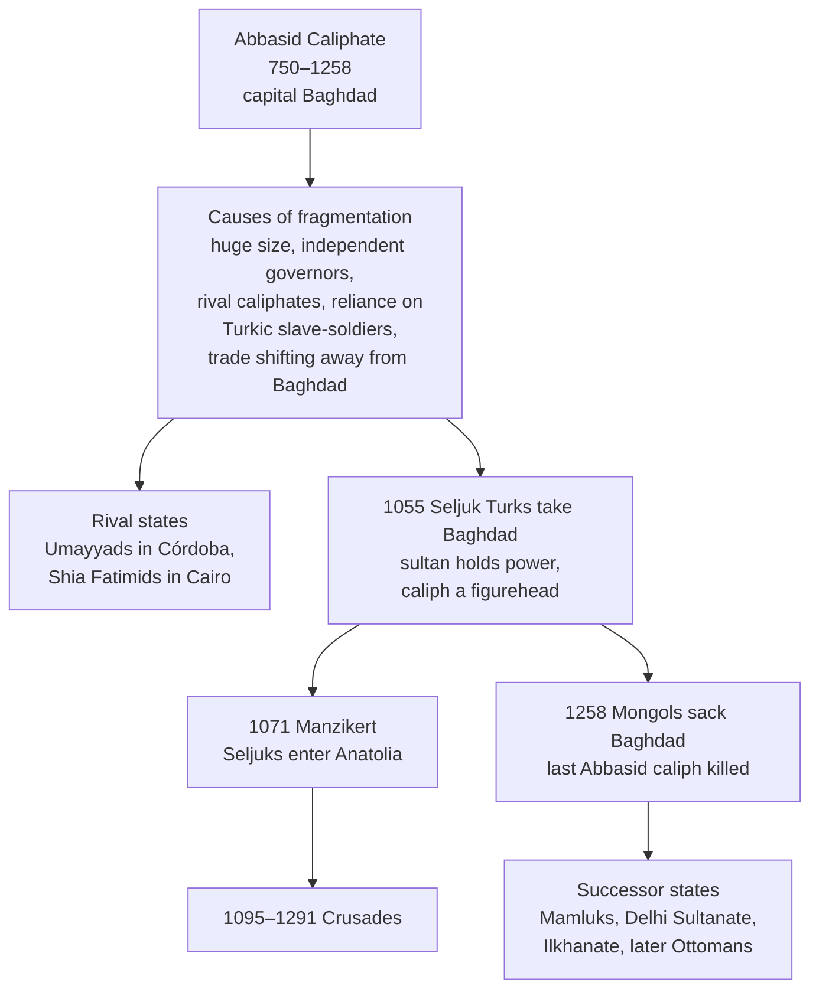
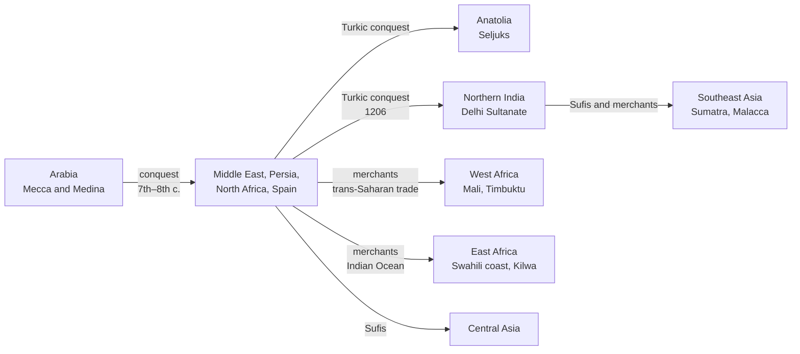
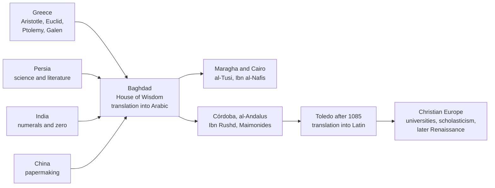
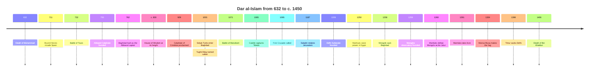
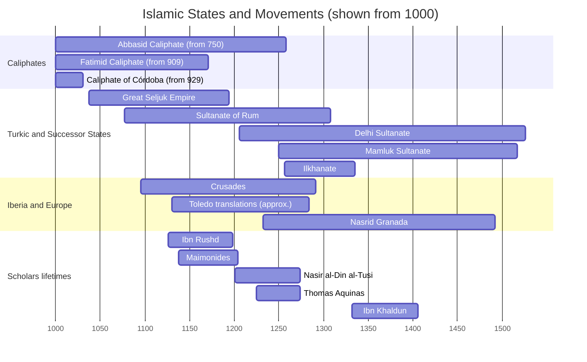
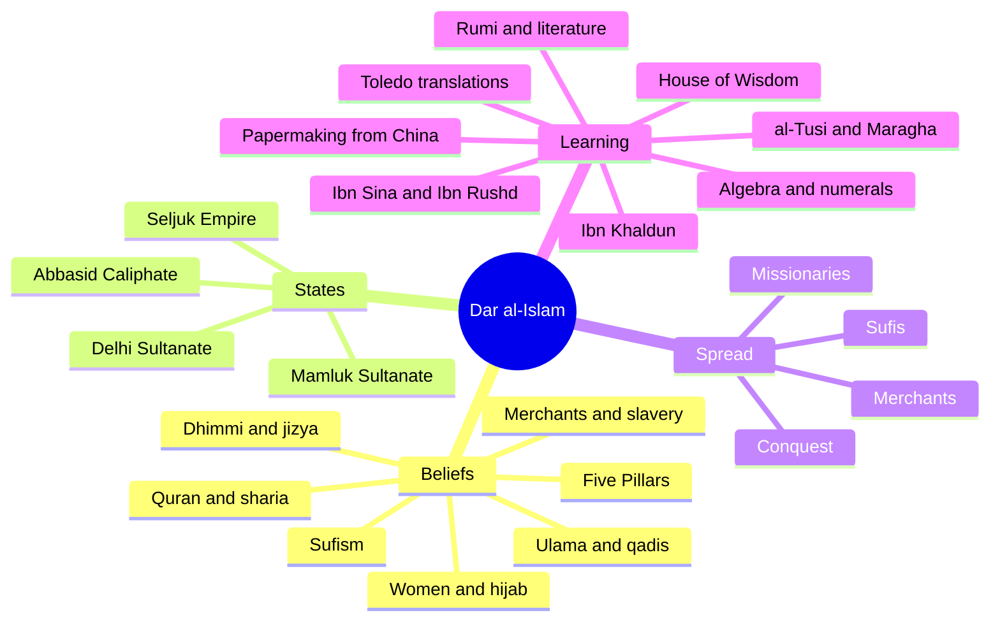

# AP World History: Modern — Topic 1.2 Developments in Dar al-Islam from c. 1200 to c. 1450

**Focus Question (textbook Essential Question):** In the period from c. 1200 to c. 1450, how did Islamic states arise, and how did major religious systems shape society?

> Source: Based on the College Board CED · Textbook incorporated (Topic 1.2 reading)

**Unit 1: The Global Tapestry (c. 1200–1450)**

---

## Learning Objective

| Code | Learning Objective |
|---|---|
| 1.2 LO A (CDI) | Explain how systems of belief and their practices affected society in the period from c. 1200 to c. 1450. |
| 1.2 LO B (GOV) | Explain the causes and effects of the rise of Islamic states over time. |
| 1.2 LO C (CDI/SCI) | Explain the effects of intellectual innovation in Dar al-Islam. |

## Historical Developments (CED)

| # | Historical Development | Covered in |
|---|---|---|
| HD1 · LO A | KC-3.1.III.D.iii: Islam, Judaism, Christianity, and the core beliefs and practices of these religions continued to shape societies in Afro-Eurasia. | §1, §2, §7 |
| HD2 · LO B | KC-3.2.I.A.ii: As the Abbasid Caliphate fragmented, new Islamic political entities emerged, most of which were dominated by Turkic peoples. These states demonstrated continuity, innovation, and diversity. Illustrative examples: **Mamluks**, **Seljuk Empire**, **Delhi Sultanate**. | §3, §4 (Seljuks, Mamluks, Delhi Sultanate), Comparison Tables |
| HD3 · LO B | KC-3.2.I.A.iii: Muslim rule continued to expand to many parts of Afro-Eurasia due to military expansion, and Islam subsequently expanded through the activities of merchants, missionaries, and Sufis. | §2 (Sufism, merchants), §5 |
| HD4 · LO C | KC-3.1.III.D.iv: Muslim states and empires encouraged significant intellectual innovations and transfers. Illustrative examples: **advances in mathematics**, **Nasir al-Din al-Tusi**, **literature**, **preservation and commentaries on Greek moral and natural philosophy**, **House of Wisdom in Abbasid Baghdad**, **scholarly and cultural transfers in Muslim and Christian Spain**. | §6 (House of Wisdom, mathematics, al-Tusi, Greek philosophy, literature), §7 (Muslim and Christian Spain), §8 |

> ⚠️ Needs verification: the KC wording for HD1, HD3, and HD4 is close to the CED but approximated. Check the exact wording against the current CED.

---

## The Big Picture

> "Allah will admit those who embrace the true faith and do good works to gardens watered by running streams."
> — The Quran, Chapter 47

**Dar al-Islam** ("the house of Islam") was the large region where Muslim rulers governed and Islamic law shaped daily life. By 1200 it stretched from **al-Andalus** (Spain) to **northern India**, but it was **no longer one state**. The **Abbasid Caliphate** (750–1258) had broken into many regional states. **Turkic peoples** took political power: the **Seljuks** ruled as **sultans** while the caliph kept only religious prestige, the **Mamluks** (slave-soldiers) ruled Egypt, and the **Delhi Sultanate** ruled a Hindu majority in South Asia. Baghdad was also losing wealth as **trade routes shifted farther north**. The **Mongols** destroyed Baghdad in **1258**, but Islamic civilization survived and kept spreading. Muslim rule spread first by **military expansion**, and Islam itself then spread through **merchants, missionaries, and Sufis**. Shared beliefs (**Five Pillars, Qur'an, sharia**) held this diverse world together and shaped how Muslims treated **Jews, Christians**, **women**, **merchants**, and **enslaved people**. As the opening quotation suggests, many Muslim rulers showed **tolerance** toward Christians, Jews, and others who believed in one God and did good works. Muslim rulers also supported **intellectual innovation**: the **House of Wisdom** preserved Greek, Persian, and Indian learning, scholars advanced **mathematics**, **astronomy**, **medicine**, and **literature**, and **al-Andalus** passed this knowledge, along with Chinese **papermaking**, to **Christian Europe**.

---

## §1. Dar al-Islam and the Core Beliefs of Islam

- **Dar al-Islam** means "the house (or abode) of Islam." It refers to lands under Muslim rule where **sharia** shaped law and society.
- After 1200, Dar al-Islam was a **shared religious and cultural zone**, not a single empire. **Arabic** was the language of religion and scholarship, and **Persian** became a major language of literature and government.
- The **hajj**, trade routes, and travelling scholars connected Muslims from West Africa to Southeast Asia.
- After Muhammad's death in **632**, Islam spread rapidly out of Arabia through **military action** and the work of **merchants and missionaries**, until it reached from **India to Spain**.
- The textbook stresses that even after the Islamic world **fragmented politically**, it remained **one cultural region**: trade spread new goods and ideas, the **common use of sharia created similar legal systems**, and great centers of learning in **Baghdad** (Iraq), **Córdoba** (Spain), **Cairo** (Egypt), and **Bukhara** (Central Asia) shared intellectual innovations. The textbook calls these centers "great universities."

| Belief or institution | What it is | Effect on society |
|---|---|---|
| **Qur'an** | The holy book of Islam; Muslims believe it contains God's revelations to the Prophet **Muhammad** (d. 632) | The basis of law, worship, and education; spread literacy in **Arabic** |
| **Five Pillars** | (1) Shahada, the declaration of faith; (2) Salat, prayer five times a day; (3) Zakat, charity to the poor; (4) Sawm, fasting during Ramadan; (5) Hajj, pilgrimage to Mecca | Created shared daily practices across very different regions; the hajj brought Muslims from many lands together |
| **Sharia** | Islamic law based on the Qur'an and the **hadith** (sayings and actions of Muhammad) | Governed family life, trade, inheritance, and crime; gave Muslim lands a **common legal culture** |
| **Ulama** | Scholars of religion and law | Taught in **madrasas** (religious schools), advised rulers, and gave rulers religious legitimacy |
| **Qadis** | Judges who applied sharia in courts | Settled disputes in a predictable way; this helped trade |

### Sunni and Shia

| | Sunni | Shia |
|---|---|---|
| Origin of the split | Disagreement over who should lead the Muslim community after Muhammad's death in 632 | (same) |
| View of leadership | Leaders (caliphs) could be chosen by the community | Leadership belonged to **Ali** (Muhammad's cousin and son-in-law) and his descendants (imams) |
| Size | The **majority** of Muslims | A **minority** |
| Examples in this period | Abbasids, Seljuks, Mamluks, Delhi Sultanate | Fatimid Caliphate in Egypt (909–1171) |

## §2. Belief Systems and Society: Sufism, Jews and Christians, Women

### Sufism

- **Sufism** is the **mystical** tradition of Islam. Sufis sought a **personal, emotional closeness to God** through meditation, prayer, poetry, music, and dance.
- Sufis organized into **orders** (brotherhoods) led by masters. Examples include the **Mevlevi** order (the "whirling dervishes," founded by followers of **Rumi**) and the **Chishti** order in India.
- Sufis were often **willing to accept local customs**, so many people found their version of Islam easy to accept. This made Sufis **very effective missionaries** (see §5).
- **Sufis vs. most Muslims (textbook):** many Muslims focused on **intellectual pursuits** such as studying the Qur'an. Sufis instead stressed **introspection** (looking inward) to grasp truths that they believed **could not be understood through learning**.
- **Origins:** Sufism may have begun as a mystical response to the perceived **love of luxury** of the early **Umayyad Caliphate**.
- Sufi missionaries sometimes **wove local religious elements into Islam**, and in this way they won many converts.
- **'A'ishah al-Ba'uniyyah**, a Sufi poet and mystic from Damascus, may be the **most prolific female Muslim writer before the 20th century**. Her best-known work, a long poem honoring Muhammad called *Clear Inspiration, on Praise of the Trusted One*, refers to many earlier poets, which shows her broad learning. Many of her works describe her journey toward **mystical illumination**.

> ⚠️ The textbook gives 'A'ishah al-Ba'uniyyah's dates as 1460–1507. Many reference works give her death as 1517, and her life falls mostly after c. 1450. Check how your teacher presents this.

### Jews and Christians as Dhimmi

- Muslim rulers treated Jews and Christians as **"People of the Book"** because they also worshipped one God and had holy scriptures.
- They held the status of **dhimmi** ("protected people"). They could practice their religion and keep their own religious leaders and courts.
- In return, they paid a special tax, the **jizya**, and faced some limits (for example, they could not try to convert Muslims).
- Over time, the jizya and social advantages encouraged **gradual conversion** to Islam.
- **Judaism** remained a living tradition inside Dar al-Islam. **Maimonides** (1138–1204), a Jewish philosopher born in **Córdoba**, worked as a physician in **Cairo** and wrote the *Guide for the Perplexed* in Arabic to reconcile Jewish faith with Aristotle's philosophy.
- **Christianity** also shaped society. Christian communities such as the **Copts** in Egypt survived under Muslim rule, Christian translators helped the Abbasid translation movement, and Latin Christians launched the **Crusades** (§3) and the **Reconquista** in Spain (§7).
- **Non-Arabs under the early caliphs (textbook):** in non-Arab lands, rule by the caliphs led to **discrimination against non-Arabs**, but rarely to open persecution, and this discrimination **faded in the 9th century**. The caliph's soldiers were **forbidden to own the land they conquered**, so a permanent army kept order without taking property. Life in the countryside stayed **almost unchanged**, except that people now paid tribute to the caliphs instead of to Byzantine rulers.

### Commerce, Class, and Slavery

- **Merchants had high status.** Islamic society viewed merchants as **more prestigious** than other societies in Europe and Asia did at the time. **Muhammad** himself had been a merchant, as had his first wife, **Khadija**.
- With the revival of trade on the **Silk Roads**, merchants could grow rich from trade across the **Indian Ocean** and **Central Asia**. They were respected as long as they **dealt fairly** and **gave to charity** (zakat, one of the Five Pillars). Some merchants were even sent out as **missionaries** (§5).
- **Rules on slavery:** Islam **prohibited Muslims from enslaving other Muslims** or other monotheists such as **Jews, Christians, and Zoroastrians**, but it allowed the enslavement of others.
- Muslims often **imported enslaved people** from **Africa**, **Kievan Rus** (present-day Belarus, Russia, and Ukraine), and **Central Asia**. Many enslaved people **converted to Islam**, and their owners then often freed them.
- **Enslaved women** might serve as **concubines** to men who already had four wives. They had **more freedom of movement** than legal wives (for example, going to markets and running errands). Only enslaved women were allowed to **dance or perform music** in front of unrelated men, and the money they earned sometimes let them **buy their freedom**.

> ⚠️ The textbook says "the institution of hereditary slavery had not developed" and that owners freed enslaved people after they converted (the sentence is cut off in the extracted text; check against the printed textbook). Many accounts say conversion did not automatically bring freedom, although freeing slaves was praised as a pious act, and that children of two enslaved parents were usually born enslaved, while a master's children by an enslaved concubine were free. Check how your teacher presents this.

### Women in Dar al-Islam

| Rights under sharia | Limits (patriarchy) |
|---|---|
| Women could **inherit** property (usually half of a brother's share) and **keep ownership after marriage** | Men could have up to **four wives**; women could have only one husband |
| Women could **own and control property**, including their **dowry** (mahr), which was paid to the bride rather than her father, and run businesses | In court, a woman's testimony was worth **only half** that of a man, though women who testified were to be protected from retaliation |
| Women had to **consent** to marriage and, under some conditions, could **initiate divorce**; a divorced woman could receive a **cash settlement** | **Veiling and seclusion** became common among urban elite women; the rise of towns and cities brought **new limits** on women's rights, as in other cultures |
| Widows could **remarry**, and women could practice **birth control** | Women could study and read, but **not in the company of unrelated men** |
| Muhammad **forbade female infanticide** (the killing of newborn girls) | The **harem**, a part of the household set aside for wives, concubines, and their children, symbolized women's new status in cities |

- **Hijab:** some practices now linked to Islam, such as women covering their heads and faces, were **older customs** in Central Asia and the Byzantine Empire. Under Islam the practice became more established, and most women observed **hijab**, a term that can mean either **dressing modestly** or a **specific type of covering**. Men often wore head coverings too, from turbans to skull caps.
- **Muhammad's policies (textbook):** he treated his wives with love and devotion, insisted that **dowries** go to the bride rather than her father, and **forbade female infanticide**. His first wife, Khadija, was **educated and owned her own business**, which set a pattern for recognizing women's abilities.
- The textbook says Islamic women overall enjoyed a **higher status than Christian or Jewish women** of the time.
- **Gap in the sources:** most records written before 1450 were **written by men**, so we have little written evidence of how women themselves viewed their position.
- A few elite women held political power, such as **Razia Sultana** of the Delhi Sultanate (r. 1236–1240) and **Shajar al-Durr**, who briefly ruled Egypt in 1250 as the Mamluks rose.
- **Key idea:** compared with many societies of the time, Islamic law gave women important **legal rights**, but society remained **patriarchal**.
- **Connect (textbook):** in a paragraph, compare the status of women in Chinese society (see 1.1) with the status of women in Islamic society from c. 1200 to c. 1450.

## §3. The Fragmentation of the Abbasid Caliphate

- The **Abbasid Caliphate** (750–1258) overthrew the Umayyads and built a new capital at **Baghdad** (762). Its golden age was the 8th–10th centuries.
- By 1200, the caliph ruled little beyond Baghdad. His role was mainly **religious and symbolic**.
- The textbook names **four outside groups** that challenged the Abbasids in the 1100s and 1200s: the **Mamluks**, the **Seljuk Turks**, the **Crusaders**, and the **Mongols**. Like the Chinese, the Abbasids fought nomads from **Central Asia**. Unlike the Chinese, they also faced **European invaders**.

| Cause of fragmentation | Explanation |
|---|---|
| **Size** | The empire was too large to control from Baghdad; regional governors made their positions hereditary and became independent |
| **Rival caliphates** | The Umayyads in **Córdoba** (caliphate from 929) and the Shia **Fatimids** in **Cairo** claimed the title of caliph |
| **Turkic slave-soldiers** | Caliphs relied on Turkic military slaves, who gained real power over the government |
| **Outside invaders** | The **Seljuk Turks** (1055), Crusaders (1095 onward), and finally the **Mongols** (1258) |
| **Economic competition** | Since the 8th century, trade routes controlled by the Abbasids had linked Asia, Europe, and North Africa, and many goods passed through **Baghdad**. Trade slowly **shifted to routes farther north**. Baghdad lost wealth and people, could not afford to **repair its canals**, and farmers could not feed the city, so its infrastructure **decayed** |

### The Seljuks and the Caliph (1055)

- The **Seljuk Turks**, Sunni Muslim nomads from Central Asia, entered **Baghdad in 1055** under **Tughril Beg**.
- The caliph gave Tughril the title **sultan** ("one with power"). From then on, the **sultan held political and military power**, while the **caliph kept religious authority** as a figurehead. The textbook says this reduced the highest-ranking Abbasid from caliph to **chief Sunni religious authority**.
- Starting in the **11th century**, the Seljuks conquered much of the Middle East. The textbook says their power eventually reached **almost as far east as western China**.

> ⚠️ The textbook says the Seljuk leader "called himself sultan." Many accounts say the Abbasid caliph granted Tughril Beg the title. Check how your teacher presents this.

### The Crusades as Context

- The textbook says the Abbasids had let Christians travel easily to and from their **holy sites in and around Jerusalem**, but the **Seljuk Turks limited this travel**. European Christians organized soldiers, called **Crusaders**, to reopen access (see 1.6).
- Seljuk victory over the Byzantines at **Manzikert (1071)** opened Anatolia to Turkic settlement. The Byzantine emperor asked the Pope for help.
- **Pope Urban II** called the **First Crusade in 1095**. Crusaders took **Jerusalem in 1099**.
- **Saladin**, founder of the Ayyubid dynasty, retook Jerusalem in **1187**. The **Mamluks** captured the last major Crusader city, **Acre, in 1291**.
- The Crusades did not destroy Dar al-Islam, but they increased contact and trade between Muslims and Europeans.

> ⚠️ The textbook presents Seljuk limits on Christian pilgrims as the reason for the Crusades. Many accounts stress the Byzantine emperor's appeal for help after Manzikert and say that stories of blocked pilgrims were exaggerated in Crusade preaching. Check how your teacher presents this.

### The Mongol Sack of Baghdad (1258)

- **Hulagu**, a grandson of Chinggis Khan, captured and **sacked Baghdad in 1258**. He executed the last Abbasid caliph, and libraries, including the **House of Wisdom**, were destroyed.
- This **ended the Abbasid Caliphate** in Baghdad. Hulagu's state, the **Ilkhanate**, ruled Persia and Iraq; its rulers **converted to Islam** in 1295.
- Cultural centers shifted to other cities such as **Cairo**, **Delhi**, and **Tabriz**.
- The textbook says the Mongols, who like the Seljuks and many Mamluks came from **Central Asia**, conquered what remained of the Abbasid Empire in 1258, **ended Seljuk rule**, and kept pushing west until the **Mamluks stopped them** (see 2.2).

> ⚠️ The textbook says the Mongols "were stopped in Egypt" and that 1258 "ended the Seljuk rule." The Battle of Ain Jalut (1260) was fought in Palestine and kept the Mongols out of Egypt. The Great Seljuk Empire had already ended in 1194, and the Seljuk Sultanate of Rum survived as a Mongol vassal until 1308. Check how your teacher presents this.

## §4. New Turkic Islamic States: Continuity, Innovation, Diversity

- The **Abbasid Caliphate** was led by **Arabs and Persians**, but the later Islamic states were shaped by **Turkic peoples** from Central Asia. The **Mamluks** in North Africa, the **Seljuks** in the Middle East, and the **Delhi Sultanate** in South Asia were all at least partly Turkic.
- Many of these new states **adopted Abbasid practices** but were **ethnically distinct**. By the 16th century, three large Islamic empires with **Turkic roots** had formed: the **Ottoman Empire** (Turkey), the **Safavid Empire** (Persia), and the **Mughal Empire** (India) (see 3.1).

### The Seljuk Empire

- **Great Seljuk Empire** (1037–1194) in Persia, Iraq, and Syria; the **Sultanate of Rum** (1077–1308) in Anatolia, with its capital at **Konya**.
- **Turkic** rulers governed with **Persian** officials. The vizier **Nizam al-Mulk** organized the bureaucracy and founded **Nizamiyya madrasas** to train Sunni ulama.
- Soldiers received **iqta**, grants of the right to collect revenue from land, in return for military service.
- The empire split among rival family members and was weakened by Crusaders and Mongols (the Sultanate of Rum became a Mongol vassal after 1243).

### The Mamluk Sultanate of Egypt (1250–1517)

- **Mamluks** were **slave-soldiers**. The Ayyubid sultans bought mostly **Turkic** boys from the steppe north of the Black Sea, converted them to Islam, and trained them as elite cavalry.
- The textbook notes that Arabs bought mamluks, often ethnic Turks from **Central Asia**, to serve as **soldiers and later as bureaucrats**. Because of these roles, mamluks had **more chances for advancement** than most enslaved people.
- In **1250**, Mamluk officers **seized power** in Egypt. Their sultanate later included Syria and the holy cities of **Mecca and Medina**.
- At **Ain Jalut (1260)**, Mamluk commanders **Qutuz** and **Baybars** **defeated the Mongols** and stopped the Mongol advance toward Egypt.
- In 1261, Baybars brought an Abbasid survivor to Cairo as a **"shadow caliph"** to give the Mamluks religious legitimacy.
- The Mamluks drove out the last Crusaders (**Acre, 1291**) and controlled the **Red Sea spice trade** between the Indian Ocean and the Mediterranean.
- They also prospered by handling the trade in **cotton and sugar** between the Islamic world and **Europe**. When the **Portuguese** and other Europeans opened **new sea routes** for trade (after c. 1500), Mamluk power **declined**.
- **Cairo** became a leading center of Islamic learning. Sultan **Qalawun** built a great hospital there in 1284.
- Power usually did **not pass from father to son**; new slave-soldiers rose to become sultans. The **Ottomans** conquered the Mamluks in **1517**.

### The Delhi Sultanate (1206–1526)

- **Qutb al-Din Aibak**, a **Turkic former slave general**, founded the sultanate in **1206** after earlier Muslim raids into northern India.
- Five dynasties ruled in turn: Mamluk (Slave), Khalji, Tughluq, Sayyid, and Lodi.
- A **Muslim minority ruled a Hindu majority**. Many Hindus paid the **jizya**, and some temples were destroyed, but most Hindus did **not** convert, and local Hindu elites often kept their positions.
- The sultans **resisted Mongol invasions** (especially under **Alauddin Khalji**) but were weakened when **Timur sacked Delhi in 1398**.
- **Razia Sultana** (r. 1236–1240) was one of the few women to rule in the Islamic world.
- Persian court culture, Indo-Islamic architecture such as the **Qutb Minar**, and Sufi orders blended with Indian traditions (see 1.3).
- **Babur** defeated the last Lodi sultan at Panipat in **1526** and founded the **Mughal Empire** (see 3.1).

### How These States Showed Continuity, Innovation, and Diversity

| CED idea | Seljuks | Mamluks | Delhi Sultanate |
|---|---|---|---|
| **Continuity** | Kept the Abbasid caliph as religious head; used sharia and Persian bureaucracy | Restored a "shadow" Abbasid caliph in Cairo; defended Sunni Islam and the holy cities | Used sharia, the jizya, and Persian court traditions |
| **Innovation** | **Sultan** as political ruler separate from the caliph; iqta land grants; state-funded madrasas | **Slave-soldier elite** that ruled as a state; non-hereditary rule | Turkic slave generals founded a dynasty in India; new Indo-Islamic architecture |
| **Diversity** | Turkic rulers, Persian officials, Arab and Greek subjects | Turkic (later Circassian) rulers over Arab Egyptians, with Coptic Christians and Jews | Muslim rulers over a Hindu majority, plus Jains and Buddhists |

## §5. The Spread of Islam: Conquest, Then Merchants, Missionaries, and Sufis

- **Step 1, military expansion:** Muslim **rule** spread through conquest. Arab armies conquered the Middle East, North Africa, and Spain in the 7th–8th centuries. Later, Turkic armies brought Muslim rule to **Anatolia** (Seljuks) and **northern India** (Delhi Sultanate).
- **Step 2, peaceful spread:** Islam as a **religion** then spread through **merchants, missionaries, and Sufis**, often in places Muslim armies never conquered.
- **Merchants as missionaries:** Islamic society respected merchants, and some merchants were even **sent out as missionaries** (§2). Sufi missionaries **adapted to local cultures** and won many converts.
- Conversion was often **gradual**. In West Africa, **rulers and merchants converted first**, while many ordinary people kept traditional beliefs. Converts often **blended** Islam with local customs.

| Region | How Islam arrived | Example |
|---|---|---|
| **Anatolia** | Seljuk conquest after 1071, then Sufis | Sultanate of Rum; Rumi in Konya |
| **Northern India** | Turkic conquest, then Sufi orders | Delhi Sultanate; Chishti Sufis attracted many followers |
| **West Africa** | **Merchants** on trans-Saharan routes | Rulers of **Mali** converted; **Mansa Musa's hajj (1324)**; Timbuktu became a center of learning (see 1.5, 2.4) |
| **East Africa** | **Merchants** on Indian Ocean routes | **Swahili** city-states such as **Kilwa**; the Swahili language mixed Bantu and Arabic |
| **Southeast Asia** | **Merchants and Sufis** | Samudra Pasai in Sumatra (late 1200s); the ruler of **Malacca** converted in the early 1400s (see 2.3) |

- The Moroccan traveler **Ibn Battuta** (1304–1368/69) journeyed across most of Dar al-Islam and even served as a qadi in Delhi. His travels show how a shared faith, law, and language connected this huge region.

## §6. Intellectual Innovation in Dar al-Islam

### The House of Wisdom in Abbasid Baghdad

- The **House of Wisdom** (Bayt al-Hikma) was a library and center of scholarship in Abbasid Baghdad. It was at its height under Caliph **al-Ma'mun** (r. 813–833).
- Scholars, including Christians and Jews, **translated** Greek (Aristotle, Euclid, Ptolemy, Galen), Persian, and Indian (Sanskrit) works into **Arabic**.
- This **preserved** much ancient learning that might otherwise have been lost, and Muslim scholars **built on it** with their own discoveries.
- The textbook calls it a **renowned center of learning** that drew scholars **from far away** to Baghdad, and says the Islamic community helped **transfer knowledge** throughout Afro-Eurasia.
- It was destroyed in the Mongol sack of **1258**.

### Cultural Continuities: Learning from Other Cultures

Islamic scholars followed a saying attributed to Muhammad: **"Go in quest of knowledge even unto China."** By learning from many cultures, they carried on the work of earlier thinkers:

| Source culture | What Islamic scholars did | Effect |
|---|---|---|
| **Greece** | Translated Greek classics into **Arabic** | Saved the works of **Aristotle** and other Greek thinkers from being lost |
| **India** | Studied Indian **mathematics** texts | Passed this knowledge on to **Europeans** |
| **China** | Adopted **papermaking** techniques | Through Muslims, **Europeans learned to make paper**, which was vital to spreading ideas in Europe |

> ⚠️ Needs verification: historians debate whether the House of Wisdom was a formal academy or mainly a royal library. The translation movement was also wider than this one institution.

### Advances in Mathematics, Science, and Medicine

| Field | Scholar or institution | Achievement | Legacy |
|---|---|---|---|
| **Mathematics** | **Al-Khwarizmi** (c. 780–c. 850), Baghdad | Wrote the book that gave us the word **algebra** (*al-jabr*); his name gave us **algorithm**; spread **Hindu-Arabic numerals** (from India, including zero) | Europe adopted these numerals; Fibonacci promoted them in 1202 |
| **Mathematics and astronomy** | **Omar Khayyam** (1048–1131), Seljuk Persia | Solved cubic equations geometrically; helped create a more accurate calendar for the Seljuk sultan | Also famous as a poet (see Literature) |
| **Astronomy and trigonometry** | **Nasir al-Din al-Tusi** (1201–1274), one of the most celebrated Islamic scholars | Contributed to astronomy, law, logic, ethics, mathematics, philosophy, and medicine; directed the **Maragha observatory** (founded 1259) under the Mongol ruler Hulagu, which the textbook calls **the most advanced in the world**, with the **most accurate astronomical charts**; created the **"Tusi couple"** model of planetary motion; studied how the **side lengths and angles of a triangle** relate, which laid the groundwork for **trigonometry** as a separate subject | Showed that Islamic science continued even after the Mongol conquest |
| **Medicine** | **Ibn Sina** (Avicenna, 980–1037) | Wrote the *Canon of Medicine*, an encyclopedia of medical knowledge | Used as a medical textbook in European universities for centuries |
| **Medicine** | **Ibn al-Nafis** (1213–1288), Mamluk Cairo | Described how blood moves between the heart and the lungs (pulmonary circulation) | An early, correct description of this process |
| **Medicine and hospitals** | Cities such as **Cairo** | Medical advances and better **hospital care**; doctors and pharmacists studied for **licensing examinations** before they could practice | An early form of professional licensing |

> ⚠️ The textbook places al-Tusi in the "golden age in Baghdad." Al-Tusi worked mainly at Maragha in Persia after the Mongol sack of Baghdad (1258), while Baghdad's golden age is usually dated to the 8th–10th centuries. Check how your teacher presents this.

> ⚠️ Needs verification: some historians argue that the Tusi couple influenced Copernicus, but how his ideas reached Europe is still debated.

### Preservation and Commentaries on Greek Moral and Natural Philosophy

- Muslim philosophers such as **al-Kindi**, **al-Farabi**, and **Ibn Sina** studied Aristotle and Plato and tried to show that **reason and faith** could agree. Al-Kindi wrote that "we ought not to be ashamed of appreciating the truth and of acquiring it wherever it comes from, even if it comes from races distant and nations different from us" (*On First Philosophy*, 9th century).
- **Ibn Rushd** (Averroes, 1126–1198), a qadi and philosopher from **Córdoba**, wrote detailed **commentaries on Aristotle**. Latin Europe called him simply "**the Commentator**."
- Not all Muslims agreed. **Al-Ghazali** (1058–1111) attacked the philosophers in *The Incoherence of the Philosophers*, and Ibn Rushd answered with *The Incoherence of the Incoherence*.

### Literature

| Work or author | Details |
|---|---|
| ***The Thousand and One Nights*** | A collection of tales from Persian, Indian, and Arab sources, gathered over centuries; told by **Scheherazade**; many stories are set in Abbasid Baghdad |
| **Rumi** (1207–1273) | A Persian **Sufi poet** in Seljuk Konya; his *Masnavi* expresses the soul's love for God |
| **Omar Khayyam** | Persian poet of the *Rubaiyat* (quatrains) |
| **Ibn Khaldun** (1332–1406) | North African historian; his *Muqaddimah* explained why dynasties rise and fall. He is widely seen as a founder of **historiography** (the study of the methods of historians) and **sociology** |
| **'A'ishah al-Ba'uniyyah** | Sufi poet and mystic; her long poem *Clear Inspiration, on Praise of the Trusted One* honors Muhammad (see §2) |

> ⚠️ Needs verification: scholars disagree about how many of the quatrains in the *Rubaiyat* Omar Khayyam actually wrote.

## §7. Muslim and Christian Spain: Scholarly and Cultural Transfers

- **Conquest:** the Umayyads ruled only briefly in the Middle East (661–750) but kept power longer in Spain. In **711**, after defeating Byzantine armies across North Africa, Muslim forces **invaded Spain from the south** and made **Córdoba** their capital.
- **Battle of Tours (732):** Frankish forces defeated the Muslim army. This defeat, rare for Islamic armies in the 700s, marked the **limit of rapid Islamic expansion into Western Europe**. Most of Europe stayed Christian, but Muslims ruled parts of Spain for about **seven more centuries**.
- **Al-Andalus** was the Muslim-ruled part of the Iberian Peninsula. The Umayyad **Caliphate of Córdoba** (929–1031) made **Córdoba** one of the largest and richest cities in Europe, with a great mosque and large libraries.
- After 1031, al-Andalus split into small kingdoms. Christian kingdoms pushed south in the **Reconquista**, which ended when **Granada** fell in **1492**.
- Muslims, Jews, and Christians lived and worked side by side. Arabic-speaking Jewish and Christian scholars shared in Islamic learning (for example, **Maimonides**).
- **Prosperity and trade:** like the Abbasids in Baghdad, the Umayyad rulers in Córdoba created a **climate of toleration** and **promoted trade**, so **Chinese and Southeast Asian products** entered Spain and then the rest of Europe. Many of these goods traveled on **dhows**, ships with long, thin hulls that were excellent for carrying cargo but less useful in war.
- **Center of learning:** the textbook says **Córdoba had the largest library in the world** at the time. **Ibn Rushd** (Averroes, 12th century) wrote influential works on **law, secular philosophy, and the natural sciences**.
- **Chain of influence:** Muslims, Christians, and Jews, all "**People of the Book**," influenced one another. Ibn Rushd's commentaries on Aristotle influenced the Jewish philosopher **Maimonides** (the textbook gives c. 1135–c. 1204), who combined Aristotle's reasoning with biblical interpretation. Maimonides in turn influenced Christian philosophers such as **Thomas Aquinas** (1225–1274).

> ⚠️ The textbook says dhows were "first developed in India or China." Many accounts link the dhow to Arab and Indian sailors of the Arabian Sea and Indian Ocean, while Chinese ships were junks. Check how your teacher presents this.

- After Castile captured **Toledo in 1085**, the city became a **translation center**. In the 12th–13th centuries, scholars translated Arabic works into **Latin** (and later Castilian).
  - **Gerard of Cremona** (d. 1187) translated dozens of works, including Ptolemy's *Almagest* and Ibn Sina's *Canon*.
  - King **Alfonso X** of Castile (r. 1252–1284) sponsored translations into Castilian.
- **Effect:** Christian Europe recovered **Aristotle** and gained Muslim works in mathematics, astronomy, and medicine. Thinkers such as **Thomas Aquinas** (1225–1274) used Aristotle and Ibn Rushd to build **scholasticism** in the new universities, and this learning later fed the Renaissance.

> ⚠️ The textbook says Muslims, Christians, and Jews in al-Andalus "coexisted peacefully" and "not only tolerated one another but also influenced one another." Many historians say this coexistence (sometimes called *convivencia*, "living together") was real but often unequal, and it sometimes broke down into violence. Check how your teacher presents this.

## §8. Effects and Connections

- **Continuity despite fragmentation:** Dar al-Islam was politically divided, but its shared religion, law, and learning **survived the Mongols**. The Mongol Ilkhans converted to Islam and supported scholars like al-Tusi.
- **Shift of power to Turkic peoples:** Turkic sultans became the main rulers of Dar al-Islam, which led to later empires with Turkic roots: the **Ottomans** (founded c. 1299), the **Safavids**, and the **Mughals** (see 3.1).
- **Spread of Islam:** Islam reached West Africa, East Africa, South Asia, and Southeast Asia, which connected these regions to Dar al-Islam's trade networks (see Unit 2).
- **Knowledge transfer:** Muslim scholarship preserved and expanded ancient learning and passed it, with Indian mathematics and Chinese papermaking, to Europe. This later helped make the Renaissance and the Scientific Revolution possible.

---

## Timeline

---

## Comparison Table: Seljuks vs. Mamluks vs. Delhi Sultanate

| Feature | Seljuk Empire | Mamluk Sultanate | Delhi Sultanate |
|---|---|---|---|
| Dates | 1037–1194 (Rum until 1308) | 1250–1517 | 1206–1526 |
| Region | Persia, Iraq, Syria, Anatolia, Central Asia (textbook: almost to western China) | Egypt and Syria | Northern India |
| Ruling group | Turkic nomads from Central Asia | Turkic (later Circassian) slave-soldiers | Turkic and later Afghan Muslims |
| Relationship to the caliph | Sultans ruled in the name of the Abbasid caliph in Baghdad | Kept a "shadow" Abbasid caliph in Cairo after 1261 | Recognized the Abbasid caliph as a symbol |
| Main subjects | Persians, Arabs, Greek Christians | Arab Muslims, Coptic Christians, Jews | Hindu majority |
| Key event | Took Baghdad (1055); Manzikert (1071) | Defeated the Mongols at Ain Jalut (1260) | Resisted Mongol invasions; sacked by Timur (1398) |
| Economy | Iqta land grants; Silk Road and Central Asian trade | Red Sea spice trade; cotton and sugar trade with Europe | Land revenue from a large farming population; trade with Central Asia and the Indian Ocean |
| Culture | Persian bureaucracy; Nizamiyya madrasas; Rumi, Omar Khayyam | Cairo as a center of learning; great hospital | Persian court culture; Qutb Minar; Sufi orders |
| End | Split apart; Rum fell under Mongol control | Weakened as Portuguese sea routes bypassed Egypt; conquered by the Ottomans (1517) | Defeated by Babur (1526) |
| Similarity | All were **Sunni**, **Turkic-led** states that rose as the Abbasids fragmented and ruled diverse populations | (same) | (same) |

## Comparison Table: Abbasid Caliphate vs. Successor States

| Feature | Abbasid Caliphate (750–1258) | Successor states (c. 1000–1450) |
|---|---|---|
| Political unity | One caliph claimed to rule most of Dar al-Islam | Many separate sultanates and dynasties |
| Who held power | The caliph (Arab dynasty), at least at first; led by Arabs and Persians | Turkic sultans and military elites |
| Source of legitimacy | Descent from Muhammad's uncle al-Abbas and the caliph's religious role | Military power plus recognition from a caliph and support of the ulama |
| Center of learning | Baghdad (House of Wisdom) | Many centers: Cairo, Córdoba, Bukhara, Maragha, Konya, Delhi |
| Trade | Baghdad at the center of routes linking Asia, Europe, and North Africa | Trade shifted north and Baghdad decayed; Mamluk Cairo profited from Red Sea trade |
| Continuity | Sharia, Arabic scholarship, Persian administration | (same, carried on by the new states) |

---

## Key Terms

| Theme | Term | Definition |
|---|---|---|
| Culture | Dar al-Islam | "The house of Islam"; lands under Muslim rule where sharia shaped society |
| Culture | Five Pillars | The five core practices of Islam: declaration of faith, prayer, charity, fasting, and pilgrimage |
| Culture | Qur'an | The holy book of Islam |
| Culture | Sunni and Shia | The two main branches of Islam, which split over leadership after Muhammad's death |
| Culture | Sufism | The mystical tradition of Islam that seeks personal closeness to God; its missionaries spread Islam |
| Culture | Madrasa | A religious school that trained ulama, often funded by rulers |
| Culture | Al-Andalus | Muslim-ruled Iberia; Córdoba and Toledo were centers of learning and translation |
| Culture | Muhammad | The prophet of Islam (d. 632); a merchant before his prophecy, who also raised the status of women in several ways |
| Culture | 'A'ishah al-Ba'uniyyah | A Sufi poet and mystic, possibly the most prolific female Muslim writer before the 20th century |
| Culture | Ibn Rushd (Averroes) | A 12th-century scholar from Córdoba who wrote on law, philosophy, and science and wrote commentaries on Aristotle |
| Culture | Maimonides | A Jewish philosopher who combined Aristotle's reasoning with biblical interpretation and influenced Thomas Aquinas |
| Culture | Ibn Khaldun | A North African historian (1332–1406), seen as a founder of historiography and sociology |
| Culture | Hijab | The practice of dressing modestly, or a specific type of head covering, observed by most Muslim women |
| Culture | Baghdad | The Abbasid capital and center of learning and trade; it declined as trade shifted and was sacked in 1258 |
| Government | Sharia | Islamic law based on the Qur'an and the hadith |
| Government | Ulama | Muslim scholars of religion and law |
| Government | Qadi | A judge who applied sharia |
| Government | Caliph | The religious and political successor of Muhammad; after 1055, mostly a religious figurehead |
| Government | Sultan | A Muslim ruler who held political and military power, often in the caliph's name |
| Government | Abbasid Caliphate | The Islamic empire based in Baghdad (750–1258) |
| Government | Seljuk Empire | A Turkic Sunni empire that took Baghdad in 1055 and ruled Persia, Iraq, and Anatolia |
| Government | Mamluk Sultanate | A state in Egypt and Syria ruled by slave-soldiers (1250–1517) |
| Government | Delhi Sultanate | A Turkic Muslim state in northern India (1206–1526) |
| Government | Mongols | Central Asian conquerors who took Baghdad in 1258 and ended the Abbasid Caliphate |
| Government | Battle of Tours | The Frankish victory over a Muslim army in 732 that marked the limit of Islamic expansion into Western Europe |
| Society | Dhimmi | "Protected people," non-Muslims (mainly Jews and Christians) under Muslim rule |
| Society | Mamluk | A slave-soldier, usually of Turkic origin |
| Society | Crusades | Christian military campaigns to the Holy Land (1095–1291) |
| Society | Reconquista | The Christian reconquest of the Iberian Peninsula, completed in 1492 |
| Society | Harem | The part of a household set aside for wives, concubines, and their children |
| Economy | Jizya | A tax paid by dhimmi |
| Economy | Iqta | A grant of the right to collect land revenue in return for military service |
| Economy | Dhow | A ship with a long, thin hull that was excellent for carrying trade goods |
| Technology | House of Wisdom | A library and translation center in Abbasid Baghdad |
| Technology | Algebra | A branch of mathematics named after al-Khwarizmi's book *al-jabr* |
| Technology | Hindu-Arabic numerals | The numeral system, including zero, that came from India and spread through Dar al-Islam to Europe |
| Technology | Maragha observatory | An observatory in Persia founded in 1259 and directed by al-Tusi |
| Technology | Nasir al-Din al-Tusi | A celebrated scholar (1201–1274) who directed the Maragha observatory and laid the groundwork for trigonometry as a separate subject |
| Technology | Papermaking | A Chinese technology that Muslims adopted and taught to Europeans |
