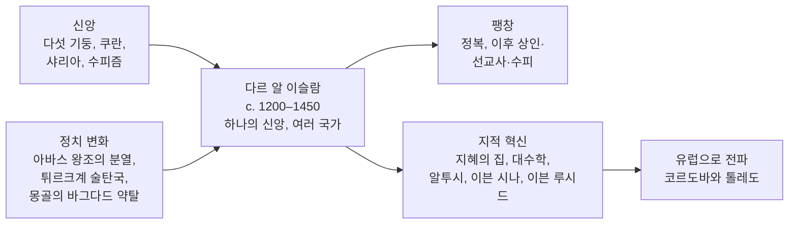
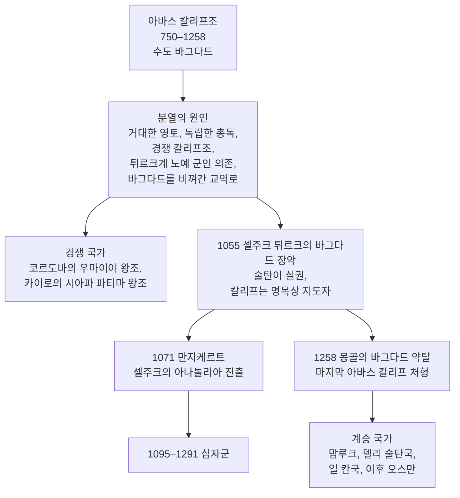
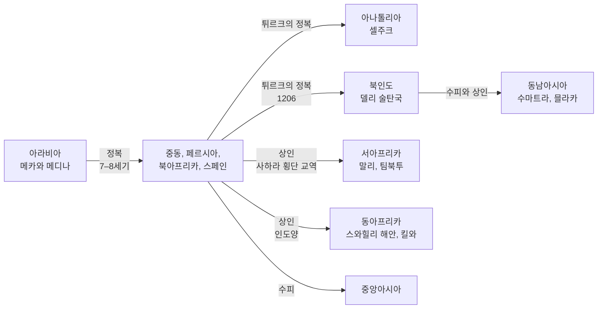
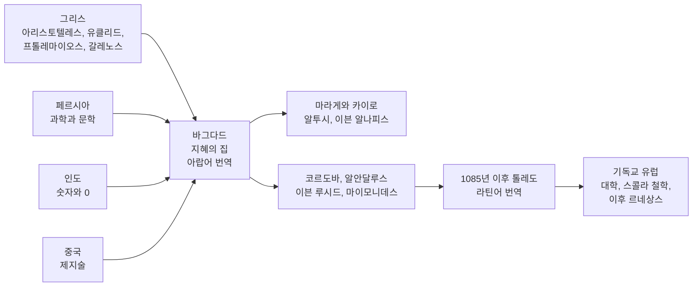
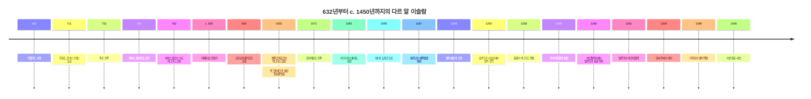
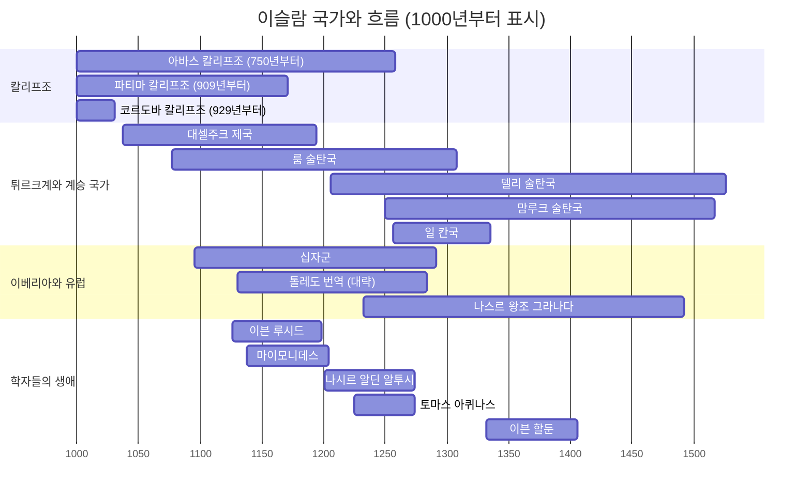
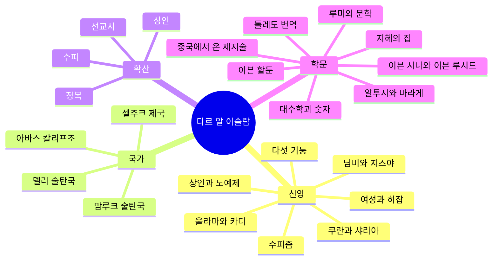

# AP 세계사: 모던 — 토픽 1.2 다르 알 이슬람의 발전, c. 1200–1450 (Developments in Dar al-Islam from c. 1200 to c. 1450)

**Focus Question (교재 Essential Question):** c. 1200–1450년에 이슬람 국가들은 어떻게 일어났으며, 주요 종교 체계는 사회를 어떻게 만들어 갔는가?

> 출처: College Board CED 기준 · 교재 반영 (교재 Topic 1.2)

**Unit 1: 세계의 태피스트리 (The Global Tapestry, c. 1200–1450)**

---

## 학습 목표 (Learning Objective)

| 코드 | 학습 목표 |
|---|---|
| 1.2 LO A (CDI) | c. 1200–1450년 신앙 체계와 그 실천이 사회에 어떤 영향을 주었는지 설명하라. |
| 1.2 LO B (GOV) | 시간에 따른 이슬람 국가 성장의 원인과 결과를 설명하라. |
| 1.2 LO C (CDI/SCI) | 다르 알 이슬람에서 일어난 지적 혁신의 결과를 설명하라. |

## 역사적 개념 (Historical Developments, CED)

| # | 역사적 개념 | 다루는 곳 |
|---|---|---|
| HD1 · LO A | KC-3.1.III.D.iii: 이슬람, 유대교, 기독교와 이 종교들의 핵심 신앙과 실천은 계속해서 아프로-유라시아의 사회를 만들어 갔다. | §1, §2, §7 |
| HD2 · LO B | KC-3.2.I.A.ii: 아바스 칼리프조 (Abbasid Caliphate)가 분열하면서 새로운 이슬람 정치체가 등장했고, 그 대부분은 튀르크계 민족 (Turkic peoples)이 지배했다. 이 국가들은 연속성, 혁신, 다양성을 보여 주었다. 예시: **맘루크 (Mamluks)**, **셀주크 제국 (Seljuk Empire)**, **델리 술탄국 (Delhi Sultanate)**. | §3, §4 (셀주크, 맘루크, 델리 술탄국), 비교표 |
| HD3 · LO B | KC-3.2.I.A.iii: 군사적 팽창으로 무슬림의 지배가 아프로-유라시아의 여러 지역으로 계속 넓어졌고, 그 뒤 상인, 선교사, 수피 (Sufis)의 활동을 통해 이슬람이 퍼졌다. | §2 (수피즘, 상인), §5 |
| HD4 · LO C | KC-3.1.III.D.iv: 무슬림 국가와 제국은 중요한 지적 혁신과 지식 전파를 장려했다. 예시: **수학의 발전**, **나시르 알딘 알투시 (Nasir al-Din al-Tusi)**, **문학**, **그리스 도덕철학·자연철학의 보존과 주석**, **아바스 왕조 바그다드의 지혜의 집 (House of Wisdom)**, **무슬림 스페인과 기독교 스페인의 학문·문화 전파**. | §6 (지혜의 집, 수학, 알투시, 그리스 철학, 문학), §7 (무슬림·기독교 스페인), §8 |

> ⚠️ 확인 필요: HD1, HD3, HD4의 KC 문구는 CED와 가깝게 옮겼지만 정확한 원문은 아니다. 최신 CED 원문과 대조해 확인이 필요하다.

---

## 큰 그림 요약

> "알라는 참된 신앙을 받아들이고 선행을 하는 이들을 흐르는 시냇물이 적시는 정원으로 들게 하실 것이다."
> — 쿠란 (The Quran), 47장

**다르 알 이슬람 (Dar al-Islam)**("이슬람의 집")은 무슬림 통치자가 다스리고 이슬람 법이 일상생활을 이끈 넓은 지역이다. 1200년 무렵 이 지역은 **알안달루스 (al-Andalus, 스페인)**에서 **북인도**까지 이어졌지만, 더 이상 **하나의 국가가 아니었다**. **아바스 칼리프조** (750–1258)는 여러 지역 국가로 쪼개져 있었다. 정치권력은 **튀르크계 민족**에게 넘어갔다. **셀주크 (Seljuks)**는 **술탄 (Sultan)**으로서 실권을 쥐었고 칼리프 (Caliph)는 종교적 권위만 지켰다. **맘루크 (Mamluks, 노예 군인)**는 이집트를 다스렸고, **델리 술탄국**은 남아시아의 힌두교도 다수를 다스렸다. 바그다드는 **교역로가 북쪽으로 옮겨 가면서** 부도 잃어 가고 있었다. **몽골 (Mongols)**은 **1258년** 바그다드를 파괴했지만, 이슬람 문명은 살아남아 계속 퍼졌다. 무슬림의 지배는 먼저 **군사적 팽창**으로 넓어졌고, 그 뒤 이슬람 신앙은 **상인, 선교사, 수피**를 통해 퍼졌다. **다섯 기둥 (Five Pillars), 쿠란 (Qur'an), 샤리아 (Sharia)** 같은 공통 신앙은 이 다양한 세계를 하나로 묶었고, 무슬림이 **유대인, 기독교인**, **여성**, **상인**, **노예가 된 사람들**을 대하는 방식에도 영향을 주었다. 첫머리 인용문이 보여 주듯, 많은 무슬림 통치자는 하나의 신을 믿고 선행을 하는 기독교인, 유대인 등에게 **관용 (Tolerance)**을 보였다. 무슬림 통치자들은 **지적 혁신**도 후원했다. **지혜의 집**은 그리스·페르시아·인도의 학문을 보존했고, 학자들은 **수학**, **천문학**, **의학**, **문학**을 발전시켰으며, **알안달루스**는 이 지식을 중국의 **제지술 (Papermaking)**과 함께 **기독교 유럽**에 전했다.

---

## §1. 다르 알 이슬람과 이슬람의 핵심 신앙

- **다르 알 이슬람**은 "이슬람의 집(또는 거처)"이라는 뜻이다. 무슬림이 다스리고 **샤리아**가 법과 사회를 이끈 지역을 가리킨다.
- 1200년 이후 다르 알 이슬람은 하나의 제국이 아니라 **종교와 문화를 공유하는 지역**이었다. **아랍어**는 종교와 학문의 언어였고, **페르시아어**는 문학과 행정의 주요 언어가 되었다.
- **하지 (Hajj)**, 교역로, 여행하는 학자들이 서아프리카에서 동남아시아까지 무슬림을 연결했다.
- **632년** 무함마드가 죽은 뒤 이슬람은 **군사 활동**과 **상인·선교사**의 활동을 통해 아라비아 밖으로 빠르게 퍼져 **인도에서 스페인까지** 이르렀다.
- 교재는 이슬람 세계가 **정치적으로 분열된** 뒤에도 **하나의 문화 지역**으로 남았다고 강조한다. 교역은 새로운 상품과 생각을 퍼뜨렸고, **샤리아를 함께 쓰면서 비슷한 법 체계**가 생겼으며, **바그다드**(이라크), **코르도바**(스페인), **카이로**(이집트), **부하라 (Bukhara)**(중앙아시아)의 큰 학문 중심지가 지적 혁신을 나누었다. 교재는 이 중심지들을 "큰 대학 (Great universities)"이라고 부른다.

| 신앙 또는 제도 | 내용 | 사회에 준 영향 |
|---|---|---|
| **쿠란 (Qur'an)** | 이슬람의 경전. 무슬림은 신이 예언자 **무함마드 (Muhammad)**(632년 사망)에게 내린 계시가 담겼다고 믿음 | 법, 예배, 교육의 바탕이 됨. **아랍어** 문자 해독 능력을 퍼뜨림 |
| **다섯 기둥 (Five Pillars)** | (1) 샤하다 (Shahada), 신앙 고백 (2) 살라트 (Salat), 하루 다섯 번의 기도 (3) 자카트 (Zakat), 가난한 이를 위한 자선 (4) 사움 (Sawm), 라마단 기간의 금식 (5) 하지 (Hajj), 메카 순례 | 서로 매우 다른 지역에 공통의 일상 실천을 만들어 줌. 하지는 여러 지역의 무슬림을 한자리에 모음 |
| **샤리아 (Sharia)** | 쿠란과 **하디스 (Hadith)**(무함마드의 말과 행동)에 바탕을 둔 이슬람 법 | 가족, 교역, 상속, 범죄를 다스림. 무슬림 지역에 **공통의 법 문화**를 만들어 줌 |
| **울라마 (Ulama)** | 종교와 법을 연구하는 학자 | **마드라사 (Madrasa, 종교 학교)**에서 가르치고, 통치자에게 조언하며, 통치자에게 종교적 정당성을 부여함 |
| **카디 (Qadi)** | 법정에서 샤리아를 적용한 재판관 | 분쟁을 예측 가능하게 해결함. 이것이 교역에 도움이 됨 |

### 수니파와 시아파

| | 수니파 (Sunni) | 시아파 (Shia) |
|---|---|---|
| 분열의 원인 | 632년 무함마드가 죽은 뒤 누가 무슬림 공동체를 이끌어야 하는지에 대한 의견 차이 | (동일) |
| 지도자에 대한 생각 | 지도자(칼리프 (Caliph))는 공동체가 뽑을 수 있음 | 지도권은 **알리 (Ali)**(무함마드의 사촌이자 사위)와 그 후손(이맘)에게 있음 |
| 규모 | 무슬림의 **다수** | **소수** |
| 이 시기의 예 | 아바스 왕조 (Abbasids), 셀주크 (Seljuks), 맘루크 (Mamluks), 델리 술탄국 (Delhi Sultanate) | 이집트의 파티마 칼리프조 (Fatimid Caliphate, 909–1171) |

## §2. 신앙 체계와 사회: 수피즘, 유대인과 기독교인, 여성

### 수피즘

- **수피즘 (Sufism)**은 이슬람의 **신비주의** 전통이다. 수피들은 명상, 기도, 시, 음악, 춤을 통해 **신과의 개인적이고 감정적인 가까움**을 추구했다.
- 수피들은 스승이 이끄는 **교단 (Orders)**을 이루었다. **루미 (Rumi)**의 제자들이 세운 **메블레비 (Mevlevi) 교단**("빙빙 도는 데르비시")과 인도의 **치슈티 (Chishti) 교단**이 그 예이다.
- 수피들은 **지역 관습을 받아들이는 데 너그러운** 경우가 많았다. 그래서 많은 사람이 그들이 전한 이슬람을 쉽게 받아들였다. 이 때문에 수피는 **매우 효과적인 선교사**였다 (§5 참고).
- **수피와 대부분의 무슬림 (교재):** 많은 무슬림은 쿠란 연구 같은 **지적 활동**에 힘썼다. 반면 수피는 배움으로는 **이해할 수 없다고 믿은 진리**를 깨닫기 위해 **내면 성찰 (Introspection)**을 중시했다.
- **기원:** 수피즘은 초기 **우마이야 칼리프조 (Umayyad Caliphate)**가 **사치를 좋아한다**고 여겨진 데 대한 신비주의적 반응으로 시작되었을 수 있다.
- 수피 선교사들은 때로 **지역의 종교 요소를 이슬람에 섞었고**, 이런 방식으로 많은 개종자를 얻었다.
- 다마스쿠스의 수피 시인이자 신비주의자인 **아이샤 알바우니야 ('A'ishah al-Ba'uniyyah)**는 **20세기 이전 가장 많은 작품을 남긴 무슬림 여성 작가**였을 수 있다. 그녀의 대표작은 무함마드를 기리는 긴 시 『신뢰받는 이를 찬양하는 맑은 영감 (Clear Inspiration, on Praise of the Trusted One)』으로, 앞선 여러 시인을 언급해 그녀의 폭넓은 학식을 보여 준다. 그녀의 많은 작품은 **신비적 깨달음 (Mystical illumination)**을 향한 여정을 그린다.

> ⚠️ 교재는 아이샤 알바우니야의 생몰년을 1460–1507년으로 쓴다. 많은 참고 자료는 그녀가 1517년에 죽었다고 보며, 그녀의 생애는 대부분 c. 1450년 이후이다. 선생님이 어떻게 가르치는지 확인이 필요하다.

### 딤미가 된 유대인과 기독교인

- 무슬림 통치자들은 유대인과 기독교인도 하나의 신을 믿고 경전을 가졌기 때문에 **"경전의 백성 (People of the Book)"**으로 대했다.
- 이들은 **딤미 (Dhimmi, "보호받는 사람들")**의 지위를 가졌다. 자기 종교를 믿을 수 있었고, 자기 종교 지도자와 법정을 유지할 수 있었다.
- 그 대신 **지즈야 (Jizya)**라는 특별세를 냈고, 몇 가지 제약을 받았다(예: 무슬림을 개종시키려 해서는 안 되었다).
- 시간이 지나면서 지즈야와 사회적 이점 때문에 이슬람으로의 **점진적 개종**이 일어났다.
- **유대교**는 다르 알 이슬람 안에서 살아 있는 전통으로 남았다. **코르도바 (Córdoba)**에서 태어난 유대인 철학자 **마이모니데스 (Maimonides, 1138–1204)**는 **카이로 (Cairo)**에서 의사로 일했고, 유대교 신앙과 아리스토텔레스 철학을 조화시키려고 아랍어로 『방황하는 자들을 위한 안내서 (Guide for the Perplexed)』를 썼다.
- **기독교**도 사회를 만들어 갔다. 이집트의 **콥트 (Copts)** 기독교인 같은 공동체는 무슬림 지배 아래에서도 살아남았고, 기독교인 번역가들은 아바스 왕조의 번역 운동을 도왔다. 라틴 기독교인들은 **십자군 (Crusades)**(§3)과 스페인의 **레콩키스타 (Reconquista)**(§7)를 일으켰다.
- **초기 칼리프 아래의 비아랍인 (교재):** 아랍인이 아닌 지역에서 칼리프의 지배는 **비아랍인에 대한 차별**로 이어졌지만, 공개적인 박해로 이어진 경우는 드물었고, 이 차별은 **9세기에 점차 사라졌다**. 칼리프의 군인은 **정복한 땅을 소유할 수 없었다**. 그래서 상비군은 질서를 지키되 재산을 차지하지 않았다. 농촌 주민 대부분의 삶은 **거의 바뀌지 않았고**, 다만 비잔티움 통치자 대신 칼리프에게 공물을 바쳤다.

### 상업, 계층, 노예제

- **상인은 높은 지위를 누렸다.** 이슬람 사회는 당시 유럽과 아시아의 다른 사회보다 상인을 **더 존중**했다. **무함마드** 자신도 상인이었고, 그의 첫 아내 **하디자 (Khadija)**도 상인이었다.
- **실크로드 (Silk Roads)** 교역이 되살아나면서 상인들은 **인도양**과 **중앙아시아**를 오가는 거래로 부자가 될 수 있었다. 상인은 **공정하게 거래**하고 **자선**(다섯 기둥 가운데 하나인 자카트)을 베푸는 한 존경받았다. 일부 상인은 **선교사**로 파견되기도 했다 (§5).
- **노예제의 규칙:** 이슬람은 **무슬림이 다른 무슬림**이나 **유대인, 기독교인, 조로아스터교도** 같은 다른 유일신 신자를 **노예로 삼는 것을 금지**했지만, 그 밖의 사람을 노예로 삼는 것은 허용했다.
- 무슬림은 **아프리카**, **키예프 루스 (Kievan Rus)**(오늘날의 벨라루스, 러시아, 우크라이나), **중앙아시아**에서 **노예를 들여오는** 경우가 많았다. 많은 노예가 **이슬람으로 개종**했고, 그러면 주인이 그들을 풀어 주는 경우가 많았다.
- **여성 노예**는 이미 네 명의 아내를 둔 남성의 **첩 (Concubine)**이 되기도 했다. 이들은 정식 아내보다 **더 자유롭게 움직일 수 있었다**(예: 시장에 가거나 심부름을 함). 친족이 아닌 남성 앞에서 **춤을 추거나 음악을 연주**하는 것은 여성 노예에게만 허용되었고, 이렇게 번 돈으로 때로 **자유를 살 수 있었다**.

> ⚠️ 교재는 "세습 노예제는 발달하지 않았다"고 하며, 노예가 개종하면 주인이 풀어 주었다고 쓴다(추출된 텍스트에서 문장이 끊겨 있으므로 인쇄된 교재와 대조해 확인이 필요하다). 많은 설명에서는 노예를 풀어 주는 일이 경건한 행위로 칭찬받았지만 개종이 곧바로 자유를 뜻하지는 않았고, 노예인 부모의 자녀는 보통 노예로 태어났으며, 주인과 여성 노예(첩) 사이의 자녀는 자유인이었다고 본다. 선생님이 어떻게 가르치는지 확인이 필요하다.

### 다르 알 이슬람의 여성

| 샤리아가 보장한 권리 | 한계 (가부장제) |
|---|---|
| 여성은 재산을 **상속**할 수 있었고(보통 남자 형제 몫의 절반), **결혼 뒤에도 소유권을 유지**했음 | 남성은 아내를 **네 명**까지 둘 수 있었지만, 여성은 남편을 한 명만 둘 수 있었음 |
| 여성은 **지참금 (Mahr)**을 포함한 **재산을 소유하고 관리**할 수 있었고, 사업도 할 수 있었음. 지참금은 신부의 아버지가 아니라 신부에게 주어졌음 | 법정에서 여성의 증언은 남성의 **절반**의 가치만 인정받았음. 다만 증언한 여성은 보복으로부터 보호받아야 했음 |
| 여성은 결혼에 **동의**해야 했고, 일정한 조건에서는 **이혼을 먼저 요구**할 수 있었음. 이혼한 여성은 **현금 위자료**를 받을 수 있었음 | 도시 상류층 여성 사이에서 **베일 착용과 격리**가 흔해졌음. 다른 문화와 마찬가지로 도시가 성장하면서 여성의 권리에 **새로운 제약**이 생겼음 |
| 과부는 **재혼**할 수 있었고, 여성은 **피임**을 할 수 있었음 | 여성은 공부하고 글을 읽을 수 있었지만, **친족이 아닌 남성과 함께해서는 안 되었음** |
| 무함마드는 **여아 살해 (Female infanticide)**(갓 태어난 여자아이를 죽이는 일)를 금지했음 | 아내, 첩, 그 자녀를 위해 따로 마련한 거처인 **하렘 (Harem)**은 도시에서 달라진 여성의 지위를 상징했음 |

- **히잡 (Hijab):** 여성이 머리와 얼굴을 가리는 것처럼 오늘날 이슬람과 연결되는 일부 관습은 무함마드 이전 중앙아시아와 비잔티움 제국의 **오래된 관습**이었다. 이 관습은 이슬람 아래에서 굳어졌고, 대부분의 여성은 **히잡**을 지켰다. 히잡은 **단정하게 옷을 입는 실천**을 뜻하기도 하고 **특정한 가리개**를 뜻하기도 한다. 남성도 터번에서 작은 모자까지 머리를 가리는 경우가 많았다.
- **무함마드의 정책 (교재):** 그는 아내들을 사랑과 헌신으로 대했고, **지참금**을 신부의 아버지가 아니라 신부에게 주도록 했으며, **여아 살해를 금지**했다. 그의 첫 아내 하디자는 **교육을 받았고 자기 사업을 가졌다**. 이는 여성의 능력을 인정하는 본보기가 되었다.
- 교재는 이슬람 여성이 전반적으로 당시 **기독교나 유대교 여성보다 높은 지위**를 누렸다고 쓴다.
- **사료의 공백:** 1450년 이전의 기록은 대부분 **남성이 썼다**. 그래서 여성 자신이 사회 속 자기 위치를 어떻게 보았는지 보여 주는 글은 거의 없다.
- 일부 상류층 여성은 정치권력을 쥐기도 했다. 델리 술탄국의 **라지아 술타나 (Razia Sultana, 재위 1236–1240)**, 그리고 맘루크가 일어서던 1250년에 이집트를 잠시 다스린 **샤자르 알두르 (Shajar al-Durr)**가 그 예이다.
- **핵심:** 당시 여러 사회와 비교하면 이슬람 법은 여성에게 중요한 **법적 권리**를 주었지만, 사회는 여전히 **가부장적**이었다.
- **연결 (교재 Connect):** c. 1200–1450년 중국 사회의 여성 지위(1.1 참고)와 이슬람 사회의 여성 지위를 한 문단으로 비교하라.

## §3. 아바스 칼리프조의 분열

- **아바스 칼리프조** (750–1258)는 우마이야 왕조 (Umayyads)를 무너뜨리고 **바그다드 (Baghdad)**에 새 수도를 세웠다(762). 황금기는 8–10세기였다.
- 1200년 무렵 칼리프가 실제로 다스린 곳은 바그다드 주변 정도였다. 칼리프의 역할은 주로 **종교적·상징적**인 것이었다.
- 교재는 1100–1200년대에 아바스 왕조에 도전한 **네 집단**으로 **맘루크**, **셀주크 튀르크**, **십자군**, **몽골**을 든다. 중국처럼 아바스 왕조도 **중앙아시아**의 유목민과 싸웠다. 중국과 달리 아바스 왕조는 **유럽의 침입자**와도 맞섰다.

| 분열의 원인 | 설명 |
|---|---|
| **영토의 크기 (Size)** | 제국이 너무 넓어 바그다드에서 다스리기 어려웠음. 지방 총독들이 자리를 세습하며 독립함 |
| **경쟁 칼리프조 (Rival caliphates)** | **코르도바 (Córdoba)**의 우마이야 왕조 (Umayyads, 929년부터 칼리프조)와 **카이로 (Cairo)**의 시아파 **파티마 왕조 (Fatimids)**가 칼리프 칭호를 내세움 |
| **튀르크계 노예 군인 (Turkic slave-soldiers)** | 칼리프들이 튀르크계 노예 군인에 의존했고, 이들이 정부의 실권을 쥠 |
| **외부 침입 (Outside invaders)** | **셀주크 튀르크 (Seljuk Turks)** (1055), 십자군 (Crusades, 1095년부터), 마지막으로 **몽골 (Mongols)** (1258) |
| **경제적 경쟁 (Economic competition)** | 8세기부터 아바스 왕조가 장악한 교역로는 아시아, 유럽, 북아프리카를 이었고, 많은 상품이 **바그다드**를 거쳤음. 교역은 서서히 **더 북쪽의 길로 옮겨 갔음**. 바그다드는 부와 인구를 잃었고, **운하를 고칠** 돈이 없었으며, 농민은 도시 인구를 먹여 살리지 못해 기반 시설이 **무너져 갔음** |

### 셀주크와 칼리프 (1055)

- 중앙아시아 출신의 수니파 무슬림 유목민인 **셀주크 튀르크 (Seljuk Turks)**는 **투그릴 베그 (Tughril Beg)**의 지휘 아래 **1055년 바그다드**에 들어갔다.
- 칼리프는 투그릴에게 **술탄**("권력을 가진 자")이라는 칭호를 주었다. 이때부터 **술탄은 정치·군사 권력**을, **칼리프는 종교적 권위**를 가진 명목상 지도자가 되었다. 교재는 이로써 아바스 왕조의 최고위자가 칼리프에서 **수니파의 최고 종교 권위자**로 낮아졌다고 쓴다.
- 셀주크는 **11세기**부터 중동의 많은 지역을 정복했다. 교재는 그들의 세력이 결국 **서쪽 중국 가까이까지** 뻗었다고 쓴다.

> ⚠️ 교재는 셀주크 지도자가 "스스로 술탄이라 칭했다"고 쓴다. 많은 설명에서는 아바스 칼리프가 투그릴 베그에게 그 칭호를 주었다고 본다. 선생님이 어떻게 가르치는지 확인이 필요하다.

### 배경으로서의 십자군

- 교재에 따르면 아바스 왕조는 기독교인이 **예루살렘과 그 주변의 성지**를 자유롭게 오가도록 허락했지만, **셀주크 튀르크는 이 왕래를 제한했다**. 유럽 기독교인들은 성지 왕래를 다시 열기 위해 **십자군 (Crusaders)**이라는 군인 집단을 꾸렸다 (1.6 참고).
- 셀주크가 **만지케르트 전투 (Battle of Manzikert, 1071)**에서 비잔티움 제국을 이기면서 튀르크인이 아나톨리아에 정착할 길이 열렸다. 비잔티움 황제는 교황에게 도움을 청했다.
- **교황 우르바노 2세 (Pope Urban II)**는 **1095년 제1차 십자군**을 일으켰다. 십자군은 **1099년 예루살렘**을 점령했다.
- 아이유브 왕조 (Ayyubid dynasty)를 세운 **살라딘 (Saladin)**은 **1187년** 예루살렘을 되찾았다. **맘루크**는 **1291년** 십자군의 마지막 주요 거점인 **아크레 (Acre)**를 함락했다.
- 십자군은 다르 알 이슬람을 무너뜨리지 못했지만, 무슬림과 유럽인 사이의 접촉과 교역을 늘렸다.

> ⚠️ 교재는 셀주크가 기독교 순례자를 제한한 것을 십자군의 원인으로 제시한다. 많은 설명에서는 만지케르트 이후 비잔티움 황제의 지원 요청을 더 강조하며, 순례길이 막혔다는 이야기는 십자군 설교에서 과장되었다고 본다. 선생님이 어떻게 가르치는지 확인이 필요하다.

### 몽골의 바그다드 약탈 (1258)

- 칭기스 칸의 손자 **훌레구 (Hulagu)**는 **1258년 바그다드를 점령하고 약탈**했다. 그는 마지막 아바스 칼리프를 처형했고, **지혜의 집**을 포함한 도서관들이 파괴되었다.
- 이로써 바그다드의 **아바스 칼리프조는 끝났다**. 훌레구의 나라인 **일 칸국 (Ilkhanate)**은 페르시아와 이라크를 다스렸고, 그 통치자들은 1295년 **이슬람으로 개종**했다.
- 문화의 중심은 **카이로**, **델리**, **타브리즈 (Tabriz)** 같은 다른 도시로 옮겨 갔다.
- 교재에 따르면 셀주크와 많은 맘루크처럼 **중앙아시아** 출신인 몽골은 1258년 남은 아바스 제국을 정복하고 **셀주크의 지배를 끝냈으며**, 계속 서쪽으로 나아가다 **맘루크에게 저지되었다** (2.2 참고).

> ⚠️ 교재는 몽골이 "이집트에서 저지되었다"고 하고, 1258년에 "셀주크의 지배가 끝났다"고 쓴다. 아인잘루트 전투 (1260)는 팔레스타인에서 벌어졌고 몽골이 이집트에 들어오지 못하게 막았다. 대셀주크 제국은 이미 1194년에 끝났고, 셀주크의 룸 술탄국은 1308년까지 몽골의 속국으로 남았다. 선생님이 어떻게 가르치는지 확인이 필요하다.

## §4. 새로운 튀르크계 이슬람 국가: 연속성, 혁신, 다양성

- **아바스 칼리프조**는 **아랍인과 페르시아인**이 이끌었지만, 뒷날의 이슬람 국가들은 중앙아시아 출신의 **튀르크계 민족**이 만들어 갔다. 북아프리카의 **맘루크**, 중동의 **셀주크**, 남아시아의 **델리 술탄국**은 모두 적어도 일부는 튀르크계였다.
- 이 새 국가들 가운데 많은 나라가 **아바스 왕조의 관행을 받아들였지만** 민족적으로는 **달랐다**. 16세기까지 **튀르크계에 뿌리를 둔** 세 개의 큰 이슬람 제국이 생겼다. **오스만 제국 (Ottoman Empire)**(튀르키예), **사파비 제국 (Safavid Empire)**(페르시아), **무굴 제국 (Mughal Empire)**(인도)이다 (3.1 참고).

### 셀주크 제국

- 페르시아, 이라크, 시리아의 **대셀주크 제국 (Great Seljuk Empire, 1037–1194)**과 아나톨리아의 **룸 술탄국 (Sultanate of Rum, 1077–1308)**이 있었다. 룸 술탄국의 수도는 **코니아 (Konya)**였다.
- **튀르크계** 통치자가 **페르시아인** 관리를 써서 다스렸다. 재상 **니잠 알물크 (Nizam al-Mulk)**는 관료제를 정비했고, 수니파 울라마를 기르기 위해 **니자미야 마드라사 (Nizamiyya madrasas)**를 세웠다.
- 군인들은 군역의 대가로 토지 세금을 거둘 권리인 **이크타 (Iqta)**를 받았다.
- 제국은 왕족 사이의 경쟁으로 나뉘었고, 십자군과 몽골 때문에 약해졌다(룸 술탄국은 1243년 이후 몽골의 속국이 되었다).

### 이집트의 맘루크 술탄국 (1250–1517)

- **맘루크 (Mamluk)**는 **노예 군인**이었다. 아이유브 왕조의 술탄들은 흑해 북쪽 초원에서 주로 **튀르크계** 소년을 사들여 이슬람으로 개종시키고 정예 기병으로 훈련했다.
- 교재는 아랍인이 흔히 **중앙아시아** 출신 튀르크인인 맘루크를 사서 **군인, 뒤에는 관료**로 썼다고 설명한다. 이런 역할 덕분에 맘루크는 대부분의 노예보다 **출세할 기회가 많았다**.
- **1250년** 맘루크 장교들이 이집트에서 **권력을 잡았다**. 이들의 술탄국은 뒤에 시리아와 성지 **메카와 메디나 (Mecca and Medina)**까지 포함했다.
- **아인잘루트 전투 (Battle of Ain Jalut, 1260)**에서 맘루크 지휘관 **쿠투즈 (Qutuz)**와 **바이바르스 (Baybars)**는 **몽골군을 물리치고** 몽골의 이집트 진격을 막았다.
- 1261년 바이바르스는 맘루크의 종교적 정당성을 얻으려고 살아남은 아바스 왕족을 카이로로 데려와 **"그림자 칼리프 (Shadow caliph)"**로 세웠다.
- 맘루크는 마지막 십자군을 몰아냈고(**아크레, 1291**), 인도양과 지중해를 잇는 **홍해 향신료 교역**을 장악했다.
- 맘루크는 이슬람 세계와 **유럽** 사이의 **면화와 설탕** 교역을 맡으면서도 번영했다. **포르투갈**과 다른 유럽인들이 **새로운 바닷길**을 열자(c. 1500년 이후) 맘루크의 힘은 **약해졌다**.
- **카이로**는 이슬람 학문의 주요 중심지가 되었다. 술탄 **칼라운 (Qalawun)**은 1284년 이곳에 큰 병원을 세웠다.
- 권력은 보통 **아버지에서 아들로 세습되지 않았다**. 새로 들어온 노예 군인이 술탄 자리에 올랐다. **오스만 (Ottomans)**이 **1517년** 맘루크를 정복했다.

### 델리 술탄국 (1206–1526)

- 북인도에 대한 무슬림의 앞선 침입 이후, **튀르크계 노예 출신 장군**인 **쿠트브 웃딘 아이바크 (Qutb al-Din Aibak)**가 **1206년** 술탄국을 세웠다.
- 다섯 왕조가 차례로 다스렸다. 맘루크(노예) 왕조, 할지 (Khalji) 왕조, 투글루크 (Tughluq) 왕조, 사이이드 (Sayyid) 왕조, 로디 (Lodi) 왕조이다.
- **무슬림 소수가 힌두교도 다수를 다스렸다**. 많은 힌두교도가 **지즈야**를 냈고 일부 사원이 파괴되었지만, 대부분의 힌두교도는 개종하지 **않았고**, 지역의 힌두 엘리트도 자리를 지키는 경우가 많았다.
- 술탄들은 **몽골의 침입을 막아 냈지만**(특히 **알라웃딘 할지 (Alauddin Khalji)** 때), **1398년 티무르 (Timur)가 델리를 약탈**하면서 약해졌다.
- **라지아 술타나** (재위 1236–1240)는 이슬람 세계에서 드물게 통치자가 된 여성이었다.
- 페르시아식 궁정 문화, **쿠트브 미나르 (Qutb Minar)** 같은 인도-이슬람 건축, 수피 교단이 인도 전통과 섞였다 (1.3 참고).
- **바부르 (Babur)**는 **1526년** 파니파트 (Panipat)에서 마지막 로디 왕조 술탄을 물리치고 **무굴 제국 (Mughal Empire)**을 세웠다 (3.1 참고).

### 이 국가들이 보여 준 연속성, 혁신, 다양성

| CED 개념 | 셀주크 (Seljuks) | 맘루크 (Mamluks) | 델리 술탄국 (Delhi Sultanate) |
|---|---|---|---|
| **연속성 (Continuity)** | 아바스 칼리프 (Abbasid caliph)를 종교 지도자로 유지함. 샤리아 (Sharia)와 페르시아식 관료제를 씀 | 카이로에 "그림자" 아바스 칼리프 (Shadow caliph)를 다시 세움. 수니파 (Sunni) 이슬람과 성지를 지킴 | 샤리아 (Sharia), 지즈야 (Jizya), 페르시아식 궁정 전통을 씀 |
| **혁신 (Innovation)** | 칼리프와 분리된 정치 통치자로서의 **술탄 (Sultan)**. 이크타 (Iqta) 토지 제도. 국가가 세운 마드라사 (Madrasa) | 국가를 다스린 **노예 군인 엘리트 (Slave-soldier elite)**. 세습되지 않는 통치 | 튀르크계 노예 장군이 인도에 왕조를 세움. 새로운 인도-이슬람 건축 |
| **다양성 (Diversity)** | 튀르크계 통치자, 페르시아인 관리, 아랍인과 그리스인 신민 | 튀르크계(뒤에는 체르케스계) 통치자가 아랍계 이집트인을 다스림. 콥트 (Copts) 기독교인과 유대인도 있었음 | 힌두교도 다수와 자이나교도, 불교도를 다스린 무슬림 통치자 |

## §5. 이슬람의 확산: 정복, 그다음 상인·선교사·수피

- **1단계, 군사적 팽창:** 무슬림의 **지배**는 정복을 통해 넓어졌다. 7–8세기에 아랍 군대가 중동, 북아프리카, 스페인을 정복했다. 뒤에는 튀르크계 군대가 **아나톨리아**(셀주크)와 **북인도**(델리 술탄국)에 무슬림의 지배를 가져왔다.
- **2단계, 평화적 확산:** 그 뒤 **종교**로서의 이슬람은 **상인, 선교사, 수피**를 통해 퍼졌다. 무슬림 군대가 한 번도 정복하지 않은 곳에도 퍼진 경우가 많았다.
- **선교사가 된 상인:** 이슬람 사회는 상인을 존중했고, 일부 상인은 **선교사로 파견**되기도 했다 (§2). 수피 선교사들은 **지역 문화에 적응**하며 많은 개종자를 얻었다.
- 개종은 **점진적**인 경우가 많았다. 서아프리카에서는 **통치자와 상인이 먼저 개종**했고, 많은 평민은 전통 신앙을 유지했다. 개종자들은 이슬람과 지역 관습을 **섞는** 경우가 많았다.

| 지역 | 이슬람이 전해진 방식 | 예 |
|---|---|---|
| **아나톨리아 (Anatolia)** | 1071년 이후 셀주크의 정복, 이후 수피 (Sufis) | 룸 술탄국 (Sultanate of Rum). 코니아 (Konya)의 루미 (Rumi) |
| **북인도 (Northern India)** | 튀르크의 정복, 이후 수피 교단 (Sufi orders) | 델리 술탄국 (Delhi Sultanate). 치슈티 (Chishti) 수피가 많은 추종자를 모음 |
| **서아프리카 (West Africa)** | 사하라 횡단 교역로 (Trans-Saharan routes)의 **상인** | **말리 (Mali)**의 통치자들이 개종함. **만사 무사 (Mansa Musa)의 하지 (1324)**. 팀북투 (Timbuktu)가 학문의 중심지가 됨 (1.5, 2.4 참고) |
| **동아프리카 (East Africa)** | 인도양 교역로 (Indian Ocean routes)의 **상인** | **킬와 (Kilwa)** 같은 **스와힐리 (Swahili)** 도시 국가. 스와힐리어는 반투어와 아랍어가 섞인 언어 |
| **동남아시아 (Southeast Asia)** | **상인과 수피 (Merchants and Sufis)** | 수마트라의 사무드라 파사이 (Samudra Pasai, 1200년대 후반). **믈라카 (Malacca)**의 통치자가 1400년대 초에 개종함 (2.3 참고) |

- 모로코의 여행가 **이븐 바투타 (Ibn Battuta, 1304–1368/69)**는 다르 알 이슬람 대부분을 여행했고, 델리에서는 카디로 일하기도 했다. 그의 여행은 공통의 신앙, 법, 언어가 이 넓은 지역을 어떻게 연결했는지 보여 준다.

## §6. 다르 알 이슬람의 지적 혁신

### 아바스 왕조 바그다드의 지혜의 집

- **지혜의 집 (House of Wisdom, Bayt al-Hikma)**은 아바스 왕조 바그다드의 도서관이자 학문의 중심지였다. 칼리프 **알마문 (al-Ma'mun, 재위 813–833)** 때 가장 번성했다.
- 기독교인과 유대인을 포함한 학자들이 그리스(아리스토텔레스, 유클리드, 프톨레마이오스, 갈레노스), 페르시아, 인도(산스크리트어)의 저작을 **아랍어로 번역**했다.
- 이를 통해 사라질 수도 있었던 고대 학문이 **보존**되었고, 무슬림 학자들은 그 위에 자신들의 발견을 **더했다**.
- 교재는 이곳을 **먼 곳에서도 학자들이 공부하러 찾아온** **이름난 학문의 중심지**라고 부르며, 이슬람 공동체가 아프로-유라시아 전역에 **지식을 전파**하는 데 도움을 주었다고 쓴다.
- 지혜의 집은 **1258년** 몽골의 약탈 때 파괴되었다.

### 문화의 연속성: 다른 문화에서 배우기

이슬람 학자들은 무함마드가 했다고 전해지는 말, **"지식을 구하라, 중국에 가서라도."**를 따랐다. 그들은 여러 문화에서 배우며 앞선 사상가들의 작업을 이어 갔다.

| 출처 문화 | 이슬람 학자들이 한 일 | 결과 |
|---|---|---|
| **그리스** | 그리스 고전을 **아랍어**로 번역함 | **아리스토텔레스**와 다른 그리스 사상가의 저작이 사라지지 않게 지킴 |
| **인도** | 인도의 **수학** 문헌을 연구함 | 이 지식을 **유럽인**에게 전함 |
| **중국** | **제지술 (Papermaking)**을 받아들임 | 무슬림을 통해 **유럽인이 종이 만드는 법을 배움**. 종이는 유럽에서 생각을 퍼뜨리는 데 꼭 필요했음 |

> ⚠️ 확인 필요: 지혜의 집이 정식 학술 기관이었는지, 주로 왕실 도서관이었는지에 대해 역사학자들의 의견이 갈린다. 번역 운동도 이 한 기관보다 더 넓게 이루어졌다.

### 수학, 과학, 의학의 발전

| 분야 | 학자 또는 기관 | 업적 | 남긴 영향 |
|---|---|---|---|
| **수학** | **알 콰리즈미 (al-Khwarizmi, c. 780–c. 850)**, 바그다드 | **대수학 (Algebra)**이라는 말(*al-jabr*)을 낳은 책을 씀. 그의 이름에서 **알고리즘 (Algorithm)**이라는 말이 나옴. 인도에서 온 0을 포함한 **인도-아라비아 숫자 (Hindu-Arabic numerals)**를 퍼뜨림 | 유럽이 이 숫자를 받아들임. 1202년 피보나치 (Fibonacci)가 보급에 앞장섬 |
| **수학과 천문학** | **오마르 하이얌 (Omar Khayyam, 1048–1131)**, 셀주크 페르시아 | 3차 방정식을 기하학적으로 풂. 셀주크 술탄을 위해 더 정확한 달력을 만드는 데 참여함 | 시인으로도 유명함 (문학 참고) |
| **천문학과 삼각법** | **나시르 알딘 알투시 (Nasir al-Din al-Tusi, 1201–1274)**, 가장 이름난 이슬람 학자 가운데 한 명 | 천문학, 법학, 논리학, 윤리학, 수학, 철학, 의학에 기여함. 몽골 통치자 훌레구 아래에서 **마라게 천문대 (Maragha observatory, 1259년 설립)**를 이끎. 교재는 이 천문대가 **세계에서 가장 앞선** 천문대였고 **가장 정확한 천문표**를 만들었다고 씀. 행성 운동 모델인 **"투시 커플 (Tusi couple)"**을 고안함. **삼각형의 변의 길이와 각**의 관계를 연구해 **삼각법 (Trigonometry)**이 독립된 과목이 되는 바탕을 놓음 | 몽골 정복 이후에도 이슬람 과학이 이어졌음을 보여 줌 |
| **의학** | **이븐 시나 (Ibn Sina/Avicenna, 980–1037)** | 의학 지식을 모은 백과사전 『의학 정전 (Canon of Medicine)』을 씀 | 수백 년 동안 유럽 대학의 의학 교과서로 쓰임 |
| **의학** | **이븐 알나피스 (Ibn al-Nafis, 1213–1288)**, 맘루크 카이로 | 피가 심장과 폐 사이를 도는 과정(폐순환, Pulmonary circulation)을 설명함 | 이 과정에 대한 이른 시기의 정확한 설명 |
| **의학과 병원** | **카이로** 같은 도시 | 의학이 발전하고 **병원 진료**가 나아짐. 의사와 약사는 진료를 하기 전에 **면허 시험 (Licensing examinations)**을 준비함 | 전문직 면허 제도의 이른 형태 |

> ⚠️ 교재는 알투시를 "바그다드의 황금기"에 넣는다. 알투시는 몽골의 바그다드 약탈(1258) 이후 주로 페르시아의 마라게에서 활동했고, 바그다드의 황금기는 보통 8–10세기로 본다. 선생님이 어떻게 가르치는지 확인이 필요하다.

> ⚠️ 확인 필요: 투시 커플이 코페르니쿠스에게 영향을 주었다고 보는 역사학자도 있지만, 그 생각이 어떻게 유럽에 전해졌는지는 아직 논쟁 중이다.

### 그리스 도덕철학·자연철학의 보존과 주석

- **알킨디**, **알파라비 (al-Farabi)**, **이븐 시나** 같은 무슬림 철학자들은 아리스토텔레스와 플라톤을 연구했고, **이성과 신앙**이 서로 맞을 수 있음을 보이려 했다. 알킨디는 "진리가 어디에서 오든, 설령 먼 민족과 다른 나라에서 온 것이라 해도, 진리를 인정하고 받아들이는 것을 부끄러워해서는 안 된다"고 썼다(『제1철학에 관하여 (On First Philosophy)』, 9세기).
- **코르도바** 출신의 카디이자 철학자인 **이븐 루시드 (Ibn Rushd/Averroes, 1126–1198)**는 **아리스토텔레스에 대한 자세한 주석**을 썼다. 라틴 유럽은 그를 그냥 "**주석가 (the Commentator)**"라고 불렀다.
- 모든 무슬림이 동의한 것은 아니었다. **알가잘리 (al-Ghazali, 1058–1111)**는 『철학자들의 모순 (The Incoherence of the Philosophers)』에서 철학자들을 비판했고, 이븐 루시드는 『모순의 모순 (The Incoherence of the Incoherence)』으로 반박했다.

### 문학

| 작품 또는 작가 | 내용 |
|---|---|
| **『천일야화 (The Thousand and One Nights)』** | 페르시아, 인도, 아랍의 이야기를 수백 년에 걸쳐 모은 이야기 모음집. **셰에라자드 (Scheherazade)**가 들려주는 형식이며, 많은 이야기의 배경이 아바스 왕조 바그다드임 |
| **루미 (Rumi, 1207–1273)** | 셀주크 코니아 (Konya)의 페르시아 **수피 시인 (Sufi poet)**. 『마스나비 (Masnavi)』에서 신을 향한 영혼의 사랑을 노래함 |
| **오마르 하이얌 (Omar Khayyam)** | 4행시 모음 『루바이야트 (Rubaiyat)』의 페르시아 시인 |
| **이븐 할둔 (Ibn Khaldun, 1332–1406)** | 북아프리카의 역사가. 『무캇디마 (Muqaddimah)』에서 왕조가 일어나고 무너지는 이유를 설명함. **역사학 방법론 (Historiography)**(역사가의 연구 방법을 연구하는 분야)과 **사회학 (Sociology)**의 창시자 가운데 한 명으로 널리 인정받음 |
| **아이샤 알바우니야 ('A'ishah al-Ba'uniyyah)** | 수피 시인이자 신비주의자. 긴 시 『신뢰받는 이를 찬양하는 맑은 영감』에서 무함마드를 기림 (§2 참고) |

> ⚠️ 확인 필요: 『루바이야트』의 4행시 가운데 오마르 하이얌이 실제로 쓴 것이 얼마나 되는지에 대해 학자들의 의견이 갈린다.

## §7. 무슬림 스페인과 기독교 스페인: 학문·문화의 전파

- **정복:** 우마이야 왕조는 중동에서는 짧게(661–750) 다스렸지만, 스페인에서는 더 오래 권력을 지켰다. **711년** 북아프리카 전역에서 비잔티움 군대를 물리친 무슬림 군대는 **남쪽에서 스페인을 침공**했고, **코르도바**를 수도로 삼았다.
- **투르 전투 (Battle of Tours, 732):** 프랑크 군대가 무슬림 군대를 물리쳤다. 700년대 이슬람 군대에게 드문 이 패배는 **서유럽으로의 빠른 이슬람 팽창이 멈춘 한계선**이 되었다. 유럽 대부분은 기독교 지역으로 남았지만, 무슬림은 그 뒤 약 **7세기 동안** 스페인 일부를 다스렸다.
- **알안달루스 (al-Andalus)**는 이베리아반도에서 무슬림이 다스린 지역이다. 우마이야 왕조의 **코르도바 칼리프조 (Caliphate of Córdoba, 929–1031)** 시기에 **코르도바**는 큰 모스크와 큰 도서관을 갖춘, 유럽에서 손꼽히게 크고 부유한 도시가 되었다.
- 1031년 이후 알안달루스는 작은 왕국들로 쪼개졌다. 기독교 왕국들은 **레콩키스타**로 남쪽으로 밀고 내려왔고, 레콩키스타는 **1492년 그라나다 (Granada)**가 함락되면서 끝났다.
- 무슬림, 유대인, 기독교인이 가까이 살며 함께 일했다. 아랍어를 쓰는 유대인과 기독교인 학자들도 이슬람 학문에 참여했다(예: **마이모니데스**).
- **번영과 교역:** 바그다드의 아바스 왕조처럼 코르도바의 우마이야 통치자들도 **관용의 분위기**를 만들고 **교역을 장려**했다. 그래서 **중국과 동남아시아의 상품**이 스페인으로, 다시 유럽의 다른 지역으로 들어왔다. 이 상품의 상당수는 **다우선 (Dhow)**으로 운반되었다. 다우선은 길고 가는 선체를 가져 짐을 나르는 데는 뛰어났지만 전쟁에는 덜 쓸모 있었다.
- **학문의 중심지:** 교재는 **코르도바에 당시 세계에서 가장 큰 도서관**이 있었다고 쓴다. **이븐 루시드** (Averroes, 12세기)는 **법학, 세속 철학, 자연과학**에 관해 영향력 있는 저작을 남겼다.
- **영향의 사슬:** 모두 "**경전의 백성**"인 무슬림, 기독교인, 유대인은 서로 영향을 주고받았다. 이븐 루시드의 아리스토텔레스 주석은 유대인 철학자 **마이모니데스**(교재는 c. 1135–c. 1204년으로 씀)에게 영향을 주었고, 마이모니데스는 아리스토텔레스의 논리와 성경 해석을 하나로 엮었다. 마이모니데스는 다시 **토마스 아퀴나스 (Thomas Aquinas, 1225–1274)** 같은 기독교 철학자에게 영향을 주었다.

> ⚠️ 교재는 다우선이 "인도나 중국에서 처음 만들어졌다"고 쓴다. 많은 설명에서는 다우선을 아라비아해와 인도양의 아랍·인도 뱃사람과 연결하며, 중국의 배는 정크선이었다고 본다. 선생님이 어떻게 가르치는지 확인이 필요하다.

- 카스티야 (Castile)가 **1085년 톨레도 (Toledo)**를 점령한 뒤, 이 도시는 **번역의 중심지**가 되었다. 12–13세기에 학자들은 아랍어 저작을 **라틴어**로(뒤에는 카스티야어로도) 번역했다.
  - **크레모나의 제라르도 (Gerard of Cremona, 1187년 사망)**는 프톨레마이오스의 『알마게스트 (Almagest)』와 이븐 시나의 『의학 정전』을 포함해 수십 편의 저작을 번역했다.
  - 카스티야 왕 **알폰소 10세 (Alfonso X, 재위 1252–1284)**는 카스티야어 번역을 후원했다.
- **결과:** 기독교 유럽은 **아리스토텔레스**를 되찾았고, 수학, 천문학, 의학 분야의 무슬림 저작을 얻었다. **토마스 아퀴나스 (Thomas Aquinas, 1225–1274)** 같은 사상가들은 아리스토텔레스와 이븐 루시드를 활용해 새로 생긴 대학에서 **스콜라 철학 (Scholasticism)**을 세웠고, 이 학문은 뒤에 르네상스의 밑거름이 되었다.

> ⚠️ 교재는 알안달루스의 무슬림, 기독교인, 유대인이 "평화롭게 공존했고" "서로를 관용했을 뿐 아니라 서로 영향을 주고받았다"고 쓴다. 많은 역사학자는 이 공존(*콘비벤시아 (Convivencia)*, "함께 살기"라고도 함)이 실제로 있었지만 불평등한 경우가 많았고, 때로는 폭력으로 무너지기도 했다고 본다. 선생님이 어떻게 가르치는지 확인이 필요하다.

## §8. 결과와 연결

- **분열 속의 연속성:** 다르 알 이슬람은 정치적으로 나뉘었지만, 공통의 종교, 법, 학문은 **몽골의 침입에도 살아남았다**. 몽골의 일 칸들은 이슬람으로 개종했고 알투시 같은 학자를 후원했다.
- **튀르크계 민족으로의 권력 이동:** 튀르크계 술탄이 다르 알 이슬람의 주요 통치자가 되었고, 이는 튀르크계에 뿌리를 둔 뒷날의 제국들, 곧 **오스만 제국**(c. 1299년 건국), **사파비 제국**, **무굴 제국**으로 이어졌다 (3.1 참고).
- **이슬람의 확산:** 이슬람이 서아프리카, 동아프리카, 남아시아, 동남아시아에 퍼지면서 이 지역들이 다르 알 이슬람의 교역망과 연결되었다 (Unit 2 참고).
- **지식의 전파:** 무슬림의 학문은 고대 학문을 보존하고 넓혀 인도의 수학, 중국의 제지술과 함께 유럽에 전했다. 이것은 뒷날 르네상스와 과학 혁명이 가능해지는 데 도움이 되었다.

---

## 연표

---

## 비교표: 셀주크 vs. 맘루크 vs. 델리 술탄국

| 항목 | 셀주크 제국 (Seljuk Empire) | 맘루크 술탄국 (Mamluk Sultanate) | 델리 술탄국 (Delhi Sultanate) |
|---|---|---|---|
| 시기 | 1037–1194 (룸은 1308년까지) | 1250–1517 | 1206–1526 |
| 지역 | 페르시아, 이라크, 시리아, 아나톨리아, 중앙아시아 (교재: 서쪽 중국 가까이까지) | 이집트와 시리아 | 북인도 |
| 지배 집단 | 중앙아시아 출신 튀르크계 유목민 | 튀르크계(뒤에는 체르케스계) 노예 군인 | 튀르크계, 뒤에는 아프간계 무슬림 |
| 칼리프와의 관계 | 술탄 (Sultan)이 바그다드 아바스 칼리프의 이름으로 다스림 | 1261년 이후 카이로에 "그림자 칼리프 (Shadow caliph)"를 둠 | 아바스 칼리프를 상징으로 인정함 |
| 주요 신민 | 페르시아인, 아랍인, 그리스계 기독교인 | 아랍계 무슬림, 콥트 기독교인, 유대인 | 힌두교도 다수 |
| 주요 사건 | 바그다드 장악 (1055). 만지케르트 전투 (Battle of Manzikert, 1071) | 아인잘루트 전투 (Battle of Ain Jalut)에서 몽골 격파 (1260) | 몽골 침입을 막아 냄. 티무르 (Timur)의 약탈 (1398) |
| 경제 | 이크타 (Iqta) 토지 제도. 실크로드와 중앙아시아 교역 | 홍해 향신료 교역. 유럽과의 면화·설탕 교역 | 많은 농민에게서 거둔 토지 세금. 중앙아시아·인도양과의 교역 |
| 문화 | 페르시아식 관료제. 니자미야 마드라사 (Nizamiyya madrasas). 루미 (Rumi), 오마르 하이얌 (Omar Khayyam) | 학문의 중심지 카이로. 큰 병원 | 페르시아식 궁정 문화. 쿠트브 미나르 (Qutb Minar). 수피 교단 (Sufi orders) |
| 끝 | 분열함. 룸은 몽골의 지배 아래 들어감 | 포르투갈의 바닷길이 이집트를 비껴가면서 약해짐. 오스만 (Ottomans)에게 정복됨 (1517) | 바부르 (Babur)에게 패함 (1526) |
| 공통점 | 셋 다 아바스 왕조가 분열하면서 일어나 다양한 주민을 다스린 **수니파**, **튀르크계 주도** 국가였음 | (동일) | (동일) |

## 비교표: 아바스 칼리프조 vs. 계승 국가

| 항목 | 아바스 칼리프조 (Abbasid Caliphate, 750–1258) | 계승 국가 (Successor states, c. 1000–1450) |
|---|---|---|
| 정치적 통일 | 한 명의 칼리프가 다르 알 이슬람 대부분을 다스린다고 주장함 | 여러 개의 술탄국과 왕조로 나뉨 |
| 실권을 가진 사람 | 적어도 처음에는 칼리프(아랍계 왕조). 아랍인과 페르시아인이 이끎 | 튀르크계 술탄 (Sultans)과 군사 엘리트 |
| 정당성의 근거 | 무함마드의 숙부 알아바스 (al-Abbas)의 후손이라는 점과 칼리프의 종교적 역할 | 군사력, 칼리프의 인정, 울라마 (Ulama)의 지지 |
| 학문의 중심 | 바그다드 (지혜의 집 (House of Wisdom)) | 여러 중심지: 카이로, 코르도바, 부하라 (Bukhara), 마라게 (Maragha), 코니아, 델리 |
| 교역 | 아시아, 유럽, 북아프리카를 잇는 교역로의 중심 바그다드 | 교역이 북쪽으로 옮겨 가 바그다드가 쇠퇴함. 맘루크의 카이로는 홍해 교역으로 이익을 얻음 |
| 연속성 | 샤리아 (Sharia), 아랍어 학문, 페르시아식 행정 | (동일, 새 국가들이 이어 감) |

---

## Key Terms (핵심 용어)

| 주제 | 용어 | 정의 |
|---|---|---|
| 문화 | 다르 알 이슬람 (Dar al-Islam) | "이슬람의 집". 무슬림이 다스리고 샤리아가 사회를 이끈 지역 |
| 문화 | 다섯 기둥 (Five Pillars) | 이슬람의 다섯 가지 핵심 실천: 신앙 고백, 기도, 자선, 금식, 순례 |
| 문화 | 쿠란 (Qur'an) | 이슬람의 경전 |
| 문화 | 수니파와 시아파 (Sunni and Shia) | 무함마드가 죽은 뒤 지도권 문제로 나뉜 이슬람의 두 주요 종파 |
| 문화 | 수피즘 (Sufism) | 신과의 개인적 가까움을 추구한 이슬람의 신비주의 전통. 수피 선교사들이 이슬람을 퍼뜨림 |
| 문화 | 마드라사 (Madrasa) | 울라마를 기른 종교 학교. 통치자가 세운 경우가 많았음 |
| 문화 | 알안달루스 (al-Andalus) | 무슬림이 다스린 이베리아. 코르도바와 톨레도는 학문과 번역의 중심지였음 |
| 문화 | 무함마드 (Muhammad) | 이슬람의 예언자 (632년 사망). 예언자가 되기 전에는 상인이었고, 여러 방식으로 여성의 지위를 높였음 |
| 문화 | 아이샤 알바우니야 ('A'ishah al-Ba'uniyyah) | 수피 시인이자 신비주의자. 20세기 이전 가장 많은 작품을 남긴 무슬림 여성 작가였을 수 있음 |
| 문화 | 이븐 루시드 (Ibn Rushd/Averroes) | 법학, 철학, 과학에 관한 저작과 아리스토텔레스 주석을 남긴 12세기 코르도바의 학자 |
| 문화 | 마이모니데스 (Maimonides) | 아리스토텔레스의 논리와 성경 해석을 엮고 토마스 아퀴나스에게 영향을 준 유대인 철학자 |
| 문화 | 이븐 할둔 (Ibn Khaldun) | 역사학 방법론과 사회학의 창시자 가운데 한 명으로 여겨지는 북아프리카의 역사가 (1332–1406) |
| 문화 | 히잡 (Hijab) | 단정하게 옷을 입는 실천 또는 특정한 머리 가리개. 대부분의 무슬림 여성이 지켰음 |
| 문화 | 바그다드 (Baghdad) | 아바스 왕조의 수도이자 학문과 교역의 중심지. 교역로가 옮겨 가며 쇠퇴했고 1258년 약탈당함 |
| 정치 | 샤리아 (Sharia) | 쿠란과 하디스에 바탕을 둔 이슬람 법 |
| 정치 | 울라마 (Ulama) | 종교와 법을 연구한 무슬림 학자 |
| 정치 | 카디 (Qadi) | 샤리아를 적용한 재판관 |
| 정치 | 칼리프 (Caliph) | 무함마드의 종교적·정치적 계승자. 1055년 이후에는 주로 명목상의 종교 지도자 |
| 정치 | 술탄 (Sultan) | 정치·군사 권력을 가진 무슬림 통치자. 칼리프의 이름으로 다스리는 경우가 많았음 |
| 정치 | 아바스 칼리프조 (Abbasid Caliphate) | 바그다드를 중심으로 한 이슬람 제국 (750–1258) |
| 정치 | 셀주크 제국 (Seljuk Empire) | 1055년 바그다드를 장악하고 페르시아, 이라크, 아나톨리아를 다스린 튀르크계 수니파 제국 |
| 정치 | 맘루크 술탄국 (Mamluk Sultanate) | 노예 군인이 다스린 이집트와 시리아의 국가 (1250–1517) |
| 정치 | 델리 술탄국 (Delhi Sultanate) | 북인도의 튀르크계 무슬림 국가 (1206–1526) |
| 정치 | 몽골 (Mongols) | 1258년 바그다드를 점령하고 아바스 칼리프조를 끝낸 중앙아시아의 정복자 |
| 정치 | 투르 전투 (Battle of Tours) | 732년 프랑크 군대가 무슬림 군대를 물리친 전투. 서유럽으로의 이슬람 팽창이 멈춘 한계선이 됨 |
| 사회 | 딤미 (Dhimmi) | "보호받는 사람들". 무슬림 지배 아래의 비무슬림(주로 유대인과 기독교인) |
| 사회 | 맘루크 (Mamluk) | 주로 튀르크계 출신의 노예 군인 |
| 사회 | 십자군 (Crusades) | 성지를 향한 기독교도의 군사 원정 (1095–1291) |
| 사회 | 레콩키스타 (Reconquista) | 기독교 세력의 이베리아반도 재정복. 1492년에 끝남 |
| 사회 | 하렘 (Harem) | 집안에서 아내, 첩, 그 자녀를 위해 따로 마련한 거처 |
| 경제 | 지즈야 (Jizya) | 딤미가 낸 세금 |
| 경제 | 이크타 (Iqta) | 군역의 대가로 토지 세금을 거둘 권리를 준 제도 |
| 경제 | 다우선 (Dhow) | 길고 가는 선체를 가져 교역 상품을 나르는 데 뛰어났던 배 |
| 기술 | 지혜의 집 (House of Wisdom) | 아바스 왕조 바그다드의 도서관이자 번역 중심지 |
| 기술 | 대수학 (Algebra) | 알 콰리즈미의 책 *al-jabr*에서 이름이 나온 수학 분야 |
| 기술 | 인도-아라비아 숫자 (Hindu-Arabic numerals) | 인도에서 나와 다르 알 이슬람을 거쳐 유럽으로 퍼진 0을 포함한 숫자 체계 |
| 기술 | 마라게 천문대 (Maragha observatory) | 1259년 페르시아에 세워져 알투시가 이끈 천문대 |
| 기술 | 나시르 알딘 알투시 (Nasir al-Din al-Tusi) | 마라게 천문대를 이끌고 삼각법이 독립된 과목이 되는 바탕을 놓은 이름난 학자 (1201–1274) |
| 기술 | 제지술 (Papermaking) | 무슬림이 받아들여 유럽인에게 전한 중국의 기술 |
