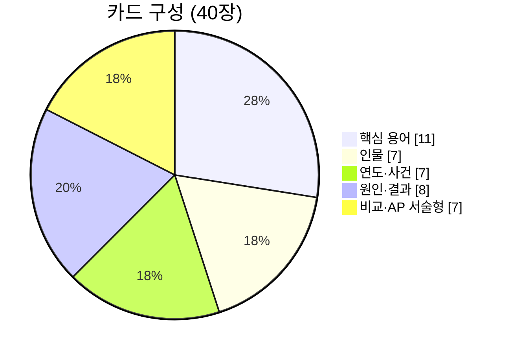

# AP 세계사: 모던 — 토픽 1.3 남아시아와 동남아시아의 발전, c. 1200–1450 (Developments in South and Southeast Asia from c. 1200 to c. 1450) · 플래시카드

> 출처: College Board CED 기준 · 교재 반영 (교재 Topic 1.3)

---

## 1. 핵심 용어

- [ ] **힌두교에서 다르마 (Dharma), 카르마 (Karma), 해탈 (Moksha)은 무슨 뜻인가?**

▶ 정답
다르마는 사람의 삶의 위치와 카스트에 맞는 의무다. 카르마는 행위가 다음 생을 결정한다는 생각이다. 해탈은 윤회 (Samsara)의 순환에서 벗어나는 것이다.

- [ ] **카스트 제도에서 바르나 (Varna)와 자티 (Jati)란 무엇인가?**

▶ 정답
바르나는 네 가지 큰 신분으로, 브라만(사제), 크샤트리아(전사와 통치자), 바이샤(상인과 농민), 수드라(노동자)이다. 자티는 대개 직업과 연결된 출생 집단으로, 사람들은 같은 자티 안에서 결혼했다. "불가촉민" 집단(달리트 (Dalit))은 바르나 바깥에 놓였다.

- [ ] **사성제 (Four Noble Truths)란 무엇인가?**

▶ 정답
삶은 고통이다, 고통은 욕망에서 온다, 고통은 끝낼 수 있다, 팔정도 (Eightfold Path)가 고통을 끝낸다는 네 가지 진리다. 목표는 열반 (Nirvana)이다.

- [ ] **불교 수도원 제도 (Buddhist monasticism)란 무엇인가?**

▶ 정답
승려와 비구니가 공동체(승가 (Sangha))를 이루어 재산을 버리고 공부하며 명상하는 생활이다. 왕은 수도원에 땅을 주었고, 평신도는 공덕을 쌓으려고 선물을 바쳤다. 수도원은 학문의 중심지였다. 교재에 따르면 스리랑카에서는 수도원과 비구니 사찰 (Nunnery)이 번성했고, 남성과 여성 모두 명상하는 삶을 택했으며, 불교 승려들이 자주 군주에게 조언했다.

- [ ] **상좌부 불교 (Theravada Buddhism)란 무엇이며, c. 1200–1450년 어디에서 강했는가?**

▶ 정답
가장 오래된 경전을 따르는 불교 종파다. 스리랑카에서 강했고, 그곳에서 버마, 태국, 캄보디아로 퍼졌다.

- [ ] **박티 운동 (Bhakti movement)이란 무엇이었는가?**

▶ 정답
경전 공부나 의식 대신 감정을 중시하며 한 신(주로 비슈누, 크리슈나, 시바)에 대한 강렬하고 개인적인 헌신을 강조한 힌두교 운동이다. 카스트 위계를 거부했고, 여성과 낮은 신분의 사람에게도 열려 있었으며, 산스크리트어 대신 토착어로 된 시와 노래를 사용했다. 교재는 이 운동이 12세기 남인도에서 시작되었다고 쓴다. 많은 설명에서는 그 뿌리를 6–9세기 타밀의 알와르와 나야나르에서 찾는다.

- [ ] **수피즘 (Sufism)이란 무엇인가?**

▶ 정답
이슬람의 신비주의 갈래다. 수피는 기도, 시, 음악, 춤을 통해 신을 개인적으로 체험하려 했다. 그들은 남아시아와 동남아시아에서 이슬람을 퍼뜨린 가장 중요한 선교자였다.

- [ ] **지즈야 (Jizya)란 무엇이었는가?**

▶ 정답
무슬림 통치 아래에서 비무슬림이 내는 세금이다. 델리 술탄국에서 비무슬림은 지즈야를 내고 보호받는 사람으로 대우받았다. 교재는 모든 비무슬림 신민에게 걷은 지즈야 때문에 많은 힌두교도가 무슬림을 원망하고 외국인으로 여겼다고 쓴다.

- [ ] **혼합주의 (Syncretism)란 무엇인가? 남아시아의 예를 하나 들어라.**

▶ 정답
서로 다른 전통의 신앙이 섞이는 것이다. 예: 카비르는 힌두교 박티와 이슬람 수피의 생각을 섞어, 신을 라마라고 부르든 알라라고 부르든 신은 하나라고 가르쳤다. 또 다른 예: 카슈미르의 힌두교 시인 랄 데드는 많은 수피에게 존경받았다.

- [ ] **포교 (Proselytize)란 무엇이며, 이슬람을 왜 보편 종교 (Universalizing religion)라고 하는가?**

▶ 정답
포교는 적극적으로 개종자를 찾는 것이다. 이슬람이나 불교 같은 보편 종교는 모든 민족에게서 개종자를 찾는다. 교재에 따르면 인도의 무슬림 통치자들은 힌두교도와 불교도에게 개종을 강요하는 것이 효과가 없다는 것을 알게 되었고, 그래서 대부분의 개종은 자발적이었다.

- [ ] **쿠트브 미나르 (Qutb Minar), 우르두어 (Urdu), "아라비아 숫자 (Arabic numerals)"는 남아시아의 문화 교류에 대해 무엇을 보여 주는가?**

▶ 정답
쿠트브 미나르(교재: Qutub Minar)는 델리 술탄국의 통치자들이 힌두 사원 위에 세운 모스크 위로 솟은 델리의 거대한 탑으로, 이슬람의 영향력을 상징했다. 우르두어는 힌디어 문법에 아랍어와 일부 페르시아어(파르시어 (Farsi)) 어휘를 결합한 언어로, 오늘날 파키스탄의 공용어다. "아라비아 숫자"는 사실 인도에서 시작되었고, 인도의 대수학과 기하학은 아랍어 번역을 통해 퍼졌다. (교재는 쿠트브 미나르를 인도에서 가장 높은 구조물이라고 쓰지만, 많은 설명에서는 세계에서 가장 높은 벽돌 미나레트로 소개한다. 또 많은 설명에서는 우르두어의 외래어가 대부분 페르시아어라고 본다.)

## 2. 인물

- [ ] **카비르 (Kabir)는 누구인가?**

▶ 정답
바라나시 출신의 15세기 직조공 시인이다(생몰 연도는 논란이 있다). 힌두교와 이슬람의 생각을 섞었고, 두 종교의 형식적인 의식을 비판했으며, 힌디어로 시를 썼다. 박티와 혼합주의의 대표적인 예이다.

- [ ] **미라바이 (Mirabai)는 누구인가?**

▶ 정답
크리슈나를 섬긴 라지푸트 공주(c. 1498–1547)이자 유명한 여성 박티 시인이다. 교재("Mira Bai"로 표기)는 그녀를 16세기에 살았던 가장 유명한 박티 인물 중 하나로 소개한다. 1450년 이후의 인물이므로, 박티가 계속 영향을 미쳤고 여성에게 열려 있었음을 보여 준다.

- [ ] **모이누딘 치슈티 (Moinuddin Chishti)는 누구인가?**

▶ 정답
아지메르에 정착한 치슈티 교단 (Chishti order)의 수피 성자다(1236년 사망). 그의 성묘에는 무슬림과 힌두교도가 함께 찾아왔고, 인도에 이슬람이 퍼지는 데 도움을 주었다.

- [ ] **티무르 (Timur)는 누구이며, 1398년에 무엇을 했는가?**

▶ 정답
중앙아시아 출신의 튀르크-몽골계 정복자다(타메를란 (Tamerlane)이라고도 한다). 1398년 델리를 약탈했고, 델리 술탄국은 완전히 회복하지 못했다.

- [ ] **자야바르만 7세 (Jayavarman VII)는 누구인가?**

▶ 정답
대승 불교도였던 크메르 왕(재위 1181–c. 1218)이다. 앙코르 톰과 바욘 사원, 그리고 도로, 숙소, 병원을 세웠고, 크메르 제국을 불교 쪽으로 이끌었다.

- [ ] **가자 마다 (Gajah Mada)는 누구인가?**

▶ 정답
14세기 마자파힛의 재상이다. 군도 통일을 맹세했고, 하얌 우룩 왕과 함께 마자파힛을 전성기로 이끌었다. 교재에 따르면 마자파힛은 전성기에 98개의 조공국을 거느렸다.

- [ ] **랄 데드 (Lal Ded)는 누구인가?**

▶ 정답
랄라 어머니 (Mother Lalla)로 불린 랄 데드(1320–1392)는 북인도 카슈미르 출신의 힌두교 시인이다. 개인적 체험을 강조해 많은 무슬림, 특히 수피에게 호소력이 있었다. 교재는 힌두교와 이슬람 전통의 상호작용을 보여 주려고 그녀의 시로 토픽 1.3을 시작한다.

## 3. 연도·사건

- [ ] **550년**

▶ 정답
굽타 왕조 (Gupta Dynasty)가 무너지면서 인도의 고전 "황금시대"가 끝났다. 이후 약 1,000년 동안 대부분 분열이 이어졌다. 북인도와 남인도는 서로 다른 정치 구조를 발전시켰고, 북쪽에서는 서로 경쟁하는 라지푸트 씨족 왕국들이 점차 생겨났다.

- [ ] **1206년**

▶ 정답
쿠트브 알딘 아이바크가 북인도에 델리 술탄국 (Delhi Sultanate)을 세웠다. 교재에 따르면 이슬람 세력은 13세기 초 델리를 정복했고, 술탄국은 약 300년 동안 다스렸다.

- [ ] **1293년**

▶ 정답
라덴 위자야가 몽골(원나라) 군대를 이용한 뒤 몰아내고 자와에 마자파힛 (Majapahit)을 세웠다. 교재는 마자파힛을 1293–1520년으로 본다. 다른 설명은 멸망을 c. 1478년 또는 c. 1527년으로 본다.

- [ ] **1336년**

▶ 정답
하리하라와 부카 형제가 남인도에 힌두 국가인 비자야나가르 제국 (Vijayanagara Empire, "승리의 도시")을 세웠다. 교재에 따르면 델리 술탄국이 이 형제를 남쪽으로 보냈고, 힌두교도로 태어난 형제는 신분 상승을 위해 이슬람으로 개종했다가 델리에서 벗어나자 힌두교로 돌아갔다. 많은 학자는 이것을 논란이 있는 전승으로 본다.

- [ ] **c. 1400년**

▶ 정답
말라카 해협에 말라카 (Malacca)가 세워졌다. 곧 그 통치자가 이슬람으로 개종했다 (2.3 참고).

- [ ] **c. 1431년**

▶ 정답
타이 세력이 앙코르를 차지했고, 크메르의 수도가 남쪽으로 옮겨 갔다 (전통적인 연도). 교재는 수코타이 왕국 (Sukhothai Kingdom)의 타이인들이 크메르인을 몰아냈다고 쓴다. 많은 설명에서는 수코타이를 속국으로 만든 태국 왕국 아유타야 (Ayutthaya)였다고 본다.

- [ ] **1526년**

▶ 정답
바부르가 파니파트에서 마지막 로디 술탄을 물리쳤다. 델리 술탄국이 끝나고 무굴 제국이 시작되었다. 교재는 무굴의 지도자들이 몽골에서 조상을 찾았다고 덧붙인다.

## 4. 원인·결과

- [ ] **원인 → 결과: 스리위자야 (Srivijaya)가 부유하고 강해진 이유는?**

▶ 정답
인도와 중국을 오가는 배들이 몬순 바람을 기다리던 말라카 해협을 장악했기 때문이다. 교재에 따르면 스리위자야는 해군을 키웠고, 인도와 중국 사이를 오가는 배에 통행료를 걷었다. 또 해적을 누르고 중국에 조공을 보냈다. 그래서 교역의 부가 스리위자야의 항구로 모였다.

- [ ] **원인 → 결과: 수피는 남아시아와 동남아시아에 이슬람을 어떻게 퍼뜨렸는가?**

▶ 정답
수피는 평범한 사람들 속에서 살았고, 누구에게나 열린 성묘를 세웠으며, 지역 언어와 음악을 사용했다. 신에 대한 사랑과 영적 평등이라는 메시지가 많은 사람에게 호소력이 있었다. 교재는 동남아시아의 수피가 지역 신앙에 관용적이어서, 개종자가 무슬림이 되어도 지역의 신들을 계속 섬길 수 있었다고 덧붙인다. 이슬람은 점진적이고 대부분 평화로운 개종을 통해 퍼졌다.

- [ ] **원인 → 결과: 박티 운동은 인도 사회에 어떤 영향을 주었는가?**

▶ 정답
누구나 헌신으로 신에게 다가갈 수 있다고 가르쳐 카스트 위계에 도전했고, 여성과 낮은 카스트에게 종교를 열었다. 또한 토착어 문학을 낳았고, 무슬림 통치 아래에서도 힌두교가 강하게 남도록 도왔다. 교재는 수피가 이슬람을 퍼뜨린 것처럼 박티 신자들이 힌두교를 퍼뜨렸다고 쓴다.

- [ ] **원인 → 결과: 델리 술탄국은 힌두교도 다수를 어떻게 다스렸으며, 무엇이 그 힘을 제한했는가?**

▶ 정답
무슬림 소수였던 술탄국은 기병 군대와 세금(비무슬림에 대한 지즈야 포함)에 의존했고, 많은 힌두 지방 세력이 지역 권력을 유지하게 했다. 그 덕분에 300년 넘게 이어졌다. 교재는 그 한계를 강조한다. 중국식의 효율적인 관료제를 만들지 못해 지역 왕국들이 계속 큰 역할을 했고, 지즈야 때문에 많은 힌두교도가 무슬림을 원망했으며, 몽골을 막느라 남쪽으로의 팽창이 멈추었다.

- [ ] **원인 → 결과: 관개는 크메르의 권력을 어떻게 뒷받침했는가?**

▶ 정답
거대한 저수지(바라이 (Baray))와 운하가 벼농사에 쓸 물을 저장했다. 교재에 따르면 관개 덕분에 1년에 여러 번 벼를 수확할 수 있었고, 배수 시설이 몬순 비의 피해를 줄여 크메르는 동남아시아에서 가장 부유한 왕국 중 하나가 되었다. 남는 쌀이 많은 인구를 먹이고 세금으로 걷혔다. 왕들은 그 노동력과 부로 앙코르에 사원을 지어 정당성을 보여 주었다. 스리랑카의 싱할라 왕들도 탱크 (Tank)라는 비슷한 저수지를 사용했다.

- [ ] **원인 → 결과: 불교가 인도에서는 쇠퇴했지만 스리랑카와 동남아시아에서는 살아남은 이유는?**

▶ 정답
인도에서는 힌두교 신앙이 불교의 많은 생각을 흡수했고, 습격으로 날란다 같은 수도원이 파괴되었다. 교재는 승려들의 부패로 불교가 혼란에 빠졌다고 덧붙이며, 이슬람으로 개종한 사람 중 가장 많은 수가 불교도였다고 쓴다(많은 설명에서는 정복 이전에 이미 불교가 줄어들고 있었다고 본다). 스리랑카와 동남아시아에서는 왕들이 수도원을 보호하고 지원했으며, 승려들이 상좌부 불교를 퍼뜨렸다.

- [ ] **원인 → 결과: 크메르 제국이 15세기에 쇠퇴한 이유는?**

▶ 정답
타이 세력과의 전쟁, 수리 시설의 부담, 왕실 사원이 덜 필요한 상좌부 불교로의 전환이 왕권을 약하게 했다. 1431년 타이 세력이 앙코르를 차지했고, 수도는 남쪽으로 옮겨 갔다. 교재는 수코타이 왕국을 들지만, 많은 설명에서는 아유타야로 본다.

- [ ] **원인 → 결과: 남아시아 사람들은 왜 이슬람으로 개종했으며, 개종은 사회를 얼마나 바꾸었는가?**

▶ 정답
교재에 따르면 대부분의 개종은 자발적이었다. 무슬림 상인이 항구 도시에 정착하면 그 아내가 흔히 개종했고, 낮은 카스트의 힌두교도는 신자의 평등을 강조하는 이슬람에 끌렸다. 그러나 변화는 제한적이었다. 낮은 카스트 개종자는 대개 신분을 높이지 못했고, 유연한 카스트 제도(인도의 가장 강한 연속성)는 무슬림을 직업에 따른 하위 카스트 (Subcaste)로 흡수했으며, 이슬람은 젠더 관계를 크게 바꾸지 않았다.

## 5. 비교·AP 서술형

- [ ] **비교: 스리위자야와 마자파힛의 공통점과 차이점은?**

▶ 정답
공통점: 둘 다 해군으로 바닷길과 인도양 교역을 장악한 해양 국가였다. 차이점: 스리위자야(수마트라)는 주로 불교 국가였고, 해협을 지나는 배에서 걷는 돈에 거의 전적으로 의존했다. 마자파힛(자와)은 힌두-불교 국가였고, 전성기에 98개의 조공국을 거느렸으며, 해상 권력과 벼농사를 함께 활용했다. 1.3 교재는 스리위자야를 "주로 불교 왕국"으로, 마자파힛을 "힌두 왕국(그러나 불교의 영향이 강함)"으로 설명하지만, 2.5 교재는 반대로 쓴다.

- [ ] **비교: 육상 기반 국가와 해상 기반 국가는 권력을 어떻게 유지했는가?**

▶ 정답
육상 기반 국가(크메르, 비자야나가르, 라지푸트, 싱할라)는 농업, 관개, 군대, 요새, 사원에 의존했다. 해상 기반 국가(스리위자야, 마자파힛)는 해군, 해협과 항구 장악, 지방 통치자와의 동맹, 교역에 대한 세금에 의존했다.

- [ ] **비교: 박티 운동과 수피즘의 공통점과 차이점은?**

▶ 정답
공통점: 교재는 둘 다 내면의 성찰로 신과 직접적이고 개인적인 관계를 맺으려 한 신비주의 운동이라고 설명한다. 둘 다 의식보다 신에 대한 사랑을 강조했고, 시와 노래를 사용했으며, 자기 전통 밖의 사람들에게도 호소력이 있었고, 혼합주의로 이어졌다(카비르, 이후의 시크교). 차이점: 박티는 힌두교에서 나와 한 힌두 신에 집중했고, 수피즘은 이슬람에서 나와 개종을 통해 이슬람을 퍼뜨렸다.

- [ ] **비교: 교재에 따르면 힌두교와 이슬람은 어떻게 달랐는가?**

▶ 정답
힌두교도는 여러 신에게 기도했지만, 이슬람은 엄격한 유일신교 (Monotheism)다. 힌두 사원과 예술품에는 신의 모습이 가득했지만, 무슬림은 알라를 시각적으로 표현하는 것을 허용하지 않는다. 힌두교는 위계적인 카스트 제도와 연결되었지만, 이슬람은 모든 신자의 평등을 요구한다. 힌두교도는 여러 경전을 인정하지만, 무슬림은 주로 꾸란을 따른다.

- [ ] **AP 단답형: c. 1200–1450년 남아시아에서 신앙 체계가 사회에 영향을 준 방식 하나를 설명하라.**

▶ 정답

**주장:** 박티 운동은 남아시아 사회의 카스트 제도에 도전했다. 
**근거:** 카비르 같은 박티 시인 성자들은 누구나 개인적 헌신으로 신에게 다가갈 수 있다고 가르쳤고, 산스크리트어 대신 토착어로 시를 썼다. 
**설명:** 헌신에는 브라만 사제나 값비싼 의식이 필요 없었다. 그래서 종교가 여성과 낮은 카스트에게 열렸고, 카스트 제도는 계속되었지만 카스트 위계의 종교적 근거는 약해졌다.

- [ ] **AP 단답형: c. 1200–1450년 동남아시아 국가가 권력을 유지한 방식 하나를 설명하라.**

▶ 정답

**주장:** 스리위자야는 말라카 해협을 통한 해상 교역을 장악해 권력을 유지했다. 
**근거:** 스리위자야는 해군을 키웠고, 인도와 중국 사이를 오가는 배에 통행료를 걷었으며, 해적을 누르고 중국에 조공 사절을 보냈다. 
**설명:** 인도와 중국 사이의 좁은 바닷길을 장악하자 꾸준한 교역의 부가 들어왔다. 스리위자야는 이 부로 지방 통치자들의 충성을 유지하고 불교 수도원을 지원해 이 지역의 종교 중심지가 되었다.

- [ ] **AP 논술형 논지: c. 1200–1450년 남아시아와 동남아시아에서 종교가 국가 형성에 어느 정도 영향을 주었는지 평가하라.**

▶ 정답

**주장:** 종교는 국가가 권력을 정당화하는 방식에 큰 영향을 주었지만, 권력을 유지하는 방식은 교역과 관개 같은 경제적 기반이 결정했다. 
**근거:** 크메르 왕들은 앙코르의 사원을 힌두 예술과 이후의 불교 예술로 채웠고, 싱할라 왕들은 불교 수도원을 보호했으며, 비자야나가르는 힌두 국가로 자신을 내세웠다. 그러나 스리위자야의 힘은 말라카 해협을 지나는 배에 대한 세금에서 나왔고, 크메르의 힘은 관개 벼농사에 기반을 두었다. 
**설명:** 종교는 통치자에게 정당성과 충성스러운 백성을 주었다. 하지만 군대를 유지하고 기념물을 세우려면 교역이나 농업에서 나오는 꾸준한 부가 필요했다. 그래서 종교와 경제는 함께 작용했다.

