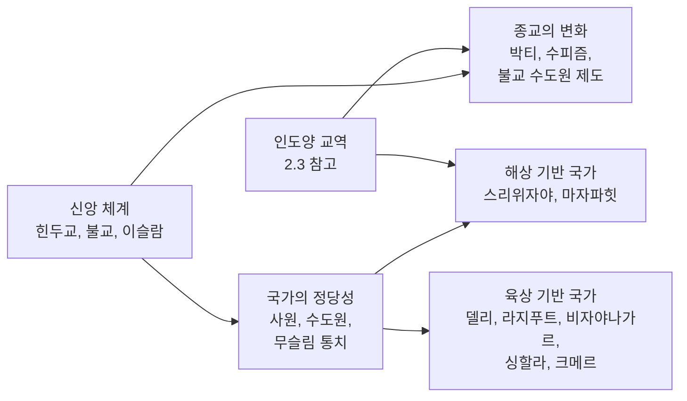
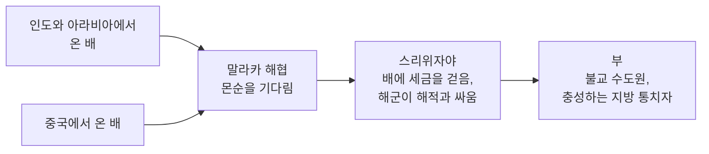
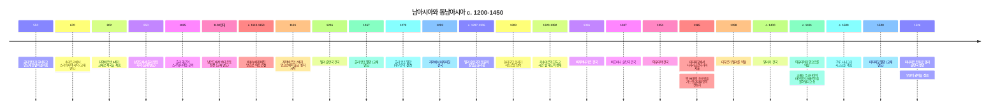
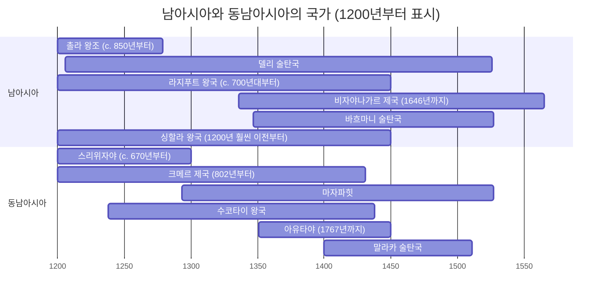
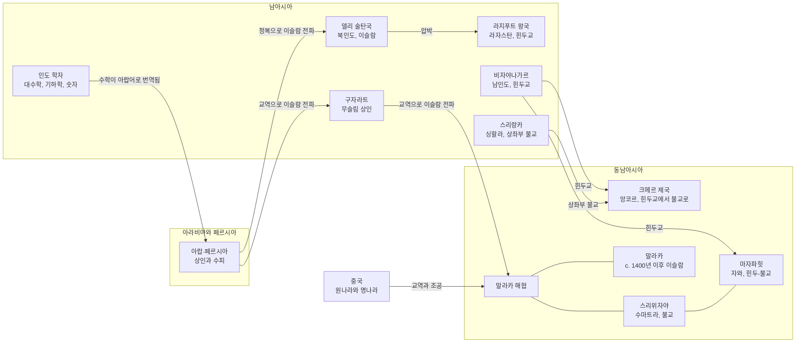
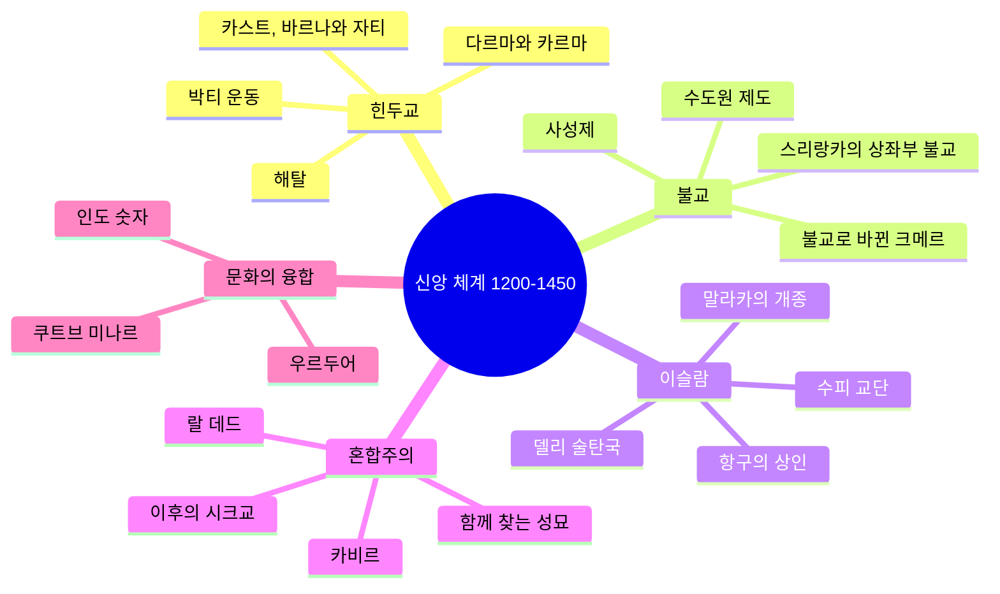

# AP 세계사: 모던 — 토픽 1.3 남아시아와 동남아시아의 발전, c. 1200–1450 (Developments in South and Southeast Asia from c. 1200 to c. 1450)

**Focus Question (교재 Essential Question):** 남아시아와 동남아시아의 다양한 신앙과 관습은 사회와 국가의 발전에 어떤 영향을 주었는가?

> 출처: College Board CED 기준 · 교재 반영 (교재 Topic 1.3)

**Unit 1: 세계의 태피스트리 (The Global Tapestry, c. 1200–1450)**

---

## 학습 목표 (Learning Objectives)

| 코드 | 학습 목표 |
|---|---|
| 1.3 LO-A (CDI) | 남아시아와 동남아시아의 다양한 신앙 체계와 관습이 시간에 따라 사회에 어떤 영향을 주었는지 설명하라. |
| 1.3 LO-B (GOV) | 남아시아와 동남아시아의 여러 국가가 시간에 따라 어떻게, 그리고 왜 권력을 키우고 유지했는지 설명하라. |

## 역사적 개념 (Historical Developments, CED)

| # | 역사적 개념 | LO | 다루는 곳 |
|---|---|---|---|
| HD1 (KC-3.1.III.D.v) | 힌두교 (Hinduism), 이슬람 (Islam), 불교 (Buddhism)와 그 핵심 신앙과 관습은 남아시아와 동남아시아 사회를 계속 형성했다. | A | §1, §2, §3, §4 |
| HD1 예시 | 박티 운동 (Bhakti movement) | A | §3 |
| HD1 예시 | 수피즘 (Sufism) | A | §4 |
| HD1 예시 | 불교 수도원 제도 (Buddhist monasticism) | A | §2, §6 |
| HD2 (KC-3.2.I.A.iv) | 남아시아와 동남아시아의 국가 형성과 발전은 연속성, 혁신, 다양성을 보여 주었다. 새로운 힌두교 국가와 불교 국가가 등장한 것도 그 예이다. | B | §5, §6, §7, §8, §9 |
| HD2 예시 | 비자야나가르 제국 (Vijayanagara Empire) | B | §5 |
| HD2 예시 | 스리위자야 제국 (Srivijaya Empire) | B | §7 |
| HD2 예시 | 라지푸트 왕국 (Rajput kingdoms) | B | §5 |
| HD2 예시 | 크메르 제국 (Khmer Empire) | B | §8 |
| HD2 예시 | 마자파힛 (Majapahit) | B | §7 |
| HD2 예시 | 싱할라 왕조 (Sinhala dynasties) | B | §6 |

---

## 큰 그림 요약

> "책이 가르쳐 준 것은 실천했다. / 책이 가르쳐 주지 않은 것은 스스로 깨우쳤다. / 나는 숲에 들어가 사자와 씨름했다. / 한 가지를 가르치면서 다른 일을 하며 여기까지 온 것이 아니다."
> — 랄 데드 (Lal Ded) (1320–1392)

**랄 데드 (Lal Ded)**는 **랄라 어머니 (Mother Lalla)**로 불렸으며, 북인도 **카슈미르 (Kashmir)** 출신의 힌두교 시인이었다. 그녀가 개인적 **체험**을 강조한 점은 많은 무슬림, 특히 **수피**에게 호소력이 있었다. 그녀의 시는 이 지역을 형성한 **종교 전통 사이의 상호작용**을 보여 준다. 힌두교도와 무슬림의 접촉은 때로 폭력적이었지만, 종교 사상, 정치, 경제, 예술, 건축에서 새로운 발전을 낳았다. **550년** **굽타 왕조 (Gupta Dynasty)**가 무너진 뒤 남아시아는 거의 통일되지 못했다. **힌두교**는 이 지역에 문화적 통일성을 주었고, 지역 힌두 왕국들은 **분권적인 (Decentralized)** 정치 지형에서 계속 큰 역할을 했다.

1200–1450년 남아시아와 동남아시아는 세 신앙 체계의 영향을 받았다. **힌두교 (Hinduism)**는 **다르마 (Dharma)**, **카르마 (Karma)**, **카스트 제도 (Caste system)**로 사회를 조직했다. **불교 (Buddhism)**는 인도에서는 약해졌지만, **스리랑카**와 동남아시아 대륙부에서는 **수도원 (Monastery)**을 통해 강하게 남았고, 그곳에 **상좌부 불교 (Theravada)**가 퍼졌다. **이슬람 (Islam)**은 두 가지 길로 들어왔다. 북쪽에서는 **정복**(**델리 술탄국 (Delhi Sultanate)**, 1206–1526)을 통해, 인도양 항구에서는 **상인과 수피 (Sufi)**를 통해 들어왔다. 이 신앙들은 서로 영향을 주고받았다. **박티 운동 (Bhakti movement)**은 힌두교 신앙을 모든 카스트와 여성에게 열었고, **수피즘 (Sufism)**은 이슬람을 평범한 사람들에게 친근하게 만들었다. 국가들은 **연속성**(힌두교·불교 왕권), **혁신**(힌두교도 다수를 다스린 무슬림 통치), **다양성**을 보여 주었다. **크메르 제국 (Khmer Empire)**, **비자야나가르 (Vijayanagara)**, **라지푸트 왕국 (Rajput kingdoms)** 같은 **육상 기반 국가 (Land-based state)**는 농업, 군대, 사원에서 힘을 얻었다. **스리위자야 (Srivijaya)**와 **마자파힛 (Majapahit)** 같은 **해상 기반 국가 (Sea-based state)**는 인도양 교역을 장악해 힘을 얻었다 (2.3 참고).

---

## §1. 핵심 신앙: 힌두교, 불교, 이슬람

| 신앙 체계 | 핵심 신앙 | 주요 관습 | c. 1200–1450년 사회에 준 영향 |
|---|---|---|---|
| **힌두교 (Hinduism)** | **다르마 (Dharma)**(삶의 위치에 맞는 의무), **카르마 (Karma)**(행위가 다음 생을 결정함), **윤회 (Samsara)**(다시 태어나는 순환), **해탈 (Moksha)**(순환에서 벗어남). 여러 신을 하나의 궁극적 실재인 **브라흐만 (Brahman)**의 여러 모습으로 봄 | 사원 예배, **브라만 (Brahmin)** 사제가 이끄는 의식, 순례, **비슈누 (Vishnu)**와 **시바 (Shiva)** 같은 신에 대한 숭배 | 인도의 다수 종교. **카스트 제도**를 뒷받침함. 힌두 왕들은 정당성을 보여 주려고 사원을 세움 |
| **불교 (Buddhism)** | **사성제 (Four Noble Truths)**(삶은 고통이다, 고통은 욕망에서 온다, 고통은 끝낼 수 있다, **팔정도 (Eightfold Path)**가 고통을 끝낸다). 목표는 **열반 (Nirvana)** | **수도원 제도 (Monasticism)**(**승가 (Sangha)**의 승려와 비구니). 평신도는 승려에게 시주해 공덕을 쌓음 | 인도에서는 쇠퇴. 스리랑카와 동남아시아에서는 번성함 (§2 참고) |
| **이슬람 (Islam)** | 유일신 **알라 (Allah)**. 무함마드는 마지막 예언자. 모든 신자는 신 앞에서 평등함 | **다섯 기둥 (Five Pillars)**, **꾸란 (Quran)**, 이슬람법 **샤리아 (Sharia)** | 델리 술탄국의 지배 종교. 상인과 **수피**를 통해 교역로를 따라 퍼짐 (§4 참고) |

### 힌두교와 이슬람: 교재의 비교

- 이슬람이 들어오기 전 남아시아 사람 대부분은 **힌두교**를 믿었고, 그보다 적은 수가 **불교도**였다. 이슬람은 **매우 다른** 종교였다.

| 항목 | 힌두교 | 이슬람 |
|---|---|---|
| 신 | 힌두교도는 **여러 신**에게 기도함 | 엄격한 **유일신교 (Monotheism)** |
| 형상 | 사원과 예술품에 **신의 모습**이 가득함 | 무슬림은 **알라를 시각적으로 표현하는 것**을 허용하지 않음 |
| 사회 질서 | **위계적인 카스트 제도**와 연결됨 | **모든 신자의 평등**을 요구함 |
| 경전 | 여러 경전을 인정함 | 주로 **꾸란**을 따름 |

### 카스트 제도

- 힌두 사회는 네 **바르나 (Varna)**로 나뉘었다. **브라만 (Brahmin)**(사제), **크샤트리아 (Kshatriya)**(전사와 통치자), **바이샤 (Vaishya)**(상인과 농민), **수드라 (Shudra)**(노동자와 하인)이다.
- "불가촉민"으로 여겨진 집단(오늘날의 **달리트 (Dalit)**)은 바르나 체계 **바깥**에 놓였다.
- 일상생활에서 사람들은 **자티 (Jati)**에 속했다. 자티는 대개 직업과 연결된 출생 집단이다. 사람들은 같은 자티 안에서 결혼했다.
- 카르마와 다르마는 카스트를 **정당화**했다. 어떤 신분으로 태어난 것은 전생의 행위 때문이라고 보았고, 자기 의무를 다하면 더 나은 신분으로 다시 태어날 수 있다고 믿었다.
- 카스트 제도는 강한 **연속성**을 보였다. 이후의 운동(박티, 수피즘)이 카스트에 **도전**했지만 없애지는 못했다.
- 교재는 카스트를 **인도의 가장 강한 역사적 연속성**이라고 부른다. 카스트는 불평등했지만, 정치적으로 분권화된 땅에 **안정**을 주었다.
- 카스트는 새로 온 사람들을 받아들일 만큼 **유연했다**. **무슬림 상인과 이주민**은 **직업**에 따라 위계 안에서 자리를 찾았다. 직업에 바탕을 둔 이 **하위 카스트 (Subcaste)**는 **동업 조합 (Guild)**처럼 움직였고, 인도 사회의 일부가 되었다.
- 이슬람의 도래는 기본적인 사회 구조를 **거의 바꾸지 못했다**. 신분을 높이려고 이슬람으로 개종한 **낮은 카스트의 힌두교도**는 **대개 뜻을 이루지 못했다**. 그들에게는 새 종교만이 아니라 더 많은 교육과 더 나은 일자리가 필요했다.
- **연결 (교재 Connect):** 카스트 제도를 1200–1450년 중국의 사회 구조와 비교하라 (1.1 참고).

### 젠더 관계

- 이슬람은 **젠더 관계 (Gender relations)를 크게 바꾸지 않았다**. 개종자들은 개종 전의 문화에 따라 이슬람의 가르침을 적용했다.
- **남아시아**에서 힌두 여성은 **분리된 사회 영역**에 갇혀 있었고, 무슬림 여성도 비슷한 대우를 받았다.
- **동남아시아**에서는 이슬람 이전에 여성이 **더 많은 독립성**을 누렸고, 사람들이 무슬림이 된 뒤에도 이 양상이 **이어졌다**.
- 개종자들은 **자신의 전통을 버리지 않고** 새 신앙을 받아들이는 방법을 찾았다.

## §2. 불교 수도원 제도와 불교 중심지의 이동

- **불교 수도원 제도 (Buddhist monasticism)**는 승려와 비구니가 공동체(**승가 (Sangha)**)를 이루어 사는 것이다. 그들은 재산을 버리고 경전을 공부하며 명상했다.
- 수도원은 **학문**, **교육**, **토지 소유**의 중심지였다. 왕은 수도원에 땅을 주었고, 평신도는 **공덕 (Merit)**을 쌓으려고 음식과 선물을 바쳤다.
- 인도에서는 불교가 **쇠퇴**했다. 힌두교 신앙(박티 포함)이 불교의 많은 생각을 흡수했고, 튀르크계의 정복 과정에서 **날란다 (Nalanda)** 같은 큰 수도원 대학이 파괴되었다.
- 교재는 **승려들의 부패**와 초기 무슬림 정복자들의 **수도원 습격**으로 불교가 **혼란에 빠졌다**고 덧붙인다. 교재에 따르면 **이슬람으로 개종한 사람 중 가장 많은 수는 불교도**였고, 이슬람의 확산은 불교를 **탄생지에서 소수 종교**로 만드는 데 영향을 주었다.

> ⚠️ 교재는 남아시아에서 이슬람으로 개종한 사람 중 가장 많은 수가 불교도였다고 쓴다. 많은 설명에서는 무슬림의 정복 이전에 이미 인도 대부분 지역에서 불교가 줄어들고 있었다고 보며, 누가 왜 개종했는지는 학자들 사이에 논란이 있다. 선생님이 어떻게 가르치는지 확인이 필요하다.

> ⚠️ 확인 필요: 날란다의 파괴는 보통 c. 1193–1200년으로, 바크티야르 할지 (Bakhtiyar Khalji)의 군대와 연결된다. 정확한 연도와 이곳이 얼마나 빨리 버려졌는지는 자료마다 다르다. 교재는 "수도원 습격"만 언급하고 날란다의 이름은 쓰지 않는다.

- 불교는 인도 밖에서 **살아남아 성장**했다. **상좌부 불교 (Theravada)**는 12–14세기에 승려들을 통해 **스리랑카**에서 **버마**(파간), **태국**(수코타이, 아유타야), **캄보디아**(크메르 제국)로 퍼졌다.

| 종파 | 핵심 생각 | c. 1200–1450년 주요 지역 |
|---|---|---|
| **상좌부 불교 (Theravada)** ("장로들의 길") | 가장 오래된 경전을 따름. 승려가 열반을 향해 수행하는 것을 강조함 | 스리랑카, 버마, 태국, 캄보디아 |
| **대승 불교 (Mahayana)** ("큰 수레") | 다른 사람의 열반을 돕는 **보살 (Bodhisattva)**을 강조함 | 중국, 한국, 일본, 베트남. 이전에는 스리위자야와 앙코르 |

## §3. 박티 운동

- **박티 (Bhakti)**는 "헌신"이라는 뜻이다. 이 운동은 **한 신에 대한 강렬하고 개인적인 사랑**을 가르쳤다. 대상은 주로 **비슈누 (Vishnu)**(또는 그 화신인 **크리슈나 (Krishna)**)나 **시바 (Shiva)**였다.
- 박티는 **남인도**의 타밀 시인 성자들(**알와르 (Alvars)**와 **나야나르 (Nayanars)**, c. 6–9세기)에게서 시작되어 12–15세기에 북쪽으로 퍼졌다.
- **교재의 설명:** **12세기**부터 일부 힌두교도는 영적 생활에서 **감정**이 중요하다는 전통적 가르침을 끌어왔다. 그들은 경전 공부나 의식 대신 **특정한 한 신**에 대한 강한 애착을 키웠다. 이 운동은 **남인도**에서 시작되었다.

> ⚠️ 교재는 박티 운동의 시작을 12세기로 본다. 많은 설명에서는 그 뿌리를 6–9세기 타밀의 알와르와 나야나르에서 찾고, 12세기부터 북쪽으로 퍼졌다고 본다. 선생님이 어떻게 가르치는지 확인이 필요하다.

- 주요 특징:
  - **카스트 위계를 거부**했다. 브라만 사제나 값비싼 의식 없이도 누구나 헌신으로 신에게 다가갈 수 있다고 보았다.
  - **여성**과 낮은 카스트에게도 **열려 있었다**.
  - **산스크리트어 (Sanskrit)** 대신 타밀어, 칸나다어, 마라티어, 힌디어 같은 **토착어 (Vernacular)**를 써서 평범한 사람도 이해할 수 있었다.
  - **시와 노래**로 퍼졌다.
- **사회에 준 영향:** 박티는 힌두교를 더 개인적이고 대중적인 종교로 만들었고, 카스트에 도전했으며, 무슬림 통치 아래에서도 힌두교가 강하게 남도록 도왔다. 또한 풍부한 **토착어 문학**을 낳았다.
- **박티와 수피즘 (교재):** 둘 다 **내면의 성찰**을 통해 신과 직접적이고 개인적인 관계를 맺으려 한 **신비주의 운동 (Mystical movement)**이었다. 엄격한 의식과 교리를 덜 강조했기 때문에 둘 다 **자기 전통 밖의 사람들에게도 호소력**이 있었다. **수피가 이슬람을 퍼뜨린** 것처럼 **박티 신자들은 힌두교를 퍼뜨렸다**.

| 인물 | 시기 | 지역 | 의의 |
|---|---|---|---|
| **알와르와 나야나르 (Alvars and Nayanars)** | c. 6–9세기 | 남인도 타밀 지역 | 비슈누(알와르)와 시바(나야나르)를 섬긴 초기 박티 시인 성자들 |
| **바사바 (Basava)** | 12세기 | 카르나타카 (남인도) | 시바를 섬기는 **링가야트 (Lingayat)** 운동을 이끎. 카스트를 거부함 |
| **랄 데드 (Lal Ded, Mother Lalla)** | 1320–1392 | 카슈미르 (북인도) | 개인적 체험을 강조해 많은 무슬림, 특히 **수피**에게 호소력이 있었던 힌두 신비주의 시인 (교재 첫머리 인용문) |
| **카비르 (Kabir)** | c. 15세기 | 바라나시 (북인도) | **힌두교와 이슬람의 생각을 섞은** 직조공 시인. 두 종교의 형식적인 의식을 비판함. 힌디어로 시를 씀 |
| **미라바이 (Mirabai)** (교재: **Mira Bai**) | c. 1498–1547 (이 시기 이후) | 라자스탄 | 크리슈나를 섬긴 **라지푸트 공주**. 유명한 여성 박티 시인. 교재는 그녀를 가장 유명한 박티 인물 중 하나(16세기)로 소개함 |

> ⚠️ 확인 필요: 카비르의 생몰 연도는 논란이 있다(보통 c. 1398–1448 또는 c. 1440–1518). 교재는 카비르를 다루지 않는다. 교재도 미라바이가 1450년 이후인 16세기 인물이라고 보므로, 박티가 계속 영향을 미쳤고 여성에게 열려 있었다는 예로만 사용한다.

## §4. 수피즘과 힌두-무슬림 혼합주의

- **수피즘 (Sufism)**은 이슬람의 **신비주의** 갈래이다. 수피는 **기도, 시, 음악, 춤**을 통해 신을 개인적이고 감정적으로 체험하려 했다.
- 수피는 남아시아와 동남아시아에서 이슬람을 퍼뜨린 **가장 중요한 선교자**였다.
  - 평범한 사람들 속에서 살았고, 누구에게나 열린 **성묘 (Shrine)**와 수도처를 세웠다.
  - **유연했다**. 지역 관습을 받아들였고, 지역 언어와 음악을 사용했다(예: 신앙 노래인 **카왈리 (Qawwali)**).
  - 신에 대한 사랑과 영적 평등을 강조해 낮은 카스트를 포함한 많은 사람에게 호소력이 있었다.
- 인도에서 가장 유명한 수피 교단은 **치슈티 교단 (Chishti order)**이었다. **모이누딘 치슈티 (Moinuddin Chishti)**(1236년 사망)는 **아지메르 (Ajmer)**에 정착했고, **니자무딘 아울리야 (Nizamuddin Auliya)**(1325년 사망)는 **델리**에서 가르쳤다. 그들의 성묘에는 무슬림과 힌두교도가 함께 찾아왔다.
- **상인**도 이슬람을 퍼뜨렸다. 아라비아, 페르시아, **구자라트 (Gujarat)**의 무슬림 상인들이 인도양 항구에 정착해 현지 여성과 결혼하고 모스크를 세웠다. 13세기 말에는 수마트라 북부의 **사무드라 파사이 (Samudera Pasai)**에 무슬림 통치자가 있었고, 1400년 무렵에는 **말라카 (Malacca)**의 통치자가 개종했다 (2.3 참고).
- 개종은 대부분 **점진적이고 평화로웠다**. 인도 사람 대부분은 **힌두교도로 남았기** 때문에 무슬림은 **소수**였다.

### 이슬람의 도래와 확산 (교재)

- 힌두교도와 무슬림의 관계는 **7세기부터** 남아시아의 역사를 형성했고, 오늘날에도 이 지역의 문화와 정치에 영향을 준다.
- 이슬람은 처음에 **무력으로** 인도에 들어왔지만, 이후 **더 평화로운** 방식을 택했다.
- 이슬람은 **보편 종교 (Universalizing religion)**로서 **포교 (Proselytize)**, 곧 적극적으로 개종자를 찾으려 했다. 그러나 무슬림 통치자들은 힌두교도와 불교도 신민에게 개종을 **강요하는 것이 효과가 없다**는 것을 일찍 알게 되었다. 그래서 **대부분의 개종은 자발적**이었다.
- 인도양 교역에 참여한 많은 **무슬림 상인**이 인도의 **항구 도시**로 옮겨 와 결혼했다. 그 **아내들은 흔히 남편의 종교로 개종**했다.
- **모든 신자의 평등**을 강조한 이슬람은 신분 상승을 바란 **낮은 카스트의 힌두교도**를 끌어들였다. 교재는 이를 **로마 제국의 기독교**와 비교한다. 둘 다 기존 사회 구조에서 가장 고통받던 사람들에게 호소했다.
- **연결 (교재 Connect):** 남아시아의 이슬람 확산을 중국의 불교 확산과 비교하라 (1.1 참고).

### 동남아시아의 이슬람 (교재)

- 교재에 따르면 **최초의 동남아시아 무슬림**은 **현지 상인**이었다. 그들은 바다를 건너온 무슬림 상인과 더 좋은 교역 관계를 맺기를 바라며 **700년대**에 개종했다.
- 처음에 이슬람은 **도시 지역**에서 가장 인기가 있었다. 이슬람은 **수마트라, 자와, 말레이반도**로 퍼졌다. 오늘날 **인도네시아**는 **세계에서 무슬림이 가장 많은 나라**이다.
- **수피** 선교자들은 **지역 신앙에 관용적**이어서 사람들은 편하게 개종할 수 있었다. 무슬림이 되어도 **지역의 신들을 계속 섬길 수** 있었다 (1.2 참고).

> ⚠️ 교재는 동남아시아 현지 상인이 700년대에 처음 개종했다고 쓴다. 많은 설명에서는 외국 무슬림 상인이 7–8세기부터 이 지역을 찾았지만, 현지 무슬림 통치자와 공동체에 대한 분명한 증거는 13세기 말(사무드라 파사이)부터 나타난다고 본다. 선생님이 어떻게 가르치는지 확인이 필요하다.

### 문화 교류와 융합

- **과학과 수학:** 아랍의 천문학자와 수학자는 인도 학자들의 업적 위에 지식을 더했다. 인도의 **대수학과 기하학**은 **아랍어**로 번역되어 **다르 알이슬람 (Dar al-Islam)** 전역에 퍼졌다. 서양에서 "**아라비아 숫자 (Arabic numerals)**"라고 부르는 숫자 체계는 실제로 **인도에서 시작**되었다.
- **건축:** 술탄들은 **힌두 예술의 섬세한 장식**과 이슬람 건축의 **기하학적 무늬**를 섞은 건물을 지었다. 델리에는 델리 술탄국 시기의 이슬람 건축물이 많다.
- **쿠트브 미나르 (Qutb Minar)** (교재: **Qutub Minar**), 델리 남부: 델리 술탄국의 통치자들은 **힌두 사원 위에** 화려한 **모스크**를 세웠고, 가까운 힌두 사원과 다른 성소의 자재를 사용했다. 약간 기울어진 높은 **탑**이 모스크 위로 솟아 있다. 학자들은 이 탑을 세운 이유를 두고 논쟁하지만, 분명한 기능 하나는 **이슬람의 영향력**과 한때의 **북인도 지배**를 보여 주는 상징이었다.

> ⚠️ 교재는 쿠트브 미나르를 "오늘날 인도에서 가장 높은 구조물"이라고 쓴다. 많은 설명에서는 이것을 세계에서 가장 높은 벽돌 미나레트(약 73 m)로 소개하지만, 인도에는 이보다 높은 현대 구조물이 많다. 선생님이 어떻게 가르치는지 확인이 필요하다.

- **언어:** 남아시아의 무슬림 사이에서 새로운 언어인 **우르두어 (Urdu)**가 생겨났다. 우르두어는 **힌디어**(북인도 사람들의 언어)의 **문법**에 **아랍어** 어휘와 **파르시어 (Farsi)**(페르시아어)의 일부 요소를 결합했다. 오늘날 우르두어는 **파키스탄의 공용어**이다.

> ⚠️ 교재는 우르두어의 아랍어 어휘를 강조한다. 많은 설명에서는 우르두어의 외래 어휘 대부분이 페르시아어이고, 많은 아랍어 단어도 페르시아어를 거쳐 들어왔다고 본다. 선생님이 어떻게 가르치는지 확인이 필요하다.

### 혼합주의

- **혼합주의 (Syncretism)**는 서로 다른 전통의 신앙이 섞이는 것이다.
- 박티와 수피즘은 공통점이 많았다. 둘 다 **의식보다 신에 대한 사랑**을 강조했고, 시와 노래를 사용했으며, 모든 신분의 사람을 받아들였다.
- **카비르**가 가장 분명한 예이다. 그는 신을 라마라고 부르든 알라라고 부르든 신은 하나라고 가르쳤다.
- 카슈미르의 힌두교 시인 **랄 데드**는 개인적 체험을 강조해 많은 무슬림, 특히 수피에게 존경받았다.
- **배경으로만 (1450년 이후):** c. 1500년 펀자브에서 **구루 나나크 (Guru Nanak)**(1469–1539)가 세운 **시크교 (Sikhism)**는 박티와 수피의 생각을 모두 받아들였다.

## §5. 남아시아의 국가: 델리 술탄국, 라지푸트, 비자야나가르

### 배경: 분열된 지역

- 남아시아가 하나의 국가로 통일된 것은 **드문 일**이었다. **550년** **굽타 왕조**가 무너지면서 인도의 이른바 **황금시대 (Golden Age)**(고전 시대)가 끝났고, 이후 약 **1,000년** 동안 대부분 **분열**이 이어졌다.
- **북인도와 남인도**는 **서로 다른 정치 구조**를 발전시켰다. **남인도**가 **더 안정적**이었고, **북인도**는 훨씬 더 많은 격변을 겪었다.
- **힌두교**가 문화적 통일성을 주었다. 많은 사람이 지역의 신앙 전통을 지키면서도 지역 전체에서 존중받는 같은 경전과 핵심 신앙을 따랐다.
- **지리:** **히말라야산맥**은 북쪽과 동쪽의 침입을 막아 주었지만, **북서쪽의 산길**을 통해 **무슬림 군대**가 침입할 수 있었다.

| 시기 | 북인도의 이슬람 세력 (교재) |
|---|---|
| **8세기** | 이슬람 군대가 오늘날의 **파키스탄**을 침입했지만 일상생활은 거의 바뀌지 않음. 이 지역은 **다르 알이슬람의 동쪽 끝**에 있었고, **라지푸트 군주들**이 정복자의 영향력을 제한함 |
| **11세기** | 이슬람 군대가 재물을 노려 **힌두 사원과 불교 성소를 약탈**하고, **힌두교와 불교의 성지에 모스크를 세워** 그 신자들의 분노를 삼 |
| **13세기 초** | 이슬람 군대가 **델리**와 북인도 대부분을 정복함. **델리 술탄국**은 약 **300년**(13–16세기) 동안 다스림 |

- 델리 자체는 1190년대에 점령되었고, 술탄국은 보통 **1206년**부터로 본다.

### 델리 술탄국 (1206–1526): 혁신

| 항목 | 내용 |
|---|---|
| **건국** | 튀르크계 무슬림 장군 **쿠트브 알딘 아이바크 (Qutb al-Din Aibak)**가 북인도에 대한 튀르크계의 침입 이후 **1206년**에 세움 |
| **왕조** | 다섯 왕조가 차례로 다스림: 맘루크, 할지, 투글루크, 사이이드, 로디 |
| **무슬림 소수 지배** | 소수의 무슬림 엘리트가 **힌두교도 다수**를 다스림. 궁정 언어는 페르시아어 |
| **지즈야 (Jizya)** | 비무슬림은 **지즈야**(비무슬림에게 걷는 세금)를 내고 보호받는 사람으로 대우받음. 많은 힌두 지방 세력이 지역 권력을 유지함 |
| **힌두-무슬림 관계** | 일부 힌두교도는 개종했지만, 다른 이들은 **무슬림을 원망**하고 **외국인**으로 여김. 교재는 **모든 비무슬림 신민에게 걷은 지즈야**가 이 원망을 키웠다고 봄 |
| **행정** | 교재에 따르면 술탄국은 중국식의 **효율적인 관료제를 끝내 만들지 못함**. 그래서 술탄들은 넓고 다양한 인도에 정책을 펴기 어려웠고, **지역 왕국들**이 계속 큰 역할을 함 |
| **군사** | 대규모 기병 군대. **몽골에 맞섬** (알라우딘 할지 (Alauddin Khalji)가 c. 1297–1306년 몽골의 침입을 여러 번 물리침). 술탄들은 남쪽으로 영토를 넓히려 했지만 북서쪽에서 오는 몽골을 막는 데 힘을 쏟아야 했음. 술탄국은 **몽골이 남아시아를 정복하지 못하게 막음** |
| **약점** | 잦은 왕위 다툼. **티무르 (Timur)**가 **1398년 델리를 약탈**했고, 술탄국은 완전히 회복하지 못함 |
| **멸망** | **바부르 (Babur)**가 **1526년 파니파트 (Panipat)**에서 마지막 로디 술탄을 물리치고 무굴 제국을 세움 (Unit 3 참고). 교재는 **무굴의 지도자들이 몽골에서 조상을 찾았다**고 덧붙임 |
| **문화** | **쿠트브 미나르 (Qutb Minar)**(교재: Qutub Minar, c. 1199년 착공) 같은 인도-이슬람 건축. 페르시아 문화와 인도 문화가 섞임. **우르두어** (§4 참고). 여성 통치자 **라지아 술타나 (Razia Sultana)**(재위 1236–1240) |

- **혁신인 이유:** 무슬림 국가가 처음으로 북인도의 넓은 지역을 다스렸다. 술탄국은 **군사력**, **조세**, 힌두교도 다수에 대한 **실용적 관용**으로 권력을 유지했다.

### 라지푸트 왕국: 연속성

- **라지푸트 (Rajput)**는 **라자스탄 (Rajasthan)**(인도 북서부)의 **힌두 전사 씨족**이었다. 그들은 **크샤트리아**(전사) 신분이라고 주장했다.
- **교재의 설명:** 굽타 제국이 무너진 뒤 **북인도와 오늘날의 파키스탄**에 라지푸트 왕국들이 **점차 생겨났다**. **여러 씨족**의 지도자들이 **서로 자주 싸웠기** 때문에 **중앙집권적인 정부**가 생기지 않았다. 중앙 권력이 없었기 때문에 이 왕국들은 **무슬림의 공격에 취약했고**, 이는 남아시아의 **다양성과 지역주의**를 보여 준다.
- 그들은 여러 왕국(예: **메와르 (Mewar)**와 그 요새 **치토르 (Chittor)**)을 다스렸고 **델리 술탄국에 맞섰다**. 알라우딘 할지가 **1303년** 치토르를 함락했지만, 라지푸트 왕국들은 살아남아 다시 일어섰다.
- 그들의 힘은 **요새**, **씨족의 충성**, **전사의 명예** 규범에서 나왔다.
- 라지푸트는 **연속성**을 보여 준다. 힌두 왕권과 카스트에 바탕을 둔 전사 정체성이 무슬림의 정복 뒤에도 살아남았다.

### 비자야나가르 제국 (1336–1646): 새로운 힌두 국가

- **1336년** **하리하라 (Harihara)와 부카 (Bukka)** 형제가 **남인도**에 세웠다. 수도 **비자야나가르**(오늘날의 **함피 (Hampi)**)는 퉁가바드라강 가에 있었다. 이름은 "**승리의 도시**"라는 뜻이다.
- **건국 이야기 (교재):** **델리 술탄국**은 남인도로 **지배를 넓히려고** 이 형제를 남쪽으로 보냈다. 형제는 **힌두교도로 태어났지만** **신분 상승**을 위해 **이슬람으로 개종**했었다. 델리의 통제에서 벗어나자 그들은 **다시 힌두교를 받아들이고** 자신들의 힌두 왕국을 세웠다.

> ⚠️ 교재는 형제가 이슬람으로 개종했다가 힌두교로 돌아갔다는 이야기를 사실로 제시한다. 많은 학자는 이것을 전승으로 보고 논쟁한다. 선생님이 어떻게 가르치는지 확인이 필요하다.

- **힌두** 국가였다. 북쪽의 무슬림 술탄국들, 그리고 국경을 맞댄 **바흐마니 술탄국 (Bahmani Sultanate)**(1347년부터)에 맞서 힌두 전통을 지키는 나라로 자신을 내세웠다.
- 힘의 원천:
  - 저수지와 운하로 뒷받침된 **농업**.
  - **교역**: **면직물, 후추, 보석**을 수출하고, 서해안 항구를 통해 아라비아와 페르시아에서 **군마**를 수입했다.
  - 왕의 신앙심과 정당성을 보여 주는 **사원 건설**.
  - **실용주의**: 무슬림 기병을 고용하고 술탄국의 군사 방식을 받아들였다.
- 페르시아 사절 **압두르 라자크 (Abdur Razzaq)**(1443)는 이 수도를 자신이 본 가장 위대한 도시 중 하나로 묘사했다.
- **크리슈나데바라야 (Krishnadevaraya)**(재위 1509–1529) 때 전성기를 맞았고, **1565년 탈리코타 전투 (Battle of Talikota)**에서 패한 뒤 약해진 채 1646년까지 이어졌다. 교재는 이 제국이 **1500년대 중반**까지 이어지다가 **여러 무슬림 왕국**(데칸 술탄국들)에 의해 **무너졌다**고 쓴다.

### 배경: 촐라 왕조

- **촐라 왕조 (Chola dynasty)**(타밀, 힌두)는 9세기부터 남인도를 다스렸다. 교재는 400년이 넘는 **850–1267년**으로 본다. 강한 해군을 가졌고 **1025년 스리위자야를 공격**했다.
- **11세기**에 촐라는 **실론 (Ceylon)**(오늘날의 **스리랑카**)까지 지배를 넓혔다.
- 촐라는 **1279년까지 쇠퇴**했고, 그 자리에 비자야나가르 같은 새로운 남인도 국가가 들어설 여지가 생겼다.

> ⚠️ 교재는 촐라 왕조가 1267년에 끝났다고 쓴다. 많은 설명에서는 촐라 통치가 끝난 해를 1279년으로 본다. 선생님이 어떻게 가르치는지 확인이 필요하다.

## §6. 스리랑카: 싱할라 왕조

- **스리랑카**의 **싱할라 (Sinhala)** 왕들은 **상좌부 불교** 왕국을 다스렸다. 왕들은 불교를 지키는 것을 가장 중요한 의무로 여겼다.
- **기원 (교재):** 싱할라 왕조는 **북인도에서 온 초기 이주민**, 아마도 **상인**에게 뿌리를 두었다. **기원전 3세기에 불교도가 들어왔고**, 섬은 **불교 학문의 중심지**가 되었다. **수도원과 비구니 사찰 (Nunnery)**이 번성했다. **남성과 여성 모두** 명상과 소박한 삶에 끌렸다.
- 불교가 깊이 뿌리내려 **불교 승려들이 자주 군주에게 조언**했다.
- 교재는 스리랑카를 동남아시아 단원의 **육상 기반 왕국** 가운데 하나로 다룬다. 지리적으로 스리랑카는 **남아시아**에 속한다.
- **불교 수도원 제도**와 왕권은 서로 연결되어 있었다.
  - 왕들은 **수도원**에 재정을 지원하고 땅을 주었다.
  - 부처의 **불치 사리 (Tooth Relic)**는 왕권의 상징이었다. 이것을 가진 사람이 다스릴 권리를 가졌다.
  - 스리랑카 승려들이 상좌부 불교를 버마, 태국, 캄보디아로 전했다.
- **관개:** 싱할라 왕들은 몬순 비를 모아 **벼농사**에 쓰는 거대한 **저수지 ("탱크 (Tank)")**와 운하를 만들었다. **파라크라마바후 1세 (Parakramabahu I)**(재위 1153–1186)는 수도 **폴론나루와 (Polonnaruwa)**에서 이 시설을 크게 늘렸다. 교재는 이 **관개 시설**이 **경제 성장**에 이바지했다고 쓴다.
- **1200년 이후의 변화:** **1215년**의 침입 이후 싱할라의 수도는 **남서부**(담바데니야, 이후 **코테 (Kotte)**)로 옮겨 갔고, 북쪽 **자프나 (Jaffna)**에는 **타밀 힌두 왕국**이 생겼다. **파라크라마바후 6세 (Parakramabahu VI)**(재위 1412–1467)는 코테에서 잠시 섬을 다시 통일했다.
- **약화 (교재):** **인도에서 온 침입자들의 공격**과 **왕실과 불교 승려 사이의 갈등**이 결국 왕국들을 약하게 했다.
- 싱할라 왕조는 **연속성**을 보여 준다. 불교 왕권과 관개 농업이 수백 년 동안 이어졌다.

## §7. 동남아시아 해양부의 해상 기반 국가: 스리위자야와 마자파힛

### 동남아시아에 대한 인도의 영향 (교재)

- 중국처럼 남아시아도 이웃한 **동남아시아**(오늘날의 인도네시아, 말레이시아, 캄보디아, 태국, 라오스, 베트남)에 강한 영향을 주었다.
- **인도 상인**은 일찍이 **기원전 500년**부터 이곳과 교역했다. 그들은 **금, 은, 금속 제품, 직물**을 팔고 고급 **향신료**를 가져왔다.
- 이 교역 항해를 통해 **힌두교와 불교**가 동남아시아에 들어왔다. 교재는 이 지역의 많은 부분이 **주로 불교** 지역이 되었고 오늘날에도 그렇다고 쓴다(오늘날 이는 주로 동남아시아 대륙부에 해당하며, 인도네시아와 말레이시아는 무슬림이 다수이다).
- 이 지역은 **전략적으로 중요했다**. 이곳을 장악한 세력은 **남아시아와 동아시아 사이의** 값진 **교역**에 영향을 줄 수 있었고, 그래서 여러 왕국이 생겨났다.

### 스리위자야 (c. 7–13세기)

- 수도는 **수마트라**의 **팔렘방 (Palembang)**이었다. 인도와 중국을 잇는 주요 바닷길인 **말라카 해협 (Strait of Malacca)**과 순다 해협을 장악했다.
- 힘은 땅이 아니라 **해상 교역**에서 나왔다.
  - 배들은 **몬순 (Monsoon)** 바람이 바뀔 때까지 스리위자야의 항구에서 기다려야 했다.
  - 지나가는 배에 **세금**을 걷었고, **해군**으로 해적을 누르고 배들이 자기 항구를 이용하게 했다.
  - 선물, 맹세, 교역 이익의 분배로 지방 통치자들의 충성을 유지했다.
  - 중국에 **조공 (Tribute)** 사절을 보내 교역 특권을 얻었다.
- 주요 **불교** 중심지였다(주로 **대승 불교**). 교재는 스리위자야를 "**주로 불교 왕국**"이자 이 지역의 **종교 중심지**로 설명한다. 중국 승려 **의정 (Yijing)**은 671년 인도로 가는 길에 이곳에서 공부했다.
- **교재의 연도와 내용:** **670–1025년**. **해군을 키웠고**, 인도와 중국 사이를 오가는 배에 **통행료를 걷어** 번영했다.
- **쇠퇴:** **1025년 촐라의 공격**으로 약해졌다. 13세기에는 경쟁 항구들이 성장했고, 14세기 말에는 마자파힛이 옛 영토를 장악했다. 교재는 **마자파힛**을 비롯한 **다른 세력의 팽창**으로 스리위자야가 약해졌다고 쓴다.

> ⚠️ 1.3 교재는 스리위자야를 "주로 불교 왕국"으로, 마자파힛을 "힌두 왕국(그러나 불교의 영향이 강함)"으로 설명한다. 이는 대부분의 연구(스리위자야는 주로 대승 불교, 마자파힛은 주로 시바파 힌두교와 불교가 함께한 힌두-불교 국가)와 일치한다. 그런데 2.5 교재와 이를 따른 2.5 노트는 반대로(스리위자야는 힌두교, 마자파힛은 불교) 쓴다. 교재 안에서 설명이 서로 어긋난다. 선생님이 어떻게 가르치는지 확인이 필요하다.

> ⚠️ 교재는 스리위자야를 670–1025년으로 보면서도, 1293년에 세워진 마자파힛이 스리위자야를 약하게 했다고 쓴다. 많은 설명에서는 스리위자야가 1025년 촐라의 공격 이후에도 약해진 채 13세기까지 이어졌다고 보며, 정확한 멸망 시기는 분명하지 않다. 이 노트는 더 긴 연대를 따른다. 선생님이 어떻게 가르치는지 확인이 필요하다.

### 마자파힛 (1293–c. 1527)

- **자와 (Java)**에 기반을 두었다. **1293년** **라덴 위자야 (Raden Wijaya)**가 세웠다. 그는 침입한 **몽골(원나라)** 군대를 이용해 경쟁자를 물리친 뒤 몽골군을 몰아냈다.
- **힌두-불교** 왕국이었다. 궁정에서는 **시바** 숭배와 불교가 나란히 존재했다. 교재는 불교 국가인 스리위자야와 달리 마자파힛을 "**힌두 왕국(그러나 불교의 영향이 강함)**"으로 설명한다.
- 힘은 **땅과 바다 모두**에서 나왔다.
  - 자와의 비옥한 화산토가 **쌀**을 넉넉히 생산했다.
  - **해군**이 **향신료**(말루쿠 제도의 정향, 육두구) 교역을 장악했고, 군도 곳곳의 섬에서 조공을 받았다.
- **하얌 우룩 (Hayam Wuruk)** 왕(재위 1350–1389)과 군도 통일을 맹세한 재상 **가자 마다 (Gajah Mada)** 때 전성기를 맞았다. 궁정 시 **나가라크르타가마 (Nagarakretagama)**(1365)에는 많은 조공국이 나온다. 교재에 따르면 마자파힛은 전성기에 **98개의 조공국**을 거느렸고, 스리위자야처럼 **바닷길을 장악**해 힘을 유지했다.
- **쇠퇴:** 15세기에 **말라카**와 **드막 (Demak)** 같은 **무슬림** 항구 국가가 더 부유해졌고, 마자파힛은 c. 1527년 그들에게 무너졌다. 교재는 **몇몇 핵심 지도자가 죽은 뒤**, 그리고 이 지역에서 **이슬람의 영향력이 커지면서** 마자파힛이 **서서히 쇠퇴**했다고 쓴다.

> ⚠️ 확인 필요: 마자파힛의 멸망 연도는 논란이 있다. 교재는 1293–1520년으로 보고, 다른 설명은 c. 1478년 또는 c. 1527년으로 본다. 이 노트는 c. 1527년을 따른다.

## §8. 육상 기반 국가: 크메르 제국 (802–1431)

- 오늘날 **캄보디아**의 **앙코르 (Angkor)**에 기반을 두었다. **802년** **자야바르만 2세 (Jayavarman II)**가 세웠다. 교재는 이 나라를 **앙코르 왕국 (Angkor Kingdom)**이라고도 부르며 **메콩강 (Mekong River)** 근처에 있었다고 쓴다. 스리위자야나 마자파힛과 달리 **바다의 힘에 의존하지 않았다**.
- **힌두교에서 불교로:**
  - **수리야바르만 2세 (Suryavarman II)**(재위 1113–c. 1150)는 힌두교 신 **비슈누**에게 바친 **앙코르 와트 (Angkor Wat)**를 세웠다. 세계에서 가장 큰 종교 건축물이다.
  - **대승 불교**도였던 **자야바르만 7세 (Jayavarman VII)**(재위 1181–c. 1218)는 **앙코르 톰 (Angkor Thom)**과 **바욘 (Bayon)** 사원, 그리고 도로, 숙소, 병원을 세웠다.
  - 13–14세기에는 크메르 사람 대부분이 **상좌부 불교**를 믿었고, 앙코르 와트는 **불교** 사원이 되었다.
  - **교재의 설명:** 수도 **앙코르 톰**의 사원들은 **인도 문화의 다양한 영향**을 보여 주었고, 힌두 예술품과 신상 조각이 가득했다. 크메르 통치자들은 **12–13세기**부터 불교도가 되면서 **힌두 예술품을 없애지 않고 불교 조각과 예술품을 더했다**. 교재는 앙코르 톰에서 약 반 마일 떨어진 **앙코르 와트**를 같은 시기에 지어진 화려한 **불교** 사원 단지로 설명한다.

> ⚠️ 교재는 앙코르 와트를 앙코르 톰에 불교 요소가 더해진 시기와 같은 때에 지어진 불교 사원 단지로 설명한다. 많은 설명에서는 앙코르 와트가 그보다 이른 12세기 전반 수리야바르만 2세 때 비슈누에게 바친 힌두 사원으로 지어졌고 나중에 불교 사원이 되었으며, 앙코르 톰은 12세기 후반 자야바르만 7세 때 지어졌다고 본다. 선생님이 어떻게 가르치는지 확인이 필요하다.

- **관개:** 거대한 **저수지 (바라이 (Baray))**와 운하가 **벼농사**에 쓸 물을 저장해 많은 인구를 먹여 살렸다. 교재는 관개 덕분에 농민이 **1년에 여러 번 벼를 수확**할 수 있었고, **배수 시설**이 거센 **몬순 비**의 피해를 줄여 크메르가 동남아시아에서 **가장 부유한** 왕국 중 하나가 되었다고 덧붙인다.
- **권력 유지:** 왕들은 자신을 신과 연결된 존재로 내세웠고, 정당성을 보여 주려고 사원을 지었으며, 사원과 수리 시설을 위한 노동력을 통제하고, 쌀을 세금으로 거두었다.
- **쇠퇴 (15세기):** 태국 왕국 **아유타야 (Ayutthaya)**(1351년 건국)와의 전쟁, 수리 시설의 부담, 그리고 왕실 사원이 덜 필요한 상좌부 불교로의 전환이 왕권을 약하게 했다. 아유타야가 **c. 1431년 앙코르를 약탈**했고, 크메르의 수도는 남쪽으로 옮겨 갔다.
- 중국 사절 **주달관 (Zhou Daguan)**은 1296–1297년 앙코르를 방문해 그 부유함을 기록했다.
- **유산 (교재):** 앙코르 톰과 앙코르 와트의 유적은 지금도 남아 **동남아시아 문화의 높은 수준**과 이 지역에 대한 **인도 문화의 강한 영향**을 보여 준다.

> ⚠️ 교재는 1431년 **수코타이 왕국 (Sukhothai Kingdom)**의 타이인들이 침입해 크메르인을 몰아냈다고 쓴다. 많은 설명에서는 그 무렵 수코타이를 속국으로 만든 태국 왕국 **아유타야**가 앙코르를 공격했다고 본다. 선생님이 어떻게 가르치는지 확인이 필요하다.

> ⚠️ 확인 필요: 교재도 타이인의 앙코르 정복을 1431년으로 쓰지만, 이 연도는 전통적인 연도이다(흔히 c. 1431년으로 씀). 앙코르의 쇠퇴가 얼마나 갑작스러웠는지, 기후와 수리 시설이 얼마나 영향을 주었는지는 학자들 사이에 논란이 있다.

## §9. 육상 기반 국가와 해상 기반 국가, 그리고 인도양과의 연결

| 유형 | 예 | 부의 원천 | 권력 유지 방법 |
|---|---|---|---|
| **육상 기반 (Land-based)** | 델리 술탄국, 라지푸트 왕국, 비자야나가르, 싱할라 왕조, 크메르 제국 | **농업**(쌀, 관개), 토지세 | 군대, 요새, 사원과 수도원, 노동력과 관개 통제 |
| **해상 기반 (Sea-based)** | 스리위자야, 마자파힛(자와에서는 육상 기반이기도 함), 이후의 말라카 | **교역**(해운에 대한 세금, 향신료) | 해군, 해협과 항구 장악, 지방 통치자와의 동맹, 중국에 대한 조공 |

- 이 국가들은 모두 **인도양 교역망** 위에 있었다 (2.3 참고). 교역은 **부**와 함께 **종교**도 가져왔다. 힌두교와 불교는 인도에서 동남아시아로 전해졌고, 이후 이슬람이 상인과 함께 들어왔다.
- **연속성:** 힌두교·불교 왕권, 카스트, 관개 농업.
- **혁신:** 북인도의 무슬림 통치. 새로운 힌두교·불교 국가(비자야나가르, 마자파힛).
- **다양성:** 무슬림·힌두교·불교 국가. 육상 기반 국가와 해상 기반 국가.
- **교재의 분류:** 교재는 **스리위자야**와 **마자파힛**을 **해상 기반** 왕국으로, **싱할라 왕조**와 **크메르 제국**을 땅과 관개를 장악해 힘을 얻은 **육상 기반** 왕국으로 소개한다.
- **정치적 연속성 (교재):** 이슬람 세력이 강했지만, **지역 힌두 왕국들**은 인도의 **분권적인** 정치 지형에서 계속 큰 역할을 했다.

---

## 연표

- 라지푸트 왕국, 싱할라 왕국, 아유타야의 막대가 1450년에서 끝나는 것은 시기에 맞추기 위해서일 뿐이다. 이 국가들은 1450년 이후에도 이어졌다.
- 간트 차트는 일반적인 학계 연도를 따른다. 교재는 일부 국가의 연도를 다르게 쓴다. 촐라 **850–1267년**, 스리위자야 **670–1025년**, 마자파힛 **1293–1520년**이다. 교재에는 수코타이의 연도가 없으므로, 막대는 일반적인 연도(c. 1238–1438)를 따른다.

---

## 지도: 인도양 세계의 종교와 국가

---

## 비교표: 네 국가

| 항목 | 스리위자야 | 마자파힛 | 크메르 제국 | 비자야나가르 |
|---|---|---|---|---|
| 위치 | 수마트라, 말라카 해협 | 자와 | 캄보디아 앙코르 | 남인도 |
| 시기 | c. 7–13세기 | 1293–c. 1527 | 802–1431 | 1336–1646 |
| 교재 연도 | 670–1025 | 1293–1520 | 802–1431 | 1336–1646 (1500년대 중반에 무너짐) |
| 종교 | 주로 대승 불교 | 힌두-불교 | 힌두교, 이후 불교 | 힌두교 |
| 교재 내용 | "주로 불교 왕국". 인도와 중국 사이를 오가는 배에 통행료를 걷음 | "힌두 왕국(그러나 불교의 영향이 강함)". 전성기에 조공국 98개 | 관개와 배수로 1년에 여러 번 벼를 수확함. 힌두 예술을 없애지 않고 불교 예술을 더함 | 이름은 "승리의 도시"라는 뜻. 델리 술탄국이 남쪽으로 보낸 형제가 세움 |
| 권력 기반 | 바다 | 바다와 땅 | 땅 | 땅 (교역 병행) |
| 부의 원천 | 해협을 지나는 배에 대한 세금 | 쌀과 향신료 교역 | 관개 벼농사 | 농업, 직물·향신료·말 교역 |
| 권력 유지 방법 | 해군, 지방 통치자와의 동맹, 중국에 대한 조공 | 해군, 섬들의 조공, 강력한 재상 | 신과 연결된 왕권, 사원, 노동력과 물 통제 | 군대, 사원, 무슬림 기병 고용 |
| 쇠퇴 | 촐라의 공격(1025), 경쟁 항구 | 무슬림 항구 국가의 성장 | 아유타야의 공격 (c. 1431) | 탈리코타 전투 패배 (1565) |

## 비교표: 박티와 수피즘

| 항목 | 박티 (Bhakti) | 수피즘 (Sufism) |
|---|---|---|
| 종교 | 힌두교 | 이슬람 |
| 핵심 생각 | 한 신에 대한 개인적 헌신 | 신과의 신비적 합일 |
| 방법 | 토착어로 된 시와 노래 | 시, 음악(카왈리 (Qawwali)), 춤, 성묘 |
| 신분에 대한 태도 | 카스트 위계를 거부함. 여성에게도 열려 있음 | 영적 평등. 모두에게 열려 있음 |
| 주요 인물 | 알와르, 바사바, 카비르, 미라바이(이후) | 모이누딘 치슈티, 니자무딘 아울리야 |
| 운동의 성격 | 신비주의. 내면의 성찰로 신과 직접적이고 개인적인 관계를 맺으려 함 | 신비주의. 내면의 성찰로 신과 직접적이고 개인적인 관계를 맺으려 함 |
| 영향 | 힌두교를 대중적이고 개인적인 종교로 만듦. 무슬림 통치 아래에서 힌두교를 강하게 함. 교재는 박티 신자들이 힌두교를 퍼뜨렸다고 봄 | 점진적 개종을 통해 이슬람을 퍼뜨림. 동남아시아에서는 개종자가 지역의 신들도 계속 섬길 수 있었음 |
| 공통점 | 둘 다 의식보다 신에 대한 사랑을 강조했고, 혼합주의 (Syncretism)로 이어짐 (카비르, 이후의 시크교) | (동일) |

---

## Key Terms (핵심 용어)

| 주제 | 용어 | 정의 |
|---|---|---|
| 문화 | 다르마 (Dharma) | 힌두교에서 사람의 삶의 위치와 카스트에 맞는 의무 |
| 문화 | 카르마 (Karma) | 사람의 행위가 다음 생을 결정한다는 생각 |
| 문화 | 해탈 (Moksha) | 힌두교에서 윤회 (Samsara)의 순환에서 벗어나는 것 |
| 문화 | 사성제 (Four Noble Truths) | 삶은 고통이고, 욕망이 고통을 낳으며, 고통은 끝낼 수 있고, 팔정도가 고통을 끝낸다는 부처의 가르침 |
| 문화 | 불교 수도원 제도 (Buddhist monasticism) | 왕과 평신도의 지원을 받으며 공동체(승가 (Sangha))를 이루어 사는 승려와 비구니의 생활 |
| 문화 | 상좌부 불교 (Theravada Buddhism) | 가장 오래된 경전을 따르는 불교 종파. 스리랑카와 동남아시아 대륙부에서 강함 |
| 문화 | 박티 운동 (Bhakti movement) | 한 신에 대한 개인적 헌신을 강조하고, 카스트 위계를 거부하며, 토착어를 사용한 힌두교 운동 |
| 문화 | 수피즘 (Sufism) | 이슬람의 신비주의 갈래. 수피는 성묘, 시, 음악으로 이슬람을 퍼뜨림 |
| 문화 | 혼합주의 (Syncretism) | 카비르가 힌두교와 이슬람의 생각을 섞은 것처럼, 서로 다른 전통의 신앙이 섞이는 것 |
| 문화 | 포교 (Proselytize) | 적극적으로 개종자를 찾는 것 |
| 문화 | 보편 종교 (Universalizing religion) | 이슬람과 불교처럼 모든 민족에게서 개종자를 찾는 종교 |
| 문화 | 랄 데드 (Lal Ded, Mother Lalla) | 개인적 체험을 강조해 많은 무슬림, 특히 수피에게 호소력이 있었던 카슈미르의 힌두교 시인 (1320–1392) |
| 문화 | 쿠트브 미나르 (Qutb Minar / Qutub Minar) | 델리 술탄국의 통치자들이 힌두 사원 자리에 세운 모스크 옆에 지은 거대한 탑. 북인도에서 이슬람 영향력의 상징 |
| 문화 | 우르두어 (Urdu) | 힌디어 문법에 아랍어와 페르시아어(파르시어 (Farsi)) 어휘를 결합한 언어. 오늘날 파키스탄의 공용어 |
| 문화 | 아라비아 숫자 (Arabic numerals) | 인도에서 시작되어 아랍어 번역을 통해 서쪽으로 퍼진 숫자 체계 |
| 사회 | 카스트 제도 (Caste system) | 바르나와 자티에 따라 출생으로 정해지는 힌두 사회의 신분 서열 |
| 사회 | 바르나 (Varna) | 힌두 사회의 네 가지 큰 신분: 브라만, 크샤트리아, 바이샤, 수드라 |
| 사회 | 자티 (Jati) | 카스트 제도 안에서 대개 직업과 연결된 출생 집단 |
| 사회 | 하위 카스트 (Subcaste) | 카스트 제도 안에서 동업 조합처럼 움직인 직업 기반 집단. 무슬림 상인과 이주민도 이런 집단에서 자리를 찾음 |
| 정치 | 델리 술탄국 (Delhi Sultanate) | 1206–1526년 북인도를 다스린 무슬림 국가 |
| 정치 | 지즈야 (Jizya) | 무슬림 통치 아래에서 비무슬림이 내는 세금 |
| 정치 | 라지푸트 왕국 (Rajput kingdoms) | 델리 술탄국에 맞선 라자스탄의 힌두 전사 씨족 왕국들 |
| 정치 | 비자야나가르 제국 (Vijayanagara Empire) | 1336년 남인도에 세워진 힌두 제국. 이름은 "승리의 도시"라는 뜻 |
| 정치 | 촐라 왕조 (Chola Dynasty) | 스리위자야를 공격하고 실론까지 지배를 넓힌 남인도의 타밀 힌두 왕조 (교재: 850–1267) |
| 정치 | 싱할라 왕조 (Sinhala dynasties) | 스리랑카의 상좌부 불교 왕들 |
| 정치 | 스리위자야 제국 (Srivijaya Empire) | 말라카 해협을 장악한 수마트라의 불교 해상 국가 (c. 7–13세기) |
| 정치 | 마자파힛 (Majapahit) | 자와의 힌두-불교 왕국 (1293–c. 1527) |
| 정치 | 크메르 제국 (Khmer Empire) | 앙코르를 중심으로 한 힌두교, 이후 불교의 육상 기반 제국 (802–1431). 앙코르 왕국이라고도 함 |
| 정치 | 수코타이 왕국 (Sukhothai Kingdom) | 태국의 왕국 (c. 1238–1438). 교재는 1431년 이 왕국의 타이인이 크메르인을 앙코르에서 몰아냈다고 씀 |
| 경제 | 말라카 해협 (Strait of Malacca) | 수마트라와 말레이반도 사이의 좁은 바닷길. 인도양 교역과 중국 교역을 이어 줌 |
| 경제 | 해상 기반 국가 (Sea-based state) | 주로 교역로와 항구를 장악해 힘을 얻은 국가 |
| 기술 | 탱크 / 바라이 (Tank / Baray) | 스리랑카(탱크)와 앙코르(바라이)에서 관개용 물을 저장한 거대한 저수지 |
| 기술 | 앙코르 와트 (Angkor Wat) | 12세기에 비슈누에게 바쳐 지은 거대한 사원. 이후 불교 사원으로 쓰임 |

### 교재의 주제별 핵심 용어 (Key Terms by Theme)

| 주제 | 교재 핵심 용어 |
|---|---|
| 정치: 남아시아 | 비자야나가르 제국 (Vijayanagara Empire); 라지푸트 왕국 (Rajput kingdoms, 북인도); 델리 술탄국 (Delhi Sultanate) |
| 정치: 동남아시아 | 스리위자야 제국 (Srivijaya Empire, 수마트라); 마자파힛 왕국 (Majapahit Kingdom, 자와); 싱할라 왕조 (Sinhala dynasties, 스리랑카); 크메르 제국 (Khmer Empire, 캄보디아); 수코타이 왕국 (Sukhothai Kingdom, 태국) |
| 문화: 종교 | 포교 (Proselytize); 박티 운동 (Bhakti Movement, 남인도) |
| 문화: 융합 | 쿠트브 미나르 (Qutub Minar); 우르두어 (Urdu) |

> ⚠️ 추출된 텍스트에서 이 핵심 용어 목록의 열이 뒤섞여 있어, 위의 분류는 재구성한 것이다(예: "(Southern India)"는 박티 운동이 아니라 비자야나가르 제국에 붙은 것일 수도 있다). 또한 목록에는 "Majahapit"로 쓰여 있지만 본문은 "Majapahit"로 쓴다. 인쇄된 교재와 대조해 확인이 필요하다.
