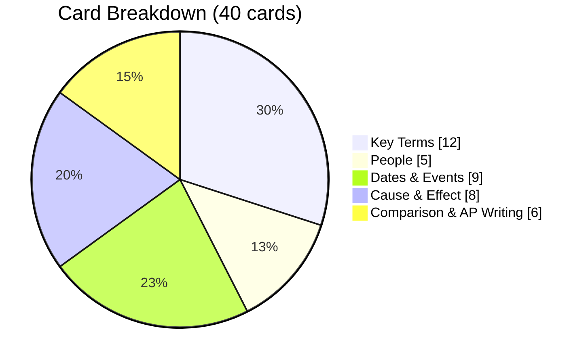

# AP World History: Modern — Topic 1.4 State Building in the Americas · Flashcards

> Source: Based on the College Board CED · Textbook incorporated (Topic 1.4 reading)

---

## 1. Key Terms

- [ ] **What were Maya city-states, and who ruled them?**

▶ Answer
Independent cities that each controlled the surrounding farmland and villages. The Maya never united into one empire, though one city-state often dominated its region. Each was ruled by a king ("holy lord") who claimed descent from a god; rule usually passed from father to son, and women ruled when no male heir was available. City-states had no standing armies and rarely fought for territory; they fought for tribute and captives.

- [ ] **What were chinampas?**

▶ Answer
Artificial raised fields built in shallow Lake Texcoco from layers of mud and plants, separated by canals ("floating gardens"). They gave several harvests a year and fed the large population of Tenochtitlan. The Mexica also dug ditches to irrigate fields and drain parts of the lake.

- [ ] **What was the Triple Alliance?**

▶ Answer
The 1428 alliance of Tenochtitlan, Texcoco, and Tlacopan. Under the Mexica ruler Itzcoatl, it defeated Azcapotzalco and created the Mexica (Aztec) empire, with Tenochtitlan as the dominant partner.

- [ ] **What was a tribute state, and how did the Mexica run one?**

▶ Answer
An empire that collects goods from conquered peoples but leaves local rulers in power. Conquered peoples paid tribute (food, cloth, firewood, feathers, beads, jewelry), surrendered land, and gave military service. Local rulers stayed on as tribute collectors, and city-states were grouped into provinces where an Aztec official collected tribute and resettled warrior families kept control. This gave dominance without direct administrative control; in exchange, subjects received Aztec protection.

- [ ] **What is a theocracy, and why does the textbook use the term for the Aztecs?**

▶ Answer
Rule by religious leaders. The Aztec emperor, the Great Speaker (huey tlatoani), was both the political ruler and a divine representative of the gods.

- [ ] **What was the mit'a?**

▶ Answer
The Inca labor tax, which the textbook calls mandatory public service. Men aged 15 to 50 took turns working for the state: farming state lands, building roads, terraces, temples, and fortresses, and serving as soldiers. Unlike subjects of the Aztecs, conquered people under the Inca paid no tribute in goods.

- [ ] **What was a quipu?**

▶ Answer
A set of knotted, colored cords the Inca used to record census numbers, labor, storehouse goods, and numbers for trade and engineering, and to record messages carried across the empire. Trained specialists kept them. Quipus let the Inca keep records without a writing system.

- [ ] **What was an ayllu?**

▶ Answer
The basic unit of Andean society: a kin-based community that held land in common, shared work, and organized each family's mit'a turn.

- [ ] **What was the Inca road network (Qhapaq Ñan)?**

▶ Answer
About 25,000 miles of roads with rope suspension bridges and waystations; the textbook spells it "Carpa Nan." It was used mainly by the government and military, and relay runners (chasquis) carried messages and quipus. (The textbook says it was built with captive labor; many accounts credit mainly mit'a workers.)

- [ ] **What were terrace farming and waru waru?**

▶ Answer
Terraces were stepped fields cut into steep slopes, with irrigation channels, that created farmland for potatoes and maize and stopped erosion. The textbook says the terraces used waru waru: raised beds with channels that captured rain, prevented flood erosion, and stored water for dry periods. (Many accounts describe waru waru as older raised fields on the flat plains near Lake Titicaca, separate from terraces.)

- [ ] **What was the Mississippian culture, and what was Cahokia?**

▶ Answer
The first large-scale civilization in North America, which emerged in the 700s or 800s in the Mississippi River Valley and built enormous earthen mounds (mound-building), some 100 feet tall. Cahokia, in southern Illinois, was its largest center. (The textbook calls Cahokia "the largest of these mounds"; Cahokia is the city, and its largest mound is Monks Mound, about 100 feet tall.)

- [ ] **What was a matrilineal society, and how did it work among the Mississippians?**

▶ Answer
A society in which social standing comes from the mother's side of the family. When the Great Sun, the chief of a large Mississippian town, died, the title passed to his sister's son, not his own son. (Many accounts say the title "Great Sun" comes from French records of the later Natchez people.)

## 2. People

- [ ] **Who were the Mexica?**

▶ Answer
A Nahuatl-speaking people, also called the Aztecs, who were originally hunter-gatherers. They migrated from the north into the Valley of Mexico in the 1200s, first served as mercenaries, founded Tenochtitlan c. 1325 on an island chosen for defense, and later built the Aztec empire.

- [ ] **Who was Pachacuti?**

▶ Answer
The Inca ruler whose name means "transformer" or "shaker" of the earth. In 1438 he began conquering the tribes around Cuzco, and his victories and his son's turned the small tribes into the Inca Empire. He rebuilt Cuzco as an imperial capital and is linked to Machu Picchu.

- [ ] **Who was Huayna Capac?**

▶ Answer
Pachacuti's grandson, who ruled the Inca Empire by 1493 and focused on consolidating and managing the lands already conquered. His death set off a civil war of succession between his sons Huáscar and Atahualpa, which was still going on when Pizarro arrived in 1532.

- [ ] **Who was the Sapa Inca?**

▶ Answer
The Inca emperor, believed to be the son of the sun god Inti and his representative on earth. He held both religious and political authority and in theory owned all land. The Temple of the Sun (Coricancha) in Cuzco, the center of sun worship and royal ancestor veneration, was the core of Inca religion.

- [ ] **Who were the Ancestral Puebloans?**

▶ Answer
Peoples of the dry American Southwest who developed ways to collect and store water. With little wood, they built in stone: the great houses of Chaco Canyon (stone and clay, hundreds of rooms) and the multi-story sandstone cliff dwellings of Mesa Verde. Their descendants include the Hopi, Zuni, and other Pueblo peoples.

## 3. Dates & Events

- [ ] **c. 900**

▶ Answer
The Classic Maya collapse in the southern lowlands ends the Maya height (c. 250–900). Maya power shifts north to Yucatán city-states such as Chichén Itzá.

- [ ] **c. 1050–1200**

▶ Answer
Cahokia, the largest center of the Mississippian culture (which began in the 700s or 800s), is at its peak.

- [ ] **c. 1220–1450**

▶ Answer
Mayapán is the leading Maya city and heads a league of Yucatán city-states (its fall is often dated c. 1441).

- [ ] **Late 13th century (late 1200s)**

▶ Answer
The textbook says Chaco and Mesa Verde both decline as the climate becomes drier. (Many accounts date Chaco Canyon's decline earlier, to c. 1130–1150, and Mesa Verde's abandonment to c. 1300.)

- [ ] **c. 1325**

▶ Answer
The Mexica found Tenochtitlan on an island in Lake Texcoco, the site of present-day Mexico City.

- [ ] **1428**

▶ Answer
Tenochtitlan, Texcoco, and Tlacopan form the Triple Alliance, which begins the Mexica empire.

- [ ] **c. 1438**

▶ Answer
Pachacuti takes power in Cuzco and begins Inca expansion.

- [ ] **c. 1450**

▶ Answer
The textbook's date for the abandonment of Cahokia; other large Mississippian cities are abandoned by 1600. (Many accounts say Cahokia was largely abandoned by c. 1350–1400.)

- [ ] **1532–1533**

▶ Answer
Francisco Pizarro arrives during the Inca civil war of succession (1532), and the Spanish conquer the core of the Inca Empire (1533). Inca outposts hold out until 1572 (Unit 4).

## 4. Cause & Effect

- [ ] **Cause → Effect: Why did the Mexica build chinampas, and what did they lead to?**

▶ Answer
Tenochtitlan sat on an island in a lake with little farmland. Chinampas created rich new fields with several harvests a year, which fed one of the largest cities in the world (almost 200,000 people, according to the textbook).

- [ ] **Cause → Effect: How did Mexica religion encourage warfare?**

▶ Answer
The Mexica believed the gods had sacrificed themselves to create the world, so human sacrifice was a repayment, and that Huitzilopochtli needed human blood to keep the sun moving. Wars supplied captives for sacrifice as well as tribute, and sacrifice also displayed the empire's might. (The textbook notes that Spanish sources may have exaggerated the extent of sacrifice.)

- [ ] **Cause → Effect: Why was the Mexica empire weak when the Spanish arrived?**

▶ Answer
The textbook gives three reasons: no wheeled vehicles or pack animals made farming inefficient; the drive for victories and sacrifice victims pushed expansion beyond what could be governed; and heavy tribute and sacrifice demands bred resentment rather than loyalty. In 1519–1521 the Spanish gained tens of thousands of indigenous allies, such as the Tlaxcalans. (The textbook says the empire was "in decline" by the late 1400s; many accounts say it was still expanding until 1519.)

- [ ] **Cause → Effect: How did the mit'a shape the Inca Empire?**

▶ Answer
Rotating labor from men aged 15–50 built the roads, terraces, temples, fortresses, and storehouses, and supplied the army. In return the state gave food, chicha, and cloth (reciprocity), which made the system easier to accept.

- [ ] **Cause → Effect: How did the road network help the Inca control their empire?**

▶ Answer
Roads, used mainly by the government and military, let armies and officials move quickly, chasquis carry messages and quipus, and llamas carry goods to storehouses. Bridges were vital in the mountains. This let a central government in Cuzco rule an empire about 2,500 miles long.

- [ ] **Cause → Effect: How did royal ancestor veneration drive Inca expansion?**

▶ Answer
Dead rulers were mummified and kept "ruling" their servants, possessions, and property. A new ruler could not inherit land or property, so he had to win new lands; the textbook calls this a partial motivator for the empire's constant expansion.

- [ ] **Cause → Effect: Why did Chaco and Mesa Verde decline?**

▶ Answer
The Southwest was dry, and the textbook says both declined in the late 13th century as the climate became drier, making farming very hard. People moved south, and their descendants became the Pueblo peoples. (Many accounts date Chaco's decline to a long drought c. 1130–1150 and Mesa Verde's to the drought of c. 1276–1299.)

- [ ] **Cause → Effect: How did the Classic Maya collapse change Maya political life?**

▶ Answer
Drought, overpopulation, deforestation, and warfare (causes are debated; the textbook table lists drought and deforestation) led to the abandonment of many southern lowland cities c. 900. Power shifted to the northern Yucatán, where Chichén Itzá and later Mayapán led.

## 5. Comparison & AP Writing

- [ ] **Compare: How did the Mexica and Inca empires differ in how they ruled?**

▶ Answer
The Mexica ran a decentralized tribute state: conquered peoples paid goods and kept their local rulers as tribute collectors. The Inca ran a centralized bureaucracy: four provinces with governors, officials, resettlement, an imposed language (Quechua), and a labor tax (mit'a) instead of tribute. The textbook table rates Aztec trade as extensive and Inca trade as limited. Both were land-based empires led by rulers with religious authority.

- [ ] **Compare: How did Maya political organization differ from that of the Mexica and Inca?**

▶ Answer
The Maya stayed divided into competing city-states, each with its own king, and never formed one empire, although a strong city-state often dominated its region and Mayapán later led a league of cities. The Mexica and Inca united large regions into empires through conquest.

- [ ] **Compare: How did religion support rulers in the Maya, Mexica, and Inca states?**

▶ Answer
Maya kings claimed descent from gods and led rituals. The textbook calls Mexica government a theocracy: the Great Speaker was a divine representative, and sacrifice to Huitzilopochtli justified war. The Sapa Inca was the son and representative of the sun god Inti, and Inca religion also honored huaca, sacred places and objects. In all three, religion made rulers' power seem sacred.

- [ ] **AP Short Answer: Explain one way the Inca centralized power after c. 1438.**

▶ Answer

**Claim:** The Inca centralized power by building a bureaucracy that reached down to every household. 
**Evidence:** The empire was split into four provinces, each with its own governor and bureaucracy; households were counted in units of 10 to 10,000 under officials; people and goods were recorded on quipus; and Quechua was imposed as the language of government. 
**Reasoning:** These tools let the government in Cuzco know exactly who could work and owed the mit'a, so it could control a large and diverse empire directly instead of relying on local rulers.

- [ ] **AP Short Answer: Explain one similarity between the Mexica and Inca states.**

▶ Answer

**Claim:** Both the Mexica and the Inca used religion to legitimize their rulers. 
**Evidence:** The Mexica emperor was a divine representative of the gods, and priests offered human sacrifices to Huitzilopochtli at the Templo Mayor; the Sapa Inca was honored as the son of the sun god Inti at the Temple of the Sun in Cuzco. 
**Reasoning:** By linking the ruler to the gods, each state made obedience and service (tribute or mit'a) a religious duty, which helped hold large conquered populations together.

- [ ] **AP Long Essay Thesis: Compare the methods the Mexica and Inca used to build and maintain their states from 1200 to 1450.**

▶ Answer

**Claim:** Both the Mexica and the Inca built land-based empires through conquest and religious legitimacy, but the Mexica ruled indirectly through tribute while the Inca ruled directly through a centralized bureaucracy. 
**Evidence:** The Mexica, after the Triple Alliance of 1428, let conquered city-states keep their rulers as tribute collectors, adding only an Aztec official and warrior settlers in each provincial capital. The Inca, after Pachacuti's expansion c. 1438, used governors, resettlement, quipus, Quechua, roads, and the mit'a labor tax instead of tribute. 
**Reasoning:** The Mexica approach was cheaper but created resentful subjects, while the Inca approach demanded more labor and organization but tied the empire more tightly to Cuzco.

