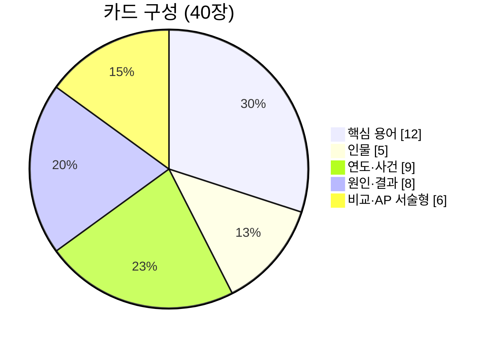

# AP 세계사: 모던 — 토픽 1.4 아메리카의 국가 형성 (State Building in the Americas) · 플래시카드

> 출처: College Board CED 기준 · 교재 반영 (교재 Topic 1.4)

---

## 1. 핵심 용어

- [ ] **마야 도시국가 (Maya city-states)란 무엇이며, 누가 다스렸는가?**

▶ 정답
각각 주변의 농지와 마을을 다스린 독립된 도시다. 마야는 끝내 하나의 제국으로 통일되지 않았지만, 한 도시국가가 그 지역을 지배하는 경우가 많았다. 각 도시국가는 신의 후손이라고 주장한 왕("신성한 군주")이 다스렸다. 왕위는 보통 아버지에게서 아들로 이어졌고, 남자 후계자가 없으면 여성이 다스렸다. 도시국가에는 상비군 (Standing army)이 없었고, 영토보다는 공물과 포로를 얻으려고 싸웠다.

- [ ] **치남파 (Chinampa)란 무엇이었는가?**

▶ 정답
얕은 텍스코코 호수에 진흙과 식물을 층층이 쌓아 만든 인공 돋운 밭이다. 밭 사이로 수로가 흘렀다("떠 있는 정원"). 1년에 여러 번 수확할 수 있어서 테노치티틀란의 많은 인구를 먹여 살렸다. 메시카는 도랑을 파서 밭에 물을 대고 호수 일부의 물을 빼기도 했다.

- [ ] **삼각 동맹 (Triple Alliance)이란 무엇이었는가?**

▶ 정답
1428년 테노치티틀란, 텍스코코, 틀라코판이 맺은 동맹이다. 메시카의 통치자 이츠코아틀 (Itzcoatl)의 지휘 아래 아스카포찰코를 물리치고 메시카(아즈텍) 제국을 세웠으며, 테노치티틀란이 주도 세력이 되었다.

- [ ] **공납 국가 (Tribute state)란 무엇이며, 메시카는 이를 어떻게 운영했는가?**

▶ 정답
정복한 민족에게서 물품을 거두지만 지역 통치자는 그대로 두는 제국이다. 정복된 민족은 공물(식량, 옷감, 땔감, 깃털, 구슬, 장신구)을 바치고, 땅을 내놓고, 병역을 졌다. 지역 통치자는 공물 징수인으로 자리를 지켰고, 도시국가들은 지방 (Province)으로 묶여 아즈텍 관리가 공물을 거두고 옮겨 온 전사 가족이 통제를 유지했다. 이로써 직접적인 행정 통제 없이 지배할 수 있었고, 그 대가로 복속민은 아즈텍의 보호를 받았다.

- [ ] **신정 (Theocracy)이란 무엇이며, 교재는 왜 이 말을 아즈텍에 쓰는가?**

▶ 정답
종교 지도자가 다스리는 체제다. 아즈텍의 황제인 위대한 연설자 (Great Speaker, 우에이 틀라토아니 (Huey tlatoani))는 정치적 통치자이면서 신들의 신성한 대리자였다.

- [ ] **미타 (Mit'a)란 무엇이었는가?**

▶ 정답
잉카의 노동세로, 교재는 이를 의무적인 공공 봉사 (Mandatory public service)라고 부른다. 15세에서 50세 사이의 남성이 돌아가며 국가를 위해 일했다. 국가의 땅을 경작하고, 도로, 계단식 밭, 신전, 요새를 짓고, 병사로 복무했다. 아즈텍의 복속민과 달리 잉카에 정복된 민족은 물품 공물을 바치지 않았다.

- [ ] **키푸 (Quipu)란 무엇이었는가?**

▶ 정답
잉카가 인구, 노동, 창고 물품, 교역과 공사에 필요한 숫자를 기록하고, 제국 곳곳으로 전하는 소식도 기록하는 데 쓴 색깔 있는 매듭 끈이다. 훈련받은 전문가가 관리했다. 키푸 덕분에 잉카는 문자 없이도 기록을 남길 수 있었다.

- [ ] **아이유 (Ayllu)란 무엇이었는가?**

▶ 정답
안데스 사회의 기본 단위다. 땅을 공동으로 소유하고 일을 나누며, 각 가족의 미타 차례를 정한 혈연 기반 공동체였다.

- [ ] **잉카 도로망 (Qhapaq Ñan, 카팍 냔)이란 무엇이었는가?**

▶ 정답
밧줄 현수교와 역참을 갖춘 약 25,000마일의 도로다. 교재는 "Carpa Nan"으로 표기한다. 주로 정부와 군대가 이용했고, 릴레이 전령인 차스키 (Chasqui)가 소식과 키푸를 전했다. (교재는 포로의 노동으로 지었다고 쓰지만, 많은 설명에서는 주로 미타 노동자가 지었다고 본다.)

- [ ] **계단식 농법 (Terrace farming)과 와루와루 (Waru waru)란 무엇이었는가?**

▶ 정답
계단식 밭은 가파른 산비탈을 계단 모양으로 깎고 관개 수로를 낸 밭으로, 감자와 옥수수를 기를 농지를 만들고 흙이 쓸려 가는 것을 막았다. 교재는 계단식 밭에 와루와루를 썼다고 한다. 와루와루는 빗물을 모아 홍수 때 흙이 쓸려 가는 것을 막고 건기에 쓸 물을 저장한 수로 딸린 돋운 밭이다. (많은 설명에서는 와루와루를 티티카카 호수 주변 평원에 있던 더 오래된 돋운 밭으로 보며, 계단식 밭과 구별한다.)

- [ ] **미시시피 문화 (Mississippian culture)란 무엇이며, 카호키아 (Cahokia)는 무엇이었는가?**

▶ 정답
700년대 또는 800년대에 미시시피강 유역에서 생겨난 북아메리카 최초의 큰 규모 문명이다. 높이가 100피트에 이르는 거대한 흙 마운드를 쌓았다(마운드 건설 (Mound-building)). 일리노이주 남부의 카호키아가 가장 큰 중심지였다. (교재는 카호키아를 "이 마운드 가운데 가장 큰 것"이라고 쓰지만, 카호키아는 도시이고 그곳에서 가장 큰 마운드는 높이 약 100피트의 몽크스 마운드 (Monks Mound)이다.)

- [ ] **모계 사회 (Matrilineal society)란 무엇이며, 미시시피 문화에서는 어떻게 작동했는가?**

▶ 정답
사회적 지위가 어머니 쪽 집안에서 정해지는 사회다. 큰 미시시피 마을의 족장인 위대한 태양 (Great Sun)이 죽으면, 그 칭호는 그의 아들이 아니라 누이의 아들에게 넘어갔다. (많은 설명에서는 "위대한 태양"이라는 칭호가 뒤늦은 나체즈 (Natchez) 민족에 관한 프랑스 기록에서 나왔다고 본다.)

## 2. 인물

- [ ] **메시카 (Mexica)는 누구였는가?**

▶ 정답
아즈텍 (Aztecs)이라고도 불리는, 나우아틀어 (Nahuatl)를 쓰는 민족으로 본래 수렵 채집민이었다. 1200년대에 북쪽에서 멕시코 분지로 이주했고, 처음에는 용병으로 일했다. c. 1325년 방어에 유리한 섬에 테노치티틀란을 세웠으며, 훗날 아즈텍 제국을 세웠다.

- [ ] **파차쿠티 (Pachacuti)는 누구였는가?**

▶ 정답
이름이 "대지를 바꾸는 자" 또는 "대지를 뒤흔드는 자"라는 뜻인 잉카의 통치자다. 1438년 쿠스코 주변 부족들을 정복하기 시작했고, 그와 아들의 승리로 작은 부족들이 잉카 제국으로 합쳐졌다. 쿠스코를 제국의 수도로 다시 지었고, 마추픽추와 관련이 있다.

- [ ] **우아이나 카팍 (Huayna Capac)은 누구였는가?**

▶ 정답
1493년까지 잉카 제국을 다스리게 된 파차쿠티의 손자로, 이미 정복한 땅을 다지고 관리하는 데 힘썼다. 그가 죽은 뒤 아들 우아스카르 (Huáscar)와 아타우알파 (Atahualpa) 사이에 왕위 계승 내전이 일어났고, 1532년 피사로가 왔을 때도 내전은 계속되고 있었다.

- [ ] **사파 잉카 (Sapa Inca)는 누구였는가?**

▶ 정답
태양신 인티 (Inti)의 아들이자 지상에서 인티의 대리자로 여겨진 잉카의 황제다. 종교적 권위와 정치적 권위를 함께 가졌고, 이론상 모든 땅의 주인이었다. 태양 숭배와 왕실 조상 숭배의 중심인 쿠스코의 태양의 신전 (Temple of the Sun, 코리칸차 (Coricancha))이 잉카 종교의 핵심이었다.

- [ ] **선조 푸에블로인 (Ancestral Puebloans)은 누구였는가?**

▶ 정답
건조한 아메리카 남서부에서 물을 모으고 저장하는 방법을 발전시킨 민족이다. 목재가 적어서 돌로 집을 지었다. 차코 캐니언의 대형 주거지(돌과 진흙, 방 수백 개)와 메사 버드의 여러 층짜리 사암 절벽 주거지가 그 예다. 그 후손에는 호피, 주니 등 푸에블로 민족이 있다.

## 3. 연도·사건

- [ ] **c. 900년**

▶ 정답
남부 저지대에서 고전기 마야가 붕괴해 마야의 전성기(c. 250–900)가 끝났다. 마야의 중심이 치첸이트사 같은 북쪽 유카탄의 도시국가로 옮겨 갔다.

- [ ] **c. 1050–1200년**

▶ 정답
미시시피 문화(700년대 또는 800년대에 시작)의 가장 큰 중심지인 카호키아가 전성기를 맞았다.

- [ ] **c. 1220–1450년**

▶ 정답
마야판이 마야의 중심 도시로서 유카탄 도시국가 연맹을 이끌었다(멸망은 흔히 c. 1441년으로 본다).

- [ ] **13세기 후반 (1200년대 후반)**

▶ 정답
교재에 따르면 기후가 더 건조해지면서 차코와 메사 버드가 모두 쇠퇴했다. (많은 설명에서는 차코 캐니언의 쇠퇴를 더 이른 c. 1130–1150으로, 메사 버드가 버려진 시기를 c. 1300으로 본다.)

- [ ] **c. 1325년**

▶ 정답
메시카가 지금의 멕시코시티 자리인 텍스코코 호수의 섬에 테노치티틀란을 세웠다.

- [ ] **1428년**

▶ 정답
테노치티틀란, 텍스코코, 틀라코판이 삼각 동맹을 맺어 메시카 제국이 시작되었다.

- [ ] **c. 1438년**

▶ 정답
파차쿠티가 쿠스코에서 권력을 잡고 잉카의 팽창을 시작했다.

- [ ] **c. 1450년**

▶ 정답
교재가 쓰는 카호키아가 버려진 시기다. 다른 큰 미시시피 도시들은 1600년까지 버려졌다. (많은 설명에서는 카호키아가 c. 1350–1400까지 거의 버려졌다고 본다.)

- [ ] **1532–1533년**

▶ 정답
잉카의 왕위 계승 내전 중에 프란시스코 피사로가 도착했고(1532), 스페인이 잉카 제국의 중심부를 정복했다(1533). 잉카의 외곽 거점은 1572년까지 버텼다 (Unit 4).

## 4. 원인·결과

- [ ] **원인 → 결과: 메시카가 치남파를 만든 이유와 그 결과는?**

▶ 정답
테노치티틀란은 농지가 거의 없는 호수 위의 섬에 있었기 때문이다. 치남파는 1년에 여러 번 수확할 수 있는 비옥한 밭을 새로 만들었고, 세계에서 가장 큰 도시 가운데 하나(교재에 따르면 거의 20만 명)를 먹여 살렸다.

- [ ] **원인 → 결과: 메시카의 종교는 어떻게 전쟁을 부추겼는가?**

▶ 정답
메시카는 신들이 스스로를 희생해 세계를 만들었으므로 인신 공양 (Human sacrifice)은 그에 대한 보답이라고 믿었고, 우이칠로포치틀리 (Huitzilopochtli)가 태양을 계속 움직이려면 사람의 피가 필요하다고 믿었다. 전쟁은 공물과 함께 제물로 바칠 포로를 가져왔고, 인신 공양은 제국의 힘을 보여 주기도 했다. (교재는 스페인 사료가 인신 공양의 규모를 과장했을 수 있다고 지적한다.)

- [ ] **원인 → 결과: 스페인이 왔을 때 메시카 제국은 왜 약했는가?**

▶ 정답
교재는 세 가지 이유를 든다. 바퀴 달린 탈것과 짐 끄는 동물이 없어 농업이 비효율적이었다. 승리와 제물에 대한 욕구 때문에 감당할 수 있는 범위 너머로 팽창했다. 무거운 공물과 제물 요구가 충성보다 분노를 낳았다. 1519–1521년 스페인은 틀락스칼라인 같은 수만 명의 원주민 동맹군을 얻었다. (교재는 제국이 1400년대 후반에 "쇠퇴하고 있었다"고 쓰지만, 많은 설명에서는 1519년까지 계속 팽창했다고 본다.)

- [ ] **원인 → 결과: 미타는 잉카 제국을 어떻게 만들었는가?**

▶ 정답
15–50세 남성이 돌아가며 제공한 노동으로 도로, 계단식 밭, 신전, 요새, 창고를 짓고 군대를 채웠다. 그 대가로 국가는 음식, 치차, 옷감을 주었고(호혜성 (Reciprocity)), 그래서 이 제도를 받아들이기가 쉬웠다.

- [ ] **원인 → 결과: 도로망은 잉카가 제국을 통제하는 데 어떻게 도움이 되었는가?**

▶ 정답
주로 정부와 군대가 쓴 도로 덕분에 군대와 관리는 빠르게 움직이고, 차스키는 소식과 키푸를 전하고, 라마는 물품을 창고로 날랐다. 산이 많은 지역이라 다리가 특히 중요했다. 그래서 쿠스코의 중앙 정부가 약 2,500마일 길이의 제국을 다스릴 수 있었다.

- [ ] **원인 → 결과: 왕실 조상 숭배 (Royal ancestor veneration)는 잉카의 팽창을 어떻게 부추겼는가?**

▶ 정답
죽은 통치자는 미라로 만들어져 하인, 재산, 땅을 계속 "다스렸다". 새 통치자는 땅이나 재산을 물려받을 수 없어서 새 땅을 정복해야 했다. 교재는 이것을 제국이 끊임없이 팽창한 동기의 일부로 본다.

- [ ] **원인 → 결과: 차코와 메사 버드가 쇠퇴한 이유는?**

▶ 정답
남서부는 건조한 지역이었고, 교재에 따르면 13세기 후반 기후가 더 건조해지면서 농사가 매우 어려워져 두 사회 모두 쇠퇴했다. 사람들은 남쪽으로 옮겨 갔고, 그 후손이 푸에블로 민족이 되었다. (많은 설명에서는 차코의 쇠퇴를 c. 1130–1150의 오랜 가뭄으로, 메사 버드의 쇠퇴를 c. 1276–1299의 가뭄으로 본다.)

- [ ] **원인 → 결과: 고전기 마야의 붕괴는 마야의 정치를 어떻게 바꾸었는가?**

▶ 정답
가뭄, 인구 과잉, 삼림 파괴, 전쟁(원인은 논쟁 중이며, 교재 표는 가뭄과 삼림 파괴를 든다) 때문에 c. 900년 남부 저지대의 많은 도시가 버려졌다. 권력은 북쪽 유카탄으로 옮겨 갔고, 그곳에서 치첸이트사와 이후 마야판이 중심이 되었다.

## 5. 비교·AP 서술형

- [ ] **비교: 메시카 제국과 잉카 제국은 통치 방식이 어떻게 달랐는가?**

▶ 정답
메시카는 분권적인 공납 국가였다. 정복된 민족은 물품을 바치고 자기 지역 통치자를 공물 징수인으로 유지했다. 잉카는 중앙집권적 관료제 (Bureaucracy)였다. 총독을 둔 네 지방, 관리, 강제 이주, 강제한 공용어(케추아어 (Quechua)), 공물 대신 노동세(미타)를 썼다. 교재 표는 아즈텍의 교역을 활발함 (Extensive), 잉카의 교역을 제한적임 (Limited)으로 본다. 둘 다 종교적 권위를 지닌 통치자가 이끈 육상 제국이었다.

- [ ] **비교: 마야의 정치 조직은 메시카, 잉카와 어떻게 달랐는가?**

▶ 정답
마야는 각자 왕이 있는 서로 경쟁하는 도시국가로 나뉘어 끝내 하나의 제국을 이루지 않았다. 다만 강한 도시국가가 그 지역을 지배하는 경우가 많았고, 훗날 마야판이 도시 연맹을 이끌기도 했다. 메시카와 잉카는 정복을 통해 넓은 지역을 하나의 제국으로 묶었다.

- [ ] **비교: 마야, 메시카, 잉카에서 종교는 통치자를 어떻게 뒷받침했는가?**

▶ 정답
마야의 왕은 신의 후손이라고 주장하며 의례를 이끌었다. 교재는 메시카의 정부를 신정 (Theocracy)이라고 부른다. 위대한 연설자는 신의 대리자였고, 우이칠로포치틀리에게 바치는 제사가 전쟁을 정당화했다. 사파 잉카는 태양신 인티의 아들이자 대리자였고, 잉카 종교는 신성한 장소와 물건인 와카 (Huaca)도 섬겼다. 세 나라 모두 종교가 통치자의 권력을 신성하게 보이게 했다.

- [ ] **AP 단답형: c. 1438년 이후 잉카가 권력을 중앙집권화한 방법 하나를 설명하라.**

▶ 정답

**주장:** 잉카는 모든 가구에까지 닿는 관료제를 만들어 권력을 중앙집권화했다. 
**근거:** 제국을 네 지방으로 나누고 지방마다 총독과 관료 조직을 두었으며, 가구를 10에서 10,000 단위로 세어 단위마다 관리를 두었고, 사람과 물품을 키푸에 기록하고, 케추아어를 통치 언어로 강제했다. 
**설명:** 이런 수단 덕분에 쿠스코의 정부는 누가 일할 수 있고 미타를 져야 하는지 정확히 알았다. 그래서 지역 통치자에게 기대지 않고 크고 다양한 제국을 직접 다스릴 수 있었다.

- [ ] **AP 단답형: 메시카와 잉카 국가의 공통점 하나를 설명하라.**

▶ 정답

**주장:** 메시카와 잉카는 모두 종교를 이용해 통치자의 권력을 정당화했다. 
**근거:** 메시카의 황제는 신들의 신성한 대리자였고, 사제들은 템플로 마요르에서 우이칠로포치틀리에게 인신 공양 (Human sacrifice)을 바쳤다. 사파 잉카는 쿠스코의 태양의 신전에서 태양신 인티의 아들로 받들어졌다. 
**설명:** 통치자를 신과 연결하면서 두 나라는 복종과 봉사(공물이나 미타)를 종교적 의무로 만들었다. 이것이 정복한 많은 사람을 하나로 묶는 데 도움이 되었다.

- [ ] **AP 논술형 논지: 1200–1450년 메시카와 잉카가 국가를 세우고 유지한 방법을 비교하라.**

▶ 정답

**주장:** 메시카와 잉카는 모두 정복과 종교적 정당성으로 육상 제국을 세웠지만, 메시카는 공물을 통해 간접적으로 다스린 반면 잉카는 중앙집권적 관료제를 통해 직접 다스렸다. 
**근거:** 1428년 삼각 동맹 이후 메시카는 정복된 도시국가가 자기 통치자를 공물 징수인으로 유지하게 했고, 지방의 중심 도시마다 아즈텍 관리와 이주한 전사만 두었다. c. 1438년 파차쿠티의 팽창 이후 잉카는 총독, 강제 이주, 키푸, 케추아어, 도로, 그리고 공물 대신 미타 노동세를 활용했다. 
**설명:** 메시카의 방식은 비용이 적게 들었지만 분노한 복속민을 낳았다. 잉카의 방식은 더 많은 노동과 조직이 필요했지만 제국을 쿠스코에 더 단단히 묶었다.

