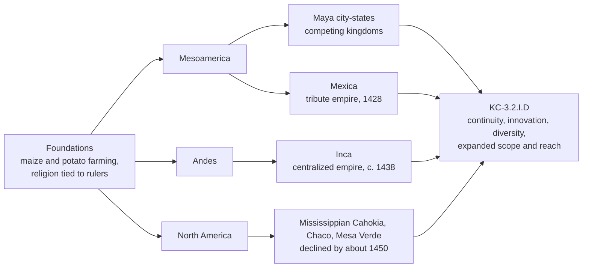
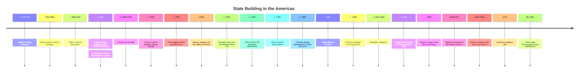
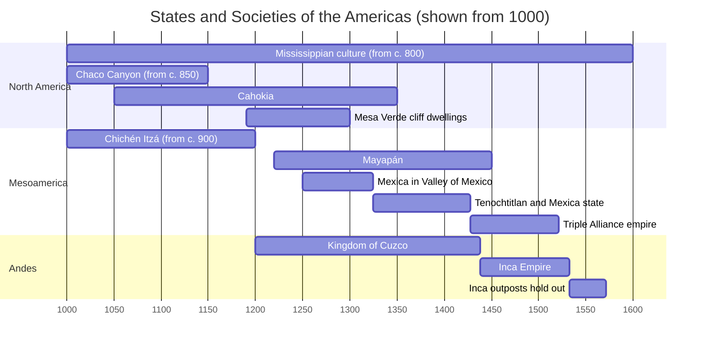
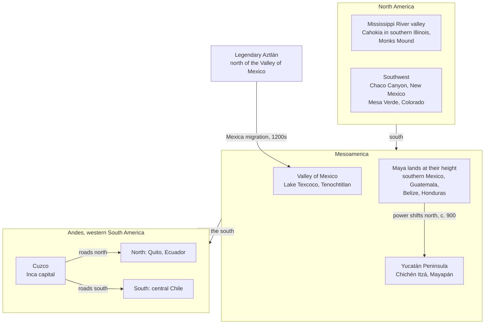
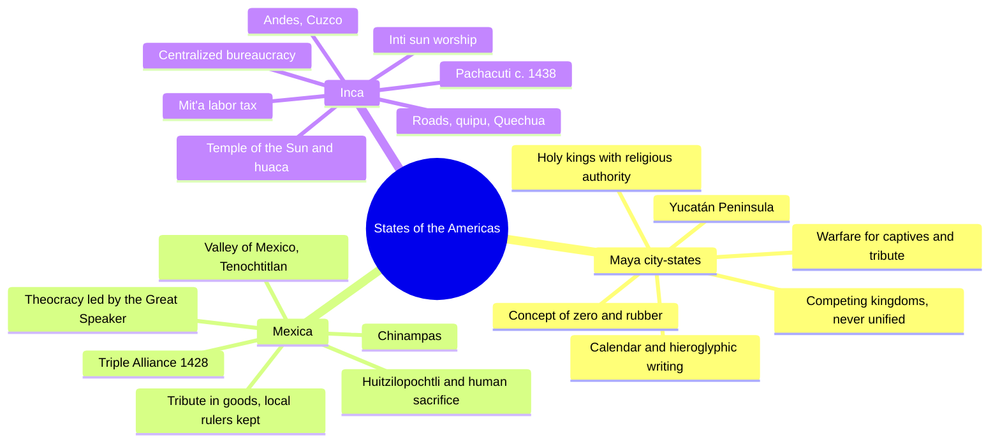

# AP World History: Modern — Topic 1.4 State Building in the Americas

**Focus Question (textbook Essential Question):** What states developed in the Americas, and how did they change over time?

> Source: Based on the College Board CED · Textbook incorporated (Topic 1.4 reading)

**Unit 1: The Global Tapestry (c. 1200–1450)**

---

## Learning Objective

| Code | Learning Objective |
|---|---|
| 1.4 LO (GOV) | Explain how and why states in the Americas developed and changed over time. |

## Historical Developments (CED)

| # | Historical Development | Covered in |
|---|---|---|
| HD1 | KC-3.2.I.D: In the Americas, as in Afro-Eurasia, state systems demonstrated continuity, innovation, and diversity, and expanded in scope and reach. | §1–§6 |
| HD1 · Ex. 1 | Illustrative example: Maya city-states | §1, §2 |
| HD1 · Ex. 2 | Illustrative example: Mexica | §3 |
| HD1 · Ex. 3 | Illustrative example: Inca | §4 |
| Textbook | North American societies covered in the textbook reading: the Mississippian culture and Cahokia; Chaco and Mesa Verde (Ancestral Puebloans) | §5 |

> **Note:** The CED's illustrative examples for 1.4 are the Maya city-states, the Mexica, and the Inca. The textbook reading also gives the Mississippian culture (Cahokia) and Chaco and Mesa Verde their own sections, and its key terms include *Mississippian*, *matrilineal society*, *mound-building*, and *Cahokia*. For your class, treat §5 as part of the required reading, not just background.

---

## The Big Picture

> "I love the song of the mockingbird, / Bird of four hundred voices, / I love the color of jade / And the intoxicating scent of flowers, / But more than all I love my brother, man!"
> — Nezahualcoyotl (1402–1472), Aztec poet

Nezahualcoyotl was also the ruler of **Texcoco**, one of the three cities of the **Triple Alliance** (§3). His poem survives because the **Spanish recorded it**. Today's knowledge of these civilizations combines **archaeological evidence**, **oral traditions**, and **writings by Europeans** who came to the Americas after 1492, so much of it was filtered through outsiders.

After the decline of the **Olmecs** in Mesoamerica and the **Chavín** in the Andes, new civilizations rose in the same regions, and the first large-scale civilization in North America developed. Between 1200 and 1450, states in the Americas grew larger and more powerful, just as states in Afro-Eurasia did. They developed **with no contact with Afro-Eurasia**, with **no large draft animals** (except the llama in the Andes), and with **no iron tools**. Yet they built large cities and empires on **maize** and **potato** farming. In **Mesoamerica**, the **Maya** never formed one empire. After the **Classic Maya collapse (c. 900)**, power moved north to **Postclassic city-states** on the **Yucatán Peninsula**, such as **Chichén Itzá** and **Mayapán**. The **Mexica** migrated into the **Valley of Mexico**, founded **Tenochtitlan (c. 1325)**, fed it with **chinampas**, and after the **Triple Alliance (1428)** built a **tribute empire** that let conquered peoples keep their local rulers. In the **Andes**, the **Inca** under **Pachacuti (c. 1438)** built the largest and most **centralized** state in the Americas, held together by the **mit'a** labor tax, a huge **road network**, **quipu** records, and the **Quechua** language. In **North America**, the **Mississippian culture** (centered on **Cahokia**) and the Southwest peoples of **Chaco** and **Mesa Verde** built complex societies, but these had declined or been abandoned by about 1450. Together these states show the CED's key ideas: **continuity, innovation, diversity, and expansion in scope and reach**.

---

## §1. Background: The Americas Before 1200

| Region | Earlier states and societies | What carried over after 1200 |
|---|---|---|
| **Mesoamerica** | **Olmecs** (c. 1200–400 B.C.E.), **Teotihuacan** (c. 100 B.C.E.–c. 550 C.E.), **Classic Maya** (c. 250–900), **Toltecs** at Tula (c. 900–1150) | Pyramid temples, the ballgame, the feathered serpent god, the 260-day ritual calendar, maize farming, and tribute; the Mexica later claimed Toltec heritage |
| **Andes** | **Chavín** (c. 900–200 B.C.E.), **Wari** and **Tiwanaku** (c. 600–1000), **Chimú** kingdom (c. 900–1470) | Terrace farming, road segments, labor obligations, and llama herding; the Inca built on these |
| **North America** | **Mississippian** mound-building culture (from the 700s or 800s, according to the textbook), **Ancestral Puebloans** | The spread of maize farming and earthen mound building |

- **Geography shaped every state.** The Americas had no horses, oxen, or cattle, so goods moved on human backs, by canoe, or (in the Andes) by llama. The wheel was not used for transport.
- **Food base:** Mesoamerica and North America grew **maize, beans, and squash**. The Andes grew **potatoes, quinoa**, and maize at lower altitudes.
- **Classic Maya collapse (c. 800–900):** Many cities in the **southern lowlands** (such as Tikal and Copán) were abandoned. Historians debate the causes: **drought**, overpopulation, deforestation, and constant **warfare** between city-states. Afterward, Maya power shifted to the **northern Yucatán**.
- **Olmec influence (textbook):** Historians debate how closely Mesoamerican cultures were related. Many argue that most later cultures were based on the **Olmecs**: the Olmec **feathered snake-god** became central to Maya and Aztec religion, the subjects on Olmec pottery appear in later pottery, and Olmec **ritual sacrifice, pyramids, and ball courts** continued in later cultures. Other historians argue that different cultures developed complex civilizations **more or less independently**.

## §2. Maya City-States

### Political Organization

- **Scale (textbook):** At its height (c. 250–900), Maya civilization stretched over **southern Mexico** and much of present-day **Belize, Honduras, and Guatemala**. Most Maya lived in or near one of about **40 cities** of 5,000 to 50,000 people. At the peak, as many as **2 million** Maya lived in the region.
- The Maya **never united into a single empire**. They lived in dozens of **competing city-states**, each made up of a city and the surrounding farmland and villages. No central government ruled all Maya lands, but often **one city-state was the strongest in a region** and dominated its neighbors.
- Each city-state was ruled by a **king** (*k'uhul ajaw*, "holy lord") who claimed **descent from a god**; the Maya believed that when the king died, he would become one with his ancestor-god. Kings led **public rituals**, including bloodletting, and their authority was both **political and religious**.
- Royal rule usually passed **from father to son**, but kings who lost the support of the people were sometimes **overthrown**. Most rulers were men, but **women ruled** when no male heir was available or old enough to govern.
- Below the king were **nobles, priests, and scribes**; the king directed the elite scribes and priests who ran the state. Most people were **farmers** who grew maize and paid **taxes** (usually **in crops**) and **labor** to the government.

> ⚠️ Needs verification: The textbook says as many as 2 million Maya lived in the region at the peak. Many recent estimates are much higher (several million or more, based partly on new aerial surveys). Treat population figures as approximate.

### Warfare and Tribute

- City-states fought each other for **captives, tribute, and prestige**. The Maya **rarely fought to control territory**; defeated cities usually paid **tribute** to the winner, and at times a city-state was overthrown.
- Important captives were sometimes **sacrificed** in religious ceremonies.
- City-states had **no standing armies**. When war broke out, governments required citizens to provide **military service**.
- Shifting **alliances** meant no single city held power for long.

### Calendar, Writing, and Science

| Achievement | Details |
|---|---|
| **Calendar** | A **260-day ritual calendar** and a **365-day solar calendar** combined into a **52-year cycle** (shared across Mesoamerica). The **Long Count** recorded long spans of time and was used mainly in the Classic period. Priests used the calendar to decide when to hold ceremonies and **whether to go to war**. With no telescopes, they built precise **observatories** atop pyramids such as the one at **Chichén Itzá**; the textbook says their calendar was more accurate than any used in Europe at the time. |
| **Writing** | **Hieroglyphic writing**, the most complete writing system in the pre-Columbian Americas; carved on stone monuments and painted in bark-paper books (**codices**), such as the Dresden Codex |
| **Mathematics and astronomy** | A base-20 number system with a **concept of zero**; careful tracking of the sun, moon, and Venus |
| **Rubber** | The Maya learned to make **rubber** from liquid collected from rubber plants |

### Religion

- Maya **science and religion were linked through astronomy**, so keeping an accurate calendar was very important.
- **Priests**, who could be **male or female**, conducted ceremonies honoring many deities. Among the most important were the gods of the **sun, rain, and corn**.
- The Maya made **offerings** so that their prayers might be answered. **War captives** were sometimes killed as offerings.

> **Connect (textbook):** Compare the political structures of the Maya with the political structures of South Asia (Topic 1.3).

### Postclassic City-States (c. 900–1450)

| City-state | Dates | Features |
|---|---|---|
| **Chichén Itzá** | c. 900–1100s ⚠️ | Northern Yucatán; the pyramid **El Castillo** (Temple of Kukulcán), a great ballcourt, an observatory, and a sacred **cenote** (sinkhole well); a major trade center; art shows styles from central Mexico; some scholars think a council of nobles shared power (debated) |
| **Mayapán** | c. 1220–1450 | Walled city that led a **league of Yucatán city-states**; the **Cocom** family dominated; leaders of subject towns had to live in Mayapán, which helped control them; collapsed after a revolt (c. 1441), and the Yucatán split into many small states |

> ⚠️ Needs verification: Scholars disagree about when Chichén Itzá peaked and declined (estimates range from the mid-1000s to c. 1200). The fall of Mayapán is usually dated c. 1441, but some sources give dates up to c. 1461 (often rounded to c. 1450). The textbook does not settle these dates.

> **Key idea:** The Maya show **continuity** (holy kings, the calendar, and the city-state system lasted from the Classic period) and **change** (power shifted north, trade grew, and Mayapán tried a league of cities). Note that the textbook's Maya section describes the Maya mainly at their height (c. 250–900).

## §3. The Mexica (Aztec) Empire

### Migration and Founding

- The **Mexica** (the textbook calls them both "Aztecs" and "Mexicas") were a **Nahuatl-speaking** people, originally **hunter-gatherers**, who migrated from the north (their legendary homeland was **Aztlán**) into the **Valley of Mexico** in the **1200s**.
- As latecomers, they first served as **mercenaries** for the powerful city of **Azcapotzalco**.
- According to legend, their god **Huitzilopochtli** told them to settle where they saw an **eagle on a cactus**. They founded **Tenochtitlan c. 1325** on an island in a swampy part of **Lake Texcoco**, the site of present-day **Mexico City**. The island location helped **protect the city from attacks**.
- Tenochtitlan grew into one of the largest cities in the world, linked to the shore by **causeways** and supplied with fresh water by a network of **aqueducts**. At its center stood the **Templo Mayor** (the textbook's "Great Pyramid"), a twin temple to Huitzilopochtli and the rain god Tlaloc that rose about **150 feet**. This pyramid and the other pyramids, temples, and palaces were built of **stone**.

> ⚠️ Needs verification: The textbook says Tenochtitlan grew to almost 200,000 people. Population estimates for 1519 vary widely (roughly 150,000–250,000), so treat "about 200,000" as an approximate figure.

### Chinampas

- **Chinampas** were artificial **raised fields** built in the shallow lake from layers of mud and plants, anchored by trees and separated by canals (often called "floating gardens"). They increased the space for **food production**.
- They produced **several harvests a year** and fed a dense urban population. This was an **innovation** adapted to a lake environment.
- The Mexica also dug **ditches** to irrigate their fields with lake water and to **drain** parts of the lake for more land.

### The Triple Alliance (1428)

- In **1428**, Tenochtitlan joined **Texcoco** and **Tlacopan** in the **Triple Alliance** and defeated Azcapotzalco under the Mexica ruler **Itzcoatl**.
- Tenochtitlan soon became the **dominant partner**. Later rulers such as **Moctezuma I** (r. 1440–1469) expanded the empire until it stretched from the **Gulf of Mexico to the Pacific**. In the textbook's words, within about 100 years of founding Tenochtitlan, the Mexica had conquered the surrounding peoples.

### A Tribute State

| Feature | How it worked |
|---|---|
| **Tribute** | Conquered peoples had to pay **tribute**, **surrender lands**, and perform **military service**. Tribute included practical goods such as food (maize), **cotton cloth**, and **firewood**, and luxury goods such as cacao, **feathers**, jade, **beads**, **jewelry**, jaguar skins, and warriors' costumes; amounts were recorded in pictorial lists |
| **Local rulers kept** | Local rulers **stayed in their positions to serve as tribute collectors**, which gave the Mexica political dominance **without direct administrative control**. If a city paid on time, its **gods and customs usually stayed** too. In exchange, conquered peoples received **Aztec protection**. The Mexica did not build a large bureaucracy |
| **Provinces** | The Mexica grouped city-states into **provinces**. They moved **warriors and their families** to each province's capital to keep it under control, and an **Aztec official** stationed there collected tribute from local officials |
| **Military** | A **warrior class** (including **eagle and jaguar warriors**) led conquest; warriors rose in rank by **taking captives**, so even commoners could gain status |
| **Result** | **Decentralized** control was cheap to run, but loyalty was shallow; subject peoples **resented** heavy tribute and demands for sacrifice victims, and some neighbors, such as **Tlaxcala**, were never conquered |

### Religion and Society

- The textbook calls Aztec government a **theocracy** (rule by religious leaders): the emperor was both the political ruler and a **divine representative of the gods**.
- Religion was **central to society**. The Mexica worshipped an ever-evolving **pantheon of hundreds of deities**, many with both male and female aspects, and held many rituals and feast days.
- **Huitzilopochtli** was the god of the **sun and war**. The Mexica believed the sun needed **human blood** to keep moving across the sky.
- **Why sacrifice?** The Mexica believed the gods had **sacrificed themselves to create the world**, so human sacrifice and bloodletting were a kind of **repayment and atonement** for human sin. Sacrifice probably also had a **political** purpose: it showed the might of the empire in dramatic fashion.
- **Priests** performed **human sacrifice** on a large scale, mostly of **war captives**, at the Templo Mayor.
- **Sources:** The number of sacrifices may never be known. Much of the information comes from **Spanish invaders**, who may have **exaggerated** human sacrifice to make the Aztecs seem more deserving of conquest.
- **Cycle of power:** religion justified war → war brought captives and tribute → sacrifice and wealth strengthened the rulers and priests.

The textbook's social hierarchy, from top to bottom: emperor → land-owning nobles → scribes and healers → craftspeople and traders → peasants and soldiers → enslaved people.

| Social group | Role |
|---|---|
| **Huey tlatoani** ("great speaker") | Emperor (the textbook's "Great Speaker"); chosen by a council of nobles from the royal family; political ruler, military leader, and divine representative of the gods |
| **Nobles (pipiltin)** | Land-owning officials, judges, high-ranking warriors, and governors; they formed most of the **military leadership** |
| **Priests** | Ran temples, schools, the calendar, and sacrifices |
| **Scribes and healers** | Ranked just below the nobles in the textbook's hierarchy |
| **Warriors** | Fought for the state; status came from captives taken (the textbook ranks ordinary **soldiers** with peasants) |
| **Craftspeople and traders** | Ranked below scribes and healers |
| **Merchants (pochteca)** | A special merchant class that traded in **luxury goods**; long-distance traders who also gathered information on other regions |
| **Commoners (macehualtin)** | Peasant farmers and artisans organized in **calpulli** (kin-based neighborhood groups) that held land and supplied labor and soldiers |
| **Landless laborers and slaves** | Worked nobles' land or served as household labor; lowest status. People were usually **enslaved for unpaid debts** or as **punishment for crimes**; enslaved people did labor and were also **sacrificed** in religious ceremonies |

### Role of Women

- Women were important to the **tribute system** because they **wove the valuable cloth** that local rulers demanded as regular tribute.
- As the demand for cloth tribute increased, a husband might take **more than one wife** in order to pay the tribute.
- Most women worked in their homes, but some became **priestesses, midwives, healers, or merchants**. A few noblewomen worked as **scribes** to female members of royal families, so at least these few women could read and write.

### Decline

The textbook gives three reasons the empire was weakening by the late 15th century:

- **Low technology:** with no wheeled vehicles or pack animals, agriculture was **arduous and inefficient**.
- **Overexpansion:** the commitment to military victory and the constant desire for more sacrifice victims pushed leaders to expand the empire **beyond what it could reasonably govern**.
- **Resentment:** taking tribute and sacrifice victims from conquered peoples created **more resentment than loyalty**, so many subject peoples were ready to rebel when the Spaniards arrived in **1519**.

> ⚠️ The textbook says the Aztec Empire "was in decline" by the late 15th century. Many accounts say the empire was still expanding under rulers such as Ahuitzotl (r. 1486–1502) and Moctezuma II (r. 1502–1520) and was near its largest in 1519, with resentful subjects as its main weakness. Check how your teacher presents this.

> **Context (Unit 4):** In 1519–1521, Hernán Cortés and a few hundred Spaniards defeated the Mexica with help from **tens of thousands of indigenous allies** (especially the Tlaxcalans) and **smallpox**. The decentralized tribute system had left many subject peoples resentful.

## §4. The Inca Empire

### Rise and Expansion

- The Inca began as a small kingdom around **Cuzco** in the southern Andes (c. 1200, according to Inca tradition).
- In **1438**, a leader who called himself **Pachacuti** ("transformer" or "shaker" of the earth; r. c. 1438–1471) defeated the rival Chanka, took power, and began **rapid expansion**, conquering the tribes near Cuzco. He rebuilt Cuzco as an imperial capital, and **Machu Picchu** was probably built as his royal estate.
- His victories, followed by those of his son **Topa Inca**, combined the small tribes into a full-fledged state. Topa Inca conquered the coastal **Chimú** kingdom (c. 1470) and pushed the empire south. By the early 1500s the empire, called **Tawantinsuyu** ("Land of the Four Quarters"), stretched about **2,500 miles** along the Andes from **Ecuador to central Chile**.
- By **1493**, Pachacuti's grandson **Huayna Capac** ruled the empire. He focused on **consolidating and managing** the lands his predecessors had conquered.
- **Split inheritance (royal ancestor veneration):** dead rulers were **mummified** and continued to "rule" as in life, keeping their servants, possessions, and property. A new ruler could not inherit land or property, so he needed new conquests. The textbook calls this a partial motivator for the constant expansion of the empire.

> ⚠️ Needs verification: The founding of Cuzco c. 1200, Pachacuti's rise in 1438, and Huayna Capac's rule by 1493 (the textbook gives 1438 and 1493 as firm dates) come from Inca oral tradition recorded later by Spanish chroniclers, so these dates are approximate.

### A Centralized Bureaucracy

| Tool | How it worked | Purpose |
|---|---|---|
| **Sapa Inca** | The emperor, believed to be the **son of the sun god Inti** and Inti's representative on earth; owned all land in theory | Religious and political authority in one person |
| **Provinces and officials** | The empire was split into **four provinces** (quarters), each with its own **governor and bureaucracy**; households were counted in units of 10, 100, 1,000, and 10,000, each under an official | Direct, top-down control of a huge territory |
| **Local lords (kurakas)** | Kept their posts but were supervised by Inca officials; conquered leaders who showed **loyalty were rewarded** | Used local loyalty under central control |
| **Resettlement (mitma)** | Loyal groups were moved into newly conquered areas, and rebellious groups were moved away | Prevented revolts |
| **Hostages** | Sons of local elites and local sacred objects were brought to **Cuzco** | Ensured loyalty |
| **Quechua** | Imposed as the **official language** of government | United a diverse empire |
| **Quipu** | Knotted, colored cords recording census numbers, labor, storehouse goods, and numbers for **trade and engineering**, and recording **messages** carried throughout the empire; kept by trained specialists | Record keeping without a writing system |

### Mit'a, Ayllu, and Reciprocity

- The **mit'a** was a **labor tax**, which the textbook calls **mandatory public service**. Instead of paying in money or goods, households took turns working for the state: building **roads, terraces, temples, and fortresses**, farming state lands, and serving as **soldiers**.
- **Who served (textbook):** men between the ages of **15 and 50** provided farm labor and other labor, including road construction. In contrast to the people under the Aztecs, conquered people under the Inca **did not have to pay tribute** in goods; they owed the mit'a instead.
- The **ayllu** was the basic unit of Andean society: a **kin-based community** that held land in common, shared work, and organized each family's mit'a turn.
- **Reciprocity:** the state gave workers **food, maize beer (chicha), and cloth** during their service and fed people from **storehouses** during famine. The Inca presented their rule as a fair exchange, which made the heavy labor demands easier to accept.

> Later, the Spanish adapted the mit'a to force indigenous people to work in silver mines such as Potosí (Unit 4).

### Roads and Agriculture

- **Road network (Qhapaq Ñan; textbook spelling "Carpa Nan"):** about **25,000 miles (40,000 km)** of roads with **rope suspension bridges** and **waystations (tambos)**. In a mountainous region, **bridges** were especially important. Relay runners (**chasquis**) carried messages and quipus quickly. The roads were used **mainly by the government and military** (armies, officials, and llama caravans); ordinary people needed permission.
- **Terrace farming:** stepped fields cut into steep mountain slopes, with **irrigation channels**. Terraces stopped erosion and created flat land for **potatoes, maize, and quinoa**. Surpluses (including freeze-dried potatoes) filled state storehouses.
- **Waru waru (textbook):** **raised beds with channels** that captured and redirected rain to prevent erosion during floods and stored water for dry periods.

> ⚠️ Needs verification: Estimates of the road network's length vary. The textbook and many AP review sources give about 25,000 miles (about 40,000 km); UNESCO cites about 30,000 km.

> ⚠️ The textbook says the Inca built the roads "using captive labor." Many accounts say the roads were built mainly by mit'a workers rotating through state service. The textbook's spelling "Carpa Nan" may also be a print or OCR variant of Capac Ñan (Qhapaq Ñan). Check against the printed textbook and how your teacher presents this.

> ⚠️ The textbook describes waru waru as a technique used in the Inca terrace systems. Many accounts describe waru waru as raised fields on the flat high plains around Lake Titicaca, a technique much older than the Inca and different from mountainside terraces. Check how your teacher presents this.

### Religion

- **Inti**, the **sun god**, was the chief state god, and Inca rulers were considered **Inti's representative on earth**. The textbook says the name Inca means "people of the sun."
- The **Coricancha** (**Temple of the Sun**) in Cuzco was covered in gold. Because it was the center of both **sun worship** and **royal ancestor veneration**, it formed the core of Inca religion.
- The Inca also honored the creator god Viracocha and the earth mother Pachamama, and **worshipped ancestors**: mummies of past rulers were kept, consulted, and brought to festivals.
- **Priests** were consulted before important actions. The Inca believed the gods controlled all things, and priests read the gods' will from the arrangement of **coca leaves** in a dish or the movement of a **spider**. Priests diagnosed illnesses, predicted the outcome of battles, solved crimes, and decided which sacrifices to make to which god.
- Human sacrifice existed for serious events such as **famines, plagues, and defeat in war** (for example, child sacrifice on mountaintops), but scholars believe it was **far less frequent** than among the Mexica.
- **Animism:** Inca religion included the belief that elements of the physical world could have supernatural powers. These sacred places and objects, called **huaca**, could be large geographic features (a river or a mountain peak) or small objects (a stone, a plant, or a built object such as a bridge).

> ⚠️ The textbook says the name Inca means "people of the sun." Many accounts say "Inca" originally meant "ruler" or "lord" and was the title of the emperor (Sapa Inca, "unique Inca"); Europeans later used it for the whole people. Check how your teacher presents this.

### Decline

- When the Spanish conquistador **Francisco Pizarro** arrived in **1532**, the empire was in the middle of a **civil war of succession** after the death of Huayna Capac, fought between his sons **Huáscar and Atahualpa**.
- Scholars debate the causes of the fall. Some believe the **civil war weakened the Inca army**, making it easier for Pizarro's forces to win. Others stress **diseases introduced by Europeans**, such as smallpox.
- In **1533**, the Spanish conquered the core of the empire, although Inca **outposts held out until 1572**. Today the Inca ruins at **Machu Picchu** are one of the most-visited sites in the world.

> **Context (Unit 4):** A civil war between the brothers Huáscar and Atahualpa, along with smallpox, weakened the empire before Francisco Pizarro arrived in 1532.

## §5. North American Societies

> **Textbook coverage:** The textbook gives these societies their own sections ("The Mississippian Culture" and "Chaco and Mesa Verde"). They are not CED illustrative examples, but they are part of your class reading (see the note under the Historical Developments table).

| Society | Location | Peak | Features | Decline |
|---|---|---|---|---|
| **Cahokia** (Mississippian culture) | Near present-day **St. Louis**, on the Illinois side of the **Mississippi River** (the textbook: "southern Illinois") | c. 1050–1200 (the Mississippian culture began in the 700s or 800s) | The largest city in North America north of Mexico; over 100 earthen mounds; **Monks Mound**, about 100 feet (30 m) tall, the largest earthen structure in pre-Columbian North America (the textbook: mounds as tall as 100 feet, covering an area the size of **12 football fields**); maize farming; a powerful chiefly elite; river trade in copper and shells | Declined after 1200; largely abandoned by **c. 1350** in many accounts (the textbook says **c. 1450**); other large Mississippian cities were abandoned **by 1600** (causes debated: flooding or weather extremes that caused crop failures, drought, deforestation, conflict, and, for later towns, European diseases) |
| **Chaco Canyon** (Ancestral Puebloans) | Northwestern **New Mexico** | c. 850–1150 | **Great houses** such as **Pueblo Bonito**, built of **stone and clay** (multistory, hundreds of rooms); round ceremonial rooms (**kivas**); straight roads; turquoise trade; a ceremonial and trade center | Declined **c. 1150** during a long **drought** (the textbook says the late 13th century) |
| **Mesa Verde** (Ancestral Puebloans) | Southwestern **Colorado** | c. 1190–1300 (cliff dwellings) | **Cliff dwellings** such as **Cliff Palace**, multi-story homes built into canyon walls with **sandstone** blocks, for shelter and defense | Abandoned **c. 1300** (the late 13th century, as in the textbook) after a severe **drought** (c. 1276–1299); people moved south, and their descendants include the Hopi, Zuni, and other Pueblo peoples |

- These were **chiefdoms and ceremonial centers**, not empires, and they had no writing system. They add to the **diversity** of American societies.
- They show how **climate** limited states that depended on farming in dry or flood-prone regions.

> ⚠️ Needs verification: Cahokia's peak population is uncertain (estimates range from about 10,000 to more than 20,000). The textbook does not give a figure.

### Mississippian Society

- The textbook calls the Mississippian culture the **first large-scale civilization in North America**. It emerged in the **700s or 800s** in the **Mississippi River Valley** of the present-day eastern United States.
- While other cultures built monumental buildings of stone, the Mississippians built **enormous earthen mounds** (**mound-building**).
- **Rigid class structure:** a chief called the **Great Sun** ruled each large town. Below him were an **upper class** of priests and nobles and a **lower class** of farmers, hunters, merchants, and artisans. At the bottom were **enslaved people**, usually **prisoners of war**.
- In general, **women farmed and men hunted**.
- **Matrilineal society:** social standing was determined by the **woman's side of the family**. When the Great Sun died, the title passed not to his own son but to his **sister's son**.
- **Decline theories (textbook):** one theory says **flooding or other weather extremes** caused crop failures and the collapse of the farm economy that fed the large cities; another says **diseases introduced by Europeans** destroyed the population.

> ⚠️ The textbook says "the largest of these mounds is Cahokia." Cahokia was the city and mound site; its largest mound is Monks Mound. Check against the printed textbook.

> ⚠️ The textbook applies the title "Great Sun" to Mississippian chiefs in general. Many accounts say the title comes from French records of the Natchez, a later Mississippian people of the 1700s, so no one knows what Cahokia's own rulers were called. Check how your teacher presents this.

> ⚠️ The textbook says Cahokia was abandoned around 1450. Many accounts say Cahokia was largely abandoned by c. 1350–1400. European diseases, which arrived after 1492, cannot explain Cahokia's decline, though they may help explain why other Mississippian towns emptied by 1600. Check how your teacher presents this.

### The Southwest: Chaco and Mesa Verde

- Soon after the Mississippian culture arose, cultures emerged in the present-day **southwestern United States**. In this **dry region**, people developed ways to **collect, transport, and store water** efficiently.
- Because of the climate, trees were small and scarce, so people had **little wood** for building homes.
- **Chaco:** built large housing structures of **stones and clay**, some with **hundreds of rooms**.
- **Mesa Verde:** built **multi-story homes into the sides of cliffs** using **sandstone** (the textbook says "bricks made of sandstone").
- The textbook says both groups **declined in the late 13th century as the climate became drier**.

> ⚠️ The textbook says Chaco and Mesa Verde both declined in the late 13th century. Many accounts date Chaco Canyon's decline to c. 1130–1150, during a long drought, and Mesa Verde's abandonment to c. 1300. Check how your teacher presents this.

## §6. Analyzing the Key Concept

| KC idea | Evidence from the Americas | Afro-Eurasian parallel |
|---|---|---|
| **Continuity** | Maya holy kings and the calendar lasted from the Classic period; many historians trace the feathered serpent god, pyramids, ball courts, and ritual sacrifice back to the Olmecs; the Mexica borrowed Toltec and Teotihuacan traditions; the Inca built on Wari and Tiwanaku roads and terraces | Song China revived Confucian bureaucracy (1.1) |
| **Innovation** | Chinampas, the Triple Alliance, the mit'a labor tax, quipu, waru waru, the Inca road network, the Maya concept of zero, and Southwest water storage | Champa rice and the civil service exam in Song China (1.1) |
| **Diversity** | Maya competing city-states, the Mexica decentralized tribute empire, the Inca centralized bureaucratic empire, and North American chiefdoms such as the matrilineal Mississippian towns ruled by a Great Sun | Centralized Song China vs. decentralized feudal Europe (1.6) |
| **Expanded scope and reach** | The Mexica ruled from the Gulf to the Pacific; the Inca ruled about 2,500 miles of the Andes from Ecuador to Chile | The Mongol Empire (2.2) and Mali (1.5) |
| **Religion legitimizes rule** | Maya kings descended from gods, the Mexica theocracy and sacrifice to Huitzilopochtli, the Sapa Inca as son and representative of Inti | The Mandate of Heaven in China; Islamic rulers in the Delhi Sultanate (1.3) |

---

## Timeline

---

## Map: Where States Formed in the Americas

---

## Comparison Table: Mexica vs. Inca

| Feature | Mexica | Inca |
|---|---|---|
| Region and capital | Valley of Mexico; **Tenochtitlan** on Lake Texcoco | Andes Mountains; **Cuzco** |
| Rise | Tenochtitlan founded c. 1325; **Triple Alliance** in 1428 | Kingdom of Cuzco c. 1200; **Pachacuti** expands from c. 1438; **Huayna Capac** consolidates by 1493 |
| Type of empire | **Land-based** | **Land-based** |
| Ruler | Huey tlatoani ("Great Speaker"), chosen by nobles; the textbook calls the state a **theocracy** | Sapa Inca, son and representative of Inti |
| Political control | **Decentralized** tribute state; local rulers kept as tribute collectors; provinces with an Aztec official in each capital | **Centralized** bureaucracy; four provinces with governors, officials, resettlement |
| Revenue | **Tribute in goods** (cloth, cacao, feathers, maize, firewood) plus land and military service | **Labor tax (mit'a)** by men aged 15–50; no tribute in goods, according to the textbook |
| Trade (textbook table) | **Extensive**; pochteca traded luxury goods | **Limited**; roads used mainly by the government and military |
| Infrastructure | Chinampas, causeways, aqueducts | Roads (about 25,000 miles), terraces, waru waru, storehouses |
| Records and language | Pictorial codices; Nahuatl spread but was not imposed | Quipu; **Quechua imposed** |
| Religion | Huitzilopochtli and hundreds of other deities; **large-scale human sacrifice** | Inti, ancestor worship, and huaca; sacrifice **rare** |
| Weakness | Resentful subjects and unconquered neighbors (Tlaxcala) | Succession civil war (Huáscar vs. Atahualpa) |
| Reasons for decline (textbook table) | European diseases, subjects rebelled, Spanish attacks | European diseases, civil war, Spanish attacks |
| Similarity | Both were large empires built by conquest, led by rulers with religious authority, and supported by farming innovations adapted to hard environments | (same) |

## Comparison: Maya vs. Mexica vs. Inca

### Textbook Table: Comparing Three American Civilizations

| Feature | Maya | Aztec | Inca |
|---|---|---|---|
| Region | Mexico/Central America | Central Mexico | Andes in South America |
| Period | 400–1517 ⚠️ | 1200–1521 | 1200–1533 |
| Crops | Corn, beans, squash | Corn, beans, squash, tomatoes | Corn, cotton, potatoes |
| Trade | Moderate | Extensive | Limited |
| Religion | Polytheistic; some human sacrifice | Polytheistic; some human sacrifice | Polytheistic; some human sacrifice |
| Government | Organized city-states, each with a king; wars for tribute | Powerful king; wars for captives; system of tribute | Powerful king; wars for conquest; mit'a system |
| Technology and thought | Writing; step pyramids; accurate calendar | Step pyramids; chinampas; accurate calendar | Waru waru; roads; masonry |
| Reasons for decline | Drought; deforestation | European diseases; subjects rebelled; Spanish attacks | European diseases; civil war; Spanish attacks |

> ⚠️ The extracted text of this table lost its column layout, so the placement of items in each column was reconstructed. Check against the printed textbook. The table's Maya period (400–1517) also differs from the reading's text, which gives the Maya height as 250–900; 1517 is when Spanish expeditions first reached the Yucatán.

---

## Key Terms

| Theme | Term | Definition |
|---|---|---|
| Government | City-state | An independent city that rules the surrounding land; the Maya political unit |
| Government | Mayapán | The leading Postclassic Maya city (c. 1220–1450), head of a league of Yucatán city-states |
| Government | Triple Alliance | The 1428 alliance of Tenochtitlan, Texcoco, and Tlacopan that created the Mexica empire |
| Government | Tribute state | An empire that collects goods from conquered peoples but lets local rulers stay in power |
| Government | Theocracy | Rule by religious leaders; the textbook's term for Aztec government, in which the emperor was both political ruler and divine representative of the gods |
| Government | Huey tlatoani | The Mexica emperor ("great speaker"; the textbook's "Great Speaker"), chosen by a council of nobles |
| Government | Sapa Inca | The Inca emperor, believed to be the son of the sun god Inti |
| Government | Pachacuti | The Inca ruler ("transformer" or "shaker" of the earth) who began conquering the tribes around Cuzco in 1438 and built the Inca Empire |
| Government | Huayna Capac | Pachacuti's grandson, who ruled by 1493 and consolidated the empire; his death led to a civil war of succession |
| Government | Bureaucracy | A system of appointed officials who run a government; the Inca's was highly centralized |
| Government | Mitma | Inca resettlement of loyal or rebellious groups to control conquered areas |
| Government | Great Sun | The title the textbook gives to the chief who ruled each large Mississippian town |
| Economy | Tribute | Goods or payments that conquered peoples must give to a ruling power |
| Economy | Mit'a | The Inca labor tax, or mandatory public service: households took turns working for the state, and men aged 15–50 served |
| Economy | Reciprocity | The Inca exchange in which the state fed and supplied workers in return for labor |
| Economy | Chinampas | Raised fields built in Lake Texcoco that fed Tenochtitlan |
| Economy | Pochteca | A special Mexica merchant class that traded in luxury goods over long distances |
| Technology | Terrace farming | Stepped fields cut into mountain slopes to create farmland and stop erosion |
| Technology | Waru waru | Raised beds with channels that captured and redirected rain, prevented flood erosion, and stored water for dry periods |
| Technology | Quipu | Knotted cords the Inca used to record numbers and information |
| Technology | Inca road network (Qhapaq Ñan) | About 25,000 miles of roads with bridges, waystations, and relay runners (textbook spelling "Carpa Nan") |
| Technology | Mound-building | The Mississippian practice of building enormous earthen mounds, some as tall as 100 feet |
| Culture | Huitzilopochtli | The Mexica sun and war god who required human sacrifice |
| Culture | Human sacrifice | Ritual killing, mostly of war captives, to nourish the gods; the Mexica saw it as repayment for the gods' own sacrifice, and it also displayed imperial power |
| Culture | Inti | The Inca sun god and chief state god |
| Culture | Temple of the Sun (Coricancha) | The gold-covered temple in Cuzco, the core of Inca religion because it centered sun worship and royal ancestor veneration |
| Culture | Royal ancestor veneration | The Inca practice in which mummified rulers kept their property, so new rulers had to conquer new lands |
| Culture | Animism (huaca) | The belief that parts of the physical world have supernatural power; Inca sacred places and objects were called huaca |
| Culture | Maya calendar and writing | The 260-day and 365-day calendars and the hieroglyphic writing system |
| Culture | Quechua | The Andean language the Inca imposed as the language of government |
| Society | Mexica (Aztecs) | The Nahuatl-speaking people who migrated into the Valley of Mexico in the 1200s and founded Tenochtitlan |
| Society | Ayllu | An Andean kin-based community that held land in common |
| Society | Calpulli | A Mexica kin-based neighborhood group that held land and supplied labor |
| Society | Warrior class | Mexica warriors, such as eagle and jaguar warriors, who rose by taking captives |
| Society | Mississippian culture | The first large-scale civilization in North America (from the 700s or 800s), centered in the Mississippi River Valley and known for its mounds |
| Society | Matrilineal society | A society in which social standing comes from the mother's side; a Mississippian Great Sun's title passed to his sister's son |
| Society | Cahokia | A Mississippian city near the Mississippi River, at its peak c. 1050–1200; abandoned by c. 1350 in many accounts (c. 1450 in the textbook) |
| Society | Ancestral Puebloans | Southwest peoples who built Chaco Canyon and the Mesa Verde cliff dwellings |
