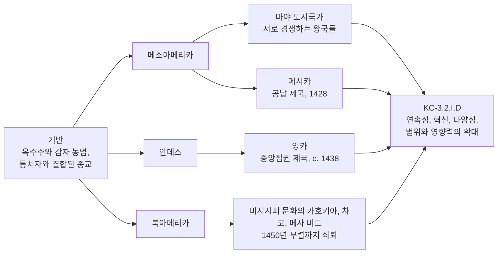
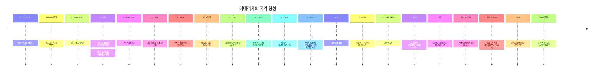
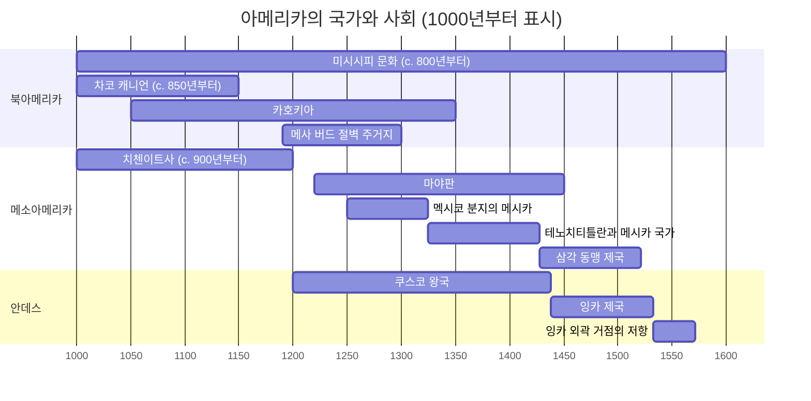
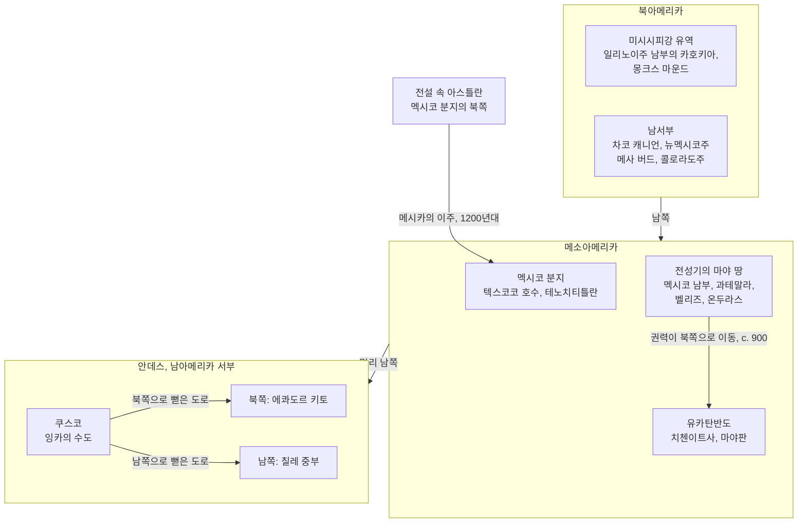
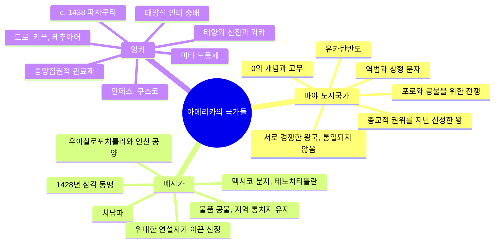

# AP 세계사: 모던 — 토픽 1.4 아메리카의 국가 형성 (State Building in the Americas)

**Focus Question (교재 Essential Question):** 아메리카에서는 어떤 국가들이 발전했으며, 그 국가들은 시간이 흐르면서 어떻게 변화했는가?

> 출처: College Board CED 기준 · 교재 반영 (교재 Topic 1.4)

**Unit 1: 세계의 태피스트리 (The Global Tapestry, c. 1200–1450)**

---

## 학습 목표 (Learning Objective)

| 코드 | 학습 목표 |
|---|---|
| 1.4 LO (GOV) | 아메리카의 국가들이 시간이 흐르면서 어떻게, 그리고 왜 발전하고 변화했는지 설명하라. |

## 역사적 개념 (Historical Developments, CED)

| # | 역사적 개념 | 다루는 곳 |
|---|---|---|
| HD1 | KC-3.2.I.D: 아프로-유라시아와 마찬가지로 아메리카에서도 국가 체제는 연속성 (Continuity), 혁신 (Innovation), 다양성 (Diversity)을 보였고, 그 범위와 영향력이 확대되었다 (Expanded in scope and reach). | §1–§6 |
| HD1 · 예시 1 | 예시: 마야 도시국가 (Maya city-states) | §1, §2 |
| HD1 · 예시 2 | 예시: 메시카 (Mexica) | §3 |
| HD1 · 예시 3 | 예시: 잉카 (Inca) | §4 |
| 교재 | 교재가 다루는 북아메리카 사회: 미시시피 문화 (Mississippian culture)와 카호키아 (Cahokia), 차코 (Chaco)와 메사 버드 (Mesa Verde, 선조 푸에블로인) | §5 |

> **참고:** CED가 1.4의 예시로 드는 것은 마야 도시국가, 메시카, 잉카이다. 교재는 여기에 더해 미시시피 문화(카호키아)와 차코·메사 버드를 별도의 절로 다루며, 핵심 용어에도 *미시시피 문화 (Mississippian)*, *모계 사회 (Matrilineal society)*, *마운드 건설 (Mound-building)*, *카호키아 (Cahokia)*를 넣었다. 수업에서는 §5를 단순한 배경이 아니라 필수 읽기 내용으로 다루어라.

---

## 큰 그림 요약

> "나는 흉내지빠귀의 노래를 사랑한다, / 사백 가지 목소리를 지닌 새를, / 나는 옥의 빛깔을 사랑한다 / 그리고 취하게 하는 꽃향기를, / 그러나 무엇보다 나는 나의 형제, 인간을 사랑한다!"
> — 네사우알코요틀 (Nezahualcoyotl) (1402–1472), 아즈텍 시인

네사우알코요틀은 **삼각 동맹 (Triple Alliance)**을 이룬 세 도시 가운데 하나인 **텍스코코 (Texcoco)**의 통치자이기도 했다 (§3). 그의 시는 **스페인인이 기록했기 때문에** 전해졌다. 오늘날 이 문명들에 대한 지식은 **고고학 증거**, **구전 (Oral tradition)**, 1492년 이후 아메리카에 온 **유럽인의 기록**을 합친 것이다. 그래서 그 많은 부분이 외부인의 눈을 거친 것이다.

메소아메리카의 **올멕 (Olmec)**과 안데스의 **차빈 (Chavín)**이 쇠퇴한 뒤, 같은 지역에서 새로운 문명들이 일어났고, 북아메리카에서도 처음으로 큰 규모의 문명이 발전했다. 1200년부터 1450년 사이 아메리카의 국가들은 아프로-유라시아의 국가들처럼 더 커지고 강해졌다. 이 국가들은 **아프로-유라시아와 접촉 없이** 발전했다. **큰 짐 끄는 동물이 없었고**(안데스의 라마는 예외), **철제 도구도 없었다**. 그런데도 **옥수수**와 **감자** 농업을 바탕으로 큰 도시와 제국을 세웠다. **메소아메리카 (Mesoamerica)**에서 **마야 (Maya)**는 끝내 하나의 제국을 이루지 않았다. **고전기 마야의 붕괴 (Classic Maya collapse, c. 900)** 이후 권력은 북쪽 **유카탄반도 (Yucatán Peninsula)**의 **후고전기 도시국가 (Postclassic city-states)**인 **치첸이트사 (Chichén Itzá)**와 **마야판 (Mayapán)**으로 옮겨 갔다. **메시카 (Mexica)**는 **멕시코 분지 (Valley of Mexico)**로 이주해 **테노치티틀란 (Tenochtitlan, c. 1325)**을 세웠고, **치남파 (Chinampa)**로 도시를 먹여 살렸다. 이어 **삼각 동맹 (Triple Alliance, 1428)** 이후 정복한 민족이 지역 통치자를 유지하도록 허락하는 **공납 제국 (Tribute empire)**을 세웠다. **안데스 (Andes)**에서는 **파차쿠티 (Pachacuti, c. 1438)**가 이끈 **잉카 (Inca)**가 아메리카에서 가장 크고 가장 **중앙집권적인 (Centralized)** 국가를 세웠다. 잉카는 **미타 (Mit'a)** 노동세, 거대한 **도로망 (Road network)**, **키푸 (Quipu)** 기록, **케추아어 (Quechua)**로 제국을 하나로 묶었다. **북아메리카**에서는 **카호키아 (Cahokia)**를 중심으로 한 **미시시피 문화 (Mississippian culture)**와 남서부의 **차코 (Chaco)**, **메사 버드 (Mesa Verde)** 사람들이 복잡한 사회를 이루었지만, 1450년 무렵까지 쇠퇴하거나 버려졌다. 이 국가들은 CED의 핵심 개념인 **연속성, 혁신, 다양성, 범위와 영향력의 확대**를 함께 보여 준다.

---

## §1. 배경: 1200년 이전의 아메리카

| 지역 | 이전의 국가와 사회 | 1200년 이후로 이어진 것 |
|---|---|---|
| **메소아메리카 (Mesoamerica)** | **올멕 (Olmecs, c. 기원전 1200–400년)**, **테오티우아칸 (Teotihuacan, c. 기원전 100년–c. 550년)**, **고전기 마야 (Classic Maya, c. 250–900)**, 툴라의 **톨텍 (Toltecs, c. 900–1150)** | 피라미드 신전, 구기 경기 (Ballgame), 깃털 달린 뱀 신 (Feathered serpent god), 260일 의례력, 옥수수 농업, 공물. 메시카는 훗날 자신들이 톨텍의 후계자라고 주장함 |
| **안데스 (Andes)** | **차빈 (Chavín, c. 기원전 900–200년)**, **와리 (Wari)**와 **티와나쿠 (Tiwanaku, c. 600–1000)**, **치무 (Chimú)** 왕국 (c. 900–1470) | 계단식 농법, 도로 일부, 노동 의무, 라마 사육. 잉카가 이를 바탕으로 삼음 |
| **북아메리카** | **미시시피 문화 (Mississippian culture)**의 마운드 건설 (교재에 따르면 700년대 또는 800년대부터), **선조 푸에블로인 (Ancestral Puebloans)** | 옥수수 농업의 확산과 흙으로 쌓은 마운드 (Mound) 건설 |

- **지리가 모든 국가의 모습을 결정했다.** 아메리카에는 말, 소 같은 가축이 없었다. 그래서 물건은 사람이 지고 나르거나 카누로 옮기거나, 안데스에서는 라마로 날랐다. 바퀴는 운송에 쓰이지 않았다.
- **식량 기반:** 메소아메리카와 북아메리카는 **옥수수, 콩, 호박**을 길렀다. 안데스는 **감자, 퀴노아**를 길렀고, 낮은 지대에서는 옥수수도 길렀다.
- **고전기 마야의 붕괴 (c. 800–900):** 티칼 (Tikal), 코판 (Copán) 같은 **남부 저지대**의 많은 도시가 버려졌다. 원인에 대해서는 역사가들 사이에 논쟁이 있다. **가뭄**, 인구 과잉, 삼림 파괴, 도시국가 사이의 끊임없는 **전쟁**이 거론된다. 이후 마야의 중심은 **북부 유카탄**으로 옮겨 갔다.
- **올멕의 영향 (교재):** 메소아메리카 문화들이 서로 얼마나 밀접하게 이어져 있는지를 두고 역사가들 사이에 논쟁이 있다. 많은 역사가는 뒤의 문화 대부분이 **올멕 (Olmec)**을 바탕으로 했다고 본다. 올멕의 **깃털 달린 뱀 신**은 마야와 아즈텍 종교의 중심이 되었고, 올멕 토기에 그려진 소재는 뒤의 토기에서도 나타나며, 올멕의 **의례적 제물, 피라미드, 구기장 (Ball court)**도 뒤의 문화로 이어졌다. 반면 다른 역사가들은 여러 문화가 **거의 독립적으로** 복잡한 문명을 발전시켰다고 본다.

## §2. 마야 도시국가

### 정치 조직

- **규모 (교재):** 전성기(c. 250–900)에 마야 문명은 **멕시코 남부**와 지금의 **벨리즈, 온두라스, 과테말라** 대부분에 걸쳐 있었다. 대부분의 마야인은 인구 5,000명에서 50,000명 규모의 약 **40개 도시** 가운데 한 곳이나 그 근처에 살았다. 전성기에는 최대 **200만 명**의 마야인이 이 지역에 살았다.
- 마야는 **끝내 하나의 제국으로 통일되지 않았다**. 수십 개의 **서로 경쟁하는 도시국가 (City-state)**로 나뉘어 있었고, 각 도시국가는 도시와 주변의 농지, 마을로 이루어졌다. 마야 땅 전체를 다스린 중앙 정부는 없었지만, 한 지역에서 **가장 강한 도시국가 하나가 이웃을 지배하는** 경우가 많았다.
- 각 도시국가는 **신의 후손**이라고 주장한 **왕** (쿠훌 아하우 (*k'uhul ajaw*), "신성한 군주")이 다스렸다. 마야인은 왕이 죽으면 조상신과 하나가 된다고 믿었다. 왕은 피 흘림 의식 (Bloodletting) 같은 **공개 의례**를 이끌었다. 왕의 권위는 **정치적이면서 종교적**이었다.
- 왕위는 보통 **아버지에게서 아들로** 이어졌지만, 백성의 지지를 잃은 왕은 때때로 **쫓겨났다**. 통치자는 대부분 남성이었지만, 남자 후계자가 없거나 나이가 어리면 **여성이 다스렸다**.
- 왕 아래에는 **귀족, 사제, 서기**가 있었다. 왕은 국정을 맡은 엘리트 서기와 사제를 지휘했다. 대부분의 사람은 옥수수를 기르는 **농민**이었고, 정부에 **세금**(보통 **농작물**)과 **노동**을 바쳤다.

> ⚠️ 확인 필요: 교재는 전성기에 최대 200만 명의 마야인이 이 지역에 살았다고 쓴다. 최근의 많은 추정치는 이보다 훨씬 많다(새로운 항공 조사 등을 바탕으로 수백만 명 이상). 인구 수치는 대략적인 값으로 다루어라.

### 전쟁과 공물

- 도시국가들은 **포로, 공물 (Tribute), 위신**을 얻으려고 서로 싸웠다. 마야는 **영토를 차지하려고 싸우는 일이 드물었다**. 패한 도시는 보통 승자에게 **공물**을 바쳤고, 때로는 도시국가가 무너지기도 했다.
- 중요한 포로는 종교 의식에서 **제물로 바쳐지기도** 했다.
- 도시국가에는 **상비군 (Standing army)이 없었다**. 전쟁이 일어나면 정부는 시민에게 **병역**을 요구했다.
- **동맹**이 자주 바뀌어서 어느 한 도시가 오래 패권을 쥐지 못했다.

### 역법, 문자, 과학

| 업적 | 내용 |
|---|---|
| **역법 (Calendar)** | **260일 의례력**과 **365일 태양력**을 합쳐 **52년 주기**를 만듦 (메소아메리카 전체가 공유). **장기력 (Long Count)**은 긴 시간을 기록했으며 주로 고전기에 쓰임. 사제들은 역법에 따라 의식을 치를 때와 **전쟁을 할지 여부**를 정함. 망원경이 없었지만 **치첸이트사 (Chichén Itzá)**의 것처럼 피라미드 위에 정밀한 **관측소 (Observatory)**를 지음. 교재는 마야의 역법이 당시 유럽의 어떤 역법보다 정확했다고 씀 |
| **문자 (Writing)** | 콜럼버스 이전 아메리카에서 가장 완전한 문자 체계인 **상형 문자 (Hieroglyphic writing)**. 돌 기념비에 새기거나 나무껍질 종이 책인 **코덱스 (Codex)**에 그림. 드레스덴 코덱스 (Dresden Codex)가 그 예 |
| **수학과 천문학** | **0의 개념**이 있는 20진법. 해, 달, 금성의 움직임을 꼼꼼히 관측함 |
| **고무 (Rubber)** | 고무나무에서 모은 액체로 **고무**를 만드는 법을 익힘 |

### 종교

- 마야의 **과학과 종교는 천문학으로 이어져 있었다**. 그래서 정확한 역법을 지키는 일이 매우 중요했다.
- **남성도 여성도 될 수 있었던 사제**들이 여러 신을 기리는 의식을 이끌었다. 가장 중요한 신으로는 **해, 비, 옥수수**의 신이 있었다.
- 마야인은 기도가 이루어지도록 **제물**을 바쳤다. **전쟁 포로**가 제물로 죽임을 당하기도 했다.

> **연결 (교재):** 마야의 정치 구조를 남아시아의 정치 구조와 비교해 보라 (Topic 1.3).

### 후고전기 도시국가 (c. 900–1450)

| 도시국가 | 시기 | 특징 |
|---|---|---|
| **치첸이트사 (Chichén Itzá)** | c. 900–1100년대 ⚠️ | 북부 유카탄. 피라미드 **엘 카스티요 (El Castillo, 쿠쿨칸 신전)**, 큰 구기장, 관측소, 신성한 **세노테 (Cenote, 석회암 싱크홀 우물)**가 있음. 주요 교역 중심지. 멕시코 중부 양식의 미술이 보임. 일부 학자는 귀족 회의가 권력을 나눠 가졌다고 봄 (논쟁 중) |
| **마야판 (Mayapán)** | c. 1220–1450 | 성벽으로 둘러싸인 도시로, **유카탄 도시국가 연맹**을 이끎. **코콤 (Cocom)** 가문이 지배함. 복속된 도시의 지도자들은 마야판에 살아야 했고, 이것이 그들을 통제하는 수단이 됨. 반란 (c. 1441) 이후 무너졌고, 유카탄은 여러 작은 나라로 갈라짐 |

> ⚠️ 확인 필요: 치첸이트사가 언제 전성기를 맞고 쇠퇴했는지는 학자마다 의견이 다르다(1000년대 중반부터 c. 1200까지 추정이 다양하다). 마야판의 멸망은 보통 c. 1441로 보지만, c. 1461까지 늦춰 보는 자료도 있다(흔히 c. 1450으로 어림한다). 교재도 이 연도를 정해 주지 않는다.

> **핵심:** 마야는 **연속성**(신성한 왕, 역법, 도시국가 체제가 고전기부터 이어짐)과 **변화**(권력이 북쪽으로 이동, 교역 증가, 마야판의 도시 연맹 시도)를 함께 보여 준다. 교재의 마야 부분은 주로 전성기(c. 250–900)의 마야를 설명한다는 점에 주의하라.

## §3. 메시카 (아즈텍) 제국

### 이주와 건국

- **메시카 (Mexica)**(교재는 "아즈텍 (Aztecs)"과 "메시카 (Mexicas)"를 함께 쓴다)는 **나우아틀어 (Nahuatl)**를 쓰는 민족으로, 본래 **수렵 채집민 (Hunter-gatherers)**이었다. 이들은 **1200년대**에 북쪽(전설 속 고향 **아스틀란 (Aztlán)**)에서 **멕시코 분지 (Valley of Mexico)**로 이주했다.
- 늦게 도착한 메시카는 처음에는 강력한 도시 **아스카포찰코 (Azcapotzalco)**의 **용병**으로 일했다.
- 전설에 따르면 그들의 신 **우이칠로포치틀리 (Huitzilopochtli)**가 **선인장 위에 앉은 독수리**를 보는 곳에 정착하라고 했다. 메시카는 **c. 1325년** 지금의 **멕시코시티** 자리인 **텍스코코 호수 (Lake Texcoco)**의 늪지대 섬에 **테노치티틀란 (Tenochtitlan)**을 세웠다. 섬이라는 위치는 도시를 **공격으로부터 지키는 데** 도움이 되었다.
- 테노치티틀란은 세계에서 가장 큰 도시 가운데 하나로 성장했다. 호숫가와는 **둑길 (Causeway)**로 이어졌고, **수로 (Aqueduct)**망으로 맑은 물을 공급받았다. 도시 한가운데에는 우이칠로포치틀리와 비의 신 틀랄록 (Tlaloc)을 함께 모신 **템플로 마요르 (Templo Mayor)**(교재의 "대피라미드 (Great Pyramid)")가 약 **150피트** 높이로 솟아 있었다. 이 피라미드와 다른 피라미드, 신전, 궁전은 **돌**로 지었다.

> ⚠️ 확인 필요: 교재는 테노치티틀란의 인구가 거의 20만 명에 이르렀다고 쓴다. 1519년 인구 추정치는 크게 다르다(대략 15만–25만 명). "약 20만 명"은 어림수로만 사용하라.

### 치남파

- **치남파 (Chinampa)**는 얕은 호수에 진흙과 식물을 층층이 쌓아 만든 인공 **돋운 밭 (Raised field)**이다. 나무로 고정했고 밭 사이로 수로가 흘렀다("떠 있는 정원"이라고도 부른다). 치남파는 **식량 생산** 공간을 늘렸다.
- 치남파는 **1년에 여러 번 수확**할 수 있어서 인구가 빽빽한 도시를 먹여 살렸다. 호수 환경에 맞춘 **혁신**이었다.
- 메시카는 또 **도랑**을 파서 호숫물로 밭에 물을 대고, 호수 일부의 **물을 빼서** 땅을 더 얻었다.

### 삼각 동맹 (1428)

- **1428년** 테노치티틀란은 **텍스코코 (Texcoco)**, **틀라코판 (Tlacopan)**과 **삼각 동맹 (Triple Alliance)**을 맺고, 메시카의 통치자 **이츠코아틀 (Itzcoatl)**의 지휘 아래 아스카포찰코를 물리쳤다.
- 곧 테노치티틀란이 **동맹의 주도 세력**이 되었다. **목테수마 1세 (Moctezuma I, 재위 1440–1469)** 같은 후대 통치자들이 영토를 넓혀, 제국은 **멕시코만에서 태평양까지** 뻗었다. 교재의 표현으로는 테노치티틀란을 세운 뒤 약 100년 안에 메시카가 주변 민족들을 정복했다.

### 공납 국가

| 특징 | 운영 방식 |
|---|---|
| **공물 (Tribute)** | 정복된 민족은 **공물**을 바치고, **땅을 내놓고**, **병역**을 져야 했음. 공물에는 식량(옥수수), **면직물**, **땔감** 같은 생활용품과 카카오, **깃털**, 옥, **구슬**, **장신구**, 재규어 가죽, 전사의 의복 같은 사치품이 있었음. 양은 그림으로 된 목록에 기록됨 |
| **지역 통치자 유지 (Local rulers kept)** | 지역 통치자는 **자리를 지키며 공물 징수인 역할**을 했음. 이로써 메시카는 **직접적인 행정 통제 없이** 정치적 우위를 유지함. 공물을 제때 바치면 그 도시의 **신과 관습도 대개 그대로 유지됨**. 그 대가로 정복민은 **아즈텍의 보호**를 받음. 메시카는 큰 관료제를 만들지 않음 |
| **지방 (Provinces)** | 메시카는 도시국가들을 **지방**으로 묶음. 각 지방의 중심 도시로 **전사와 그 가족**을 옮겨 살게 해 통제를 유지했고, 그곳에 머문 **아즈텍 관리**가 지역 관리들에게서 공물을 거둠 |
| **군사 (Military)** | **전사 계급 (Warrior class)**(**독수리 전사와 재규어 전사** 포함)이 정복을 이끎. 전사는 **포로를 잡아** 지위가 올라갔기 때문에 평민도 신분을 높일 수 있었음 |
| **결과** | **분권적인 (Decentralized)** 통치는 비용이 적게 들었지만 충성심은 얕았음. 복속민은 무거운 공물과 제물 요구에 **분노함**. **틀락스칼라 (Tlaxcala)** 같은 이웃은 끝내 정복되지 않음 |

### 종교와 사회

- 교재는 아즈텍의 정부를 **신정 (Theocracy)**, 곧 종교 지도자가 다스리는 체제로 부른다. 황제는 정치적 통치자이면서 **신들의 신성한 대리자**였다.
- 종교는 **사회의 중심**이었다. 메시카는 계속 변해 가는 **수백 명의 신으로 이루어진 판테온 (Pantheon)**을 섬겼고, 그 가운데 많은 신은 남성과 여성의 면을 함께 지녔다. 의례와 축제일도 매우 많았다.
- **우이칠로포치틀리 (Huitzilopochtli)**는 **태양과 전쟁의 신**이었다. 메시카는 태양이 하늘을 계속 가로지르려면 **사람의 피**가 필요하다고 믿었다.
- **왜 제물을 바쳤나?** 메시카는 신들이 **스스로를 희생해 세계를 만들었다**고 믿었다. 그래서 인신 공양과 피 흘림 의식은 인간의 죄에 대한 일종의 **보답이자 속죄**였다. 인신 공양에는 **정치적** 목적도 있었을 것이다. 제국의 힘을 극적으로 보여 주었기 때문이다.
- **사제**들은 템플로 마요르에서 주로 **전쟁 포로**를 대상으로 대규모 **인신 공양 (Human sacrifice)**을 했다.
- **사료 문제:** 제물의 수는 영원히 알 수 없을지도 모른다. 정보의 많은 부분은 **스페인 침략자**에게서 나왔는데, 그들은 아즈텍이 정복당해 마땅해 보이도록 인신 공양을 **과장했을** 수 있다.
- **권력의 순환:** 종교가 전쟁을 정당화했다 → 전쟁으로 포로와 공물을 얻었다 → 제사와 부가 통치자와 사제의 힘을 키웠다.

교재가 제시하는 사회 계층은 위에서부터 다음과 같다. 황제 → 땅을 가진 귀족 → 서기와 치료사 → 장인과 상인 → 농민과 병사 → 노예.

| 사회 집단 | 역할 |
|---|---|
| **우에이 틀라토아니 (Huey tlatoani, "위대한 연설자")** | 황제 (교재의 "Great Speaker"). 왕족 가운데에서 귀족 회의가 선출함. 정치적 통치자이자 군사 지도자이며 신들의 신성한 대리자 |
| **귀족 (Pipiltin, 피필틴)** | 땅을 가진 관리, 재판관, 고위 전사, 총독. **군 지휘부**의 대부분을 차지함 |
| **사제 (Priests)** | 신전, 학교, 역법, 제사를 맡음 |
| **서기와 치료사 (Scribes and healers)** | 교재의 계층에서 귀족 바로 아래 |
| **전사 (Warriors)** | 국가를 위해 싸움. 잡은 포로의 수로 지위가 정해짐 (교재는 일반 **병사**를 농민과 같은 층에 둠) |
| **장인과 상인 (Craftspeople and traders)** | 서기와 치료사 아래 |
| **상인 (Pochteca, 포치테카)** | **사치품**을 거래한 특별한 상인 계급. 다른 지역의 정보도 모은 장거리 교역 상인 |
| **평민 (Macehualtin, 마세우알틴)** | 농민과 장인. 땅을 공동으로 소유하고 노동과 병사를 제공한 혈연 기반 지역 공동체인 **칼풀리 (Calpulli)**에 속함 |
| **땅 없는 노동자와 노예 (Landless laborers and slaves)** | 귀족의 땅을 경작하거나 집안일을 함. 가장 낮은 신분. 사람들은 보통 **빚을 갚지 못하거나** **범죄의 벌**로 노예가 됨. 노예는 노동을 했고 종교 의식에서 **제물**로 바쳐지기도 함 |

### 여성의 역할

- 여성은 지역 통치자들이 정기 공물로 요구한 **귀한 옷감을 짰기** 때문에 **공납 체제**에서 중요했다.
- 옷감 공물 요구가 늘자, 남편이 공물을 마련하려고 **아내를 여럿** 두기도 했다.
- 대부분의 여성은 집에서 일했지만, 일부는 **여사제, 산파, 치료사, 상인**이 되었다. 몇몇 귀족 여성은 왕실 여성들의 **서기**로 일했다. 따라서 적어도 이 몇몇 여성은 읽고 쓸 줄 알았다.

### 쇠퇴

교재는 15세기 후반 제국이 약해진 이유로 세 가지를 든다.

- **낮은 기술 수준:** 바퀴 달린 탈것과 짐 끄는 동물이 없어서 농업이 **힘들고 비효율적**이었다.
- **과도한 팽창:** 군사적 승리에 대한 집착과 더 많은 제물을 바라는 욕구 때문에 지도자들이 제국을 **감당할 수 있는 범위 너머로** 넓혔다.
- **분노:** 정복민에게서 공물과 제물을 빼앗은 일은 **충성보다 분노**를 더 많이 낳았다. 그래서 많은 복속민은 **1519년** 스페인인이 왔을 때 반란을 일으킬 준비가 되어 있었다.

> ⚠️ 교재는 아즈텍 제국이 15세기 후반에 "쇠퇴하고 있었다"고 쓴다. 많은 설명에서는 아위초틀 (Ahuitzotl, 재위 1486–1502)과 목테수마 2세 (Moctezuma II, 재위 1502–1520) 아래에서 제국이 계속 팽창해 1519년 무렵 거의 가장 넓었고, 주된 약점은 분노한 복속민이었다고 본다. 선생님이 어떻게 가르치는지 확인이 필요하다.

> **맥락 (Unit 4):** 1519–1521년 에르난 코르테스 (Hernán Cortés)와 수백 명의 스페인인은 **수만 명의 원주민 동맹군**(특히 틀락스칼라인)과 **천연두**의 도움으로 메시카를 무너뜨렸다. 분권적인 공납 체제 때문에 많은 복속민이 메시카에 분노하고 있었다.

## §4. 잉카 제국

### 성장과 팽창

- 잉카는 남부 안데스의 **쿠스코 (Cuzco)** 주변의 작은 왕국으로 시작했다(잉카 전승에 따르면 c. 1200).
- **1438년** 스스로를 **파차쿠티 (Pachacuti)**("대지를 바꾸는 자" 또는 "대지를 뒤흔드는 자", 재위 c. 1438–1471)라고 부른 지도자가 경쟁 세력 찬카 (Chanka)를 물리치고 권력을 잡은 뒤, 쿠스코 주변의 부족들을 정복하며 **빠르게 영토를 넓혔다**. 그는 쿠스코를 제국의 수도로 다시 지었고, **마추픽추 (Machu Picchu)**는 아마 그의 왕실 영지로 지어졌을 것이다.
- 그의 승리와 뒤이은 아들 **토파 잉카 (Topa Inca)**의 승리로 작은 부족들이 하나의 온전한 국가로 합쳐졌다. 토파 잉카는 해안의 **치무 (Chimú)** 왕국을 정복하고(c. 1470) 제국을 남쪽으로 넓혔다. 1500년대 초 **타완틴수유 (Tawantinsuyu, "네 지방의 땅")**라고 불린 제국은 **에콰도르에서 칠레 중부까지** 안데스를 따라 약 **2,500마일**에 걸쳐 있었다.
- **1493년**까지 파차쿠티의 손자 **우아이나 카팍 (Huayna Capac)**이 제국을 다스리게 되었다. 그는 선대가 정복한 땅을 **다지고 관리하는 데** 힘을 쏟았다.
- **분할 상속 (Split inheritance, 왕실 조상 숭배 (Royal ancestor veneration)):** 죽은 통치자는 **미라**로 만들어져 살아 있을 때처럼 계속 "다스렸고", 하인과 재산, 땅을 그대로 소유했다. 새 통치자는 땅이나 재산을 물려받을 수 없었기 때문에 새로운 정복이 필요했다. 교재는 이것을 제국이 끊임없이 팽창한 동기의 일부로 본다.

> ⚠️ 확인 필요: 쿠스코 건국(c. 1200), 파차쿠티의 등장(1438), 우아이나 카팍의 통치(1493)(교재는 1438과 1493을 확정된 연도로 쓴다)는 모두 훗날 스페인 연대기 작가들이 기록한 잉카 구전에서 나온 것이므로 대략적인 연도이다.

### 중앙집권적 관료제

| 수단 | 운영 방식 | 목적 |
|---|---|---|
| **사파 잉카 (Sapa Inca)** | **태양신 인티 (Inti)의 아들**이자 지상에서 인티의 대리자로 여겨진 황제. 이론상 모든 땅의 주인 | 종교적 권위와 정치적 권위를 한 사람이 가짐 |
| **지방과 관리 (Provinces and officials)** | 제국을 **네 지방**으로 나누고 지방마다 **총독과 관료 조직**을 둠. 가구를 10, 100, 1,000, 10,000 단위로 세고 단위마다 관리를 둠 | 넓은 영토를 위에서 아래로 직접 통제 |
| **지역 영주 (Kuraka, 쿠라카)** | 자리를 유지했지만 잉카 관리의 감독을 받음. **충성을 보인** 정복지 지도자는 **보상을 받음** | 중앙 통제 아래에서 지역의 충성을 활용 |
| **강제 이주 (Mitma, 미트마)** | 충성스러운 집단을 새로 정복한 지역으로 옮기고, 반항적인 집단은 다른 곳으로 옮김 | 반란 방지 |
| **인질 (Hostages)** | 지역 지배층의 아들과 지역의 신성한 물건을 **쿠스코**로 데려옴 | 충성 확보 |
| **케추아어 (Quechua)** | 통치의 **공용어**로 강제함 | 다양한 민족으로 이루어진 제국을 하나로 묶음 |
| **키푸 (Quipu)** | 색깔 있는 끈에 매듭을 지어 인구, 노동, 창고 물품, **교역과 공사**에 필요한 숫자를 기록하고, 제국 곳곳으로 전하는 **소식**도 기록함. 훈련받은 전문가가 관리함 | 문자 없이 기록을 남김 |

### 미타, 아이유, 호혜성

- **미타 (Mit'a)**는 **노동세 (Labor tax)**였고, 교재는 이를 **의무적인 공공 봉사 (Mandatory public service)**라고 부른다. 가구들은 돈이나 물품 대신 돌아가며 국가를 위해 일했다. **도로, 계단식 밭, 신전, 요새**를 짓고, 국가의 땅을 경작하고, **병사**로 복무했다.
- **누가 일했나 (교재):** **15세에서 50세** 사이의 남성이 농사일과 도로 건설 같은 노동을 했다. 아즈텍 아래의 민족과 달리 잉카에 정복된 민족은 물품 **공물을 바치지 않았고**, 대신 미타를 졌다.
- **아이유 (Ayllu)**는 안데스 사회의 기본 단위였다. 땅을 공동으로 소유하고 일을 나누며, 각 가족의 미타 차례를 정한 **혈연 기반 공동체**였다.
- **호혜성 (Reciprocity):** 국가는 복무하는 사람들에게 **음식, 옥수수 술 (Chicha, 치차), 옷감**을 주었고, 기근 때에는 **창고**의 식량으로 사람들을 먹였다. 잉카는 자신의 통치를 공정한 교환으로 내세웠고, 그래서 무거운 노동 요구도 받아들이기 쉬워졌다.

> 훗날 스페인은 미타를 바꾸어 원주민을 포토시 (Potosí) 같은 은광에서 강제로 일하게 했다 (Unit 4).

### 도로와 농업

- **도로망 (Qhapaq Ñan, 카팍 냔, 교재 표기 "Carpa Nan"):** 약 **25,000마일(40,000km)**의 도로에 **밧줄 현수교**와 **역참 (Tambo, 탐보)**이 있었다. 산이 많은 지역이라 **다리**가 특히 중요했다. 릴레이 전령인 **차스키 (Chasqui)**가 소식과 키푸를 빠르게 전했다. 도로는 **주로 정부와 군대**(군대, 관리, 라마 대상)가 이용했고, 일반 백성은 허가를 받아야 했다.
- **계단식 농법 (Terrace farming):** 가파른 산비탈을 계단 모양으로 깎아 만든 밭에 **관개 수로**를 냈다. 계단식 밭은 흙이 쓸려 내려가는 것을 막고, **감자, 옥수수, 퀴노아**를 기를 평평한 땅을 만들었다. 남은 수확물(얼려 말린 감자 포함)은 국가 창고에 쌓였다.
- **와루와루 (Waru waru, 교재):** 빗물을 모아 돌려 흘려보내 홍수 때 흙이 쓸려 가는 것을 막고, 건기에 쓸 물을 저장한 **수로 딸린 돋운 밭 (Raised beds)**이다.

> ⚠️ 확인 필요: 도로망의 길이는 추정치마다 다르다. 교재와 많은 AP 학습 자료는 약 25,000마일(약 40,000km)로 쓰고, 유네스코는 약 30,000km로 쓴다.

> ⚠️ 교재는 잉카가 "포로의 노동으로" 도로를 지었다고 쓴다. 많은 설명에서는 도로를 주로 돌아가며 국가에 봉사한 미타 노동자들이 지었다고 본다. 교재의 "Carpa Nan"이라는 표기도 카팍 냔 (Capac Ñan, Qhapaq Ñan)의 인쇄 또는 OCR 변형일 수 있다. 인쇄된 교재와 대조하고, 선생님이 어떻게 가르치는지 확인이 필요하다.

> ⚠️ 교재는 와루와루를 잉카 계단식 밭에 쓰인 기술로 설명한다. 많은 설명에서는 와루와루를 티티카카 호수 주변의 평평한 고원에 만든 돋운 밭으로 보며, 잉카보다 훨씬 오래된 기술이고 산비탈의 계단식 밭과는 다르다고 본다. 선생님이 어떻게 가르치는지 확인이 필요하다.

### 종교

- **태양신 인티 (Inti)**가 국가의 최고신이었고, 잉카의 통치자는 **지상에서 인티의 대리자**로 여겨졌다. 교재는 잉카라는 이름이 "태양의 사람들"이라는 뜻이라고 쓴다.
- 쿠스코의 **코리칸차 (Coricancha, 태양의 신전 (Temple of the Sun))**는 금으로 덮여 있었다. 이곳은 **태양 숭배**와 **왕실 조상 숭배**의 중심이었기 때문에 잉카 종교의 핵심이 되었다.
- 잉카는 창조신 비라코차 (Viracocha)와 대지의 어머니 파차마마 (Pachamama)도 섬겼고, **조상을 숭배했다**. 옛 통치자들의 미라를 보관하고, 그들에게 조언을 구하고, 축제에 모시고 나왔다.
- 중요한 일을 하기 전에는 **사제**에게 물었다. 잉카인은 신이 모든 것을 다스린다고 믿었고, 사제는 접시에 놓인 **코카 잎**의 배열이나 **거미**의 움직임을 보고 신의 뜻을 읽었다. 사제는 병을 진단하고, 전투의 결과를 예언하고, 범죄를 해결하고, 어느 신에게 어떤 제물을 바칠지 정했다.
- **기근, 전염병, 전쟁 패배** 같은 심각한 일이 있을 때에는 인신 공양도 있었지만(예: 산꼭대기에서 아이를 바친 의식), 학자들은 메시카보다 **훨씬 드물었다**고 본다.
- **애니미즘 (Animism):** 잉카 종교에는 물리적 세계의 요소가 초자연적인 힘을 가질 수 있다는 믿음이 있었다. **와카 (Huaca)**라고 부른 이 신성한 장소와 물건은 강이나 산봉우리 같은 큰 지형일 수도, 돌, 식물, 다리 같은 만든 물건처럼 작은 것일 수도 있었다.

> ⚠️ 교재는 잉카라는 이름이 "태양의 사람들"이라는 뜻이라고 쓴다. 많은 설명에서는 "잉카"가 본래 "통치자" 또는 "군주"를 뜻하는 황제의 칭호(사파 잉카 (Sapa Inca), "유일한 잉카")였고, 나중에 유럽인이 민족 전체를 부르는 이름으로 썼다고 본다. 선생님이 어떻게 가르치는지 확인이 필요하다.

### 쇠퇴

- 스페인 정복자 **프란시스코 피사로 (Francisco Pizarro)**가 **1532년**에 도착했을 때, 제국은 우아이나 카팍이 죽은 뒤 그의 아들 **우아스카르 (Huáscar)와 아타우알파 (Atahualpa)** 사이의 **왕위 계승 내전**을 치르고 있었다.
- 몰락의 원인을 두고 학자들 사이에 논쟁이 있다. 어떤 학자는 **내전이 잉카 군대를 약하게 만들어** 피사로의 군대가 쉽게 이겼다고 본다. 다른 학자는 천연두 같은 **유럽인이 들여온 질병**을 강조한다.
- **1533년** 스페인은 제국의 중심부를 정복했지만, 잉카의 **외곽 거점은 1572년까지 버텼다**. 오늘날 **마추픽추**의 잉카 유적은 세계에서 가장 많은 사람이 찾는 곳 가운데 하나이다.

> **맥락 (Unit 4):** 우아스카르 (Huáscar)와 아타우알파 (Atahualpa) 형제 사이의 내전과 천연두가 1532년 프란시스코 피사로 (Francisco Pizarro)가 도착하기 전에 제국을 약하게 만들었다.

## §5. 북아메리카 사회

> **교재의 다루는 범위:** 교재는 이 사회들을 별도의 절("미시시피 문화 (The Mississippian Culture)"와 "차코와 메사 버드 (Chaco and Mesa Verde)")로 다룬다. CED의 예시는 아니지만 수업 읽기 내용에 포함된다 (역사적 개념 표 아래의 참고를 보라).

| 사회 | 위치 | 전성기 | 특징 | 쇠퇴 |
|---|---|---|---|---|
| **카호키아 (Cahokia, 미시시피 문화)** | 지금의 **세인트루이스** 근처, **미시시피강 (Mississippi River)**의 일리노이주 쪽 (교재: "일리노이주 남부") | c. 1050–1200 (미시시피 문화는 700년대 또는 800년대에 시작) | 멕시코 북쪽 북아메리카에서 가장 큰 도시. 흙으로 쌓은 마운드가 100개 넘음. 높이 약 100피트(30m)인 **몽크스 마운드 (Monks Mound)**는 콜럼버스 이전 북아메리카에서 가장 큰 흙 구조물 (교재: 높이가 100피트에 이르고 **미식축구장 12개** 넓이를 덮는 마운드도 있었음). 옥수수 농업. 강력한 족장 지배층. 구리와 조개껍데기를 강을 따라 교역함 | 1200년 이후 쇠퇴. 많은 설명에서는 **c. 1350**까지 거의 버려졌다고 봄 (교재는 **c. 1450**). 다른 큰 미시시피 도시들은 **1600년까지** 버려짐 (원인은 흉작을 부른 홍수나 이상 기후, 가뭄, 삼림 파괴, 분쟁, 그리고 뒤의 도시들에는 유럽인의 질병 등으로 논쟁 중) |
| **차코 캐니언 (Chaco Canyon, 선조 푸에블로인)** | **뉴멕시코주** 북서부 | c. 850–1150 | **돌과 진흙**으로 지은 **푸에블로 보니토 (Pueblo Bonito)** 같은 **대형 주거지 (Great house)**(여러 층, 방 수백 개). 둥근 의례용 방인 **키바 (Kiva)**. 곧은 도로. 터키석 교역. 의례와 교역의 중심지 | 오랜 **가뭄** 속에 **c. 1150**에 쇠퇴 (교재는 13세기 후반으로 씀) |
| **메사 버드 (Mesa Verde, 선조 푸에블로인)** | **콜로라도주** 남서부 | c. 1190–1300 (절벽 주거지) | **클리프 팰리스 (Cliff Palace)** 같은 **절벽 주거지 (Cliff dwelling)**. **사암** 덩어리로 협곡 벽에 지은 여러 층의 집으로, 피난처와 방어를 위한 것 | 심한 **가뭄**(c. 1276–1299) 이후 **c. 1300**에 버려짐 (교재와 같은 13세기 후반). 사람들은 남쪽으로 옮겨 갔고, 그 후손에는 호피 (Hopi), 주니 (Zuni) 등 푸에블로 민족이 있음 |

- 이 사회들은 제국이 아니라 **족장 사회 (Chiefdom)와 의례 중심지**였고, 문자가 없었다. 이들은 아메리카 사회의 **다양성**을 더해 준다.
- 이 사회들은 건조하거나 홍수가 잦은 지역에서 농업에 기댄 국가가 **기후**에 얼마나 제약을 받았는지 보여 준다.

> ⚠️ 확인 필요: 카호키아의 전성기 인구는 불확실하다(약 1만 명에서 2만 명 이상까지 추정이 다양하다). 교재는 수치를 제시하지 않는다.

### 미시시피 문화의 사회

- 교재는 미시시피 문화를 **북아메리카 최초의 큰 규모 문명**이라고 부른다. 이 문화는 **700년대 또는 800년대**에 지금의 미국 동부 **미시시피강 유역 (Mississippi River Valley)**에서 생겨났다.
- 다른 문화들이 돌로 기념비적 건물을 지은 것과 달리, 미시시피 사람들은 **거대한 흙 마운드**를 쌓았다(**마운드 건설 (Mound-building)**).
- **엄격한 계급 구조:** **위대한 태양 (Great Sun)**이라고 불린 족장이 큰 마을마다 다스렸다. 그 아래에는 사제와 귀족으로 이루어진 **상층 계급**과 농민, 사냥꾼, 상인, 장인으로 이루어진 **하층 계급**이 있었다. 맨 아래에는 대개 **전쟁 포로**였던 **노예**가 있었다.
- 대체로 **여성은 농사를 짓고 남성은 사냥을 했다**.
- **모계 사회 (Matrilineal society):** 사회적 지위는 **어머니 쪽 집안**에 따라 정해졌다. 위대한 태양이 죽으면 그 칭호는 그의 아들이 아니라 **누이의 아들**에게 넘어갔다.
- **쇠퇴에 관한 이론 (교재):** 한 이론은 **홍수나 다른 이상 기후**로 흉작이 들어 큰 도시들을 먹여 살리던 농업 경제가 무너졌다고 본다. 다른 이론은 **유럽인이 들여온 질병**이 인구를 크게 줄였다고 본다.

> ⚠️ 교재는 "이 마운드 가운데 가장 큰 것이 카호키아"라고 쓴다. 카호키아는 도시이자 마운드 유적지이고, 그곳에서 가장 큰 마운드는 몽크스 마운드이다. 인쇄된 교재와 대조해 확인이 필요하다.

> ⚠️ 교재는 "위대한 태양"이라는 칭호를 미시시피 족장 전체에 쓴다. 많은 설명에서는 이 칭호가 1700년대의 뒤늦은 미시시피계 민족인 나체즈 (Natchez)에 관한 프랑스 기록에서 나왔다고 보며, 카호키아의 통치자들이 실제로 어떻게 불렸는지는 알 수 없다고 본다. 선생님이 어떻게 가르치는지 확인이 필요하다.

> ⚠️ 교재는 카호키아가 1450년 무렵 버려졌다고 쓴다. 많은 설명에서는 카호키아가 c. 1350–1400까지 거의 버려졌다고 본다. 또 유럽인의 질병은 1492년 이후에 들어왔으므로 카호키아의 쇠퇴를 설명할 수 없다. 다만 다른 미시시피 도시들이 1600년까지 비게 된 이유는 설명할 수 있다. 선생님이 어떻게 가르치는지 확인이 필요하다.

### 남서부: 차코와 메사 버드

- 미시시피 문화가 일어난 직후, 지금의 **미국 남서부**에서도 여러 문화가 생겨났다. 이 **건조한 지역**에서 사람들은 물을 효율적으로 **모으고, 나르고, 저장하는** 방법을 발전시켰다.
- 기후 때문에 나무가 작고 드물어서, 집을 지을 **목재가 거의 없었다**.
- **차코 (Chaco):** **돌과 진흙**으로 큰 주거 건물을 지었고, 그 가운데에는 **방이 수백 개**인 것도 있었다.
- **메사 버드 (Mesa Verde):** **사암**으로 **절벽 옆면에 여러 층의 집**을 지었다(교재는 "사암으로 만든 벽돌"이라고 씀).
- 교재는 두 집단 모두 **기후가 더 건조해지면서 13세기 후반에 쇠퇴했다**고 쓴다.

> ⚠️ 교재는 차코와 메사 버드가 모두 13세기 후반에 쇠퇴했다고 쓴다. 많은 설명에서는 차코 캐니언의 쇠퇴를 오랜 가뭄이 든 c. 1130–1150으로, 메사 버드가 버려진 시기를 c. 1300으로 본다. 선생님이 어떻게 가르치는지 확인이 필요하다.

## §6. 핵심 개념 분석

| 핵심 개념 | 아메리카의 근거 | 아프로-유라시아의 비슷한 사례 |
|---|---|---|
| **연속성 (Continuity)** | 마야의 신성한 왕과 역법이 고전기부터 이어짐. 많은 역사가는 깃털 달린 뱀 신, 피라미드, 구기장, 의례적 제물이 올멕에서 비롯되었다고 봄. 메시카는 톨텍과 테오티우아칸의 전통을 빌려 옴. 잉카는 와리와 티와나쿠의 도로와 계단식 밭을 바탕으로 삼음 | 송나라가 유교 관료제를 되살림 (1.1) |
| **혁신 (Innovation)** | 치남파, 삼각 동맹, 미타 노동세, 키푸, 와루와루, 잉카 도로망, 마야의 0의 개념, 남서부의 물 저장 | 송나라의 참파 쌀 (Champa rice)과 과거제 (Civil service exam) (1.1) |
| **다양성 (Diversity)** | 서로 경쟁한 마야 도시국가, 분권적인 메시카 공납 제국, 중앙집권적인 잉카 관료 제국, 위대한 태양이 다스린 모계 사회인 미시시피 마을 같은 북아메리카의 족장 사회 | 중앙집권적인 송나라와 분권적인 봉건 유럽 (Feudalism) (1.6) |
| **범위와 영향력의 확대 (Expanded scope and reach)** | 메시카는 멕시코만에서 태평양까지 다스림. 잉카는 에콰도르에서 칠레까지 안데스 약 2,500마일을 다스림 | 몽골 제국 (2.2), 말리 (Mali) (1.5) |
| **종교가 통치를 정당화함 (Religion legitimizes rule)** | 신의 후손인 마야의 왕, 메시카의 신정과 우이칠로포치틀리에게 바친 제사, 인티의 아들이자 대리자인 사파 잉카 | 중국의 천명 (Mandate of Heaven), 델리 술탄국의 이슬람 통치자 (1.3) |

---

## 연표

---

## 지도: 아메리카에서 국가가 형성된 곳

---

## 비교표: 메시카와 잉카

| 항목 | 메시카 (Mexica) | 잉카 (Inca) |
|---|---|---|
| 지역과 수도 | 멕시코 분지. 텍스코코 호수의 **테노치티틀란 (Tenochtitlan)** | 안데스산맥. **쿠스코 (Cuzco)** |
| 성장 | c. 1325 테노치티틀란 건설. 1428 **삼각 동맹 (Triple Alliance)** | c. 1200 쿠스코 왕국. c. 1438부터 **파차쿠티 (Pachacuti)**가 팽창. 1493년까지 **우아이나 카팍 (Huayna Capac)**이 다짐 |
| 제국의 유형 | **육상 제국 (Land-based)** | **육상 제국 (Land-based)** |
| 통치자 | 귀족이 선출한 우에이 틀라토아니 (Huey tlatoani, "위대한 연설자"). 교재는 이 국가를 **신정 (Theocracy)**이라고 부름 | 인티의 아들이자 대리자인 사파 잉카 (Sapa Inca) |
| 정치적 통제 | **분권적인** 공납 국가 (Tribute state). 지역 통치자를 공물 징수인으로 유지. 지방마다 중심 도시에 아즈텍 관리를 둠 | **중앙집권적** 관료제 (Bureaucracy). 총독을 둔 네 지방, 관리, 강제 이주 |
| 재정 | **물품 공물 (Tribute)**(옷감, 카카오, 깃털, 옥수수, 땔감)과 땅, 병역 | 15–50세 남성의 **노동세 (Mit'a, 미타)**. 교재에 따르면 물품 공물은 없음 |
| 교역 (교재 표) | **활발함 (Extensive)**. 포치테카 (Pochteca)가 사치품을 거래함 | **제한적임 (Limited)**. 도로는 주로 정부와 군대가 이용함 |
| 기반 시설 | 치남파 (Chinampa), 둑길, 수로망 | 도로(약 25,000마일), 계단식 밭 (Terrace farming), 와루와루 (Waru waru), 창고 |
| 기록과 언어 | 그림 코덱스 (Codex). 나우아틀어는 퍼졌지만 강제되지 않음 | 키푸 (Quipu). **케추아어 (Quechua) 강제** |
| 종교 | 우이칠로포치틀리 (Huitzilopochtli)와 수백 명의 다른 신. **대규모 인신 공양 (Human sacrifice)** | 인티 (Inti), 조상 숭배, 와카 (Huaca). 인신 공양은 **드묾** |
| 약점 | 분노한 복속민과 정복되지 않은 이웃 (틀락스칼라 (Tlaxcala)) | 왕위 계승 내전 (우아스카르 대 아타우알파) |
| 쇠퇴 원인 (교재 표) | 유럽인의 질병, 복속민의 반란, 스페인의 공격 | 유럽인의 질병, 내전, 스페인의 공격 |
| 공통점 | 둘 다 정복으로 세운 큰 제국이었고, 종교적 권위를 지닌 통치자가 이끌었으며, 어려운 환경에 맞춘 농업 혁신이 뒷받침했음 | (동일) |

## 비교: 마야, 메시카, 잉카

### 교재 표: 아메리카 세 문명 비교

| 항목 | 마야 (Maya) | 아즈텍 (Aztec) | 잉카 (Inca) |
|---|---|---|---|
| 지역 | 멕시코/중앙아메리카 | 멕시코 중부 | 남아메리카 안데스 |
| 시기 | 400–1517 ⚠️ | 1200–1521 | 1200–1533 |
| 작물 | 옥수수, 콩, 호박 | 옥수수, 콩, 호박, 토마토 | 옥수수, 목화, 감자 |
| 교역 | 보통 (Moderate) | 활발함 (Extensive) | 제한적임 (Limited) |
| 종교 | 다신교 (Polytheistic). 일부 인신 공양 | 다신교. 일부 인신 공양 | 다신교. 일부 인신 공양 |
| 정치 | 왕이 다스리는 조직된 도시국가들. 공물을 위한 전쟁 | 강력한 왕. 포로를 위한 전쟁. 공납 체제 | 강력한 왕. 정복을 위한 전쟁. 미타 제도 |
| 기술과 사상 | 문자. 계단식 피라미드 (Step pyramid). 정확한 역법 | 계단식 피라미드. 치남파. 정확한 역법 | 와루와루. 도로. 석조 건축 (Masonry) |
| 쇠퇴 원인 | 가뭄. 삼림 파괴 | 유럽인의 질병. 복속민의 반란. 스페인의 공격 | 유럽인의 질병. 내전. 스페인의 공격 |

> ⚠️ 추출된 텍스트에서 이 표의 열 배치가 사라져, 각 열의 항목을 다시 맞추어 넣었다. 인쇄된 교재와 대조해 확인이 필요하다. 또 표의 마야 시기(400–1517)는 본문이 쓰는 마야의 전성기(250–900)와 다르다. 1517년은 스페인 원정대가 처음 유카탄에 닿은 해이다.

---

## Key Terms (핵심 용어)

| 주제 | 용어 | 정의 |
|---|---|---|
| 정치 | 도시국가 (City-state) | 주변 땅을 다스리는 독립된 도시. 마야의 정치 단위 |
| 정치 | 마야판 (Mayapán) | 유카탄 도시국가 연맹을 이끈 후고전기 마야의 중심 도시 (c. 1220–1450) |
| 정치 | 삼각 동맹 (Triple Alliance) | 메시카 제국을 만든 테노치티틀란, 텍스코코, 틀라코판의 1428년 동맹 |
| 정치 | 공납 국가 (Tribute state) | 정복한 민족에게서 물품을 거두지만 지역 통치자는 그대로 두는 제국 |
| 정치 | 신정 (Theocracy) | 종교 지도자가 다스리는 체제. 교재가 아즈텍 정부를 부르는 말로, 황제는 정치적 통치자이자 신들의 신성한 대리자였음 |
| 정치 | 우에이 틀라토아니 (Huey tlatoani) | 귀족 회의가 선출한 메시카의 황제 ("위대한 연설자", 교재의 "Great Speaker") |
| 정치 | 사파 잉카 (Sapa Inca) | 태양신 인티의 아들로 여겨진 잉카의 황제 |
| 정치 | 파차쿠티 (Pachacuti) | 1438년 쿠스코 주변 부족들을 정복하기 시작해 잉카 제국을 세운 통치자 ("대지를 바꾸는 자" 또는 "대지를 뒤흔드는 자") |
| 정치 | 우아이나 카팍 (Huayna Capac) | 1493년까지 제국을 다스리게 되어 영토를 다진 파차쿠티의 손자. 그의 죽음이 왕위 계승 내전으로 이어짐 |
| 정치 | 관료제 (Bureaucracy) | 임명된 관리들이 정부를 운영하는 체제. 잉카의 관료제는 매우 중앙집권적이었음 |
| 정치 | 미트마 (Mitma) | 정복지를 통제하려고 충성스럽거나 반항적인 집단을 옮겨 살게 한 잉카의 강제 이주 |
| 정치 | 위대한 태양 (Great Sun) | 교재가 미시시피 문화의 큰 마을을 다스린 족장에게 붙인 칭호 |
| 경제 | 공물 (Tribute) | 정복된 민족이 지배 세력에게 바쳐야 하는 물품이나 대가 |
| 경제 | 미타 (Mit'a) | 잉카의 노동세, 곧 의무적인 공공 봉사. 가구들이 돌아가며 국가를 위해 일했고, 15–50세 남성이 복무함 |
| 경제 | 호혜성 (Reciprocity) | 노동의 대가로 국가가 일꾼에게 음식과 물자를 준 잉카의 교환 관계 |
| 경제 | 치남파 (Chinampa) | 테노치티틀란을 먹여 살린 텍스코코 호수의 돋운 밭 |
| 경제 | 포치테카 (Pochteca) | 사치품을 장거리로 거래한 메시카의 특별한 상인 계급 |
| 기술 | 계단식 농법 (Terrace farming) | 농지를 만들고 흙이 쓸려 가는 것을 막으려고 산비탈을 계단 모양으로 깎은 밭 |
| 기술 | 와루와루 (Waru waru) | 빗물을 모아 돌려 흘려보내 홍수 때 흙이 쓸려 가는 것을 막고 건기에 쓸 물을 저장한 수로 딸린 돋운 밭 |
| 기술 | 키푸 (Quipu) | 잉카가 숫자와 정보를 기록하는 데 쓴 매듭 끈 |
| 기술 | 잉카 도로망 (Qhapaq Ñan) | 다리, 역참, 릴레이 전령을 갖춘 약 25,000마일의 도로 (교재 표기 "Carpa Nan") |
| 기술 | 마운드 건설 (Mound-building) | 높이가 100피트에 이르기도 한 거대한 흙 마운드를 쌓은 미시시피 문화의 관행 |
| 문화 | 우이칠로포치틀리 (Huitzilopochtli) | 인신 공양을 요구한 메시카의 태양과 전쟁의 신 |
| 문화 | 인신 공양 (Human sacrifice) | 신에게 힘을 주려고 주로 전쟁 포로를 죽인 의례. 메시카는 이를 신들의 희생에 대한 보답으로 보았고, 제국의 힘을 보여 주는 역할도 했음 |
| 문화 | 인티 (Inti) | 잉카의 태양신이자 국가의 최고신 |
| 문화 | 태양의 신전 (Temple of the Sun, Coricancha) | 태양 숭배와 왕실 조상 숭배의 중심이어서 잉카 종교의 핵심이 된, 금으로 덮인 쿠스코의 신전 |
| 문화 | 왕실 조상 숭배 (Royal ancestor veneration) | 미라가 된 통치자가 재산을 계속 소유해 새 통치자가 새 땅을 정복해야 했던 잉카의 관행 |
| 문화 | 애니미즘 (Animism, 와카 (Huaca)) | 물리적 세계의 일부가 초자연적인 힘을 가진다는 믿음. 잉카의 신성한 장소와 물건을 와카라고 불렀음 |
| 문화 | 마야의 역법과 문자 (Maya calendar and writing) | 260일·365일 역법과 상형 문자 체계 |
| 문화 | 케추아어 (Quechua) | 잉카가 통치 언어로 강제한 안데스의 언어 |
| 사회 | 메시카 (Mexica, 아즈텍 (Aztecs)) | 1200년대에 멕시코 분지로 이주해 테노치티틀란을 세운 나우아틀어를 쓰는 민족 |
| 사회 | 아이유 (Ayllu) | 땅을 공동으로 소유한 안데스의 혈연 기반 공동체 |
| 사회 | 칼풀리 (Calpulli) | 땅을 소유하고 노동을 제공한 메시카의 혈연 기반 지역 공동체 |
| 사회 | 전사 계급 (Warrior class) | 포로를 잡아 지위가 오른 독수리 전사, 재규어 전사 같은 메시카의 전사들 |
| 사회 | 미시시피 문화 (Mississippian culture) | 700년대 또는 800년대에 미시시피강 유역에서 생겨나 마운드로 유명한 북아메리카 최초의 큰 규모 문명 |
| 사회 | 모계 사회 (Matrilineal society) | 사회적 지위가 어머니 쪽에서 정해지는 사회. 미시시피 문화의 위대한 태양의 칭호는 누이의 아들에게 넘어감 |
| 사회 | 카호키아 (Cahokia) | 미시시피강 근처의 미시시피 문화 도시. 전성기는 c. 1050–1200. 많은 설명에서는 c. 1350까지 버려졌다고 봄 (교재는 c. 1450) |
| 사회 | 선조 푸에블로인 (Ancestral Puebloans) | 차코 캐니언과 메사 버드 절벽 주거지를 세운 남서부의 민족 |
