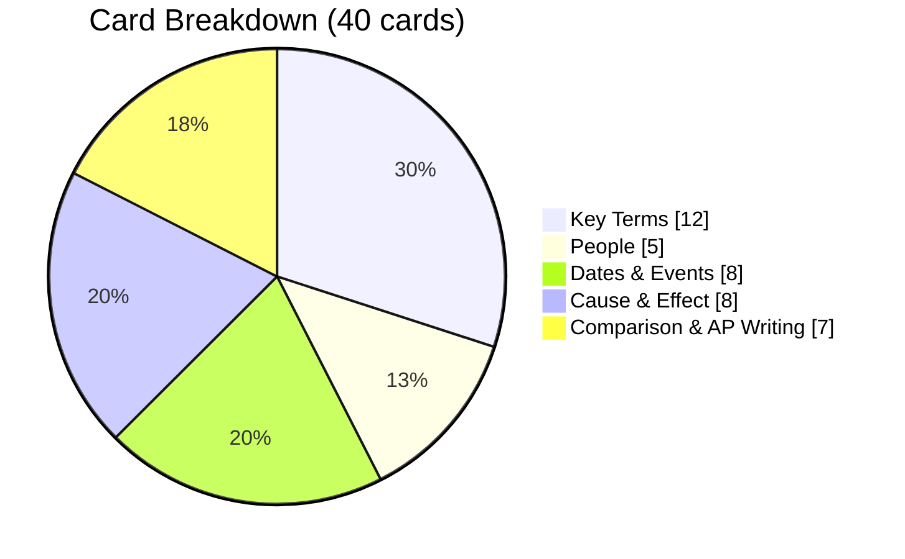

# AP World History: Modern — Topic 1.5 State Building in Africa · Flashcards

> Source: Based on the College Board CED · Textbook incorporated (Topic 1.5 reading)

---

## 1. Key Terms

- [ ] **What was the trans-Saharan gold-salt trade?**

▶ Answer
Camel caravans crossed the Sahara and exchanged West African gold (from fields such as Bambuk and Bure) for Saharan salt (from mines such as Taghaza). Ghana's rulers sold gold and ivory to Muslim traders for salt, copper, cloth, and tools. Ghana and then Mali grew rich by controlling and taxing this trade (see 2.4).

- [ ] **What were kin-based networks, and what did a chief do?**

▶ Answer
Communities in Sub-Saharan Africa where families governed themselves instead of living under one central government. A male head, the chief, settled conflicts and dealt with neighboring groups. Groups of villages formed districts, and councils of chiefs solved district problems. Many lasted until the 19th century, but larger kingdoms grew after 1000.

- [ ] **Who were griots and griottes?**

▶ Answer
Griots were West African hereditary storytellers, musicians, and oral historians. They knew family lineages and the deeds of great leaders, sang their stories with drums and the kora (a harp), advised kings, and passed down the Epic of Sundiata. People said a griot could "sing your success or sing your downfall," and when a griot died, "it was as though a library had burned." Griottes were women griots who sang at weddings and counseled brides, giving women a sense of empowerment in a patriarchal society.

- [ ] **Why was Timbuktu important?**

▶ Answer
It sat on the bend of the Niger River where Saharan caravans met river boats, so it was a major trade city. It also became a center of Islamic scholarship, with mosques such as Djinguereber and Sankore and large manuscript collections.

- [ ] **What is syncretism? Give an example from Mali or Ethiopia.**

▶ Answer
The blending of different religious or cultural traditions. Mali's rulers and merchants converted to Islam, but the court kept traditional rituals and griots; Ibn Battuta saw a court custom from before Islam, in which the chief of the poets laid his head on the sultan's lap and shoulders. In Ethiopia, people blended ancestor veneration and belief in spirits with Christianity.

- [ ] **What were the Hausa kingdoms?**

▶ Answer
Seven city-states in northern Nigeria, such as Kano, Katsina, and Zaria, formed sometime before 1000 (according to the textbook). Each walled city was ruled by a sarki and had its own specialty, such as cotton cloth, dyeing, or leather. They were loosely linked by kinship, had no central authority, were often dominated by outsiders, and were never unified into one empire. Islam reached their rulers in the 14th century (the textbook says through missionaries; the Kano Chronicle names Wangara Muslim merchants).

- [ ] **What was Great Zimbabwe?**

▶ Answer
The stone capital of a powerful kingdom (12th–15th centuries) built by the ancestors of the Shona, Bantu speakers, between the Zambezi and Limpopo rivers. Its granite walls were built without mortar. The textbook describes a wall 30 feet tall and 15 feet thick around the capital and nearly 20,000 people (many accounts give the Great Enclosure wall about 11 m). Its wealth came from cattle, farming, and above all gold, through taxes on gold transport and trade to the Swahili coast.

- [ ] **What are the rock-hewn churches of Lalibela?**

▶ Answer
Eleven Ethiopian churches carved downward out of solid rock around 1200, credited to the Zagwe king Lalibela. The textbook says the new 12th-century Christian kingdom showed its power through this architecture. Tradition says the site was meant as a "New Jerusalem." The cross-shaped Church of St. George is the most famous.

- [ ] **What is the Kebra Nagast?**

▶ Answer
"Glory of the Kings," an Ethiopian text compiled in Ge'ez in the early 14th century. It tells how Menelik I, son of King Solomon and the Queen of Sheba, founded Ethiopia's royal line, and it legitimized the Solomonic dynasty.

- [ ] **What were the Swahili city-states, and what is Swahili?**

▶ Answer
Independent Muslim trading cities on the East African coast, such as Kilwa, Mombasa, Malindi, and Mogadishu. They used the monsoon winds for Indian Ocean trade and traded with Zimbabwe (see 2.3). Swahili is a Bantu language with many Arabic words; the textbook says coastal traders blended Bantu and Arabic to create it, and it is still spoken in the African Great Lakes region today.

- [ ] **What were age sets, and how did gender shape work?**

▶ Answer
Age sets (also called age grades) were groups of people of the same age who were initiated together and shared duties such as farming, defense, or warfare; younger people relied on the advice of elders. Men did most work that needed a specialized skill, such as leather tanning and blacksmithing. Women generally farmed, gathered food, did most household chores, and raised children.

- [ ] **What were the three forms of slavery in the textbook's table?**

▶ Answer
Chattel slavery: people were the owner's legal property, usually for life, and their children were enslaved (common in the Americas, 16th–19th centuries). Domestic slavery: people worked as household servants, often for life, sometimes with customs that stopped their sale. Debt bondage: people were enslaved, sometimes by agreement, to repay a debt; it was not permanent in theory, but children often inherited the debt.

## 2. People

- [ ] **Who was Sundiata Keita?**

▶ Answer
A Malinke (Mande) prince who defeated Sumanguru, king of the Sosso, at the Battle of Kirina (c. 1235) and founded the Mali Empire. The textbook says most scholars believe he was a Muslim who used ties with North African and Arab merchants to build a thriving gold trade (many accounts say his Islam was only nominal). His story is told in the Epic of Sundiata by griots.

- [ ] **Who was Mansa Musa?**

▶ Answer
Mali's ruler at its height (r. c. 1312–1337; some historians say c. 1307–1332). "Mansa" means "king" or "emperor." His hajj of 1324 spread so much gold in Cairo that its value fell, and his lavish displays "left a lasting impression." He brought back scholars and architects and supported Islamic learning in Timbuktu. The 1.5 textbook reading calls him Sundiata's nephew; the 2.4 reading and many accounts call him Sundiata's grand-nephew.

- [ ] **Who was Ibn Battuta, and what did he say about Mali?**

▶ Answer
A Moroccan scholar of Islamic law (shariah) whose advice was sought by Muslim governments in Mogadishu and Delhi. He visited Kilwa (1331) and Mali (1352–1353). He praised Mali's safety and justice, criticized some local customs as un-Islamic, and described a court custom from before Islam, which shows that Mali kept its traditions after adopting Islam.

- [ ] **Who was King Lalibela?**

▶ Answer
A Zagwe king of Ethiopia (r. c. 1181–1221) who is credited with the rock-hewn churches at Lalibela.

- [ ] **Who was Yekuno Amlak?**

▶ Answer
The Ethiopian ruler who overthrew the Zagwe dynasty in 1270 and founded the Solomonic dynasty, which claimed descent from Solomon and Sheba.

## 3. Dates & Events

- [ ] **8th–11th centuries**

▶ Answer
The Ghana Empire is at its peak. From its capital, Koumbi Saleh, the king ruled a centralized government with nobles and an army with iron weapons. The kingdom was not in the same place as the modern nation of Ghana.

- [ ] **869–883**

▶ Answer
The Zanj Rebellion. Enslaved East Africans (Zanj), brought to Mesopotamia by the Indian Ocean slave trade, rose up with many Arab workers. The textbook says about 15,000 rebels captured Basra and held it for ten years (many accounts say they sacked it in 871 and ruled from their own capital).

- [ ] **c. 1076**

▶ Answer
Almoravid pressure on the Ghana Empire, traditionally described as a conquest (now disputed). The textbook says only that wars with neighbors had permanently weakened Ghana by the 12th century. Ghana declined through the 1200s.

- [ ] **c. 1200**

▶ Answer
The rock-hewn churches of Lalibela are carved in Ethiopia, and Great Zimbabwe begins to grow.

- [ ] **c. 1235**

▶ Answer
Sundiata wins the Battle of Kirina and founds the Mali Empire.

- [ ] **1270**

▶ Answer
Yekuno Amlak founds Ethiopia's Solomonic dynasty.

- [ ] **1324**

▶ Answer
Mansa Musa's hajj to Mecca through Cairo, where his gold lowered its value for years.

- [ ] **c. 1450**

▶ Answer
Great Zimbabwe declines and is abandoned (the textbook says by the end of the 1400s), as overgrazing damages the land and trade shifts north toward the Zambezi (Mutapa).

## 4. Cause & Effect

- [ ] **Cause → Effect: Why did larger kingdoms grow in Sub-Saharan Africa after 1000?**

▶ Answer
Settled farming (adopted by most of the region by 1000) led to population growth. Kin-based networks became harder to govern, competition and fighting between villages and districts increased, and small communities struggled to survive, so larger kingdoms gained importance.

- [ ] **Cause → Effect: What were the effects of Mansa Musa's hajj?**

▶ Answer
His gold lowered gold's value in Cairo for years, Mali became famous (the Catalan Atlas of 1375 shows him), and he brought back scholars and architects who helped make Timbuktu a center of Islamic learning.

- [ ] **Cause: Why did West African rulers adopt Islam, and why did they keep traditional practices?**

▶ Answer
Islam gave them ties to Muslim merchants, literacy in Arabic, and prestige. They kept traditional rituals because most rural subjects still followed traditional beliefs, so syncretism helped them keep everyone loyal.

- [ ] **Cause → Effect: Why did Great Zimbabwe become rich and powerful?**

▶ Answer
It had rich gold fields, and taxes on the transport of gold made the kingdom wealthy. Its rulers also owned many cattle and controlled the gold and ivory trade to coastal city-states such as Sofala, Kilwa, Mombasa, and Mogadishu, which tied it into the Indian Ocean trade. This wealth paid for stone walls and brought in Chinese porcelain and Persian pottery.

- [ ] **Cause: Why was Great Zimbabwe abandoned?**

▶ Answer
The textbook says overgrazing so damaged the surrounding land that residents abandoned the capital by the end of the 1400s. Many accounts add land exhaustion and a shift of the gold trade north toward the Zambezi, where the Mutapa state rose, and date the decline from about 1450.

- [ ] **Cause → Effect: Why did Mali decline, and what replaced it?**

▶ Answer
Weak rulers and succession disputes after Mansa Sulayman weakened Mali. The Tuareg took Timbuktu (1433), and the Songhai under Sunni Ali took Timbuktu (1468) and became the main West African empire.

- [ ] **Cause → Effect: Why did the Solomonic dynasty stress its descent from Solomon and Sheba?**

▶ Answer
Yekuno Amlak took power by overthrowing the Zagwe in 1270, so he needed legitimacy. The Kebra Nagast told the Solomon and Sheba story, which made Solomonic rule seem sacred, and the Church supported the kings.

- [ ] **Cause → Effect: Why did Ethiopia develop a distinct form of Christianity?**

▶ Answer
From the 12th through the 16th centuries, Ethiopia was an "island of Christianity" surrounded by Muslim states and cut off from the Roman Catholic and Eastern Orthodox churches of Europe. Its Christianity developed independently and blended in traditional beliefs such as ancestor veneration and spirits. (Many accounts stress that it stayed linked to the Coptic Church of Egypt.)

## 5. Comparison & AP Writing

- [ ] **Compare: How were Mali and Great Zimbabwe similar and different?**

▶ Answer
Similar: both had rich gold fields, grew rich from gold trade with long-distance merchants, and had strong central rulers. Different: Mali relied on land-based trade across the Sahara and its rulers adopted Islam; Great Zimbabwe traded by sea through the Swahili coast into the Indian Ocean and kept traditional Shona beliefs.

- [ ] **Compare: How did Mali and the Hausa kingdoms differ in political structure?**

▶ Answer
Mali was a centralized empire under one mansa, with governors and tributary rulers. The Hausa kingdoms were decentralized city-states, each with its own sarki, loosely linked by kinship; they competed, were often dominated by outsiders, and were never unified into one empire.

- [ ] **Compare: How did the kin-based networks of inland Africa differ from the Inca state (1.4)?**

▶ Answer
Inland African kin-based networks were decentralized: families governed themselves, chiefs settled conflicts, and councils of chiefs ran districts without a central government. The Inca were highly centralized under one emperor in Cuzco, with officials, roads, and the mit'a labor system controlling a huge empire.

- [ ] **Compare: How was slavery in Africa different from later Atlantic slavery?**

▶ Answer
In Africa, most enslaved people were war captives, debtors, or criminals who worked as servants, farmers, or soldiers; they could be absorbed into kin groups, owning many of them raised one's status, and slavery was not based on race. Atlantic slavery was hereditary chattel slavery, mostly plantation labor, and increasingly based on race. The Indian Ocean slave trade from East Africa to the Middle East began centuries before the Atlantic trade.

- [ ] **AP Short Answer: Explain one way African rulers legitimized their power from 1200 to 1450.**

▶ Answer

**Claim:** Ethiopia's Solomonic dynasty legitimized its power through religion. 
**Evidence:** After Yekuno Amlak overthrew the Zagwe in 1270, the Kebra Nagast claimed the kings descended from King Solomon and the Queen of Sheba, and kings gave land to churches and monasteries. 
**Reasoning:** Linking the king to a sacred biblical line and to the Church made his rule seem chosen by God, which helped a Christian kingdom surrounded by Muslim states stay united.

- [ ] **AP Short Answer: Explain one way trade shaped the development of an African state from 1200 to 1450.**

▶ Answer

**Claim:** Trans-Saharan trade made Mali rich and powerful. 
**Evidence:** Mali controlled the gold fields and taxed gold, salt, and copper, and Mansa Musa's 1324 hajj spread so much gold in Cairo that its value fell. 
**Reasoning:** Taxes on trade paid for the empire and its army, and trade contacts brought Islam and scholars, which turned Timbuktu into a center of learning.

- [ ] **AP Long Essay Thesis: Evaluate the extent to which African states showed continuity and innovation from 1200 to 1450.**

▶ Answer

**Claim:** African states showed strong continuity in their economic and religious foundations, but they also introduced important innovations in religion, architecture, and the ways rulers legitimized power. 
**Evidence:** Mali took over Ghana's gold-salt trade, Ethiopia continued Aksum's Christianity, and kin-based networks with chiefs lasted for centuries, but Mansa Musa built up Islamic learning in Timbuktu, the Zagwe carved the Lalibela churches, the Shona built Great Zimbabwe's dry-stone walls, and the Kebra Nagast gave the Solomonic dynasty a new claim to rule. 
**Reasoning:** Rulers built on older trade routes and faiths because these already gave them wealth and loyalty, but they innovated to win new prestige and legitimacy, which produced a diverse set of empires, city-states, and kingdoms.

