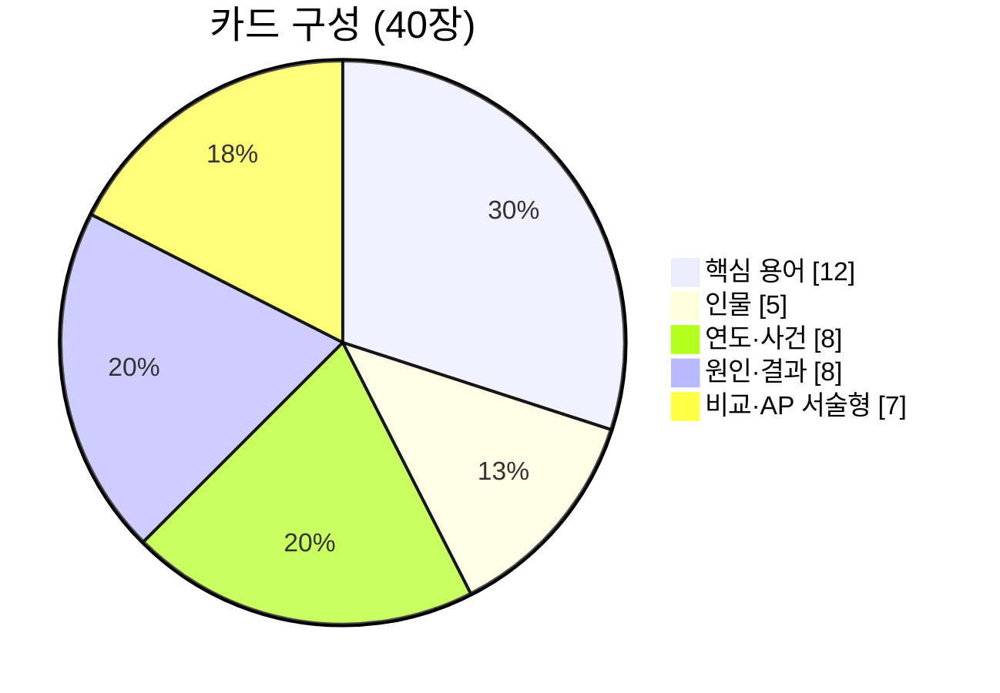

# AP 세계사: 모던 — 토픽 1.5 아프리카의 국가 형성 (State Building in Africa) · 플래시카드

> 출처: College Board CED 기준 · 교재 반영 (교재 Topic 1.5)

---

## 1. 핵심 용어

- [ ] **사하라 횡단 금-소금 교역 (Trans-Saharan gold-salt trade)이란 무엇이었는가?**

▶ 정답
낙타 대상이 사하라를 건너 서아프리카의 금(밤부크 (Bambuk), 부레 (Bure) 같은 금광)과 사하라의 소금(타가자 (Taghaza) 같은 소금 광산)을 교환한 교역이다. 가나의 통치자들은 무슬림 상인에게 금과 상아를 팔고 소금, 구리, 옷감, 도구를 받았다. 가나와 그 뒤의 말리는 이 교역을 장악하고 세금을 거두어 부유해졌다 (2.4 참고).

- [ ] **친족 기반 네트워크 (Kin-based networks)란 무엇이며, 족장 (Chief)은 어떤 일을 했는가?**

▶ 정답
사하라 이남 아프리카에서 하나의 중앙 정부 대신 가족이 스스로를 다스린 공동체다. 남성 우두머리인 족장이 분쟁을 조정하고 이웃 집단을 상대했다. 여러 마을이 지구 (District)를 이루었고, 족장 회의가 지구의 문제를 풀었다. 많은 공동체가 19세기까지 이어졌지만, 1000년 이후에는 더 큰 왕국들이 성장했다.

- [ ] **그리오 (Griot)와 그리오트 (Griotte)는 누구인가?**

▶ 정답
그리오는 대대로 이어지는 서아프리카의 이야기꾼이자 음악가, 구전 역사가다. 이들은 가문의 계보와 위대한 지도자의 업적을 알았고, 북과 코라 (Kora, 하프)를 연주하며 이야기를 노래했다. 또 왕에게 조언했고 순디아타 서사시 (Epic of Sundiata)를 전했다. 사람들은 그리오가 "당신의 성공을 노래할 수도, 몰락을 노래할 수도 있다"고 했고, 그리오가 죽으면 "도서관 하나가 불탄 것과 같다"고 했다. 그리오트는 여성 그리오로, 결혼식에서 노래하고 신부에게 조언했다. 이들은 가부장적 사회에서 여성에게 힘을 주는 존재였다.

- [ ] **팀북투 (Timbuktu)가 중요했던 이유는?**

▶ 정답
사하라 대상과 강배가 만나는 니제르강 굽이에 있어서 큰 교역 도시였다. 또한 징게레베르 (Djinguereber)와 산코레 (Sankore) 같은 모스크와 많은 필사본을 갖춘 이슬람 학문의 중심지가 되었다.

- [ ] **혼합주의 (Syncretism)란 무엇인가? 말리나 에티오피아의 예를 들어라.**

▶ 정답
서로 다른 종교나 문화 전통이 섞이는 것이다. 말리의 통치자와 상인은 이슬람으로 개종했지만, 궁정은 토착 의례와 그리오를 유지했다. 이븐 바투타는 시인들의 우두머리가 술탄의 무릎과 어깨에 머리를 얹는, 이슬람 이전부터 내려온 궁정 관습을 보았다. 에티오피아에서는 사람들이 조상 숭배 (Ancestor veneration)와 정령 신앙을 기독교와 결합했다.

- [ ] **하우사 왕국 (Hausa kingdoms)이란 무엇이었는가?**

▶ 정답
카노, 카치나, 자리아 같은 나이지리아 북부의 일곱 도시 국가 (City-state)로, 교재에 따르면 1000년 이전 어느 때 형성되었다. 성벽을 두른 각 도시는 사르키 (Sarki)가 다스렸고, 면직물, 염색, 가죽 같은 저마다의 특산 분야가 있었다. 이들은 친족 관계로 느슨하게만 이어졌고, 중앙 권력이 없었으며, 외부 세력의 지배를 자주 받았고, 하나의 제국으로 통일되지 않았다. 이슬람은 14세기에 통치자들에게 전해졌다(교재는 선교사가 전했다고 쓰고, 카노 연대기는 왕가라 (Wangara) 무슬림 상인을 든다).

- [ ] **그레이트 짐바브웨 (Great Zimbabwe)란 무엇이었는가?**

▶ 정답
반투어를 쓰는 쇼나족 (Shona)의 조상이 잠베지강과 림포포강 사이에 세운 강한 왕국(12–15세기)의 석조 수도다. 화강암 벽을 모르타르 없이 쌓았다. 교재는 높이 30피트, 두께 15피트의 석벽이 수도를 둘러쌌고 인구가 거의 2만 명이었다고 쓴다(많은 설명에서는 그레이트 인클로저의 벽 높이를 약 11미터로 본다). 부는 소, 농업, 그리고 무엇보다 금에서 나왔다. 금 운송세와 스와힐리 해안으로 가는 교역이 왕국을 부유하게 했다.

- [ ] **랄리벨라의 암반 교회 (Rock-hewn churches of Lalibela)란 무엇인가?**

▶ 정답
1200년 무렵 단단한 바위를 아래로 파 내려가며 깎아 만든 에티오피아의 교회 11개다. 자그웨 왕조의 랄리벨라 왕이 만든 것으로 알려져 있다. 교재에 따르면 12세기에 등장한 새 기독교 왕국은 이 건축으로 권력을 드러냈다. 전승에 따르면 "새 예루살렘"으로 만들려 했다. 십자가 모양의 성 게오르기우스 교회가 가장 유명하다.

- [ ] **케브라 나가스트 (Kebra Nagast)란 무엇인가?**

▶ 정답
"왕들의 영광"이라는 뜻으로, 14세기 초 게에즈어 (Ge'ez)로 편찬된 에티오피아의 책이다. 솔로몬 왕과 시바 여왕의 아들 메넬리크 1세가 에티오피아 왕가를 세웠다는 이야기를 담았다. 이 책은 솔로몬 왕조를 정당화했다.

- [ ] **스와힐리 도시 국가 (Swahili city-states)란 무엇이었으며, 스와힐리어 (Swahili)란 무엇인가?**

▶ 정답
킬와, 몸바사, 말린디, 모가디슈 같은 동아프리카 해안의 독립된 무슬림 교역 도시다. 이들은 몬순 (Monsoon)을 이용해 인도양 교역을 했고 짐바브웨와도 교역했다 (2.3 참고). 스와힐리어는 아랍어 단어가 많이 섞인 반투어다. 교재에 따르면 해안의 상인들이 반투어와 아랍어를 섞어 만들었고, 지금도 아프리카 대호수 지역에서 쓰인다.

- [ ] **연령 집단 (Age sets)이란 무엇이며, 성별 (Gender)은 일의 분담에 어떤 영향을 주었는가?**

▶ 정답
연령 집단(연령 등급 (Age grades)이라고도 한다)은 같은 나이에 함께 성인식을 치르고 농사, 방어, 전쟁 같은 의무를 나눈 사람들의 집단이다. 젊은이들은 어른의 조언에 기댔다. 남성은 가죽 무두질이나 대장일처럼 전문 기술이 필요한 일을 주로 맡았다. 여성은 주로 농사와 먹을거리 채집, 대부분의 집안일, 자녀 양육을 맡았다.

- [ ] **교재 표에 나오는 세 가지 형태의 노예제는 무엇인가?**

▶ 정답
동산 노예제 (Chattel slavery): 사람이 주인의 법적 재산이었고, 대개 평생 이어졌으며 자녀도 노예가 되었다(16–19세기 아메리카에서 흔했다). 가내 노예제 (Domestic slavery): 사람이 집안 하인으로 일했고, 대개 평생 이어졌으며, 관습이 매매를 막기도 했다. 채무 노예제 (Debt bondage): 빚을 갚으려고, 때로는 합의에 따라 노예가 되었다. 원칙적으로는 영구적이지 않았지만, 자녀가 빚을 물려받는 경우가 많았다.

## 2. 인물

- [ ] **순디아타 케이타 (Sundiata Keita)는 누구인가?**

▶ 정답
키리나 전투 (Battle of Kirina, c. 1235)에서 소소 (Sosso)의 왕 수망구루 (Sumanguru)를 물리치고 말리 제국을 세운 말링케족 (만데족) 왕자다. 교재에 따르면 대부분의 학자는 그가 무슬림이었고, 북아프리카와 아랍 상인과의 관계를 이용해 번성하는 금 교역을 일구었다고 본다(많은 설명에서는 그의 이슬람 신앙이 명목상이었다고 본다). 그의 이야기는 그리오가 전한 순디아타 서사시에 담겨 있다.

- [ ] **만사 무사 (Mansa Musa)는 누구인가?**

▶ 정답
전성기 말리의 통치자다(재위 c. 1312–1337. c. 1307–1332년으로 보는 역사가도 있다). "만사 (Mansa)"는 "왕" 또는 "황제"라는 뜻이다. 1324년 하즈 (Hajj) 때 카이로에 금을 너무 많이 풀어서 금값이 떨어졌고, 그의 호화로운 금은 "오래 남는 인상을 남겼다". 그는 학자와 건축가를 데려왔고, 팀북투의 이슬람 학문을 후원했다. 1.5 교재는 그를 순디아타의 조카라고 쓰지만, 2.4 교재와 많은 설명에서는 순디아타의 종손이라고 본다.

- [ ] **이븐 바투타 (Ibn Battuta)는 누구이며, 말리에 대해 무엇이라고 했는가?**

▶ 정답
이슬람법 (Shariah, 샤리아)에 밝은 모로코 출신 학자로, 모가디슈와 델리의 이슬람 정부가 그에게 조언을 구했다. 그는 킬와(1331)와 말리(1352–1353)를 방문했다. 그는 말리의 안전과 정의를 칭찬했고, 일부 현지 관습은 이슬람답지 않다고 비판했다. 또 이슬람 이전부터 내려온 궁정 관습을 기록했다. 이는 말리가 이슬람을 받아들인 뒤에도 전통을 지켰음을 보여 준다.

- [ ] **랄리벨라 왕 (King Lalibela)은 누구인가?**

▶ 정답
랄리벨라의 암반 교회를 만든 것으로 알려진 에티오피아 자그웨 왕조의 왕이다(재위 c. 1181–1221).

- [ ] **예쿠노 암라크 (Yekuno Amlak)는 누구인가?**

▶ 정답
1270년 자그웨 왕조를 무너뜨리고 솔로몬 왕조를 세운 에티오피아의 통치자다. 솔로몬 왕조는 솔로몬과 시바의 후손이라고 주장했다.

## 3. 연도·사건

- [ ] **8–11세기**

▶ 정답
가나 제국 (Ghana Empire)의 전성기다. 왕은 수도 쿰비 살레 (Koumbi Saleh)에서 귀족, 철제 무기를 갖춘 군대와 함께 중앙 집권 정부를 이끌었다. 이 왕국은 오늘날의 가나 공화국과 위치가 다르다.

- [ ] **869–883년**

▶ 정답
잔지 반란 (Zanj Rebellion)이다. 인도양 노예 무역 (Indian Ocean slave trade)으로 메소포타미아에 끌려온 동아프리카인 노예(잔지 (Zanj))가 많은 아랍 노동자와 함께 봉기했다. 교재에 따르면 약 1만 5천 명의 반란군이 바스라를 점령하고 10년 동안 지켰다(많은 설명에서는 871년에 바스라를 약탈하고 자신들의 수도에서 다스렸다고 본다).

- [ ] **c. 1076년**

▶ 정답
알모라비드 (Almoravids)가 가나 제국을 압박했다. 전통적으로는 정복으로 설명하지만 지금은 논쟁 중이다. 교재는 12세기까지 이웃과의 전쟁이 가나를 영구히 약하게 만들었다고만 쓴다. 가나는 1200년대에 걸쳐 쇠퇴했다.

- [ ] **c. 1200년**

▶ 정답
에티오피아에서 랄리벨라의 암반 교회가 만들어졌고, 그레이트 짐바브웨가 성장하기 시작했다.

- [ ] **c. 1235년**

▶ 정답
순디아타가 키리나 전투에서 이기고 말리 제국을 세웠다.

- [ ] **1270년**

▶ 정답
예쿠노 암라크가 에티오피아의 솔로몬 왕조를 세웠다.

- [ ] **1324년**

▶ 정답
만사 무사가 카이로를 거쳐 메카로 하즈를 떠났다. 그가 쓴 금 때문에 카이로의 금값이 몇 년 동안 떨어졌다.

- [ ] **c. 1450년**

▶ 정답
과도한 방목이 땅을 망가뜨리고 교역의 중심이 북쪽 잠베지강 쪽(무타파 (Mutapa))으로 옮겨 가면서 그레이트 짐바브웨가 쇠퇴하고 버려졌다(교재는 1400년대 말까지라고 쓴다).

## 4. 원인·결과

- [ ] **원인 → 결과: 1000년 이후 사하라 이남 아프리카에서 더 큰 왕국들이 성장한 이유는?**

▶ 정답
1000년까지 이 지역 대부분이 받아들인 정착 농경으로 인구가 늘었다. 친족 기반 네트워크는 다스리기 더 어려워졌고, 마을과 지구 사이의 경쟁과 싸움이 늘었으며, 작은 공동체는 살아남기 힘들어졌다. 그래서 더 큰 왕국들이 중요해졌다.

- [ ] **원인 → 결과: 만사 무사의 하즈는 어떤 결과를 낳았는가?**

▶ 정답
카이로의 금값이 몇 년 동안 떨어졌고, 말리가 널리 알려졌다(1375년 카탈루냐 지도 (Catalan Atlas)에 그가 그려져 있다). 또 그가 데려온 학자와 건축가들 덕분에 팀북투가 이슬람 학문의 중심지가 되었다.

- [ ] **원인: 서아프리카 통치자들이 이슬람을 받아들이면서도 토착 의례를 유지한 이유는?**

▶ 정답
이슬람은 무슬림 상인과의 관계, 아랍어 문자, 위신을 가져다주었다. 하지만 대부분의 농촌 백성은 여전히 토착 신앙을 따랐기 때문에 토착 의례도 유지했다. 이런 혼합주의 덕분에 모든 백성의 충성을 지킬 수 있었다.

- [ ] **원인 → 결과: 그레이트 짐바브웨가 부유하고 강해진 이유는?**

▶ 정답
풍부한 금광이 있었고, 금 운송에 매긴 세금이 왕국을 부유하게 했다. 통치자들은 많은 소를 가졌고, 소팔라 (Sofala), 킬와 (Kilwa), 몸바사 (Mombasa), 모가디슈 (Mogadishu) 같은 해안 도시 국가로 가는 금과 상아 교역을 장악했다. 이를 통해 인도양 교역 (Indian Ocean trade)에 연결되었다. 이 부로 석벽을 쌓았고, 중국 도자기와 페르시아 도기를 들여왔다.

- [ ] **원인: 그레이트 짐바브웨가 버려진 이유는?**

▶ 정답
교재에 따르면 과도한 방목이 주변 땅을 크게 망가뜨려 사람들이 1400년대 말까지 수도를 떠났다. 많은 설명에서는 땅의 황폐화와 함께 금 교역의 중심이 무타파 왕국이 일어난 북쪽 잠베지강 쪽으로 옮겨 간 것을 원인으로 들고, 쇠퇴 시기를 1450년 무렵으로 본다.

- [ ] **원인 → 결과: 말리가 쇠퇴한 이유와 그 뒤를 이은 나라는?**

▶ 정답
만사 술라이만 이후 약한 통치자와 왕위 계승 분쟁이 말리를 약하게 만들었다. 투아레그족이 팀북투를 점령했고(1433), 순니 알리가 이끄는 송가이 (Songhai)가 팀북투를 차지하며(1468) 서아프리카의 중심 제국이 되었다.

- [ ] **원인 → 결과: 솔로몬 왕조가 솔로몬과 시바의 후손임을 강조한 이유는?**

▶ 정답
예쿠노 암라크는 1270년 자그웨 왕조를 무너뜨리고 권력을 잡았기 때문에 정당성이 필요했다. 케브라 나가스트가 솔로몬과 시바의 이야기를 전하면서 솔로몬 왕조의 통치는 신성한 것처럼 보이게 되었고, 교회도 왕을 지지했다.

- [ ] **원인 → 결과: 에티오피아가 독특한 형태의 기독교를 발전시킨 이유는?**

▶ 정답
12–16세기에 에티오피아는 이슬람 국가들에 둘러싸인 "기독교의 섬 (Island of Christianity)"이었고, 유럽의 로마 가톨릭교회, 동방 정교회와 떨어져 있었다. 그래서 에티오피아 기독교는 독자적으로 발전했고, 조상 숭배와 정령 신앙 같은 전통 신앙을 받아들였다. (많은 설명에서는 이집트의 콥트 교회 (Coptic Church)와 계속 연결되어 있었다는 점을 강조한다.)

## 5. 비교·AP 서술형

- [ ] **비교: 말리와 그레이트 짐바브웨의 공통점과 차이점은?**

▶ 정답
공통점: 둘 다 풍부한 금광이 있었고, 먼 지역 상인과의 금 교역으로 부유해졌으며, 강한 중앙 통치자가 있었다. 차이점: 말리는 사하라를 건너는 육상 교역에 기댔고 통치자가 이슬람을 받아들였다. 그레이트 짐바브웨는 스와힐리 해안을 거쳐 바다로 인도양과 교역했고 쇼나족의 토착 신앙을 지켰다.

- [ ] **비교: 말리와 하우사 왕국의 정치 구조는 어떻게 달랐는가?**

▶ 정답
말리는 한 명의 만사 아래 총독과 공물을 바치는 통치자들을 둔 중앙 집권 제국 (Centralized empire)이었다. 하우사 왕국은 각자 사르키가 있고 친족 관계로 느슨하게 이어진 분권적 (Decentralized) 도시 국가들이었다. 이들은 서로 경쟁했고, 외부 세력의 지배를 자주 받았으며, 하나의 제국으로 통일되지 않았다.

- [ ] **비교: 아프리카 내륙의 친족 기반 네트워크는 잉카 (Inca) 국가(1.4)와 어떻게 달랐는가?**

▶ 정답
아프리카 내륙의 친족 기반 네트워크는 분권적이었다. 가족이 스스로를 다스렸고, 족장이 분쟁을 조정했으며, 족장 회의가 중앙 정부 없이 지구를 운영했다. 잉카는 쿠스코의 황제 한 명 아래 고도로 중앙 집권화되어 있었고, 관리, 도로, 미타 (Mit'a) 노동 제도로 거대한 제국을 통제했다.

- [ ] **비교: 아프리카의 노예제는 이후의 대서양 노예제 (Atlantic slavery)와 어떻게 달랐는가?**

▶ 정답
아프리카에서는 노예의 다수가 전쟁 포로, 빚진 사람, 범죄자였고, 하인, 농부, 군인으로 일했다. 이들은 친족 집단에 흡수될 수 있었고, 노예를 많이 거느리면 지위가 높아졌으며, 노예제는 인종에 따른 것이 아니었다. 대서양 노예제는 세습되는 동산 노예제였고, 주로 플랜테이션 노동이었으며, 점점 인종에 따라 정해졌다. 동아프리카에서 서아시아로 향한 인도양 노예 무역은 대서양 노예 무역보다 몇 세기 앞서 시작되었다.

- [ ] **AP 단답형: 1200–1450년 아프리카의 통치자들이 권력을 정당화한 방법 하나를 설명하라.**

▶ 정답

**주장:** 에티오피아의 솔로몬 왕조는 종교를 통해 권력을 정당화했다. 
**근거:** 1270년 예쿠노 암라크가 자그웨 왕조를 무너뜨린 뒤, 케브라 나가스트는 왕들이 솔로몬 왕과 시바 여왕의 후손이라고 주장했다. 왕들은 교회와 수도원에 땅을 주었다. 
**설명:** 왕을 성경 속 신성한 혈통과 교회에 연결하자 그의 통치는 신이 정한 것처럼 보였다. 이는 이슬람 국가들에 둘러싸인 기독교 왕국이 하나로 뭉치는 데 도움이 되었다.

- [ ] **AP 단답형: 1200–1450년 교역이 아프리카 국가의 발전에 영향을 준 방식 하나를 설명하라.**

▶ 정답

**주장:** 사하라 횡단 교역은 말리를 부유하고 강하게 만들었다. 
**근거:** 말리는 금광을 장악하고 금, 소금, 구리에 세금을 매겼다. 만사 무사의 1324년 하즈 때는 카이로에 금이 너무 많이 풀려 금값이 떨어졌다. 
**설명:** 교역세는 제국과 군대를 유지하는 비용이 되었다. 또 교역 관계를 통해 이슬람과 학자들이 들어와 팀북투가 학문의 중심지가 되었다.

- [ ] **AP 논술형 논지: 1200–1450년 아프리카 국가들이 연속성과 혁신을 어느 정도 보여 주었는지 평가하라.**

▶ 정답

**주장:** 아프리카 국가들은 경제와 종교의 토대에서 강한 연속성을 보였지만, 종교, 건축, 권력 정당화 방식에서도 중요한 혁신을 이루었다. 
**근거:** 말리는 가나의 금-소금 교역을 이어받았고, 에티오피아는 악숨의 기독교를 이어 갔으며, 족장이 이끄는 친족 기반 네트워크는 수백 년 동안 이어졌다. 그러나 만사 무사는 팀북투의 이슬람 학문을 키웠고, 자그웨 왕조는 랄리벨라 교회를 깎아 만들었으며, 쇼나족은 그레이트 짐바브웨의 건식 석벽을 쌓았고, 케브라 나가스트는 솔로몬 왕조에 새로운 통치 근거를 주었다. 
**설명:** 통치자들은 이미 부와 충성을 가져다주던 오래된 교역로와 신앙을 바탕으로 삼았다. 동시에 새로운 위신과 정당성을 얻기 위해 혁신했다. 그 결과 제국, 도시 국가, 왕국이라는 다양한 국가가 나타났다.

