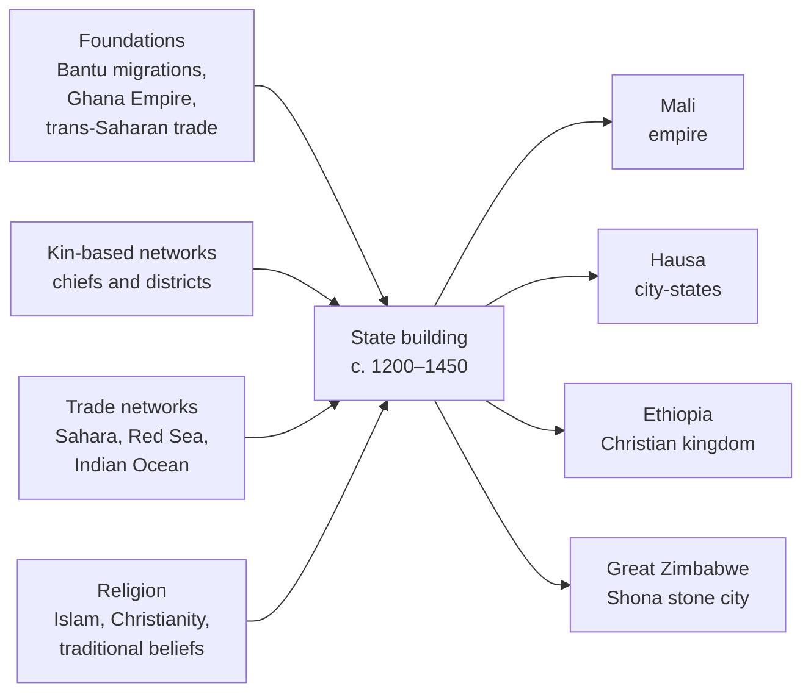
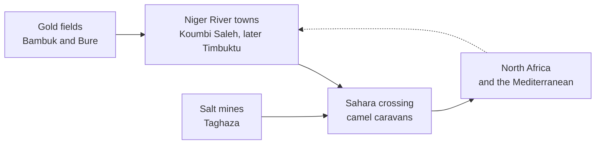
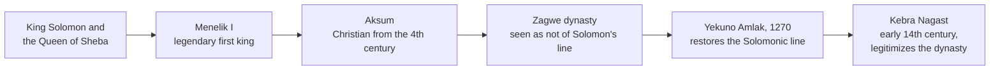
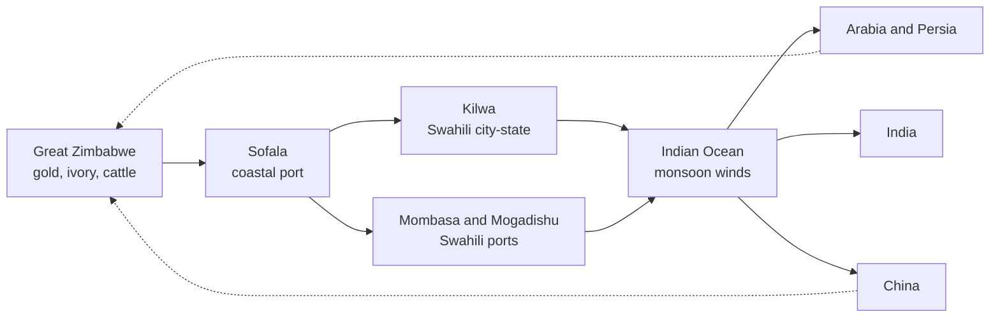
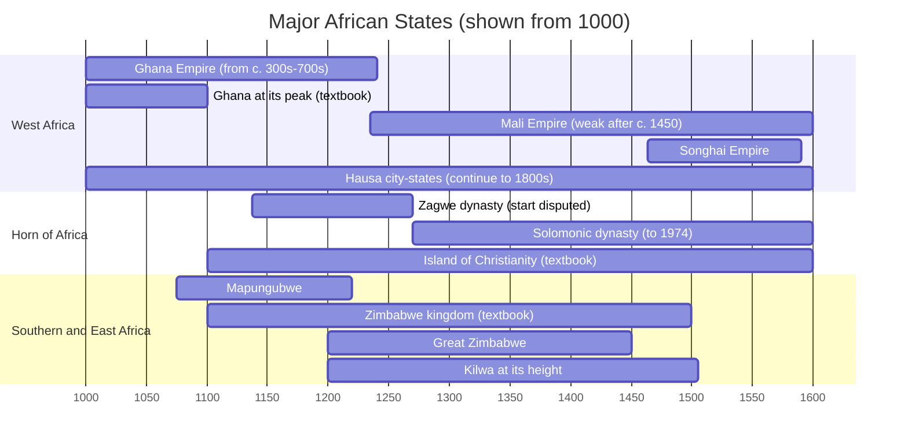
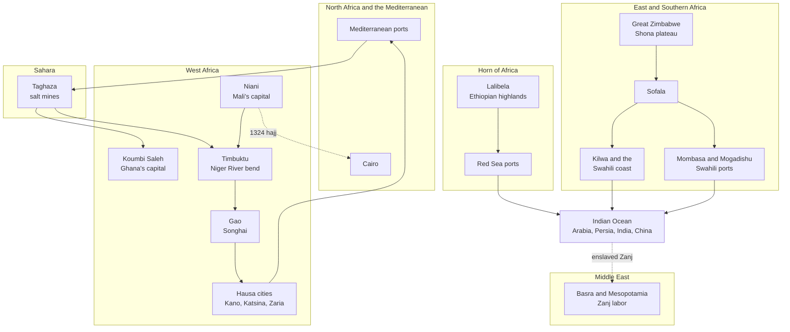
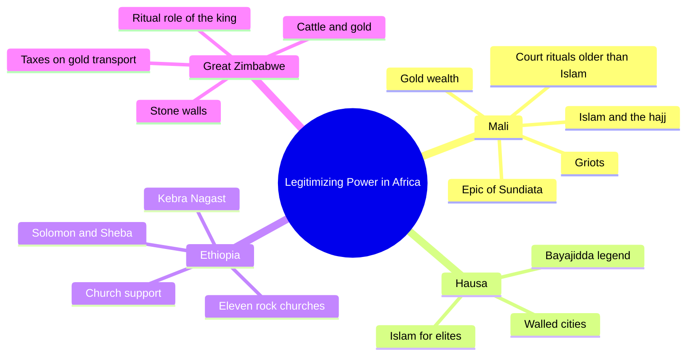

# AP World History: Modern — Topic 1.5 State Building in Africa

**Focus Question (textbook Essential Question):** How and why did states develop in Africa and change over time?

> Source: Based on the College Board CED · Textbook incorporated (Topic 1.5 reading)

**Unit 1: The Global Tapestry (c. 1200–1450)**

---

## Learning Objective

| Code | Learning Objective |
|---|---|
| 1.5 LO (GOV) | Explain how and why states in Africa developed and changed over time. |

## Historical Developments (CED)

| # | Historical Development | Covered in |
|---|---|---|
| HD1 (KC-3.2.I.D) | In Africa, as in Eurasia and the Americas, state systems demonstrated continuity, innovation, and diversity in the 13th century. | §1–§9 |
| HD1-a | Illustrative example: **Mali** | §2 |
| HD1-b | Illustrative example: **Hausa kingdoms** | §3 |
| HD1-c | Illustrative example: **Ethiopia** | §4 |
| HD1-d | Illustrative example: **Great Zimbabwe** | §5 |

---

## The Big Picture

> "After that the chief of the poets mounts the steps of the pempi [a raised platform on which the ruler sits] and lays his head on the sultan's lap, then climbs to the top of the pempi and lays his head first on the sultan's right shoulder and then on his left, speaking all the while in their tongue, and finally he comes down again. I was told that this practice is a very old custom amongst them, prior to the introduction of Islam, and that they have kept it up."
> — Ibn Battuta, c. 1352

**Ibn Battuta** was a scholar from **Morocco** and an expert in **Islamic law (shariah)**. Muslim governments as far apart as **Mogadishu** in East Africa and **Delhi** in India asked for his advice. Here he describes a court ceremony in **Mali**. His travel account shows how the fast growth of **Islam** linked Asia, Africa, and southern Europe. It also shows that African societies that adopted Islam **kept many of their own traditions**. Some parts of Africa resisted Islam, and much of the south had little contact with Islam until later.

Across Sub-Saharan Africa, many people lived in **kin-based networks** led by **chiefs** instead of under one central government, but **larger kingdoms** grew in importance after **1000**. Africa between 1200 and 1450 had **many different kinds of states**. In West Africa, the **Mali Empire** replaced the older **Ghana Empire**. Mali grew rich by controlling the **trans-Saharan gold-salt trade**, and its rulers, such as **Sundiata Keita** and **Mansa Musa**, mixed **Islam** with local traditions. To the east, the **Hausa kingdoms** were walled **city-states** that traded and competed but **never united** into one empire. In the Horn of Africa, **Ethiopia** was a **Christian kingdom** surrounded by Muslim states; its **Zagwe** kings carved the **rock-hewn churches of Lalibela**, and the **Solomonic dynasty** (from **1270**) claimed descent from King Solomon and the Queen of Sheba. In southern Africa, the **Shona** built **Great Zimbabwe**, a stone city that grew rich from **cattle** and from **gold and ivory** sent to the **Swahili coast** and the Indian Ocean. These states show the CED's three ideas: **continuity** (older traditions and trade routes), **innovation** (new religions, buildings, and ways to rule), and **diversity** (empires, city-states, and kingdoms with different faiths).

---

## §1. Background: Foundations Before 1200

| Background factor | What it was | Why it matters after 1200 |
|---|---|---|
| **Bantu migrations** | Bantu-speaking peoples spread from West-Central Africa south and east over many centuries, beginning around 2000–1000 B.C.E. By **1000 C.E.**, most of Sub-Saharan Africa had adopted **agriculture** | Spread **farming, iron working, and Bantu languages**; the **Shona** (Great Zimbabwe) and the **Swahili** coast peoples spoke Bantu languages. Settled farming needed more complex ways to govern |
| **Trans-Saharan trade** | Camel caravans crossed the Sahara; camels came into wide use in the early centuries C.E. | Linked West Africa to North Africa and the Mediterranean (see 2.4) |
| **Gold-salt trade** | West African **gold** (from fields such as **Bambuk** and **Bure**) was traded for Saharan **salt** (from mines such as **Taghaza**) | Whoever controlled and taxed this trade became rich and powerful |
| **Spread of Islam** | Muslim Berber and Arab merchants brought Islam across the Sahara after the 7th–8th centuries | West African rulers and merchants converted; Islam brought literacy in Arabic and trade contacts |
| **Aksum** | An ancient kingdom in the Horn of Africa (the textbook spells it **Axum**); its king **Ezana** converted to **Christianity** in the 4th century. It prospered by trading goods from **India, Arabia, the Roman Empire, and the African interior** | Ethiopia's Christian kingdom grew out of Aksum's tradition. From the **7th century**, the spread of Islam made the region more religiously diverse |

### Kin-Based Networks and Chiefs

- Unlike most Asian and European societies, many Sub-Saharan societies did **not centralize power** under one leader or central government.
- Instead, communities formed **kin-based networks**, in which **families governed themselves**. A male head of the network, the **chief**, settled conflicts and dealt with neighboring groups.
- Groups of villages formed **districts**, and a group of chiefs decided together how to solve each district's problems.
- As populations grew, these networks became harder to govern. Competition and **fighting** between villages and districts increased, and small communities found it harder to survive.
- Many kin-based communities lasted until the **19th century**, but **larger kingdoms** grew in importance, especially after **1000**.
- *Textbook "Connect" question:* contrast these decentralized systems with the centralized **Inca** state (see 1.4).

### The Ghana Empire

- **Ghana** (called **Wagadu** by its **Soninke** people) was the first great West African trading empire. "Ghana" was a title for its king.
- The kingdom lay between the **Sahara** and the **tropical rain forests** of the West African coast. It was **not in the same place as the modern nation of Ghana**.
- The textbook says historians believe Ghana was founded in the **5th century**, at least two centuries before Muhammad, and that it was at its **peak from the 8th to the 11th centuries**.
- Ghana grew rich by **taxing gold and salt** that passed through its land. Its rulers sold **gold and ivory** to Muslim traders for **salt, copper, cloth, and tools**. The king kept gold nuggets for himself; traders could use only gold dust.
- Its capital, **Koumbi Saleh**, had **two towns**: one for Muslim merchants and one for the king, who kept **traditional religion**. This pattern of Muslim traders at a traditional court continued in Mali.
- From Koumbi Saleh, the king ruled a **centralized government** with the help of **nobles** and an army armed with **iron weapons**.
- Ghana **declined** from the late 11th century through the 1200s. Pressure from the **Almoravids** (a North African Muslim movement), loss of trade, and drought weakened it. The textbook says that by the **12th century**, **wars with neighboring societies** had permanently weakened Ghana. By the early 1200s, the **Sosso** kingdom controlled much of the region, and several new trading societies arose; the most powerful was **Mali**.

> ⚠️ Needs verification: Older accounts say the Almoravids **conquered** Ghana in **c. 1076**. Many historians now question whether a military conquest happened, and argue instead for gradual decline and conversion. The textbook does not mention the Almoravids; it says only that wars with neighbors had permanently weakened Ghana by the 12th century.

> ⚠️ The extracted textbook text says Ghana was founded in the "Sth" century. This is most likely the **5th century**, since the textbook adds "at least two centuries before the time of Muhammad." Check against the printed textbook.

## §2. Mali Empire (c. 1235–1600)

> **Textbook coverage:** The textbook treats Mali only briefly in Topic 1.5, as one of four trading kingdoms (Ghana, Mali, Zimbabwe, and Ethiopia). It says "You will read more about Mali in Topic 2.4" and leaves Timbuktu and the Songhai Empire to Topic **2.4** (Trans-Saharan Trade Routes). The CED still lists Mali as an illustrative example for 1.5, so these notes keep the full Mali section here. See the 2.4 notes for Mali's role in trans-Saharan trade.

### Founding: Sundiata and the Battle of Kirina

- **Sundiata Keita** was a prince of the **Malinke** (Mande) people.
- At the **Battle of Kirina (c. 1235)**, he defeated **Sumanguru** (Soumaoro Kanté), the king of the **Sosso**.
- Sundiata then founded the **Mali Empire** and took over the old trade routes of Ghana. Its capital was probably **Niani**.
- The textbook says **most scholars believe Sundiata was a Muslim**. He used his ties with other Muslims to build trade with **North African and Arab merchants**, and he built a thriving **gold trade** that made Mali's wealth grow greatly.
- His story survives as the **Epic of Sundiata**, an **oral tradition** told by **griots**. Griots were hereditary storytellers, musicians, and historians who kept a people's history and advised kings (see §8).

> ⚠️ Needs verification: The location of Mali's capital (traditionally **Niani**) is debated by archaeologists.

> ⚠️ The textbook says most scholars believe Sundiata was a Muslim. Many accounts say his Islam was at most nominal, and the Epic of Sundiata shows him relying mainly on traditional Mande beliefs and hunters' magic. Check how your teacher presents this.

### Mansa Musa and the Hajj of 1324

- **Mansa** means "king" or "emperor." **Mansa Musa** ruled at Mali's height, **c. 1312–1337**.
- In **1324**, Mansa Musa made the **hajj** (pilgrimage) to Mecca. He traveled with a huge caravan of people and gold. The textbook says his lavish displays of gold "left a lasting impression."
- In **Cairo** he spent and gave away so much gold that **gold's value there fell for years**. The Arab writer **al-Umari** reported the effect lasted about 12 years.
- The hajj made Mali famous. The **Catalan Atlas (1375)**, a European map, shows Mansa Musa holding a gold nugget.
- Musa brought back **scholars and architects**, including **Abu Ishaq al-Sahili**, who is credited with designing the **Djinguereber Mosque** in **Timbuktu** (c. 1327).

> ⚠️ Needs verification: Mansa Musa's reign is often given as **c. 1312–1337**, but some historians date it **c. 1307–1332**. The size of his caravan is also uncertain. The textbook gives no dates for his reign.

> ⚠️ The Topic 1.5 textbook reading calls Mansa Musa Sundiata's **nephew**, but the Topic 2.4 reading calls him Sundiata's **grand-nephew**. Many accounts describe him as a grand-nephew (a grandson of Sundiata's brother). Check against the printed textbook.

### Timbuktu: A Center of Islamic Learning

- **Timbuktu**, on the bend of the **Niger River**, was where Saharan caravans met river boats.
- It became a center of **Islamic scholarship**. Mosques such as **Djinguereber** and **Sankore** taught Islamic law, theology, astronomy, and mathematics.
- Scholars copied and collected **manuscripts**, and books were a valuable trade good.
- Sankore became most famous later, under the **Songhai Empire** (15th–16th centuries).

### Government, Economy, and Religion

| Area | Details |
|---|---|
| **Government** | The **mansa** ruled from the capital; **governors** ran provinces; conquered local rulers often kept power if they paid **tribute** and stayed loyal |
| **Economy** | Mali controlled the **gold fields** and taxed **gold, salt, and copper** passing through its land; most people were **farmers** along the Niger |
| **Religion** | The **rulers, court, and merchants** converted to **Islam**; many **rural subjects kept traditional beliefs** |
| **Syncretism** | Mansas used Islam for **trade ties, literacy, and prestige**, while keeping **traditional rituals** (for example, court ceremonies and griots) so ordinary subjects stayed loyal |
| **Court ritual** | Ibn Battuta saw the chief of the poets climb the royal platform (**pempi**) and lay his head on the sultan's lap and shoulders. He was told this custom came from **before Islam** (see the opening quote) |
| **Order** | **Ibn Battuta**, who visited in **1352–1353**, praised Mali's **safety and justice**, but he criticized some local customs as un-Islamic |

> **Key idea:** Mali's rulers blended **Islam** with **local traditions**. This **syncretism** helped them rule both Muslim merchants and non-Muslim farmers.

### Decline and the Rise of Songhai

- After Mansa Musa and his brother **Mansa Sulayman**, Mali faced **weak rulers** and **succession disputes**.
- **Tuareg** raiders took **Timbuktu in 1433**.
- The **Songhai**, based at **Gao**, broke away. Under **Sunni Ali**, Songhai took **Timbuktu in 1468** and became the largest West African empire (c. 1464–1591).
- Mali shrank to its Mande heartland and survived as a smaller state.

## §3. Hausa Kingdoms

| Feature | Details |
|---|---|
| **Location** | Northern Nigeria, between the Niger River and Lake Chad; the region had **no access to the sea** |
| **Founding** | The textbook says the Hausa people formed **seven states** **sometime before 1000** |
| **Main cities** | **Kano, Katsina, Zaria** (Zazzau), Gobir, Daura, Rano, and others |
| **Political form** | Independent **city-states**, each ruled by a king called a **sarki**; the textbook says they were only loosely connected by **kinship ties** and had **no central authority** |
| **Cities** | Large **walled cities** (birni) with farmland inside the walls, so people could survive a siege |
| **Economy** | Each city-state had a **specialty**; several lay in plains where **cotton** grew well. **Cotton cloth**, **indigo dyeing**, **leather goods**, and trade in **kola nuts** and enslaved people; linked to **trans-Saharan** routes |
| **Defense** | The textbook says one state on the western edge specialized in **military matters** and defended the others. Even so, without a central authority the states were **often dominated by outsiders** |
| **Religion** | **Islam** was adopted by **rulers and merchants** around the **14th century** (the textbook says **missionaries** brought it); many rural people kept traditional beliefs |
| **Unity** | The city-states **competed** for trade and land and were **never unified** into one empire before the 1800s |

- According to Hausa legend, the **seven original Hausa states** came from the sons and grandsons of the hero **Bayajidda**.
- The **Kano Chronicle** says Islam came to Kano under **Sarki Yaji** (14th century), brought by **Wangara** (Mande) merchants from **Mali**. This shows how trade spread Islam.
- The Hausa states were **decentralized**: there was no single capital. Some later paid tribute to stronger neighbors such as **Kanem-Bornu** and **Songhai**.

> ⚠️ Needs verification: The Kano Chronicle was written down much later (19th century copy), so its dates for Sarki Yaji (c. 1349–1385) and the arrival of Islam are approximate. The textbook agrees on the 14th century but says "missionaries" brought Islam, while the Kano Chronicle names Wangara Muslim merchants and clerics.

> ⚠️ The textbook says a state on the western edge of Hausaland was the military defender of the others. In Hausa tradition, the "war" state is usually **Gobir**, in the north, which guarded against desert peoples. Check how your teacher presents this.

## §4. Ethiopia: A Christian Kingdom

### The Zagwe Dynasty and Lalibela

- Christianity spread from the eastern Mediterranean into Egypt and farther south. Ethiopia continued the **Christian** tradition of **Aksum**.
- The textbook says a new **Christian-led kingdom** emerged in the **12th century**. This was the **Zagwe dynasty**, which ruled the highlands until **1270**.
- Like other rulers, the Zagwe kings showed their power through **architecture**. **King Lalibela** (r. c. 1181–1221) is credited with the **rock-hewn churches** at the town now called **Lalibela** (c. 1200). **Eleven** massive churches were **carved downward out of solid rock**, such as the cross-shaped **Church of St. George** (Bete Giyorgis).
- Tradition says Lalibela meant the site as a **"New Jerusalem,"** so Christians could make a pilgrimage without going to Jerusalem.
- The textbook says some Africans who resisted Islam built churches with **labyrinths, reservoirs, and tunnels** to defend themselves against attacks by Islamic forces.

> ⚠️ Needs verification (partly settled by the textbook): The textbook places the new Christian kingdom in the **12th century**, which fits the c. 1137 start date used in the gantt chart below. Some traditions put the Zagwe start in the 10th century, and the exact building dates of the Lalibela churches are still debated.

> ⚠️ The textbook says carved rock structures had been part of Ethiopian religious architecture "since the 2nd millennium B.C.E." Many accounts date Ethiopia's earliest rock-hewn churches to the first millennium C.E., after Aksum became Christian. Check against the printed textbook.

### The Solomonic Dynasty and the Kebra Nagast

- In **1270**, **Yekuno Amlak** overthrew the Zagwe and founded the **Solomonic dynasty**. It ruled Ethiopia, with breaks, until **1974**.
- The dynasty claimed descent from **King Solomon** of Israel and the **Queen of Sheba** through their son **Menelik I**.
- The **Kebra Nagast** ("Glory of the Kings"), compiled in the **early 14th century** in the **Ge'ez** language, told this story. It **legitimized** Solomonic rule.
- Kings such as **Amda Seyon** (r. 1314–1344) expanded the kingdom by fighting nearby **Muslim sultanates** such as **Ifat**.
- Solomonic kings often ruled from **moving royal camps** instead of one fixed capital.

### A Christian Island Among Muslim States

| Feature | Details |
|---|---|
| **Church** | The **Ethiopian Orthodox Church** was linked to the **Coptic Church** of Egypt; its head bishop (**abuna**) was sent from **Alexandria** |
| **Island of Christianity** | The textbook says Ethiopia was an **"island of Christianity"** in Africa from the **12th through the 16th centuries**. Cut off from the Roman Catholic Church and the Eastern Orthodox Church of Europe, Ethiopian Christianity **developed independently** |
| **Blending of beliefs** | People combined traditional beliefs, such as **ancestor veneration** and belief in **spirits**, with Christianity to create a distinct form of faith |
| **Church and state** | Kings gave **land** to churches and **monasteries**; the Church supported the king's right to rule |
| **Neighbors** | Surrounded by **Muslim states** and Muslim traders, especially on the coast |
| **Trade** | Traded **gold, ivory, and enslaved people** through **Red Sea** ports, often with Muslim merchants |
| **European view** | Europeans told legends of a Christian king called **Prester John** and later linked him to Ethiopia |

> ⚠️ The textbook says Ethiopian Christianity developed independently of the Catholic and Orthodox churches of Europe. That is true, but many accounts stress that it stayed linked to the **Coptic Church** of Egypt, which sent its head bishop (abuna) from Alexandria until the 20th century. Check how your teacher presents this.

## §5. Great Zimbabwe (c. 1200–1450)

| Feature | Details |
|---|---|
| **People** | Ancestors of the **Shona** (Bantu speakers) |
| **Location** | The plateau between the **Zambezi** and **Limpopo** rivers (present-day Zimbabwe; the textbook adds parts of Mozambique) |
| **Kingdom** | The textbook says Zimbabwe was one of the most powerful kingdoms of the region between the **12th and 15th centuries** |
| **Name** | "Zimbabwe" comes from Shona words usually translated as **"houses of stone"**; the textbook calls it the Bantu word for **"dwellings."** By the **9th century**, chiefs had begun to build their zimbabwes in **stone** instead of wood |
| **Buildings** | **Stone enclosures** built of granite blocks **without mortar** (dry-stone walls); the **Great Enclosure** wall is about **11 meters** high; the **Hill Complex** is the oldest part. The textbook says that by the end of the **13th century** a massive wall **30 feet tall and 15 feet thick** surrounded the capital, and that most royal buildings inside were stone |
| **Society** | The **king and elites** lived inside the stone walls; ordinary people lived in mud houses outside; perhaps **10,000–20,000** people at its height (the textbook says **nearly 20,000**) |
| **Economy** | Wealth came from **agriculture**, **cattle** and **grazing**, and above all **gold**. **Taxes on the transport of gold** and control of the **gold and ivory** trade to the **Swahili coast** made the kingdom rich |
| **Trade partners** | Coastal city-states such as **Mombasa, Kilwa, and Mogadishu**, which tied Zimbabwe into the **Indian Ocean trade** linking East Africa, the Middle East, South Asia, and East Asia |
| **Trade evidence** | Archaeologists found **Chinese porcelain**, **Persian pottery**, Near Eastern **glass**, and **glass beads** there |
| **Symbols** | Carved **soapstone birds** (the Zimbabwe Bird is now a national symbol) |
| **Decline** | Abandoned around **1450**, probably because of **overgrazing and land exhaustion** and a **shift in the gold trade** north toward the **Zambezi** (the **Mutapa** state). The textbook stresses **overgrazing** and says the capital was abandoned **by the end of the 1400s**; the wall still stands |

- **Land vs. sea:** Like Ghana and Mali, Zimbabwe had rich gold fields. But Ghana and Mali relied on **land-based trade across the Sahara**, while Zimbabwe traded **by sea** through the Swahili coast.
- An earlier state at **Mapungubwe** (c. 1075–1220) shows that gold trade and stone-walled elite centers already existed in the region. Great Zimbabwe **continued and expanded** this pattern.
- In the colonial era, some Europeans falsely claimed Africans could not have built Great Zimbabwe. Archaeology proves the **Shona built it**.

> ⚠️ Needs verification: The textbook gives **nearly 20,000** people, the top of the range above, but dates this to the **late 15th century**, when Great Zimbabwe was already declining. Many accounts put the peak in the **14th century**, with decline from about **1450**. The start of building on the Hill Complex may also be earlier than 1200.

> ⚠️ The textbook says the wall was **30 feet (about 9 m) tall and 15 feet (about 4.5 m) thick**, that it surrounded the whole capital, and that it was the first large wall in Africa built without mortar. Many accounts say the **Great Enclosure** wall reaches about **11 m (36 feet)** and surrounds a royal compound, not the whole city. Check how your teacher presents this.

> ⚠️ The textbook places Zimbabwe in **East Africa** and translates "zimbabwe" as "dwellings." Most maps place it in **southern** (southeastern) Africa, and many accounts translate the Shona term as "houses of stone." Check how your teacher presents this.

## §6. The Swahili Coast (Link to 2.3)

> **Textbook coverage:** The 1.5 textbook reading mentions the Swahili city-states only as Zimbabwe's trading partners and as the birthplace of the Swahili language. Neither the textbook nor the CED lists them as a 1.5 state. Topic **2.3** (Exchange in the Indian Ocean) covers them in detail.

- The **Swahili city-states** (such as **Kilwa, Mombasa, Malindi, Zanzibar,** and **Mogadishu**) lined the East African coast. The textbook names **Mombasa, Kilwa, and Mogadishu** as the ports that traded with Zimbabwe.
- **Swahili** comes from an Arabic word for "coasts." The Swahili language is a **Bantu language** with many **Arabic** words. The textbook says East African traders **blended Bantu and Arabic** to create it, and that it is still spoken today in the **African Great Lakes region** and other parts of southeastern Africa.
- The city-states were run by **Muslim** ruling families and merchants and used **monsoon winds** to trade across the Indian Ocean. The Muslim government of **Mogadishu** sought legal advice from Ibn Battuta.
- **Kilwa** grew rich by controlling the **gold trade from Sofala**, which came from the Great Zimbabwe region. Ibn Battuta visited Kilwa in **1331**.
- They were **independent** cities, not one empire. Topic **2.3** covers them in more detail.

## §7. Society: Kinship, Age Sets, Gender, and Slavery

| Institution | Details |
|---|---|
| **Kinship** | Many Africans organized life around **families, lineages, and clans**; people identified first as members of a **clan or family**, and kin groups shared land, labor, and duties |
| **Age sets** | People of the same age went through **initiation** together and formed a group with shared duties, such as **farming, defense, or warfare**; age sets tied people across different families. The textbook also calls them **age grades**: communities divided work by age, and younger people relied on the **advice of elders** |
| **Gender** | Men did most work that needed a **specialized skill**, such as **leather tanning** and **blacksmithing**. Women generally did **farming and food gathering**, most **household chores**, and **raising children** |
| **Griots** | Kept **oral history**, genealogies, and praise songs for rulers (especially in Mali; see §8) |
| **Slavery in Africa** | Many enslaved people were **war captives**, **debtors, or criminals** who worked as **household servants, farmers, soldiers, or officials**. Most men and some women farmed; most women and some men served in households. In many kin-based societies people **could not own land privately but could own people**, so owning many enslaved people raised one's **social status** |

### The Indian Ocean Slave Trade and the Zanj Rebellion

- Strong demand for enslaved workers in the **Middle East** created an **Indian Ocean slave trade** between East Africa and the Middle East.
- It began **several centuries before** the Atlantic slave trade between West Africa and the Americas, and in some places it lasted into the **20th century**.
- Enslaved East Africans were called **Zanj** in Arabic. The textbook says they worked on **sugar plantations in Mesopotamia** (southern Iraq).
- **Zanj Rebellion (869–883):** the Zanj and many Arab workers rose in a series of revolts. The textbook says about **15,000** enslaved people captured the city of **Basra** and held it for **ten years** before they were defeated.

> ⚠️ The extracted textbook text breaks off mid-sentence after the Zanj Rebellion ("The large size and long length of time before it was defeated m..."); check the rest against the printed textbook. Also, many accounts say the Zanj mainly cleared **salt flats** for farming, that the rebels **sacked** Basra in 871 instead of holding it for ten years, and that they ruled from their own capital (al-Mukhtara). Check how your teacher presents this.

### Textbook table: Comparing Three Forms of Slavery

| Question | Chattel | Domestic | Debt bondage |
|---|---|---|---|
| Description | People were the legal property of the owner | People served as cooks, cleaners, or other household workers | People became enslaved, sometimes through mutual agreement, to repay a debt |
| Examples | Common in the Americas, 16th to 19th century | Common in Classical Greece and Rome, and in the Middle East | Common in East Africa before the 15th century and in European colonies in the Americas |
| Was enslavement permanent? | Yes | Often | Not in theory, but it often happened in practice |
| Were the children of enslaved people automatically enslaved? | Yes | Often | Children often inherited the debts of their parents |
| Did enslaved people have any rights? | No | Some: laws or customs might prevent a master from selling a person | Some: laws or customs might limit how severely a master could punish a person |

> ⚠️ The table's cells were split apart in the extracted text, so the placement of the "Examples" cells may be off. Check against the printed textbook.

### Slavery in Africa vs. Later Atlantic Slavery

| Feature | Slavery in Africa (c. 1200–1450) | Atlantic slavery (after 1500) |
|---|---|---|
| Source | Mostly **war captives**, criminals, and debtors | Mass capture and sale for export across the Atlantic |
| Work | **Domestic**, farm, **military**, and sometimes official work | Mostly **plantation** labor (sugar, later cotton) |
| Status | Could be **absorbed into kin groups**; children were sometimes free | **Hereditary** and for life |
| Basis | Not based on **race** | Increasingly based on **race** |
| Similarity | Both treated people as property; Africans were also sold across the **Sahara** and the **Indian Ocean** to Muslim lands | (same) |

## §8. Cultural Life: Music, Art, and Griots

| Art form | Details |
|---|---|
| **Music** | Marked rituals such as **weddings and funerals**. Because traditional religions included **ancestor veneration**, song lyrics were a way to **communicate with the spirit world**. Music had distinctive **rhythms**, with voices mixed with **handclaps, bells, pots, or gourds** |
| **Visual arts** | Often served a **religious** purpose. Metalworkers made **busts of past rulers** so that royalty could look to them for guidance. Artists in **Benin** (West Africa) were famous for detailed **iron and bronze** sculptures; in the late 19th century, these works raised some Europeans' respect for West African cultures |
| **Literature** | Literature in Sub-Saharan Africa was **oral**. Griots were a community's keepers of history |

### Griots and Griottes

- **Griots** had encyclopedic knowledge of **family lineages** and the lives and deeds of great leaders. They usually **sang** their stories and played instruments such as **drums** and the **kora**, a harp.
- Griots were both **honored and feared** because they held the power of language and story. People said a griot could "sing your success or sing your downfall." Kings sought their **advice** on political matters.
- By telling and retelling stories, griots passed a people's history from generation to generation. "When a griot died, it was as though a **library had burned**."
- **Griottes** were women griots. They sang at special occasions, such as before a **wedding**, and counseled the bride. For example, a griotte might tell the bride not to talk back to an abusive mother-in-law, or reassure her that she could return home if things got too bad. The textbook says griottes gave women a sense of **empowerment** in a **patriarchal** society.

> ⚠️ The extracted textbook text calls the kora a "12-string" harp. The kora usually has **21 strings**, so this may be an OCR or printing error. Check against the printed textbook.

## §9. Continuity, Innovation, and Diversity

| CED idea | Examples |
|---|---|
| **Continuity** | Mali took over **Ghana's gold-salt trade**; Ethiopia continued **Aksum's Christianity**; Great Zimbabwe built on **Mapungubwe's** model; griots kept old **oral traditions**; **kin-based networks** with chiefs lasted into the 19th century; Mali's court kept **pre-Islamic rituals** |
| **Innovation** | **Mansa Musa's** support for **Islamic learning** in Timbuktu; **rock-hewn churches** of Lalibela; **dry-stone** architecture of Great Zimbabwe; the **Kebra Nagast** as a new way to legitimize rule; the **Swahili** language, which blended Bantu and Arabic |
| **Diversity** | **Empire** (Mali), **city-states** (Hausa, Swahili), **Christian kingdom** (Ethiopia), **stone-city state** (Great Zimbabwe), and **kin-based networks** without a central government; Muslim, Christian, and traditional religions (including **animism**) |

- **As in Eurasia and the Americas:** African rulers, like rulers of Song China (1.1), the Islamic states (1.2), and the Mexica and Inca (1.4), used **religion, trade, and tribute** to build and keep power.

---

## Timeline

```mermaid
timeline
    title State Building in Africa
    5th century : Ghana founded (textbook)
    8th-11th centuries : Ghana at its peak
    9th century : Chiefs begin building zimbabwes in stone
    869-883 : Zanj Rebellion in Mesopotamia
    Before 1000 : Seven Hausa states form
    By 1000 : Most of Sub-Saharan Africa has adopted farming
    c. 1076 : Almoravid pressure on Ghana (disputed)
    12th century : Wars permanently weaken Ghana
                 : New Christian kingdom in Ethiopia (Zagwe)
    c. 1181-1221 : Reign of King Lalibela
    c. 1200 : Lalibela rock-hewn churches
            : Great Zimbabwe begins to grow
    c. 1235 : Battle of Kirina
            : Sundiata founds Mali
    1270 : Yekuno Amlak founds the Solomonic dynasty
    Late 1200s : Great stone wall surrounds Great Zimbabwe
    Early 1300s : Kebra Nagast compiled
    1324 : Mansa Musa's hajj through Cairo
    c. 1327 : Djinguereber Mosque in Timbuktu
    1331 : Ibn Battuta visits Kilwa
    14th century : Hausa rulers adopt Islam
    1352-1353 : Ibn Battuta visits Mali
    1375 : Catalan Atlas shows Mansa Musa
    1433 : Tuareg take Timbuktu
    c. 1450 : Great Zimbabwe abandoned (textbook says by 1500)
    1468 : Sunni Ali of Songhai takes Timbuktu
```

---

## Map: African States and Trade Routes

---

## Comparison Tables

### Four African States

| Feature | Mali | Hausa kingdoms | Ethiopia | Great Zimbabwe |
|---|---|---|---|---|
| Region | West Africa (upper and middle Niger) | West Africa (northern Nigeria) | Horn of Africa (highlands) | Southern Africa (Zimbabwe plateau) |
| Political form | **Centralized empire** under a mansa | **Decentralized** city-states, each with a sarki | **Kingdom** under Zagwe, then Solomonic kings | **Centralized** state ruled from a stone capital |
| Religion | Islam for rulers and merchants; traditional beliefs for many subjects | Islam for elites from the 14th century; traditional beliefs for many | **Christianity** (Ethiopian Orthodox, linked to the Coptic Church) | **Traditional** Shona beliefs |
| Economy | Gold-salt trade, taxes on trade, farming | Cloth, dyeing, leather, regional and trans-Saharan trade | Farming, Red Sea trade in gold and ivory | Cattle, gold and ivory trade to the Swahili coast |
| How power was legitimized | Sundiata's epic told by griots; Islam and the hajj; wealth in gold | Legend of Bayajidda; Islam for rulers; strong walls | Descent from Solomon and Sheba (**Kebra Nagast**); Church support | Control of trade and cattle; monumental stone walls; religious role of the king |
| Famous site | Djinguereber and Sankore mosques, Timbuktu | Walls of Kano | Rock-hewn churches of Lalibela | Great Enclosure |
| Textbook highlight | Sundiata's Muslim trade ties; Mansa Musa's lavish gold on the hajj | Seven states linked by kinship; a military state defended the rest | 11 rock churches; an "island of Christianity" that blended in ancestor veneration | 30-foot stone wall; nearly 20,000 people; taxes on gold transport |
| What came next | Songhai (from c. 1464) | Sokoto Caliphate (1800s) | Solomonic rule continued to 1974 | Mutapa state to the north |

### Centralized vs. Decentralized States

| Feature | Centralized (Mali, Ethiopia, Great Zimbabwe) | Decentralized (Hausa, Swahili) |
|---|---|---|
| Ruler | One king or emperor over a large area | Many rulers, one for each city |
| Strength | Could control trade routes and raise armies | Flexible; one city's fall did not end the others |
| Weakness | Succession disputes could weaken the whole state | Rivalry between cities; harder to defend against strong neighbors |
| Textbook examples | **Ghana**: a king at Koumbi Saleh ruled with nobles and an army with iron weapons | **Kin-based networks** led by chiefs and district councils; the **seven Hausa states**, linked only by kinship and often dominated by outsiders |

### Land vs. Sea Gold Trade (textbook)

| Feature | Ghana and Mali | Zimbabwe |
|---|---|---|
| Gold | Rich gold fields; gold and ivory sold to Muslim traders | Rich gold fields; taxes on the transport of gold |
| Route | **Land-based** trans-Saharan caravan trade | **Sea-based** trade through Swahili ports (Mombasa, Kilwa, Mogadishu) |
| Wider network | North Africa and the Mediterranean | **Indian Ocean trade**: East Africa, the Middle East, South Asia, and East Asia |
| Goods received | Salt, copper, cloth, and tools | Chinese porcelain, Persian pottery, and glass beads (from archaeology) |
| Cultural effect | Islam spread to rulers and merchants | The Swahili language blended Bantu and Arabic on the coast |

---

## Key Terms

| Theme | Term | Definition |
|---|---|---|
| Government | Kin-based network | A community in which families governed themselves, led by a chief and councils of chiefs instead of a central government |
| Government | Chief | The male head of a kin-based network who settled conflicts and dealt with neighboring groups |
| Government | Ghana Empire | A West African trading empire (peak 8th–11th centuries, not in modern Ghana) that taxed the gold-salt trade and declined from the late 11th century |
| Government | Koumbi Saleh | Ghana's capital, where the king ruled with nobles and an army with iron weapons |
| Government | Mali Empire | A West African empire founded by Sundiata c. 1235 that controlled the gold-salt trade |
| Government | Mansa | The title of Mali's king or emperor |
| Government | Battle of Kirina | The battle (c. 1235) in which Sundiata defeated Sumanguru of the Sosso |
| Government | Songhai Empire | The empire based at Gao that replaced Mali as the main West African power (c. 1464–1591) |
| Government | Hausa kingdoms | Independent walled city-states in northern Nigeria, such as Kano, Katsina, and Zaria; seven states formed before 1000 with no central authority |
| Government | City-state | A self-governing city that controls the land around it |
| Government | Ethiopia | A Christian kingdom in the Horn of Africa; an "island of Christianity" from the 12th to the 16th centuries |
| Government | Aksum (Axum) | The ancient Christian trading kingdom in the Horn of Africa from which Ethiopia's Christian tradition came |
| Government | Solomonic dynasty | Ethiopia's ruling dynasty from 1270, which claimed descent from Solomon and Sheba |
| Government | Zagwe dynasty | The Ethiopian dynasty before 1270, known for the Lalibela churches |
| Government | Zimbabwe (kingdom) | A powerful kingdom between the Zambezi and Limpopo rivers (12th–15th centuries) that grew rich from gold |
| Culture | Griot | A West African oral historian, musician, and storyteller |
| Culture | Griotte | A woman griot who sang at special occasions, such as weddings, and counseled brides |
| Culture | Kora | A West African harp that griots played while singing their stories |
| Culture | Epic of Sundiata | The oral epic about Mali's founder, passed down by griots |
| Culture | Timbuktu | A Niger River trade city and center of Islamic scholarship |
| Culture | Djinguereber Mosque | A mud-brick mosque in Timbuktu built after Mansa Musa's hajj (c. 1327) |
| Culture | Shariah | Islamic law; Ibn Battuta was an expert in it |
| Culture | Syncretism | The blending of different religious or cultural traditions |
| Culture | Rock-hewn churches | Churches carved out of solid rock at Lalibela, Ethiopia (c. 1200) |
| Culture | Kebra Nagast | An early 14th-century Ethiopian text that tells of Solomon, Sheba, and Menelik I |
| Culture | Ethiopian Orthodox Church | Ethiopia's Christian church, linked to the Coptic Church of Egypt |
| Economy | Trans-Saharan trade | Camel caravan trade across the Sahara between West and North Africa |
| Economy | Gold-salt trade | The exchange of West African gold for Saharan salt |
| Economy | Indian Ocean trade | Sea trade linking East Africa, the Middle East, South Asia, and East Asia |
| Economy | Indian Ocean slave trade | The trade in enslaved East Africans to the Middle East, which began centuries before the Atlantic slave trade |
| Economy | Hajj | The Muslim pilgrimage to Mecca; Mansa Musa's hajj of 1324 |
| Economy | Swahili city-states | Muslim trading cities on the East African coast, such as Kilwa |
| Society | Bantu migrations | The long spread of Bantu-speaking peoples across central, eastern, and southern Africa |
| Society | Shona | The Bantu-speaking people who built Great Zimbabwe |
| Society | Swahili (language) | A Bantu language with many Arabic words, created by traders on the East African coast |
| Society | Kinship | Social ties based on family, lineage, and clan |
| Society | Age set (age grade) | A group of people of the same age who are initiated together and share duties |
| Society | Slavery in Africa | Mostly war captives used as servants, farmers, or soldiers; not race-based |
| Society | Chattel slavery | Slavery in which people were the legal property of the owner, usually for life and passed to their children |
| Society | Domestic slavery | Slavery in which people worked in households as cooks, cleaners, or other servants |
| Society | Debt bondage | Slavery taken on, sometimes by agreement, to repay a debt; not permanent in theory |
| Society | Zanj | The Arabic name for enslaved East Africans |
| Society | Zanj Rebellion | A revolt of enslaved East Africans and Arab workers in Mesopotamia (869–883) |
| Technology | Great Zimbabwe | A Shona stone city (c. 1200–1450) with dry-stone walls |
| Technology | Dry-stone walls | Walls built of fitted stone blocks without mortar |
