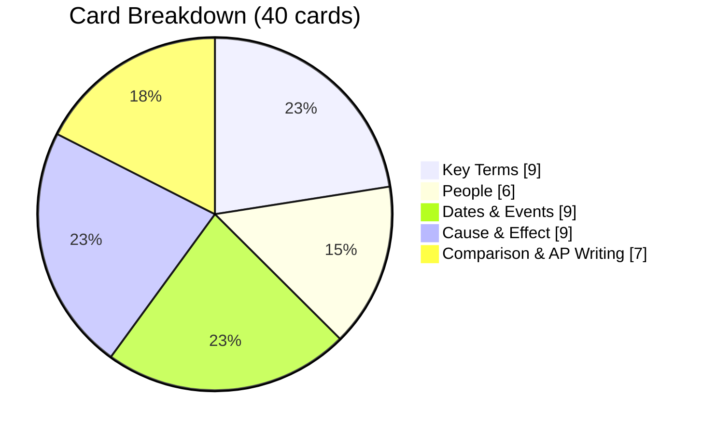

# AP World History: Modern — Topic 1.6 Developments in Europe from c. 1200 to c. 1450 · Flashcards

> Source: Based on the College Board CED · Textbook incorporated (Topic 1.6 reading)

---

## 1. Key Terms

- [ ] **What was feudalism, and what were a fief and a vassal?**

▶ Answer
A decentralized political and military system of mutual obligations in which land was exchanged for loyalty. A monarch or lord granted land (a fief) to a vassal in exchange for an oath of loyalty and military service. Knights were mounted warriors who served lords and followed the code of chivalry (honor, courtesy, bravery). Vassals could have vassals of their own, so loyalties overlapped. Because the system rested on farming, wealth was measured in land rather than cash.

- [ ] **What was manorialism?**

▶ Answer
An economic system based on the manor (the textbook calls it the manorial system), a lord's largely self-sufficient estate with a village, fields, a mill, a blacksmith shop, wine presses, and a church. Serfs worked the lord's land and paid dues; in return the lord gave protection, justice, and land to farm. Because the manor produced almost everything, many serfs spent their whole lives on one manor.

- [ ] **What was a serf, and how was a serf different from a slave?**

▶ Answer
A peasant legally bound to the land who owed labor and dues to the lord and could not travel, marry, or move without permission. Serfs paid tribute in crops, labor, or, rarely, coins, and children born to serfs were also serfs. Serfs were coerced labor but not slaves: they could not be sold apart from the land, and they had a right to farm their plots.

- [ ] **What was scholasticism?**

▶ Answer
A method of study in medieval universities, which the Church founded, that used reason and logic to explain and defend Christian faith. It drew on Aristotle, often through Arabic translations and commentaries from al-Andalus. Peter Abelard studied Aristotle and sometimes criticized the Church but stayed faithful; Thomas Aquinas joined faith and reason.

- [ ] **What was the three-field system?**

▶ Answer
A crop rotation in which one field grew a winter crop (wheat, rye), one grew a spring crop (oats, barley, and legumes such as peas, lentils, and beans), and one lay fallow. Two-thirds of the land produced each year instead of half, and the legumes made the soil more fertile by adding nitrogen. The textbook says it came into use near the end of the Middle Ages; many accounts say it spread from the 8th and 9th centuries.

- [ ] **What was the Reconquista?**

▶ Answer
The long campaign by Christian kingdoms (Castile, Aragon, Portugal) to retake Iberia from Muslim rule, which began in the 8th century. Key steps: Las Navas de Tolosa (1212), Córdoba (1236), Seville (1248). Only Granada remained Muslim until it fell in 1492. The textbook adds that Spain then expelled Muslims who would not convert; many accounts date the forced conversion or exile of Castile's Muslims to 1502. The Normans also took Sicily from Muslim rulers.

- [ ] **What was the bourgeoisie (burghers)?**

▶ Answer
The growing middle class between the elite (nobles and clergy) and the mass of peasants: shopkeepers, merchants, craftspeople, and small landholders. As long-distance trade grew, economic success began to rival a religious calling or military service as a way to win status. Agricultural surpluses helped towns grow and markets meet more often than just on holidays.

- [ ] **What was the Little Ice Age, and how did it affect Europe?**

▶ Answer
A cooling of the climate that began about 1300 and lasted about five centuries. Lower temperatures reduced harvests, so people had less to trade and cities grew more slowly. It also increased disease and unemployment, which led to social unrest, more crime, and the scapegoating of Jews and other groups that already faced discrimination.

- [ ] **What were the Renaissance and humanism? (textbook context)**

▶ Answer
The Renaissance was a revival of interest in classical Greek and Roman literature, art, culture, and civic virtue, sparked by trade, agricultural surplus, and a middle class able to pay artists. Humanism focused on individuals and human concerns and produced secular literature. Examples: Dante's Divine Comedy in the Italian vernacular, the Medici of Florence as patrons, and Gutenberg's movable-type printing press (1439). The textbook also places Chaucer (The Canterbury Tales, Middle English) in the Northern Renaissance, though many accounts call him late medieval. The CED's 1.6 developments do not list the Renaissance.

## 2. People

- [ ] **Who was Thomas Aquinas?**

▶ Answer
A Dominican scholar (1225–1274) who wrote the Summa Theologica. Using Aristotle, he argued that faith and reason do not conflict because both come from God. He is the leading figure of scholasticism.

- [ ] **Who was Pope Urban II?**

▶ Answer
The pope who called the First Crusade at the Council of Clermont in 1095 to retake the Holy Land. The textbook says the Orthodox patriarch at Constantinople, alarmed by Seljuk Turk persecution of Christian pilgrims, appealed to him; many accounts say the appeal came from the Byzantine emperor Alexios I Komnenos.

- [ ] **Who was King John of England?**

▶ Answer
The English king whose nobles forced him to sign Magna Carta in 1215, which put the king under the law. Nobles also won the right to be consulted on scutage (a payment instead of military service). The textbook says Magna Carta guaranteed a jury trial before a noble could be imprisoned; clause 39 itself promises "the lawful judgment of his equals or the law of the land." John had also clashed with Pope Innocent III, who placed England under interdict (1208–1214).

- [ ] **Who was Philip IV of France?**

▶ Answer
The French king (r. 1285–1314) who called the first Estates-General (1302) to win support in his conflict with Pope Boniface VIII. Because French kings did not collect regular taxes from the clergy and nobility, the Estates-General had little power. He expelled France's Jews in 1306 (the textbook gives 1394, the date of the final expulsion). Late in his reign the popes moved to Avignon (1309).

- [ ] **Who was Joan of Arc?**

▶ Answer
A French peasant girl who said God told her to save France. She helped lift the siege of Orléans (1429) in the Hundred Years' War. The English captured her, and she was burned at the stake in 1431.

- [ ] **Who was Ivan the Great? (textbook context)**

▶ Answer
A Moscow-based ruler who, in the late 15th century (usually dated 1480), made the region independent of the Mongols, beginning the modern state of Russia. Background: Kievan Rus' had adopted Orthodox Christianity and kept close ties to Byzantium; after the 13th-century Mongol conquest, the Mongols made local nobles collect taxes, and those nobles grew rich and began to resist.

## 3. Dates & Events

- [ ] **1054**

▶ Answer
The East-West Schism (the textbook calls it the Great Schism). Christianity split into the Roman Catholic Church (Rome, pope) and the Eastern Orthodox Church (Constantinople, patriarch). Do not confuse it with the Western Schism of 1378–1417.

- [ ] **1066**

▶ Answer
The Norman Conquest. William the Conqueror, duke of Normandy (the textbook calls him "a Norman king"), whose Normans descended from Vikings, invaded England. He ran a tightly organized feudal system through royal sheriffs, and the blending of Normans and Anglo-Saxons formed the English people.

- [ ] **1122**

▶ Answer
The Concordat of Worms ends the lay investiture controversy between popes and Holy Roman Emperors over whether a secular ruler could give bishops the symbols of their office. The textbook says the Church won autonomy from secular rulers; many accounts call it a compromise. The Holy Roman Empire had begun when Otto I was crowned in 962.

- [ ] **1204**

▶ Answer
The Fourth Crusade, backed by Venice, sacks Constantinople, Venice's trade rival, and sets up a Latin Empire (1204–1261). Venice had not been fully paid for shipping the crusaders, so it first had them sack Zara (1202; the textbook calls it an Italian city, but it was on the Dalmatian coast). The crusade never reached the Holy Land. Byzantium is badly weakened, and Catholic–Orthodox hatred deepens.

- [ ] **1215**

▶ Answer
Magna Carta. English nobles force King John to accept limits on royal power. The same year, the Fourth Lateran Council requires Jews and Muslims in Christian lands to wear distinctive clothing.

- [ ] **1337–1453**

▶ Answer
The Hundred Years' War between England and France. English longbows (about six feet long) won early victories, but France won, and England lost all its French lands except Calais.

- [ ] **1347–1351**

▶ Answer
The Black Death sweeps Europe, arriving in Sicily in 1347 on ships from the Black Sea port of Caffa. It kills about a third of Europe's people.

- [ ] **1356**

▶ Answer
The Golden Bull of Emperor Charles IV sets seven prince-electors to choose the Holy Roman Emperor. It confirms the princes' power, so the empire stays fragmented.

- [ ] **1453**

▶ Answer
Two endings: the Ottoman Turks under Mehmed II capture Constantinople, ending the Byzantine Empire, and the Hundred Years' War ends.

## 4. Cause & Effect

- [ ] **Cause → Effect: Why did feudalism and manorialism develop in Europe?**

▶ Answer
After Rome fell, there was no central government or army in the west, and people needed protection from Viking, Magyar, and Muslim raids, bandits, and rival lords. Weak kings relied on nobles, and land was the main form of wealth, so lords traded land for loyalty and peasants traded labor for protection.

- [ ] **Effect: How did the Catholic Church unify a politically divided Europe?**

▶ Answer
Nearly everyone in the west shared the same faith, Latin rituals, and Church hierarchy, and Christianity gave a shared identity even as vernacular languages spread. The sacraments ran through every stage of life, tithes made the Church rich, and Church staff were often the only literate people. Monasteries and the Church-founded universities kept learning alive, and tools such as excommunication and interdict (even a bishop canceling services for a lord's serfs) gave the Church power over kings and lords.

- [ ] **Cause → Effect: What caused the Crusades?**

▶ Answer
Religious: popes wanted to retake the Holy Land, and the Church offered relief from penance and a faster path to heaven. An appeal from Constantinople after Seljuk Turks persecuted Christian pilgrims. Social: under primogeniture the eldest son inherited everything, so nobles sent restless younger sons and unemployed peasants east. Economic: merchants wanted access to Middle Eastern trade routes. Political: tensions between popes and kings.

- [ ] **Cause → Effect: What were the effects of the Crusades?**

▶ Answer
Only the First Crusade (Jerusalem, 1099) was a clear victory, and Islamic forces eventually prevailed in the Levant. Italian city-states such as Venice and Genoa grew rich, and because the Middle East had a higher standard of living, Europeans wanted more Middle Eastern and Asian goods. Crusaders attacked Jewish communities (Rhineland, 1096), the Fourth Crusade weakened Byzantium and divided Christians, and cultural exchange and contact with Muslim learning increased.

- [ ] **Cause → Effect: How did new farming methods change European society?**

▶ Answer
As climate and technology improved, more land became farmable. Heavy wheeled plows (north of the Alps), lighter plows (southern Europe), the horse collar, windmills, and the three-field system produced more food. Europe's population roughly doubled between c. 1000 and c. 1300, and the surplus led to growing towns, more trade, guilds, universities, and a new middle class.

- [ ] **Cause → Effect: Why were Jews persecuted and expelled in medieval Europe?**

▶ Answer
Antisemitism was widespread; many Christians saw Jews as untrustworthy outsiders. The Church banned usury (lending at interest) among Christians but not Jews, and Jews were shut out of landowning and most guilds, so many became moneylenders; the textbook notes this flow of money helped Europe's economy grow, but it created resentment. False accusations, Church rules such as distinctive dress (1215), and kings' desire to seize debts led to violence and expulsions: England 1290, France 1306 (the textbook gives 1394, the final expulsion), Spain 1492, Portugal 1497. Jews were scapegoated for the Black Death and the hardships of the Little Ice Age, and many moved east to Poland and Lithuania.

- [ ] **Cause → Effect: How did the Black Death weaken serfdom?**

▶ Answer
The plague killed about a third of Europe's people, causing a labor shortage. Surviving serfs gained bargaining power and demanded higher wages and freedom, and many lords in Western Europe turned labor duties into money rents or freed serfs to keep workers.

- [ ] **Cause → Effect: What caused the Jacquerie (1358) and the English Peasants' Revolt (1381)?**

▶ Answer
After the Black Death, rulers tried to freeze wages (Statute of Labourers, 1351) and raise taxes. In France, war damage and taxes after Poitiers sparked the Jacquerie. In England, a poll tax sparked the 1381 revolt, led by Wat Tyler and the preacher John Ball, who met King Richard II in London. Both were crushed (England dropped the poll tax), but they showed peasants' new bargaining power.

- [ ] **Cause → Effect: How did the Hundred Years' War strengthen monarchies?**

▶ Answer
Kings raised permanent taxes and built standing armies instead of relying on feudal knights. Longbows and gunpowder weapons (gunpowder was invented in China and spread west by the Mongols) made knights and castles less useful. Serving under one monarch united soldiers who spoke different languages or dialects, so people began to call themselves "English" or "French" rather than naming their region.

## 5. Comparison & AP Writing

- [ ] **Compare: How were European and Japanese feudalism similar and different?**

▶ Answer
Similar: both were decentralized, land-based systems in which warrior elites (knights, samurai) served lords in exchange for land or income, following codes (chivalry, bushido). Different: European bonds were contracts with duties on both sides, and the Church was a separate power; in Japan the shogun held real power over a figurehead emperor, and bonds rested on personal loyalty shaped by Confucian ideas.

- [ ] **Compare: How did England, France, and the Holy Roman Empire differ by 1450?**

▶ Answer
England: hereditary kings from the Norman Conquest (1066), limited by Magna Carta and Parliament (first formed in 1265; the textbook says it already had Lords and Commons, though many accounts say the two houses formed in the 14th century); centralizing. France: hereditary kings who built a royal bureaucracy (Philip II), slowly expanded royal land, and called a weak Estates-General because the clergy and nobles paid no regular taxes; centralizing after the Hundred Years' War. Holy Roman Empire: begun by Otto I (962), weakened by struggles with popes (lay investiture), with an elected emperor (Golden Bull, 1356) over hundreds of states; it stayed fragmented.

- [ ] **Compare: How did Roman Catholic and Eastern Orthodox Christianity differ?**

▶ Answer
Catholic: centered in Rome, led by the pope, Latin services, celibate priests, and a pope who rivaled kings. Orthodox: centered in Constantinople, led by the patriarch under strong influence of the Byzantine emperor, Greek services, and parish priests who could marry; it was powerful from Greece to Russia. Both shared the Bible and the sacraments.

- [ ] **Compare: How did the lives of peasant women, noblewomen, and nuns differ?**

▶ Answer
Peasant women did fieldwork, spinning, brewing, and childcare. Noblewomen managed estates and households, and women often kept manor accounts, though fewer women than men were educated. Nuns could gain an education, and the textbook says religious orders gave women their best chance to lead and administer. Some women joined guilds, though not all had property rights. In all groups, law and inheritance favored men, and the textbook says women's rights eroded as society became more urban; Christine de Pizan defended women's abilities in 1405.

- [ ] **AP Short Answer: Explain one way the beliefs and practices of Christianity affected European society from c. 1200 to c. 1450.**

▶ Answer

**Claim:** The Catholic Church unified a politically divided Western Europe and shaped daily life. 
**Evidence:** Nearly everyone took part in the sacraments and paid tithes, Church staff were often the only literate people, monasteries and Church-founded universities preserved and spread learning, and the Church used excommunication and interdict against kings and lords (England, 1208–1214). 
**Reasoning:** Because kingdoms were fragmented, the Church was the one institution with authority across all of them, so it gave Europeans a shared identity and could even limit the power of kings.

- [ ] **AP Short Answer: Explain one effect of agriculture on social organization in Europe from c. 1200 to c. 1450.**

▶ Answer

**Claim:** Because Europe was an agricultural society, most people were peasants, and many were serfs bound to the land. 
**Evidence:** On manors, serfs worked the lord's fields and paid dues in exchange for protection, and their children were born serfs. After the Black Death (1347–1351) caused a labor shortage, peasants demanded higher wages and rebelled (Jacquerie 1358, English Peasants' Revolt 1381). 
**Reasoning:** Social status depended on who controlled land and labor, so when labor became scarce, peasants gained bargaining power, and serfdom weakened in Western Europe.

- [ ] **AP Long Essay Thesis: Evaluate the extent to which political power in Europe remained decentralized from c. 1200 to c. 1450.**

▶ Answer

**Claim:** Political power in Europe stayed largely decentralized, but England and France grew more centralized by 1450, while the Holy Roman Empire and Italy stayed fragmented. 
**Evidence:** Feudalism and manorialism left real power with local lords, and the Golden Bull (1356) confirmed the power of German princes. However, monarchs began hiring their own bureaucracies and armies (Philip II of France built the first real royal bureaucracy), English kings worked through Parliament, French kings expanded royal land and called the Estates-General, and the Hundred Years' War (1337–1453) led both kingdoms to create permanent taxes and standing armies. 
**Reasoning:** War and crisis gave some kings reasons and resources to build stronger states, but where rulers were elected or cities were rich and independent, decentralization continued.

