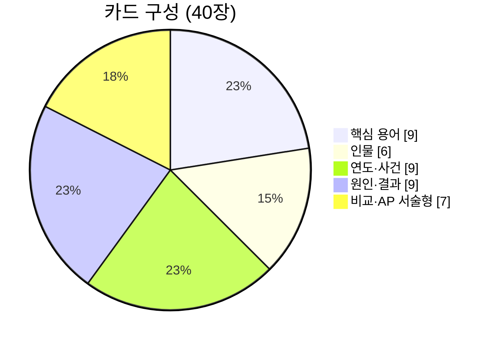

# AP 세계사: 모던 — 토픽 1.6 유럽의 발전, c. 1200–1450 (Developments in Europe from c. 1200 to c. 1450) · 플래시카드

> 출처: College Board CED 기준 · 교재 반영 (교재 Topic 1.6)

---

## 1. 핵심 용어

- [ ] **봉건제 (Feudalism)란 무엇이며, 봉토 (Fief)와 봉신 (Vassal)은 무엇인가?**

▶ 정답
땅과 충성을 맞바꾸는 상호 의무에 바탕을 둔 분권적인 정치·군사 제도다. 군주나 영주가 충성 서약과 군사 봉사의 대가로 봉신에게 땅(봉토)을 주었다. 기사 (Knight)는 영주를 섬기며 기사도 (Chivalry, 명예·예의·용기)를 따른 기마 전사였다. 봉신도 자기 봉신을 거느릴 수 있어서 충성 관계가 겹쳤다. 제도 전체가 농업에 바탕을 두었기 때문에 부는 현금이 아니라 땅으로 측정되었다.

- [ ] **장원제 (Manorialism)란 무엇인가?**

▶ 정답
장원 (Manor)을 바탕으로 한 경제 제도다(교재는 장원 제도 (Manorial system)라고 부른다). 장원은 마을, 경작지, 방앗간, 대장간, 포도주 압착기, 교회가 있는, 대체로 자급자족하는 영주의 영지였다. 농노는 영주의 땅에서 일하고 공납을 바쳤고, 그 대가로 영주는 보호, 재판, 경작할 땅을 주었다. 장원이 거의 모든 것을 생산했기 때문에 많은 농노가 평생 한 장원에서만 살았다.

- [ ] **농노 (Serf)란 무엇이며, 노예와 어떻게 달랐는가?**

▶ 정답
법적으로 땅에 묶여 영주에게 노동과 공납의 의무를 지고, 허락 없이는 여행하거나 결혼하거나 이사할 수 없었던 농민이다. 농노는 작물, 노동, 드물게는 동전으로 공납을 바쳤고, 농노에게서 태어난 아이도 농노가 되었다. 농노는 강제 노동 (Coerced labor)이었지만 노예는 아니었다. 땅과 따로 팔 수 없었고, 자기 땅을 경작할 권리가 있었다.

- [ ] **스콜라 철학 (Scholasticism)이란 무엇인가?**

▶ 정답
교회가 세운 중세 대학에서 이성과 논리로 기독교 신앙을 설명하고 옹호한 학문 방법이다. 아리스토텔레스를 바탕으로 했는데, 알안달루스의 아랍어 번역과 주석을 통한 경우가 많았다. 피에르 아벨라르 (Peter Abelard)는 아리스토텔레스를 공부하고 때로 교회를 비판했지만 신앙을 지켰고, 토마스 아퀴나스는 신앙과 이성을 결합했다.

- [ ] **삼포제 (Three-field system)란 무엇인가?**

▶ 정답
한 밭에는 가을 작물(밀, 호밀), 한 밭에는 봄 작물(귀리, 보리, 그리고 완두·렌즈콩·콩 같은 콩과 작물)을 심고, 한 밭은 휴경으로 두는 윤작법이다. 해마다 땅의 절반이 아니라 3분의 2에서 수확했고, 콩과 작물은 흙에 질소를 더해 땅을 비옥하게 했다. 교재는 삼포제가 중세 말기 무렵에 쓰이기 시작했다고 쓰지만, 많은 설명에서는 8–9세기부터 퍼졌다고 본다.

- [ ] **레콘키스타 (Reconquista)란 무엇인가?**

▶ 정답
기독교 왕국들(카스티야, 아라곤, 포르투갈)이 8세기부터 무슬림이 다스린 이베리아를 되찾으려고 벌인 오랜 전쟁이다. 주요 단계: 라스나바스데톨로사 전투(1212), 코르도바(1236), 세비야(1248). 그라나다만 1492년 함락될 때까지 무슬림 지배 아래 남았다. 교재는 이때 스페인이 개종하지 않은 무슬림을 추방했다고 덧붙이지만, 많은 설명에서는 카스티야 무슬림의 강제 개종이나 추방을 1502년으로 본다. 노르만족도 시칠리아를 무슬림 통치자에게서 빼앗았다.

- [ ] **부르주아 (Bourgeoisie, 버거 Burghers)란 무엇인가?**

▶ 정답
엘리트(귀족과 성직자)와 다수의 농민 사이에서 커져 간 중간 계층이다. 상점 주인, 상인, 장인, 작은 땅을 가진 사람이 속했다. 원거리 교역이 커지면서 경제적 성공이 종교적 소명이나 군사 봉사와 겨룰 만한 지위 획득의 길이 되었다. 농업 잉여 덕분에 도시가 커지고, 축일에만 열리던 시장이 더 자주 열렸다.

- [ ] **소빙하기 (Little Ice Age)란 무엇이며, 유럽에 어떤 영향을 주었는가?**

▶ 정답
약 1300년에 시작되어 약 다섯 세기 동안 이어진 기후 냉각이다. 기온이 떨어져 수확이 줄자 교역할 것이 줄고 도시의 성장이 느려졌다. 질병과 실업도 늘어 사회 불안과 범죄가 늘었고, 이미 차별받던 유대인과 다른 집단이 희생양 (Scapegoat)이 되었다.

- [ ] **르네상스 (Renaissance)와 인문주의 (Humanism)란 무엇인가? (교재의 배경 설명)**

▶ 정답
르네상스는 고대 그리스·로마의 문학, 예술, 문화, 시민적 덕목에 대한 관심이 되살아난 시기로, 교역, 농업 잉여, 예술가를 후원할 수 있는 중간 계층이 이를 낳았다. 인문주의는 개인과 인간의 관심사에 초점을 맞추었고 세속 문학을 낳았다. 예: 이탈리아 자국어로 쓴 단테의 신곡, 후원자인 피렌체의 메디치 가문, 구텐베르크의 활판 인쇄기(1439). 교재는 초서 (캔터베리 이야기, 중세 영어)도 북부 르네상스에 넣지만, 많은 설명에서는 그를 중세 후기 작가로 본다. CED의 1.6 역사적 개념에는 르네상스가 없다.

## 2. 인물

- [ ] **토마스 아퀴나스 (Thomas Aquinas)는 누구인가?**

▶ 정답
신학대전 (Summa Theologica)을 쓴 도미니코회 학자다 (1225–1274). 아리스토텔레스를 바탕으로, 신앙과 이성은 모두 신에게서 오기 때문에 서로 충돌하지 않는다고 주장했다. 스콜라 철학을 대표하는 인물이다.

- [ ] **교황 우르바노 2세 (Urban II)는 누구인가?**

▶ 정답
성지를 되찾으려고 1095년 클레르몽 공의회 (Council of Clermont)에서 제1차 십자군을 호소한 교황이다. 교재는 셀주크 튀르크가 기독교 순례자를 박해한다는 소식에 놀란 콘스탄티노폴리스의 정교회 총대주교가 그에게 도움을 청했다고 쓴다. 많은 설명에서는 비잔티움 황제 알렉시오스 1세 콤니노스 (Alexios I Komnenos)가 도움을 청했다고 본다.

- [ ] **잉글랜드의 존 왕 (King John)은 누구인가?**

▶ 정답
1215년 귀족들의 압박으로 왕을 법 아래 두는 마그나 카르타 (Magna Carta)에 서명한 잉글랜드 왕이다. 귀족들은 군역 면제세 (Scutage, 군사 봉사 대신 내는 돈)에 대해 의견을 들을 권리도 얻었다. 교재는 마그나 카르타가 귀족을 투옥하기 전에 배심 재판을 보장했다고 쓰지만, 제39조 자체는 "동등한 사람들의 적법한 판결이나 국법"을 약속한다. 존 왕은 교황 인노첸시오 3세와도 대립해, 잉글랜드는 성무 금지령 (Interdict)을 받았다 (1208–1214).

- [ ] **프랑스의 필리프 4세 (Philip IV)는 누구인가?**

▶ 정답
교황 보니파시오 8세와의 대립에서 지지를 얻으려고 첫 삼부회 (Estates-General, 1302)를 소집한 프랑스 왕이다 (재위 1285–1314). 프랑스 왕들은 성직자와 귀족에게서 정기적인 세금을 걷지 않았기 때문에 삼부회의 힘은 약했다. 그는 1306년 프랑스의 유대인을 추방했다(교재는 최종 추방 연도인 1394년을 쓴다). 그의 치세 후반에 교황청이 아비뇽으로 옮겨 갔다 (1309).

- [ ] **잔 다르크 (Joan of Arc)는 누구인가?**

▶ 정답
신이 프랑스를 구하라고 했다고 말한 프랑스 농민 소녀다. 백년 전쟁에서 오를레앙 포위(1429)를 푸는 데 기여했다. 잉글랜드에 붙잡혀 1431년 화형을 당했다.

- [ ] **이반 대제 (Ivan the Great)는 누구인가? (교재의 배경 설명)**

▶ 정답
15세기 후반(보통 1480년으로 본다) 이 지역을 몽골로부터 독립시켜 근대 러시아 국가를 시작한 모스크바의 통치자다. 배경: 키예프 루스 (Kievan Rus')는 정교회를 받아들여 비잔티움과 가까웠다. 13세기 몽골의 정복 뒤 몽골은 현지 귀족에게 세금을 걷게 했고, 부유해진 이 귀족들이 저항하기 시작했다.

## 3. 연도·사건

- [ ] **1054**

▶ 정답
동서 교회 분열 (East-West Schism, 교재는 대분열 (Great Schism)이라고 부른다). 기독교가 로마 가톨릭교회(로마, 교황)와 동방 정교회(콘스탄티노폴리스, 총대주교)로 갈라졌다. 1378–1417년의 서방 교회 대분열과 헷갈리지 않아야 한다.

- [ ] **1066**

▶ 정답
노르만 정복 (Norman Conquest). 바이킹의 후손인 노르만족의 지도자, 노르망디 공작 정복왕 윌리엄 (William the Conqueror, 교재는 "노르만 왕"이라고 부른다)이 잉글랜드를 침공했다. 그는 국왕 직속 행정관 (Sheriff)을 통해 잘 조직된 봉건 제도를 운영했고, 노르만족과 앵글로색슨족이 섞여 잉글랜드 민족이 형성되었다.

- [ ] **1122**

▶ 정답
보름스 협약 (Concordat of Worms)이 서임권 투쟁 (Lay investiture controversy)을 끝냈다. 이 다툼은 세속 통치자가 주교에게 직위의 상징을 줄 수 있는지를 두고 교황과 신성 로마 황제 사이에서 벌어졌다. 교재는 교회가 세속 권력으로부터 자율을 얻었다고 쓰지만, 많은 설명에서는 타협으로 본다. 신성 로마 제국은 962년 오토 1세 (Otto I)의 대관으로 시작되었다.

- [ ] **1204**

▶ 정답
베네치아의 지원을 받은 제4차 십자군 (Fourth Crusade)이 베네치아의 교역 경쟁자인 콘스탄티노폴리스를 약탈하고 라틴 제국(1204–1261)을 세웠다. 베네치아는 십자군 수송 대금을 다 받지 못하자 먼저 자라 (Zara)를 약탈하게 했다(1202. 교재는 이탈리아의 도시라고 쓰지만 달마티아 해안의 도시였다). 이 십자군은 성지에 가지 못했다. 비잔티움이 크게 약해졌고, 가톨릭과 정교회의 증오가 깊어졌다.

- [ ] **1215**

▶ 정답
마그나 카르타 (Magna Carta). 잉글랜드 귀족들이 존 왕에게 왕권의 제한을 받아들이게 했다. 같은 해 제4차 라테라노 공의회는 기독교 지역의 유대인과 무슬림에게 구별되는 옷을 입게 했다.

- [ ] **1337–1453**

▶ 정답
잉글랜드와 프랑스의 백년 전쟁 (Hundred Years' War). 잉글랜드의 장궁 (Longbow, 길이 약 6피트)이 초기 승리를 이끌었지만, 결국 프랑스가 이겼고 잉글랜드는 칼레를 빼고 프랑스 안의 땅을 모두 잃었다.

- [ ] **1347–1351**

▶ 정답
흑사병 (Black Death)이 유럽을 휩쓸었다. 흑해의 항구 카파에서 온 배를 통해 1347년 시칠리아에 도착했고, 유럽 인구의 약 3분의 1을 죽였다.

- [ ] **1356**

▶ 정답
황제 카를 4세의 금인칙서 (Golden Bull)가 일곱 명의 선제후 (Prince-electors)가 신성 로마 황제를 뽑도록 정했다. 제후의 권력이 굳어져 제국은 계속 분열되었다.

- [ ] **1453**

▶ 정답
두 가지가 끝났다. 메흐메트 2세가 이끄는 오스만 튀르크가 콘스탄티노폴리스를 점령해 비잔티움 제국이 멸망했고, 백년 전쟁이 끝났다.

## 4. 원인·결과

- [ ] **원인 → 결과: 유럽에서 봉건제와 장원제가 생긴 이유는?**

▶ 정답
로마가 무너진 뒤 서유럽에는 중앙 정부와 군대가 없었고, 사람들은 바이킹, 마자르족, 무슬림의 침입과 도적, 경쟁 영주로부터 보호가 필요했다. 약한 왕은 귀족에게 의존했고 땅이 부의 중심이었다. 그래서 영주는 땅으로 충성을 샀고, 농민은 노동을 바치고 보호를 받았다.

- [ ] **결과: 가톨릭교회는 정치적으로 나뉜 유럽을 어떻게 하나로 묶었는가?**

▶ 정답
서유럽 사람들은 거의 모두 같은 신앙, 라틴어 의식, 교회 위계를 공유했고, 자국어 (Vernacular)가 퍼지는 가운데서도 기독교는 공동의 정체성을 주었다. 성사 (Sacraments)가 삶의 모든 단계를 이끌었고, 십일조 (Tithe)로 교회는 부유해졌으며, 글을 아는 사람은 교회 사람뿐인 경우가 많았다. 수도원과 교회가 세운 대학은 학문을 지켰고, 파문과 성무 금지령(주교가 영주의 농노들을 위한 예배를 취소하는 것까지)은 교회에 왕과 영주를 누를 힘을 주었다.

- [ ] **원인 → 결과: 십자군의 원인은 무엇이었는가?**

▶ 정답
종교적 원인: 교황은 성지를 되찾고자 했고, 교회는 속죄 고행의 면제와 더 빠른 천국행을 약속했다. 셀주크 튀르크가 기독교 순례자를 박해하자 콘스탄티노폴리스에서 도움을 청했다. 사회적 원인: 장자 상속제 (Primogeniture) 아래 맏아들이 모든 것을 물려받았기 때문에, 귀족들은 불만 많은 둘째 이하 아들과 일자리 없는 농민을 동쪽으로 보냈다. 경제적 원인: 상인은 중동 교역로를 원했다. 정치적 원인: 교황과 왕 사이의 긴장.

- [ ] **원인 → 결과: 십자군의 결과는 무엇이었는가?**

▶ 정답
분명한 승리는 제1차 십자군(예루살렘, 1099)뿐이었고, 결국 레반트 (Levant)에서는 이슬람 세력이 승리했다. 베네치아와 제노바 같은 이탈리아 도시국가가 부유해졌고, 중동의 생활 수준이 더 높았기 때문에 유럽인은 중동과 아시아 상품을 더 원하게 되었다. 십자군은 유대인 공동체를 공격했고(라인란트, 1096), 제4차 십자군은 비잔티움을 약하게 만들고 기독교인을 갈라놓았다. 문화 교류와 이슬람 학문과의 접촉도 늘었다.

- [ ] **원인 → 결과: 새 농법은 유럽 사회를 어떻게 바꾸었는가?**

▶ 정답
기후와 기술이 나아지면서 경작할 수 있는 땅이 늘었다. 바퀴 달린 무거운 쟁기 (Heavy plow, 알프스 북쪽), 가벼운 쟁기 (남유럽), 말 목걸이 (Horse collar), 풍차, 삼포제로 식량이 늘었다. 유럽 인구는 c. 1000–1300년 사이에 대략 두 배가 되었고, 잉여 덕분에 도시가 커지고 교역이 늘었으며 길드, 대학, 새로운 중간 계층이 생겼다.

- [ ] **원인 → 결과: 중세 유럽에서 유대인이 박해받고 추방된 이유는?**

▶ 정답
반유대주의 (Antisemitism)가 널리 퍼져 있었고, 많은 기독교인은 유대인을 믿을 수 없는 외부인으로 여겼다. 교회는 기독교인 사이의 고리대금 (Usury, 이자를 받고 돈을 빌려주는 것)을 금지했지만 유대인에게는 금지하지 않았다. 유대인은 땅 소유와 대부분의 길드에서 배제되었기 때문에 많은 유대인이 대금업자가 되었다. 교재는 이 돈의 흐름이 유럽 경제 성장에 도움이 되었다고 쓰지만, 이것은 반감도 불렀다. 거짓 고발, 구별되는 옷을 입게 한 교회 규정(1215), 빚을 압수하려는 왕들의 욕심이 폭력과 추방으로 이어졌다: 잉글랜드 1290, 프랑스 1306(교재는 최종 추방 연도인 1394년을 쓴다), 스페인 1492, 포르투갈 1497. 유대인은 흑사병과 소빙하기의 고난에 대한 희생양이 되었고, 많은 유대인이 동쪽의 폴란드와 리투아니아로 이주했다.

- [ ] **원인 → 결과: 흑사병은 어떻게 농노제를 약하게 만들었는가?**

▶ 정답
흑사병이 유럽 인구의 약 3분의 1을 죽여 노동력 부족이 생겼다. 살아남은 농노는 협상력을 얻어 더 높은 임금과 자유를 요구했다. 서유럽의 많은 영주는 일꾼을 붙잡아 두려고 노동 의무를 화폐 지대로 바꾸거나 농노를 해방했다.

- [ ] **원인 → 결과: 자크리의 난 (Jacquerie, 1358)과 잉글랜드 농민 반란(1381)의 원인은?**

▶ 정답
흑사병 뒤 지배층은 임금을 묶고(노동자 조례 (Statute of Labourers), 1351) 세금을 올리려 했다. 프랑스에서는 푸아티에 패배 뒤의 전쟁 피해와 세금이 자크리의 난을 일으켰다. 잉글랜드에서는 인두세 (Poll tax)가 1381년 반란을 일으켰다. 이 반란은 와트 타일러 (Wat Tyler)와 설교자 존 볼 (John Ball)이 이끌었고, 반란군은 런던에서 리처드 2세를 만났다. 둘 다 진압되었지만(잉글랜드는 인두세를 폐지했다), 농민의 협상력이 커졌음을 보여 주었다.

- [ ] **원인 → 결과: 백년 전쟁은 어떻게 군주정을 강하게 만들었는가?**

▶ 정답
왕들은 상설 세금을 걷고, 봉건 기사 대신 상비군 (Standing army)을 만들었다. 장궁과 화약 무기(화약은 중국에서 발명되어 몽골을 통해 서쪽으로 전해졌다) 때문에 기사와 성의 쓸모가 줄었다. 한 군주 아래에서 싸우며 서로 다른 언어나 방언을 쓰던 병사들이 하나가 되었고, 사람들은 자기 지방 대신 "잉글랜드인"이나 "프랑스인"이라고 스스로를 부르기 시작했다.

## 5. 비교·AP 서술형

- [ ] **비교: 유럽 봉건제와 일본 봉건제의 공통점과 차이점은?**

▶ 정답
공통점: 둘 다 분권적이고 토지에 바탕을 둔 제도였고, 전사 엘리트(기사, 사무라이)가 땅이나 수입을 받고 영주를 섬기며 규범(기사도, 무사도)을 따랐다. 차이점: 유럽의 관계는 양쪽 모두 의무를 지는 계약이었고, 교회가 따로 존재하는 권력이었다. 일본에서는 상징적인 천황 대신 쇼군이 실권을 쥐었고, 관계는 유교 사상의 영향을 받은 개인적 충성에 바탕을 두었다.

- [ ] **비교: 1450년까지 잉글랜드, 프랑스, 신성 로마 제국은 어떻게 달랐는가?**

▶ 정답
잉글랜드: 노르만 정복(1066) 이후의 세습 왕으로, 마그나 카르타와 의회 (Parliament)로 제한되었다(의회는 1265년에 처음 생겼다. 교재는 그때 이미 상원과 하원이 있었다고 쓰지만, 많은 설명에서는 두 원이 14세기에 생겼다고 본다). 중앙집권화되어 갔다. 프랑스: 왕실 관료제를 만들고(필리프 2세) 왕령을 조금씩 넓힌 세습 왕. 성직자와 귀족이 정기적인 세금을 내지 않아 삼부회는 약했다. 백년 전쟁 뒤 중앙집권화되었다. 신성 로마 제국: 오토 1세(962)로 시작되어 교황과의 다툼(서임권 투쟁)으로 약해졌고, 수백 개 국가 위에 선출 황제(금인칙서, 1356)가 있었다. 분열된 채로 남았다.

- [ ] **비교: 로마 가톨릭과 동방 정교회는 어떻게 달랐는가?**

▶ 정답
가톨릭: 로마가 중심이고, 교황이 이끌었으며, 라틴어로 예배하고, 사제는 독신이었고, 교황이 왕과 경쟁했다. 정교회: 콘스탄티노폴리스가 중심이고, 비잔티움 황제의 강한 영향을 받는 총대주교가 이끌었으며, 그리스어로 예배하고, 본당 사제는 결혼할 수 있었다. 그리스에서 러시아까지 강한 힘을 가졌다. 둘 다 성경과 성사를 공유했다.

- [ ] **비교: 농민 여성, 귀족 여성, 수녀의 삶은 어떻게 달랐는가?**

▶ 정답
농민 여성은 밭일, 실잣기, 맥주 빚기, 육아를 했다. 귀족 여성은 영지와 집안을 관리했고, 교육받은 여성이 남성보다 적었는데도 여성이 장원의 회계를 맡는 경우가 많았다. 수녀는 교육을 받을 수 있었고, 교재는 수도회가 여성이 지도력과 행정 능력을 발휘할 가장 좋은 기회였다고 쓴다. 일부 여성은 길드에 들어갔지만 모두가 재산권을 가진 것은 아니었다. 어느 집단이든 법과 상속은 남성에게 유리했고, 교재는 사회가 도시화하면서 여성의 권리가 줄었다고 쓴다. 크리스틴 드 피상은 1405년 여성의 능력을 옹호했다.

- [ ] **AP 단답형: c. 1200–1450년 기독교의 신앙과 관습이 유럽 사회에 준 영향 하나를 설명하라.**

▶ 정답

**주장:** 가톨릭교회는 정치적으로 나뉜 서유럽을 하나로 묶고 일상생활을 형성했다. 
**근거:** 거의 모든 사람이 성사에 참여하고 십일조를 냈다. 글을 아는 사람은 교회 사람뿐인 경우가 많았고, 수도원과 교회가 세운 대학은 학문을 지키고 퍼뜨렸으며, 교회는 왕과 영주에게 파문과 성무 금지령을 썼다(잉글랜드, 1208–1214). 
**설명:** 왕국들이 분열되어 있었기 때문에, 교회는 모든 왕국에 걸쳐 권위를 가진 유일한 기관이었다. 그래서 유럽인에게 공동의 정체성을 주었고, 왕의 권력까지 제한할 수 있었다.

- [ ] **AP 단답형: c. 1200–1450년 유럽에서 농업이 사회 조직에 준 영향 하나를 설명하라.**

▶ 정답

**주장:** 유럽은 농업 사회였기 때문에 대부분의 사람이 농민이었고, 그 가운데 많은 사람이 땅에 묶인 농노였다. 
**근거:** 장원에서 농노는 보호를 받는 대가로 영주의 밭에서 일하고 공납을 바쳤고, 그 자녀도 농노로 태어났다. 흑사병(1347–1351)으로 노동력이 부족해지자 농민은 더 높은 임금을 요구하고 반란을 일으켰다(자크리의 난 1358, 잉글랜드 농민 반란 1381). 
**설명:** 사회적 지위는 누가 땅과 노동을 통제하느냐에 달려 있었다. 그래서 노동력이 귀해지자 농민의 협상력이 커졌고, 서유럽에서 농노제가 약해졌다.

- [ ] **AP 논술형 논지: c. 1200–1450년 유럽의 정치권력이 어느 정도 분권화된 상태로 남았는지 평가하라.**

▶ 정답

**주장:** 유럽의 정치권력은 대체로 분권화된 상태로 남았다. 그러나 1450년까지 잉글랜드와 프랑스는 더 중앙집권화되었고, 신성 로마 제국과 이탈리아는 분열된 채로 남았다. 
**근거:** 봉건제와 장원제 때문에 실제 권력은 지방 영주에게 있었고, 금인칙서(1356)는 독일 제후의 권력을 굳혔다. 그러나 군주들은 자기 관료제와 군대를 두기 시작했고(프랑스의 필리프 2세가 처음으로 제대로 된 왕실 관료제를 만들었다), 잉글랜드 왕은 의회를 통해 통치했으며, 프랑스 왕은 왕령을 넓히고 삼부회를 소집했다. 또 백년 전쟁(1337–1453)으로 두 왕국 모두 상설 세금과 상비군을 만들었다. 
**설명:** 전쟁과 위기는 일부 왕에게 더 강한 국가를 세울 이유와 자원을 주었다. 하지만 통치자를 선출하거나 도시가 부유하고 독립적인 곳에서는 분권화가 계속되었다.

