# AP World History: Modern — Topic 1.6 Developments in Europe from c. 1200 to c. 1450

**Focus Question (textbook Essential Question):** How did the beliefs and practices of the predominant religions, agricultural practices, and political decentralization affect European society from c. 1200 to c. 1450?

> Source: Based on the College Board CED · Textbook incorporated (Topic 1.6 reading)

**Unit 1: The Global Tapestry (c. 1200–1450)**

---

## Learning Objectives

| Code | Learning Objective |
|---|---|
| 1.6 LO A (CDI) | Explain how the beliefs and practices of the predominant religions in Europe affected European society. |
| 1.6 LO B (GOV) | Explain the causes and consequences of political decentralization in Europe from c. 1200 to c. 1450. |
| 1.6 LO C (SIO) | Explain the effects of agriculture on social organization in Europe from c. 1200 to c. 1450. |

## Historical Developments (CED)

| # | Historical Development | Covered in |
|---|---|---|
| HD1 (LO A) · KC-3.1.III.D.vi | Christianity, as well as the core beliefs and practices of Judaism and Islam, continued to shape societies in Europe. | §2, §3, §4, §5, §10, §11, §13 |
| HD2 (LO B) · KC-3.2.I.C | Europe was politically fragmented and characterized by decentralized monarchies, feudalism, and the manorial system. | §1, §6, §7, §8 |
| HD2 example | England | §7, §8 |
| HD2 example | France | §7, §8 |
| HD2 example | Holy Roman Empire | §7 |
| HD2 example | Italian city-states (e.g., Venice) | §4, §7, §11, §12 |
| HD3 (LO C) · KC-3.3.III.A.i | Europe was largely an agricultural society dependent on free and coerced labor, including serfdom. | §6, §9, §10, §11 |

> ⚠️ Needs verification: The HD wording is close to the CED but may not match it word for word. The textbook does not settle the illustrative example list. Its political section covers only **France**, the **Holy Roman Empire**, and **Norman England** (plus the Christian–Muslim wars in Sicily and Spain). It mentions **Venice** only as the wealthy city-state behind the Fourth Crusade's diversion and as Marco Polo's home, and **Florence** only through the Medici's support for Renaissance artists. It never presents the Italian city-states as an example of decentralized rule. Check whether Venice or the Italian city-states are listed against the official CED PDF.

---

## The Big Picture

> "I should not wish to be Aristotle if this were to separate me from Christ."
> — Peter Abelard, Letter 17 to Heloise, 1141

Peter Abelard, like many scholars of his time, studied classical thinkers such as **Aristotle** and sometimes **criticized the Church**, yet he remained a faithful Christian all his life. His words capture the age: learning was reviving, but it grew up inside a Christian world. After the Roman Empire declined in the **5th and 6th centuries**, Western Europe entered the **Middle Ages** (the medieval period). Trade declined, intellectual life receded, and small kingdoms fought one another for land. Only the **Roman Catholic Church** stayed powerful across most of Europe. Between about **1000 and 1450**, an era the textbook calls the **High Middle Ages**, learning and trade began to revive.

> ⚠️ The textbook uses "High Middle Ages" for 1000 to 1450. Many accounts say the High Middle Ages ran from c. 1000 to c. 1300 and call c. 1300 to c. 1500 the **Late Middle Ages** (the textbook itself also speaks of the "later Middle Ages"). Check how your teacher presents this.

After the **Western Roman Empire** fell, no single government ruled Europe again. Power was split among kings, nobles, the Church, and towns. The **Roman Catholic Church** was the one institution that reached across this divided world. It shaped daily life through the **sacraments**, collected **tithes**, ran **monasteries** and **universities**, and built great **cathedrals**. In the east, the **Eastern Orthodox Church** and the **Byzantine Empire** followed a separate path after **1054**. **Jews** and **Muslims** lived in Europe as well, but Jews faced growing **persecution and expulsion**, and Christian kingdoms pushed Muslim rule out of Iberia in the **Reconquista**. Politically, Europe ran on **feudalism** (land in exchange for loyalty and military service) and **manorialism** (self-sufficient estates worked by **serfs**). Monarchs in **England** and **France** slowly gained power, but the **Holy Roman Empire** stayed fragmented, and **Italian city-states** governed themselves. New farming methods such as the **three-field system** and the **heavy plow** fed a growing population. Then the **Black Death (1347–1351)** killed about a third of Europe's people. The labor shortage **weakened serfdom** and set off **peasant revolts**, while the **Hundred Years' War (1337–1453)** helped kings build stronger states. Growing trade created a new middle class, the **bourgeoisie**, while the **Little Ice Age** (from c. 1300) slowed growth. Wealthy patrons and rediscovered classical texts sparked the **Renaissance**, and in the east, **Russia** began to emerge from Mongol rule.

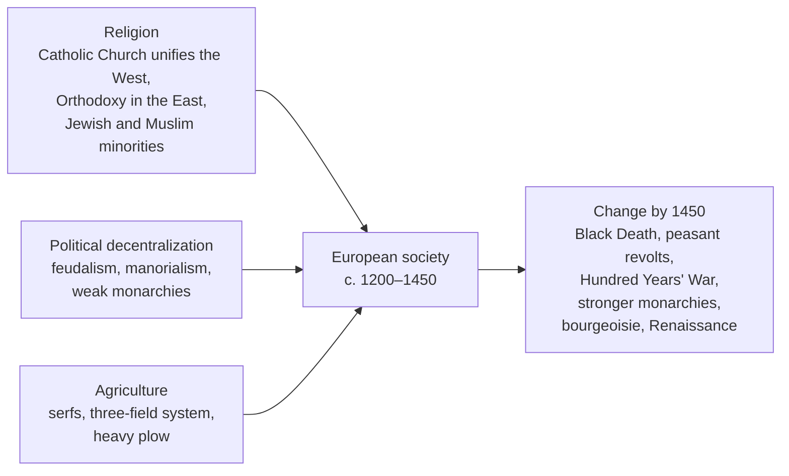

---

## §1. Background: Europe After Rome

| Period | What happened | Effect on Europe |
|---|---|---|
| **476** | The last Western Roman emperor was removed | Roman roads, laws, and central government broke down in the west |
| **c. 500–800** | Germanic kingdoms (Franks, Visigoths, Anglo-Saxons) replaced Roman rule | Many small kingdoms, no single ruler |
| **800** | The pope crowned **Charlemagne**, king of the Franks, emperor | A brief revival of empire; it split among his grandsons in **843** |
| **c. 800–1000** | **Viking**, **Magyar**, and Muslim raids | Kings could not protect everyone, so local lords with armed knights took over defense |
| **962** | The German king **Otto I** was crowned **Holy Roman Emperor**, recalling Charlemagne's title | Began the Holy Roman Empire, which lasted, with little power at the end, until **1806** |
| **1066** | **William the Conqueror**, duke of Normandy, conquered England (the **Norman Conquest**) | A tightly organized feudal kingdom with lands on both sides of the English Channel |
| **1122** | The **Concordat of Worms** ended the **lay investiture controversy** between popes and emperors | Settled who could install bishops; the textbook says the Church won autonomy from secular rulers (§7) |

- With weak kings and constant raids, people turned to **local lords** for protection. This was the main **cause** of feudalism and manorialism (§6).
- The **Eastern Roman Empire** did not fall. It continued as the **Byzantine Empire**, with its capital at **Constantinople** (§3).
- The textbook sums up the early Middle Ages this way: **trade declined**, **intellectual life receded**, and the united Roman state was replaced by **smaller kingdoms** that often fought one another. Kings, lords, and peasants worked out agreements for **common defense**.

## §2. The Roman Catholic Church

The Roman Catholic Church was the **most powerful and unifying institution** in Western Europe. Kingdoms were divided (the textbook says Europe was split into **hundreds of small political states**), but nearly everyone in the west shared the same faith, the same Latin rituals, and the same Church hierarchy.

| Feature | Details | Effect on society |
|---|---|---|
| **Hierarchy** | The **pope** in Rome led archbishops, bishops, and parish priests. Regional **bishops** owed allegiance to the pope and **selected and supervised local priests**, much like the regional leaders of the old Roman Empire | One chain of authority across many kingdoms |
| **Sacraments** | Seven sacred rituals, such as baptism, the Eucharist (communion), penance, and marriage, believed necessary for salvation | Every stage of life, from birth to death, ran through the Church |
| **Tithe** | A tax of one-tenth of a person's income or harvest, paid to the Church | Made the Church very wealthy; it was also one of the largest landowners |
| **Excommunication and interdict** | The Church could cut a person off from the sacraments (excommunication) or close churches in a whole region (interdict). On a smaller scale, a local **bishop could cancel religious services for a lord's serfs**, who would then press the lord to give in | Gave popes power over kings and lords; Pope Innocent III placed England under interdict (1208–1214) in a dispute with King John |
| **Monasteries and convents** | Communities of monks and nuns, many following the **Rule of St. Benedict**. Monasteries had the **same economic functions** (farming and protection) as other manors. Women could become **nuns** and exert influence in the monasteries | Copied manuscripts, kept learning alive, ran schools and hospitals, and cleared and farmed land |
| **Mendicant orders** | **Franciscans** and **Dominicans** (early 1200s) lived in poverty and preached in towns | Brought religion to growing towns; Dominicans also fought heresy |
| **Cathedrals** | Huge **Gothic** churches with pointed arches, flying buttresses, and stained glass (e.g., Chartres, Notre-Dame de Paris) | Showed the Church's wealth and taught Bible stories to people who could not read |
| **Universities** | The **Church established the first universities** in Europe; they grew out of cathedral schools: **Bologna**, **Paris**, **Oxford** (all by c. 1200) | Trained clergy, lawyers, and doctors; centers of **scholasticism** |
| **Literacy and art** | Church staff were often the **only people in a community who could read and write**; most manors had a small church and a priest. Most thinkers and writers were religious leaders, and most art had **religious themes** | Common people asked a Church official to read or write for them; religious images helped **illiterate serfs** understand the Bible |
| **Shared identity** | Christianity united people even as **vernacular languages** (the everyday languages of each region) began to replace Latin | Europeans saw themselves as members of one Christendom |

> ⚠️ The textbook says that **all artists worked for the Church**. Many accounts say kings, nobles, and rich townspeople also paid artists, and the textbook itself later says the Medici of Florence supported painters (§12). Check how your teacher presents this.

### Scholasticism and Thomas Aquinas

- **Scholasticism** was a method of study that used **reason and logic** to explain and defend Christian faith.
- Scholars rediscovered the Greek philosopher **Aristotle**, often through **Arabic translations and commentaries** from al-Andalus (for example, the Muslim scholar **Ibn Rushd**, known in Europe as Averroes).
- **Peter Abelard** (1079–1142), quoted at the top of these notes, studied Aristotle and sometimes criticized the Church, but he remained faithful throughout his life.
- **Thomas Aquinas** (1225–1274), a Dominican friar, wrote the ***Summa Theologica***. He argued that **faith and reason do not conflict**, because both come from God.

### Challenges to Church Authority

- **Heresy:** The Church fought groups it saw as heretics, such as the **Cathars** in southern France (Albigensian Crusade, 1209–1229), and set up the **Inquisition** to try heretics.
- **Kings vs. popes:** French King **Philip IV** clashed with Pope **Boniface VIII** over taxing the clergy (c. 1296–1303).
- **Avignon Papacy (1309–1377):** Popes lived in Avignon, under strong French influence.
- **Western Schism (1378–1417):** Two, and later three, men claimed to be pope at once. This damaged the Church's prestige.
- **Wealth and corruption:** Clergy took **vows of poverty** and supported charities, but they also held real political influence, and some monasteries became very wealthy. The textbook says wealth and power led to **corruption in the 13th and 14th centuries**. Corruption and theological disagreements later drove reformers such as **Martin Luther** to break the unity of the Catholic Church in the **16th century** (context for later units).

> **Key idea:** In a politically **fragmented** Europe, the Catholic Church gave the west a **shared identity** (Christendom), a shared language of learning (**Latin**), and a power that could challenge kings.

## §3. The Eastern Orthodox Church and the Byzantine Empire

- Christianity in the east developed under the **Byzantine emperor** and the **patriarch of Constantinople**. Services were in **Greek**, and **icons** (religious images) were central to worship.
- **East-West Schism (1054):** Disputes over the **pope's authority** and religious practices (for example, the type of bread used in communion) led the pope's representative and the patriarch to **excommunicate each other**. Christianity split into the **Roman Catholic** west and the **Eastern Orthodox** east.
- The textbook calls this 1054 split the **Great Schism**. Do not confuse it with the **Western Schism** of 1378–1417 (§2), which some books also call a "great schism."
- After 1054, the Catholic Church dominated most of Europe for about five more centuries, while the Orthodox Church was powerful farther east, **from Greece to Russia**.
- Orthodoxy spread to **Eastern Europe and Russia** (Kievan Rus' converted in **988**; see §13).
- **1204:** Crusaders of the **Fourth Crusade**, backed by **Venice**, **sacked Constantinople** instead of fighting in the Holy Land. They set up a **Latin Empire** (1204–1261). This deepened hatred between Catholics and Orthodox Christians.
- The Byzantines retook Constantinople in **1261**, but the empire never recovered its strength.
- **1453:** The **Ottoman Turks** under **Mehmed II** captured Constantinople, ending the Byzantine Empire.

> See §Comparison Tables for Catholic vs. Orthodox Christianity.

## §4. The Crusades (1095–1291)

The **Crusades** were a series of religious wars called by the popes to take the **Holy Land** from Muslim rule. The Holy Land was the region of **Palestine** in the Middle East, with sites sacred to **Jews, Christians, and Muslims**. European Christians had been able to visit it for centuries, even after it came under Muslim control.

### Causes of the Crusades

- **Religious:** The Church used its spiritual authority to recruit. It offered **relief from required acts of penance** and promised that crusaders would **reach heaven sooner**.
- **Request from the east:** Alarmed by news that the **Seljuk Turks** were persecuting Christian pilgrims, the Byzantines asked **Pope Urban II** for help in retaking the Holy Land.
- **Social:** Under **primogeniture**, the eldest son inherited the whole estate, so many **younger sons** had little land or wealth. Landed nobles saw a crusade as a way to redirect these restless nobles, and also **unemployed peasants** who often raided neighboring lords' lands.
- **Economic:** Merchants wanted **unfettered access to trade routes** through the Middle East.
- **Political:** Tensions between popes and kings made the Church more eager to take the lead.

> ⚠️ The textbook says the **Orthodox patriarch** at Constantinople appealed to Pope Urban II. Many accounts say the appeal came from the **Byzantine emperor Alexios I Komnenos**, as in the table below. Check how your teacher presents this.

| Crusade / event | Date | What happened |
|---|---|---|
| **Council of Clermont** | **1095** | Pope **Urban II** called the First Crusade after the Byzantine emperor asked for help against the **Seljuk Turks** |
| **First Crusade** | 1096–1099 | Crusaders captured **Jerusalem (July 1099)** and set up **crusader states**; the textbook calls it the only clear victory for Christendom |
| **Saladin retakes Jerusalem** | 1187 | The Muslim leader Saladin recaptured the city |
| **Third Crusade** | 1189–1192 | Failed to retake Jerusalem; a truce allowed Christian pilgrims to visit |
| **Sack of Zara** | 1202 | Venice had a contract to ship the crusaders to the **Levant** (the eastern Mediterranean coast) but was not fully paid, so it persuaded the crusaders to attack the trading city of **Zara** first |
| **Fourth Crusade** | 1202–1204 | Diverted to **Constantinople**, a major trade competitor of Venice, which crusaders sacked in **1204**; it never reached the Holy Land |
| **Fall of Acre** | **1291** | The **Mamluks** took the last major crusader city, ending the crusader states |

> ⚠️ The textbook counts **four major Crusades**, calls the Fourth (1202–1204) the last major one, and dates the Crusades "between 1095 and the 1200s." Many accounts number more Crusades (the Fifth through the Eighth or Ninth, up to 1272) and end the crusader states with the fall of Acre in 1291, as this section does. Check how your teacher presents this.

> ⚠️ The textbook calls Zara "an Italian city." Many accounts place Zara (today Zadar, Croatia) on the Dalmatian coast of the Adriatic, under the king of Hungary, so the crusaders were attacking a Christian city. Check how your teacher presents this.

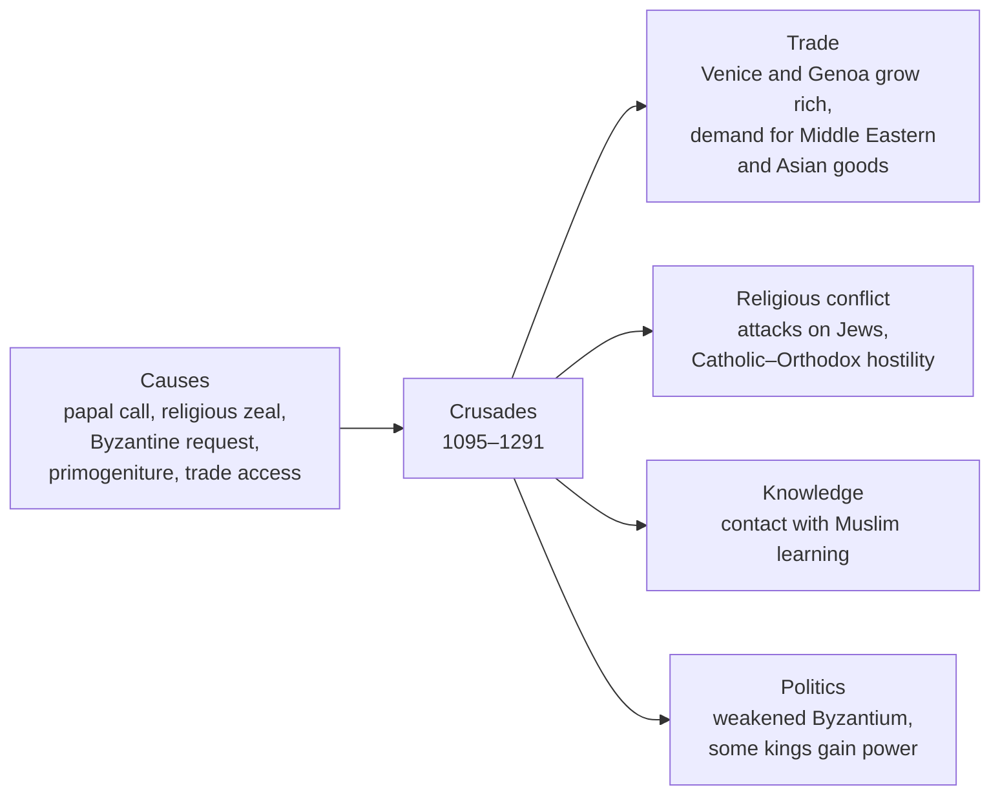

- **Effects on trade:** Italian city-states such as **Venice** and **Genoa** grew rich shipping crusaders and goods. The Middle East had a **higher standard of living**, and returning crusaders increased European demand for its goods. Europeans gained a taste for spices, silk, and sugar (see 2.1).
- **Effects on culture:** The Crusades promoted **cultural exchange** between Europe and the Middle East. (For the spread of Islam up to the Crusades, see 1.2.)
- **Effects on religion:** Crusaders attacked **Jewish communities in the Rhineland** in 1096. The Fourth Crusade turned Catholics and Orthodox Christians into bitter enemies.
- **Effects on politics:** Many nobles died or sold land to pay for the journey, which helped some kings gain power.
- **Final result:** Islamic forces eventually prevailed in the Levant.

## §5. Judaism and Islam in Europe

### Judaism: A Persecuted Minority

- **Jewish communities** lived in towns across Europe. They kept their own **laws (Torah and Talmud)**, synagogues, and community leaders.
- During the Middle Ages, the small Jewish population in Christian Europe **grew**. Many Jews had lived in Muslim-ruled **Iberia** and around the **Mediterranean**; when Christians took over these areas, Jews who could afford it moved north. Some leaders, especially in **Amsterdam** and other commercial cities, welcomed them for their experience in business and trade.
- The Church banned **usury** (lending money at interest) among Christians, but Jews were not bound by this rule. Jews were also **barred from owning land** in many places and **shut out of most guilds**, so many turned to **moneylending** and trade. The textbook notes that the resulting flow of money **helped Europe's economy grow**.
- Unlike most Europeans, Jews lived mainly in **towns**, and they served as a **bridge** between Christians and the Muslims whose goods Christians wanted.
- Kings often **protected and heavily taxed** Jewish moneylenders, then turned on them when it suited them.
- The **Fourth Lateran Council (1215)** required Jews (and Muslims) in Christian lands to wear **distinctive clothing or badges**.
- **Antisemitism** (anti-Jewish feeling) was widespread. Many Christians saw Jews as outsiders and untrustworthy.
- **Persecution:** Jews faced false accusations (such as the "blood libel"), mob violence, and forced conversions.
- **Expulsions:** Kings often seized the debts owed to Jewish lenders. Jews were also expelled from various kingdoms and cities in northern and central Europe.

| Kingdom | Expulsion of Jews | Notes |
|---|---|---|
| **England** | **1290** | King **Edward I** |
| **France** | **1306**; finally **1394** (the textbook's date) | King **Philip IV** expelled them in 1306; Jews were later allowed back and expelled again |
| **Spain** | **1492** | Ferdinand and Isabella (context for later units) |
| **Portugal** | **1497** | Context for later units |

> ⚠️ The textbook gives **1394** for France's expulsion of its Jews. Many accounts give **1306** (Philip IV) as the first major expulsion; Jews were allowed back in 1315 and expelled again, finally in 1394. Learn both dates and check how your teacher presents this.

- **Black Death:** Many Christians **blamed Jews for the plague**, falsely accusing them of poisoning wells. Jewish communities were massacred in many towns, for example in **Strasbourg (1349)**, even though Pope **Clement VI** declared that Jews were not to blame.
- Many Jews moved **east to Poland and Lithuania**, where rulers welcomed them. The textbook notes that Jews had lived in eastern Europe since the 1st century, but the expulsions greatly increased their numbers there.

### Islam: Al-Andalus and the Reconquista

- Muslims had ruled much of the **Iberian Peninsula** (Spain and Portugal), called **al-Andalus**, since **711**.
- Cities such as **Córdoba** and **Toledo** were centers of learning where Muslim, Jewish, and Christian scholars worked. Arabic texts on philosophy, medicine, and mathematics were translated into Latin, helping start European scholasticism. The Jewish philosopher **Maimonides** was born in Córdoba.
- The **Normans**, who also conquered England, took the Mediterranean island of **Sicily** from its Muslim rulers (completed 1091).
- The **Reconquista** was the long campaign by Christian kingdoms (Castile, Aragon, Portugal) to retake Iberia.

| Date | Event |
|---|---|
| 1085 | Castile captured **Toledo** |
| **1212** | Christian victory at **Las Navas de Tolosa** broke Muslim power in Iberia |
| 1236 / 1248 | Castile captured **Córdoba** and **Seville** |
| 1232–1492 | Only the **Nasrid Emirate of Granada** remained under Muslim rule |
| **1492** | **Granada fell** to Ferdinand and Isabella (context for later units); the textbook adds that the Spanish king expelled the remaining Muslims who would not convert |

> ⚠️ The textbook says Muslims who would not convert were expelled from Spain in **1492**. Many accounts say 1492 was the year Granada fell and Spain expelled its **Jews**; Muslims in Castile were forced to convert or leave in **1502**, and their converted descendants (Moriscos) were expelled in **1609**. Check how your teacher presents this.

- In southeastern Europe, Islam advanced as the **Ottomans** expanded into the **Balkans** in the 1300s (see Unit 3). Present-day **Albania**, **Kosovo**, and **Bosnia and Herzegovina** developed large Muslim populations, and many Muslims leaving Spain moved to southeastern Europe.

> ⚠️ The textbook says the Ottoman Empire expanded into the Balkans in the **13th century**. Many accounts say the Ottoman state was founded c. 1299 and crossed into the Balkans in the **mid-1300s** (for example, the Battle of Kosovo in 1389). Check how your teacher presents this.

> **Key idea:** Europe was mainly Christian, but despite persecution, **Jews and Muslims helped shape European society**. Contact with traders in Muslim caliphates opened up a world of **trade and ideas** for Europeans who had long been self-sufficient and isolated under feudalism.

## §6. Causes of Political Decentralization: Feudalism and Manorialism

### Causes of Decentralization

- **Fall of Rome:** no central government, tax system, or professional army remained in the west.
- **Invasions:** Viking, Magyar, and Muslim raids required **local, fast defense**. People also needed protection from **bandits and rival lords**.
- **Weak kings:** kings had little money and few officials, so they **depended on nobles** for soldiers.
- **A land-based economy:** with little trade or coined money, **land** was the main form of wealth, so rulers paid for loyalty with land.
- **A rival authority:** the Church held its own lands, courts, and taxes.

### Feudalism (political and military system)

The textbook defines **feudalism** as a decentralized system of **exchanges of land for loyalty**, built on **mutual obligations**: the monarch granted fiefs to lords, lords granted land to knights, and lords gave land and protection to peasants, who farmed the lord's land, gave him crops and livestock, and obeyed his orders.

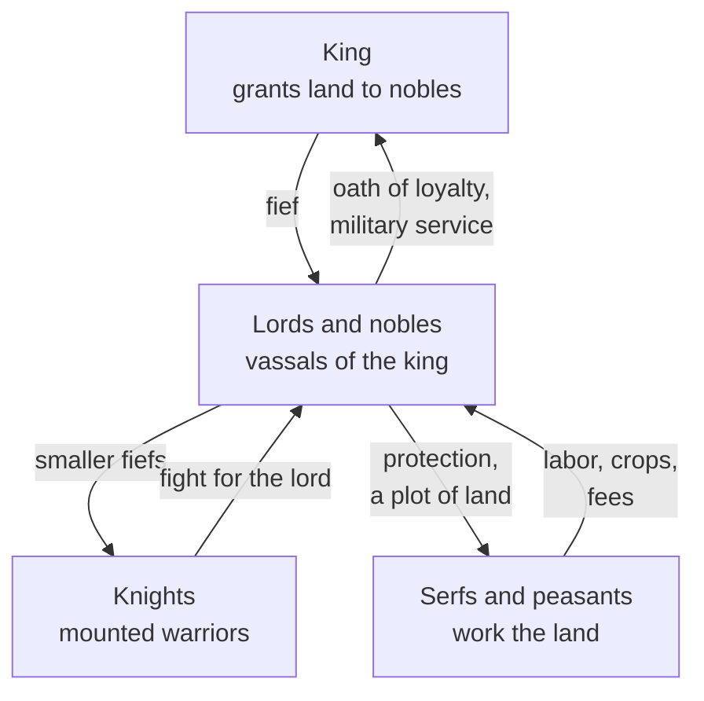

| Term | Meaning |
|---|---|
| **Lord** | A noble who owned land and granted part of it to others |
| **Vassal** | A person who received land from a lord and swore loyalty to him; in the textbook's words, a person who owed service to someone of higher status |
| **Fief** | Land granted by a lord to a vassal in exchange for loyalty and military service |
| **Oath of fealty** | A vassal's sworn promise of loyalty to his lord |
| **Knight** | A trained, armored warrior on horseback who served a lord; expected to follow the code of **chivalry** (bravery, loyalty, protecting the weak) |
| **Chivalry** | An unwritten code of conduct stressing **honor, courtesy, and bravery**, also used to settle disputes. It put women "on a pedestal" to be protected but gave them few real rights |

- A vassal could be a **lord** of his own vassals, and a person could be a vassal to **more than one lord**. Loyalties overlapped, which made central control hard.
- Feudalism gave **security** to peasants, **equipment** to warriors, and **land** to those who served a lord. Because the whole system rested on farming, **wealth was measured in land rather than cash**.

### Manorialism (economic system)

- The **manor** was a lord's estate: a castle or manor house, a village, fields, pasture, woods, a mill, and a church. The textbook calls this the **manorial system**; large fiefs or estates were called manors.
- Manor grounds were small villages that often included a **church**, a **blacksmith shop**, a **mill**, **wine presses**, and the homes of the serfs.
- Manors were largely **self-sufficient**: they produced their own food, cloth, tools, and building materials. This limited the need for trade, and **many serfs spent their entire lives on one manor**, knowing little about the rest of Europe.
- **Serfs** worked the lord's land (the demesne) several days a week and gave him part of their own harvest. They also paid **fees** to use the lord's mill or oven and to marry.
- Serfs were **not enslaved, but tied to the land**: they could not travel or marry without the lord's permission. They paid tribute in **crops, labor, or, rarely, coins**, and **children born to serfs were also serfs**.
- In return, the lord gave **protection**, **justice** in his manor court, and the right to farm a strip of land.

> **Consequences of decentralization:** local nobles held real power, warfare between lords was common, trade and travel were limited, and the **Church** became the main institution linking Europe together (§2).

## §7. Decentralized Monarchies and City-States

- **Later Middle Ages trend (textbook):** monarchs grew stronger **at the expense of feudal lords** by hiring their own **bureaucracy** and **army**. These officials and soldiers worked directly for the king or queen (in modern countries such as the United States, they work for the country, not the chief executive). The lands that monarchs gathered, especially in **England and France**, began to look like the modern countries of Europe.

| State | Type of rule | How royal power grew or stayed limited | Key dates |
|---|---|---|---|
| **England** | Hereditary monarchy (Norman kings from 1066, then Plantagenet kings) | **William the Conqueror** ran a tightly organized feudal system through **royal sheriffs**. Nobles later forced **King John** to accept **Magna Carta**, which put the king **under the law** and required consent for certain taxes, such as **scutage**. **Parliament** grew from royal councils and came to include knights and townspeople | **1066** Norman Conquest; **1215** Magna Carta; **1265** Simon de Montfort's Parliament; **1295** Model Parliament (Edward I) |
| **France** | Hereditary monarchy (**Capetian** kings, 987–1328; then **Valois**) | At first the king controlled only the area around **Paris**. **Philip II** (r. 1180–1223) built the first real royal **bureaucracy** and took Normandy from England in 1204. **Philip IV** (r. 1285–1314) called the **Estates-General** to win support against the pope. Kings did not collect regular taxes from the clergy and nobility, so the Estates-General had little power | **1204** Normandy; **1302** first Estates-General; **1328** Valois dynasty begins |
| **Holy Roman Empire** | **Elected** emperor ruling **hundreds** of German states, plus parts of northern Italy | Began when **Otto I** was crowned in 962. Emperors fought popes in the **lay investiture controversy**, settled by the **Concordat of Worms (1122)**. Powerful princes, bishops, and free cities ruled their own lands, and emperors never built a strong central state | **962** Otto I crowned; **1122** Concordat of Worms; **1356** **Golden Bull**: seven **prince-electors** choose the emperor |
| **Italian city-states** | Independent cities: **Venice** (a republic led by a **doge**), **Florence**, **Genoa**, **Milan**; the pope ruled the **Papal States** | Wealthy merchant families governed, such as the **Medici** bankers of Florence; no single ruler united Italy | Venice led the Fourth Crusade's diversion (1202–1204) and dominated Mediterranean trade |

- **England (Norman roots):** The **Normans** were descendants of **Vikings** who settled in **Normandy** in northwestern France. In **1066**, William, duke of Normandy (the textbook calls him "a Norman king"), invaded and won England, giving him lands on both sides of the English Channel. The blending of Normans and Anglo-Saxons formed the English people.
- **England (Magna Carta):** Many English nobles objected to the power of the Norman kings. In **1215** they forced **King John** to sign Magna Carta. It was a deal between the king and his **barons**, not a democracy, but it set the principle that the **king must obey the law**. Clause 39 reads: "No free man shall be seized or imprisoned, or stripped of his rights or possessions, or outlawed or exiled, or deprived of his standing in any way, nor will we proceed with force against him, or send others to do so, except by the lawful judgment of his equals or by the law of the land." Nobles also won the right to be consulted on **scutage**, a payment a knight made instead of military service.

> ⚠️ The textbook says Magna Carta guaranteed "the right to a jury trial" before a noble could be imprisoned. Many accounts say clause 39 promised only "the lawful judgment of his equals or the law of the land," and that jury trial in its modern form developed later. Check how your teacher presents this.

- **England (Parliament):** The textbook dates the first English Parliament to **1265**, with a **House of Lords** for nobles and Church leaders and a **House of Commons** of elected representatives of wealthy townspeople. These gains increased the rights of the **nobility, not of ordinary people**. Over time, England's Parliament became stronger than similar bodies on the European continent, and it later gained the right to approve taxes.

> ⚠️ The textbook says the 1265 Parliament already had a **House of Lords** and a **House of Commons**. Many accounts say Simon de Montfort's 1265 Parliament added knights and townsmen (burgesses), that Parliament split into two houses only in the **14th century**, and that the **Model Parliament of 1295** is often called the first representative one. Check how your teacher presents this.

- **France:** The **Estates-General** represented the three **estates** (legal classes): the **clergy** (First Estate), the **nobles** (Second Estate), and the **commoners** (Third Estate). Because the clergy and nobility paid no regular taxes, they felt little duty to support a government they were not financing. This problem kept growing until the eve of the **French Revolution of 1789**.
- **Holy Roman Empire:** The German king **Otto I** was crowned emperor in **962**, recalling Charlemagne's title of Emperor of the Romans. In the **lay investiture controversy** (11th–12th centuries), popes and emperors argued over whether a **secular** (non-religious) ruler could give bishops the symbols of their office. The **Concordat of Worms (1122)** settled it. The **Golden Bull (1356)**, issued by Emperor **Charles IV**, named seven electors: the archbishops of Mainz, Cologne, and Trier; the king of Bohemia; the count palatine of the Rhine; the duke of Saxony; and the margrave of Brandenburg. It made elections orderly but **confirmed the princes' power**, so Germany stayed divided. The textbook adds that the empire was nearly destroyed in the **Thirty Years' War (1618–1648)** and formally ended in **1806**, after Napoleon invaded central Europe.

> ⚠️ The textbook says the Church "achieved autonomy from secular authorities" at Worms and that the Holy Roman Empire "remained vibrant" until the Thirty Years' War. Many accounts describe the Concordat of Worms as a **compromise** (the emperor kept a role in granting bishops their lands) and stress that the empire was already **fragmented** in this period, as the CED and this section do. Check how your teacher presents this.

- **Italian city-states:** Trade and banking made them rich. Venice and Genoa controlled sea trade with the eastern Mediterranean and the Black Sea.

## §8. The Hundred Years' War (1337–1453)

| Aspect | Details |
|---|---|
| **Causes** | English kings held lands in France (Gascony) and **Edward III** of England claimed the French throne after the Capetian line ended (1328); both sides wanted control of the wool-trading region of **Flanders** |
| **Major battles** | English victories at **Crécy (1346)**, **Poitiers (1356)**, and **Agincourt (1415)**, won largely with the **longbow** (about six feet long) |
| **Joan of Arc** | A French peasant girl who said God told her to save France; she helped lift the **siege of Orléans (1429)**. The English captured her, and she was **burned at the stake in 1431** |
| **Gunpowder** | The war showed the **spreading use of gunpowder weapons**. Gunpowder had been invented in **China** and spread west with the **Mongols** |
| **Outcome** | France won; by **1453** England had lost all its French lands except **Calais** |

- **Effects on monarchies:** Kings raised **permanent taxes** and built **standing (permanent) armies**. They relied less on feudal knights.
- **Military change:** **Longbows** and, later, **cannons (gunpowder)** made armored knights and castle walls less useful, which weakened feudalism.
- **National identity:** English and French people began to see themselves as **nations**. Serving under one monarch united soldiers who often spoke **different languages or dialects**, so people began to call themselves "English" or "French" instead of naming their region. English replaced French as the language of England's government and courts.
- **Result:** By 1450, **England and France were becoming more centralized**, while the **Holy Roman Empire** and **Italy** stayed fragmented.

## §9. Agriculture and Social Organization

### A Society Built on Farming

- Most Europeans (about **90 percent**) were **peasants** who lived and worked on the land.
- Medieval writers described society as **three orders**: **those who pray** (clergy), **those who fight** (nobles and knights), and **those who work** (peasants).

| Group | Status | Labor |
|---|---|---|
| **Serfs** | **Coerced labor**: legally **bound to the land**; could not leave the manor, marry, or move without the lord's permission; not slaves, because they could not be sold apart from the land | Worked the lord's fields, paid dues in crops and fees |
| **Free peasants** | **Free labor**: rented land or owned small plots; could move | Paid rent in money, crops, or labor |
| **Townspeople** | Merchants and artisans organized in **guilds**; "town air makes you free" (a serf who lived in a town for a year and a day could often become free). The textbook calls the growing town middle class the **bourgeoisie** or **burghers** (§11) | Crafts and trade |

### Agricultural Innovations and Population Growth

- As the **climate and technology** slowly improved, the amount of **arable** (farmable) land gradually increased.

| Innovation | How it worked | Effect |
|---|---|---|
| **Heavy plow** | An iron-tipped plow on wheels that cut deep into the **heavy, wet clay soils** of northern Europe (the textbook: the dense soil north of the Alps) | Opened rich northern lands to farming |
| **Light plow** | A lighter plow that, the textbook says, worked better in **southern Europe** | Suited the lighter soils south of the Alps |
| **Horse collar** | A padded collar that let horses pull without choking | Horses plowed faster than oxen |
| **Three-field system** | Land split into three fields: one for a **winter crop** (wheat, rye), one for a **spring crop** (oats, barley, peas, beans), and one left **fallow** (resting); the fields rotated each year. The legumes (peas, lentils, beans) made the soil more fertile by **adding nitrogen** | Two-thirds of the land produced each year instead of half; peas and beans restored the soil |
| **Water mills and windmills** | Used water and wind power to grind grain | Saved human labor |

> ⚠️ The textbook says agriculture became more efficient and the three-field system "came into use" **near the end of the Middle Ages**. Many accounts say the three-field system began spreading in the **8th and 9th centuries** and was widespread by the 1000s–1200s, helping cause the population growth of c. 1000–1300. Check how your teacher presents this.

- These innovations, along with a warmer climate, caused **population growth**. Europe's population roughly **doubled between c. 1000 and c. 1300**.
- More food meant **growing towns**, more **trade**, and new **guilds** and **universities**.
- Growth stopped with the **Great Famine (1315–1317)** and then the **Black Death** (§10), while the **Little Ice Age** slowed recovery (§11).

### Position of Women

- **Peasant women** worked in the fields, raised animals, spun and wove cloth, brewed ale, and raised children.
- **Noblewomen** managed estates and households, especially when husbands were away at war, but usually could not hold political office. The textbook notes that women often **managed manor accounts**, even though even fewer women than men received an education.
- **Nuns** in convents could gain an education, and abbesses could have real authority. The textbook says **religious orders** were the one place where women had greater chances to show skill in **administration and leadership**.
- In towns, some women worked in **guilds** (for example, as silk workers), often as the widows of craftsmen. Some women became **artisans and guild members**, although not all had property rights.
- The Church taught that women should obey men, and **law and inheritance favored men**. The textbook says women's rights **eroded** as a wave of patriarchal thinking and writing came with the shift from a farming society to a more urban one. The code of **chivalry** put women "on a pedestal" but gave them few rights (§6).
- The writer **Christine de Pizan** defended women's abilities in ***The Book of the City of Ladies* (1405)**.
- **Comparison:** the textbook notes that women in **Islamic societies** tended to enjoy higher levels of equality, especially in parts of **Africa and Southeast Asia**.

## §10. The Black Death and Its Effects (1347–1351)

- The **bubonic plague** traveled along trade routes from Central Asia (see 2.6). It reached Europe through Italian trading ships from the **Black Sea** port of **Caffa**, arriving in **Sicily in 1347**. It was one of a series of severe plagues that swept through Eurasia in the 14th century.
- It killed about **one-third** of Europe's population, and in some areas as many as **half** of the people.

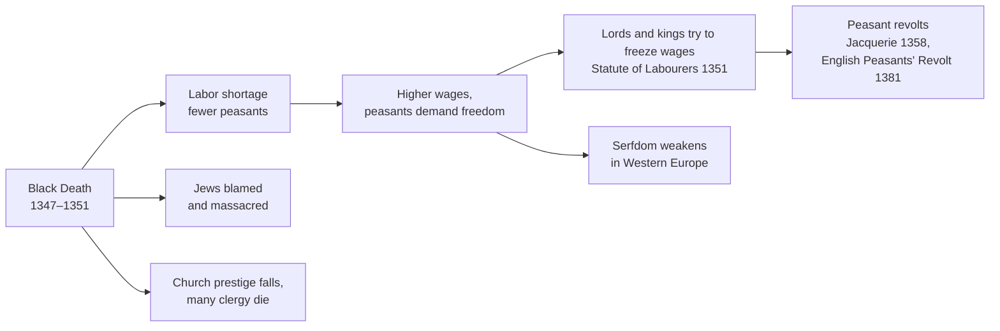

| Effect | Details |
|---|---|
| **Labor shortage** | So many workers died that surviving peasants could **demand higher wages** and better terms; the textbook stresses that serfs gained **bargaining power** with lords |
| **Labor laws** | England's **Ordinance (1349)** and **Statute of Labourers (1351)** tried to keep wages at pre-plague levels |
| **Jacquerie (1358)** | A violent peasant uprising in **northern France**, sparked by war damage and heavy taxes after the defeat at Poitiers; nobles crushed it within weeks |
| **English Peasants' Revolt (1381)** | Sparked by a **poll tax** (a tax on each person); led by **Wat Tyler** and the preacher **John Ball**; rebels marched on London and met **King Richard II**. The revolt was crushed, but the poll tax was dropped |
| **Weakening of serfdom** | In **Western Europe**, many lords turned labor duties into **money rents** or freed serfs to keep workers; serfdom faded in England over the next century |
| **Religion** | **Flagellants** whipped themselves in public to ask God's mercy; Jews were **scapegoated**; many priests died, and people questioned the Church |

> **Key idea:** The Black Death shows how **agriculture shaped social organization**. When labor became scarce, peasants gained bargaining power, and the old manorial system began to break down. (In Eastern Europe, by contrast, lords later **tightened** serfdom.)

## §11. Towns, Trade, and a Changing Society

In the late Middle Ages, local **self-sufficiency** gradually gave way to interest in goods from other parts of Europe and from far-off ports. The Crusades were only one part of this change.

### Marco Polo

- In the **late 13th century**, **Marco Polo**, a native of **Venice**, visited the court of **Kublai Khan** at **Dadu** (modern-day Beijing) (see 2.5).
- His descriptions of the people he met fascinated Europeans. He wrote that the Mongols had **multiple marriages**, drank **mare's milk**, burned **"black stones" (coal)** to heat their homes, and **bathed often**, frequently three times a week.
- European curiosity about Asia soared, which stimulated interest in **cartography** (mapmaking).

### The Bourgeoisie and Urban Growth

- Growing long-distance commerce changed Western Europe's **social pyramid**. **Economic success** began to rival a religious calling or military service as a way to win status.
- A **middle class** grew between the elite and the peasants. It was known as the **bourgeoisie**, or **burghers**.

| Social group | Who belonged | Source of status |
|---|---|---|
| **Elite** | Nobles and clergy | Land, military service, or religious office |
| **Middle class (bourgeoisie, burghers)** | Shopkeepers, merchants, craftspeople, and small landholders | Economic success in trade and crafts |
| **Mass of peasants** | Serfs and free peasants | Farm labor on the manor |

- **Urban growth:** The three-field system and other farming advances led to population growth. The **agricultural surplus** encouraged the growth of **towns** and of **markets** that could meet more often than just on holidays.
- After the **Black Death**, the growing demand for labor and the deaths of so many people gave serfs more bargaining power with lords (§10).

### The Little Ice Age

- After about **1300**, a cooling of the climate known as the **Little Ice Age** began. It lasted about **five centuries**.

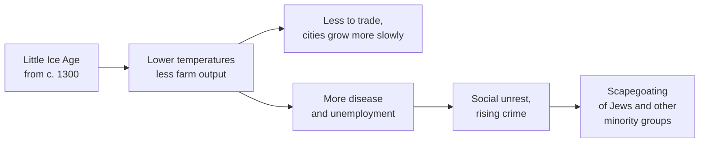

- **Scapegoating** means blaming a group for something it could not control. Jews and other groups that already faced discrimination became victims.

> **Key idea:** Trade and towns slowly loosened the manorial order and created a new middle class, but climate and disease set limits on growth.

## §12. The Renaissance (Textbook Context)

- The CED Historical Developments for 1.6 do not mention the Renaissance; the textbook includes it here as a result of trade and urban growth. (For the classical Greek and Roman roots, see the textbook's Prologue.)
- **Causes:** the expansion of trade, the growth of an agricultural surplus, and the rise of a **middle class** able to pay artists sparked great creativity.
- **Definition:** The **Renaissance** was a revival of interest in **classical Greek and Roman** literature, art, culture, and civic virtue. Scholars recovered and studied decaying manuscripts written many centuries earlier.
- **Printing press:** **Johannes Gutenberg's** movable-type printing press, developed in **1439**, allowed texts to be mass-produced at fairly low cost. It spread **literacy** and **ideas** rapidly.
- **Humanism:** a focus on **individuals rather than God** (the textbook's wording). Humanists sought education and reform and began to write **secular** (non-religious) literature.
- **Vernacular and politics:** the growing use of **vernacular languages** helped push the rise of powerful monarchies, the centralization of governments, and the birth of **nationalism**.

| Person | Region | Work | Why it matters |
|---|---|---|---|
| **Dante Alighieri** (1265–1321) | Italy (Florence) | ***The Divine Comedy***, a journey through hell, purgatory, and heaven | Used a religious framework, yet boldly **criticized corrupt Church officials** and wrote in the **Italian vernacular** instead of Latin |
| **The Medici family** | Florence | Wealthy patrons | Used their money to support **painters, sculptors, and architects** |
| **Geoffrey Chaucer** (c. 1343–1400) | England | ***The Canterbury Tales*** (late 1300s) | Portrayed a cross-section of middle-class jobs, including Church positions; **satirized** monks who loved hunting and overly sentimental nuns; wrote in **Middle English** |
| **Johannes Gutenberg** | Germany (Mainz) | **Movable-type printing press** (1439) | Made books cheaper and helped ideas spread quickly |

- **Southern Renaissance:** In Italy and Spain, **Church patronage** supported the Renaissance, along with wealthy families such as the Medici.
- **Northern Renaissance:** The textbook says the Renaissance spirit had spread to northern Europe **by 1400**. Some artists stressed piety, while others stressed **human concerns**.

> ⚠️ The textbook places Chaucer in the Northern Renaissance (by 1400) and says many of his other writings were in **Latin**. Many accounts treat Chaucer as a **late medieval** writer, date the Northern Renaissance to the late 1400s and 1500s, and note that nearly all of his works were written in **English**. Check how your teacher presents this.

## §13. The Origins of Russia

- In Eastern Europe, extensive trade in **furs, fish, and grain** linked peoples from **Scandinavia** to the **Mediterranean** to **Central Asia**.
- At the center of this trade was **Kievan Rus'**, based in **Kiev** (today Kyiv, Ukraine). The textbook calls it a city-state.
- Because it adopted **Orthodox Christianity** (988, §3), Kievan Rus' kept closer cultural ties with **Byzantium** than with Roman Catholic Europe.
- In the **13th century**, the **Mongols** overran the region (see 2.2), so it developed even more separately from the rest of Europe.
- The Mongols made **local nobles collect taxes** for them. As these nobles grew wealthy, they began to **resist** Mongol rule.
- In the **late 15th century**, under **Ivan the Great** (Ivan III), a ruler based in **Moscow**, the region became independent of the Mongols (usually dated **1480**). This marked the **beginning of the modern state of Russia**.

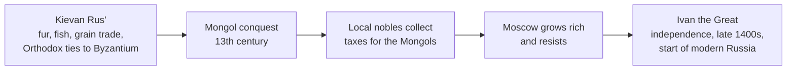

---

## Timeline

```mermaid
timeline
    title Europe c. 1200-1450
    section Background before 1200
        962 : Otto I crowned Holy Roman Emperor
        1054 : East-West Schism splits Christianity
        1066 : Norman Conquest of England
        1095 : Urban II calls the First Crusade
        1099 : Crusaders capture Jerusalem
        1122 : Concordat of Worms
        1187 : Saladin retakes Jerusalem
    section 1200s
        1202 : Crusaders sack Zara
        1204 : Fourth Crusade sacks Constantinople
             : France takes Normandy from England
        1212 : Battle of Las Navas de Tolosa
        1215 : Magna Carta
             : Fourth Lateran Council
        1265 : Simon de Montfort calls a Parliament
        1265-1274 : Aquinas writes the Summa Theologica
        1275 : Marco Polo reaches the court of Kublai Khan
        1290 : England expels its Jews
        1291 : Fall of Acre ends the crusader states
        1295 : Model Parliament
    section 1300s
        1300 : Little Ice Age begins, about this date
        1302 : First Estates-General in France
        1306 : France expels its Jews
        1315-1317 : Great Famine
        1337 : Hundred Years War begins
        1347 : Black Death reaches Sicily
        1356 : Golden Bull
        1358 : Jacquerie in France
        1381 : English Peasants Revolt
        1387-1400 : Chaucer writes The Canterbury Tales
        1394 : France expels its Jews again
    section 1400s
        1405 : Christine de Pizan writes The Book of the City of Ladies
        1429 : Joan of Arc lifts the siege of Orleans
        1439 : Gutenberg develops the printing press
        1453 : Hundred Years War ends
             : Ottomans capture Constantinople
        1480 : Ivan the Great ends Mongol rule over Russia
        1492 : Granada falls, context for later units
             : Spain expels its Jews
        1497 : Portugal expels its Jews
```

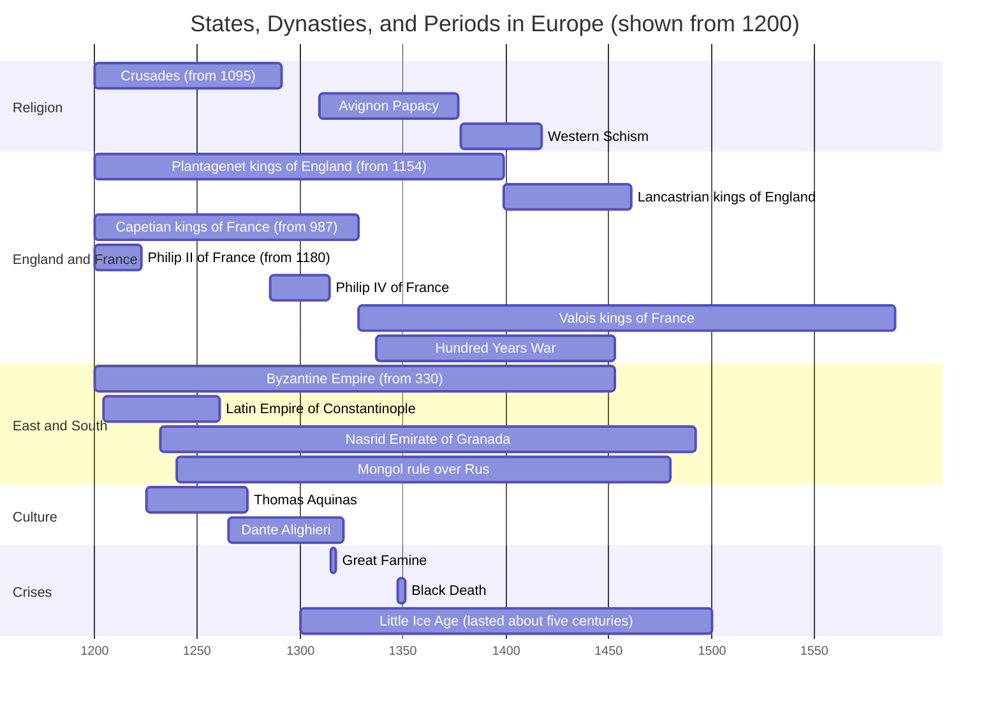

---

## Maps

### Map: Political Europe c. 1300

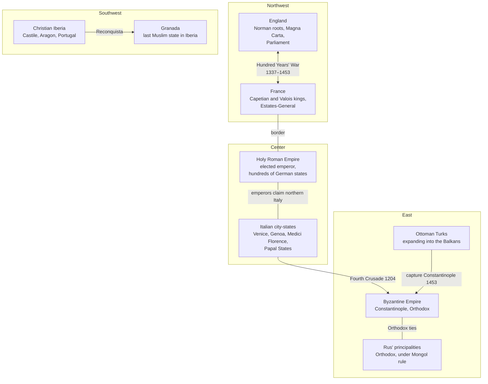

### Map: Spread of the Black Death

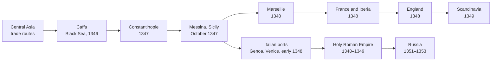

> ⚠️ Needs verification: Arrival dates for each region differ slightly between sources, and the textbook does not give them. The order (Black Sea → Italy → France → England and Germany → Scandinavia → Russia) is standard.

---

## Comparison Tables

### European Feudalism vs. Japanese Feudalism (link to 1.1)

| Feature | Europe | Japan |
|---|---|---|
| Top of society | King (often weak) | **Emperor** (a figurehead); real power with the **shogun** |
| Landholding lords | Lords and nobles (vassals) | **Daimyo** |
| Warrior class | **Knights** | **Samurai** |
| Warrior code | **Chivalry** | **Bushido** (way of the warrior) |
| Basis of the bond | A **contract**: land (fief) for loyalty and military service, with duties on both sides | Personal **loyalty** to one's lord, shaped by Confucian ideas |
| Religion | **Christianity**; the Church was a separate, powerful institution | **Shinto**, **Buddhism**, and Confucian values |
| Workers | **Serfs** and free peasants | Peasants who paid rice to their lords |
| Similarity | Both were decentralized, land-based systems in which a warrior elite served lords in exchange for land or income | (same) |

> ⚠️ Needs verification: The word "bushido" became widely used in later centuries, but AP materials use it for the samurai code in this period.

### England vs. France vs. Holy Roman Empire

| Feature | England | France | Holy Roman Empire |
|---|---|---|---|
| Founding figure (textbook) | **William the Conqueror** (Norman Conquest, 1066) | **Philip II** built the first real royal bureaucracy | **Otto I**, crowned emperor in 962 |
| How the ruler took power | Inherited | Inherited | **Elected** by princes |
| Limits on the ruler | **Magna Carta (1215)**, **Parliament** | Powerful nobles; **Estates-General (1302)** | Strong princes; **Golden Bull (1356)** |
| Taxes | Nobles won the right to be consulted on **scutage**; Parliament later approved taxes | No regular taxes on the clergy and nobility, so the Estates-General stayed weak | Princes kept control of their own lands and revenues |
| Relationship with the pope | King John forced to submit (1213) after the interdict | Philip IV defeated Boniface VIII; popes moved to Avignon | Long conflict between emperors and popes (lay investiture, Concordat of Worms 1122) |
| Trend by 1450 | **Centralizing**; Parliament shared power | **Centralizing**; strong king after the Hundred Years' War | **Fragmented**; hundreds of states |

### Roman Catholic vs. Eastern Orthodox Christianity

| Feature | Roman Catholic | Eastern Orthodox |
|---|---|---|
| Center | **Rome** | **Constantinople** |
| Leader | **Pope**, who claimed authority over all Christians | **Patriarch**, with strong influence from the **Byzantine emperor** |
| Language | **Latin** | **Greek** (and Slavic languages) |
| Priests | Expected to stay unmarried (**celibate**) | Parish priests could marry |
| Communion bread | Unleavened | Leavened |
| Church and state | Popes and kings were **separate, rival** powers | The emperor and Church were **closely tied** |
| Region | Western and Central Europe | Byzantium, the Balkans, Russia |
| Similarity | Both were Christian, shared the Bible and sacraments, and shaped all of daily life | (same) |

### Southern vs. Northern Renaissance

| Feature | Southern Renaissance | Northern Renaissance |
|---|---|---|
| Region | **Italy** and **Spain** | **Northern Europe**, such as England |
| Timing (textbook) | Began first, in the time of Dante (1265–1321) | Had spread north **by 1400** |
| Main support | **Church patronage** and wealthy families such as the **Medici** of Florence | The spread of the Renaissance spirit northward |
| Example writer | **Dante**, *The Divine Comedy* | **Chaucer**, *The Canterbury Tales* |
| Language | **Italian** vernacular | **Middle English** |
| Focus | A religious framework, with criticism of corrupt Church officials | **Human concerns** and satire of society, including Church figures |
| Similarity | Both chose the vernacular over Latin and criticized Church figures | (same) |

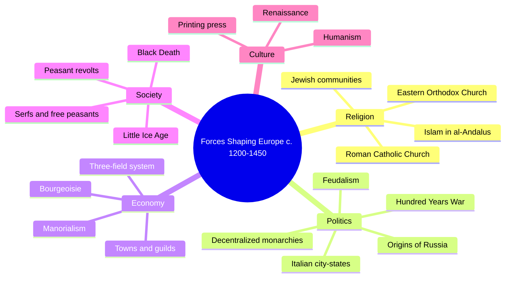

---

## Key Terms

| Theme | Term | Definition |
|---|---|---|
| Culture | Roman Catholic Church | The Christian church led by the pope in Rome; the main unifying institution of Western Europe |
| Culture | Sacraments | Seven sacred rituals, such as baptism and communion, believed necessary for salvation |
| Culture | Tithe | A payment of one-tenth of a person's income or harvest to the Church |
| Culture | Excommunication | Cutting a person off from the Church and its sacraments |
| Culture | Monastery | A community of monks living under religious rules; kept learning alive |
| Culture | Scholasticism | A method of study that used reason and logic to explain Christian faith |
| Culture | Peter Abelard | A 12th-century scholar who studied Aristotle and sometimes criticized the Church but remained faithful |
| Culture | Thomas Aquinas | Dominican scholar (1225–1274) who wrote the *Summa Theologica*, joining faith and reason |
| Culture | East-West Schism | The 1054 split between Roman Catholic and Eastern Orthodox Christianity |
| Culture | Great Schism | The textbook's name for the 1054 East-West Schism (not the Western Schism of 1378–1417) |
| Culture | Eastern Orthodox Church | The Christian church of the Byzantine Empire, led by the patriarch of Constantinople |
| Culture | Lay investiture controversy | The 11th–12th-century dispute over whether a secular ruler or the pope could give bishops the symbols of their office |
| Culture | Holy Land | The region of Palestine, with sites sacred to Jews, Christians, and Muslims |
| Culture | Crusades | Religious wars (1095–1291) called by popes to take the Holy Land from Muslim rule |
| Culture | Reconquista | The Christian campaign to retake Iberia from Muslim rule, completed in 1492 |
| Culture | Al-Andalus | Muslim-ruled Iberia, a center of learning |
| Culture | Vernacular | The everyday language spoken by the people of a region, which began to replace Latin |
| Culture | Marco Polo | A Venetian who visited Kublai Khan's court in the late 13th century; his descriptions stirred European curiosity about Asia |
| Culture | Renaissance | A revival of interest in classical Greek and Roman literature, art, culture, and civic virtue |
| Culture | Humanism | A Renaissance focus on individuals and human concerns, with education, reform, and secular literature |
| Culture | Dante Alighieri | Italian writer (1265–1321) of *The Divine Comedy*, written in the Italian vernacular |
| Culture | Geoffrey Chaucer | English writer of *The Canterbury Tales* (late 1300s), written in Middle English |
| Society | Usury | Lending money at interest; banned among Christians, so many Jews became moneylenders |
| Society | Antisemitism | Anti-Jewish feeling or prejudice, widespread among medieval Christians |
| Society | Scapegoating | Blaming a group for something over which it had no control |
| Government | Feudalism | A political and military system in which lords granted land to vassals for loyalty and military service |
| Government | Vassal | A person who received land from a lord and swore loyalty to him |
| Government | Fief | Land granted by a lord to a vassal |
| Government | Knight | A mounted, armored warrior who served a lord and followed the code of chivalry |
| Government | Chivalry | An unwritten code of conduct for knights stressing honor, courtesy, and bravery |
| Government | Decentralized monarchy | A kingdom in which the king shared real power with nobles, the Church, and towns |
| Government | William the Conqueror | Duke of Normandy who conquered England in 1066 and ran a tightly organized feudal system |
| Government | Magna Carta | The 1215 English charter that put the king under the law |
| Government | Scutage | A payment a knight made instead of military service; nobles won the right to be consulted on it |
| Government | Parliament | England's assembly of nobles, clergy, knights, and townspeople; it gained power over taxes |
| Government | Estates | The three legal classes of France: clergy, nobility, and commoners |
| Government | Estates-General | France's assembly of the three estates, first called in 1302 |
| Government | Holy Roman Empire | A loose union of hundreds of German and northern Italian states under an elected emperor |
| Government | Otto I | German king crowned Holy Roman Emperor in 962 |
| Government | Concordat of Worms | The 1122 agreement that ended the lay investiture controversy |
| Government | Golden Bull | The 1356 decree that set seven prince-electors to choose the Holy Roman Emperor |
| Government | Italian city-states | Self-governing trading cities such as Venice, Genoa, and Florence |
| Government | Hundred Years' War | The 1337–1453 war between England and France that strengthened both monarchies |
| Government | Kievan Rus' | The Orthodox trading state centered on Kiev, conquered by the Mongols in the 13th century |
| Government | Ivan the Great | Moscow-based ruler who ended Mongol rule in the late 15th century, beginning the modern Russian state |
| Economy | Manorialism | An economic system based on self-sufficient estates (manors) worked by serfs; the textbook calls it the manorial system |
| Economy | Manor | A lord's estate, including a village, fields, mill, and church |
| Economy | Guild | An association of merchants or artisans that controlled a trade in a town |
| Economy | Bourgeoisie (burghers) | The growing middle class of shopkeepers, merchants, craftspeople, and small landholders |
| Economy | Cartography | Mapmaking, which grew as European curiosity about Asia increased |
| Society | Primogeniture | A rule under which the eldest son inherited the entire estate |
| Society | Serf | A peasant legally bound to the land who owed labor and dues to the lord |
| Society | Free peasant | A peasant who rented or owned land and could move |
| Society | Black Death | The bubonic plague pandemic that struck Europe in 1347–1351 and killed about a third of its people |
| Society | Jacquerie | A 1358 peasant revolt in northern France |
| Society | English Peasants' Revolt | A 1381 uprising against the poll tax and labor laws, led by Wat Tyler and John Ball |
| Society | Statute of Labourers | A 1351 English law that tried to freeze wages after the Black Death |
| Technology | Heavy plow | An iron-tipped, wheeled plow that could turn the heavy soils of northern Europe |
| Technology | Three-field system | A crop rotation using three fields (winter crop, spring crop, fallow) |
| Technology | Longbow | A powerful English bow, about six feet long, that helped win battles in the Hundred Years' War |
| Technology | Printing press | Gutenberg's movable-type press (1439), which made books cheaper and spread ideas quickly |
| Environment | Little Ice Age | A cooling of the climate from about 1300 that lasted about five centuries and reduced harvests |
