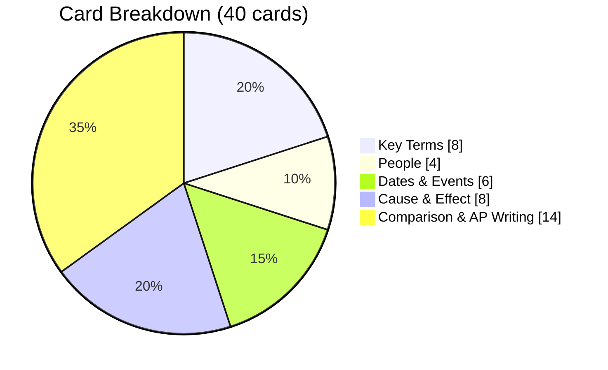

# AP World History: Modern — Topic 1.7 Comparison in the Period from c. 1200 to c. 1450 · Flashcards

> Source: Based on the College Board CED · Textbook incorporated (Topic 1.7 reading)

---

## 1. Key Terms

- [ ] **What is the difference between legitimizing and consolidating power?**

▶ Answer
Legitimizing power means convincing people that the ruler has the right to rule, usually through religion or descent. Consolidating power means keeping control over land, people, and wealth through tools such as bureaucracy, the military, taxes, tribute, and roads.

- [ ] **What is the Mandate of Heaven, and which Unit 1 state used it?**

▶ Answer
The Chinese idea that Heaven gives the right to rule to a just emperor and takes it away from an unjust one. Song China used it, supported by Neo-Confucian ideas of loyalty and order.

- [ ] **What were the civil service exams, and how did they affect the Song state?**

▶ Answer
Song exams on Confucian texts used to choose government officials (scholar-officials). They created a loyal, educated bureaucracy chosen by merit that served the emperor rather than local nobles, which weakened the old aristocracy and made the Song highly centralized. The textbook says no other state had such a well-established system for running government across so large a territory.

- [ ] **What is devaraja?**

▶ Answer
The Khmer idea of the king as a "god-king" linked to Hindu gods. Khmer kings used it to legitimize their rule and built temples such as Angkor Wat.

- [ ] **What were the mit'a and the quipu?**

▶ Answer
The mit'a was the Inca labor tax: subjects had to work on state projects, such as roads, farms, and buildings, for a set period of time. The textbook calls it an elaborate system that supported Inca state-building. The quipu was a set of knotted cords used to record taxes, labor, and population, which let the Inca run a large empire without a writing system.

- [ ] **What was the Mexica tribute system, and what were its effects?**

▶ Answer
Conquered city-states kept their own rulers but sent goods (cotton, cacao, feathers, food) and captives to Tenochtitlan. The textbook calls the Aztec state a tributary empire that relied on a strong military. Tribute brought great wealth without the cost of direct rule, but subject peoples resented it, so the empire was loosely held together and fairly decentralized.

- [ ] **What is feudalism, and where was it found from 1200 to 1450?**

▶ Answer
A system in which lords gave land to vassals in exchange for military service and loyalty. It was found in Western Europe (lords, vassals, knights), where the textbook says feudal ties were declining as kings built centralized states, and in Japan (shogun, daimyo, samurai), which the textbook says became more decentralized and feudal.

- [ ] **What are the textbook's four types of state-building, c. 1200–c. 1450?**

▶ Answer
(1) Emergence of new states in land once ruled by another empire (Mamluks, Seljuks, Delhi Sultanate). (2) Revival of former empires (Song based on the Han, Mali based on Ghana, Holy Roman Empire based on Rome). (3) Synthesis of different traditions (Japan, the Delhi Sultanate, Neo-Confucianism). (4) Expansion in scope (Aztecs, Incas, city-states in East Africa and Southeast Asia). Note: many accounts point out that the Great Seljuk Empire peaked before 1200.

## 2. People

- [ ] **Who was Mansa Musa, and how did he legitimize his rule?**

▶ Answer
The ruler of Mali (r. 1312–1337). He showed his Islamic piety and wealth through his hajj to Mecca in 1324 and by building mosques and supporting scholars in Timbuktu.

- [ ] **Who was Pachacuti?**

▶ Answer
The Inca ruler who began the rapid expansion of the Inca Empire in 1438. The Inca consolidated this empire with the mit'a, roads, quipu, and resettlement.

- [ ] **Who was King Lalibela?**

▶ Answer
A king of Ethiopia's Zagwe dynasty (c. 1200) who sponsored churches carved from solid rock. These churches showed the ruler's Christian authority through monumental architecture.

- [ ] **Who were the Mamluks?**

▶ Answer
Turkic slave soldiers who seized power in Egypt in 1250 and ruled Egypt and Syria until 1517. They legitimized their rule by defending Islam (defeating the Mongols at Ayn Jalut in 1260) and hosting the Abbasid caliphs in Cairo.

## 3. Dates & Events

- [ ] **1206**

▶ Answer
The Delhi Sultanate is founded in northern India by Turkic Muslim rulers who were former slave soldiers.

- [ ] **c. 1299**

▶ Answer
Osman founds the Ottoman state in Anatolia. The textbook names the Ottoman Turks as one of the separate Turkic groups whose empires lasted well past 1450.

- [ ] **1324**

▶ Answer
Mansa Musa of Mali makes his hajj to Mecca, passing through Cairo and displaying Mali's gold and Islamic faith.

- [ ] **c. 1325**

▶ Answer
The Mexica found Tenochtitlan in the Valley of Mexico.

- [ ] **1336**

▶ Answer
The Vijayanagara Empire, a Hindu kingdom, is founded in southern India. The textbook groups it with the Chola as a state that used trade to build its strength; many accounts call it land-based because its power rested on farm revenue and a large army.

- [ ] **1438**

▶ Answer
Pachacuti begins the expansion of the Inca Empire.

## 4. Cause & Effect

- [ ] **Cause → Effect: What happened to Islamic political legitimacy after the Mongols destroyed the Abbasid Caliphate in 1258?**

▶ Answer
Islam stayed the basis of rule (continuity). The textbook says the Abbasid Caliphate had already been fragmented by invaders and shifts in trade, and new Muslim states arose in Africa, the Middle East, and Spain. The Mamluks kept a line of Abbasid caliphs in Cairo from 1261, and Muslim rulers in places such as Delhi and Mali continued to legitimize their power through Islam.

- [ ] **Cause → Effect: What were the effects of Mansa Musa's hajj?**

▶ Answer
It made Mali famous across Afro-Eurasia for its wealth (his gold spending reportedly lowered the value of gold in Cairo) and strengthened his image as a Muslim ruler. He brought back scholars and architects, which helped Timbuktu grow as a center of Islamic learning.

- [ ] **Cause → Effect: How did Inca roads and the mit'a help the Inca hold their empire together?**

▶ Answer
Mit'a labor built roads, terraces, and storehouses. Roads with runners and rest stations moved armies, goods, and messages quickly across the Andes, so the Sapa Inca could control a long mountainous empire from Cuzco.

- [ ] **Cause → Effect: How did Champa rice help make the Song a strong state?**

▶ Answer
Champa rice spread from Vietnam to China and helped the Song feed a growing population. The larger, more urban population supported China's manufacturing, the largest in the world (porcelain, silk, steel, iron). The textbook says this made the Song the strongest state in China since the Han; many accounts add that the Song was militarily weak (it lost the north to the Jin in 1127), so its strength was mainly economic and bureaucratic.

- [ ] **Cause → Effect: What were the effects of the spread of paper across Eurasia?**

▶ Answer
Paper, invented in China (the textbook says in the 2nd century B.C.E.), reached Europe around the 13th century. More written and printed material raised literacy in Europe, the Middle East, and North Africa, and learning led to advances in mathematics and medicine, especially at Islamic centers such as the House of Wisdom in Baghdad. Many accounts credit Cai Lun with improving papermaking in 105 C.E.

- [ ] **Cause → Effect: How did Mongol rule affect Eurasia, and how did the role of nomads change afterward?**

▶ Answer
The political stability of Mongol rule let trade across Eurasia greatly expand, intensified cross-cultural exchange, and led to some of the first direct contacts between Europe and China since the classical period. The textbook says the Mongol and Turkic empires were among the last major impacts of nomads on settled peoples; afterward, organized merchants and trading companies replaced nomads in commerce and exchange.

- [ ] **Cause → Effect: How did missionaries and trade spread religions, and what was the result in South Asia?**

▶ Answer
Islam, Buddhism, and Christianity encouraged conversion, so missionary activity helped local religions decline in Sub-Saharan Africa, Southeast Asia, and East Asia. Trade networks (Indian Ocean, South China Sea, Central Asia, Sahara) also spread religions. In South Asia, converts to Islam increased partly through invasions from Central Asia, but Hinduism stayed dominant, leading to periods of both conflict and tolerance.

- [ ] **Cause → Effect: How did contacts with Asia affect state-building in Europe from 1200 to 1450?**

▶ Answer
Trade with the Middle East (and through it the rest of Asia), Muslim Spain, the Crusades (from around 1100), and the Mongols all contributed to state-building in Europe. The textbook says the process was small and slow, held back by the manorial system and serfdom, but noticeable; after 1450 it grew faster and more significant.

## 5. Comparison & AP Writing

- [ ] **Compare: How did the Mexica and the Inca consolidate power?**

▶ Answer
Similar: both expanded through military conquest and used sun-related religion. Different: the Mexica collected tribute and let local rulers stay, whereas the Inca ruled more directly with the mit'a, roads, quipu, and resettlement of conquered peoples.

- [ ] **Compare: How were feudal Western Europe and Japan similar and different?**

▶ Answer
Similar: both were feudal, and land was exchanged for military service by a warrior class (knights, samurai). Different: in Europe, kings and the Church shared authority, whereas in Japan the emperor was a figurehead and the shogun held real power. The textbook adds that Europe's feudal ties declined as kings centralized (most clearly in England and France), whereas Japan, unlike most states, became more decentralized and feudal.

- [ ] **Compare: How were the Mamluk Sultanate and the Delhi Sultanate similar and different?**

▶ Answer
Similar: both were Islamic states led by Turkic military elites with slave-soldier origins, and both used iqta land grants. Different: the Mamluks ruled a mostly Muslim population and hosted the Abbasid caliphs, whereas the Delhi sultans ruled a Hindu majority.

- [ ] **Compare: How did the Chola and Vijayanagar differ from the Delhi Sultanate, according to the textbook?**

▶ Answer
Similar: all were strong Indian states that collected land revenue and supported a dominant religion. Different: the textbook says the Chola and Vijayanagar in southern India used trade to build strong states, whereas the Delhi Sultanate in northern India was more land-based. Note: many accounts classify Vijayanagara as land-based too, since its power rested on farm revenue and a large army.

- [ ] **Compare: How was the Mali Empire different from the Empire of Ghana?**

▶ Answer
Similar: both West African states grew rich from the trans-Saharan gold trade. Different: the textbook says Mali was bigger and more centrally administered than Ghana, and Mali's rulers used Islam to legitimize and unite their state. The textbook calls Mali a "revival" of a former empire based on Ghana.

- [ ] **Compare: How did the Mongols and the Turkic peoples build empires?**

▶ Answer
Similar: both were nomads from the Central Asian steppes who conquered large land-based empires. Different: the Mongols built one empire through a coordinated campaign by unified clans, whereas different Turkic groups built separate empires (the Seljuks and Ottomans in the Mediterranean region and another group in Persia, which the textbook does not name) that lasted well past 1450.

- [ ] **Compare: How was the role of the Church in European state-building different from the role of religion in most of Eurasia?**

▶ Answer
In most of Eurasia, religion worked with the state (Islam, Confucianism, Hinduism, Buddhism). In Europe, the Church was sometimes part of state-building, but because states were weak for most of the Middle Ages, it had become an alternative structure for organizing society. As stronger states emerged in France and (the textbook says) the Holy Roman Empire, the Church sometimes became a rival power. Note: many accounts describe the Holy Roman Empire in this period as weak and decentralized.

- [ ] **Compare: How did religion affect women in Europe, South Asia, and China?**

▶ Answer
Similar: most cultures remained patriarchal, and religion often reinforced men's power. Different: Christian convents in Europe and Jain and Buddhist communities in South Asia gave women opportunities for learning and leadership, whereas in China women lost some independence as foot binding became more common. The textbook calls religion's record "mixed."

- [ ] **Compare: Centralized vs. decentralized states. Give examples of each.**

▶ Answer
Centralized: power held at the center by the ruler and appointed officials (Song China with its bureaucracy; the Inca with the mit'a and roads; Mali, which the textbook says was more centrally run than Ghana). Decentralized: power shared with local elites (Japan, which became more decentralized; Eastern Europe; the Mexica tribute empire; most of the Americas, which lacked centralized states). England and France were feudal but slowly centralizing.

- [ ] **Compare: How did Angkor Wat, Great Zimbabwe, and the churches of Lalibela serve rulers?**

▶ Answer
All three were monumental architecture that showed the ruler's power and wealth. They differed in religion: Angkor Wat was Hindu and later Buddhist, Lalibela's churches were Christian, and Great Zimbabwe's stone walls reflected local Shona beliefs and the ruler's prestige.

- [ ] **AP Short Answer: Identify and explain one similarity in how two states legitimized power from 1200 to 1450.**

▶ Answer

**Claim:** Both the Mexica and the Inca legitimized their rulers through sun worship. 
**Evidence:** The Mexica honored the sun and war god Huitzilopochtli with human sacrifice, and the Sapa Inca claimed to be the son of the sun god Inti. 
**Reasoning:** Linking the ruler and the state to the sun, the most important god, made rule seem divinely required, so subjects had religious reasons to obey and to supply labor or tribute.

- [ ] **AP Short Answer: Explain one difference in how two states consolidated power from 1200 to 1450.**

▶ Answer

**Claim:** Song China consolidated power through a civil bureaucracy, whereas the Mamluk Sultanate consolidated power through a military elite. 
**Evidence:** The Song chose scholar-officials through civil service exams on Confucian texts. The Mamluks were Turkic slave soldiers who ruled Egypt and Syria and paid officers with iqta land grants. 
**Reasoning:** The Song inherited a long Confucian tradition of written government, while the Mamluks came to power as soldiers and depended on military strength to defend Islam against the Mongols and the Crusaders.

- [ ] **AP Long Essay Thesis: Compare the methods that two states in Afro-Eurasia used to consolidate power from c. 1200 to c. 1450.**

▶ Answer

**Claim:** Both Srivijaya and the Khmer Empire used Hindu and Buddhist kingship to support their rulers, but Srivijaya consolidated power by taxing sea trade, whereas the Khmer consolidated power by taxing rice farming and building monuments, because of their different geography. 
**Evidence:** Srivijaya's navy controlled the Strait of Malacca and taxed passing ships. The Khmer controlled fertile river lowlands, built reservoirs for irrigated rice, and built Angkor Wat. 
**Reasoning:** A state's location shaped its main source of wealth: a state on a key sea route could grow rich from trade, while a state with fertile land could grow rich from farming and labor.

- [ ] **AP Long Essay Thesis: Compare the processes of state formation in two regions of the world from c. 1200 to c. 1450.**

▶ Answer

**Claim:** Both the Song Dynasty and the Inca Empire built centralized states that used religious ideas to legitimize their rulers, but the Song consolidated power through an exam-based Confucian bureaucracy, whereas the Inca relied on the mit'a, roads, and quipu, because the Song inherited a written tradition of government while the Inca had no writing system. 
**Evidence:** The Song used the Mandate of Heaven and chose scholar-officials through civil service exams. The Sapa Inca claimed to be the son of Inti and used mit'a labor to build thousands of miles of roads, with quipu records. 
**Reasoning:** Older traditions and geography shaped each state's tools: written Confucian traditions made a paper bureaucracy possible in China, while the mountainous Andes and the lack of writing made labor, roads, and knotted-cord records the best tools for the Inca.

