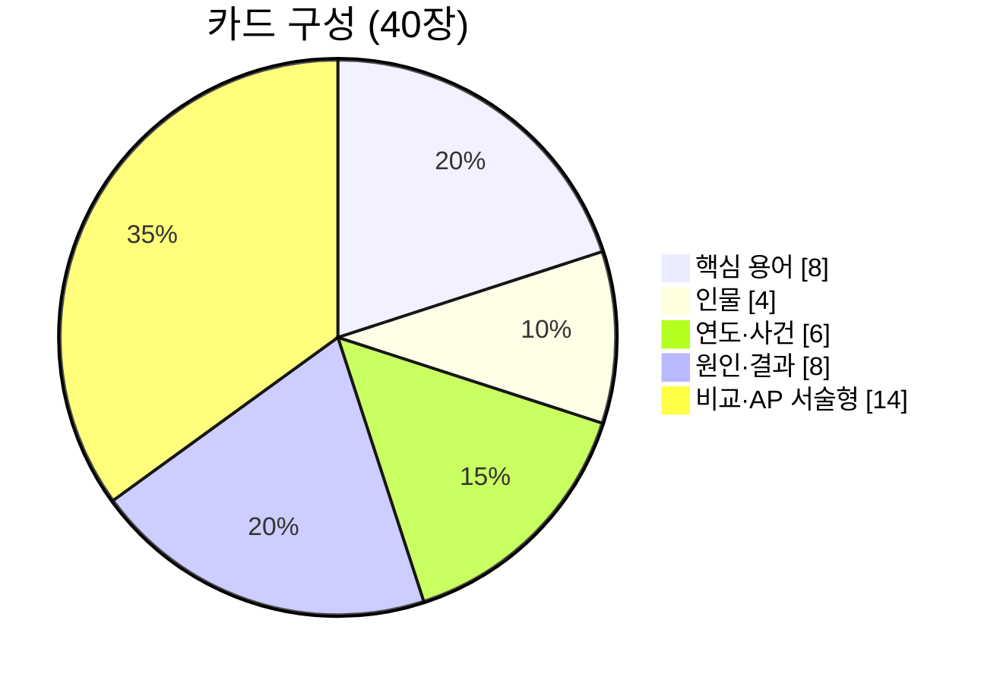

# AP 세계사: 모던 — 토픽 1.7 c. 1200–1450년 시기의 비교 (Comparison in the Period from c. 1200 to c. 1450) · 플래시카드

> 출처: College Board CED 기준 · 교재 반영 (교재 Topic 1.7)

---

## 1. 핵심 용어

- [ ] **권력의 정당화 (Legitimize)와 공고화 (Consolidate)는 어떻게 다른가?**

▶ 정답
정당화는 통치자에게 다스릴 권리가 있다고 사람들을 설득하는 것으로, 보통 종교나 혈통을 이용한다. 공고화는 관료제, 군대, 세금, 공납, 도로 같은 수단으로 땅과 사람과 부를 계속 통제하는 것이다.

- [ ] **천명 (Mandate of Heaven)이란 무엇이며, Unit 1의 어느 국가가 이용했는가?**

▶ 정답
하늘이 정의로운 황제에게 통치권을 주고, 정의롭지 못한 황제에게서는 거두어 간다는 중국의 사상이다. 송나라가 이용했고, 충성과 질서를 강조한 성리학 (Neo-Confucianism)이 이를 뒷받침했다.

- [ ] **과거제 (Civil service exams)란 무엇이었으며, 송나라에 어떤 영향을 주었는가?**

▶ 정답
유교 경전으로 관리(사대부 (Scholar-officials))를 뽑은 송나라의 시험이다. 과거제는 능력으로 뽑혀 지방 귀족이 아니라 황제를 위해 일하는 충성스럽고 교육받은 관료제를 만들었다. 이로써 옛 귀족의 힘이 약해졌고, 송나라는 매우 중앙 집권적인 국가가 되었다. 교재는 이렇게 넓은 영토에서 정부를 운영하는 체계를 이만큼 잘 갖춘 나라는 다른 어디에도 없었다고 쓴다.

- [ ] **데바라자 (Devaraja)란 무엇인가?**

▶ 정답
왕을 힌두 신과 연결된 "신왕"으로 보는 크메르의 사상이다. 크메르의 왕들은 이 사상으로 통치를 정당화했고, 앙코르 와트 (Angkor Wat) 같은 사원을 지었다.

- [ ] **미타 (Mit'a)와 키푸 (Quipu)란 무엇이었는가?**

▶ 정답
미타는 잉카의 노동세이다. 백성은 정해진 기간 동안 도로, 농장, 건물 같은 국가 사업에서 일해야 했다. 교재는 미타를 잉카의 국가 형성을 뒷받침한 정교한 제도라고 부른다. 키푸는 세금, 노동, 인구를 기록하는 데 쓴 매듭 끈으로, 덕분에 잉카는 문자 체계 없이 큰 제국을 운영할 수 있었다.

- [ ] **메시카의 공납 제도 (Tribute system)란 무엇이었으며, 어떤 결과를 낳았는가?**

▶ 정답
정복된 도시 국가들이 자기 통치자를 유지하되, 테노치티틀란 (Tenochtitlan)에 물자(면화, 카카오, 깃털, 식량)와 포로를 보낸 제도이다. 교재는 아스테카 국가를 강한 군대에 의지한 공납 제국 (Tributary empire)이라고 부른다. 공납은 직접 통치하는 비용 없이 큰 부를 가져왔지만, 복속된 민족들이 불만을 품었다. 그래서 제국은 느슨하게 묶여 있었고 비교적 지방 분권적이었다.

- [ ] **봉건제 (Feudalism)란 무엇이며, 1200–1450년 어디에서 볼 수 있었는가?**

▶ 정답
영주가 군사 봉사와 충성을 받는 대가로 봉신에게 땅을 준 제도이다. 서유럽(영주, 봉신, 기사)에서 볼 수 있었는데, 교재에 따르면 왕들이 중앙 집권 국가를 세우면서 봉건적 유대가 약해지고 있었다. 일본(쇼군 (Shogun), 다이묘 (Daimyo), 사무라이 (Samurai))에서도 볼 수 있었는데, 교재에 따르면 일본은 더 분권적이고 봉건적으로 변했다.

- [ ] **c. 1200–c. 1450년 국가 형성의 네 가지 유형 (교재)은 무엇인가?**

▶ 정답
(1) 새 국가의 등장 (Emergence of new states): 다른 제국이 지배하던 땅에 생긴 국가(맘루크, 셀주크, 델리 술탄국). (2) 이전 제국의 부흥 (Revival of former empires): 한나라를 바탕으로 한 송나라, 가나를 바탕으로 한 말리, 로마를 바탕으로 한 신성 로마 제국. (3) 서로 다른 전통의 융합 (Synthesis of different traditions): 일본, 델리 술탄국, 성리학. (4) 범위의 확대 (Expansion in scope): 아스테카, 잉카, 동아프리카와 동남아시아의 도시 국가. 참고: 많은 설명에서는 대셀주크 제국의 전성기가 1200년 이전이었다고 지적한다.

## 2. 인물

- [ ] **만사 무사 (Mansa Musa)는 누구이며, 어떻게 통치를 정당화했는가?**

▶ 정답
말리의 통치자이다(재위 1312–1337). 1324년 메카 성지 순례 (Hajj)와 모스크 건설, 팀북투 (Timbuktu) 학자 후원으로 이슬람 신앙심과 부를 보여 주었다.

- [ ] **파차쿠티 (Pachacuti)는 누구인가?**

▶ 정답
1438년 잉카 제국의 빠른 팽창을 시작한 잉카의 통치자이다. 잉카는 미타, 도로, 키푸, 강제 이주로 이 제국을 공고화했다.

- [ ] **랄리벨라 왕 (King Lalibela)은 누구인가?**

▶ 정답
통바위를 깎아 교회를 짓게 한 에티오피아 자그웨 왕조 (Zagwe dynasty)의 왕이다(c. 1200). 이 교회들은 기념비적 건축으로 통치자의 기독교적 권위를 보여 주었다.

- [ ] **맘루크 (Mamluks)는 누구였는가?**

▶ 정답
1250년 이집트에서 권력을 잡고 1517년까지 이집트와 시리아를 다스린 튀르크계 노예 병사이다. 이슬람을 지키고(1260년 아인 잘루트 (Ayn Jalut)에서 몽골 격파), 카이로에 아바스 칼리프 (Abbasid caliphs)를 모셔 통치를 정당화했다.

## 3. 연도·사건

- [ ] **1206년**

▶ 정답
노예 병사 출신의 튀르크계 무슬림 통치자들이 북인도에 델리 술탄국 (Delhi Sultanate)을 세운다.

- [ ] **c. 1299년**

▶ 정답
오스만 1세 (Osman)가 아나톨리아에 오스만 국가 (Ottoman state)를 세운다. 교재는 오스만 튀르크를 1450년 이후까지 오래 이어진 제국을 각각 따로 세운 튀르크 집단 중 하나로 든다.

- [ ] **1324년**

▶ 정답
말리의 만사 무사가 메카로 순례를 떠난다. 카이로를 지나며 말리의 금과 이슬람 신앙을 보여 준다.

- [ ] **c. 1325년**

▶ 정답
메시카 (Mexica)가 멕시코 계곡에 테노치티틀란을 세운다.

- [ ] **1336년**

▶ 정답
남인도에 힌두 왕국인 비자야나가르 제국 (Vijayanagara Empire)이 세워진다. 교재는 비자야나가르를 촐라 (Chola)와 함께 교역을 이용해 힘을 키운 국가로 묶는다. 많은 설명에서는 그 힘이 농업 세입과 대군에서 나왔으므로 육지 기반 (Land-based) 국가로 본다.

- [ ] **1438년**

▶ 정답
파차쿠티가 잉카 제국의 팽창을 시작한다.

## 4. 원인·결과

- [ ] **원인 → 결과: 1258년 몽골이 아바스 칼리프조 (Abbasid Caliphate)를 무너뜨린 뒤 이슬람의 정치적 정당성은 어떻게 되었는가?**

▶ 정답
이슬람은 통치의 바탕으로 남았다(연속성 (Continuity)). 교재에 따르면 아바스 칼리프조는 이미 침입자와 교역의 변화로 분열되어 있었고, 아프리카, 중동, 스페인에 새로운 무슬림 국가가 등장했다. 맘루크는 1261년부터 카이로에서 아바스 칼리프의 계보를 이어 갔고, 델리와 말리 같은 곳의 무슬림 통치자들도 계속 이슬람으로 권력을 정당화했다.

- [ ] **원인 → 결과: 만사 무사의 순례는 어떤 결과를 낳았는가?**

▶ 정답
말리는 부유한 나라로 아프로-유라시아 전역에 이름을 알렸다(그가 쓴 금 때문에 카이로의 금값이 떨어졌다고 전해진다). 무슬림 통치자로서의 이미지도 강해졌다. 그는 학자와 건축가를 데려왔고, 덕분에 팀북투는 이슬람 학문의 중심지로 성장했다.

- [ ] **원인 → 결과: 잉카의 도로와 미타는 제국을 묶는 데 어떻게 도움이 되었는가?**

▶ 정답
미타 노동으로 도로, 계단식 밭, 창고를 지었다. 파발꾼과 쉼터를 갖춘 도로는 군대, 물자, 소식을 안데스 전역으로 빠르게 옮겼다. 그래서 사파 잉카 (Sapa Inca)는 쿠스코에서 길게 뻗은 산악 제국을 통제할 수 있었다.

- [ ] **원인 → 결과: 참파 벼 (Champa rice)는 어떻게 송나라를 강한 국가로 만드는 데 도움이 되었는가?**

▶ 정답
참파 벼는 베트남에서 중국으로 퍼져 송나라가 늘어나는 인구를 먹여 살리게 했다. 더 많고 더 도시화된 인구가 세계 최대였던 중국의 제조업(도자기, 비단, 강철, 철)을 뒷받침했다. 교재는 이로써 송나라가 한나라 이후 중국에서 가장 강한 국가가 되었다고 쓴다. 많은 설명에서는 송나라가 군사적으로 약했으므로(1127년 금나라 (Jin)에게 북중국을 잃음) 그 강점은 주로 경제와 관료제였다고 덧붙인다.

- [ ] **원인 → 결과: 종이 (Paper)가 유라시아에 퍼진 결과는 무엇이었는가?**

▶ 정답
중국에서 발명된(교재는 기원전 2세기라고 씀) 종이는 13세기경 유럽에 도달했다. 글과 인쇄물이 늘어 유럽, 중동, 북아프리카의 문해율이 높아졌고, 학문이 발달해 특히 바그다드의 지혜의 집 (House of Wisdom) 같은 이슬람 학문 중심지에서 수학과 의학이 발전했다. 많은 설명에서는 채륜 (Cai Lun)이 105년에 제지법을 개량했다고 본다.

- [ ] **원인 → 결과: 몽골의 지배는 유라시아에 어떤 영향을 주었으며, 그 뒤 유목민의 역할은 어떻게 변했는가?**

▶ 정답
몽골 지배의 정치적 안정 덕분에 유라시아 교역이 크게 늘었고, 문화 교류가 활발해졌으며, 고전 시대 이후 처음으로 유럽과 중국이 직접 접촉했다. 교재는 몽골과 튀르크 제국이 유목민이 정착민에게 준 마지막 주요 영향 중 하나였다고 쓴다. 그 뒤 상업과 교류에서 유목민의 자리는 조직된 상인 집단과 무역 회사가 차지했다.

- [ ] **원인 → 결과: 선교사와 교역은 종교를 어떻게 퍼뜨렸으며, 남아시아에서는 어떤 결과가 나타났는가?**

▶ 정답
이슬람, 불교, 기독교는 개종을 권했으므로, 선교 활동 (Missionary activity)은 사하라 이남 아프리카, 동남아시아, 동아시아에서 토착 종교가 쇠퇴하는 데 영향을 주었다. 교역망(인도양, 남중국해, 중앙아시아, 사하라)도 종교를 퍼뜨렸다. 남아시아에서는 중앙아시아에서 온 침입으로 이슬람 개종자가 늘었지만 힌두교가 여전히 주된 종교로 남아, 갈등과 관용이 번갈아 나타났다.

- [ ] **원인 → 결과: 1200–1450년 아시아와의 접촉은 유럽의 국가 형성에 어떤 영향을 주었는가?**

▶ 정답
중동(그리고 중동을 거쳐 아시아 나머지 지역)과의 교역, 무슬림 스페인, 십자군 (Crusades, 1100년경부터), 몽골이 모두 유럽의 국가 형성에 기여했다. 교재에 따르면 이 과정은 장원제와 농노제 (Manorial system and serfdom) 때문에 작고 느렸지만 눈에 띄었다. 1450년 이후에는 더 빠르고 중요해졌다.

## 5. 비교·AP 서술형

- [ ] **비교: 메시카와 잉카는 권력을 어떻게 공고화했는가?**

▶ 정답
공통점: 둘 다 군사 정복으로 팽창했고, 태양 관련 종교를 이용했다. 차이점: 메시카는 공납을 받고 지방 통치자를 그대로 두었고, 반면 잉카는 미타, 도로, 키푸, 정복민 이주로 더 직접 다스렸다.

- [ ] **비교: 봉건 서유럽과 일본의 공통점과 차이점은?**

▶ 정답
공통점: 둘 다 봉건 사회였고, 전사 계급(기사, 사무라이)이 군사 봉사를 하고 땅을 받았다. 차이점: 유럽에서는 왕과 교회가 권위를 나누었고, 반면 일본에서는 천황이 상징적 존재였으며 실제 권력은 쇼군이 가졌다. 교재는 유럽에서는 왕이 중앙 집권을 강화하면서 봉건적 유대가 약해졌고(잉글랜드와 프랑스에서 가장 분명함), 반면 일본은 대부분의 국가와 달리 더 분권적이고 봉건적으로 변했다고 덧붙인다.

- [ ] **비교: 맘루크 술탄국과 델리 술탄국의 공통점과 차이점은?**

▶ 정답
공통점: 둘 다 노예 병사 출신 튀르크계 군사 엘리트가 이끈 이슬람 국가였고, 둘 다 이크타 (Iqta) 토지 수여를 썼다. 차이점: 맘루크는 주로 무슬림인 주민을 다스리고 아바스 칼리프를 모셨으며, 반면 델리의 술탄들은 힌두교도 다수를 다스렸다.

- [ ] **비교: 교재에 따르면 촐라 (Chola)와 비자야나가르 (Vijayanagar)는 델리 술탄국과 어떻게 달랐는가?**

▶ 정답
공통점: 모두 토지 세입을 거두고 주된 종교를 후원한 강한 인도 국가였다. 차이점: 교재에 따르면 남인도의 촐라와 비자야나가르는 교역을 이용해 강한 국가를 세웠고, 반면 북인도의 델리 술탄국은 더 육지 기반이었다. 참고: 많은 설명에서는 비자야나가르도 농업 세입과 대군에 힘이 있었으므로 육지 기반 국가로 분류한다.

- [ ] **비교: 말리 제국은 가나 제국 (Empire of Ghana)과 어떻게 달랐는가?**

▶ 정답
공통점: 둘 다 사하라 횡단 금 교역으로 부유해진 서아프리카 국가였다. 차이점: 교재에 따르면 말리는 가나보다 더 크고 더 중앙 집권적으로 운영되었고, 말리의 통치자들은 이슬람으로 국가를 정당화하고 하나로 묶었다. 교재는 말리를 가나를 바탕으로 한 이전 제국의 "부흥 (Revival)"이라고 부른다.

- [ ] **비교: 몽골과 튀르크계 민족 (Turkic peoples)은 제국을 어떻게 세웠는가?**

▶ 정답
공통점: 둘 다 중앙아시아 초원 출신 유목민으로 큰 육상 제국을 정복했다. 차이점: 몽골은 통합된 씨족들의 조직적인 원정으로 하나의 제국을 세웠고, 반면 서로 다른 튀르크 집단들은 1450년 이후까지 이어진 각각의 제국을 세웠다(지중해 지역의 셀주크와 오스만, 그리고 교재가 이름을 밝히지 않은 페르시아의 한 집단).

- [ ] **비교: 유럽의 국가 형성에서 교회의 역할은 유라시아 대부분 지역에서 종교가 한 역할과 어떻게 달랐는가?**

▶ 정답
유라시아 대부분에서는 종교가 국가와 함께 움직였다(이슬람, 유교, 힌두교, 불교). 유럽에서는 교회가 때때로 국가 형성의 일부였지만, 중세 대부분의 기간 동안 국가가 약했기 때문에 사회를 조직하는 또 하나의 구조 (Alternative structure)가 되어 있었다. 프랑스와 (교재에 따르면) 신성 로마 제국에서 더 강한 국가가 등장하자 교회는 때때로 경쟁 세력이 되었다. 참고: 많은 설명에서는 이 시기의 신성 로마 제국을 약하고 분권적인 국가로 본다.

- [ ] **비교: 유럽, 남아시아, 중국에서 종교는 여성에게 어떤 영향을 주었는가?**

▶ 정답
공통점: 대부분의 문화는 여전히 가부장적 (Patriarchal)이었고, 종교는 흔히 남성의 권력을 강화했다. 차이점: 유럽의 기독교 수녀원 (Convent)과 남아시아의 자이나교 (Jainism)·불교 공동체는 여성에게 학문과 지도력의 기회를 주었고, 반면 중국에서는 전족 (Foot binding)이 더 흔해지면서 여성이 독립성을 일부 잃었다. 교재는 종교의 기록이 "엇갈린다"고 쓴다.

- [ ] **비교: 중앙 집권 국가 (Centralized state)와 지방 분권 국가 (Decentralized state). 각각의 예를 들어라.**

▶ 정답
중앙 집권: 중앙의 통치자와 임명된 관리가 권력을 가졌다(관료제를 갖춘 송나라, 미타와 도로를 갖춘 잉카, 교재에 따르면 가나보다 더 중앙 집권적으로 운영된 말리). 지방 분권: 지방 엘리트와 권력을 나누었다(더 분권화된 일본, 동유럽, 메시카 공납 제국, 중앙 집권 국가가 없었던 아메리카 대부분). 잉글랜드와 프랑스는 봉건 사회였지만 서서히 중앙 집권화했다.

- [ ] **비교: 앙코르 와트, 그레이트 짐바브웨 (Great Zimbabwe), 랄리벨라의 교회는 통치자에게 어떤 역할을 했는가?**

▶ 정답
셋 다 통치자의 권력과 부를 보여 준 기념비적 건축 (Monumental architecture)이었다. 종교는 서로 달랐다. 앙코르 와트는 힌두 사원이었다가 불교 사원이 되었고, 랄리벨라의 교회는 기독교 교회였으며, 그레이트 짐바브웨의 돌벽은 쇼나족 (Shona)의 토착 신앙과 통치자의 위세를 반영했다.

- [ ] **AP 단답형: 1200–1450년 두 국가가 권력을 정당화한 방식의 공통점 하나를 제시하고 설명하라.**

▶ 정답

**주장:** 메시카와 잉카는 둘 다 태양 숭배 (Sun worship)로 통치자를 정당화했다. 
**근거:** 메시카는 태양과 전쟁의 신 우이칠로포치틀리 (Huitzilopochtli)에게 인신 공양 (Human sacrifice)을 바쳤고, 사파 잉카는 태양신 인티 (Inti)의 아들이라고 주장했다. 
**설명:** 통치자와 국가를 가장 중요한 신인 태양과 연결하면 통치가 신의 뜻으로 보였다. 그래서 백성은 복종하고 노동이나 공납을 바칠 종교적 이유를 갖게 되었다.

- [ ] **AP 단답형: 1200–1450년 두 국가가 권력을 공고화한 방식의 차이점 하나를 설명하라.**

▶ 정답

**주장:** 송나라는 문관 관료제로 권력을 공고화했고, 반면 맘루크 술탄국은 군사 엘리트로 권력을 공고화했다. 
**근거:** 송나라는 유교 경전을 시험하는 과거제로 사대부를 뽑았다. 맘루크는 이집트와 시리아를 다스린 튀르크계 노예 병사였고, 이크타 토지 수여로 장교에게 보수를 주었다. 
**설명:** 송나라는 문자로 된 오랜 유교 통치 전통을 물려받았다. 반면 맘루크는 군인으로서 권력을 잡았고, 몽골과 십자군으로부터 이슬람을 지키기 위해 군사력에 의지했다.

- [ ] **AP 논술형 논지: c. 1200–1450년 아프로-유라시아의 두 국가가 권력을 공고화한 방법을 비교하라.**

▶ 정답

**주장:** 스리위자야 (Srivijaya)와 크메르 제국 (Khmer Empire)은 둘 다 힌두교·불교 왕권 (Hindu and Buddhist kingship)으로 통치자를 뒷받침했다. 그러나 지리가 달랐기 때문에 스리위자야는 해상 교역에 과세해 권력을 공고화했고, 반면 크메르는 벼농사에 과세하고 기념물을 지어 권력을 공고화했다. 
**근거:** 스리위자야의 해군은 믈라카 해협 (Strait of Malacca)을 장악하고 지나가는 배에 세금을 매겼다. 크메르는 비옥한 강 저지대를 장악하고, 관개 벼농사를 위한 저수지와 앙코르 와트를 지었다. 
**설명:** 국가의 위치가 주요 부의 원천을 결정했다. 중요한 바닷길에 있는 국가는 교역으로 부유해질 수 있었고, 비옥한 땅을 가진 국가는 농업과 노동으로 부유해질 수 있었다.

- [ ] **AP 논술형 논지: c. 1200–1450년 세계의 두 지역에서 국가가 형성된 과정을 비교하라.**

▶ 정답

**주장:** 송나라와 잉카 제국은 둘 다 종교적 사상으로 통치자를 정당화한 중앙 집권 국가를 세웠다. 그러나 송나라는 과거제에 기초한 유교 관료제로 권력을 공고화했고, 반면 잉카는 미타, 도로, 키푸에 의지했다. 송나라는 문자로 된 통치 전통을 물려받았지만, 잉카에는 문자 체계가 없었기 때문이다. 
**근거:** 송나라는 천명을 내세웠고 과거제로 사대부를 뽑았다. 사파 잉카는 인티의 아들이라고 주장했고, 미타 노동으로 수천 마일의 도로를 놓았으며, 키푸로 기록을 남겼다. 
**설명:** 오래된 전통과 지리가 각 국가의 수단을 결정했다. 중국에서는 문자로 된 유교 전통 덕분에 문서 중심의 관료제가 가능했다. 잉카에서는 험한 안데스 지형과 문자의 부재 때문에 노동, 도로, 매듭 끈 기록이 가장 알맞은 수단이 되었다.

