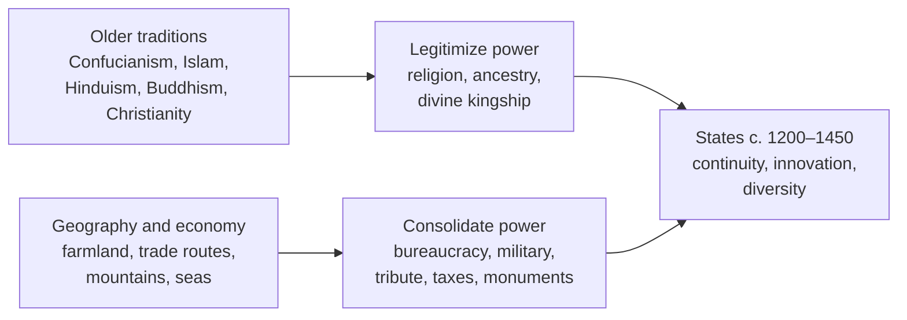
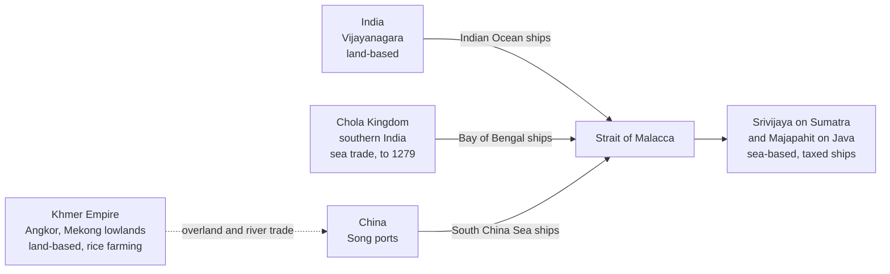
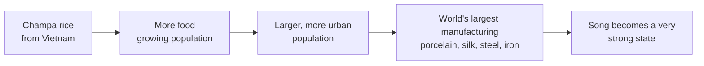
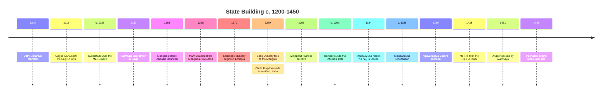
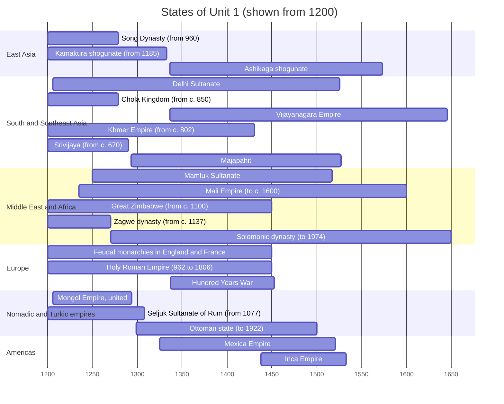
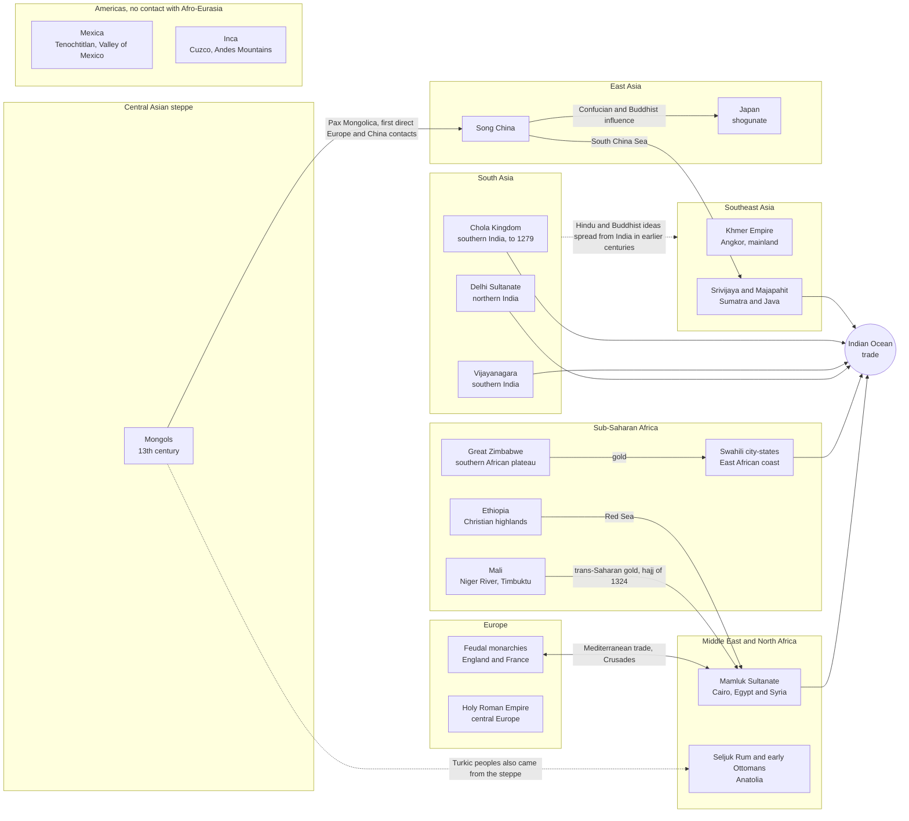
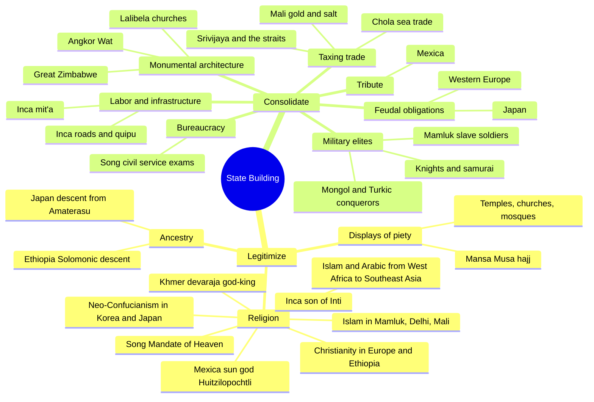

# AP World History: Modern — Topic 1.7 Comparison in the Period from c. 1200 to c. 1450

**Focus Question (textbook Essential Question):** In what ways was the process of state-building in various parts of the world between c. 1200 and c. 1450 similar and different?

> Source: Based on the College Board CED · Textbook incorporated (Topic 1.7 reading)

**Unit 1: The Global Tapestry (c. 1200–1450)**

---

## Learning Objective

| Code | Learning Objective |
|---|---|
| 1.7 LO (GOV) | Explain the similarities and differences in the processes of state formation from c. 1200 to c. 1450. |

> Note: The title above is the textbook's title for 1.7, and it matches the CED topic title as we understand it. Earlier versions of these notes used the informal title "Comparison in State Building." If your class materials use a different title, follow them.

## Historical Developments (CED)

> 1.7 is a comparison topic. It asks you to **compare the states of Topics 1.1–1.6** (East Asia, Dar al-Islam, South and Southeast Asia, the Americas, Africa, and Europe) using the skill of **Comparison**.

| # | Historical Development | Covered in |
|---|---|---|
| HD1 (KC-3.2.I) | Empires and states in Afro-Eurasia and the Americas demonstrated continuity, innovation, and diversity in the 13th century. | §1, §2, §3, §4, §5, §6, §7, §8, §9 |

> ⚠️ Needs verification: The KC-3.2.I wording above is close to, but may not match, the official CED text word for word.

---

## The Big Picture

> "The world is divided into men who have wit and no religion and men who have religion and no wit."
> — Ibn Sina (Avicenna) (980–1037), Persian philosopher and physician

> ⚠️ The textbook attributes this quote to Ibn Sina. Many accounts attribute a very similar saying to the Syrian poet **al-Ma'arri** (973–1057). Check how your teacher presents this.

The textbook explains that between c. 1200 and c. 1450, states in the **core areas of civilization grew larger** while **smaller states declined**. In this way, much of the world followed the **same trend** of building **more centralized, more powerful states**. However, the process varied from place to place. In most of Asia, the **military strength of the Mongols** created the **largest land-based empire in world history**. In **West Africa, the Middle East, and South Asia**, the religion of **Islam** was a key part of state-building. In **Europe**, **trade**, both internal and with the more advanced civilizations of the Middle East, had a greater impact. As stronger states rose, the influence of **nomadic societies** began to wane by the **15th century**.

From c. 1200 to c. 1450, rulers across Afro-Eurasia and the Americas faced the same two problems. First, they had to **legitimize** their power: convince people that they had the **right** to rule. Second, they had to **consolidate** their power: keep **control** over land, people, and wealth. Most rulers used **religion** to legitimize power, such as the **Mandate of Heaven** in Song China, **Islam** in the Mamluk Sultanate, the Delhi Sultanate, and Mali, **Christianity** in Europe and Ethiopia, **Hindu and Buddhist kingship** in the Khmer Empire, and **sun worship** among the Mexica and the Inca. To consolidate power, they used a mix of **bureaucracy**, **military elites**, **feudal obligations**, **tribute and labor systems**, **taxes on trade**, and **monumental architecture**. The CED sums up this era in three words. There was **continuity**, because older traditions such as Confucianism and Islam continued. There was **innovation**, because new states such as the Delhi Sultanate, Mali, the Mexica, and the Inca appeared. There was **diversity**, because empires, kingdoms, sultanates, sea-based trading states, city-states, and feudal states all existed at the same time.

---

## §1. The Comparison Framework: Legitimize vs. Consolidate

| Concept | Question it answers | Common methods | Example |
|---|---|---|---|
| **Legitimacy** | Why do people accept this ruler? | Religion, claims of divine descent, support of religious leaders, displays of piety | The Sapa Inca claimed to be the **son of Inti**, the sun god |
| **Consolidation** | How does the ruler keep control? | Bureaucracy, military, taxes and tribute, labor systems, roads, monuments | Song China chose officials through **civil service exams** |
| **Centralized state** | Is power held at the center? | Strong ruler, appointed officials, direct taxes | Song China, the Inca Empire |
| **Decentralized state** | Is power shared with local elites? | Lords, vassals, local rulers who pay tribute | Feudal Europe, shogunate Japan, the Mexica tribute empire |

- Almost every state used **both** legitimacy and consolidation. A ruler who had only force was easy to overthrow, and a ruler who had only religious claims could not collect taxes.
- **Religion** was the most common source of legitimacy in every region.
- The methods of consolidation depended on **geography** and the **economy**: farming empires taxed land, trading states taxed trade, and mountain empires built roads.
- **Textbook summary of the comparison:** the main **similarity** was a shared trend toward **larger, more centralized states**, with **religion** as a vital tool. The main **differences** were in the driving force in each region (**Mongol military power** in Asia, **Islam** in West Africa, the Middle East, and South Asia, **trade** in Europe) and in exceptions such as **Japan**, which became **more decentralized**.

## §2. Legitimizing Power

| Source of legitimacy | States | How it worked |
|---|---|---|
| **Confucianism and the Mandate of Heaven** | Song China | Heaven gave the emperor the right to rule as long as he ruled well. **Neo-Confucianism** stressed loyalty, order, and filial piety, which supported the emperor and his officials. The textbook adds that Neo-Confucianism spread to **Korea and Japan**, where rulers used it to justify and consolidate their power |
| **Islam** | Mamluk Sultanate, Delhi Sultanate, Mali | Rulers presented themselves as defenders and patrons of Islam. The Mamluks defeated the Mongols at **Ayn Jalut (1260)** and hosted the **Abbasid caliphs in Cairo** after 1258. Delhi sultans sought recognition from the Abbasid caliph. **Mansa Musa** of Mali showed his piety through his **hajj to Mecca (1324)** and by building mosques. The textbook stresses that shared beliefs and the common language of **Arabic** gave Islam the power to legitimize rulers **from West Africa to Southeast Asia** |
| **Christianity** | Western Europe, Ethiopia | European kings were crowned and anointed by the Church and claimed to rule by God's will. Ethiopia's **Solomonic dynasty** (from 1270) claimed descent from **King Solomon and the Queen of Sheba** and was closely tied to the Ethiopian Church |
| **Hindu and Buddhist kingship** | Khmer Empire, Vijayanagara, Chola, Srivijaya, Majapahit | Khmer kings used the **devaraja** ("god-king") idea and built **Angkor Wat**. Vijayanagara kings were patrons of Hindu temples. Srivijaya was a center of Buddhist learning. The textbook notes that rulers across **South and Southeast Asia** relied on Hinduism and Buddhism to strengthen their states |
| **Divine imperial descent** | Japan | The emperor claimed descent from the sun goddess **Amaterasu**. The emperor kept religious prestige, but the **shogun** held real power in the emperor's name |
| **Sun worship and sacrifice** | Mexica, Inca | The Mexica honored the sun and war god **Huitzilopochtli** with **human sacrifice**, which they believed kept the sun moving. The **Sapa Inca** claimed to be the son of the sun god **Inti** |
| **Prestige shown through monuments** | Great Zimbabwe | Huge stone walls built without mortar displayed the ruler's power and wealth |

- The phrase **"divine right of kings"** describes a theory that became fully developed later (16th–17th centuries). Medieval European kings still claimed that their power came from God and relied on the Church to confirm it.
- **China:** the textbook says the Song relied on **Confucian scholars** to run a powerful, enduring bureaucracy. Here a belief system and the civil service were **closely tied**, so religion supported both legitimacy and consolidation.

> ⚠️ Needs verification: Great Zimbabwe left no written records, so the religious role of its rulers (for example, ancestor or rain rituals) is reconstructed from archaeology and later Shona traditions.

> ⚠️ The textbook says Neo-Confucianism helped rulers in Korea and Japan in this period. Many accounts say Neo-Confucianism became the official state ideology in **Korea** under the **Joseon dynasty (from 1392)** and in **Japan** mainly under the **Tokugawa shogunate (after 1600)**; Kamakura and Ashikaga Japan relied more on Buddhism (especially Zen). Check how your teacher presents this.

### The Church in Europe: Partner and Rival

- In most of Eurasia, religion worked **with** the state. The textbook says the relationship between the **Roman Catholic Church** and state-building in **Europe** was **somewhat different**.
- At times the Church was **part of** the state-building process (for example, crowning kings).
- Because European states were **so weak for most of the Middle Ages**, the Church had provided an **alternative structure for organizing society**.
- Between 1200 and 1450, as **more powerful states** emerged in **France** and the **Holy Roman Empire**, the Church sometimes became a **rival power**.

> ⚠️ The textbook names the Holy Roman Empire as one of the more powerful states of 1200–1450. Many accounts describe the Holy Roman Empire in this period as **weak and decentralized** (for example, the "Great Interregnum" of 1250–1273 and the **Golden Bull of 1356**, which gave power to seven princes who elected the emperor). France and England are the usual examples of growing royal power. Check how your teacher presents this.

### Diffusion of Religion

- **Islam, Buddhism, and Christianity** all encouraged followers to **convert non-believers**. So **missionary activity** helped cause the **decline of local religions** in places such as **Sub-Saharan Africa, Southeast Asia, and East Asia**.
- In **South Asia**, converts to Islam increased partly because of **military invasions by Islamic armies from Central Asia**. However, **Hinduism remained the predominant religion**, setting the stage for **intermittent periods of conflict and tolerance** between Muslims and Hindus.
- **Trade networks** in the **Indian Ocean**, the **South China Sea**, **East and Central Asia**, and **across the Sahara** spread religions as commercial activity increased.

## §3. Consolidating Power

| Method | How it worked | Examples |
|---|---|---|
| **Bureaucracy and exams** | Officials were chosen by merit and paid by the state, so they served the ruler instead of local nobles | Song China: **civil service exams** on Confucian texts produced **scholar-officials**. The textbook says **no other state** had such a well-established and extensive system for running government across so large a territory; the ability to **implement laws and carry out imperial edicts** was key to Chinese state-building |
| **Military elites and slave soldiers** | Rulers relied on loyal professional soldiers, often enslaved as boys and trained for war | **Mamluks** (Turkic slave soldiers who took over Egypt in 1250); the first Delhi sultans were former slave soldiers; **iqta** land grants paid officers in both sultanates |
| **Feudal obligations** | Lords gave land in exchange for military service and loyalty; peasants worked the land | Western Europe: lords, vassals, knights, and serfs on **manors**. Japan: shogun, **daimyo**, and **samurai** |
| **Tribute** | Conquered peoples kept their own rulers but paid goods and labor to the center | **Mexica**: city-states sent cotton, cacao, feathers, food, and captives to **Tenochtitlan**. The textbook calls the Aztec state a **tributary empire** that relied on a **strong military** |
| **Labor systems and infrastructure** | The state demanded labor and built networks to move armies, goods, and messages | **Inca**: **mit'a** labor tax, a road system of thousands of miles with runners, **quipu** records, storehouses, and the Quechua language. The textbook calls the mit'a an **elaborate system** that supported Inca state-building |
| **Taxing trade** | Rulers controlled a key route and taxed the goods that passed through | **Srivijaya** taxed ships in the **Strait of Malacca**; **Mali** taxed the trans-Saharan **gold and salt** trade; **Great Zimbabwe** controlled gold sent to the Swahili coast; the textbook says the **Chola Kingdom** and **Vijayanagar** in southern India **used trade to build strong states** |
| **Monumental architecture** | Huge buildings showed the ruler's power, wealth, and religious authority | **Angkor Wat** (Khmer), the **Great Enclosure** (Great Zimbabwe), the **rock-cut churches of Lalibela** (Ethiopia), the **Templo Mayor** (Mexica), mosques in **Timbuktu** (Mali) |

- Many states combined several methods. For example, the Inca used religion, roads, labor taxes, and resettlement of conquered peoples all at once.
- The rock-cut churches of Lalibela were built under the **Zagwe dynasty** (King Lalibela, c. 1200), before the Solomonic dynasty took power in 1270.
- **Mali vs. Ghana:** the textbook says the rulers of **Mali** created an empire that was **bigger and more centrally administered** than the **Empire of Ghana** that came before it.

## §4. Continuity, Innovation, and Diversity

| Pattern | Meaning | Examples |
|---|---|---|
| **Continuity** | Older traditions and institutions continued after 1200 | The Song kept the **Confucian** bureaucracy and exams that earlier dynasties had built. **Islam** stayed the basis of rule after the Mongols destroyed the **Abbasid Caliphate (1258)**; the Mamluks kept a line of Abbasid caliphs in Cairo. **Christianity** continued to support kings in Europe and Ethiopia. **Hindu and Buddhist** kingship continued in Southeast Asia. The textbook also counts **revivals** of earlier empires: the Song (based on the Han), Mali (based on Ghana), and the Holy Roman Empire (based on Rome) |
| **Innovation** | New states and new ways of ruling appeared | New states: the **Delhi Sultanate (1206)**, **Mali (c. 1235)**, the **Mamluk Sultanate (1250)**, the **Ottoman state (c. 1299)**, **Vijayanagara (1336)**, the **Mexica (c. 1325)**, and the **Inca (expanding from 1438)**. New methods: former slave soldiers became rulers; the Inca built a large empire run with quipu records instead of writing |
| **Diversity** | Many different kinds of states existed at once | Centralized empires (Song, Inca), sultanates (Mamluk, Delhi), kingdoms (Mali, Ethiopia, Vijayanagara, Chola), sea-based trading states (Srivijaya, Majapahit), tribute empires (Mexica), city-states (Swahili coast, Southeast Asia, Italy), feudal states (Europe, Japan), and nomadic empires (Mongols) |

- The **Mongols** (Unit 2) disrupted many of these states. They conquered the Song by **1279** and destroyed Baghdad in **1258**, but they were stopped by the Mamluks (1260) and by the Delhi Sultanate.

### Textbook Overview: State-Building and New Empires

| Region | What happened (textbook) | Direction |
|---|---|---|
| **China** | The **Song Dynasty** continued a long period of **technological and cultural progress** | Strong, centralized |
| **Middle East** | The **Abbasid Caliphate** was **fragmented by invaders and shifts in trade**; new Muslim states then arose in **Africa, the Middle East, and Spain** | Old empire broke up; new states formed |
| **South and Southeast Asia** | The **Chola Kingdom** and **Vijayanagar Empire** used **trade** to build strong states, while the **Delhi Sultanate** in northern India was **more land-based** | Strong states, different economic bases |
| **Africa** | **Mali** was **bigger and more centrally administered** than the **Empire of Ghana** before it | More centralized |
| **Americas** | The **Aztecs** formed a **tributary empire** in Mesoamerica that relied on a **strong military**; the **Inca** used the elaborate **mit'a** system; **most of the Americas lacked centralized states** | Two large empires; most areas not centralized |
| **Europe** | **Feudal ties declined** as centralized states developed, more clearly in **England and France** than in **Eastern Europe** | Slowly centralizing |
| **Japan** | Unlike most states, Japan became **more decentralized and feudal** | Decentralizing |
| **Nomadic societies** | Their influence **began to wane by the 15th century** as stronger, more centralized states rose | Declining |

### Textbook Table: Four Types of State-Building, c. 1200–c. 1450

| Process | Description | Examples |
|---|---|---|
| **Emergence of New States** | States arise in land once controlled by another empire | Mamluk Empire (formerly Abbasid territory); Seljuk Empire (formerly Abbasid territory); Delhi Sultanate (formerly Gupta territory) |
| **Revival of Former Empires** | New leadership continues or rebuilds a previous empire with some innovations | Song Dynasty (based on the Han Dynasty); Mali Empire (based on the Ghana Kingdom); Holy Roman Empire (based on the Roman Empire) |
| **Synthesis of Different Traditions** | A state adapts foreign ideas to local conditions | Japan (Chinese and Japanese); Delhi Sultanate (Islamic and Hindu); Neo-Confucianism |
| **Expansion in Scope** | An existing state expands its influence through conquest, trade, or other means | Aztecs in Mesoamerica; Incas in South America; city-states in East Africa; city-states in Southeast Asia |

- **Link to the CED's three words:** "revival" is a kind of **continuity**; "emergence" and "synthesis" are kinds of **innovation**; having all four types at once shows **diversity**.
- The Delhi Sultanate appears **twice**: as a new state and as a synthesis of Islamic and Hindu traditions. Neo-Confucianism is a belief system rather than a state; it is listed because it **combined** Confucian, Buddhist, and Daoist ideas.

> ⚠️ Two examples in the textbook table may need context. The **Great Seljuk Empire** was at its height in the **11th–12th centuries** (before 1200); only the **Seljuk Sultanate of Rum** in Anatolia lasted to c. 1308. The **Gupta Empire** ended around **550**, so many accounts say northern India was ruled by regional kingdoms (such as Rajput states) for centuries before the Delhi Sultanate. The Mamluks also took Egypt directly from the **Ayyubid** dynasty, not the Abbasids. Check how your teacher presents this.

## §5. Types of States

### Centralized vs. Decentralized

| Feature | Centralized states | Decentralized states |
|---|---|---|
| Who held power | The ruler and appointed officials at the center | Local lords, vassals, or subject rulers |
| Main tools | Bureaucracy, direct taxes, state labor, roads | Feudal obligations, land grants, tribute |
| Examples | Song China, Inca Empire; Mali (more centralized than Ghana); England and France (slowly centralizing) | Eastern Europe, Japan (growing more decentralized), Mexica tribute empire, most of the Americas |
| Strength | Rulers could collect resources and enforce laws across the whole state | Local elites handled defense and government cheaply |
| Weakness | Needed many officials and a lot of revenue | Local elites could rebel or ignore the ruler |

- Centralization is a **spectrum**, not a yes-or-no category. For example, Mali had a strong **mansa** but also governed through local rulers and governors, even though the textbook says it was more centrally run than Ghana.
- **Europe:** the textbook says **feudal ties declined in importance** as centralized states developed, more clearly in **England and France** than in **Eastern Europe**. Western Europe was still feudal in 1200–1450, but its kings were slowly gaining power.
- **Japan:** the textbook says Japan, **unlike most states**, became **more decentralized and feudal** in this period.
- **Americas:** outside the Aztec and Inca empires, **most of the Americas lacked centralized states**.

### Land-Based vs. Sea-Based (South and Southeast Asia)

| Feature | Land-based states | Sea-based states |
|---|---|---|
| Examples | **Khmer Empire** (mainland Southeast Asia), **Vijayanagara** (southern India), **Delhi Sultanate** (northern India; the textbook calls it more land-based) | **Srivijaya** (Sumatra), **Majapahit** (Java), **Chola Kingdom** (southern India, to 1279) |
| Main source of wealth | Taxes on **farmland**, especially irrigated rice | Taxes on **sea trade** passing through the straits |
| Main tool of power | Large armies, reservoirs and irrigation, temples | **Navies** that controlled the Strait of Malacca and nearby waters; the **Chola navy** raided Srivijaya in **1025** |
| Religion | Hindu and Buddhist (Khmer); Hindu (Vijayanagara); Islam (Delhi) | Buddhist (Srivijaya); Hindu-Buddhist (Majapahit); Hindu (Chola) |
| Monuments | **Angkor Wat**; the temples of **Hampi** (the Vijayanagara capital); the **Qutb Minar** (Delhi) | Fewer giant monuments in Srivijaya and Majapahit, whose wealth came from ports; the Chola built great Hindu temples such as the one at **Thanjavur** |

> ⚠️ Needs verification: Some scholars describe Majapahit as both land-based (rice farming on Java) and sea-based (control of island trade). AP courses usually treat it as a sea-based state.

> ⚠️ The textbook groups **Vijayanagar** with the Chola as states that **used trade** to build strong states, and calls the Delhi Sultanate more land-based. These notes list Vijayanagara as **land-based**, as many accounts do, because its power rested on farm revenue and a large army, even though it also profited from coastal trade (for example, importing war horses). Check how your teacher presents this.

## §6. State-Building Through Trade

| Exchange | What spread and where | Effect on states |
|---|---|---|
| **Champa rice** | Spread from **Vietnam** to **China** | Helped the Song **feed a growing population**. A larger, more **urban** population supported China's **manufacturing**, the **largest in the world** at the time (**porcelain, silk, steel, and iron**) |
| **Paper** | Invented in **China** (the textbook says in the **2nd century B.C.E.**); spread across Eurasia and reached **Europe around the 13th century** | More written and printed material raised **literacy** in **Europe, the Middle East, and North Africa**; learning led to advances in **mathematics and medicine**, especially at Islamic centers such as the **House of Wisdom in Baghdad** |
| **Contacts between Europe and Asia** | Trade with the **Middle East** (and through it the rest of Asia); **Muslim Spain** (conquered by force in the **8th century**); the **Crusades** (from around **1100**); the **Mongols** (who fostered knowledge transfer **only after brutal conquests**) | All of these contacts **contributed to state-building in Europe** |

- The textbook says these changes made the **Song the strongest state in China since the Han**, a millennium earlier.
- Not all contact between Europe and Asia was **peaceful**: Muslim conquest of Spain, the Crusades, and Mongol invasions all involved war.
- The textbook says European state-building between 1200 and 1450 was **small and slow**, held back by the **manorial system and serfdom**, but it was **noticeable**. After **1450**, state-building in Europe would increase in speed and significance.
- The **House of Wisdom** was founded in Baghdad in the 800s and was destroyed when the Mongols sacked Baghdad in 1258 (see 1.2 and 2.2).

> ⚠️ The textbook calls the Song the strongest state in China since the Han. Many accounts note that the Song was **militarily weak** (it lost northern China to the Jurchen **Jin** in **1127**) and that the **Tang (618–907)** was also very powerful; the Song's strength was mainly **economic and bureaucratic**. Check how your teacher presents this.

> ⚠️ The textbook dates the invention of paper to the 2nd century B.C.E. Many accounts credit the official **Cai Lun** with improving papermaking in **105 C.E.**, although the oldest paper fragments do date from the 2nd century B.C.E. Many accounts also say paper reached **Muslim Spain** by the 1100s and **Christian Europe (Italy)** in the 1200s. Check how your teacher presents this.

## §7. The Impact of Nomadic Peoples

| Feature | Mongols | Turkic peoples |
|---|---|---|
| Origin | A **pastoral** people from the **steppes of Central Asia** | Also from the **Central Asian steppes** |
| How they built empires | One **coordinated campaign** by **unified Mongol clans** | **Different Turkic groups** built **separate empires** |
| Where they ruled | Significant areas of **Asia and Eastern Europe** in the **13th century** | Large land-based empires in the **eastern Mediterranean, Persia, and South Asia** |
| Examples | The Mongol Empire and its khanates (see Topic 2.2) | **Seljuk** and **Ottoman Turks** (dominant in the Mediterranean region); another Turkic group that built an empire in **Persia**; Turkic rulers of the **Delhi Sultanate** and the **Mamluks** |
| How long | Mongol dominance mostly in the 13th and 14th centuries | Empires that **lasted well past 1450** |
| Effects | **Political stability** let **trade across Eurasia** greatly expand; cross-cultural exchange intensified; some of the **first direct contacts between Europe and China since the classical period** | Turkic dynasties shaped the Islamic world from Anatolia to India |

- The textbook says the creation of these empires was **among the last major impacts** of the interaction between **settled and nomadic peoples**.
- Over time, the role of nomads in **commerce and cross-cultural exchange diminished** as they were replaced by **organized groups of merchants and trading companies**.

> ⚠️ The textbook does not name the Turkic group that "established an empire located in Persia." It may mean the **Timurids** (Timur, from 1370), who were Turco-Mongol, or the earlier Seljuks, who also ruled Persia. Check how your teacher presents this.

## §8. Patriarchy and Religion

| Region | Religion or custom | Effect on women |
|---|---|---|
| **Europe** | **Convent life** for Christian women | Opportunities for **learning and leadership** |
| **South Asia** | **Jain and Buddhist** religious communities | Opportunities for **learning and leadership** |
| **China** | The custom of **foot binding** became more common | Women **lost some independence** |

- Social organization in most cultures **remained patriarchal**, but cultures varied.
- Religion often **reinforced the power of men**, but the textbook says its record was **mixed**: some religious communities gave women roles outside the family.

## §9. How to Write a Comparison (AP Skill)

| Step | What to do | Example |
|---|---|---|
| 1. Pick a category | Compare one thing, such as legitimacy, consolidation, or economy | "How the Song and the Inca consolidated power" |
| 2. State a similarity | Use words such as **both**, **similarly**, **likewise** | "Both were centralized states." |
| 3. State a difference | Use words such as **whereas**, **in contrast**, **unlike** | "The Song used exams, whereas the Inca used the mit'a." |
| 4. Explain the reason | Say **why** they were similar or different (geography, religion, economy, older traditions) | "The Song inherited a written Confucian tradition; the Inca had no writing system." |
| 5. Add specific evidence | Name places, people, dates, and institutions | Civil service exams, scholar-officials, quipu, roads, Pachacuti (1438) |

**Thesis formula:** Although **A** and **B** both **[similarity]**, they differed in **[difference]** because **[reason]**.

**Model LEQ thesis (comparison prompt):**

> "From c. 1200 to c. 1450, both the Song Dynasty and the Inca Empire built centralized states that used religious ideas to legitimize their rulers, but the Song consolidated power through a Confucian bureaucracy chosen by civil service exams, whereas the Inca relied on the mit'a labor system, roads, and quipu records, because the Song inherited a long tradition of written government while the Inca ruled a mountainous empire without a writing system."

- **Similarity:** both centralized, both used religion (Mandate of Heaven, son of Inti).
- **Difference:** exams and bureaucracy vs. labor tax and roads.
- **Reason:** older traditions and geography.
- A strong thesis must be **historically defensible** and set up a **line of reasoning**. Do not just list the two states; say how and why they compare.

**Second model thesis (based on the textbook):**

> "Although both the Mongols and the Turkic peoples were nomads from the Central Asian steppes who conquered large land-based empires between c. 1200 and c. 1450, the Mongols built one empire through a coordinated campaign by unified clans, whereas separate Turkic groups such as the Seljuks and Ottomans built their own empires, which lasted well past 1450."

---

## Timeline

> ⚠️ Needs verification: Start and end dates for Srivijaya (decline in the late 1200s), Great Zimbabwe (c. 1100–c. 1450), and Mali (declining after the 1400s, ending c. 1600) are approximate and vary by source.

---

## Map: States Across the World, c. 1200–1450

- **Afro-Eurasian** states were linked by trade, religion, and conflict, so ideas such as **Islam** and **Hindu-Buddhist kingship** crossed regions.
- The **Mexica** and **Inca** developed separately, with no contact with Afro-Eurasia, yet they used similar methods (sun worship, conquest, tribute or labor).
- **Nomads from the Central Asian steppe** (Mongols and Turkic peoples) built empires that reached from Eastern Europe to China and India.

---

## Comparison Tables

### Big Comparison: 18 States, c. 1200–1450

| State | Region | Dates | Type | Legitimacy | Consolidation | Economic basis |
|---|---|---|---|---|---|---|
| **Song Dynasty** | East Asia | 960–1279 | Centralized empire | Mandate of Heaven; Neo-Confucianism | Civil service exams; scholar-official bureaucracy | Champa rice farming, commerce, paper money, Grand Canal; world's largest manufacturing (porcelain, silk, steel, iron) |
| **Japan** (Kamakura and Ashikaga shogunates) | East Asia | 1185–1333; 1336–1573 | Decentralized feudal state (growing more decentralized) | Emperor descended from Amaterasu; shogun ruled in the emperor's name | Feudal ties of shogun, daimyo, and samurai; loyalty code (bushido) | Farming on landed estates |
| **Mamluk Sultanate** | Middle East and North Africa (Egypt, Syria) | 1250–1517 | Military sultanate | Defenders of Islam (Ayn Jalut 1260); hosted Abbasid caliphs; guardians of Mecca and Medina | Turkic slave-soldier elite; iqta land grants | Nile farming; Red Sea and Mediterranean trade |
| **Delhi Sultanate** | South Asia (northern India) | 1206–1526 | Muslim sultanate ruling a Hindu majority; more land-based | Islam; title of sultan; recognition from the Abbasid caliph | Turkic military elite (first rulers were former slave soldiers); iqta; land taxes; jizya | Taxes on farming |
| **Chola Kingdom** | South Asia (southern India) | c. 850–1279 | Hindu kingdom that used trade and a navy | Hindu kingship; patron of great temples (Thanjavur) | Strong navy (raided Srivijaya in 1025); control of trade ports | Rice farming; Indian Ocean trade |
| **Vijayanagara Empire** | South Asia (southern India) | 1336–1646 | Land-based Hindu kingdom (the textbook stresses its use of trade) | Hindu kingship; patron of temples | Strong army; nayaka governors; land revenue | Farming; trade through coastal ports |
| **Khmer Empire** | Southeast Asia (mainland) | c. 802–1431 | Land-based empire | Devaraja (god-king); Hindu, later Buddhist | Temple building (Angkor Wat); reservoirs and irrigation | Irrigated rice farming |
| **Srivijaya and Majapahit** | Southeast Asia (Sumatra, Java) | c. 670–late 1200s; 1293–c. 1527 | Sea-based trading states | Buddhist (Srivijaya) and Hindu-Buddhist (Majapahit) kingship | Navies controlled the straits; taxes on ships | Taxes on Strait of Malacca trade |
| **Mali Empire** | West Africa | c. 1235–c. 1600 | Islamic empire, bigger and more centralized than Ghana | Islam; Mansa Musa's hajj (1324); mosques and scholars in Timbuktu | Taxed trans-Saharan trade; controlled gold fields; governors and local rulers | Gold and salt trade, farming |
| **Swahili city-states** (Kilwa, Mombasa, and others) | East Africa (coast) | c. 1000–1500s | Independent trading city-states | Islam; Muslim rulers and mosques | Each city taxed its own port trade; no single empire | Indian Ocean trade in gold and ivory |
| **Great Zimbabwe** | Southern Africa | c. 1100–c. 1450 | Shona kingdom | Ruler's prestige shown in stone architecture | Great Enclosure and stone walls; control of cattle and gold trade | Cattle, gold trade to the Swahili coast |
| **Ethiopia** (Zagwe, then Solomonic) | East Africa | Zagwe c. 1137–1270; Solomonic from 1270 | Christian kingdom | Christianity; Solomonic descent from Solomon and the Queen of Sheba | Alliance with the Ethiopian Church; rock-cut churches of Lalibela | Farming; Red Sea trade |
| **Western Europe** (England, France) | Europe | c. 1200–1450 | Feudal monarchies, slowly centralizing | Christianity; kings crowned by the Church and claimed God's will | Feudal obligations; manorialism; Magna Carta (1215) limited the English king | Manor farming; growing towns; trade with the Middle East |
| **Holy Roman Empire** | Europe (central Europe) | 962–1806 | Empire of many princes under an elected emperor | Claimed to continue the Roman Empire; emperors crowned by the pope, but often rivals of the Church | Alliances with princes; emperor chosen by electors (Golden Bull, 1356) | Farming; trading towns |
| **Mongol Empire** (see Unit 2) | Central Asia, China, Persia, Russia | 1206–1294 united; khanates after | Nomadic land-based empire, the largest in history | Genghis Khan chosen at a kuriltai; claimed a mandate from the Eternal Blue Sky (Tengri) | Unified clans; military conquest; local administrators | Tribute, taxes, protected Eurasian trade |
| **Seljuk and Ottoman Turks** | Anatolia and the eastern Mediterranean | Seljuk Rum to c. 1308; Ottomans from c. 1299 | Separate Turkic land-based empires | Islam; sultans; warriors for the faith | Turkic cavalry and conquest; later Ottoman slave soldiers (Janissaries, from the late 1300s) | Farming and trade taxes |
| **Mexica (Aztec)** | Mesoamerica | c. 1325–1521 | Tribute empire | Sun and war god Huitzilopochtli; human sacrifice | Tribute from conquered city-states; strong military; Triple Alliance (1428) | Chinampa farming, tribute, markets |
| **Inca Empire** | Andes (South America) | 1438–1533 | Centralized empire | Sapa Inca as son of Inti; ancestor worship | Mit'a labor; roads; quipu; Quechua language; resettlement | Terrace farming, state storehouses, labor tax |

### Paired Comparisons

| Pair | Similarity | Difference | Reason for the difference |
|---|---|---|---|
| **Song China vs. Delhi Sultanate** | Both used a belief system (Confucianism, Islam) to legitimize rulers and collected taxes from farmers | The Song relied on exam-chosen scholar-officials; the Delhi Sultanate relied on a Turkic military elite | The Song inherited a long Confucian tradition; the Delhi sultans were Muslim conquerors ruling a Hindu majority |
| **Mexica vs. Inca** | Both were expanding empires that used sun-related religion and military conquest | The Mexica collected tribute and let local rulers stay; the Inca ruled more directly with mit'a, roads, and resettlement | The Mexica grew out of a world of rival city-states; the Inca had to hold together a long mountain empire |
| **Western Europe vs. Japan** | Both were decentralized feudal states where land was exchanged for military service by a warrior class (knights, samurai) | In Europe, kings and the Church shared authority; in Japan, the emperor was a figurehead and the shogun held real power. The textbook adds that Europe's feudal ties **declined** as kings centralized (clearest in England and France), whereas Japan became **more** decentralized | Different religious institutions and political traditions shaped who held authority; trade helped European kings gain power |
| **Srivijaya vs. Khmer Empire** | Both used Hindu and Buddhist ideas of kingship | Srivijaya was sea-based and taxed trade; the Khmer were land-based and taxed rice farming | Srivijaya sat on the Strait of Malacca; the Khmer controlled fertile river lowlands |
| **Mamluk Sultanate vs. Delhi Sultanate** | Both were Islamic states led by Turkic military elites with slave-soldier origins and used iqta land grants | The Mamluks ruled a mostly Muslim population and hosted the caliph; the Delhi sultans ruled a Hindu majority | Different religious makeup of the people they ruled |
| **Mali vs. Great Zimbabwe** | Both grew rich from controlling the gold trade | Mali used Islam and trans-Saharan routes; Great Zimbabwe used Indian Ocean routes and local beliefs | Location: Mali faced the Sahara and North Africa; Great Zimbabwe faced the Swahili coast |
| **Mali vs. Ghana** | Both West African states grew rich from the trans-Saharan gold trade | The textbook says Mali was **bigger and more centrally administered**; Mali's rulers were Muslim, while Ghana's kings mostly kept local beliefs while hosting Muslim merchants | Mali rebuilt on Ghana's foundation (a "revival") and used Islam to unite and govern |
| **Chola and Vijayanagar vs. Delhi Sultanate** (textbook) | All were strong Indian states that collected land revenue and supported a dominant religion | The textbook says the Chola and Vijayanagar **used trade** to build strong states, while the Delhi Sultanate was **more land-based** | The southern states faced the Indian Ocean; Delhi ruled the inland plains of northern India |
| **Mongols vs. Turkic peoples** (textbook) | Both were nomads from the Central Asian steppes who conquered large land-based empires | The Mongols built one empire in a **coordinated campaign by unified clans**; **different Turkic groups** (Seljuks, Ottomans, a group in Persia) built **separate** empires that lasted past 1450 | The Mongols were united under Genghis Khan; Turkic groups never united under one leader |
| **Church and state: Europe vs. the rest of Eurasia** (textbook) | Religion supported rulers in both | Elsewhere, religion mostly worked with the state (Islam, Confucianism, Hinduism, Buddhism); in Europe, the Church had been an **alternative structure** and sometimes became a **rival** as France and the Holy Roman Empire grew stronger | European states were weak for most of the Middle Ages, so the Church built its own power |
| **Women: Europe and South Asia vs. China** (textbook) | All were patriarchal societies | Christian convents and Jain and Buddhist communities gave women learning and leadership; in China, foot binding spread and women lost some independence | Religion's record was mixed: some religious communities gave women space outside the family, while Chinese social customs narrowed women's lives |

### Mind Map: Legitimize vs. Consolidate

---

## Key Terms

| Theme | Term | Definition |
|---|---|---|
| Government | Legitimacy | The accepted right to rule, often based on religion or descent |
| Government | Consolidation | The process of strengthening and keeping control over land, people, and wealth |
| Government | Centralized state | A state where power is held by the ruler and appointed officials at the center |
| Government | Decentralized state | A state where power is shared with local lords or subject rulers |
| Government | Mandate of Heaven | The Chinese idea that Heaven gives the right to rule to a just emperor and takes it away from an unjust one |
| Government | Civil service exams | Song exams on Confucian texts used to choose government officials |
| Government | Sultanate | A state ruled by a sultan, a Muslim political ruler (e.g., Mamluk Sultanate, Delhi Sultanate) |
| Government | Mamluks | Turkic slave soldiers who seized power in Egypt in 1250 and ruled until 1517 |
| Government | Iqta | A land grant whose tax revenue paid a military officer, used in the Mamluk and Delhi sultanates |
| Government | Feudalism | A system in which lords gave land to vassals in exchange for military service and loyalty |
| Government | Shogunate | Japanese military government led by a shogun who ruled in the emperor's name |
| Government | Tribute system (Mexica) | A system in which conquered city-states paid goods and labor to Tenochtitlan |
| Government | Mit'a | The Inca labor tax that required subjects to work on state projects for a set time |
| Government | Chola Kingdom | A Hindu kingdom in southern India (c. 850–1279) that used trade and a strong navy to build a powerful state |
| Government | Ghana Empire | The West African trading empire before Mali; the textbook says Mali was bigger and more centrally administered |
| Government | Holy Roman Empire | A central European empire (962–1806) that claimed to continue the Roman Empire; its emperors were at times rivals of the Church |
| Government | Seljuk Turks | A Turkic people from the steppe who took over much of the Abbasid lands in the 1000s; the Sultanate of Rum in Anatolia lasted to c. 1308 |
| Government | Ottoman Turks | A Turkic group whose state in Anatolia began c. 1299 and grew into an empire that lasted well past 1450 |
| Government | Emergence of new states | Textbook term: states arising in land once controlled by another empire (e.g., Mamluks, Delhi Sultanate) |
| Government | Revival of former empires | Textbook term: new leaders rebuilding an earlier empire with some innovations (e.g., Song, Mali, Holy Roman Empire) |
| Government | Synthesis of different traditions | Textbook term: a state adapting foreign ideas to local conditions (e.g., Japan, Delhi Sultanate) |
| Government | Expansion in scope | Textbook term: an existing state expanding its influence through conquest or trade (e.g., Aztecs, Incas, East African city-states) |
| Culture | Neo-Confucianism | A Song-era form of Confucianism that included Buddhist and Daoist ideas and stressed loyalty and order |
| Culture | Devaraja | The Khmer idea of the king as a "god-king" linked to Hindu gods |
| Culture | Solomonic dynasty | The Ethiopian ruling dynasty (from 1270) that claimed descent from King Solomon and the Queen of Sheba |
| Culture | Hajj | The Muslim pilgrimage to Mecca; Mansa Musa's hajj in 1324 showed Mali's wealth and piety |
| Culture | Huitzilopochtli | The Mexica sun and war god honored with human sacrifice |
| Culture | Inti | The Inca sun god; the Sapa Inca claimed to be his son |
| Culture | Angkor Wat | A huge Khmer temple complex built in the 1100s, first Hindu and later Buddhist |
| Culture | Rock-cut churches of Lalibela | Churches carved from solid rock in Ethiopia under King Lalibela (Zagwe dynasty) |
| Culture | Missionary activity | Efforts by Muslims, Buddhists, and Christians to convert non-believers, which helped local religions decline |
| Culture | House of Wisdom | A center of learning in Abbasid Baghdad where scholars advanced mathematics and medicine |
| Culture | Jainism | A South Asian religion whose religious communities, like Buddhist ones, gave some women learning and leadership roles |
| Economy | Sea-based state | A state whose power came from controlling and taxing sea trade (e.g., Srivijaya, Chola) |
| Economy | Land-based state | A state whose power came from taxing farmland and controlling territory (e.g., Khmer, Vijayanagara, Delhi Sultanate) |
| Economy | Trans-Saharan trade | Camel caravan trade across the Sahara, especially in gold and salt, taxed by Mali |
| Economy | Champa rice | A fast-ripening rice from Vietnam that helped the Song feed a growing, more urban population |
| Society | Scholar-officials | Educated men who passed the exams and ran the Song government |
| Society | Samurai | Japanese warriors who served daimyo in exchange for land or pay |
| Society | Manorialism | The European economic system in which serfs farmed a lord's land in exchange for protection |
| Society | Serfdom | The status of peasants bound to a lord's land; the textbook says it held back European state-building |
| Society | Patriarchy | A social system in which men hold most power; it remained the rule in most cultures |
| Society | Foot binding | The Chinese custom of tightly binding girls' feet, which became more common and reduced women's independence |
| Society | Convent | A community of Christian nuns that gave European women chances for learning and leadership |
| Technology | Quipu | Knotted cords the Inca used to keep records of taxes, labor, and population |
| Technology | Inca road system | A network of thousands of miles of roads with runners and rest stations that tied the empire together |
| Technology | Great Enclosure | The largest stone structure at Great Zimbabwe, built without mortar |
| Technology | Paper | A Chinese invention that spread across Eurasia and reached Europe around the 13th century, raising literacy |
