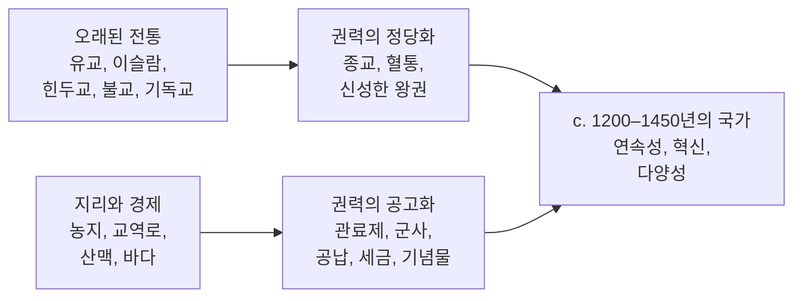
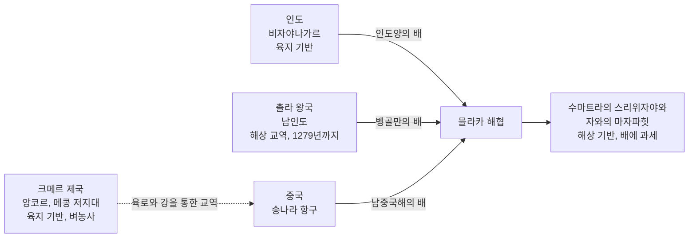
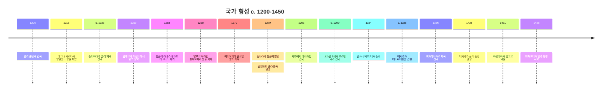
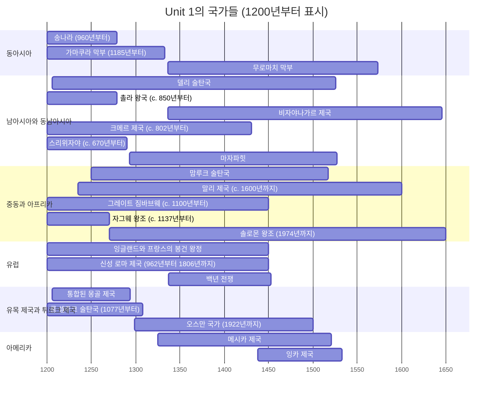
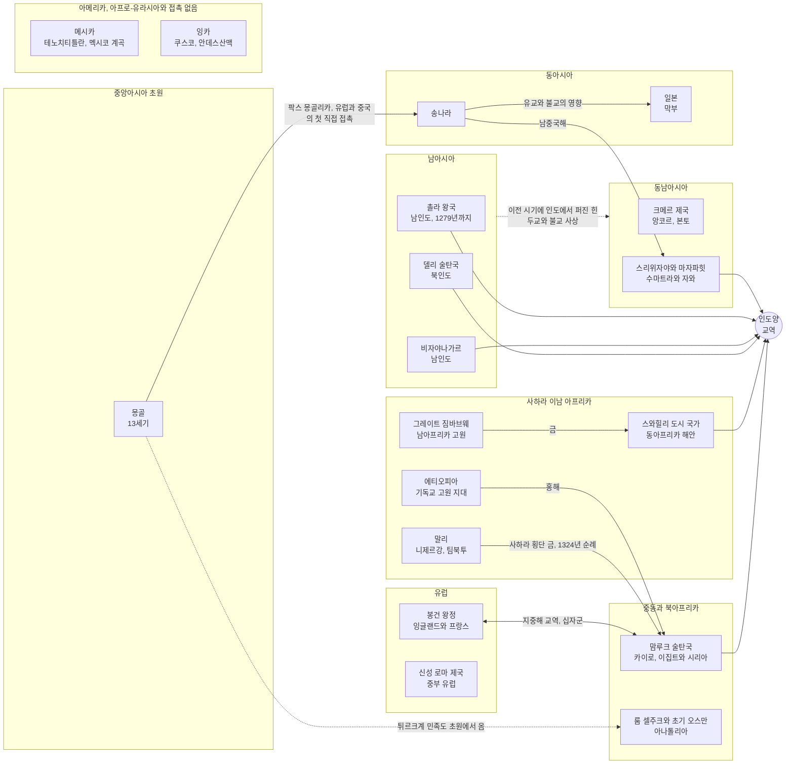
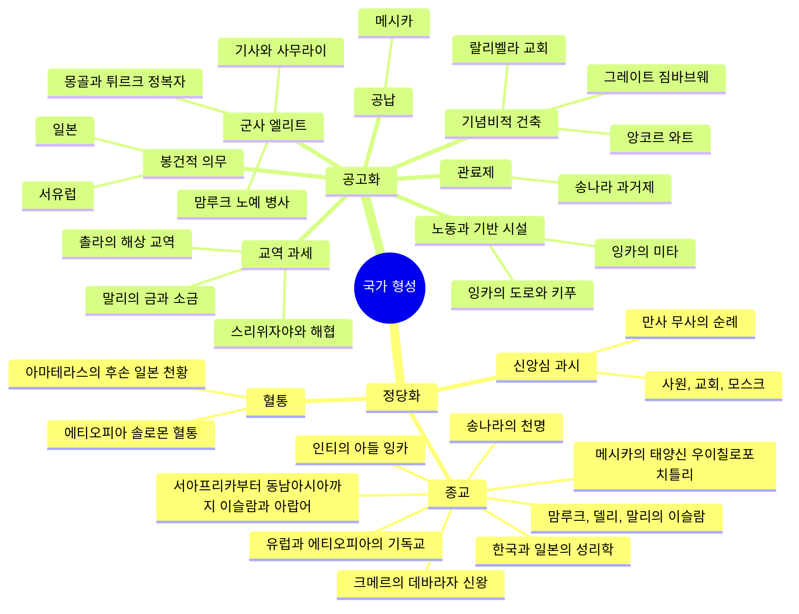

# AP 세계사: 모던 — 토픽 1.7 c. 1200–1450년 시기의 비교 (Comparison in the Period from c. 1200 to c. 1450)

**Focus Question (교재 Essential Question):** c. 1200–1450년 세계 여러 지역의 국가 형성 과정은 어떤 점에서 비슷했고 어떤 점에서 달랐는가?

> 출처: College Board CED 기준 · 교재 반영 (교재 Topic 1.7)

**Unit 1: 세계의 태피스트리 (The Global Tapestry, c. 1200–1450)**

---

## 학습 목표 (Learning Objective)

| 코드 | 학습 목표 |
|---|---|
| 1.7 LO (GOV) | c. 1200–1450년 국가 형성 (State formation) 과정의 공통점과 차이점을 설명하라. |

> 참고: 위 제목은 교재의 1.7 제목이며, 우리가 알고 있는 CED 토픽 제목과도 일치한다. 이 노트의 이전 버전은 "Comparison in State Building"이라는 비공식 제목을 썼다. 수업 자료의 제목이 다르면 수업 자료를 따른다.

## 역사적 개념 (Historical Developments, CED)

> 1.7은 비교 토픽이다. **토픽 1.1–1.6의 국가들**(동아시아, 이슬람 세계, 남아시아·동남아시아, 아메리카, 아프리카, 유럽)을 **비교 (Comparison)** 기술로 비교하는 것이 목표이다.

| # | 역사적 개념 | 다루는 곳 |
|---|---|---|
| HD1 (KC-3.2.I) | 13세기 아프로-유라시아와 아메리카의 제국과 국가들은 연속성 (Continuity), 혁신 (Innovation), 다양성 (Diversity)을 보여 주었다. | §1, §2, §3, §4, §5, §6, §7, §8, §9 |

> ⚠️ 확인 필요: 위의 KC-3.2.I 문구는 공식 CED 원문과 비슷하지만, 글자 그대로 일치하지 않을 수 있다.

---

## 큰 그림 요약

> "세상은 재치는 있으나 종교가 없는 사람과, 종교는 있으나 재치가 없는 사람으로 나뉜다."
> — 이븐 시나 (Ibn Sina, 아비센나 Avicenna) (980–1037), 페르시아의 철학자이자 의사

> ⚠️ 교재는 이 인용문을 이븐 시나의 말로 소개한다. 많은 설명에서는 아주 비슷한 말을 시리아의 시인 **알마아리 (al-Ma'arri)** (973–1057)의 말로 본다. 선생님이 어떻게 가르치는지 확인이 필요하다.

교재에 따르면 c. 1200–1450년 **문명의 중심 지역에 있던 국가들은 더 커졌고**, **작은 국가들은 쇠퇴했다**. 이처럼 세계의 많은 지역이 **더 중앙 집권적이고 더 강력한 국가**를 세우는 **같은 흐름**을 따랐다. 그러나 그 과정은 지역마다 달랐다. 아시아 대부분에서는 **몽골의 군사력**이 **세계 역사상 가장 큰 육상 제국**을 만들었다. **서아프리카, 중동, 남아시아**에서는 **이슬람 (Islam)**이 국가 형성의 핵심 요소였다. **유럽**에서는 내부 교역과, 더 발전한 중동 문명과의 교역 같은 **교역 (Trade)**이 더 큰 영향을 주었다. 더 강한 국가들이 등장하면서 **유목 사회 (Nomadic societies)**의 영향력은 **15세기**에 이르러 줄어들기 시작했다.

c. 1200–1450년 아프로-유라시아와 아메리카의 통치자들은 똑같은 두 가지 문제에 부딪혔다. 첫째, 권력을 **정당화 (Legitimize)**해야 했다. 즉, 자신에게 다스릴 **권리**가 있다고 사람들을 설득해야 했다. 둘째, 권력을 **공고화 (Consolidate)**해야 했다. 즉, 땅과 사람과 부를 계속 **통제**해야 했다. 대부분의 통치자는 **종교**로 권력을 정당화했다. 송나라의 **천명 (Mandate of Heaven)**, 맘루크 술탄국·델리 술탄국·말리의 **이슬람 (Islam)**, 유럽과 에티오피아의 **기독교 (Christianity)**, 크메르 제국의 **힌두교·불교 왕권 (Hindu and Buddhist kingship)**, 메시카와 잉카의 **태양 숭배 (Sun worship)**가 그 예이다. 권력을 공고화하기 위해서는 **관료제 (Bureaucracy)**, **군사 엘리트 (Military elites)**, **봉건적 의무 (Feudal obligations)**, **공납·노동 제도 (Tribute and labor systems)**, **교역세 (Taxes on trade)**, **기념비적 건축 (Monumental architecture)**을 함께 썼다. CED는 이 시대를 세 단어로 요약한다. 유교와 이슬람 같은 오래된 전통이 이어졌으므로 **연속성**이 있었다. 델리 술탄국, 말리, 메시카, 잉카 같은 새 국가가 나타났으므로 **혁신**이 있었다. 제국, 왕국, 술탄국, 해상 교역 국가, 도시 국가, 봉건 국가가 동시에 존재했으므로 **다양성**이 있었다.

---

## §1. 비교의 틀: 정당화와 공고화

| 개념 | 답하는 질문 | 흔한 방법 | 예 |
|---|---|---|---|
| **정당성 (Legitimacy)** | 사람들은 왜 이 통치자를 받아들이는가? | 종교, 신의 혈통 주장, 종교 지도자의 지지, 신앙심 과시 | 사파 잉카 (Sapa Inca)는 태양신 **인티 (Inti)의 아들**이라고 주장함 |
| **공고화 (Consolidation)** | 통치자는 어떻게 통제를 유지하는가? | 관료제, 군대, 세금과 공납, 노동 제도, 도로, 기념물 | 송나라는 **과거제 (Civil service exams)**로 관리를 뽑음 |
| **중앙 집권 국가 (Centralized state)** | 권력이 중앙에 있는가? | 강한 통치자, 임명된 관리, 직접 과세 | 송나라, 잉카 제국 |
| **지방 분권 국가 (Decentralized state)** | 권력을 지방 엘리트와 나누는가? | 영주, 봉신, 공납을 바치는 지방 통치자 | 봉건 유럽, 막부 시대 일본, 메시카 공납 제국 |

- 거의 모든 국가가 정당화와 공고화를 **함께** 썼다. 힘만 가진 통치자는 쉽게 무너졌고, 종교적 주장만 가진 통치자는 세금을 거둘 수 없었다.
- 모든 지역에서 정당성의 가장 흔한 근거는 **종교**였다.
- 공고화 방법은 **지리**와 **경제**에 따라 달랐다. 농업 제국은 토지에 세금을 매겼고, 교역 국가는 교역에 세금을 매겼으며, 산악 제국은 도로를 놓았다.
- **교재의 비교 요약:** 가장 큰 **공통점**은 **더 크고 더 중앙 집권적인 국가**로 가는 공통된 흐름이었고, **종교**가 그 핵심 도구였다. 가장 큰 **차이점**은 지역마다 국가 형성을 이끈 힘(아시아의 **몽골 군사력**, 서아프리카·중동·남아시아의 **이슬람**, 유럽의 **교역**)과, **일본**처럼 오히려 **더 분권화된** 예외였다.

## §2. 권력의 정당화

| 정당성의 근거 | 국가 | 작동 방식 |
|---|---|---|
| **유교와 천명 (Confucianism and the Mandate of Heaven)** | 송나라 | 하늘은 황제가 잘 다스리는 동안 통치할 권리를 주었다. **성리학 (Neo-Confucianism)**은 충성, 질서, 효를 강조해 황제와 관리들을 뒷받침했다. 교재는 성리학이 **한국과 일본**으로 퍼졌고, 그곳의 통치자들도 성리학으로 권력을 정당화하고 공고화했다고 덧붙인다 |
| **이슬람 (Islam)** | 맘루크 술탄국, 델리 술탄국, 말리 | 통치자들은 이슬람의 수호자이자 후원자로 자신을 내세웠다. 맘루크는 **아인 잘루트 (Ayn Jalut, 1260)**에서 몽골을 물리쳤고, 1258년 이후 **카이로에 아바스 칼리프 (Abbasid caliphs)**를 모셨다. 델리의 술탄들은 아바스 칼리프의 인정을 구했다. 말리의 **만사 무사 (Mansa Musa)**는 **메카 성지 순례 (Hajj, 1324)**와 모스크 건설로 신앙심을 보여 주었다. 교재는 공통된 신앙과 공용어인 **아랍어 (Arabic)** 덕분에 이슬람이 **서아프리카부터 동남아시아까지** 통치자의 정당성을 뒷받침했다고 강조한다 |
| **기독교 (Christianity)** | 서유럽, 에티오피아 | 유럽의 왕은 교회에서 대관식과 도유식을 받고 하느님의 뜻으로 다스린다고 주장했다. 에티오피아의 **솔로몬 왕조 (Solomonic dynasty, 1270년부터)**는 **솔로몬 왕과 시바 여왕 (King Solomon and the Queen of Sheba)**의 후손이라고 주장했고, 에티오피아 교회와 긴밀히 연결되었다 |
| **힌두교·불교 왕권 (Hindu and Buddhist kingship)** | 크메르 제국, 비자야나가르, 촐라, 스리위자야, 마자파힛 | 크메르의 왕은 **데바라자 (Devaraja, "신왕")** 사상을 이용했고 **앙코르 와트 (Angkor Wat)**를 지었다. 비자야나가르의 왕은 힌두 사원의 후원자였다. 스리위자야는 불교 학문의 중심지였다. 교재는 **남아시아와 동남아시아**의 통치자들이 힌두교와 불교에 의지해 국가를 강화했다고 쓴다 |
| **신성한 황실 혈통 (Divine imperial descent)** | 일본 | 천황은 태양의 여신 **아마테라스 (Amaterasu)**의 후손이라고 주장했다. 천황은 종교적 권위를 유지했지만, 실제 권력은 천황의 이름으로 다스린 **쇼군 (Shogun)**이 가졌다 |
| **태양 숭배와 제물 (Sun worship and sacrifice)** | 메시카, 잉카 | 메시카는 태양과 전쟁의 신 **우이칠로포치틀리 (Huitzilopochtli)**에게 **인신 공양 (Human sacrifice)**을 바쳤다. 그래야 태양이 계속 움직인다고 믿었다. **사파 잉카**는 태양신 **인티**의 아들이라고 주장했다 |
| **기념물로 보여 준 위세 (Prestige shown through monuments)** | 그레이트 짐바브웨 | 회반죽 없이 쌓은 거대한 돌벽이 통치자의 권력과 부를 보여 주었다 |

- **"왕권신수설 (Divine right of kings)"**이라는 말은 더 나중(16–17세기)에 완성된 이론을 가리킨다. 그래도 중세 유럽의 왕들은 권력이 하느님에게서 온다고 주장했고, 교회의 인정에 의지했다.
- **중국:** 교재에 따르면 송나라는 **유교 학자**에게 의지해 강력하고 오래가는 관료제를 운영했다. 여기서는 신념 체계와 관료제가 **긴밀히 연결**되어 있었으므로, 종교가 정당화와 공고화를 모두 뒷받침했다.

> ⚠️ 확인 필요: 그레이트 짐바브웨는 문자 기록을 남기지 않았다. 그래서 통치자의 종교적 역할(예: 조상 의례, 기우 의례)은 고고학과 후대 쇼나족 (Shona) 전통을 바탕으로 추정한 것이다.

> ⚠️ 교재는 이 시기에 성리학이 한국과 일본의 통치자를 도왔다고 쓴다. 많은 설명에서는 성리학이 **한국**에서는 **조선 왕조 (Joseon dynasty, 1392년부터)** 때, **일본**에서는 주로 **도쿠가와 막부 (Tokugawa shogunate, 1600년 이후)** 때 공식 국가 이념이 되었다고 본다. 가마쿠라와 무로마치 시대의 일본은 불교(특히 선종 (Zen))에 더 의지했다. 선생님이 어떻게 가르치는지 확인이 필요하다.

### 유럽의 교회: 협력자이자 경쟁자

- 유라시아 대부분에서는 종교가 국가와 **함께** 움직였다. 교재는 유럽에서 **로마 가톨릭 교회 (Roman Catholic Church)**와 국가 형성의 관계는 **조금 달랐다**고 쓴다.
- 교회는 때때로 국가 형성 과정의 **일부**였다(예: 왕의 대관식).
- 유럽의 국가들은 **중세 대부분의 기간 동안 매우 약했기** 때문에, 교회가 사회를 조직하는 **또 하나의 구조 (Alternative structure)** 역할을 했다.
- 1200–1450년 **프랑스**와 **신성 로마 제국 (Holy Roman Empire)**에서 **더 강한 국가**가 등장하자, 교회는 때때로 **경쟁 세력 (Rival power)**이 되었다.

> ⚠️ 교재는 신성 로마 제국을 1200–1450년의 더 강력한 국가 중 하나로 든다. 많은 설명에서는 이 시기의 신성 로마 제국을 **약하고 분권적인** 국가로 본다(예: 1250–1273년의 "대공위 시대 (Great Interregnum)", 황제를 뽑는 7명의 제후에게 권한을 준 **1356년 금인칙서 (Golden Bull)**). 왕권이 커진 예로는 보통 프랑스와 잉글랜드를 든다. 선생님이 어떻게 가르치는지 확인이 필요하다.

### 종교의 확산

- **이슬람, 불교, 기독교**는 모두 신자들에게 **믿지 않는 사람을 개종시키라고** 권했다. 그래서 **선교 활동 (Missionary activity)**은 **사하라 이남 아프리카, 동남아시아, 동아시아** 같은 곳에서 **토착 종교가 쇠퇴**하는 데 중요한 요인이 되었다.
- **남아시아**에서는 **중앙아시아에서 온 이슬람 군대의 침입**도 이슬람 개종자가 늘어난 한 원인이었다. 그러나 **힌두교가 여전히 주된 종교**로 남았고, 이것이 아대륙에서 무슬림과 힌두교도 사이에 **갈등과 관용이 번갈아 나타나는** 배경이 되었다.
- **인도양**, **남중국해**, **동아시아와 중앙아시아**, **사하라 사막을 건너는** 교역망은 상업 활동이 늘면서 종교를 퍼뜨렸다.

## §3. 권력의 공고화

| 방법 | 작동 방식 | 예 |
|---|---|---|
| **관료제와 시험 (Bureaucracy and exams)** | 관리를 능력으로 뽑고 국가가 봉급을 주었다. 그래서 관리들은 지방 귀족이 아니라 통치자를 위해 일했다 | 송나라: 유교 경전을 시험하는 **과거제 (Civil service exams)**로 **사대부 (Scholar-officials)**를 뽑음. 교재는 이렇게 넓은 영토에서 정부를 운영하는 체계를 이만큼 잘 갖춘 나라는 **다른 어디에도 없었다**고 쓴다. **법을 시행하고 황제의 칙령을 집행하는** 능력이 중국 국가 형성의 핵심이었다 |
| **군사 엘리트와 노예 병사 (Military elites and slave soldiers)** | 통치자는 충성스러운 직업 군인에게 의지했다. 이들은 어릴 때 노예로 끌려와 전쟁 훈련을 받은 경우가 많았다 | **맘루크 (Mamluks)**: 1250년 이집트를 장악한 튀르크계 노예 병사. 델리 술탄국의 첫 술탄들도 노예 병사 출신. 두 술탄국 모두 **이크타 (Iqta)** 토지 수여로 장교에게 보수를 줌 |
| **봉건적 의무 (Feudal obligations)** | 영주는 군사 봉사와 충성을 받는 대가로 땅을 주었고, 농민이 그 땅을 경작했다 | 서유럽: **장원 (Manors)**의 영주, 봉신, 기사, 농노. 일본: 쇼군, **다이묘 (Daimyo)**, **사무라이 (Samurai)** |
| **공납 (Tribute)** | 정복된 민족은 자기 통치자를 유지하되, 중앙에 물자와 노동을 바쳤다 | **메시카 (Mexica)**: 도시 국가들이 면화, 카카오, 깃털, 식량, 포로를 **테노치티틀란 (Tenochtitlan)**에 보냄. 교재는 아스테카 국가를 **강한 군대**에 의지한 **공납 제국 (Tributary empire)**이라고 부른다 |
| **노동 제도와 기반 시설 (Labor systems and infrastructure)** | 국가는 노동을 요구했고, 군대·물자·소식을 옮기는 망을 건설했다 | **잉카 (Inca)**: **미타 (Mit'a)** 노동세, 파발꾼이 달리던 수천 마일의 도로망, **키푸 (Quipu)** 기록, 창고, 케추아어 (Quechua). 교재는 미타를 잉카의 국가 형성을 뒷받침한 **정교한 제도**라고 부른다 |
| **교역 과세 (Taxing trade)** | 통치자는 중요한 교역로를 장악하고 그곳을 지나는 상품에 세금을 매겼다 | **스리위자야 (Srivijaya)**는 **믈라카 해협 (Strait of Malacca)**을 지나는 배에 세금을 매김. **말리 (Mali)**는 사하라 횡단 **금·소금 (Gold and salt)** 교역에 세금을 매김. **그레이트 짐바브웨 (Great Zimbabwe)**는 스와힐리 해안으로 가는 금을 장악함. 교재에 따르면 남인도의 **촐라 왕국 (Chola Kingdom)**과 **비자야나가르 (Vijayanagar)**는 **교역을 이용해 강한 국가를 세움** |
| **기념비적 건축 (Monumental architecture)** | 거대한 건물로 통치자의 권력, 부, 종교적 권위를 보여 주었다 | **앙코르 와트** (크메르), **그레이트 엔클로저 (Great Enclosure)** (그레이트 짐바브웨), **랄리벨라의 암굴 교회 (Rock-cut churches of Lalibela)** (에티오피아), **템플로 마요르 (Templo Mayor)** (메시카), **팀북투 (Timbuktu)**의 모스크 (말리) |

- 많은 국가가 여러 방법을 함께 썼다. 예를 들어 잉카는 종교, 도로, 노동세, 정복민 이주를 한꺼번에 사용했다.
- 랄리벨라의 암굴 교회는 솔로몬 왕조가 1270년에 권력을 잡기 전, **자그웨 왕조 (Zagwe dynasty)**의 랄리벨라 왕 시기(c. 1200)에 지어졌다.
- **말리와 가나:** 교재에 따르면 **말리**의 통치자들은 앞선 **가나 제국 (Empire of Ghana)**보다 **더 크고 더 중앙 집권적으로 운영된** 제국을 만들었다.

## §4. 연속성, 혁신, 다양성

| 유형 | 뜻 | 예 |
|---|---|---|
| **연속성 (Continuity)** | 오래된 전통과 제도가 1200년 이후에도 이어졌다 | 송나라는 이전 왕조들이 만든 **유교** 관료제와 과거제를 유지했다. 몽골이 **아바스 칼리프조 (Abbasid Caliphate, 1258)**를 무너뜨린 뒤에도 **이슬람**은 통치의 바탕으로 남았다. 맘루크는 카이로에서 아바스 칼리프의 계보를 이어 갔다. **기독교**는 유럽과 에티오피아에서 계속 왕을 뒷받침했다. 동남아시아에서는 **힌두교·불교** 왕권이 이어졌다. 교재는 이전 제국의 **부흥**도 예로 든다: 송나라(한나라를 바탕으로), 말리(가나를 바탕으로), 신성 로마 제국(로마를 바탕으로) |
| **혁신 (Innovation)** | 새로운 국가와 새로운 통치 방식이 나타났다 | 새 국가: **델리 술탄국 (1206)**, **말리 (c. 1235)**, **맘루크 술탄국 (1250)**, **오스만 국가 (Ottoman state, c. 1299)**, **비자야나가르 (1336)**, **메시카 (c. 1325)**, **잉카 (1438년부터 팽창)**. 새 방식: 노예 병사 출신이 통치자가 됨. 잉카는 문자 대신 키푸 기록으로 큰 제국을 운영함 |
| **다양성 (Diversity)** | 여러 종류의 국가가 동시에 존재했다 | 중앙 집권 제국(송, 잉카), 술탄국(맘루크, 델리), 왕국(말리, 에티오피아, 비자야나가르, 촐라), 해상 교역 국가(스리위자야, 마자파힛), 공납 제국(메시카), 도시 국가(스와힐리 해안, 동남아시아, 이탈리아), 봉건 국가(유럽, 일본), 유목 제국(몽골) |

- **몽골 (Mongols)**(Unit 2)은 이 국가들 중 다수를 흔들었다. 몽골은 **1279년**까지 송나라를 정복했고 **1258년** 바그다드를 파괴했지만, 맘루크(1260)와 델리 술탄국에게 저지당했다.

### 교재 개관: 국가 형성과 새로운 제국

| 지역 | 일어난 일 (교재) | 방향 |
|---|---|---|
| **중국** | **송나라**는 오랜 **기술적·문화적 발전**을 이어 갔다 | 강한 중앙 집권 |
| **중동** | **아바스 칼리프조**는 **침입자와 교역의 변화로 분열**되었다. 그 뒤 **아프리카, 중동, 스페인**에 새로운 무슬림 국가가 등장했다 | 옛 제국 분열, 새 국가 형성 |
| **남아시아와 동남아시아** | **촐라 왕국**과 **비자야나가르 제국**은 **교역**을 이용해 강한 국가를 세웠고, 북인도의 **델리 술탄국**은 **더 육지 기반**이었다 | 강한 국가들, 서로 다른 경제 기반 |
| **아프리카** | **말리**는 앞선 **가나 제국**보다 **더 크고 더 중앙 집권적으로 운영**되었다 | 중앙 집권 강화 |
| **아메리카** | **아스테카**는 **강한 군대**에 의지한 **공납 제국**을 메소아메리카에 세웠다. **잉카**는 정교한 **미타** 제도를 이용했다. **아메리카 대부분에는 중앙 집권 국가가 없었다** | 두 개의 큰 제국, 대부분 지역은 비중앙 집권 |
| **유럽** | 중앙 집권 국가가 발전하면서 **봉건적 유대가 약해졌다**. 이 변화는 **동유럽**보다 **잉글랜드와 프랑스**에서 더 분명했다 | 서서히 중앙 집권화 |
| **일본** | 대부분의 국가와 달리 일본은 **더 분권적이고 봉건적으로** 변했다 | 분권화 |
| **유목 사회** | 더 강하고 중앙 집권적인 국가가 등장하면서 **15세기**에 이르러 영향력이 **줄어들기 시작했다** | 쇠퇴 |

### 교재 표: 국가 형성의 네 가지 유형, c. 1200–c. 1450

| 과정 | 설명 | 예 |
|---|---|---|
| **새 국가의 등장 (Emergence of New States)** | 다른 제국이 지배하던 땅에 국가가 생겨남 | 맘루크 제국(이전 아바스 영토), 셀주크 제국(이전 아바스 영토), 델리 술탄국(이전 굽타 영토) |
| **이전 제국의 부흥 (Revival of Former Empires)** | 새 지도층이 이전 제국을 잇거나 다시 세우면서 몇 가지 혁신을 더함 | 송나라(한나라를 바탕으로), 말리 제국(가나 왕국을 바탕으로), 신성 로마 제국(로마 제국을 바탕으로) |
| **서로 다른 전통의 융합 (Synthesis of Different Traditions)** | 국가가 외래 사상을 지역 상황에 맞게 받아들임 | 일본(중국과 일본), 델리 술탄국(이슬람과 힌두), 성리학 (Neo-Confucianism) |
| **범위의 확대 (Expansion in Scope)** | 기존 국가가 정복, 교역, 기타 수단으로 영향력을 넓힘 | 메소아메리카의 아스테카, 남아메리카의 잉카, 동아프리카의 도시 국가, 동남아시아의 도시 국가 |

- **CED의 세 단어와 연결하기:** "부흥"은 **연속성**의 한 형태이다. "등장"과 "융합"은 **혁신**의 형태이다. 네 유형이 동시에 존재했다는 것은 **다양성**을 보여 준다.
- 델리 술탄국은 새 국가이자 이슬람과 힌두 전통의 융합으로 **두 번** 나온다. 성리학은 국가가 아니라 신념 체계이지만, 유교·불교·도교 사상을 **합쳤기** 때문에 예로 들어 있다.

> ⚠️ 교재 표의 예 가운데 두 가지는 배경 설명이 필요할 수 있다. **대셀주크 제국 (Great Seljuk Empire)**의 전성기는 **11–12세기**(1200년 이전)였고, 아나톨리아의 **룸 셀주크 술탄국 (Seljuk Sultanate of Rum)**만 c. 1308년까지 이어졌다. **굽타 제국 (Gupta Empire)**은 **550년경** 끝났으므로, 많은 설명에서는 델리 술탄국 이전 수백 년 동안 북인도를 지역 왕국들(예: 라지푸트 (Rajput) 국가)이 다스렸다고 본다. 또한 맘루크는 아바스 왕조가 아니라 **아이유브 왕조 (Ayyubid dynasty)**에게서 직접 이집트를 빼앗았다. 선생님이 어떻게 가르치는지 확인이 필요하다.

## §5. 국가의 유형

### 중앙 집권과 지방 분권

| 항목 | 중앙 집권 국가 (Centralized states) | 지방 분권 국가 (Decentralized states) |
|---|---|---|
| 권력을 가진 쪽 | 중앙의 통치자와 임명된 관리 | 지방 영주, 봉신, 복속된 통치자 |
| 주요 수단 | 관료제, 직접 과세, 국가 노동, 도로 | 봉건적 의무, 토지 수여, 공납 |
| 예 | 송나라, 잉카 제국, 말리(가나보다 중앙 집권적), 잉글랜드와 프랑스(서서히 중앙 집권화) | 동유럽, 일본(더 분권화됨), 메시카 공납 제국, 아메리카 대부분 |
| 장점 | 나라 전체에서 자원을 모으고 법을 집행할 수 있었음 | 지방 엘리트가 방어와 통치를 적은 비용으로 맡았음 |
| 약점 | 많은 관리와 큰 세입이 필요했음 | 지방 엘리트가 반란을 일으키거나 통치자를 무시할 수 있었음 |

- 중앙 집권은 "예/아니요"로 나뉘는 범주가 아니라 **스펙트럼 (Spectrum)**이다. 예를 들어 말리에는 강한 **만사 (Mansa)**가 있었지만, 지방 통치자와 총독을 통해서도 다스렸다. 교재는 그래도 말리가 가나보다 더 중앙 집권적으로 운영되었다고 쓴다.
- **유럽:** 교재에 따르면 중앙 집권 국가가 발전하면서 **봉건적 유대의 중요성이 줄었고**, 이 변화는 **동유럽**보다 **잉글랜드와 프랑스**에서 더 분명했다. 1200–1450년 서유럽은 여전히 봉건 사회였지만, 왕들은 서서히 권력을 키우고 있었다.
- **일본:** 교재에 따르면 일본은 이 시기에 **대부분의 국가와 달리** **더 분권적이고 봉건적으로** 변했다.
- **아메리카:** 아스테카와 잉카 제국 밖의 **아메리카 대부분에는 중앙 집권 국가가 없었다**.

### 육지 기반과 해상 기반 (남아시아와 동남아시아)

| 항목 | 육지 기반 국가 (Land-based states) | 해상 기반 국가 (Sea-based states) |
|---|---|---|
| 예 | **크메르 제국 (Khmer Empire)**(동남아시아 본토), **비자야나가르 (Vijayanagara)**(남인도), **델리 술탄국 (Delhi Sultanate)**(북인도, 교재는 더 육지 기반이라고 씀) | **스리위자야 (Srivijaya)**(수마트라), **마자파힛 (Majapahit)**(자와), **촐라 왕국 (Chola Kingdom)**(남인도, 1279년까지) |
| 주요 부의 원천 | **농지**, 특히 관개 벼농사에 매긴 세금 | 해협을 지나는 **해상 교역**에 매긴 세금 |
| 주요 권력 수단 | 대군, 저수지와 관개, 사원 | 믈라카 해협과 주변 바다를 장악한 **해군**. **촐라 해군**은 **1025년** 스리위자야를 공격함 |
| 종교 | 힌두교와 불교(크메르), 힌두교(비자야나가르), 이슬람(델리) | 불교(스리위자야), 힌두교·불교(마자파힛), 힌두교(촐라) |
| 기념물 | **앙코르 와트**, 비자야나가르의 수도 **함피 (Hampi)**의 사원, **쿠트브 미나르 (Qutb Minar)**(델리) | 스리위자야와 마자파힛은 거대한 기념물이 적음. 부는 항구에서 나옴. 촐라는 **탄자부르 (Thanjavur)**의 사원 같은 거대한 힌두 사원을 지음 |

> ⚠️ 확인 필요: 일부 학자들은 마자파힛을 육지 기반(자와의 벼농사)이면서 해상 기반(섬 교역 장악)인 국가로 본다. AP 과정에서는 보통 해상 기반 국가로 다룬다.

> ⚠️ 교재는 **비자야나가르 (Vijayanagar)**를 촐라와 함께 **교역을 이용해** 강한 국가를 세운 예로 묶고, 델리 술탄국을 더 육지 기반이라고 쓴다. 이 노트는 많은 설명처럼 비자야나가르를 **육지 기반** 국가로 분류한다. 비자야나가르의 힘은 농업 세입과 대군에서 나왔기 때문이다. 다만 해안 교역(예: 군마 수입)으로도 이익을 얻었다. 선생님이 어떻게 가르치는지 확인이 필요하다.

## §6. 교역을 통한 국가 형성

| 교류 | 무엇이 어디로 퍼졌는가 | 국가에 준 영향 |
|---|---|---|
| **참파 벼 (Champa rice)** | **베트남**에서 **중국**으로 퍼짐 | 송나라가 **늘어나는 인구를 먹여 살리게** 함. 더 많고 더 **도시화된** 인구가 당시 **세계 최대**였던 중국의 **제조업**(**도자기, 비단, 강철, 철**)을 뒷받침함 |
| **종이 (Paper)** | **중국**에서 발명(교재는 **기원전 2세기**라고 씀)되어 유라시아를 가로질러 **13세기경 유럽**에 도달함 | 글과 인쇄물이 늘어 **유럽, 중동, 북아프리카**의 **문해율**이 높아짐. 학문이 발달해 특히 **바그다드의 지혜의 집 (House of Wisdom)** 같은 이슬람 학문 중심지에서 **수학과 의학**이 발전함 |
| **유럽과 아시아의 접촉** | **중동**과의 교역(그리고 중동을 거쳐 아시아 나머지 지역과의 교역), **무슬림 스페인**(**8세기**에 무력으로 정복됨), **십자군 (Crusades)**(**1100년경**부터), **몽골**(**잔혹한 정복 뒤에야** 지식 전파를 촉진함) | 이 모든 접촉이 **유럽의 국가 형성에 기여함** |

- 교재는 이런 변화로 **송나라가 천 년 전 한나라 이후 중국에서 가장 강한 국가**가 되었다고 쓴다.
- 유럽과 아시아의 접촉이 모두 **평화로웠던** 것은 아니다. 무슬림의 스페인 정복, 십자군, 몽골 침입은 모두 전쟁을 동반했다.
- 교재에 따르면 1200–1450년 유럽의 국가 형성은 **장원제와 농노제 (Manorial system and serfdom)** 때문에 **작고 느렸지만**, **눈에 띄는** 변화였다. **1450년** 이후 유럽의 국가 형성은 속도와 중요성이 커졌다.
- **지혜의 집**은 800년대에 바그다드에 세워졌고, 1258년 몽골이 바그다드를 약탈할 때 파괴되었다(1.2와 2.2 참고).

> ⚠️ 교재는 송나라를 한나라 이후 중국에서 가장 강한 국가라고 쓴다. 많은 설명에서는 송나라가 **군사적으로 약했고**(1127년 여진족의 **금나라 (Jin)**에게 북중국을 잃음), **당나라 (Tang, 618–907)**도 매우 강했다고 지적한다. 송나라의 강점은 주로 **경제와 관료제**였다. 선생님이 어떻게 가르치는지 확인이 필요하다.

> ⚠️ 교재는 종이의 발명을 기원전 2세기로 쓴다. 많은 설명에서는 관리 **채륜 (Cai Lun)**이 **105년**에 제지법을 개량했다고 보며, 가장 오래된 종이 조각은 실제로 기원전 2세기의 것이다. 또한 많은 설명에서는 종이가 1100년대까지 **무슬림 스페인**에, 1200년대에 **기독교 유럽(이탈리아)**에 전해졌다고 본다. 선생님이 어떻게 가르치는지 확인이 필요하다.

## §7. 유목 민족의 영향

| 항목 | 몽골 (Mongols) | 튀르크계 민족 (Turkic peoples) |
|---|---|---|
| 출신 | **중앙아시아 초원**의 **목축** 민족 | 역시 **중앙아시아 초원** 출신 |
| 제국을 세운 방식 | **통합된 몽골 씨족들**의 **조직적인 원정** 하나로 | **서로 다른 튀르크 집단**이 **각각 따로** 제국을 세움 |
| 지배 지역 | **13세기**에 **아시아와 동유럽**의 넓은 지역 | **동지중해, 페르시아, 남아시아**의 큰 육상 제국 |
| 예 | 몽골 제국과 여러 칸국 (토픽 2.2 참고) | **셀주크 (Seljuk)**와 **오스만 (Ottoman) 튀르크**(지중해 지역의 주도 세력), **페르시아**에 제국을 세운 또 다른 튀르크 집단, **델리 술탄국**과 **맘루크**의 튀르크계 통치자 |
| 지속 기간 | 몽골의 지배는 주로 13–14세기 | **1450년 이후까지 오래 이어진** 제국 |
| 영향 | **정치적 안정** 덕분에 **유라시아 교역**이 크게 늘어남. 문화 교류가 활발해짐. **고전 시대 이후 처음으로 유럽과 중국이 직접 접촉**함 | 튀르크 왕조들이 아나톨리아부터 인도까지 이슬람 세계를 형성함 |

- 교재는 이 제국들의 성립이 **정착민과 유목민의 상호 작용**이 남긴 **마지막 주요 영향 중 하나**였다고 쓴다.
- 시간이 지나면서 상업과 문화 교류에서 유목민의 역할은 **줄어들었고**, 그 자리를 **조직된 상인 집단과 무역 회사**가 차지했다.

> ⚠️ 교재는 "페르시아에 제국을 세운" 튀르크 집단의 이름을 밝히지 않는다. 튀르크-몽골계인 **티무르 왕조 (Timurids)**(티무르, 1370년부터)를 뜻할 수도 있고, 페르시아도 다스렸던 이전의 셀주크를 뜻할 수도 있다. 선생님이 어떻게 가르치는지 확인이 필요하다.

## §8. 가부장제와 종교

| 지역 | 종교나 관습 | 여성에게 준 영향 |
|---|---|---|
| **유럽** | 기독교 여성의 **수녀원 생활 (Convent life)** | **학문과 지도력**을 얻을 기회 |
| **남아시아** | **자이나교 (Jainism)와 불교**의 종교 공동체 | **학문과 지도력**을 얻을 기회 |
| **중국** | **전족 (Foot binding)** 관습이 더 흔해짐 | 여성이 **독립성을 일부 잃음** |

- 대부분 문화의 사회 조직은 **여전히 가부장적 (Patriarchal)**이었지만, 문화마다 차이가 있었다.
- 종교는 흔히 **남성의 권력을 강화했지만**, 교재는 그 기록이 **엇갈린다**고 쓴다. 일부 종교 공동체는 여성에게 가정 밖의 역할을 주었다.

## §9. 비교 서술 방법 (AP 기술)

| 단계 | 할 일 | 예 |
|---|---|---|
| 1. 범주 고르기 | 정당화, 공고화, 경제처럼 한 가지를 비교한다 | "송나라와 잉카가 권력을 공고화한 방식" |
| 2. 공통점 쓰기 | **둘 다 (Both)**, **마찬가지로 (Similarly)**, **똑같이 (Likewise)** 같은 말을 쓴다 | "둘 다 중앙 집권 국가였다." |
| 3. 차이점 쓰기 | **반면 (Whereas)**, **대조적으로 (In contrast)**, **~와 달리 (Unlike)** 같은 말을 쓴다 | "송나라는 과거제를 썼고, 반면 잉카는 미타를 썼다." |
| 4. 이유 설명하기 | 왜 비슷하거나 달랐는지(지리, 종교, 경제, 오래된 전통) 쓴다 | "송나라는 문자로 된 유교 전통을 물려받았고, 잉카에는 문자 체계가 없었다." |
| 5. 구체적 근거 넣기 | 장소, 인물, 연도, 제도를 쓴다 | 과거제, 사대부, 키푸, 도로, 파차쿠티 (Pachacuti, 1438) |

**논지 공식:** **A**와 **B**는 둘 다 **[공통점]**했지만, **[이유]** 때문에 **[차이점]**에서 달랐다.

**LEQ 모범 논지 (비교 문제):**

> "c. 1200–1450년 송나라와 잉카 제국은 둘 다 종교적 사상으로 통치자를 정당화한 중앙 집권 국가를 세웠다. 그러나 송나라는 과거제로 뽑은 유교 관료제로 권력을 공고화했고, 반면 잉카는 미타 노동 제도, 도로, 키푸 기록에 의지했다. 송나라는 문자로 된 오랜 통치 전통을 물려받았지만, 잉카는 문자 체계 없이 산악 제국을 다스려야 했기 때문이다."

- **공통점:** 둘 다 중앙 집권 국가였고, 둘 다 종교를 이용했다(천명, 인티의 아들).
- **차이점:** 과거제와 관료제 대 노동세와 도로.
- **이유:** 오래된 전통과 지리.
- 좋은 논지는 **역사적으로 옹호할 수 있어야 (Historically defensible)** 하고 **논리의 흐름 (Line of reasoning)**을 세워야 한다. 두 국가를 나열만 하지 말고, 어떻게 그리고 왜 비교되는지 써야 한다.

**두 번째 모범 논지 (교재 바탕):**

> "c. 1200–1450년 몽골과 튀르크계 민족은 둘 다 중앙아시아 초원 출신의 유목민으로서 큰 육상 제국을 정복했다. 그러나 몽골은 통합된 씨족들의 조직적인 원정으로 하나의 제국을 세웠고, 반면 셀주크와 오스만 같은 튀르크 집단들은 각각 따로 제국을 세웠으며, 그 제국들은 1450년 이후까지 오래 이어졌다."

---

## 연표

> ⚠️ 확인 필요: 스리위자야(1200년대 후반 쇠퇴), 그레이트 짐바브웨(c. 1100–c. 1450), 말리(1400년대 이후 쇠퇴, c. 1600년 소멸)의 시작과 끝 연도는 대략적이며 자료마다 다르다.

---

## 지도: 세계의 국가들, c. 1200–1450

- **아프로-유라시아**의 국가들은 교역, 종교, 분쟁으로 연결되어 있었다. 그래서 **이슬람**이나 **힌두교·불교 왕권** 같은 사상이 지역을 넘나들었다.
- **메시카**와 **잉카**는 아프로-유라시아와 접촉 없이 따로 발전했다. 그런데도 비슷한 방법(태양 숭배, 정복, 공납이나 노동)을 썼다.
- **중앙아시아 초원의 유목민**(몽골과 튀르크계 민족)은 동유럽부터 중국과 인도까지 이르는 제국을 세웠다.

---

## 비교표

### 종합 비교: 18개 국가, c. 1200–1450

| 국가 | 지역 | 시기 | 유형 | 정당성 | 공고화 | 경제 기반 |
|---|---|---|---|---|---|---|
| **송나라 (Song Dynasty)** | 동아시아 | 960–1279 | 중앙 집권 제국 | 천명 (Mandate of Heaven), 성리학 (Neo-Confucianism) | 과거제 (Civil service exams), 사대부 (Scholar-officials) 관료제 | 참파 벼 (Champa rice) 농사, 상업, 지폐, 대운하, 세계 최대의 제조업(도자기, 비단, 강철, 철) |
| **일본 (Japan)** (가마쿠라·무로마치 막부, Kamakura and Ashikaga shogunates) | 동아시아 | 1185–1333, 1336–1573 | 지방 분권 봉건 국가(더 분권화됨) | 아마테라스 (Amaterasu)의 후손인 천황, 천황의 이름으로 다스린 쇼군 (Shogun) | 쇼군·다이묘 (Daimyo)·사무라이 (Samurai)의 봉건 관계, 충성 규범인 무사도 (Bushido) | 영지의 농업 |
| **맘루크 술탄국 (Mamluk Sultanate)** | 중동과 북아프리카(이집트, 시리아) | 1250–1517 | 군사 술탄국 | 이슬람 수호자(아인 잘루트 (Ayn Jalut), 1260), 아바스 칼리프 (Abbasid caliphs)를 모심, 메카와 메디나의 수호자 | 튀르크계 노예 병사 엘리트, 이크타 (Iqta) 토지 수여 | 나일강 농업, 홍해·지중해 교역 |
| **델리 술탄국 (Delhi Sultanate)** | 남아시아(북인도) | 1206–1526 | 힌두교도 다수를 다스린 이슬람 술탄국, 더 육지 기반 | 이슬람, 술탄 (Sultan) 칭호, 아바스 칼리프의 인정 | 튀르크계 군사 엘리트(첫 통치자들은 노예 병사 출신), 이크타, 토지세, 지즈야 (Jizya) | 농업세 |
| **촐라 왕국 (Chola Kingdom)** | 남아시아(남인도) | c. 850–1279 | 교역과 해군을 이용한 힌두 왕국 | 힌두 왕권, 거대한 사원의 후원자(탄자부르 (Thanjavur)) | 강한 해군(1025년 스리위자야 공격), 교역 항구 장악 | 벼농사, 인도양 교역 |
| **비자야나가르 제국 (Vijayanagara Empire)** | 남아시아(남인도) | 1336–1646 | 육지 기반 힌두 왕국(교재는 교역 이용을 강조함) | 힌두 왕권 (Hindu kingship), 사원 후원 | 강한 군대, 나야카 (Nayaka) 총독, 토지 세입 | 농업, 해안 항구를 통한 교역 |
| **크메르 제국 (Khmer Empire)** | 동남아시아(본토) | c. 802–1431 | 육지 기반 제국 | 데바라자 (Devaraja, 신왕), 힌두교, 이후 불교 | 사원 건설(앙코르 와트 (Angkor Wat)), 저수지와 관개 | 관개 벼농사 |
| **스리위자야와 마자파힛 (Srivijaya and Majapahit)** | 동남아시아(수마트라, 자와) | c. 670–1200년대 후반, 1293–c. 1527 | 해상 교역 국가 | 불교(스리위자야)와 힌두교·불교(마자파힛) 왕권 | 해협을 장악한 해군, 배에 매긴 세금 | 믈라카 해협 (Strait of Malacca) 교역세 |
| **말리 제국 (Mali Empire)** | 서아프리카 | c. 1235–c. 1600 | 가나보다 더 크고 중앙 집권적인 이슬람 제국 | 이슬람, 만사 무사 (Mansa Musa)의 순례 (Hajj, 1324), 팀북투 (Timbuktu)의 모스크와 학자 | 사하라 횡단 교역 (Trans-Saharan trade)에 과세, 금광 지대 장악, 총독과 지방 통치자 | 금·소금 교역, 농업 |
| **스와힐리 도시 국가 (Swahili city-states)** (킬와 (Kilwa), 몸바사 (Mombasa) 등) | 동아프리카(해안) | c. 1000–1500년대 | 독립된 교역 도시 국가 | 이슬람, 무슬림 통치자와 모스크 | 각 도시가 자기 항구의 교역에 과세, 하나의 제국은 없음 | 금과 상아의 인도양 교역 |
| **그레이트 짐바브웨 (Great Zimbabwe)** | 남부 아프리카 | c. 1100–c. 1450 | 쇼나 (Shona) 왕국 | 돌 건축으로 보여 준 통치자의 위세 | 그레이트 엔클로저 (Great Enclosure)와 돌벽, 소와 금 교역 장악 | 소, 스와힐리 해안으로 가는 금 교역 |
| **에티오피아 (Ethiopia)** (자그웨, 이후 솔로몬 왕조) | 동아프리카 | 자그웨 (Zagwe) c. 1137–1270, 솔로몬 왕조 1270년부터 | 기독교 왕국 | 기독교, 솔로몬 왕과 시바 여왕의 후손이라는 솔로몬 왕조 (Solomonic dynasty)의 주장 | 에티오피아 교회와의 동맹, 랄리벨라의 암굴 교회 (Rock-cut churches of Lalibela) | 농업, 홍해 교역 |
| **서유럽 (Western Europe)** (잉글랜드, 프랑스) | 유럽 | c. 1200–1450 | 서서히 중앙 집권화한 봉건 왕정 | 기독교, 교회에서 대관식을 받고 하느님의 뜻을 내세운 왕 | 봉건적 의무 (Feudal obligations), 장원제 (Manorialism), 잉글랜드 왕을 제한한 마그나 카르타 (Magna Carta, 1215) | 장원 농업, 성장하는 도시, 중동과의 교역 |
| **신성 로마 제국 (Holy Roman Empire)** | 유럽(중부 유럽) | 962–1806 | 선출된 황제 아래 여러 제후가 있던 제국 | 로마 제국을 잇는다고 주장, 교황이 황제의 대관식을 했지만 교회와 자주 경쟁함 | 제후들과의 동맹, 선제후가 황제를 뽑음(금인칙서 (Golden Bull), 1356) | 농업, 교역 도시 |
| **몽골 제국 (Mongol Empire)** (Unit 2 참고) | 중앙아시아, 중국, 페르시아, 러시아 | 1206–1294 통합, 이후 칸국으로 나뉨 | 역사상 가장 큰 유목 육상 제국 | 쿠릴타이 (Kuriltai)에서 추대된 칭기즈 칸, 영원한 푸른 하늘 (텡그리 Tengri)의 명을 받았다고 주장 | 통합된 씨족, 군사 정복, 현지 행정가 | 공납, 세금, 유라시아 교역 보호 |
| **셀주크와 오스만 튀르크 (Seljuk and Ottoman Turks)** | 아나톨리아와 동지중해 | 룸 셀주크 c. 1308년까지, 오스만 c. 1299년부터 | 각각 따로 세운 튀르크계 육상 제국 | 이슬람, 술탄, 신앙을 위한 전사 | 튀르크 기병과 정복, 이후 오스만의 노예 병사(예니체리 (Janissaries), 1300년대 후반부터) | 농업세와 교역세 |
| **메시카 (Mexica, 아스테카 Aztec)** | 메소아메리카 | c. 1325–1521 | 공납 제국 | 태양과 전쟁의 신 우이칠로포치틀리 (Huitzilopochtli), 인신 공양 (Human sacrifice) | 정복한 도시 국가의 공납 (Tribute), 강한 군대, 삼각 동맹 (Triple Alliance, 1428) | 치남파 (Chinampa) 농업, 공납, 시장 |
| **잉카 제국 (Inca Empire)** | 안데스(남아메리카) | 1438–1533 | 중앙 집권 제국 | 인티 (Inti)의 아들인 사파 잉카 (Sapa Inca), 조상 숭배 | 미타 (Mit'a) 노동, 도로, 키푸 (Quipu), 케추아어 (Quechua), 강제 이주 | 계단식 농업, 국가 창고, 노동세 |

### 짝 비교

| 짝 | 공통점 | 차이점 | 차이의 이유 |
|---|---|---|---|
| **송나라 대 델리 술탄국** | 둘 다 신념 체계(유교 (Confucianism), 이슬람 (Islam))로 통치자를 정당화했고, 농민에게 세금을 거둠 | 송나라는 과거제 (Civil service exams)로 뽑은 사대부 (Scholar-officials)에게 의지했고, 델리 술탄국은 튀르크계 군사 엘리트 (Military elite)에게 의지함 | 송나라는 오랜 유교 전통을 물려받았고, 델리의 술탄들은 힌두교도 다수를 다스린 이슬람 정복자였음 |
| **메시카 대 잉카** | 둘 다 태양 관련 종교와 군사 정복을 이용한 팽창 제국이었음 | 메시카는 공납 (Tribute)을 받고 지방 통치자를 그대로 두었고, 잉카는 미타 (Mit'a), 도로, 강제 이주로 더 직접 다스림 | 메시카는 경쟁하는 도시 국가들 사이에서 성장했고, 잉카는 길게 뻗은 산악 제국을 하나로 묶어야 했음 |
| **서유럽 대 일본** | 둘 다 전사 계급(기사, 사무라이 (Samurai))이 군사 봉사를 하고 땅을 받는 지방 분권 봉건 국가 (Feudal states)였음 | 유럽에서는 왕과 교회가 권위를 나누었고, 일본에서는 천황이 상징적 존재였으며 실제 권력은 쇼군 (Shogun)이 가짐. 교재는 유럽에서는 왕이 중앙 집권을 강화하면서 봉건적 유대가 **약해졌고**(잉글랜드와 프랑스에서 가장 분명함), 반면 일본은 **더** 분권화되었다고 덧붙임 | 서로 다른 종교 기관과 정치 전통이 권위를 누가 가질지를 결정함. 유럽에서는 교역이 왕권 강화에 도움을 줌 |
| **스리위자야 대 크메르 제국** | 둘 다 힌두교·불교 왕권 (Hindu and Buddhist kingship)을 이용함 | 스리위자야는 해상 기반 (Sea-based)으로 교역에 과세했고, 크메르는 육지 기반 (Land-based)으로 벼농사에 과세함 | 스리위자야는 믈라카 해협 (Strait of Malacca)에 있었고, 크메르는 비옥한 강 저지대를 장악함 |
| **맘루크 술탄국 대 델리 술탄국** | 둘 다 노예 병사 출신 튀르크계 군사 엘리트가 이끈 이슬람 국가였고, 이크타 (Iqta) 토지 수여를 씀 | 맘루크는 주로 무슬림인 주민을 다스리고 칼리프 (Caliph)를 모셨으며, 델리의 술탄들은 힌두교도 다수를 다스림 | 다스린 주민의 종교 구성이 달랐음 |
| **말리 대 그레이트 짐바브웨** | 둘 다 금 교역 (Gold trade)을 장악해 부유해짐 | 말리는 이슬람과 사하라 횡단 교역로 (Trans-Saharan routes)를 이용했고, 그레이트 짐바브웨는 인도양 교역로 (Indian Ocean routes)와 토착 신앙을 이용함 | 위치: 말리는 사하라와 북아프리카를 향했고, 그레이트 짐바브웨는 스와힐리 해안을 향함 |
| **말리 대 가나 (Ghana)** | 둘 다 사하라 횡단 금 교역으로 부유해진 서아프리카 국가였음 | 교재에 따르면 말리가 **더 크고 더 중앙 집권적으로 운영**됨. 말리의 통치자는 무슬림이었고, 가나의 왕들은 무슬림 상인을 받아들이면서도 대체로 토착 신앙을 유지함 | 말리는 가나의 기반 위에 다시 세워졌고("부흥"), 이슬람을 이용해 나라를 묶고 다스림 |
| **촐라·비자야나가르 대 델리 술탄국** (교재) | 모두 토지 세입을 거두고 주된 종교를 후원한 강한 인도 국가였음 | 교재에 따르면 촐라와 비자야나가르는 **교역을 이용해** 강한 국가를 세웠고, 델리 술탄국은 **더 육지 기반**이었음 | 남쪽 국가들은 인도양을 향했고, 델리는 북인도 내륙 평원을 다스림 |
| **몽골 대 튀르크계 민족** (교재) | 둘 다 중앙아시아 초원 출신 유목민으로 큰 육상 제국을 정복함 | 몽골은 **통합된 씨족들의 조직적인 원정**으로 하나의 제국을 세웠고, **서로 다른 튀르크 집단**(셀주크, 오스만, 페르시아의 한 집단)은 1450년 이후까지 이어진 **각각의** 제국을 세움 | 몽골은 칭기즈 칸 아래 통합되었고, 튀르크 집단들은 한 지도자 아래 통합된 적이 없음 |
| **교회와 국가: 유럽 대 유라시아의 다른 지역** (교재) | 두 곳 모두 종교가 통치자를 뒷받침함 | 다른 지역에서는 종교가 대체로 국가와 함께 움직였고(이슬람, 유교, 힌두교, 불교), 유럽에서는 교회가 **또 하나의 구조**였으며 프랑스와 신성 로마 제국이 강해지자 때때로 **경쟁자**가 됨 | 유럽의 국가들은 중세 대부분의 기간 동안 약했으므로 교회가 자기 힘을 키움 |
| **여성: 유럽·남아시아 대 중국** (교재) | 모두 가부장적 사회였음 | 기독교 수녀원과 자이나교·불교 공동체는 여성에게 학문과 지도력의 기회를 주었고, 중국에서는 전족이 퍼져 여성이 독립성을 일부 잃음 | 종교의 기록은 엇갈림. 일부 종교 공동체는 여성에게 가정 밖의 자리를 주었고, 중국의 사회 관습은 여성의 삶을 좁힘 |

### 마인드맵: 정당화와 공고화

---

## Key Terms (핵심 용어)

| 주제 | 용어 | 정의 |
|---|---|---|
| 정치 | 정당성 (Legitimacy) | 다스릴 권리를 인정받는 것. 종교나 혈통에 근거한 경우가 많음 |
| 정치 | 공고화 (Consolidation) | 땅, 사람, 부에 대한 통제를 강화하고 유지하는 과정 |
| 정치 | 중앙 집권 국가 (Centralized state) | 중앙의 통치자와 임명된 관리가 권력을 가진 국가 |
| 정치 | 지방 분권 국가 (Decentralized state) | 지방 영주나 복속된 통치자와 권력을 나누는 국가 |
| 정치 | 천명 (Mandate of Heaven) | 하늘이 정의로운 황제에게 통치권을 주고, 정의롭지 못한 황제에게서는 거두어 간다는 중국의 사상 |
| 정치 | 과거제 (Civil service exams) | 유교 경전으로 관리를 뽑은 송나라의 시험 |
| 정치 | 술탄국 (Sultanate) | 무슬림 정치 통치자인 술탄이 다스린 국가 (예: 맘루크 술탄국, 델리 술탄국) |
| 정치 | 맘루크 (Mamluks) | 1250년 이집트에서 권력을 잡고 1517년까지 다스린 튀르크계 노예 병사 |
| 정치 | 이크타 (Iqta) | 그 땅의 세금으로 군 장교에게 보수를 준 토지 수여 제도. 맘루크 술탄국과 델리 술탄국에서 씀 |
| 정치 | 봉건제 (Feudalism) | 영주가 군사 봉사와 충성을 받는 대가로 봉신에게 땅을 준 제도 |
| 정치 | 막부 (Shogunate) | 천황의 이름으로 다스린 쇼군이 이끈 일본의 무사 정권 |
| 정치 | 공납 제도 (Tribute system, Mexica) | 정복된 도시 국가들이 테노치티틀란에 물자와 노동을 바친 제도 |
| 정치 | 미타 (Mit'a) | 백성에게 정해진 기간 동안 국가 사업에서 일하게 한 잉카의 노동세 |
| 정치 | 촐라 왕국 (Chola Kingdom) | 교역과 강한 해군으로 강력한 국가를 세운 남인도의 힌두 왕국 (c. 850–1279) |
| 정치 | 가나 제국 (Ghana Empire) | 말리 이전의 서아프리카 교역 제국. 교재는 말리가 가나보다 더 크고 더 중앙 집권적으로 운영되었다고 씀 |
| 정치 | 신성 로마 제국 (Holy Roman Empire) | 로마 제국을 잇는다고 주장한 중부 유럽의 제국 (962–1806). 황제는 때때로 교회와 경쟁함 |
| 정치 | 셀주크 튀르크 (Seljuk Turks) | 1000년대에 아바스 영토의 많은 부분을 차지한 초원 출신 튀르크계 민족. 아나톨리아의 룸 술탄국은 c. 1308년까지 이어짐 |
| 정치 | 오스만 튀르크 (Ottoman Turks) | c. 1299년 아나톨리아에서 국가를 세우고 1450년 이후까지 오래 이어진 제국으로 성장한 튀르크 집단 |
| 정치 | 새 국가의 등장 (Emergence of new states) | 교재 용어: 다른 제국이 지배하던 땅에 국가가 생겨나는 것 (예: 맘루크, 델리 술탄국) |
| 정치 | 이전 제국의 부흥 (Revival of former empires) | 교재 용어: 새 지도자가 이전 제국을 다시 세우면서 몇 가지 혁신을 더하는 것 (예: 송나라, 말리, 신성 로마 제국) |
| 정치 | 서로 다른 전통의 융합 (Synthesis of different traditions) | 교재 용어: 국가가 외래 사상을 지역 상황에 맞게 받아들이는 것 (예: 일본, 델리 술탄국) |
| 정치 | 범위의 확대 (Expansion in scope) | 교재 용어: 기존 국가가 정복이나 교역으로 영향력을 넓히는 것 (예: 아스테카, 잉카, 동아프리카 도시 국가) |
| 문화 | 성리학 (Neo-Confucianism) | 불교와 도교의 사상을 받아들이고 충성과 질서를 강조한 송나라 시대의 유교 |
| 문화 | 데바라자 (Devaraja) | 왕을 힌두 신과 연결된 "신왕"으로 보는 크메르의 사상 |
| 문화 | 솔로몬 왕조 (Solomonic dynasty) | 솔로몬 왕과 시바 여왕의 후손이라고 주장한 에티오피아 왕조 (1270년부터) |
| 문화 | 하지 (Hajj) | 무슬림의 메카 성지 순례. 1324년 만사 무사의 순례는 말리의 부와 신앙심을 보여 줌 |
| 문화 | 우이칠로포치틀리 (Huitzilopochtli) | 인신 공양을 받은 메시카의 태양과 전쟁의 신 |
| 문화 | 인티 (Inti) | 잉카의 태양신. 사파 잉카는 그의 아들이라고 주장함 |
| 문화 | 앙코르 와트 (Angkor Wat) | 1100년대에 지은 크메르의 거대한 사원 단지. 처음에는 힌두 사원, 나중에는 불교 사원 |
| 문화 | 랄리벨라의 암굴 교회 (Rock-cut churches of Lalibela) | 에티오피아 자그웨 왕조의 랄리벨라 왕 시기에 통바위를 깎아 만든 교회 |
| 문화 | 선교 활동 (Missionary activity) | 무슬림, 불교도, 기독교도가 믿지 않는 사람을 개종시키려 한 활동. 토착 종교가 쇠퇴하는 데 영향을 줌 |
| 문화 | 지혜의 집 (House of Wisdom) | 학자들이 수학과 의학을 발전시킨 아바스 왕조 바그다드의 학문 중심지 |
| 문화 | 자이나교 (Jainism) | 남아시아의 종교. 불교 공동체처럼 그 종교 공동체가 일부 여성에게 학문과 지도력의 기회를 줌 |
| 경제 | 해상 기반 국가 (Sea-based state) | 해상 교역을 장악하고 과세해 힘을 얻은 국가 (예: 스리위자야, 촐라) |
| 경제 | 육지 기반 국가 (Land-based state) | 농지에 과세하고 영토를 장악해 힘을 얻은 국가 (예: 크메르, 비자야나가르, 델리 술탄국) |
| 경제 | 사하라 횡단 교역 (Trans-Saharan trade) | 사하라를 건너는 낙타 대상 교역. 특히 금과 소금을 거래했고 말리가 과세함 |
| 경제 | 참파 벼 (Champa rice) | 송나라가 늘어나고 더 도시화된 인구를 먹여 살리는 데 도움을 준 베트남의 빨리 익는 벼 |
| 사회 | 사대부 (Scholar-officials) | 과거에 합격해 송나라 정부를 운영한 교육받은 관리 |
| 사회 | 사무라이 (Samurai) | 땅이나 봉급을 받고 다이묘를 섬긴 일본의 무사 |
| 사회 | 장원제 (Manorialism) | 농노가 보호를 받는 대가로 영주의 땅을 경작한 유럽의 경제 제도 |
| 사회 | 농노제 (Serfdom) | 농민이 영주의 땅에 묶인 신분 제도. 교재는 이것이 유럽의 국가 형성을 늦췄다고 씀 |
| 사회 | 가부장제 (Patriarchy) | 남성이 대부분의 권력을 가진 사회 체제. 대부분의 문화에서 계속 유지됨 |
| 사회 | 전족 (Foot binding) | 여자아이의 발을 단단히 묶는 중국의 관습. 더 흔해지면서 여성의 독립성이 줄어듦 |
| 사회 | 수녀원 (Convent) | 유럽 여성에게 학문과 지도력의 기회를 준 기독교 수녀 공동체 |
| 기술 | 키푸 (Quipu) | 잉카가 세금, 노동, 인구를 기록하는 데 쓴 매듭 끈 |
| 기술 | 잉카 도로망 (Inca road system) | 파발꾼과 쉼터를 갖추고 제국을 하나로 묶은 수천 마일의 도로망 |
| 기술 | 그레이트 엔클로저 (Great Enclosure) | 회반죽 없이 쌓은 그레이트 짐바브웨의 가장 큰 돌 구조물 |
| 기술 | 종이 (Paper) | 유라시아를 가로질러 13세기경 유럽에 도달해 문해율을 높인 중국의 발명품 |
