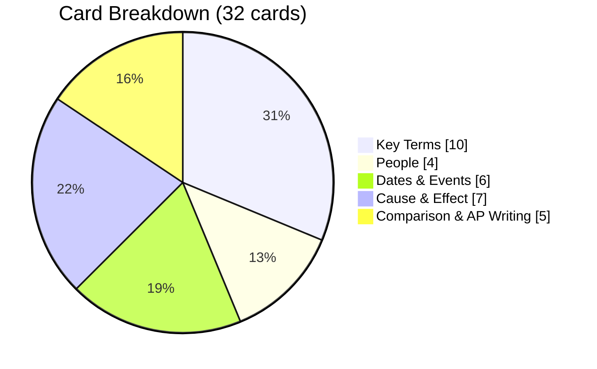

# AP World History: Modern — Topic 2.1 The Silk Roads · Flashcards

> Source: Based on the College Board CED · Textbook incorporated (Topic 2.1 reading)

---

## 1. Key Terms

- [ ] **What is a caravanserai, and how far apart were they?**

▶ Answer
An inn along a trade route, about 100 miles from the next one, the distance camels could travel before needing water. Travelers rested and could trade their animals for fresh ones. The name comes from Persian words for "caravan" and "palace."

- [ ] **What is a money economy?**

▶ Answer
An economy that uses money rather than barter with commodities such as cowrie shells or salt. China had long been a money economy.

- [ ] **What was flying cash?**

▶ Answer
A Chinese government credit system. A merchant deposited paper money under his name in one place and withdrew the same amount in another. It was created because copper coins were too unwieldy to carry, and its exchange locations became the model for modern banks.

- [ ] **What was a banking house?**

▶ Answer
A financial institution set up in European cities in the 1300s. A person could present a bill of exchange there and receive money. Banking houses were modeled on the exchange locations for flying cash.

- [ ] **What is a bill of exchange?**

▶ Answer
A document stating that the holder was legally promised payment of a set amount on a set date.

- [ ] **What was the Chinese junk?**

▶ Answer
A Chinese ship with multiple sails, up to 400 feet long (at least 3× a typical Western European ship). Its hull was divided into compartments, which strengthened it and made sinking less likely.

- [ ] **How did the magnetic compass and the improved rudder help sea trade?**

▶ Answer
The compass aided navigation, and the rudder gave better control of the ship. Together they helped China control sea trade routes in the South China Sea.

- [ ] **What was the Hanseatic League?**

▶ Answer
A 13th-century commercial alliance of northern German and Scandinavian cities (Lübeck, Hamburg, Riga). It controlled North Sea and Baltic Sea trade, drove out pirates, and monopolized timber, grain, leather, and salted fish.

- [ ] **What is proto-industrialization?**

▶ Answer
Large-scale production for market before machines. Example: demand expanded China's iron and steel manufacturing.

- [ ] **Why were luxury goods the main goods on the Silk Roads?**

▶ Answer
Overland travel was long and costly, so only high-value goods were profitable. Examples: China exported silk, porcelain, and tea, and imported precious stones and horses, which appealed to its upper class.

## 2. People

- [ ] **Who was Francesco Balducci Pegolotti, and what does his quote show?**

▶ Answer
An Italian merchant who advised treating customs officers with respect and giving them presents so they would value your goods below their real worth. His advice shows that the land route was busy and essential to trade between regions.

- [ ] **Who revived the Silk Roads in the 8th and 9th centuries?**

▶ Answer
Arab merchants from the Abbasid Empire, on both the land route and the Indian Ocean sea routes, together with Tang China. This was the second golden age.

- [ ] **Which group had the most significant impact on the expansion of Silk Roads trade?**

▶ Answer
The Mongols. They unified the routes under one authority that respected merchants and enforced laws, improved roads, and punished bandits.

- [ ] **Which artisans expanded production of textiles and porcelain for export?**

▶ Answer
Chinese, Persian, and Indian craftworkers and merchants.

## 3. Dates & Events

- [ ] **8th–9th centuries**

▶ Answer
The second golden age of the Silk Roads. Abbasid Arab merchants revived the routes, and Tang China traded actively.

- [ ] **c. 800 C.E.**

▶ Answer
Paper money appears in China (date from the textbook table).

- [ ] **1258**

▶ Answer
The Mongols conquer the Abbasid Caliphate.

- [ ] **1296**

▶ Answer
The Hanseatic League (date from the textbook table; the text says "13th century").

- [ ] **1300s**

▶ Answer
Banking houses are established in European cities.

- [ ] **Mid-17th century**

▶ Answer
The Hanseatic League ends because national governments are now strong enough to protect their merchants.

## 4. Cause & Effect

- [ ] **Cause → Effect: How did the Crusades affect trade?**

▶ Answer
Knights brought back fabrics and spices, which awakened European interest in Asian luxury goods. Europeans then organized trade in their own resources (for example, the Hanseatic League).

- [ ] **Cause → Effect: What did Mongol unification of the Silk Roads lead to?**

▶ Answer
Safer travel (better roads, bandits punished), new trade channels between Asia, the Middle East, Africa, and Europe, and the third golden age of the Silk Roads.

- [ ] **Cause → Effect: How did caravans and camel saddles affect trade?**

▶ Answer
Caravans made travel safer than going alone, and new saddle designs let camels carry much heavier loads, so more goods moved more safely.

- [ ] **Cause → Effect: Why did China create flying cash, and what did it lead to?**

▶ Answer
Copper coins were too unwieldy to carry for everyday trade. Flying cash made trade easier and became the model for modern banks, including European banking houses.

- [ ] **Cause → Effect: Why did cities such as Kashgar and Samarkand thrive?**

▶ Answer
The routes crossed hot, dry land where water was scarce. River-watered cities supplied water, food, and markets, so they became thriving trade centers.

- [ ] **Cause → Effect: What happened when demand for luxury goods rose?**

▶ Answer
Supply rose through expanded production. Craftworkers made more textiles and porcelain for export, and China's iron and steel production grew (proto-industrialization).

- [ ] **Cause: Why did the Hanseatic League end?**

▶ Answer
By the mid-17th century, national governments were strong enough to protect their own merchants, so the league was no longer needed.

## 5. Comparison & AP Writing

- [ ] **Compare: How did the three golden ages of the Silk Roads differ?**

▶ Answer
First: the Roman and Han empires; it ended when they collapsed. Second: Abbasid merchants and Tang China revived the routes in the 8th and 9th centuries. Third: the Mongols unified and protected the routes (c. 1250–1350).

- [ ] **Compare: How were Kashgar and Samarkand similar and different?**

▶ Answer
Similar: both were river-watered oasis cities with skilled artisans and centers of Islamic learning. Different: Kashgar sat at China's western edge where the northern and southern routes crossed and shifted from Buddhist to Islamic. Samarkand, in the Zeravshan valley, hosted Christianity, Buddhism, Zoroastrianism, and Islam.

- [ ] **AP Short Answer: Explain one cause of the growth of the Silk Roads after 1200.**

▶ Answer

**Claim:** The rise of the Mongol Empire was the most significant cause of the growth of Silk Roads trade after 1200. 
**Evidence:** The Mongols conquered the Abbasid Caliphate (1258) and China, unified the routes under one authority, improved roads, and punished bandits. 
**Reasoning:** One authority that respected merchants and enforced laws lowered the risks of travel, so trade grew and new channels opened between Asia, the Middle East, Africa, and Europe.

- [ ] **AP Short Answer: Explain one effect of the growth of the Silk Roads.**

▶ Answer

**Claim:** The growth of the Silk Roads led to powerful trading cities. 
**Evidence:** Kashgar, where the northern and southern routes crossed, supplied water and food and sold textiles, rugs, leather goods, and pottery in a busy market. 
**Reasoning:** Travelers on the dry routes depended on river-watered cities, so these cities gathered wealth and became centers for exchanging both goods and ideas (for example, Kashgar became a center of Islamic scholarship).

- [ ] **AP Long Essay Thesis: Evaluate the extent to which commercial innovations caused the growth of Afro-Eurasian trade from 1200 to 1450.**

▶ Answer

**Claim:** Commercial innovations were an important cause of growing trade, but the Mongol unification of the routes was more significant. 
**Evidence:** Caravanserai, flying cash, banking houses, and bills of exchange made trade convenient and stable. However, the textbook says no other cause had as great an impact as the Mongols, who unified the routes, improved roads, and punished bandits. 
**Reasoning:** Innovations lowered the cost and risk of each transaction, but only political unification made the whole network safe enough for trade to reach its third golden age.

