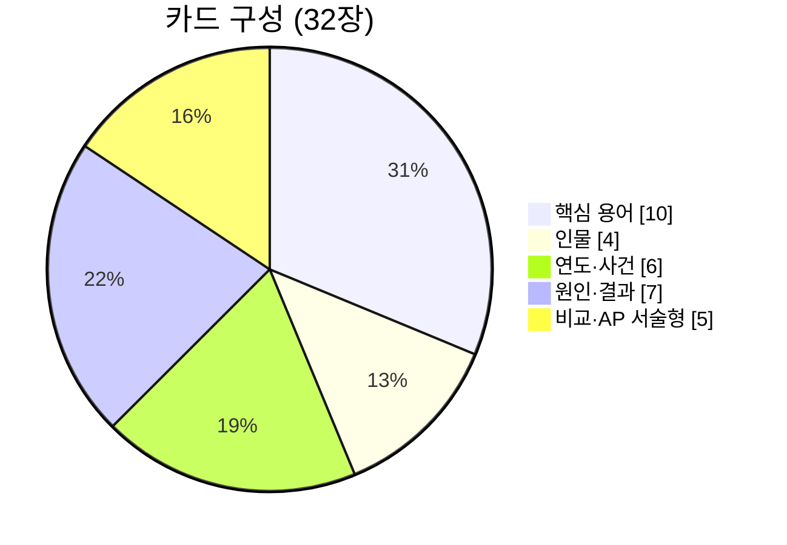

# AP 세계사: 모던 — 토픽 2.1 실크로드 (The Silk Roads) · 플래시카드

> 출처: College Board CED 기준 · 교재 반영 (교재 Topic 2.1)

---

## 1. 핵심 용어

- [ ] **캐러밴서라이 (Caravanserai)란 무엇이며, 어느 정도 간격으로 있었는가?**

▶ 정답
교역로에 세운 숙소로, 낙타가 물 없이 갈 수 있는 거리인 약 100마일 간격으로 있었다. 여행자가 쉬고, 지친 가축을 새 가축으로 바꿀 수 있었다. 이름은 페르시아어 "대상"과 "궁전"에서 유래했다.

- [ ] **화폐 경제 (Money economy)란 무엇인가?**

▶ 정답
개오지 조개껍데기나 소금 같은 물건으로 하는 물물교환 대신 화폐를 쓰는 경제다. 중국은 오래전부터 화폐 경제였다.

- [ ] **비전 (Flying cash)이란 무엇이었는가?**

▶ 정답
중국 정부의 신용 제도다. 상인이 한 곳에서 자기 이름으로 지폐를 맡기고 다른 곳에서 같은 금액을 찾았다. 구리 동전이 무거워 들고 다니기 어려워서 만들어졌고, 환전소는 근대 은행의 모델이 되었다.

- [ ] **은행 (Banking house)이란 무엇이었는가?**

▶ 정답
1300년대 유럽 도시에 세워진 금융 기관이다. 환어음을 내면 돈으로 받을 수 있었다. 비전의 환전소를 본보기로 삼았다.

- [ ] **환어음 (Bill of exchange)이란 무엇인가?**

▶ 정답
소지자에게 정해진 날짜에 정해진 금액을 지급하기로 법적으로 약속한 문서다.

- [ ] **중국의 정크선 (Junk)은 어떤 배였는가?**

▶ 정답
돛이 여러 개인 중국 선박으로, 길이가 최대 400피트(당시 서유럽 선박의 3배 이상)였다. 선체가 격벽으로 나뉘어 있어 튼튼하고 잘 가라앉지 않았다.

- [ ] **나침반 (Magnetic compass)과 개량된 키 (Rudder)는 해상 교역에 어떤 도움을 주었는가?**

▶ 정답
나침반은 항해를 도왔고, 키는 배를 더 잘 조종할 수 있게 했다. 이 기술들 덕분에 중국은 남중국해의 해상 교역로를 장악할 수 있었다.

- [ ] **한자 동맹 (Hanseatic League)이란 무엇이었는가?**

▶ 정답
13세기 북부 독일과 스칸디나비아 도시들(뤼베크, 함부르크, 리가)의 상업 동맹이다. 북해와 발트해의 교역을 장악하고, 해적을 몰아냈으며, 목재, 곡물, 가죽, 소금에 절인 생선의 교역을 독점했다.

- [ ] **원산업화 (Proto-industrialization)란 무엇인가?**

▶ 정답
기계가 쓰이기 전에 시장을 겨냥해 대규모로 생산한 것이다. 예: 수요 증가로 중국의 철·강철 생산이 늘었다.

- [ ] **실크로드에서 사치품 (Luxury goods)이 주된 교역품이었던 이유는?**

▶ 정답
육로 여행은 길고 비용이 많이 들어서 가치가 높은 상품만 이익이 났기 때문이다. 예: 중국은 비단, 도자기, 차를 수출하고, 상류층이 좋아하는 보석과 말을 수입했다.

## 2. 인물

- [ ] **프란체스코 발두치 페골로티 (Francesco Balducci Pegolotti)는 누구이며, 그의 글은 무엇을 보여 주는가?**

▶ 정답
세관 관리를 정중히 대하고 선물을 건네면 상품을 실제보다 낮게 평가해 준다고 조언한 이탈리아 상인이다. 그의 조언은 육로가 활발했고 지역 간 교역에 꼭 필요했음을 보여 준다.

- [ ] **8–9세기에 실크로드를 되살린 사람들은 누구인가?**

▶ 정답
육로와 인도양 해로에서 활동한 아바스 제국의 아랍 상인들, 그리고 당나라다. 이것이 두 번째 황금기다.

- [ ] **실크로드 교역 확대에 가장 큰 영향을 준 집단은?**

▶ 정답
몽골이다. 상인을 존중하고 법을 집행하는 하나의 권력 아래 교역로를 통합했고, 도로를 정비하고 도적을 처벌했다.

- [ ] **수출용 직물과 도자기 생산을 늘린 장인들은 누구인가?**

▶ 정답
중국·페르시아·인도의 장인과 상인이다.

## 3. 연도·사건

- [ ] **8–9세기**

▶ 정답
실크로드의 두 번째 황금기. 아바스의 아랍 상인이 교역로를 되살렸고, 당나라가 활발히 교역했다.

- [ ] **c. 800년**

▶ 정답
중국에서 지폐가 등장했다 (교재 표의 연도).

- [ ] **1258년**

▶ 정답
몽골이 아바스 칼리프조를 정복했다.

- [ ] **1296년**

▶ 정답
한자 동맹 (교재 표의 연도. 본문에는 "13세기"라고 되어 있다).

- [ ] **1300년대**

▶ 정답
유럽 도시에 은행이 세워졌다.

- [ ] **17세기 중반**

▶ 정답
각국 정부가 자국 상인을 보호할 만큼 강해지면서 한자 동맹이 해체되었다.

## 4. 원인·결과

- [ ] **원인 → 결과: 십자군은 교역에 어떤 영향을 주었는가?**

▶ 정답
기사들이 직물과 향신료를 가져오면서 아시아 사치품에 대한 유럽인의 관심이 커졌다. 그러자 유럽인들은 자신들의 자원을 교역하는 조직을 만들었다(예: 한자 동맹).

- [ ] **원인 → 결과: 몽골이 실크로드를 통합하면서 어떤 결과가 나타났는가?**

▶ 정답
도로가 정비되고 도적이 처벌되어 여행이 안전해졌고, 아시아·중동·아프리카·유럽 사이에 새로운 교역로가 열렸으며, 실크로드의 세 번째 황금기가 시작되었다.

- [ ] **원인 → 결과: 대상과 낙타 안장은 교역에 어떤 영향을 주었는가?**

▶ 정답
대상을 이루면 혼자 다닐 때보다 안전했고, 새로운 안장 덕분에 낙타가 훨씬 무거운 짐을 실을 수 있었다. 그래서 더 많은 상품이 더 안전하게 이동했다.

- [ ] **원인 → 결과: 중국이 비전을 만든 이유와 그 결과는?**

▶ 정답
구리 동전이 무거워 일상적인 거래에 들고 다니기 어려웠기 때문이다. 비전은 거래를 쉽게 만들었고, 유럽의 은행을 포함한 근대 은행의 모델이 되었다.

- [ ] **원인 → 결과: 카슈가르와 사마르칸트 같은 도시가 번성한 이유는?**

▶ 정답
교역로가 물이 부족한 덥고 건조한 땅을 지났기 때문이다. 강이 흐르는 도시들이 물, 식량, 시장을 제공하면서 교역의 중심지로 번성했다.

- [ ] **원인 → 결과: 사치품 수요가 늘자 어떤 일이 일어났는가?**

▶ 정답
생산이 늘어 공급도 증가했다. 장인들은 수출용 직물과 도자기를 더 많이 만들었고, 중국의 철·강철 생산이 늘었다(원산업화).

- [ ] **원인: 한자 동맹이 해체된 이유는?**

▶ 정답
17세기 중반이 되자 각국 정부가 자국 상인을 보호할 만큼 강해져서 동맹이 더는 필요 없어졌기 때문이다.

## 5. 비교·AP 서술형

- [ ] **비교: 실크로드의 세 황금기는 어떻게 달랐는가?**

▶ 정답
첫 번째는 로마와 한 제국 시기로, 두 제국이 무너지면서 끝났다. 두 번째는 8–9세기에 아바스 상인과 당나라가 교역로를 되살린 시기다. 세 번째는 몽골이 교역로를 통합하고 보호한 시기다(c. 1250–1350).

- [ ] **비교: 카슈가르와 사마르칸트의 공통점과 차이점은?**

▶ 정답
공통점: 둘 다 강물을 이용한 오아시스 도시였고, 숙련된 장인이 있었으며, 이슬람 학문의 중심지였다. 차이점: 카슈가르는 중국 서쪽 끝 북쪽 경로와 남쪽 경로가 만나는 곳에 있었고, 불교 도시에서 이슬람 도시로 바뀌었다. 제라프샨강 유역의 사마르칸트에는 기독교, 불교, 조로아스터교, 이슬람이 공존했다.

- [ ] **AP 단답형: 1200년 이후 실크로드가 성장한 원인 하나를 설명하라.**

▶ 정답

**주장:** 1200년 이후 실크로드 교역이 성장한 가장 중요한 원인은 몽골 제국의 등장이었다. 
**근거:** 몽골은 아바스 칼리프조(1258)와 중국을 정복해 교역로를 하나의 권력 아래 통합했고, 도로를 정비하고 도적을 처벌했다. 
**설명:** 상인을 존중하고 법을 집행하는 하나의 권력이 여행의 위험을 줄였다. 그래서 교역이 늘었고, 아시아·중동·아프리카·유럽 사이에 새로운 교역로가 열렸다.

- [ ] **AP 단답형: 실크로드 성장의 결과 하나를 설명하라.**

▶ 정답

**주장:** 실크로드가 성장하면서 강력한 교역 도시들이 생겨났다. 
**근거:** 북쪽 경로와 남쪽 경로가 만나는 카슈가르는 물과 식량을 공급했고, 붐비는 시장에서 직물, 양탄자, 가죽 제품, 도기를 팔았다. 
**설명:** 건조한 교역로를 지나는 여행자들은 강이 흐르는 도시에 의존했다. 그래서 이 도시들은 부를 모았고, 상품과 사상이 함께 교류되는 중심지가 되었다(예: 카슈가르는 이슬람 학문의 중심지가 되었다).

- [ ] **AP 논술형 논지: 1200–1450년 상업 혁신이 아프로-유라시아 교역의 성장을 어느 정도 이끌었는지 평가하라.**

▶ 정답

**주장:** 상업 혁신은 교역 성장의 중요한 원인이었지만, 몽골의 교역로 통합이 더 큰 영향을 주었다. 
**근거:** 캐러밴서라이, 비전, 은행, 환어음은 교역을 편리하고 안정적으로 만들었다. 그러나 교재는 교역로를 통합하고, 도로를 정비하고, 도적을 처벌한 몽골만큼 큰 영향을 준 원인은 없었다고 말한다. 
**설명:** 혁신은 개별 거래의 비용과 위험을 줄였다. 하지만 교역망 전체를 안전하게 만들어 세 번째 황금기를 연 것은 정치적 통합이었다.

