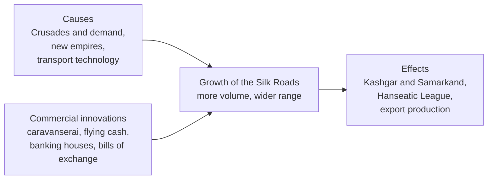
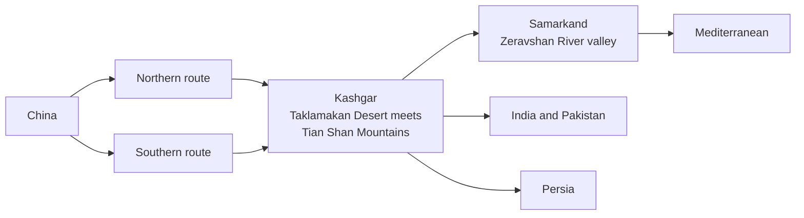
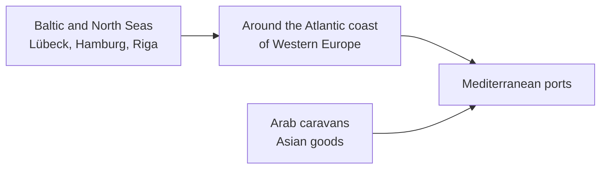
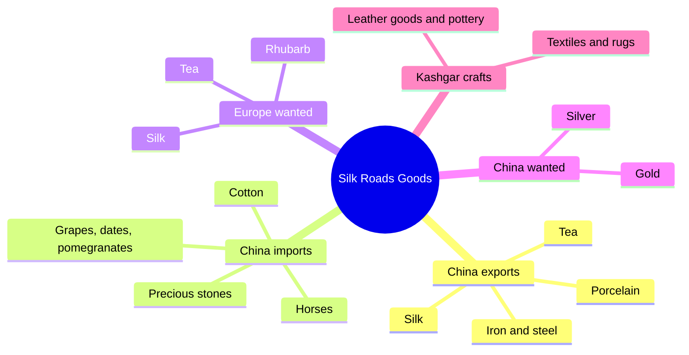
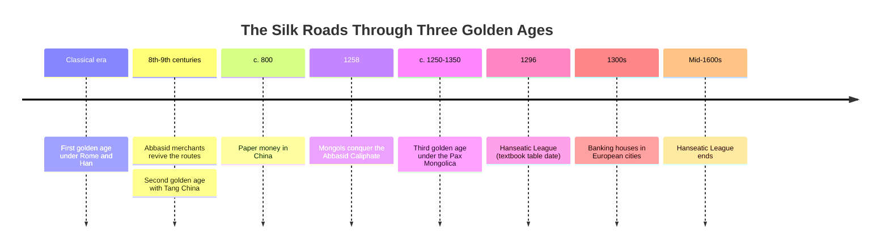
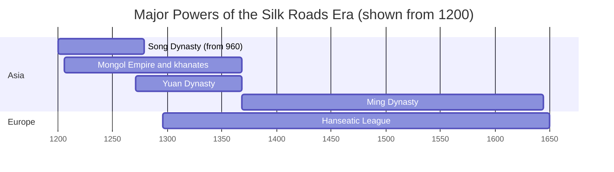

# AP World History: Modern — Topic 2.1 The Silk Roads

**Focus Question:** What were the causes and effects of the growth of networks of exchange after 1200?

> Source: Based on the College Board CED · Textbook incorporated (Topic 2.1 reading)

**Unit 2: Networks of Exchange (c. 1200–1450)**

---

## Learning Objective

| Code | Learning Objective |
|---|---|
| 2.1 LO | Explain the causes and effects of the growth of networks of exchange after 1200. |

## Historical Developments (CED)

| # | Historical Development | Covered in |
|---|---|---|
| HD1 | Improved commercial practices led to an increased volume of trade and expanded the geographical range of existing and newly active trade networks. | §2, §3 |
| HD2 | The growth of interregional trade in luxury goods was encouraged by innovations in previously existing transportation and commercial technologies, including the caravanserai, forms of credit, and the development of money economies. | §2, §3 |
| HD3 | The Silk Roads promoted the growth of powerful new trading cities. | §4 |
| HD4 | Demand for luxury goods increased in Afro-Eurasia. Chinese, Persian, and Indian artisans and merchants expanded their production of textiles and porcelains for export; the manufacture of iron and steel expanded in China. | §6 |

---

## The Big Picture

> "And don't forget that if you treat the custom-house officers with respect, and make them something of a present in goods or money, as well as their clerks and dragomen, they will behave with great civility, and always be ready to appraise your wares below their real value."
> — Italian merchant Francesco Balducci Pegolotti (textbook spelling and date: "Peglotti," 1471)

The Silk Roads were not new after 1200. They went through **three "golden ages."** The first, under the **Roman and Han empires**, ended when those empires collapsed. In the **8th and 9th centuries**, **Arab merchants of the Abbasid Empire** and **Tang China** revived the routes (the second golden age). After 1200, the **Mongol Empire** unified the routes under one authority that respected merchants and enforced laws, which began the third golden age. Trade grew because of **European demand** awakened by the **Crusades**, **new empires**, better **transportation** (caravans, camel saddles, Chinese naval technology), and **commercial innovations** (caravanserai, flying cash, banking houses, bills of exchange). The effects included thriving **oasis trading cities** such as **Kashgar** and **Samarkand**, European trade alliances such as the **Hanseatic League**, and expanded **production for export** in China, Persia, and India.

---

## §1. Background: The Three Golden Ages of the Silk Roads

| Golden age | Period | Key powers | What happened |
|---|---|---|---|
| **First** | Classical era | Roman and Han empires | First accounts of Silk Roads travel; activity **declined dramatically** after these empires collapsed |
| **Second** | 8th–9th centuries onward | **Abbasid Empire**, **Tang China** | **Arab merchants** revived the land route and the Indian Ocean sea routes; Tang China offered the compass, paper, and gunpowder |
| **Third** | c. 1250–1350 | **Mongol Empire** | Mongol rule unified and protected the routes (Pax Mongolica; see 2.2) |

- **Tang China exported** porcelain, tea, and silk.
- **Tang China imported** cotton, precious stones, pomegranates, dates, horses, and grapes from other parts of Asia. These luxury goods appealed to China's upper class.

## §2. Causes of Growth

### Demand and the Crusades

- The **Crusades** helped expand exchange networks: lords and knights brought back **fabrics and spices** from the East, which awakened European interest in Asian luxury goods.
- Although the **Ottoman Turks** were taking territory from the **Byzantine Empire**, the Silk Roads, the Mediterranean sea routes, and the Indian Ocean routes **stayed in operation**.
- Demand ran **both ways**: China wanted Europe's **gold and silver**, and Europe wanted **silk, tea, and rhubarb**.
- Europeans had not yet found a route around the **Cape of Good Hope**, but they had been making overland trips for centuries.

### Rise of New Empires

- **No other cause had as significant an impact** as the rise of the **Mongol Empire**.
- The Mongols conquered the **Abbasid Caliphate in 1258** and then brought China under their control.
- For the first time, parts of the Silk Roads under different rulers were unified under **one authority that respected merchants and enforced laws**.
- The Mongols **improved roads** and **punished bandits**, which made travel safer, and opened **new trade channels** between Asia, the Middle East, Africa, and Europe.

> ⚠️ The textbook says China came under Mongol control "in the 14th century." The Yuan Dynasty began in 1271 (13th century; see 2.2). Check this against the printed textbook.

### Improvements in Transportation Technology

| Technology | Details |
|---|---|
| **Caravans** | Traveling with others in caravans was safer than traveling alone |
| **Camel saddles** | New saddle designs greatly increased the weight camels could carry |
| **Magnetic compass** | Chinese invention that aided navigation at sea |
| **Improved rudder** | Chinese improvement that gave better control of ships |
| **Junk** | Chinese ship similar to the dhow, with multiple sails; up to **400 feet** long, at least **3×** the size of a typical Western European ship; the hull was divided into **compartments**, which strengthened the ship and made sinking less likely |

- These naval advances let China control sea-based trade routes in the **South China Sea**.

> ⚠️ The textbook dates the compass, rudder, and junk to the **Han Dynasty**. The textbook reading for 2.3, however, covers the magnetic compass in Topic 4.1. Check how your teacher wants these dated.

## §3. Commercial Innovations

| Innovation | Details | Why it mattered |
|---|---|---|
| **Caravanserai** | Inns about **100 miles apart**, the distance camels could travel before needing water; travelers rested and could trade their animals for fresh ones; the name comes from Persian words for "caravan" and "palace" | Created oases along the arid routes and made long journeys possible |
| **Money economy** | China had long used **money rather than barter** (with commodities such as cowrie shells or salt) | Made exchange simpler and larger |
| **Flying cash** | Copper coins were too unwieldy to carry, so the government created a **credit** system: a merchant deposited paper money under his name in one place and withdrew the same amount in another | Its exchange locations became the **model for modern banks** |
| **Paper money** | Currency in paper form (China, c. 800 C.E.) | Made large transactions easier |
| **Banking houses** | Set up in **European cities in the 1300s** | A person could present a bill of exchange and receive money |
| **Bill of exchange** | A document stating that the holder was legally promised **payment of a set amount on a set date** | Let merchants trade without carrying coins |

> **Key idea:** Each innovation encouraged trade by providing **convenience** and **stable institutions**.

### Textbook Table: Innovations in Commerce, 500 B.C.E. to 1603 C.E.

| Innovation | Description | Origin date | Early location |
|---|---|---|---|
| Coin | Minted precious metals (silver, bronze, gold) with their own value | c. 500 B.C.E. | Lydia (Turkey) |
| Caravanserai | Inns along trade routes where travelers could trade, rest, and replenish | c. 500 B.C.E. | Persian Empire |
| Paper money | Currency in paper form | c. 800 C.E. | China |
| Hanseatic League | First common market and confederation of merchant guilds | 1296 C.E. | Germany |
| Banking house | Precursor to modern banking | c. 200 B.C.E. ⚠️ | China |
| Bill of exchange | A written order without interest that binds one party to pay a fixed sum to another party at a set future date | c. 700 C.E. ⚠️ | China |

> ⚠️ The banking house and bill of exchange rows were jumbled in the extracted text. Check the dates and locations against the printed textbook.

## §4. Effect: Trading Cities and Oases

| City | Location | Why it thrived | Culture |
|---|---|---|---|
| **Kashgar** | Western edge of China, where the **northern and southern routes crossed**; where the Taklamakan Desert meets the Tian Shan Mountains | Watered by the **Kashgar River**; fertile land for wheat, rice, fruits, and cotton; travelers depended on it for water and food; artisans made textiles, rugs, leather goods, and pottery for a busy market | Once mainly **Buddhist**, it also became a center of **Islamic scholarship** |
| **Samarkand** | Present-day Uzbekistan, in the **Zeravshan River valley** | A stopping point between China and the Mediterranean; known for its artisans | Remains show **Christianity, Buddhism, Zoroastrianism, and Islam**; centers of Islamic learning; richly decorated mosques |

- Long stretches of the routes crossed **hot, dry land** where water was scarce, so cities watered by **rivers** became thriving centers of trade.
- **Caravanserai** were smaller oases between the large cities.
- These cities were centers for exchanging **ideas** as well as goods.

## §5. Effect: A European Trade Alliance — The Hanseatic League

- In the **13th century**, cities in **northern Germany and Scandinavia** formed a commercial alliance, the **Hanseatic League** (the textbook's table dates it to 1296).
- Member cities included **Lübeck, Hamburg, and Riga**.
- The league controlled trade in the **North Sea and the Baltic Sea**, drove out pirates, and **monopolized** trade in timber, grain, leather, and salted fish.
- League ships sailed around the Atlantic coast to **Mediterranean ports** to pick up valuable goods from **Arab caravans**.
- The league lasted until the **mid-17th century**, when national governments became strong enough to protect their own merchants.

## §6. Effect: Rising Demand and Export Production

- Growing demand for luxury goods led to a matching increase in **supply** through expanded production.
- Chinese, Persian, and Indian craftworkers expanded production of **silk and other textiles** and **porcelain** for export.
- Demand also expanded **iron and steel** manufacturing in China, which drove its **proto-industrialization**.

## §7. Wider Effects

- **Culture:** Kashgar shifted from Buddhist to Islamic scholarship, and Samarkand hosted many religions (see 2.5).
- **Technology:** the compass, paper, and gunpowder spread from China.
- **Disease:** the bubonic plague later traveled these routes (see 2.6).

---

## Timeline

---

## Comparison Table: Kashgar vs. Samarkand

| Feature | Kashgar | Samarkand |
|---|---|---|
| Location | Western edge of China | Present-day Uzbekistan |
| Water source | Kashgar River | Zeravshan River |
| Position on the routes | Where the northern and southern routes crossed | A stop between China and the Mediterranean |
| Economy | Food (wheat, rice, fruit, cotton) and crafts (textiles, rugs, leather, pottery) | Crafts and trade |
| Religion | Buddhist, then a center of Islamic scholarship | Christianity, Buddhism, Zoroastrianism, Islam |
| Similarity | Both were river-watered oasis cities and centers of exchange for ideas as well as goods | (same) |

---

## Key Terms

| Theme | Term | Definition |
|---|---|---|
| Technology | Magnetic compass | A Chinese navigation tool that points to magnetic north |
| Technology | Rudder | A device for steering a ship; the Chinese improved it for better control |
| Technology | Junk | A large Chinese ship with multiple sails and a compartmented hull, up to 400 feet long |
| Government | Mongol Empire | The empire that unified the Silk Roads under one authority (see 2.2) |
| Culture | Kashgar | An oasis city at China's western edge where routes crossed; a center of Islamic scholarship |
| Culture | Samarkand | A trade city in the Zeravshan valley, home to many religions and Islamic learning |
| Economics | Caravanserai | Inns about 100 miles apart along trade routes |
| Economics | Money economy | An economy that uses money rather than barter |
| Economics | Flying cash | A Chinese credit system: deposit money in one place and withdraw it in another |
| Economics | Paper money | Currency in paper form, from China (c. 800 C.E.) |
| Economics | Banking houses | Financial institutions in European cities from the 1300s |
| Economics | Bill of exchange | A document promising payment of a set amount on a set date |
| Economics | Hanseatic League | A commercial alliance of northern German and Scandinavian cities (13th century to mid-17th century) |
| CED | Luxury goods | High-value, low-bulk goods such as silk and porcelain |
| CED | Proto-industrialization | Large-scale production for market before mechanized industry |
| CED | Porcelain | Fine, high-fired ceramic and a famous Chinese export |
