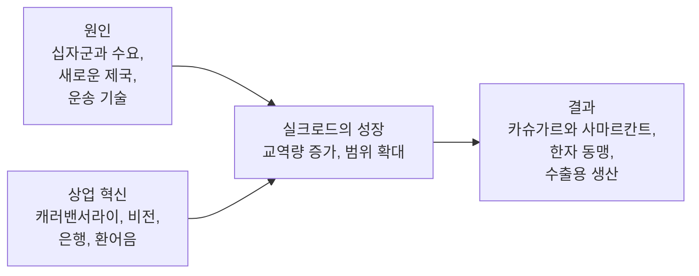
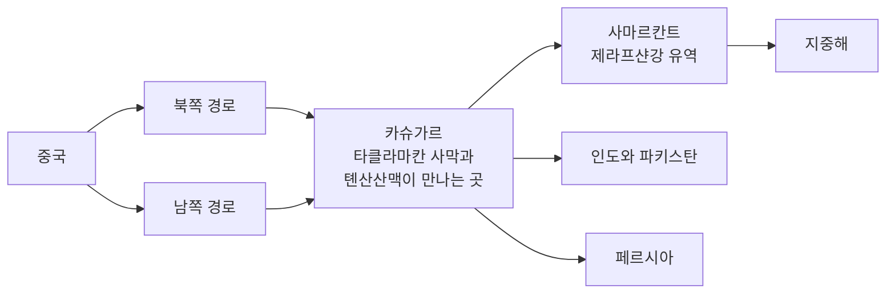
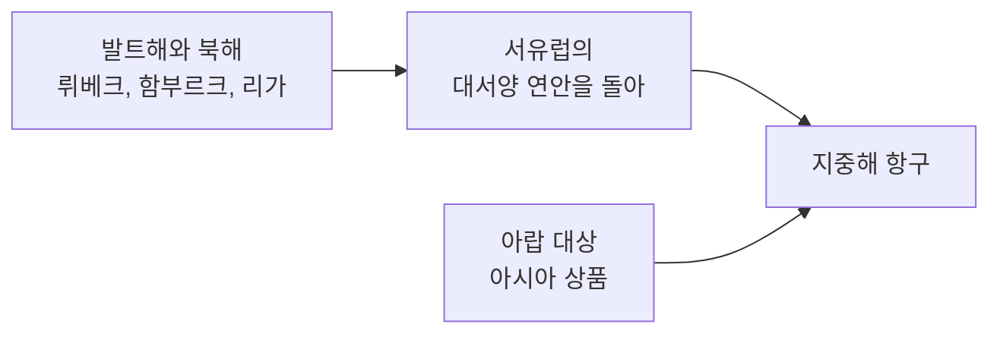
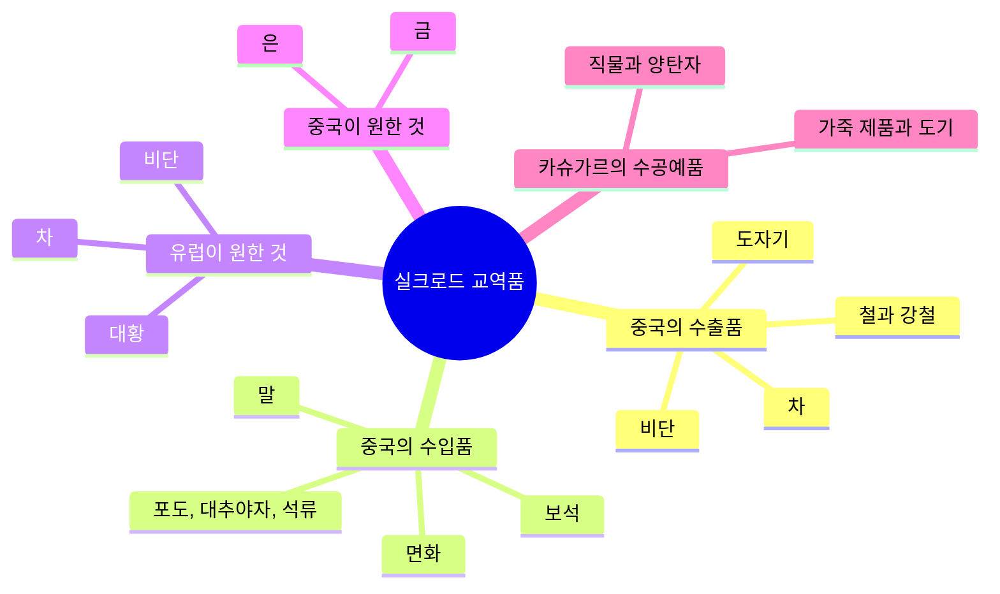
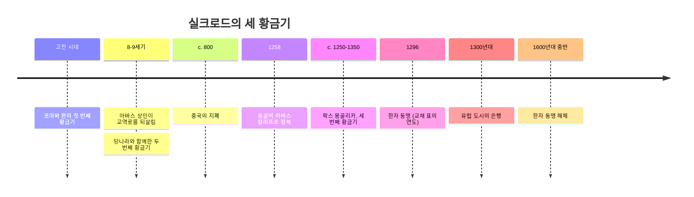
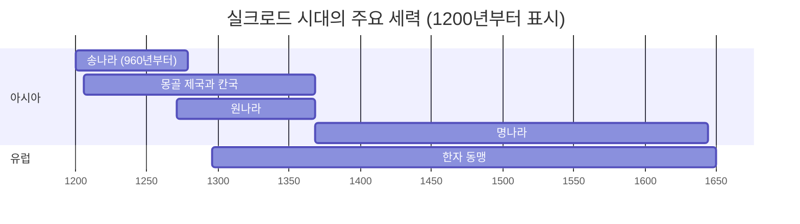

# AP 세계사: 모던 — 토픽 2.1 실크로드 (The Silk Roads)

**Focus Question:** 1200년 이후 교류 네트워크가 성장한 원인과 결과는 무엇이었는가?

> 출처: College Board CED 기준 · 교재 반영 (교재 Topic 2.1)

**Unit 2: 교류의 네트워크 (Networks of Exchange, c. 1200–1450)**

---

## 학습 목표 (Learning Objective)

| 코드 | 학습 목표 |
|---|---|
| 2.1 LO | 1200년 이후 교류 네트워크가 성장한 원인과 결과를 설명하라. |

## 역사적 개념 (Historical Developments, CED)

| # | 역사적 개념 | 다루는 곳 |
|---|---|---|
| HD1 | 상업 관행이 개선되면서 교역량이 늘었고, 기존 교역망과 새로 활발해진 교역망의 지리적 범위가 넓어졌다. | §2, §3 |
| HD2 | 지역 간 사치품 교역이 커진 데에는 기존 운송·상업 기술의 혁신이 뒷받침되었다. 캐러밴서라이 (Caravanserai), 신용 (Credit), 화폐 경제 (Money economy)의 발달이 그 예이다. | §2, §3 |
| HD3 | 실크로드는 강력한 신흥 교역 도시들의 성장을 촉진했다. | §4 |
| HD4 | 아프로-유라시아 전역에서 사치품 수요가 늘었다. 중국·페르시아·인도의 장인과 상인은 수출용 직물과 도자기 생산을 늘렸고, 중국에서는 철과 강철 생산이 확대되었다. | §6 |

---

## 큰 그림 요약

> "세관 관리를 정중히 대하고, 그들과 서기, 통역관에게 물건이나 돈으로 약간의 선물을 건네는 것을 잊지 마라. 그러면 그들은 매우 친절하게 대해 줄 것이고, 언제든 당신의 물건을 실제 가치보다 낮게 평가해 줄 것이다."
> — 이탈리아 상인 프란체스코 발두치 페골로티 (Francesco Balducci Pegolotti) (교재 표기와 연도: "Peglotti", 1471)

실크로드는 1200년 이후에 새로 생긴 길이 아니다. 실크로드에는 **세 번의 "황금기"**가 있었다. 첫 번째는 **로마와 한 제국** 시기로, 두 제국이 무너지면서 끝났다. **8–9세기**에는 **아바스 제국의 아랍 상인**과 **당나라**가 교역로를 되살렸다(두 번째 황금기). 1200년 이후에는 **몽골 제국**이 상인을 존중하고 법을 집행하는 하나의 권력 아래 교역로를 통합해 세 번째 황금기를 열었다. 교역이 성장한 원인은 **십자군 (Crusades)**이 일깨운 **유럽의 수요**, **새로운 제국**, 더 나은 **운송 기술**(대상, 낙타 안장, 중국의 해양 기술), 그리고 **상업 혁신**(캐러밴서라이, 비전, 은행, 환어음)이었다. 그 결과 **카슈가르**와 **사마르칸트** 같은 **오아시스 교역 도시**가 번성했고, **한자 동맹 (Hanseatic League)** 같은 유럽의 교역 동맹이 생겼으며, 중국·페르시아·인도에서 **수출용 생산**이 늘었다.

---

## §1. 배경: 실크로드의 세 황금기

| 황금기 | 시기 | 주요 세력 | 내용 |
|---|---|---|---|
| **첫 번째** | 고전 시대 | 로마와 한 제국 | 실크로드 여행에 관한 최초의 기록이 남음. 두 제국이 무너진 뒤 교역이 **크게 줄어듦** |
| **두 번째** | 8–9세기 이후 | **아바스 제국**, **당나라** | **아랍 상인**이 육로와 인도양 해로를 되살림. 당나라는 나침반, 종이, 화약을 내놓음 |
| **세 번째** | c. 1250–1350 | **몽골 제국** | 몽골의 지배가 교역로를 통합하고 보호함 (팍스 몽골리카, 2.2 참고) |

- **당나라의 수출품:** 도자기, 차, 비단.
- **당나라의 수입품:** 아시아 각지에서 들여온 면화, 보석, 석류, 대추야자, 말, 포도. 이런 사치품은 중국 상류층에게 인기가 있었다.

## §2. 성장 원인

### 수요와 십자군

- **십자군**은 교류 네트워크가 넓어지는 계기가 되었다. 영주와 기사들이 동방에서 **직물과 향신료**를 가져오면서 아시아 사치품에 대한 유럽인의 관심이 커졌다.
- **오스만 튀르크**가 **비잔티움 제국**의 영토를 잠식하고 있었지만, 실크로드와 지중해 해로, 인도양 교역로는 **계속 운영되었다.**
- 수요는 **양쪽 모두에** 있었다. 중국은 유럽의 **금과 은**을, 유럽은 **비단, 차, 대황 (Rhubarb)**을 원했다.
- 유럽인들은 아직 **희망봉 (Cape of Good Hope)**을 도는 항로를 찾지 못했지만, 수백 년 동안 육로로 유럽을 오가고 있었다.

### 새로운 제국의 등장

- 교역 확대에 **가장 큰 영향을 준 원인**은 **몽골 제국**의 등장이었다.
- 몽골은 **1258년 아바스 칼리프조**를 정복하고, 이어 중국까지 지배했다.
- 서로 다른 통치자 아래 나뉘어 있던 실크로드가 처음으로 **상인을 존중하고 법을 집행하는 하나의 권력** 아래 통합되었다.
- 몽골은 **도로를 정비**하고 **도적을 처벌**해 여행을 안전하게 만들었고, 아시아·중동·아프리카·유럽 사이에 **새로운 교역로**를 열었다.

> ⚠️ 교재에는 몽골이 중국을 "14세기에" 지배했다고 쓰여 있다. 원나라는 1271년(13세기)에 세워졌다(2.2 참고). 인쇄된 교재와 대조해 확인이 필요하다.

### 운송 기술의 발전

| 기술 | 내용 |
|---|---|
| **대상 (Caravan)** | 혼자보다 여럿이 대상을 이루어 이동하는 것이 더 안전했음 |
| **낙타 안장 (Camel saddle)** | 새로운 안장 설계로 낙타가 실을 수 있는 짐의 무게가 크게 늘어남 |
| **나침반 (Magnetic compass)** | 바다에서의 항해를 도운 중국의 발명품 |
| **개량된 키 (Rudder)** | 배를 더 잘 조종할 수 있게 한 중국의 개량 기술 |
| **정크선 (Junk)** | 다우선과 비슷한 중국 선박으로, 돛이 여러 개였음. 길이가 최대 **400피트**로 당시 서유럽 선박의 **3배** 이상이었고, 선체가 **격벽**으로 나뉘어 튼튼하고 잘 가라앉지 않았음 |

- 이런 해양 기술 덕분에 중국은 **남중국해**의 해상 교역로를 장악할 수 있었다.

> ⚠️ 교재는 나침반, 키, 정크선을 **한나라** 시기의 것으로 본다. 그런데 2.3 교재는 나침반을 Topic 4.1에서 다룬다고 한다. 선생님이 어떤 시기로 가르치는지 확인이 필요하다.

## §3. 상업 혁신

| 혁신 | 내용 | 중요성 |
|---|---|---|
| **캐러밴서라이 (Caravanserai)** | 낙타가 물 없이 갈 수 있는 거리인 약 **100마일 간격**으로 세운 숙소. 여행자가 쉬고, 지친 가축을 새 가축으로 바꿀 수 있었음. 이름은 페르시아어 "대상"과 "궁전"에서 유래 | 건조한 교역로에 오아시스를 만들어 먼 여행을 가능하게 함 |
| **화폐 경제 (Money economy)** | 중국은 오래전부터 개오지 조개껍데기나 소금 같은 물건으로 하는 **물물교환 대신 화폐**를 사용함 | 교환을 더 쉽고 크게 만듦 |
| **비전 (Flying cash)** | 구리 동전은 무거워 들고 다니기 어려웠기 때문에 정부가 만든 **신용** 제도. 상인이 한 곳에서 자기 이름으로 지폐를 맡기고 다른 곳에서 같은 금액을 찾음 | 환전소가 **근대 은행의 모델**이 됨 |
| **지폐 (Paper money)** | 종이로 된 화폐 (중국, c. 800년) | 큰 거래를 쉽게 함 |
| **은행 (Banking houses)** | **1300년대 유럽 도시**에 세워짐 | 환어음을 내면 돈으로 받을 수 있었음 |
| **환어음 (Bill of exchange)** | 소지자에게 **정해진 날짜에 정해진 금액**을 지급하기로 법적으로 약속한 문서 | 상인이 동전 없이 거래할 수 있게 함 |

> **핵심:** 각 혁신은 **편리함**과 **안정된 제도**를 제공해 교역을 촉진했다.

### 교재 표: 상업 혁신, 기원전 500년–1603년

| 혁신 | 설명 | 기원 시기 | 처음 나타난 곳 |
|---|---|---|---|
| 동전 (Coin) | 그 자체로 가치를 지닌 귀금속(은, 청동, 금)으로 만든 화폐 | c. 기원전 500년 | 리디아 (튀르키예) |
| 캐러밴서라이 (Caravanserai) | 여행자가 교역하고 쉬며 보급을 받던 교역로의 숙소 | c. 기원전 500년 | 페르시아 제국 |
| 지폐 (Paper money) | 종이로 된 화폐 | c. 800년 | 중국 |
| 한자 동맹 (Hanseatic League) | 최초의 공동 시장이자 상인 길드 연합 | 1296년 | 독일 |
| 은행 (Banking house) | 근대 은행의 전신 | c. 기원전 200년 ⚠️ | 중국 |
| 환어음 (Bill of exchange) | 한쪽이 다른 쪽에게 정해진 미래의 날짜에 정해진 금액을 이자 없이 지급하도록 하는 문서 | c. 700년 ⚠️ | 중국 |

> ⚠️ 추출된 텍스트에서 은행과 환어음 행이 뒤섞여 있었다. 연도와 장소는 인쇄된 교재와 대조해 확인이 필요하다.

## §4. 결과: 교역 도시와 오아시스

| 도시 | 위치 | 번성한 이유 | 문화 |
|---|---|---|---|
| **카슈가르 (Kashgar)** | 중국 서쪽 끝, **북쪽 경로와 남쪽 경로가 만나는 곳**. 타클라마칸 사막과 톈산산맥이 만나는 지점 | **카슈가르강** 덕분에 땅이 비옥해 밀, 쌀, 과일, 면화를 재배함. 여행자들은 이곳의 물과 식량에 의존함. 장인들이 직물, 양탄자, 가죽 제품, 도기를 만들어 붐비는 시장에서 팔았음 | 원래는 주로 **불교** 도시였으나, **이슬람 학문**의 중심지가 되기도 함 |
| **사마르칸트 (Samarkand)** | 지금의 우즈베키스탄, **제라프샨강** 유역 | 중국과 지중해 사이의 경유지였고, 장인들로 유명함 | 유적에서 **기독교, 불교, 조로아스터교, 이슬람**의 흔적이 나옴. 이슬람 학문의 중심지가 있었고, 화려하게 장식된 모스크가 있었음 |

- 교역로의 상당 부분이 물이 부족한 **덥고 건조한 땅**을 지났기 때문에, **강**이 흐르는 도시들이 교역의 중심지로 번성했다.
- **캐러밴서라이**는 큰 도시들 사이에 있는 작은 오아시스 역할을 했다.
- 이 도시들은 상품뿐 아니라 **사상**이 교류되는 중심지였다.

## §5. 결과: 유럽의 교역 동맹 — 한자 동맹

- **13세기**에 **북부 독일과 스칸디나비아**의 도시들이 상업 동맹인 **한자 동맹 (Hanseatic League)**을 결성했다 (교재 표에는 1296년).
- 회원 도시로는 **뤼베크 (Lübeck), 함부르크 (Hamburg), 리가 (Riga)** 등이 있었다.
- 한자 동맹은 **북해와 발트해**의 교역을 장악하고, 해적을 몰아냈으며, 목재, 곡물, 가죽, 소금에 절인 생선의 교역을 **독점**했다.
- 동맹의 배들은 대서양 연안을 돌아 **지중해 항구**로 가서 **아랍 대상**이 가져온 귀중한 상품을 실었다.
- 한자 동맹은 각국 정부가 자국 상인을 보호할 만큼 강해진 **17세기 중반**까지 이어졌다.

## §6. 결과: 수요 증가와 수출용 생산

- 사치품 수요가 늘자 생산이 확대되어 **공급**도 함께 늘었다.
- 중국·페르시아·인도의 장인들은 수출용 **비단과 직물**, **도자기** 생산을 늘렸다.
- 수요 증가는 중국의 **철과 강철** 생산도 늘려 **원산업화 (Proto-industrialization)**를 이끌었다.

## §7. 더 넓은 결과

- **문화:** 카슈가르는 불교 도시에서 이슬람 학문의 중심지로 바뀌었고, 사마르칸트에는 여러 종교가 공존했다 (2.5 참고).
- **기술:** 나침반, 종이, 화약이 중국에서 퍼져 나갔다.
- **질병:** 훗날 흑사병이 이 교역로를 따라 퍼졌다 (2.6 참고).

---

## 연표

---

## 비교표: 카슈가르와 사마르칸트

| 항목 | 카슈가르 | 사마르칸트 |
|---|---|---|
| 위치 | 중국 서쪽 끝 | 지금의 우즈베키스탄 |
| 물 공급원 | 카슈가르강 | 제라프샨강 |
| 교역로에서의 위치 | 북쪽 경로와 남쪽 경로가 만나는 곳 | 중국과 지중해 사이의 경유지 |
| 경제 | 식량(밀, 쌀, 과일, 면화)과 수공예품(직물, 양탄자, 가죽, 도기) | 수공예품과 교역 |
| 종교 | 불교, 이후 이슬람 학문의 중심지 | 기독교, 불교, 조로아스터교, 이슬람 |
| 공통점 | 둘 다 강물을 이용한 오아시스 도시였고, 상품뿐 아니라 사상이 교류되는 중심지였음 | (동일) |

---

## Key Terms (핵심 용어)

| 주제 | 용어 | 정의 |
|---|---|---|
| 기술 | 나침반 (Magnetic compass) | 자북을 가리키는 중국의 항해 도구 |
| 기술 | 키 (Rudder) | 배의 방향을 조종하는 장치로, 중국이 개량해 조종을 쉽게 함 |
| 기술 | 정크선 (Junk) | 돛이 여러 개이고 선체가 격벽으로 나뉜 중국의 대형 선박. 길이가 최대 400피트 |
| 정치 | 몽골 제국 (Mongol Empire) | 실크로드를 하나의 권력 아래 통합한 제국 (2.2 참고) |
| 문화 | 카슈가르 (Kashgar) | 교역로가 만나는 중국 서쪽 끝의 오아시스 도시. 이슬람 학문의 중심지 |
| 문화 | 사마르칸트 (Samarkand) | 제라프샨강 유역의 교역 도시. 여러 종교와 이슬람 학문의 중심지 |
| 경제 | 캐러밴서라이 (Caravanserai) | 교역로를 따라 약 100마일 간격으로 세운 숙소 |
| 경제 | 화폐 경제 (Money economy) | 물물교환 대신 화폐를 쓰는 경제 |
| 경제 | 비전 (Flying cash) | 한 곳에 돈을 맡기고 다른 곳에서 찾는 중국의 신용 제도 |
| 경제 | 지폐 (Paper money) | 종이로 된 화폐로, 중국에서 시작됨 (c. 800년) |
| 경제 | 은행 (Banking houses) | 1300년대부터 유럽 도시에 생긴 금융 기관 |
| 경제 | 환어음 (Bill of exchange) | 정해진 날짜에 정해진 금액을 지급하기로 약속한 문서 |
| 경제 | 한자 동맹 (Hanseatic League) | 북부 독일과 스칸디나비아 도시들의 상업 동맹 (13세기–17세기 중반) |
| CED | 사치품 (Luxury goods) | 비단, 도자기처럼 가치는 높고 부피는 작은 상품 |
| CED | 원산업화 (Proto-industrialization) | 기계화 산업 이전에 시장을 겨냥해 대규모로 생산한 것 |
| CED | 도자기 (Porcelain) | 고온에서 구운 고급 도자기로, 중국의 대표 수출품 |
