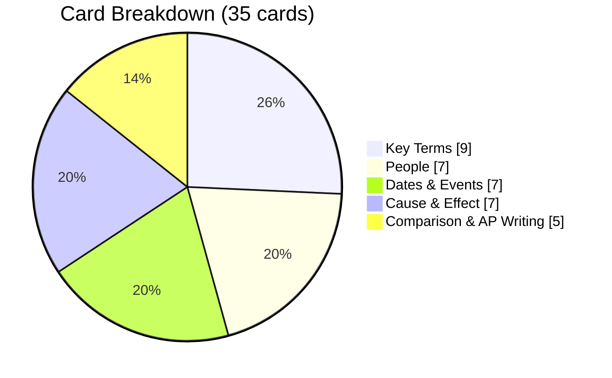

# AP World History: Modern — Topic 2.2 The Mongol Empire · Flashcards

> Source: Based on the College Board CED · Textbook incorporated (Topic 2.2 reading)

---

## 1. Key Terms

- [ ] **What is a kuriltai?**

▶ Answer
A meeting of Mongol chieftains. In 1206, a kuriltai elected Temujin khan, and he took the name Genghis Khan.

- [ ] **What do "khan" and "khanate" mean?**

▶ Answer
A khan is a king or ruler. A khanate is the kingdom a khan rules.

- [ ] **What was the Pax Mongolica?**

▶ Answer
The "Mongolian peace" (c. 1250–1350). Mongol soldiers protected the Silk Roads and maintained roads, which started the third golden age of the Silk Roads and opened new trade channels between Asia, the Middle East, Africa, and Europe.

- [ ] **What was the Golden Horde?**

▶ Answer
Batu's army and khanate in Russia. It ruled indirectly through Russian rulers who paid tribute.

- [ ] **What was the Il-khanate?**

▶ Answer
Hulegu's khanate, which stretched from Byzantium to the Oxus River (the Amu Darya). Mongols ruled, but Persians served as ministers and officials.

- [ ] **What happened with the Uyghur alphabet?**

▶ Answer
Genghis Khan had a scribe captured in 1204 adapt it to write Mongolian. The effort to use one system across the empire failed, but Mongolia still uses this alphabet today.

- [ ] **How did the Mongols get their siege weapons?**

▶ Answer
They used captured Chinese and Persian engineers to build improved siege weapons, such as portable towers and catapults.

- [ ] **What was the White Lotus Society?**

▶ Answer
A secret society that began organizing in the 1350s to end the Yuan Dynasty.

- [ ] **Why do some people consider the cannon a Mongol invention?**

▶ Answer
It may have combined Chinese gunpowder, Muslim flamethrowers, and European bell-casting techniques, all brought together through the Mongol Empire.

## 2. People

- [ ] **Who was Temujin (Genghis Khan)?**

▶ Answer
Born in 1162, he built tribal alliances, appointed talented non-family members, and valued personal loyalty. He was elected khan in 1206 and took the name Genghis Khan ("ruler of all").

- [ ] **Who was Batu?**

▶ Answer
A grandson of Genghis Khan. He led 100,000 soldiers (the Golden Horde) into Russia in 1236, destroyed Kiev (1240), and defeated European knights (1241).

- [ ] **Who was Hulegu?**

▶ Answer
A grandson of Genghis Khan. He destroyed Baghdad in 1258 and founded the Il-khanate.

- [ ] **Who was Kublai Khan?**

▶ Answer
A grandson of Genghis Khan. He became Great Khan in 1260 and founded the Yuan Dynasty. He followed Chinese traditions, rebuilt Zhongdu as Dadu, and practiced religious tolerance.

- [ ] **Who was Baibars?**

▶ Answer
The military leader of the Muslim Mamluks. The textbook says his forces, in a temporary alliance with Christian Crusaders, defeated the Mongols in 1260.

- [ ] **Who was Zhu Yuanzhang?**

▶ Answer
A Buddhist monk from a poor peasant family. He led the revolt that overthrew the Yuan and founded the Ming Dynasty in 1368.

- [ ] **Who was Matthew Paris, and why must his account be read carefully?**

▶ Answer
An English Benedictine writer (1240). He had no firsthand knowledge of the Mongols and focused only on their atrocities. His account shows their reputation, not their full impact.

## 3. Dates & Events

- [ ] **1206**

▶ Answer
A kuriltai elects Temujin khan, and he becomes Genghis Khan.

- [ ] **1219**

▶ Answer
Genghis Khan conquers the Kara Khitai Empire and the Khwarazm Empire.

- [ ] **1240**

▶ Answer
The Golden Horde loots and destroys Kiev.

- [ ] **1258**

▶ Answer
Hulegu destroys Baghdad and kills the caliph and perhaps 200,000 residents.

- [ ] **1260**

▶ Answer
The Mamluks (with Crusaders, according to the textbook) defeat the Mongols, and Kublai becomes Great Khan.

- [ ] **1368**

▶ Answer
Zhu Yuanzhang overthrows the Yuan and founds the Ming (1368–1644).

- [ ] **1380**

▶ Answer
A Moscow-led coalition defeats the Golden Horde at the Battle of Kulikovo.

## 4. Cause & Effect

- [ ] **Cause: Why did the Mongols expand beyond the steppe?**

▶ Answer
They wanted the wealth of peoples closer to the Silk Roads, who had easier access to luxury goods such as silk and gold.

- [ ] **Cause → Effect: How did Genghis Khan's reputation for brutality help him?**

▶ Answer
Stories of mass killings spread ahead of his armies, so some leaders surrendered before he even attacked.

- [ ] **Cause: Name three military strategies that made the Mongols successful.**

▶ Answer
Any three of: disciplined horse archers with short bows, feigned retreats, mapping units, a messenger force, adopted siege technology, and demanding surrender before an attack.

- [ ] **Effect: How did Mongol rule affect Russia in the long term?**

▶ Answer
Princes improved their military and accepted centralized leadership; being cut off from Western Europe created a more distinctly Russian culture; resistance led by Moscow laid the foundation of the modern Russian state.

- [ ] **Cause: Why did the Chinese turn against the Yuan?**

▶ Answer
The Yuan hired foreigners, dismantled the civil service exams (upsetting the Confucian scholar-gentry), kept Mongols separate, and failed to conquer Japan and other lands from 1274. This led to the White Lotus revolt.

- [ ] **Effect: Name three cultural or technological transfers caused by the Mongols.**

▶ Answer
Any three of: Islamic science to China; Chinese paper to Europe (which helped the Gutenberg press); Greco-Islamic medicine and Arabic numerals to Western Europe; the Uyghur alphabet for Mongolian.

- [ ] **Effect: How did the Mongols change warfare in Europe?**

▶ Answer
Their speed and surprise ended the use of armored knights, and their siege technology made walled cities useless.

## 5. Comparison & AP Writing

- [ ] **Compare: How did the Golden Horde, the Il-khanate, and the Yuan rule differently?**

▶ Answer
The Golden Horde ruled indirectly through Russian princes and tribute. The Il-khanate used Persian ministers and officials and converted to Islam. The Yuan followed Chinese traditions but kept Mongols separate and ended the exams.

- [ ] **Compare: How did religious policy differ between the Il-khanate and the Yuan?**

▶ Answer
The Il-khanate tolerated all religions until it converted to Islam, and then supported massacres of Jews and Christians. The Yuan stayed tolerant of Buddhists, Daoists, Muslims, Jews, and Christians.

- [ ] **AP Short Answer: Explain one way Mongol expansion affected trade and communication.**

▶ Answer

**Claim:** Mongol expansion made Eurasian trade easier and safer. 
**Evidence:** Under the Pax Mongolica (c. 1250–1350), Mongol soldiers protected the Silk Roads and built and guarded roads, and new trade channels opened between Asia, the Middle East, Africa, and Europe. 
**Reasoning:** One power controlling and protecting the routes lowered the risks for merchants, and conquered peoples were drawn into Mongol trade networks. This revived routes that had not been heavily used since the Roman and Han empires.

- [ ] **AP Short Answer: Explain one process of Mongol state decline.**

▶ Answer

**Claim:** The Yuan Dynasty declined because it alienated the Chinese population. 
**Evidence:** The Yuan hired foreigners, dismantled the civil service exams, banned non-Mongols from speaking Mongolian, and failed to conquer Japan, Burma, and Java. The White Lotus Society organized in the 1350s. 
**Reasoning:** These policies angered the Confucian scholar-gentry and made the Mongols seem weak, so Zhu Yuanzhang's revolt succeeded and founded the Ming in 1368.

- [ ] **AP Long Essay Thesis: Evaluate the extent to which the Mongols were destroyers or connectors of Eurasia.**

▶ Answer

**Claim:** The Mongols were deeply destructive, but their more lasting significance was connecting Eurasia, although even those connections carried harm such as the plague. 
**Evidence:** They destroyed Kiev (1240) and Baghdad (1258, perhaps 200,000 dead). Yet the Pax Mongolica revived trade, Greco-Islamic medicine and Arabic numerals reached Europe, Chinese paper helped the Gutenberg press, and later states copied Mongol centralization. The same networks spread the bubonic plague. 
**Reasoning:** The destruction was concentrated in time and place, while the connections changed trade, knowledge, warfare, and state building for centuries. This shows how one empire can be both a source of chaos and a source of global integration.

