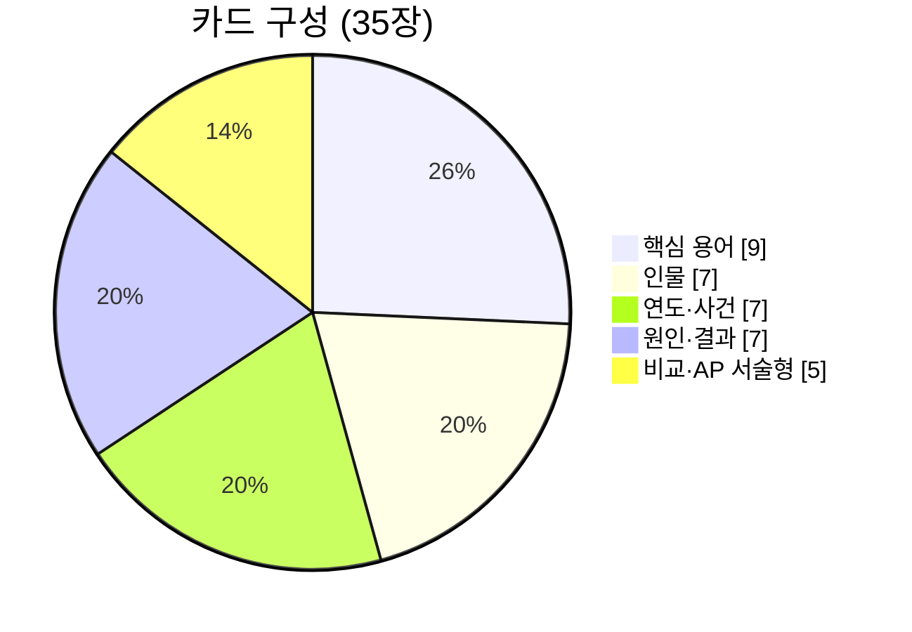

# AP 세계사: 모던 — 토픽 2.2 몽골 제국 (The Mongol Empire) · 플래시카드

> 출처: College Board CED 기준 · 교재 반영 (교재 Topic 2.2)

---

## 1. 핵심 용어

- [ ] **쿠릴타이 (Kuriltai)란 무엇인가?**

▶ 정답
몽골 족장들의 회의다. 1206년 쿠릴타이에서 테무친이 칸으로 선출되어 칭기즈 칸이라는 이름을 얻었다.

- [ ] **"칸 (Khan)"과 "칸국 (Khanate)"의 뜻은?**

▶ 정답
칸은 왕 또는 통치자이고, 칸국은 칸이 다스리는 왕국이다.

- [ ] **팍스 몽골리카 (Pax Mongolica)란 무엇이었는가?**

▶ 정답
"몽골의 평화"(c. 1250–1350)라는 뜻이다. 몽골 병사들이 실크로드를 보호하고 도로를 관리하면서 실크로드의 세 번째 황금기가 시작되었고, 아시아·중동·아프리카·유럽 사이에 새로운 교역로가 열렸다.

- [ ] **킵차크 칸국 (Golden Horde)이란 무엇이었는가?**

▶ 정답
러시아를 지배한 바투의 군대이자 칸국이다. 공납을 바치는 러시아 통치자들을 통해 간접적으로 다스렸다.

- [ ] **일 칸국 (Il-khanate)이란 무엇이었는가?**

▶ 정답
비잔티움에서 옥수스강(아무다리야강)까지 이른 훌라구의 칸국이다. 몽골인이 다스렸지만 페르시아인이 대신과 관리를 맡았다.

- [ ] **위구르 문자 (Uyghur alphabet)와 관련해 어떤 일이 있었는가?**

▶ 정답
칭기즈 칸이 1204년에 붙잡은 서기에게 위구르 문자를 몽골어에 맞게 고치도록 했다. 제국 전체에 하나의 문자를 쓰게 하려는 시도는 실패했지만, 이 문자는 지금도 몽골에서 쓰인다.

- [ ] **몽골은 공성 무기 (Siege weapons)를 어떻게 얻었는가?**

▶ 정답
붙잡은 중국·페르시아 기술자들을 이용해 이동식 공성탑과 투석기 같은 개량된 공성 무기를 만들었다.

- [ ] **백련교 (White Lotus Society)란 무엇이었는가?**

▶ 정답
원나라를 무너뜨리기 위해 1350년대부터 조직되기 시작한 비밀 결사다.

- [ ] **대포 (Cannon)를 몽골의 발명품으로 보는 사람이 있는 이유는?**

▶ 정답
몽골 제국을 통해 한데 모인 중국의 화약, 무슬림의 화염 방사기, 유럽의 종 주조 기술을 결합한 것일 수 있기 때문이다.

## 2. 인물

- [ ] **테무친 (Temujin, 칭기즈 칸)은 누구인가?**

▶ 정답
1162년에 태어나 부족 동맹을 맺고, 친족이 아닌 인재를 등용했으며, 개인적 충성을 중시했다. 1206년 칸으로 선출되어 칭기즈 칸("모든 것의 통치자")이라는 이름을 얻었다.

- [ ] **바투 (Batu)는 누구인가?**

▶ 정답
칭기즈 칸의 손자다. 1236년 10만 대군(킵차크 칸국)을 이끌고 러시아로 진격해 키예프를 파괴했고(1240), 유럽 기사단을 물리쳤다(1241).

- [ ] **훌라구 (Hulegu)는 누구인가?**

▶ 정답
칭기즈 칸의 손자다. 1258년 바그다드를 파괴하고 일 칸국을 세웠다.

- [ ] **쿠빌라이 칸 (Kublai Khan)은 누구인가?**

▶ 정답
칭기즈 칸의 손자다. 1260년 대칸이 되었고 원나라를 세웠다. 중국 전통을 따랐고, 중도를 대도로 다시 지었으며, 종교적 관용을 베풀었다.

- [ ] **바이바르스 (Baibars)는 누구인가?**

▶ 정답
무슬림 맘루크의 군사 지도자다. 교재에 따르면 그의 군대는 기독교 십자군과 일시적으로 동맹해 1260년 몽골을 물리쳤다.

- [ ] **주원장 (Zhu Yuanzhang)은 누구인가?**

▶ 정답
가난한 농민 출신의 불교 승려다. 반란을 이끌어 원나라를 무너뜨리고 1368년 명나라를 세웠다.

- [ ] **매슈 패리스 (Matthew Paris)는 누구이며, 그의 기록을 조심해서 읽어야 하는 이유는?**

▶ 정답
잉글랜드 베네딕트회의 저술가다(1240). 몽골을 직접 본 적이 없었고 잔혹 행위에만 초점을 맞추었다. 그래서 그의 기록은 몽골의 영향 전체가 아니라 몽골에 대한 평판을 보여 준다.

## 3. 연도·사건

- [ ] **1206년**

▶ 정답
쿠릴타이에서 테무친이 칸으로 선출되어 칭기즈 칸이 되었다.

- [ ] **1219년**

▶ 정답
칭기즈 칸이 카라 키타이 제국과 호라즘 제국을 정복했다.

- [ ] **1240년**

▶ 정답
킵차크 칸국이 키예프를 약탈하고 파괴했다.

- [ ] **1258년**

▶ 정답
훌라구가 바그다드를 파괴하고 칼리프와 약 20만 명의 주민을 죽였다.

- [ ] **1260년**

▶ 정답
맘루크가 (교재에 따르면 십자군과 함께) 몽골을 물리쳤고, 쿠빌라이가 대칸이 되었다.

- [ ] **1368년**

▶ 정답
주원장이 원나라를 무너뜨리고 명나라(1368–1644)를 세웠다.

- [ ] **1380년**

▶ 정답
모스크바가 이끄는 연합이 쿨리코보 전투에서 킵차크 칸국을 물리쳤다.

## 4. 원인·결과

- [ ] **원인: 몽골이 초원 밖으로 팽창한 이유는?**

▶ 정답
실크로드에 가까워 비단이나 금 같은 사치품을 쉽게 얻는 이웃들의 부를 원했기 때문이다.

- [ ] **원인 → 결과: 칭기즈 칸의 잔혹하다는 평판은 그에게 어떤 도움이 되었는가?**

▶ 정답
대량 학살 소문이 군대보다 먼저 퍼져서, 일부 지도자들은 공격받기도 전에 항복했다.

- [ ] **원인: 몽골을 성공으로 이끈 군사 전략 세 가지를 들어라.**

▶ 정답
다음 중 세 가지: 단궁을 쓰는 규율 잡힌 기마 궁수, 거짓 후퇴, 지도 제작 부대, 전령 부대, 받아들인 공성 기술, 공격 전 항복 요구.

- [ ] **결과: 몽골의 지배는 러시아에 장기적으로 어떤 영향을 주었는가?**

▶ 정답
공후들이 군사력을 키우고 중앙집권적 지도력을 받아들였다. 서유럽과 단절되면서 더 뚜렷한 러시아 문화가 생겼다. 모스크바가 이끈 저항은 근대 러시아 국가의 기초가 되었다.

- [ ] **원인: 중국인이 원나라에 등을 돌린 이유는?**

▶ 정답
원나라는 외국인을 관리로 썼고, 과거제를 폐지해 유교 사대부의 반감을 샀으며, 몽골인을 중국인과 분리했다. 1274년부터 일본 등의 정복에도 실패했다. 이것이 백련교의 반란으로 이어졌다.

- [ ] **결과: 몽골이 일으킨 문화·기술 전파 세 가지를 들어라.**

▶ 정답
다음 중 세 가지: 이슬람 과학의 중국 전래, 중국 종이의 유럽 전래(구텐베르크 인쇄기에 기여), 그리스-이슬람 의학과 아라비아 숫자의 서유럽 전래, 몽골어 표기를 위한 위구르 문자.

- [ ] **결과: 몽골은 유럽의 전쟁을 어떻게 바꾸었는가?**

▶ 정답
몽골의 속도와 기습 때문에 갑옷 입은 기사가 쓰이지 않게 되었고, 몽골의 공성 기술 때문에 성곽 도시가 쓸모없어졌다.

## 5. 비교·AP 서술형

- [ ] **비교: 킵차크 칸국, 일 칸국, 원나라의 통치 방식은 어떻게 달랐는가?**

▶ 정답
킵차크 칸국은 러시아 공후와 공납을 통해 간접 통치했다. 일 칸국은 페르시아인 대신과 관리를 쓰고 이슬람으로 개종했다. 원나라는 중국 전통을 따랐지만 몽골인을 분리하고 과거제를 폐지했다.

- [ ] **비교: 일 칸국과 원나라의 종교 정책은 어떻게 달랐는가?**

▶ 정답
일 칸국은 이슬람으로 개종하기 전까지 모든 종교를 관용했지만, 개종 후에는 유대인과 기독교인 학살을 지지했다. 원나라는 불교도, 도교도, 무슬림, 유대인, 기독교인에게 계속 관용을 베풀었다.

- [ ] **AP 단답형: 몽골의 팽창이 교역과 통신에 영향을 준 방식 하나를 설명하라.**

▶ 정답

**주장:** 몽골의 팽창은 유라시아 교역을 더 쉽고 안전하게 만들었다. 
**근거:** 팍스 몽골리카(c. 1250–1350) 동안 몽골 병사들이 실크로드를 보호하고 도로를 짓고 지켰으며, 아시아·중동·아프리카·유럽 사이에 새로운 교역로가 열렸다. 
**설명:** 하나의 세력이 교역로를 장악하고 보호하면서 상인의 위험이 줄었고, 피정복민도 몽골의 교역망에 편입되었다. 그 결과 로마와 한 제국 이후 거의 쓰이지 않던 교역로가 되살아났다.

- [ ] **AP 단답형: 몽골 국가가 쇠퇴한 과정 하나를 설명하라.**

▶ 정답

**주장:** 원나라는 중국인의 반감을 사서 쇠퇴했다. 
**근거:** 원나라는 외국인을 관리로 쓰고, 과거제를 폐지하고, 몽골인이 아닌 사람이 몽골어를 쓰는 것을 금지했으며, 일본, 버마, 자와 정복에 실패했다. 1350년대에는 백련교가 조직되었다. 
**설명:** 이런 정책은 유교 사대부의 분노를 샀고 몽골이 약해 보이게 만들었다. 그래서 주원장의 반란이 성공해 1368년 명나라가 세워졌다.

- [ ] **AP 논술형 논지: 몽골이 유라시아의 파괴자였는지, 연결자였는지 그 정도를 평가하라.**

▶ 정답

**주장:** 몽골은 매우 파괴적이었지만, 더 오래 남은 의의는 유라시아를 연결한 데 있다. 다만 그 연결도 흑사병 같은 피해를 함께 옮겼다. 
**근거:** 몽골은 키예프(1240)와 바그다드(1258, 약 20만 명 사망)를 파괴했다. 그러나 팍스 몽골리카는 교역을 되살렸고, 그리스-이슬람 의학과 아라비아 숫자가 유럽에 전해졌으며, 중국의 종이는 구텐베르크 인쇄기에 기여했고, 후대 국가들은 몽골의 중앙집권 방식을 모방했다. 같은 교역망을 따라 흑사병도 퍼졌다. 
**설명:** 파괴는 특정한 시기와 장소에 집중되었지만, 연결은 수백 년 동안 교역, 지식, 전쟁, 국가 형성을 바꾸었다. 이는 한 제국이 혼란의 원인이자 세계 통합의 원인이 될 수 있음을 보여 준다.

