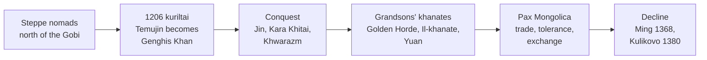
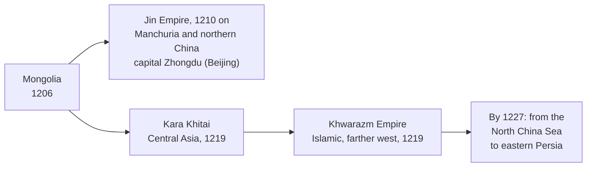
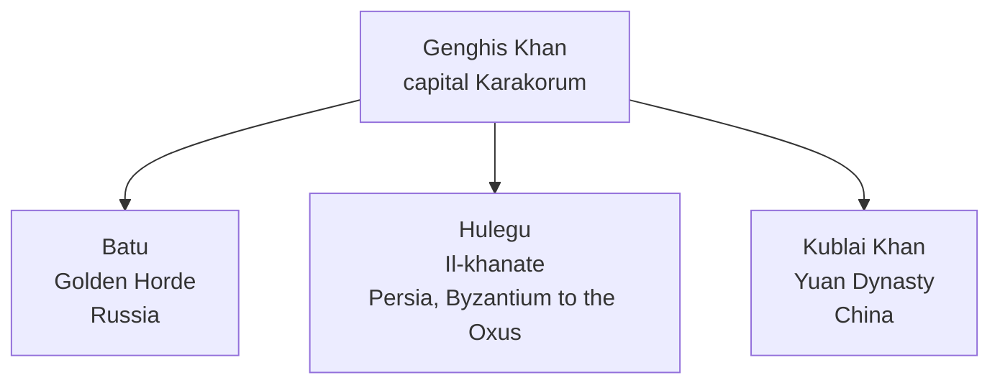
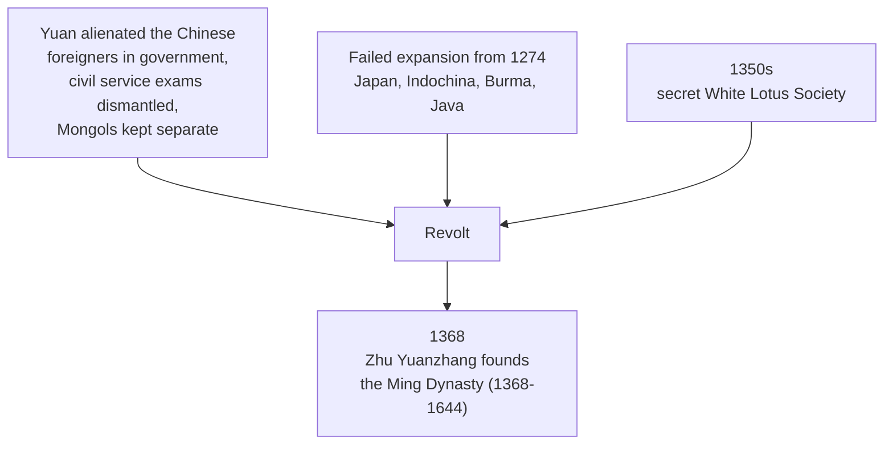
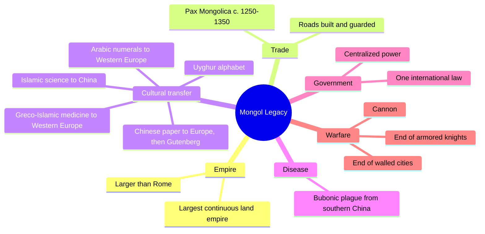
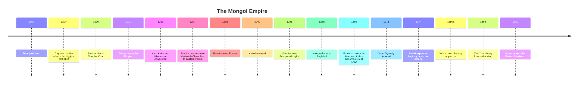
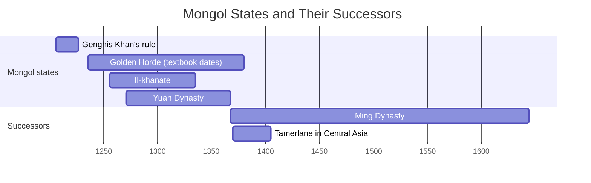

# AP World History: Modern — Topic 2.2 The Mongol Empire and the Making of the Modern World

**Focus Question (textbook Essential Question):** How did Eurasian empires grow over time, and how did their expansion influence trade and communication?

> Source: Based on the College Board CED · Textbook incorporated (Topic 2.2 reading)

**Unit 2: Networks of Exchange (c. 1200–1450)**

---

## Learning Objectives

| Code | Learning Objective |
|---|---|
| 2.2 LO-A | Explain the process of state building and decline in Eurasia over time. |
| 2.2 LO-B | Explain how the expansion of empires influenced trade and communication over time. |
| 2.2 LO-C | Explain the significance of the Mongol Empire in larger patterns of continuity and change. |

## Historical Developments (CED)

| # | Historical Development | LO | Covered in |
|---|---|---|---|
| HD1 | Empires collapsed in different regions of the world and in some areas were replaced by new imperial states, including the Mongol khanates. | A | §2, §4, §5 |
| HD2 | The Mongols created the largest contiguous land-based empire in history. | A | §2, §6 |
| HD3 | The Mongol Empire made Eurasian trade and communication easier, as new peoples were drawn into the conquerors' economies and trade networks. | B | §3, §4, §6 |
| HD4 | Interregional contacts and conflicts between states and empires, including the Mongols, encouraged significant technological and cultural transfers. Examples: the transfer of Greco-Islamic medical knowledge to Western Europe and the adoption of the Uyghur script. | C | §3, §6 |

---

## The Big Picture

> "Swarming like locusts over the face of the earth, they [the Mongols] have brought terrible devastation to the eastern parts [of Europe], laying it waste with fire and carnage..."
> — Matthew Paris, *Chronica Majora* (1240)

Matthew Paris wrote from a safe Benedictine abbey in England and had **no firsthand knowledge** of the Mongols. Like most writers of his time, he focused on Mongol **atrocities**. The Mongols did spread destruction across Eurasia in the 13th century. But in their quest for blood and treasure, they also started a period of **interregional connection and exchange** at a level the world had not seen in a thousand years.

**Temujin** united the steppe clans and became **Genghis Khan** at a **kuriltai in 1206**. His disciplined horse archers conquered from northern China to Persia. His grandsons **Batu** (the Golden Horde in Russia), **Hulegu** (the Il-khanate in Persia), and **Kublai Khan** (the Yuan Dynasty in China) expanded the empire further. Under the **Pax Mongolica** (c. 1250–1350), the Mongols protected trade, practiced religious tolerance, and spread knowledge. They also spread the **bubonic plague**. By the late 1300s, Mongol power declined: Moscow defeated the Golden Horde (1380), and the Ming overthrew the Yuan (1368).

---

## §1. The Mongols and Their Surroundings

- In the 12th century, the Mongols were **multiple clans of pastoral nomads** (herding goats and sheep) and hunter-foragers living **north of the Gobi Desert**.
- Harsh life on the **arid Asian steppes** shaped their culture. **Everyone, male and female,** was expected to ride well, and courage in hunting and war was highly valued.
- Neighbors included the **Tatars, Naimans, Merkits,** and the powerful **Jurchen** in northern China.
- The Mongols **coveted the wealth** of peoples closer to the Silk Roads, who had easier access to luxury goods such as silk clothing and gold jewelry.

## §2. Genghis Khan: State Building and Conquest

### Rise to Power

- **Temujin** (born **1162**) spent decades building **tribal alliances** and defeating neighbors one by one.
- He formed key friendships and married his oldest son to a neighboring **khan's** daughter.
- He sometimes appointed **talented non-family members** over relatives. He could be **ruthless** (he killed his own stepbrother) and valued **personal loyalty** above all.
- **1206:** at a **kuriltai** (a meeting of Mongol chieftains), he was elected khan and took the name **Genghis Khan** ("ruler of all").

### Conquests

- **1210:** attacked the **Jin Empire** of the Jurchens, whose capital was **Zhongdu** (present-day Beijing). Those who resisted were brutally killed, and sometimes whole towns were wiped out.
- Stories of this **brutality spread ahead of him**, so some leaders **surrendered before an attack**.
- **1219:** conquered the **Kara Khitai Empire** (Central Asia) and the **Khwarazm Empire** (Islamic).
- **By 1227:** his khanate reached from the **North China Sea to eastern Persia**.

### Genghis Khan at War

| Strategy | Details |
|---|---|
| **Skilled soldiers** | Strong riders, skilled with the **short bow**, highly disciplined; efficient command structure |
| **Messengers** | Riders who rode for days without stopping, even sleeping on horseback |
| **Mapping units** | Special units mapped terrain to prepare against attacks and plan routes |
| **Feigned retreat** | A small band pretended to lose and retreat; when the enemy chased them, larger Mongol forces confused and outflanked the enemy |
| **Demand for surrender** | A small group asked for surrender first; if refused, all the **aristocrats were killed** |
| **Use of conquered people** | Craftworkers, miners, and literate people were **recruited**; others carried loot or were sent to the front lines |
| **Adopted technology** | Captured Chinese and Persian engineers built **siege weapons** (portable towers, catapults) |
| **Communication** | A "pony express" in which riders carried **oral** (spoken) messages |

### Genghis Khan at Peace

- Built his capital at **Karakorum** (in present-day Mongolia), consulting Chinese and Islamic scholars and engineers.
- May have built **more new bridges than any other ruler** in history.
- Introduced **religious tolerance** across the empire, which was unusual in the 13th century.
- His soldiers **protected the Silk Roads**, which began the **third golden age** of the Silk Roads (see 2.1).
- **Uyghur alphabet:** he had a scribe captured in **1204** adapt the Uyghur alphabet to write Mongolian. The effort to use one system across the empire failed, but **Mongolia still uses this alphabet today**.

## §3. Effects on Trade, Communication, and Culture

- The **Pax Mongolica** ("Mongolian peace," c. 1250–1350) brought **new trade channels** between Asia, the Middle East, Africa, and Europe.
- With each conquest, **new peoples were absorbed** into the Mongol economy and networks of exchange (CED HD3).
- Survivors of the conquests benefited from **revived trade routes** that had not been heavily used since the Roman and Han empires.
- Roads were built, maintained, and guarded.
- **Mongol women** led **more independent lives** than women in other societies. They tended flocks, rode horses, wore the same leather trousers as men, could **remarry** after being widowed, and could **start a divorce**.

## §4. Expansion Through Genghis Khan's Grandsons

### Batu and the Golden Horde (Russia)

| Year | Event |
|---|---|
| **1236** | Batu (son of Genghis's oldest son) led **100,000 soldiers** into Russia, then a loose network of city-states and principalities |
| **1240** | **Kiev** was looted and destroyed |
| **1241** | Defeated Polish, German, and French knights under **King Henry of Silesia**, then a force of Hungarian knights |
| — | Planned attacks on Italy and Austria, but **Ögödei Khan** died; Batu went home for the funeral and succession and later **lost interest** in Western Europe |
| **1380** | A Moscow-led coalition defeated the Golden Horde at the **Battle of Kulikovo** |

- Western Europe's early sympathy for the Mongols (religious tolerance, trade) **disappeared** after the Golden Horde conquered **Christian Russia**.
- **Indirect rule:** the Mongols ruled northern Russia through existing **Russian rulers** who paid regular **tribute**, because they did not want to live in the forests.
- **Rise of Moscow:** Moscow's rulers collected **extra tribute** to build an army and formed an **anti-Mongol coalition**, which won at **Kulikovo (1380)**.
- By the mid-16th century, Russia had defeated all of the Mongols' descendant khans except the **Crimean Tatars** (defeated in the late 18th century).

**Long-term impact on Russia**

| Change | Details |
|---|---|
| Devastation | Widespread destruction and death |
| Military and political | Russian princes improved their **military organization** and accepted more **centralized leadership** |
| Cultural | Three centuries of Mongol rule **cut Russia off from Western Europe**, so a **more distinctly Russian culture** developed |
| Foundation of the state | Resistance to the Mongols laid the **foundation of the modern Russian state** |

### Hulegu and the Islamic Heartlands (the Il-khanate)

- **1258:** Hulegu destroyed **Baghdad**, killed the **caliph** and perhaps **200,000 residents**, and ended the Abbasid Caliphate.
- **1260:** the Mongols were defeated in Palestine by a temporary alliance of the **Muslim Mamluks** (under **Baibars**) and **Christian Crusaders**; both saw the Mongols as a serious threat.
- The **Il-khanate** stretched from **Byzantium to the Oxus River** (the Amu Darya).
- The Mongols ruled, but **Persians served as ministers and officials**, which brought the **highest tax collection**.
- Hulegu and most Mongols there **converted to Islam**. Before converting, they tolerated all religions; afterward, they supported **massacres of Jews and Christians**.

> ⚠️ The textbook describes the 1260 victory as a temporary Mamluk–Crusader alliance. Many accounts of the Battle of Ain Jalut say the Crusaders only allowed the Mamluks to pass through. Check how your teacher presents this.

> ⚠️ The textbook states that Hulegu himself converted to Islam. Many accounts say a later ruler, Ghazan, converted in 1295. Check against your class materials.

### Kublai Khan and the Yuan Dynasty (China)

- China (the **Song Dynasty**) was a tougher opponent than those the other khans faced. The textbook says Kublai's armies tried to conquer China from **1235 to 1271**.
- **1260:** Kublai took the title of **Great Khan**. Eleven years later, he finally defeated the Chinese.
- He followed **Chinese tradition** more than Mongol practice and founded the **Yuan Dynasty**.
- He rebuilt **Zhongdu** (destroyed by the Mongols in 1215) and renamed it **Dadu**.
- **Religious tolerance** won the loyalty of Buddhists and Daoists (who were then out of favor) and extended to Muslims, Jews, and Christians.
- At first, most Chinese welcomed his rule: he brought **prosperity** through cultural exchange and better trade, including with Europe.

> ⚠️ The textbook's 1235–1271 range is the period of the Mongol war against the Song. Kublai was born in 1215, so he did not lead the war from the start. Check this against the printed textbook.

## §5. The Mongols Lose Power

- **Alienating the Chinese:** the Yuan hired **foreigners** instead of native Chinese for government jobs, promoted Buddhists and Daoists, and **dismantled the civil service exams**, which upset the **Confucian scholar-gentry**. The Mongols stayed separate from the Chinese and **banned non-Mongols from speaking Mongolian**.
- **Failed expansion:** starting in **1274**, the Yuan failed to conquer **Japan, Indochina, Burma, and Java**, which suggested the Mongols were no longer so fearsome.
- **Revolt:** in the **1350s**, the secret **White Lotus Society** began organizing. In **1368**, **Zhu Yuanzhang**, a Buddhist monk from a poor peasant family, led a revolt that founded the **Ming Dynasty (1368–1644)**.
- **Wider decline:** the textbook says the Golden Horde had lost its territory by about **1369**, and **Tamerlane (Timur the Lame)** conquered the Central Asian territories at around the same time.

> ⚠️ The textbook gives about 1369 for the Golden Horde's loss of territory and 1380 for Kulikovo. Many accounts say Mongol tribute over Russia ended only in 1480. This note follows the textbook.

## §6. Long-Term Impact of the Mongol Invasions

| Area | Impact |
|---|---|
| **Size** | Conquered more land than the Romans; the **largest continuous land empire in history** |
| **Trade** | Pax Mongolica (c. 1250–1350) revived trade between Asia, the Middle East, Africa, and Europe |
| **Cultural transfer** | **Islamic science** reached China; **Chinese paper** made possible the communication revolution of the **Gutenberg printing press**; **Greco-Islamic medical knowledge** and **Arabic numerals** reached Western Europe |
| **Disease** | The Mongols helped spread the fleas carrying the **bubonic plague (Black Death)** from southern China to Central Asia, Southeast Asia, and Europe, along trade and military routes (see 2.6) |
| **Government** | Their grasp of **centralized power** and their **single international law** were continued or copied by later states in Europe, Asia, and Southeast Asia |
| **Warfare** | Mongol speed and surprise ended Western Europe's reliance on **armored knights**; **walled cities** lost their value against Mongol siege technology |
| **Cannon** | Some consider the **cannon** a Mongol invention, combining **Chinese gunpowder**, **Muslim flamethrowers**, and **European bell-casting** |

### Continuity and Change

| Change | Continuity |
|---|---|
| The largest connected trade zone in history | Old trade routes and goods continued |
| The Abbasid Caliphate and the Song Dynasty destroyed | Local rulers and bureaucracies kept working (Russian princes, Persian ministers) |
| The rise of Moscow and the Ming | The Khanates adopted local culture (Islam in the Il-khanate, Chinese traditions in the Yuan) |
| The end of knights and walled cities | Conflict between steppe nomads and settled peoples continued |

---

## Timeline

---

## Comparison Table: The Three Grandsons' Khanates

| Feature | Golden Horde (Batu) | Il-khanate (Hulegu) | Yuan Dynasty (Kublai) |
|---|---|---|---|
| Region | Russia | Persia and Southwest Asia (Byzantium to the Oxus) | China |
| Key event | Kiev destroyed (1240) | Baghdad destroyed (1258) | Yuan founded (1271) |
| Ruling style | **Indirect rule** through Russian princes and tribute | Mongol rulers with **Persian ministers and officials** | Followed **Chinese traditions**, but kept Mongols separate and ended the exams |
| Religion | — | Converted to **Islam**; then massacres of Jews and Christians | **Tolerance** of Buddhists, Daoists, Muslims, Jews, and Christians |
| Limit or end | Kulikovo (1380), Moscow-led coalition | Stopped by the Mamluks (1260) | Failed to take Japan and others (from 1274); Ming (1368) |
| Lasting legacy | Rise of Moscow and a distinct Russian culture | Islamic-Persian administration | Dadu (Beijing), trade with Europe |

---

## Key Terms

| Theme | Term | Definition |
|---|---|---|
| Government | Mongols | Pastoral nomadic clans from north of the Gobi Desert |
| Government | Khan | King or ruler |
| Government | Kuriltai | A meeting of Mongol chieftains; it elected Temujin khan in 1206 |
| Government | Genghis Khan | "Ruler of all"; Temujin, the founder of the Mongol Empire |
| Government | Khanates | Kingdoms ruled by khans |
| Government | Pax Mongolica | "Mongolian peace" (c. 1250–1350), a period of safe trade |
| Government | Batu | Grandson of Genghis; leader of the Golden Horde |
| Government | Golden Horde | Batu's army and khanate in Russia |
| Government | Moscow | The city-state that led the anti-Mongol coalition (Kulikovo, 1380) |
| Government | Hulegu | Grandson of Genghis; destroyed Baghdad (1258) |
| Government | Il-khanate | Hulegu's khanate in Persia and Southwest Asia |
| Government | Kublai Khan | Grandson of Genghis; Great Khan (1260), founder of the Yuan |
| Government | Yuan Dynasty | The Mongol dynasty in China (1271–1368) |
| Government | Zhu Yuanzhang | A Buddhist monk who overthrew the Yuan and founded the Ming (1368) |
| Government | Ming Dynasty | The Chinese dynasty after the Yuan (1368–1644) |
| Environment | Gobi Desert | The desert in East Asia south of the Mongol homeland |
| Technology | Siege weapons | Portable towers and catapults built by captured engineers |
| Technology | Cannon | Possibly a Mongol invention combining Chinese, Muslim, and European technology |
| Culture | Uyghur alphabet | Adapted to write Mongolian; still used in Mongolia |
| Society | White Lotus Society | A secret society that organized against the Yuan (1350s) |
| Society | Bubonic plague | The Black Death, spread along Mongol trade and military routes |
| CED | Largest contiguous land-based empire | The Mongol Empire's place in history |
| CED | Greco-Islamic medical knowledge | Medical knowledge transferred to Western Europe through Mongol contact |
