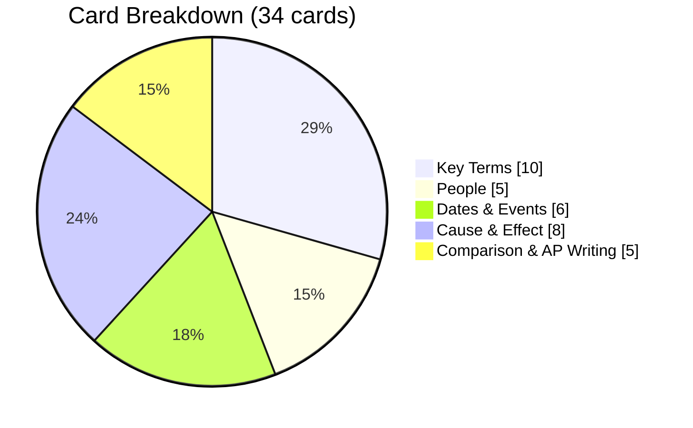

# AP World History: Modern — Topic 2.3 Exchange in the Indian Ocean · Flashcards

> Source: Based on the College Board CED · Textbook incorporated (Topic 2.3 reading)

---

## 1. Key Terms

- [ ] **What is Dar al-Islam, and why is it called the "first global empire"?**

▶ Answer
The "House of Islam," or Muslim world. It connected societies from North Africa to South Asia, and Muslim merchants opened trade routes even before missionaries and armies arrived.

- [ ] **How do the monsoon winds blow?**

▶ Answer
From the northeast in winter, and from the southwest in spring and summer. Merchants had to time their voyages and often waited in port for months.

- [ ] **What is a lateen sail?**

▶ Answer
A triangular sail used by Arab sailors (whether they invented it is debated). Its shape could catch wind from many directions.

- [ ] **What is a stern rudder?**

▶ Answer
A steering device invented by Chinese sailors in the classical period. It made ships more stable and easier to steer.

- [ ] **What did the astrolabe do?**

▶ Answer
Improved by Muslim navigators in the 12th century, it let sailors find how far north or south of the equator they were (latitude).

- [ ] **What is a diaspora?**

▶ Answer
A settlement of people away from their homeland. Settlers brought their traditions into the local culture, and the local culture also influenced them.

- [ ] **What does "Swahili" mean?**

▶ Answer
Literally "coasters": the people of the busy East African coastal trade centers such as Kilwa, Mombasa, and Zanzibar. In Arabic, the coast was called the Zanj Coast.

- [ ] **What were the Spice Islands?**

▶ Answer
Modern-day Malaysia and Indonesia, known for nutmeg, cinnamon, cloves, and cardamom.

- [ ] **What was the Indian Ocean slave trade?**

▶ Answer
A long-running trade in which enslaved East Africans were sold to buyers in North Africa, the Middle East, and India, and many were sent to islands such as Madagascar. It peaked in the 18th and 19th centuries.

- [ ] **What are customs?**

▶ Answer
Taxes on imported goods. Gujarat's customs revenue was many times larger than the entire worth of some European states.

## 2. People

- [ ] **Who was Zheng He?**

▶ Answer
A Muslim admiral of the Ming (1371–1433). He led seven voyages starting in 1405 with more than 300 ships and 28,000 people to display Ming power and collect tribute.

- [ ] **Who was the Yongle Emperor?**

▶ Answer
The Ming emperor who sent Zheng He on the first of seven voyages in 1405.

- [ ] **Who was Zhu Gaozhi, and what did he do?**

▶ Answer
Yongle's son and successor. He ended Zheng He's voyages, discouraged Chinese from sailing abroad, and made building a ship with more than two masts a crime.

- [ ] **Who was the Sultan of Malacca, and what did he achieve in the 1400s?**

▶ Answer
The Muslim ruler of Malacca. He became powerful enough to expand the state into Sumatra and the southern Malay Peninsula.

- [ ] **Which merchant groups met in Calicut?**

▶ Answer
Arab merchants, who brought goods from the West, and Chinese merchants, who brought goods from the East. Local rulers welcomed them.

## 3. Dates & Events

- [ ] **c. 200 B.C.E.**

▶ Answer
Indian Ocean trade already exists.

- [ ] **12th century**

▶ Answer
Muslim navigators improve the astrolabe.

- [ ] **1405**

▶ Answer
The first of Zheng He's seven voyages.

- [ ] **1400s, Malacca**

▶ Answer
The Sultan of Malacca expands into Sumatra and the southern Malay Peninsula.

- [ ] **1511**

▶ Answer
The Portuguese invade Malacca to control the trade between Europe, India, and China.

- [ ] **18th–19th centuries**

▶ Answer
The peak of the Indian Ocean slave trade.

## 4. Cause & Effect

- [ ] **Cause: How did the spread of Islam expand Indian Ocean trade?**

▶ Answer
It connected more cities than ever before. Muslim Persians and Arabs became the leading seafarers and linked ports in East Africa, South Asia, and East and Southeast Asia.

- [ ] **Cause: How did demand for specialized products expand trade?**

▶ Answer
Each region had something special to offer: Indian cotton and steel, spices from the Spice Islands, Swahili gold and ivory, Chinese silk and porcelain, and Southwest Asian horses. This encouraged exchange between regions.

- [ ] **Cause → Effect: How did the monsoon winds lead to diasporic communities?**

▶ Answer
Merchants waited months in port for good winds, so they interacted with local people, married local women, and settled permanently.

- [ ] **Effect: How did Islam first reach southern Asia, according to the textbook?**

▶ Answer
Through intermarriage, not missionaries or conquest. Merchants from Dar al-Islam married local women, and their children were raised in Muslim traditions.

- [ ] **Cause → Effect: How did Malacca become rich?**

▶ Answer
It built a navy and charged fees on ships passing through the Strait of Malacca between India and China. Its wealth came from trade, not agriculture or mining.

- [ ] **Effect: What were the results of the Portuguese invasion of Malacca (1511)?**

▶ Answer
Portugal gained great wealth, but less than it had hoped. The conquest caused conflicts among states in the region, and traders diversified their routes and ports.

- [ ] **Cause → Effect: How did increased demand strengthen states such as Gujarat?**

▶ Answer
The state's role grew to oversee efficient production and to collect customs and port fees. Gujarat became the go-between for East–West trade and earned huge customs revenue.

- [ ] **Effect: What did Zheng He's voyages achieve, and why did they end?**

▶ Answer
Achievements: prestige for China, new markets, a giraffe and new knowledge of the world, emigration to Southeast Asia, and a temporary stop to piracy. They ended because Confucian scholars feared damage to social order, some critics looked down on foreigners, and the voyages were costly.

## 5. Comparison & AP Writing

- [ ] **Compare: How did enslaved people's lives in the Indian Ocean trade differ from those in the Atlantic trade?**

▶ Answer
In the Indian Ocean trade, enslaved people more often worked in ports, shipping, and households, or as sailors and soldiers. They lived in towns, had more chance to form communities and work alongside free laborers, and in Islamic communities had some rights, such as the right to marry.

- [ ] **Compare: How were Malacca, Gujarat, and the Swahili city-states similar and different?**

▶ Answer
Similar: all were trade-based states that grew rich from Indian Ocean trade. Different: Malacca charged ship fees backed by a navy, Gujarat collected customs as a go-between, and the Swahili cities exported ivory, gold, and enslaved people.

- [ ] **AP Short Answer: Explain how environmental knowledge supported the growth of Indian Ocean trade.**

▶ Answer

**Claim:** Knowledge of the monsoon winds was essential to the growth of Indian Ocean trade. 
**Evidence:** The winds blew from the northeast in winter and from the southwest in spring and summer, so merchants timed their voyages and waited in port for months. 
**Reasoning:** Predictable winds made regular long-distance voyages possible. The long stays in port also led merchants to settle and form diasporic communities, which deepened trade ties.

- [ ] **AP Short Answer: Explain one effect of the growth of Indian Ocean trade on states.**

▶ Answer

**Claim:** Indian Ocean trade led to the growth of trade-based states such as Malacca. 
**Evidence:** Malacca built a navy and charged fees on ships in the Strait of Malacca, and by the 1400s its sultan had expanded into Sumatra and the southern Malay Peninsula. 
**Reasoning:** Controlling a key chokepoint let the state turn trade revenue into regular income and power. This shows how trade, not agriculture, could support state building.

- [ ] **AP Long Essay Thesis: Evaluate the extent to which Indian Ocean trade transformed societies from 1200 to 1450.**

▶ Answer

**Claim:** Indian Ocean trade greatly transformed coastal societies through new states, religion, and cultural mixing, but the change was concentrated in ports and was not always welcomed, as Ming China's reaction shows. 
**Evidence:** Malacca, Gujarat, and the Swahili city-states grew rich (for example, Kilwa's stone and coral mosques), and Islam spread through merchant intermarriage. However, Confucian critics ended Zheng He's voyages and banned large ships. 
**Reasoning:** Trade reshaped places that depended on it, while societies that valued stability, such as Ming China, pulled back. This shows both change and continuity.

