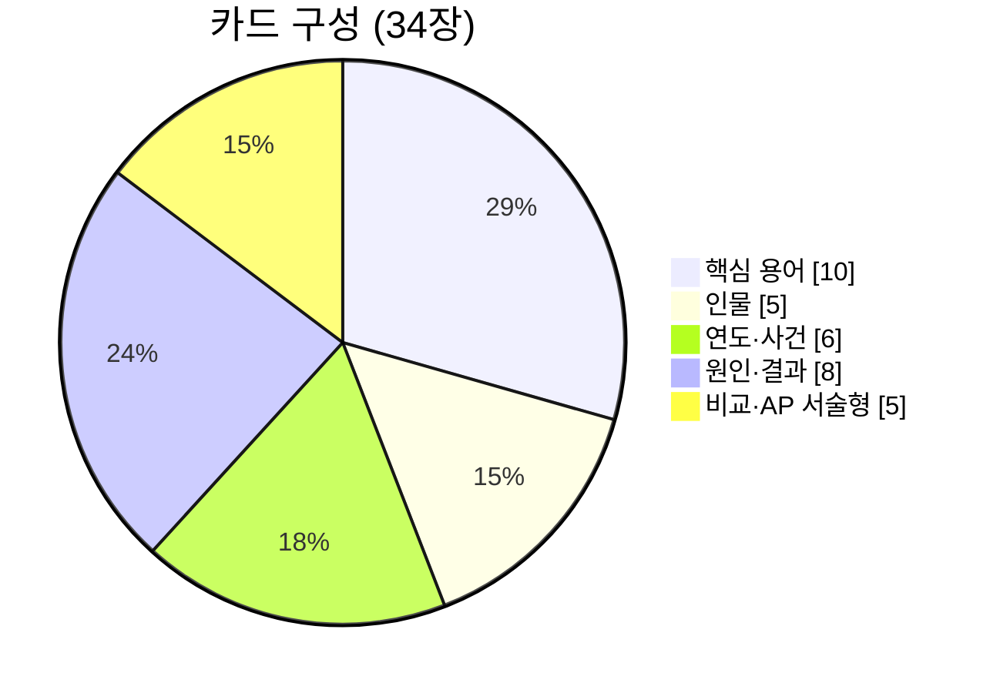

# AP 세계사: 모던 — 토픽 2.3 인도양 교역 (Exchange in the Indian Ocean) · 플래시카드

> 출처: College Board CED 기준 · 교재 반영 (교재 Topic 2.3)

---

## 1. 핵심 용어

- [ ] **이슬람 세계 (Dar al-Islam)란 무엇이며, 왜 "최초의 지구적 제국"이라고 불리는가?**

▶ 정답
"이슬람의 집", 즉 무슬림 세계다. 북아프리카에서 남아시아까지 여러 사회를 이었고, 선교사와 군대가 오기 전부터 무슬림 상인들이 교역로를 열었다.

- [ ] **계절풍 (Monsoon winds)은 어떻게 부는가?**

▶ 정답
겨울에는 북동쪽에서, 봄과 여름에는 남서쪽에서 분다. 상인들은 항해 시기를 맞춰야 했고, 항구에서 몇 달씩 기다리는 경우가 많았다.

- [ ] **삼각돛 (Lateen sail)이란 무엇인가?**

▶ 정답
아랍 선원들이 쓴 삼각형 돛이다(아랍인이 발명했는지는 논란이 있다). 여러 방향에서 부는 바람을 받을 수 있었다.

- [ ] **선미타 (Stern rudder)란 무엇인가?**

▶ 정답
고전 시대 중국 선원들이 발명한 조종 장치다. 배를 더 안정적이고 조종하기 쉽게 만들었다.

- [ ] **아스트롤라베 (Astrolabe)는 어떤 역할을 했는가?**

▶ 정답
12세기 무슬림 항해자들이 개량한 도구로, 배가 적도에서 남북으로 얼마나 떨어져 있는지(위도)를 알 수 있게 했다.

- [ ] **디아스포라 (Diaspora)란 무엇인가?**

▶ 정답
고향을 떠난 사람들의 정착지다. 정착민은 자신들의 전통을 현지 문화에 들여왔고, 현지 문화도 그들에게 영향을 주었다.

- [ ] **"스와힐리 (Swahili)"는 무슨 뜻인가?**

▶ 정답
말 그대로 "해안 사람들 (Coasters)"이다. 킬와, 몸바사, 잔지바르 같은 동아프리카 해안의 붐비는 교역 중심지 사람들을 가리킨다. 아랍어로 이 해안은 잔즈 해안이라고 불렸다.

- [ ] **향료 제도 (Spice Islands)는 어디인가?**

▶ 정답
지금의 말레이시아와 인도네시아로, 육두구, 계피, 정향, 카다멈으로 유명했다.

- [ ] **인도양 노예 무역 (Indian Ocean slave trade)이란 무엇이었는가?**

▶ 정답
동아프리카 사람들을 북아프리카, 중동, 인도의 구매자에게 팔고, 많은 사람을 마다가스카르 같은 섬으로 보낸 오래된 무역이다. 18–19세기에 절정에 이르렀다.

- [ ] **관세 (Customs)란 무엇인가?**

▶ 정답
수입품에 매기는 세금이다. 구자라트의 관세 수입은 일부 유럽 국가 전체의 가치보다 몇 배나 많았다.

## 2. 인물

- [ ] **정화 (Zheng He)는 누구인가?**

▶ 정답
명나라의 무슬림 제독(1371–1433)이다. 1405년부터 300척 이상의 배와 2만 8천 명을 이끌고 일곱 차례 원정을 떠나 명나라의 힘을 과시하고 조공을 받았다.

- [ ] **영락제 (Yongle Emperor)는 누구인가?**

▶ 정답
1405년 정화를 일곱 차례 원정 중 첫 원정에 보낸 명나라 황제다.

- [ ] **주고치 (Zhu Gaozhi)는 누구이며, 무엇을 했는가?**

▶ 정답
영락제의 아들이자 후계자다. 정화의 원정을 끝냈고, 중국인이 먼 바다로 나가는 것을 막았으며, 돛대가 두 개 넘는 배를 만드는 것을 범죄로 정했다.

- [ ] **말라카의 술탄 (Sultan of Malacca)은 누구이며, 1400년대에 무엇을 이루었는가?**

▶ 정답
말라카의 무슬림 통치자다. 수마트라와 말레이반도 남부까지 영토를 넓힐 만큼 강해졌다.

- [ ] **캘리컷에서 만난 상인 집단은 누구인가?**

▶ 정답
서방의 상품을 가져온 아랍 상인과 동방의 상품을 가져온 중국 상인이다. 현지 통치자들이 이들을 환영했다.

## 3. 연도·사건

- [ ] **c. 기원전 200년**

▶ 정답
인도양 교역이 이미 있었다.

- [ ] **12세기**

▶ 정답
무슬림 항해자들이 아스트롤라베를 개량했다.

- [ ] **1405년**

▶ 정답
정화의 일곱 차례 원정 중 첫 원정.

- [ ] **1400년대, 말라카**

▶ 정답
말라카의 술탄이 수마트라와 말레이반도 남부로 영토를 넓혔다.

- [ ] **1511년**

▶ 정답
포르투갈이 유럽·인도·중국 사이의 교역을 장악하려고 말라카를 침공했다.

- [ ] **18–19세기**

▶ 정답
인도양 노예 무역의 절정.

## 4. 원인·결과

- [ ] **원인: 이슬람의 확산은 인도양 교역을 어떻게 넓혔는가?**

▶ 정답
그 어느 때보다 많은 도시를 연결했다. 무슬림 페르시아인과 아랍인이 바다의 주역이 되어 동아프리카, 남아시아, 동아시아·동남아시아의 항구를 이었다.

- [ ] **원인: 특산품에 대한 수요는 교역을 어떻게 넓혔는가?**

▶ 정답
지역마다 내놓을 특별한 상품이 있었다. 인도의 면직물과 강철, 향료 제도의 향신료, 스와힐리의 금과 상아, 중국의 비단과 도자기, 서남아시아의 말 등이다. 이것이 지역 간 교환을 촉진했다.

- [ ] **원인 → 결과: 계절풍은 어떻게 디아스포라 공동체로 이어졌는가?**

▶ 정답
상인들이 좋은 바람을 기다리며 항구에 몇 달씩 머물다 보니 현지 사람들과 교류하고, 현지 여성과 결혼해 영구히 정착했다.

- [ ] **결과: 교재에 따르면 이슬람은 남아시아에 처음 어떻게 전해졌는가?**

▶ 정답
선교나 정복이 아니라 통혼을 통해서다. 이슬람 세계의 상인들이 현지 여성과 결혼했고, 그 자녀들은 무슬림 전통 속에서 자랐다.

- [ ] **원인 → 결과: 말라카는 어떻게 부유해졌는가?**

▶ 정답
해군을 키우고, 인도와 중국 사이의 말라카 해협을 지나는 배에 통행료를 물렸다. 말라카의 부는 농업이나 광업이 아니라 교역에서 나왔다.

- [ ] **결과: 포르투갈의 말라카 침공(1511)은 어떤 결과를 낳았는가?**

▶ 정답
포르투갈은 큰 부를 얻었지만 기대만큼은 아니었다. 정복이 주변 국가들 사이의 분쟁을 일으켰고, 상인들이 교역로와 항구를 다양화했다.

- [ ] **원인 → 결과: 수요 증가는 구자라트 같은 국가를 어떻게 강하게 만들었는가?**

▶ 정답
효율적인 생산을 관리하고 관세와 항구 사용료를 걷는 국가의 역할이 커졌다. 구자라트는 동서 교역의 중개자가 되어 막대한 관세 수입을 얻었다.

- [ ] **결과: 정화의 원정은 무엇을 이루었으며, 왜 중단되었는가?**

▶ 정답
성과: 중국의 위상 향상, 새로운 시장, 기린과 바깥 세계에 대한 새로운 지식, 동남아시아로의 이주, 해적 활동의 일시적 중단. 중단 이유: 유교 학자들이 사회 질서가 흔들릴까 걱정했고, 일부 비판자는 외국인을 깔보았으며, 비용이 많이 들었다.

## 5. 비교·AP 서술형

- [ ] **비교: 인도양 노예 무역에서 노예의 삶은 대서양 노예 무역과 어떻게 달랐는가?**

▶ 정답
인도양 노예 무역의 노예는 주로 항구, 해운업, 가사 노동에서 일하거나 선원과 군인이 되었다. 도시에 살아서 공동체를 이루고 자유 노동자와 함께 일할 기회가 더 많았고, 이슬람 공동체에서는 결혼할 권리 같은 일부 권리가 있었다.

- [ ] **비교: 말라카, 구자라트, 스와힐리 도시국가의 공통점과 차이점은?**

▶ 정답
공통점: 모두 인도양 교역으로 부유해진 교역 국가였다. 차이점: 말라카는 해군을 바탕으로 배에 통행료를 물렸고, 구자라트는 중개자로서 관세를 걷었으며, 스와힐리 도시들은 상아, 금, 노예를 수출했다.

- [ ] **AP 단답형: 환경 지식이 인도양 교역의 성장을 어떻게 뒷받침했는지 설명하라.**

▶ 정답

**주장:** 계절풍에 대한 지식은 인도양 교역의 성장에 꼭 필요했다. 
**근거:** 바람은 겨울에는 북동쪽에서, 봄과 여름에는 남서쪽에서 불었다. 그래서 상인들은 항해 시기를 맞추고 항구에서 몇 달씩 기다렸다. 
**설명:** 바람을 예측할 수 있었기 때문에 정기적인 장거리 항해가 가능했다. 또 항구에 오래 머물면서 상인들이 정착해 디아스포라 공동체를 이루었고, 이것이 교역 관계를 더 깊게 만들었다.

- [ ] **AP 단답형: 인도양 교역의 성장이 국가에 미친 결과 하나를 설명하라.**

▶ 정답

**주장:** 인도양 교역은 말라카 같은 교역 국가의 성장으로 이어졌다. 
**근거:** 말라카는 해군을 키우고 말라카 해협을 지나는 배에 통행료를 물렸으며, 1400년대에 술탄이 수마트라와 말레이반도 남부까지 영토를 넓혔다. 
**설명:** 핵심 길목을 장악한 덕분에 국가는 교역 수입을 꾸준한 수입과 힘으로 바꿀 수 있었다. 이는 농업이 아닌 교역도 국가 형성을 뒷받침할 수 있음을 보여 준다.

- [ ] **AP 논술형 논지: 1200–1450년 인도양 교역이 사회를 어느 정도 변화시켰는지 평가하라.**

▶ 정답

**주장:** 인도양 교역은 새로운 국가, 종교, 문화의 혼합을 통해 해안 사회를 크게 바꾸었다. 그러나 변화는 항구에 집중되었고, 명나라의 반응에서 보듯 언제나 환영받지는 않았다. 
**근거:** 말라카, 구자라트, 스와힐리 도시국가는 부유해졌고(예: 킬와의 돌과 산호로 지은 모스크), 이슬람은 상인들의 통혼을 통해 퍼졌다. 그러나 유교 비판자들은 정화의 원정을 끝내고 큰 배를 금지했다. 
**설명:** 교역은 교역에 의존하는 곳을 바꾸었지만, 명나라처럼 안정을 중시하는 사회는 물러섰다. 이는 변화와 연속성을 함께 보여 준다.

