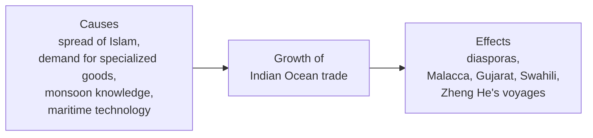
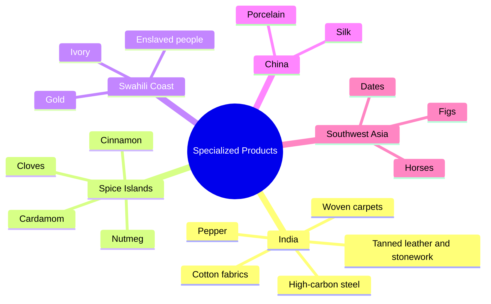
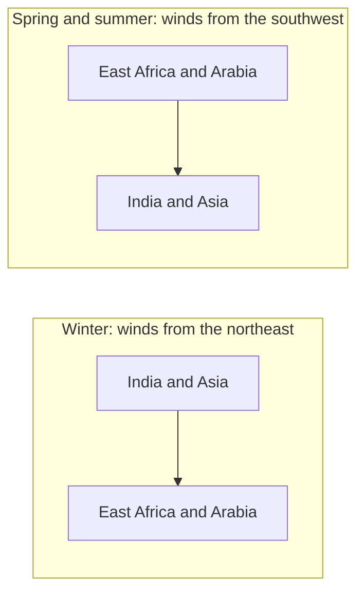
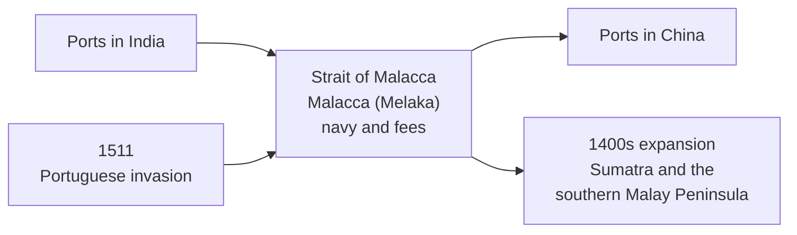
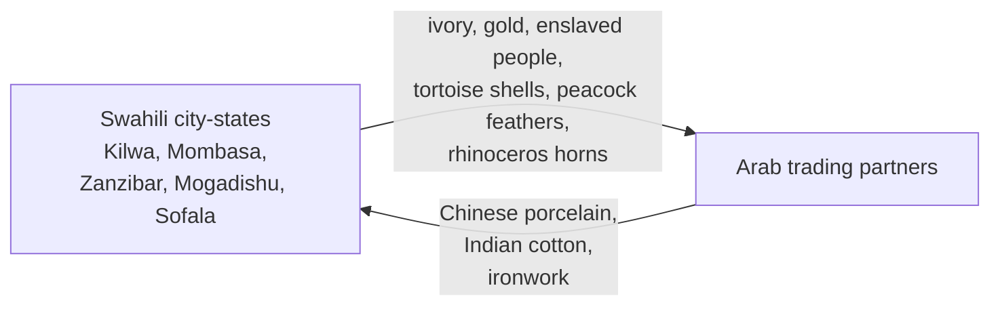
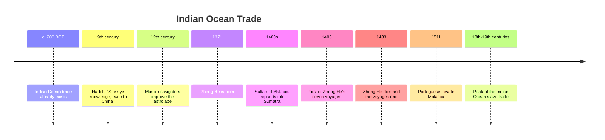
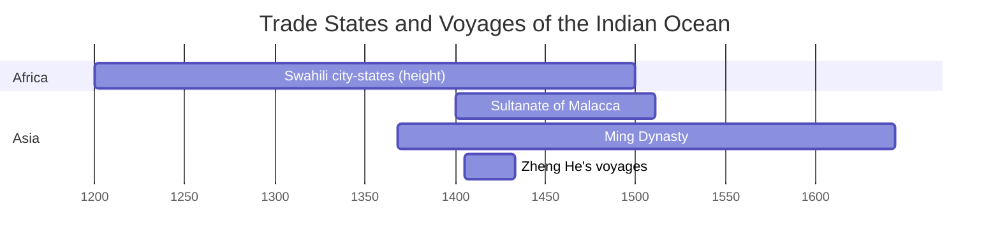

# AP World History: Modern — Topic 2.3 Exchange in the Indian Ocean

**Focus Question (textbook Essential Question):** What were the causes and effects of the growth of networks of exchange after 1200, and how did environmental knowledge support that expansion?

> Source: Based on the College Board CED · Textbook incorporated (Topic 2.3 reading)

**Unit 2: Networks of Exchange (c. 1200–1450)**

---

## Learning Objectives

| Code | Learning Objective |
|---|---|
| 2.3 LO-A | Explain the causes of the growth of networks of exchange after 1200. |
| 2.3 LO-B | Explain the effects of the growth of networks of exchange after 1200. |

## Historical Developments (CED)

| # | Historical Development | LO | Covered in |
|---|---|---|---|
| HD1 | The growth of interregional trade was encouraged by innovations in previously existing maritime technologies, such as the compass, astrolabe, and larger ship designs (e.g., the dhow and the junk). | A | §4 |
| HD2 | The expansion and intensification of long-distance trade routes often depended on environmental knowledge, including advanced knowledge of the monsoon winds. | A | §3 |
| HD3 | The growth of interregional trade encouraged merchants to set up diasporic communities, where they introduced their own cultural traditions into the local culture. Examples: Arab and Persian communities in East Africa, Chinese merchant communities in Southeast Asia, Malay communities in the Indian Ocean basin. | B | §6 |
| HD4 | The economy of the Indian Ocean led to the growth of new states, often based on trade: the Swahili city-states, the Sultanate of Malacca, and the Gujarat region. | B | §5, §7, §8 |
| HD5 | The Ming dynasty's state-sponsored voyages, led by Zheng He, made Chinese prestige greater in the Indian Ocean. | B | §9 |

---

## The Big Picture

> "Seek ye knowledge, even to China."
> — Hadith (9th century)

This saying, traditionally attributed to the Prophet Muhammad, encouraged Muslims to **travel and learn**. **Dar al-Islam** (the "House of Islam," or Muslim world) connected societies from North Africa to South Asia and could be called the **world's first global empire**. Even before missionaries and armies spread Islam, **Muslim merchants** were opening the way, and Arab merchants had sailed to South Asia for centuries before Islam began.

Indian Ocean trade existed as early as **200 B.C.E.**, but it grew greatly after 1200 because of four causes: the **spread of Islam**, **demand for specialized products**, **environmental knowledge** of the **monsoon winds**, and **maritime technology** (lateen sails, the stern rudder, dhows, and the astrolabe). It produced **trade-based states** (**Malacca**, **Gujarat**, the **Swahili city-states**), **diasporic communities**, and **cultural transfers**, shown most clearly by **Zheng He's voyages**.

---

## §1. Cause: The Spread of Islam

- The expansion of Islam **connected more cities than ever before**, in East Africa, East and Southeast Asia, and South Asia.
- **Muslim Persians and Arabs** were the **dominant seafarers**, carrying goods to port cities across the ocean.
- West coast Indian cities such as **Calicut** and **Cambay** became thriving trade centers.
- **Calicut** was a busy port where merchants sought **southern Indian spices**. **Arab** merchants (bringing Western goods) and **Chinese** merchants (bringing Eastern goods) met there, and local rulers **welcomed** them because they brought wealth and prominence.
- **South Asia**, at the **center** of the Indian Ocean, benefited enormously.

## §2. Cause: Increased Demand for Specialized Products

| Region | Specialized products |
|---|---|
| **India** | High-quality **cotton** fabrics, finely woven **carpets**, **high-carbon steel** (for knives and swords), tanned leather, artisan stonework, and **pepper** from the southern coast |
| **Spice Islands** (modern Malaysia and Indonesia) | Nutmeg, cinnamon, cloves, cardamom |
| **Swahili coast** (Mombasa, Mogadishu, Sofala) | **Enslaved people**, **ivory**, **gold** |
| **China** | Silk and **porcelain**, prized worldwide, which is why people still call fine dishes "fine china" |
| **Southwest Asia** | Horses, figs, dates |

### The Indian Ocean Slave Trade

- There was a **long-running slave trade in East Africa**. (Most Africans enslaved and taken to the Americas after 1500 came from West and Central Africa.)
- By land or sea, enslaved people from East Africa were sold to buyers in **North Africa, the Middle East, and India**. Many were taken to islands such as **Madagascar**. The trade **peaked in the 18th and 19th centuries**.

| Feature | Indian Ocean slave trade | Atlantic slave trade (for comparison) |
|---|---|---|
| Work | Seaports, shipping, household servants, sailors, soldiers | Mostly plantation labor in the Americas |
| Living conditions | Lived in towns and cities; more chance to build communities and to work alongside free laborers | Fewer such opportunities |
| Rights | In Islamic communities, some rights, such as the **right to marry** | — |
| Cultural legacy | African words, music, and customs in **Oman, India**, and elsewhere | — |

## §3. Cause: Environmental Knowledge — The Monsoon Winds

- **Winter:** winds blow from the **northeast**. **Spring and summer:** winds blow from the **southwest**.
- Merchants had to **time their voyages carefully** and often stayed in port cities **for months** waiting for good winds. This waiting later produced **diasporic communities** (§6).

## §4. Cause: Advances in Maritime Technology

| Technology | Origin and details |
|---|---|
| **Lateen sail** | A triangular sail used by Arab sailors (whether they invented it is debated); the shape could catch wind from many directions |
| **Stern rudder** | Invented by Chinese sailors in the classical period; gave ships more stability and made them easier to steer |
| **Dhow** | A small wooden ship used by Arab and Indian sailors; dominated the seas in the Postclassical Era |
| **Astrolabe** | Improved by Muslim navigators in the 12th century; showed how far north or south a ship was from the equator (latitude) |
| **Compass and junk** | CED examples. The 2.3 reading says the magnetic compass and improved rudder are covered in Topic 4.1; the 2.1 reading covers the junk |

- Trade itself spread sailing technology quickly to many lands around the Indian Ocean.

> ⚠️ The 2.1 reading dates the magnetic compass and junk to the Han Dynasty, while the 2.3 reading moves the compass to Topic 4.1. Since the CED lists the compass and junk as examples for 2.3, they are kept here.

## §5. Cause and Effect: Growth of States — Malacca

- Trade networks encouraged states to grow in order to **institutionalize trade revenue**.
- **Malacca (Melaka)**, a **Muslim city-state**, grew rich by building a **navy** and charging **fees** on ships passing through the **Strait of Malacca**, a narrow inlet between ports in India and China.
- In the **1400s**, the **Sultan of Malacca** became powerful enough to expand into **Sumatra** and the **southern Malay Peninsula**.
- Like city-states in East Africa, Italy, and the Americas, Malacca's wealth came from **trade**, not from agriculture, mining, or manufacturing.
- **1511:** the **Portuguese** invaded to control the trade between Europe, India, and China. They became very wealthy, but less than they had hoped: the conquest caused conflicts among other states, and traders **diversified** their routes and ports.

## §6. Effect: Diasporic Communities

- Because merchants waited months for good winds, they **interacted with local peoples and cultures**.
- Many **Arab and East African merchants** settled permanently in western Indian ports after **marrying local women**. **Arab and Persian merchants** settled in **East Africa**.
- Merchants from Dar al-Islam first brought Islam to southern Asia **through intermarriage**, not through missionaries or conquest. Their children were usually raised in Muslim traditions.
- **Diaspora:** a settlement of people away from their homeland. Settlers brought their own traditions into the local culture, and the local culture in turn influenced the merchants. This was a **two-way exchange**.

### Textbook Table: Merchants in Diasporic Communities

| Merchant community | Region(s) | Products |
|---|---|---|
| **Muslim** | China, Indian Ocean Basin, Europe | Silk, paper, porcelain, spices, gems, woods, gold, salt, amber, furs |
| **Chinese** | Southeast Asia, Africa | Cotton, tea, silk, metals, opium, salt |
| **Sogdian** (in Samarkand) | Main caravan merchants on the Silk Roads, China | Silk, gold, wine, linens |
| **Jewish** | China, India, Europe | Glass beads, linens, dyes, spices |
| **Malay** | Sri Lanka | Nutmeg, pepper, cloves |

## §7. Effect: Response to Increased Demand — Gujarat

- To meet rising demand, producers became **more efficient**: they grew more crops, made more textiles, and produced more iron.
- In some places, the **state's role grew** to oversee this and to raise money through **customs** (taxes on imports) and **port fees**.
- The **Rajput kingdom of Gujarat** in western India became the **go-between** for East–West trade. Its customs revenue was **many times larger than the entire worth of some European states**.

## §8. Effect: The Swahili City-States

- **"Swahili"** literally means **"coasters,"** the people of the busy East African coastal trade centers such as **Kilwa**, **Mombasa** (in modern Kenya), and **Zanzibar** (in modern Tanzania).
- In Arabic, this coast was called the **Zanj Coast**.
- **Exports:** ivory, gold, enslaved people, tortoise shells, peacock feathers, rhinoceros horns.
- **Imports:** **Chinese porcelain**, **Indian cotton**, manufactured ironwork. Chinese porcelain is still commonly found in Swahili ruins.
- **Signs of wealth:** most buildings had been made of mud and clay, but at the height of the trade, many **mosques and wealthy merchants' homes** in Kilwa were built of **stone or coral**.

## §9. Effect: Cultural Transfers — Zheng He's Voyages

| Item | Details |
|---|---|
| Who | **Zheng He** (1371–1433), a **Muslim admiral** |
| Sponsor | The Ming emperor **Yongle** (first voyage in **1405**, seven voyages in total) |
| Where | Indonesia, Ceylon, the Indian Ocean coasts, Arabia, the East African coast, and the **Cape of Good Hope** (according to the textbook) |
| Purpose | To show off Ming power and receive **tribute** |
| Scale | At its height, **more than 300 ships** carrying **28,000 people** |
| Results | Won **prestige** for China, opened **new markets** for Chinese goods, brought back exotic treasures (the **first giraffe** seen in China) and new knowledge of the world, inspired Chinese **emigration** to Southeast Asian ports, and **temporarily stopped piracy** |

**Controversy and the end of the voyages**

- **Confucian** scholars valued a stable, agrarian society and worried that foreign contact threatened social order.
- Some critics looked down on other cultures as **barbaric**, and some thought the voyages were **too expensive**.
- Yongle's son **Zhu Gaozhi** ended the voyages, discouraged sailing away from China, and made building a ship with **more than two masts** a crime.
- Once the armed ships stopped sailing, **piracy came back**.

> ⚠️ The textbook says Zheng He reached the "Cape of Good Hope." Most accounts say he reached only the East African coast (around present-day Kenya). Check how your teacher presents this.

---

## Timeline

---

## Comparison Tables

### Trade-Based States

| Feature | Malacca | Gujarat | Swahili city-states |
|---|---|---|---|
| Location | Strait of Malacca | Western India | East African coast |
| Type of state | Muslim city-state (sultanate) | Rajput kingdom | City-states |
| Source of wealth | **Navy** and **fees** on passing ships | **Customs** as the East–West go-between | Export of ivory, gold, and enslaved people |
| Evidence of wealth | Expansion into Sumatra and the southern Malay Peninsula (1400s) | Customs revenue many times the worth of some European states | Stone and coral mosques and homes in Kilwa |
| Later history | Portuguese invasion (1511) | — | — |

### Dhow vs. Junk

| Feature | Dhow | Junk |
|---|---|---|
| Builders | Arab and Indian sailors | Chinese |
| Size | Small wooden ship | Up to 400 feet (see 2.1) |
| Sail | Lateen (triangular) sail | Multiple sails |
| Special features | Catches wind from many directions | Watertight compartments in the hull |
| Main area | Western Indian Ocean (Postclassical Era) | South China Sea and the eastern Indian Ocean |

---

## Key Terms

| Theme | Term | Definition |
|---|---|---|
| Government | Malacca (Melaka) | A Muslim city-state that charged fees on ships in the Strait of Malacca |
| Government | Gujarat | A Rajput kingdom in western India and a go-between for East–West trade |
| Government | Swahili city-states | Trade cities on the East African coast ("coasters") such as Kilwa, Mombasa, and Zanzibar |
| Environment | Indian Ocean Basin | The lands and seas connected by Indian Ocean trade |
| Environment | Monsoon winds | Seasonal winds: from the northeast in winter, from the southwest in spring and summer |
| Culture | Indian Ocean slave trade | The long-running trade in enslaved East Africans to North Africa, the Middle East, and India |
| Culture | Diaspora | A settlement of people away from their homeland |
| Culture | Zheng He | A Ming Muslim admiral who led seven voyages (from 1405) |
| Technology | Lateen sail | A triangular sail that catches wind from many directions |
| Technology | Stern rudder | A Chinese invention that made ships more stable and easier to steer |
| Technology | Astrolabe | A tool, improved by Muslim navigators in the 12th century, that finds latitude |
| Economy | Calicut | A spice port on the western coast of India where Arab and Chinese merchants met |
| Economy | Spice Islands | Modern Malaysia and Indonesia, which produced nutmeg, cinnamon, cloves, and cardamom |
| Additional | Dar al-Islam | The "House of Islam," the Muslim world |
| Additional | Dhow | A small wooden Arab and Indian ship |
| Additional | Customs | Taxes on imported goods |
| Additional | Tribute system | A system in which states sent gifts to China to show respect |
