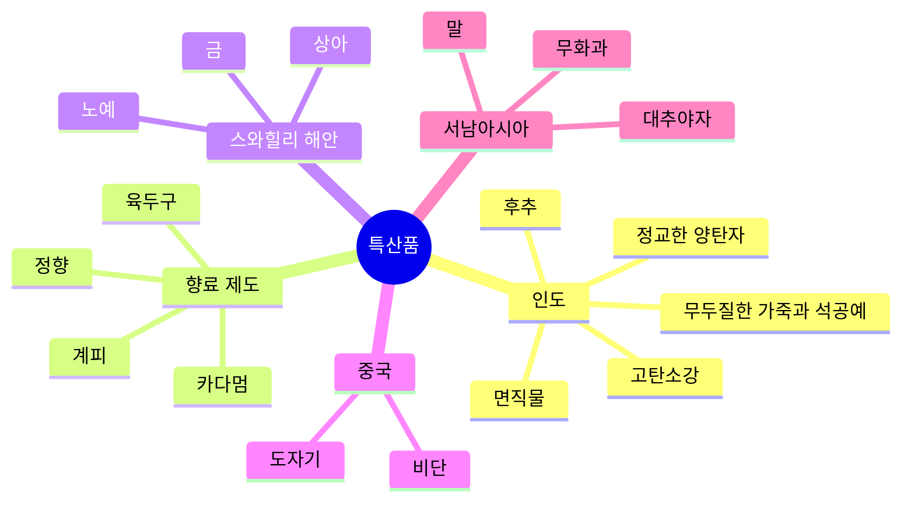
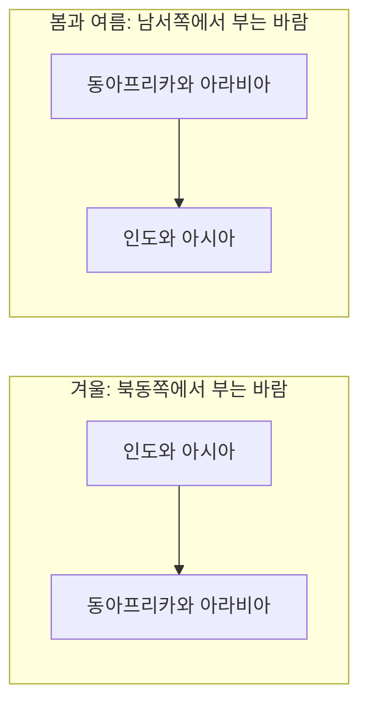
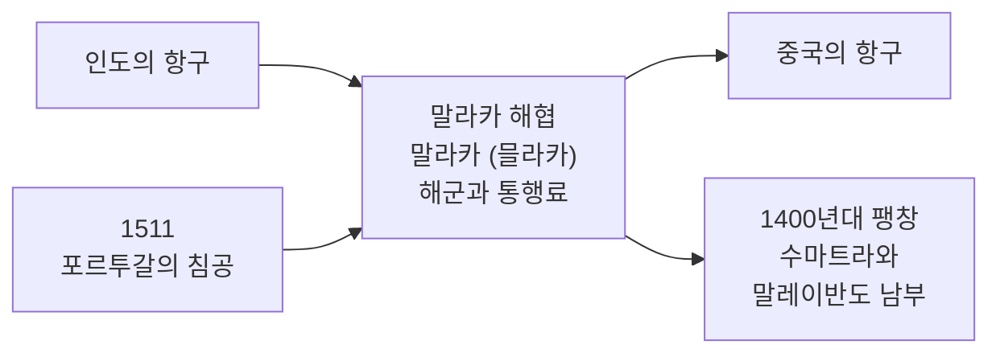
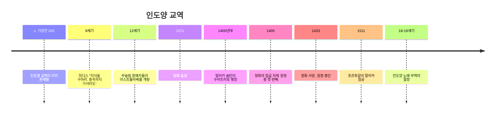
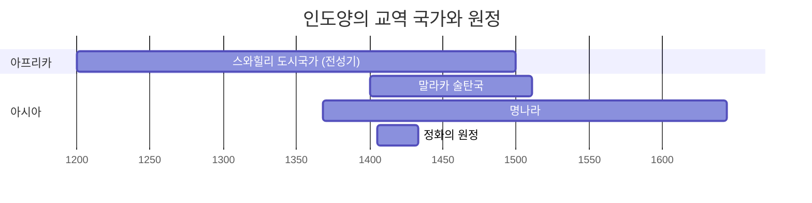

# AP 세계사: 모던 — 토픽 2.3 인도양 교역 (Exchange in the Indian Ocean)

**Focus Question (교재 Essential Question):** 1200년 이후 교류 네트워크가 성장한 원인과 결과는 무엇이며, 환경 지식은 그 확대를 어떻게 뒷받침했는가?

> 출처: College Board CED 기준 · 교재 반영 (교재 Topic 2.3)

**Unit 2: 교류의 네트워크 (Networks of Exchange, c. 1200–1450)**

---

## 학습 목표 (Learning Objectives)

| 코드 | 학습 목표 |
|---|---|
| 2.3 LO-A | 1200년 이후 교류 네트워크가 성장한 원인을 설명하라. |
| 2.3 LO-B | 1200년 이후 교류 네트워크가 성장한 결과를 설명하라. |

## 역사적 개념 (Historical Developments, CED)

| # | 역사적 개념 | LO | 다루는 곳 |
|---|---|---|---|
| HD1 | 지역 간 교역이 성장한 데에는 기존 해양 기술의 혁신이 뒷받침되었다. 나침반 (Compass), 아스트롤라베 (Astrolabe), 더 큰 선박 설계(예: 다우선 (Dhow), 정크선 (Junk))가 그 예이다. | A | §4 |
| HD2 | 장거리 교역로의 확대와 활성화는 계절풍 (Monsoon winds)에 대한 깊은 지식 같은 환경 지식에 크게 의존했다. | A | §3 |
| HD3 | 지역 간 교역이 커지면서 상인들은 디아스포라 공동체 (Diasporic communities)를 이루었고, 자신들의 문화 전통을 현지 문화에 들여왔다. 예: 동아프리카의 아랍·페르시아인 공동체, 동남아시아의 중국 상인 공동체, 인도양 연안의 말레이인 공동체. | B | §6 |
| HD4 | 인도양 경제는 교역에 기반한 새로운 국가들의 성장으로 이어졌다. 스와힐리 도시국가 (Swahili city-states), 말라카 술탄국 (Sultanate of Malacca), 구자라트 (Gujarat) 지역이 그 예이다. | B | §5, §7, §8 |
| HD5 | 정화 (Zheng He)가 이끈 명나라의 국가 주도 원정은 인도양에서 중국의 위상을 높였다. | B | §9 |

---

## 큰 그림 요약

> "지식을 구하라, 중국까지 가서라도."
> — 하디스 (Hadith) (9세기)

전통적으로 예언자 무함마드의 말로 전해지는 이 구절은 무슬림에게 **여행하고 배우라고** 권했다. **이슬람 세계 (Dar al-Islam)**("이슬람의 집", 무슬림 세계)는 북아프리카에서 남아시아까지 여러 사회를 이었고, **세계 최초의 지구적 제국**이라고 불릴 만하다. 선교사와 군대가 이슬람을 퍼뜨리기 전부터 **무슬림 상인**이 길을 열고 있었다. 아랍 상인은 이슬람이 생기기 수백 년 전부터 남아시아를 오갔다.

인도양 교역은 이미 **기원전 200년**에도 있었다. 그러나 1200년 이후 네 가지 원인으로 크게 성장했다. **이슬람의 확산**, **특산품에 대한 수요**, **계절풍**에 대한 **환경 지식**, 그리고 **해양 기술**(삼각돛, 선미타, 다우선, 아스트롤라베)이다. 그 결과 **말라카**, **구자라트**, **스와힐리 도시국가** 같은 **교역 국가**와 **디아스포라 공동체**가 생겨났다. **문화 전파**도 일어났는데, **정화의 원정**이 이를 가장 잘 보여 준다.

---

## §1. 원인: 이슬람의 확산

- 이슬람이 퍼지면서 동아프리카, 동아시아·동남아시아, 남아시아의 **그 어느 때보다 많은 도시가 연결되었다.**
- **무슬림 페르시아인과 아랍인**이 **바다의 주역**으로서 인도양 곳곳의 항구 도시로 상품을 실어 날랐다.
- **캘리컷 (Calicut)**과 **캄베이 (Cambay)** 같은 인도 서해안 도시가 교역의 중심지로 번성했다.
- **캘리컷**은 **남인도의 향신료**를 찾는 상인들로 붐비는 항구였다. **아랍** 상인(서방의 상품)과 **중국** 상인(동방의 상품)이 이곳에서 만났고, 현지 통치자들은 부와 명성을 가져오는 이들을 **환영했다.**
- 인도양 **한가운데**에 있는 **남아시아**가 가장 큰 이익을 보았다.

## §2. 원인: 특산품에 대한 수요 증가

| 지역 | 특산품 |
|---|---|
| **인도** | 품질 좋은 **면직물**, 정교하게 짠 **양탄자**, 칼과 검을 만드는 **고탄소강 (High-carbon steel)**, 무두질한 가죽, 장인의 석공예품, 남부 해안의 **후추** |
| **향료 제도 (Spice Islands)** (지금의 말레이시아·인도네시아) | 육두구, 계피, 정향, 카다멈 |
| **스와힐리 해안** (몸바사, 모가디슈, 소팔라) | **노예**, **상아**, **금** |
| **중국** | 비단과 세계적으로 귀하게 여겨진 **도자기**. 그래서 서양에서는 지금도 고급 식기를 "fine china"라고 부름 |
| **서남아시아** | 말, 무화과, 대추야자 |

### 인도양 노예 무역 (Indian Ocean Slave Trade)

- **동아프리카에는 오래된 노예 무역**이 있었다. (1500년 이후 아메리카로 끌려간 아프리카인은 대부분 서·중앙아프리카 출신이었다.)
- 동아프리카 사람들은 육로나 바닷길로 **북아프리카, 중동, 인도**의 구매자에게 팔렸고, 많은 사람이 **마다가스카르** 같은 섬으로 보내졌다. 이 무역은 **18–19세기에 절정**에 이르렀다.

| 항목 | 인도양 노예 무역 | 대서양 노예 무역 (비교) |
|---|---|---|
| 노동 | 항구, 해운업, 가사 노동, 선원, 군인 | 주로 아메리카의 플랜테이션 노동 |
| 생활 조건 | 도시에 살며 공동체를 이루고 자유 노동자와 함께 일할 기회가 더 많았음 | 그런 기회가 더 적었음 |
| 권리 | 이슬람 공동체에서는 **결혼할 권리** 같은 일부 권리가 있었음 | — |
| 문화적 유산 | **오만, 인도** 등지에 아프리카의 단어, 음악, 관습이 남음 | — |

## §3. 원인: 환경 지식 — 계절풍

- **겨울**에는 **북동쪽**에서, **봄과 여름**에는 **남서쪽**에서 바람이 분다.
- 상인들은 **항해 시기를 신중하게 맞춰야** 했고, 좋은 바람을 기다리며 항구 도시에 **몇 달씩** 머무는 경우가 많았다. 이 기다림이 나중에 **디아스포라 공동체**로 이어졌다 (§6).

## §4. 원인: 해양 기술의 발전

| 기술 | 기원과 특징 |
|---|---|
| **삼각돛 (Lateen sail)** | 아랍 선원들이 쓴 삼각형 돛(아랍인이 발명했는지는 논란이 있음). 여러 방향에서 부는 바람을 받을 수 있음 |
| **선미타 (Stern rudder)** | 고전 시대 중국 선원들의 발명품. 배를 더 안정적이고 조종하기 쉽게 만듦 |
| **다우선 (Dhow)** | 아랍·인도 선원이 쓴 작은 목조선. 후고전 시대 (Postclassical Era)의 바다를 지배함 |
| **아스트롤라베 (Astrolabe)** | 12세기 무슬림 항해자들이 개량함. 배가 적도에서 남북으로 얼마나 떨어져 있는지(위도)를 알려 줌 |
| **나침반과 정크선** | CED 예시. 2.3 교재는 나침반과 개량된 키를 Topic 4.1에서 다루고, 정크선은 2.1 교재에서 다룸 |

- 교역을 통해 항해 기술이 인도양 연안의 여러 지역으로 빠르게 퍼졌다.

> ⚠️ 2.1 교재는 나침반과 정크선을 한나라 시기로 보지만, 2.3 교재는 나침반을 Topic 4.1로 넘긴다. CED가 2.3의 예시로 나침반과 정크선을 들기 때문에 여기서도 다룬다.

## §5. 원인이자 결과: 국가의 성장 — 말라카

- 교역망은 **교역 수입을 제도화**하기 위한 국가의 성장을 이끌었다.
- **말라카 (Malacca/Melaka)**는 **이슬람 도시국가**로, **해군**을 키우고 인도와 중국의 항구 사이에 있는 좁은 해협인 **말라카 해협**을 지나는 배에 **통행료**를 물려 부유해졌다.
- **1400년대**에 **말라카의 술탄**은 **수마트라**와 **말레이반도 남부**까지 영토를 넓힐 만큼 강해졌다.
- 동아프리카, 이탈리아, 아메리카의 도시국가처럼 말라카의 부는 농업, 광업, 제조업이 아니라 **교역**에서 나왔다.
- **1511년:** **포르투갈**이 유럽·인도·중국 사이의 교역을 장악하려고 침공했다. 포르투갈은 큰 부를 얻었지만 기대만큼은 아니었다. 정복이 주변 국가들 사이의 분쟁을 일으켰고, 상인들이 교역로와 항구를 **다양화**했기 때문이다.

## §6. 결과: 디아스포라 공동체

- 상인들은 좋은 바람을 기다리며 몇 달씩 머물렀기 때문에 **현지 사람들과 교류**했다.
- 많은 **아랍·동아프리카 상인**이 **현지 여성과 결혼**해 인도 서부의 항구에 영구히 정착했다. **아랍·페르시아 상인**은 **동아프리카**에 정착했다.
- 이슬람 세계의 상인들은 선교나 정복이 아니라 **통혼 (Intermarriage)**을 통해 남아시아에 처음 이슬람을 전했다. 그 자녀들은 대개 무슬림 전통 속에서 자랐다.
- **디아스포라 (Diaspora):** 고향을 떠난 사람들의 정착지다. 정착민은 자신들의 전통을 현지 문화에 들여왔고, 현지 문화도 상인들에게 영향을 주었다. **양방향의 교류**였다.

### 교재 표: 디아스포라 공동체의 상인들

| 상인 집단 | 지역 | 교역품 |
|---|---|---|
| **무슬림** | 중국, 인도양 연안, 유럽 | 비단, 종이, 도자기, 향신료, 보석, 목재, 금, 소금, 호박, 모피 |
| **중국인** | 동남아시아, 아프리카 | 면화, 차, 비단, 금속, 아편, 소금 |
| **소그드인** (사마르칸트) | 실크로드의 주요 대상 상인, 중국 | 비단, 금, 포도주, 리넨 |
| **유대인** | 중국, 인도, 유럽 | 유리구슬, 리넨, 염료, 향신료 |
| **말레이인** | 스리랑카 | 육두구, 후추, 정향 |

## §7. 결과: 수요 증가에 대한 대응 — 구자라트

- 늘어나는 수요를 맞추려고 생산자들은 **더 효율적**이 되었다. 작물을 더 많이 기르고, 직물을 더 많이 짜고, 철을 더 많이 생산했다.
- 일부 지역에서는 이를 관리하고 **관세 (Customs)**(수입품에 매기는 세금)와 **항구 사용료**로 돈을 걷기 위해 **국가의 역할이 커졌다.**
- 인도 서부 **라지푸트 (Rajput) 왕국 구자라트**는 동서 교역의 **중개자**가 되었다. 구자라트의 관세 수입은 **일부 유럽 국가 전체의 가치보다 몇 배나 많았다.**

## §8. 결과: 스와힐리 도시국가

- **"스와힐리"**는 말 그대로 **"해안 사람들 (Coasters)"**이라는 뜻이다. **킬와 (Kilwa)**, **몸바사 (Mombasa)**(지금의 케냐), **잔지바르 (Zanzibar)**(지금의 탄자니아) 같은 동아프리카 해안의 붐비는 교역 중심지 사람들을 가리킨다.
- 아랍어로 이 해안은 **잔즈 해안 (Zanj Coast)**이라고 불렸다.
- **수출품:** 상아, 금, 노예, 거북 등딱지, 공작 깃털, 코뿔소 뿔.
- **수입품:** **중국 도자기**, **인도 면직물**, 철제품. 지금도 스와힐리 유적에서 중국 도자기가 흔히 발견된다.
- **부의 흔적:** 대부분의 건물은 진흙과 점토로 지었지만, 교역이 절정이던 시기에 킬와의 많은 **모스크와 부유한 상인의 집**은 **돌이나 산호**로 지어졌다.

## §9. 결과: 문화 전파 — 정화의 원정

| 항목 | 내용 |
|---|---|
| 인물 | **정화 (Zheng He)**(1371–1433), **무슬림 제독** |
| 후원자 | 명나라의 **영락제 (Yongle)** (**1405년** 첫 원정, 모두 일곱 차례) |
| 항해 지역 | 인도네시아, 실론, 인도양 연안, 아라비아, 동아프리카 해안, 그리고 (교재에 따르면) **희망봉** |
| 목적 | 명나라의 힘을 과시하고 **조공 (Tribute)**을 받는 것 |
| 규모 | 전성기에 **300척 이상**, **2만 8천 명** |
| 결과 | 중국의 **위상**을 높이고, 중국 상품의 **새로운 시장**을 열었으며, 진귀한 보물(중국인이 처음 본 **기린**)과 바깥 세계에 대한 새로운 지식을 가져옴. 동남아시아 항구로의 **이주**를 자극했고, **해적 활동을 일시적으로 막음** |

**논란과 원정의 중단**

- **유교** 학자들은 안정된 농업 사회를 중시해, 외국과의 교류가 사회 질서를 위협할까 걱정했다.
- 일부 비판자는 다른 문화를 **야만적**이라고 깔보았고, 일부는 원정이 **너무 비싸다**고 보았다.
- 영락제의 아들 **주고치 (Zhu Gaozhi)**는 원정을 끝냈고, 중국인이 먼 바다로 나가는 것을 막았으며, **돛대가 두 개 넘는 배**를 만드는 것을 범죄로 정했다.
- 무장한 배들이 더 이상 나가지 않자 **해적 활동이 다시 시작되었다.**

> ⚠️ 교재는 정화가 "희망봉"까지 갔다고 쓴다. 대부분의 설명에서는 동아프리카 해안(지금의 케냐 부근)까지 갔다고 본다. 선생님이 어떻게 가르치는지 확인이 필요하다.

---

## 연표

---

## 비교표

### 교역 국가

| 항목 | 말라카 | 구자라트 | 스와힐리 도시국가 |
|---|---|---|---|
| 위치 | 말라카 해협 | 인도 서부 | 동아프리카 해안 |
| 국가 형태 | 이슬람 도시국가 (술탄국) | 라지푸트 왕국 | 도시국가 |
| 부의 원천 | **해군**과 지나가는 배의 **통행료** | 동서 교역의 중개자로서 거둔 **관세** | 상아, 금, 노예의 수출 |
| 부의 증거 | 수마트라와 말레이반도 남부로 팽창 (1400년대) | 일부 유럽 국가 전체의 가치보다 몇 배 많은 관세 수입 | 킬와의 돌과 산호로 지은 모스크와 집 |
| 이후 역사 | 포르투갈의 침공 (1511) | — | — |

### 다우선과 정크선

| 항목 | 다우선 (Dhow) | 정크선 (Junk) |
|---|---|---|
| 만든 사람 | 아랍·인도 선원 | 중국인 |
| 크기 | 작은 목조선 | 최대 400피트 (2.1 참고) |
| 돛 | 삼각돛 (Lateen sail) | 여러 개의 돛 |
| 특징 | 여러 방향에서 부는 바람을 받을 수 있음 | 선체 안의 방수 격벽 |
| 주요 활동 지역 | 서부 인도양 (후고전 시대) | 남중국해와 동부 인도양 |

---

## Key Terms (핵심 용어)

| 주제 | 용어 | 정의 |
|---|---|---|
| 정치 | 말라카 (Malacca/Melaka) | 말라카 해협을 지나는 배에 통행료를 물린 이슬람 도시국가 |
| 정치 | 구자라트 (Gujarat) | 인도 서부의 라지푸트 왕국으로, 동서 교역의 중개자 |
| 정치 | 스와힐리 도시국가 (Swahili city-states) | 킬와, 몸바사, 잔지바르 같은 동아프리카 해안의 교역 도시 ("해안 사람들") |
| 환경 | 인도양 연안 (Indian Ocean Basin) | 인도양 교역으로 연결된 땅과 바다 |
| 환경 | 계절풍 (Monsoon winds) | 겨울에는 북동쪽에서, 봄·여름에는 남서쪽에서 부는 계절성 바람 |
| 문화 | 인도양 노예 무역 (Indian Ocean slave trade) | 동아프리카 사람들을 북아프리카, 중동, 인도로 팔아넘긴 오래된 무역 |
| 문화 | 디아스포라 (Diaspora) | 고향을 떠난 사람들의 정착지 |
| 문화 | 정화 (Zheng He) | 일곱 차례 원정을 이끈 명나라의 무슬림 제독 (1405년부터) |
| 기술 | 삼각돛 (Lateen sail) | 여러 방향에서 부는 바람을 받을 수 있는 삼각형 돛 |
| 기술 | 선미타 (Stern rudder) | 배를 더 안정적이고 조종하기 쉽게 만든 중국의 발명품 |
| 기술 | 아스트롤라베 (Astrolabe) | 12세기 무슬림 항해자들이 개량한, 위도를 알아내는 도구 |
| 경제 | 캘리컷 (Calicut) | 아랍과 중국 상인이 만난 인도 서해안의 향신료 항구 |
| 경제 | 향료 제도 (Spice Islands) | 육두구, 계피, 정향, 카다멈을 생산한 지금의 말레이시아·인도네시아 |
| 추가 | 이슬람 세계 (Dar al-Islam) | "이슬람의 집", 무슬림 세계 |
| 추가 | 다우선 (Dhow) | 아랍·인도의 작은 목조선 |
| 추가 | 관세 (Customs) | 수입품에 매기는 세금 |
| 추가 | 조공 체제 (Tribute system) | 여러 나라가 중국에 예물을 보내 존중을 표하던 체제 |
