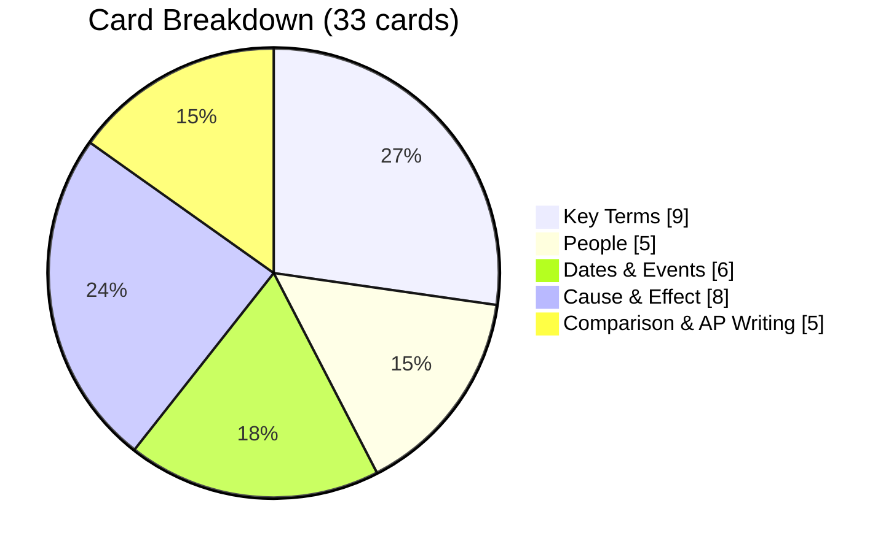

# AP World History: Modern — Topic 2.4 Trans-Saharan Trade Routes · Flashcards

> Source: Based on the College Board CED · Textbook incorporated (Topic 2.4 reading)

---

## 1. Key Terms

- [ ] **What are oases, and how much of the Sahara do they cover?**

▶ Answer
Places where underground water reaches the surface and makes the land fertile, naturally or through dug wells. They cover only about 800 of the Sahara's 3.6 million square miles.

- [ ] **Why did the Somali camel saddle have the greatest impact on trade?**

▶ Answer
The semi-nomadic Somalis of East Africa designed it to carry loads of up to 600 pounds. Without it, camels could not have carried heavy loads of trade goods.

- [ ] **How did the South Arabian and North Arabian saddles differ?**

▶ Answer
South Arabian: the rider sat behind the hump and could hold its hair, which made riding easier. North Arabian: the rider sat on top of the hump, high and near the head, which gave visibility in battle and the best control.

- [ ] **Why were camels suited to the Sahara?**

▶ Answer
They can drink more than 50 gallons in three minutes and then go a long time without water, eat thorny plants, drink salty water, and have long eyelashes against desert winds. They are the only animal that can cross deserts.

- [ ] **What was a trans-Saharan caravan like?**

▶ Answer
Often thousands of camels carrying trade goods plus food and fresh water to reach the next oasis. Leaders usually walked the whole way, using seven north–south and two east–west routes.

- [ ] **What were the main goods of trans-Saharan trade?**

▶ Answer
From West Africa: gold (the most precious), ivory, hides, and enslaved people. From North Africa (Arab and Berber traders): salt, cloth, paper, and horses.

- [ ] **What served as currency in Mali?**

▶ Answer
Cowrie shells, cotton cloth, gold, glass beads, and salt.

- [ ] **What was Timbuktu known for?**

▶ Answer
It was a wealthy Mali trade city and a world-renowned center of Islamic learning. By the 1500s, its books sold for more than most other goods.

- [ ] **What is the hajj, and where is Mecca?**

▶ Answer
The hajj is the pilgrimage to Mecca, Islam's holiest city, in Arabia. Mansa Musa made one in 1324.

## 2. People

- [ ] **Who was Ibn Battuta, and what does his account of Timbuktu and Gao show?**

▶ Answer
A 14th-century Muslim scholar and explorer. He describes traveling by boat on the Niger, trading with cowrie shells in Gao and Mali, and joining a merchant caravan, which shows how caravans and currencies supported commerce.

- [ ] **Who was Sundiata?**

▶ Answer
"The Lion Prince," founder of Mali. Spared as a crippled boy, he became a feared warrior, was exiled, and returned in 1235 to reclaim the throne. Most scholars believe he was Muslim and used those ties to build trade with North African and Arab merchants.

- [ ] **Who was Mansa Musa?**

▶ Answer
Sundiata's grand-nephew and a 14th-century ruler of Mali, known more for religious leadership. He made a lavish hajj in 1324, then built religious schools in Timbuktu and mosques in trading cities.

- [ ] **Who were Ibn Rushd and Maimonides?**

▶ Answer
Scholars of al-Andalus (Spain): Ibn Rushd was an Islamic legal scholar and philosopher, and Maimonides was a Jewish scholar of ethics. They reflect al-Andalus's tolerant society and its preservation of Greek learning.

- [ ] **Who were Vladimir I and Yaroslav I?**

▶ Answer
Rulers of Kievan Rus. Vladimir I converted to Christianity in 989, and Yaroslav I codified the legal system.

## 3. Dates & Events

- [ ] **3rd century B.C.E. / after 300 C.E.**

▶ Answer
Camels appear in North Africa (3rd century B.C.E.) and begin replacing horses and donkeys (after 300 C.E.).

- [ ] **7th–8th centuries**

▶ Answer
Muslim merchants arrive, and the volume of trans-Saharan trade increases. By the end of the 8th century, the trade is famous in Europe and Asia.

- [ ] **12th century**

▶ Answer
Wars with neighbors permanently weaken Ghana, and new trading societies, especially Mali, rise.

- [ ] **1235**

▶ Answer
Sundiata returns from exile, defeats his enemies, reclaims the throne, and founds Mali.

- [ ] **1324**

▶ Answer
Mansa Musa's hajj to Mecca with 100 camels, thousands of enslaved people and soldiers, and gold.

- [ ] **Late 1400s**

▶ Answer
The Songhai Kingdom replaces Mali as the leading power in West Africa.

## 4. Cause & Effect

- [ ] **Cause → Effect: What increased the volume of trans-Saharan trade?**

▶ Answer
The arrival of Muslim merchants in the 7th and 8th centuries, and later the takeover of the region by empires such as Mali in the early 1200s, when commerce expanded dramatically.

- [ ] **Cause → Effect: How did the Somali saddle change trade?**

▶ Answer
Camels could carry up to 600 pounds, so caravans could move heavy loads of goods across the desert.

- [ ] **Cause → Effect: Why did Mali become richer than Ghana?**

▶ Answer
Mali profited from gold and also taxed nearly all other trade entering West Africa.

- [ ] **Cause → Effect: How did growing trade expand the role of the state?**

▶ Answer
Rulers had to set a currency people trusted and protect the trade routes and resource areas, so government grew stronger and more active.

- [ ] **Cause → Effect: How did tax revenue lead to the expansion of Mali?**

▶ Answer
Tax revenue bought horses and iron weapons for armies that took over resource-rich areas. Each expansion drew more people into Mali's economy and trade networks.

- [ ] **Cause → Effect: How did Sundiata's faith help Mali's economy?**

▶ Answer
As a Muslim (according to most scholars), he used ties with other Muslims to build trade relationships with North African and Arab merchants, which created a thriving gold trade.

- [ ] **Effect: What did Mansa Musa's hajj achieve?**

▶ Answer
It displayed Mali's wealth to the outside world and deepened his devotion to Islam, which led to religious schools in Timbuktu, mosques, and stronger support for Islam in Mali.

- [ ] **Effect: How did trans-Saharan trade affect religion in West Africa, and what stayed the same?**

▶ Answer
Change: Islam spread into Sub-Saharan Africa and is still prominent there today. Continuity: most West Africans, mostly farmers, kept their traditional beliefs.

## 5. Comparison & AP Writing

- [ ] **Compare: Why was the camel better than the horse for trans-Saharan trade?**

▶ Answer
Camels could cross deserts, drink salty water, eat thorny plants, carry up to 600 pounds, and did not spook easily. Horses needed grain, spooked easily, and could not tolerate high heat. (Camels could not be controlled with a bit and needed a lot of salt.)

- [ ] **Compare: How were Ghana and Mali similar and different?**

▶ Answer
Similar: both grew rich from the gold trade. Different: Mali also taxed nearly all other trade, was richer, had Muslim rulers such as Sundiata and Mansa Musa, and had the cities of Timbuktu and Gao.

- [ ] **AP Short Answer: Explain one way technology encouraged trans-Saharan trade.**

▶ Answer

**Claim:** The camel saddle, especially the Somali load saddle, encouraged the growth of trans-Saharan trade. 
**Evidence:** The Somali saddle let camels carry loads of up to 600 pounds, and caravans of thousands of camels crossed the Sahara on seven north–south and two east–west routes. 
**Reasoning:** Heavier loads per animal made it profitable to move large amounts of gold, salt, and other goods, so the volume of trade grew and more peoples were connected.

- [ ] **AP Short Answer: Explain how the expansion of Mali influenced trade and communication.**

▶ Answer

**Claim:** Mali's expansion increased trade and communication in West Africa. 
**Evidence:** Mali taxed nearly all trade, used the revenue to buy horses and iron weapons, and expanded into resource-rich areas. It also set up currencies such as cowrie shells and gold. 
**Reasoning:** Protection, shared currencies, and expansion drew more people into Mali's economy and trade networks, which put them in touch with distant cultures, including Islam.

- [ ] **AP Long Essay Thesis: Evaluate the extent to which trans-Saharan trade transformed West Africa from 1200 to 1450.**

▶ Answer

**Claim:** Trans-Saharan trade greatly transformed West Africa's states and elite culture, but most ordinary people's lives and beliefs stayed largely the same. 
**Evidence:** Mali grew richer than Ghana by taxing trade, Timbuktu became a world center of Islamic learning, and Mansa Musa's hajj and mosques deepened support for Islam. Yet most West Africans were farmers growing sorghum and rice who kept traditional beliefs. 
**Reasoning:** Trade wealth and Islam were concentrated in rulers and cities. This shows change at the top of society and continuity among the rural majority.

