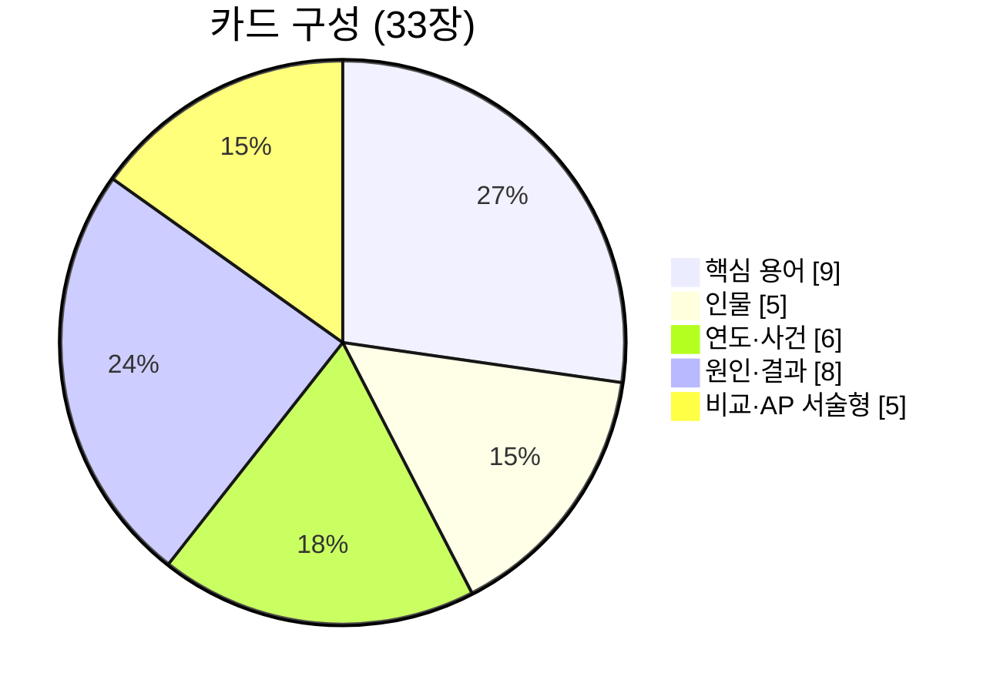

# AP 세계사: 모던 — 토픽 2.4 사하라 횡단 교역 (Trans-Saharan Trade Routes) · 플래시카드

> 출처: College Board CED 기준 · 교재 반영 (교재 Topic 2.4)

---

## 1. 핵심 용어

- [ ] **오아시스 (Oases)란 무엇이며, 사하라에서 얼마나 되는가?**

▶ 정답
땅속의 물이 저절로 솟거나 우물을 파서 지표로 올라와 땅이 비옥해진 곳이다. 사하라 약 360만 제곱마일 가운데 약 800제곱마일뿐이다.

- [ ] **소말리 낙타 안장 (Somali saddle)이 교역에 가장 큰 영향을 준 이유는?**

▶ 정답
동아프리카의 반유목민인 소말리인이 최대 600파운드의 짐을 싣도록 만든 안장이기 때문이다. 이 안장이 없었다면 낙타로 무거운 교역품을 나를 수 없었다.

- [ ] **남아라비아 안장과 북아라비아 안장은 어떻게 달랐는가?**

▶ 정답
남아라비아 안장: 혹 뒤에 앉아 혹의 털을 잡을 수 있어 타기 쉬웠다. 북아라비아 안장: 혹 위에 높이, 머리 가까이 앉아 전투에서 시야가 넓고 낙타를 가장 잘 조종할 수 있었다.

- [ ] **낙타가 사하라에 잘 맞았던 이유는?**

▶ 정답
3분 만에 50갤런이 넘는 물을 마시고 오랫동안 버틸 수 있으며, 가시 있는 식물을 먹고, 짠물을 마시고, 긴 속눈썹으로 사막 바람을 막는다. 사막을 건널 수 있는 유일한 동물이다.

- [ ] **사하라 횡단 대상 (Caravan)은 어떤 모습이었는가?**

▶ 정답
낙타가 수천 마리에 이르는 경우가 많았고, 교역품과 함께 다음 오아시스까지 버틸 식량과 물을 실었다. 이끄는 사람들은 대개 처음부터 끝까지 걸었으며, 남북 교역로 7개와 동서 교역로 2개를 이용했다.

- [ ] **사하라 횡단 교역의 주요 상품은 무엇이었는가?**

▶ 정답
서아프리카에서: 금(가장 귀한 상품), 상아, 가죽, 노예. 북아프리카(아랍·베르베르 상인)에서: 소금, 옷감, 종이, 말.

- [ ] **말리에서 화폐로 쓰인 것은 무엇인가?**

▶ 정답
개오지 조개껍데기, 면포, 금, 유리구슬, 소금.

- [ ] **팀북투 (Timbuktu)는 무엇으로 유명했는가?**

▶ 정답
부유한 말리의 교역 도시이자 세계적으로 유명한 이슬람 학문의 중심지였다. 1500년대에는 이곳의 책이 대부분의 다른 상품보다 비싸게 팔렸다.

- [ ] **하지 (Hajj)란 무엇이며, 메카 (Mecca)는 어디인가?**

▶ 정답
하지는 아라비아에 있는 이슬람의 가장 거룩한 도시 메카로 가는 성지 순례다. 만사 무사가 1324년에 순례를 떠났다.

## 2. 인물

- [ ] **이븐 바투타 (Ibn Battuta)는 누구이며, 팀북투와 가오에 관한 그의 기록은 무엇을 보여 주는가?**

▶ 정답
14세기의 무슬림 학자이자 탐험가다. 니제르강을 배로 내려가고, 가오와 말리에서 개오지 조개껍데기로 거래하며, 상인 대상에 합류한 일을 기록했다. 대상과 화폐가 교역을 뒷받침했음을 보여 준다.

- [ ] **순디아타 (Sundiata)는 누구인가?**

▶ 정답
"사자 왕자"로 불린 말리의 건국자다. 다리가 불편한 소년이라 목숨을 건졌지만 두려운 전사가 되었고, 망명했다가 1235년에 돌아와 왕위를 되찾았다. 대부분의 학자는 그가 무슬림이었다고 보며, 그는 이 관계를 이용해 북아프리카·아랍 상인과 교역했다.

- [ ] **만사 무사 (Mansa Musa)는 누구인가?**

▶ 정답
순디아타의 종손이자 14세기 말리의 통치자로, 종교 지도자로 더 유명했다. 1324년 화려한 성지 순례를 했고, 그 뒤 팀북투에 종교 학교를 세우고 교역 도시에 모스크를 지었다.

- [ ] **이븐 루시드 (Ibn Rushd)와 마이모니데스 (Maimonides)는 누구인가?**

▶ 정답
알안달루스(에스파냐)의 학자들이다. 이븐 루시드는 이슬람 법학자이자 철학자였고, 마이모니데스는 유대인 윤리학자였다. 알안달루스의 관용적인 사회와 그리스 학문 보존을 보여 준다.

- [ ] **블라디미르 1세 (Vladimir I)와 야로슬라프 1세 (Yaroslav I)는 누구인가?**

▶ 정답
키예프 루스의 통치자들이다. 블라디미르 1세는 989년 기독교로 개종했고, 야로슬라프 1세는 법 체계를 정리했다.

## 3. 연도·사건

- [ ] **기원전 3세기 / 300년 이후**

▶ 정답
북아프리카에 낙타가 나타났고(기원전 3세기), 말과 당나귀를 대신하기 시작했다(300년 이후).

- [ ] **7–8세기**

▶ 정답
무슬림 상인이 오면서 사하라 횡단 교역량이 늘었다. 8세기 말에는 이 교역이 유럽과 아시아에 널리 알려졌다.

- [ ] **12세기**

▶ 정답
이웃과의 전쟁으로 가나가 영영 약해졌고, 말리를 비롯한 새 교역 사회가 일어났다.

- [ ] **1235년**

▶ 정답
순디아타가 망명에서 돌아와 적을 물리치고 왕위를 되찾아 말리를 세웠다.

- [ ] **1324년**

▶ 정답
낙타 100마리, 수천 명의 노예와 병사, 금을 거느린 만사 무사의 메카 성지 순례.

- [ ] **1400년대 후반**

▶ 정답
송가이 왕국이 말리를 대신해 서아프리카의 강자가 되었다.

## 4. 원인·결과

- [ ] **원인 → 결과: 사하라 횡단 교역량을 늘린 것은 무엇인가?**

▶ 정답
7–8세기 무슬림 상인의 도착, 그리고 1200년대 초 말리 같은 제국의 이 지역 장악이다. 이때 교역이 크게 늘었다.

- [ ] **원인 → 결과: 소말리 안장은 교역을 어떻게 바꾸었는가?**

▶ 정답
낙타가 최대 600파운드를 실을 수 있게 되어, 대상이 무거운 상품을 사막 건너로 나를 수 있었다.

- [ ] **원인 → 결과: 말리가 가나보다 부유해진 이유는?**

▶ 정답
금 교역으로 이익을 얻은 데다, 서아프리카로 들어오는 거의 모든 교역에 세금을 매겼기 때문이다.

- [ ] **원인 → 결과: 교역이 늘면서 국가의 역할은 어떻게 커졌는가?**

▶ 정답
통치자들이 사람들이 믿는 화폐를 정하고 교역로와 자원 지역을 보호해야 했기 때문에, 정부가 더 강하고 적극적으로 바뀌었다.

- [ ] **원인 → 결과: 세금 수입은 어떻게 말리의 팽창으로 이어졌는가?**

▶ 정답
세금으로 말과 철제 무기를 사서 군대를 갖추고 자원이 풍부한 지역을 차지했다. 영토가 넓어질 때마다 더 많은 사람이 말리의 경제와 교역망에 편입되었다.

- [ ] **원인 → 결과: 순디아타의 신앙은 말리 경제에 어떤 도움이 되었는가?**

▶ 정답
(대부분의 학자가 보듯) 무슬림이었던 그는 같은 신앙을 가진 사람들과의 관계를 이용해 북아프리카·아랍 상인과 교역 관계를 맺었고, 금 교역을 번성시켰다.

- [ ] **결과: 만사 무사의 성지 순례는 무엇을 이루었는가?**

▶ 정답
말리의 부를 바깥 세계에 보여 주었고, 그의 이슬람 신앙을 깊게 했다. 그 결과 팀북투의 종교 학교와 모스크가 세워지고 말리에서 이슬람에 대한 지지가 커졌다.

- [ ] **결과: 사하라 횡단 교역은 서아프리카의 종교에 어떤 영향을 주었으며, 무엇이 그대로였는가?**

▶ 정답
변화: 이슬람이 사하라 이남 아프리카로 퍼졌고, 지금도 그 지역에서 중요하다. 연속성: 대부분 농민이었던 서아프리카 사람들은 전통 신앙을 지켰다.

## 5. 비교·AP 서술형

- [ ] **비교: 사하라 횡단 교역에 낙타가 말보다 나았던 이유는?**

▶ 정답
낙타는 사막을 건너고, 짠물을 마시고, 가시 있는 식물을 먹고, 최대 600파운드를 실었으며, 잘 놀라지 않았다. 말은 곡물이 필요하고, 잘 놀라며, 더위에 약했다. (다만 낙타는 재갈로 조종할 수 없었고 소금이 많이 필요했다.)

- [ ] **비교: 가나와 말리의 공통점과 차이점은?**

▶ 정답
공통점: 둘 다 금 교역으로 부유해졌다. 차이점: 말리는 거의 모든 다른 교역에도 세금을 매겨 더 부유했고, 순디아타와 만사 무사 같은 무슬림 통치자가 있었으며, 팀북투와 가오 같은 도시가 있었다.

- [ ] **AP 단답형: 기술이 사하라 횡단 교역을 촉진한 방식 하나를 설명하라.**

▶ 정답

**주장:** 낙타 안장, 특히 소말리 짐 안장이 사하라 횡단 교역의 성장을 촉진했다. 
**근거:** 소말리 안장 덕분에 낙타가 최대 600파운드를 실을 수 있었고, 수천 마리의 낙타로 이루어진 대상이 남북 7개, 동서 2개의 교역로로 사하라를 건넜다. 
**설명:** 한 마리가 더 많은 짐을 실을 수 있게 되자 금, 소금 등 많은 상품을 옮기는 것이 이익이 되었다. 그래서 교역량이 늘고 더 많은 사람들이 연결되었다.

- [ ] **AP 단답형: 말리의 팽창이 교역과 통신에 어떤 영향을 주었는지 설명하라.**

▶ 정답

**주장:** 말리의 팽창은 서아프리카의 교역과 통신을 늘렸다. 
**근거:** 말리는 거의 모든 교역에 세금을 매기고, 그 수입으로 말과 철제 무기를 사서 자원이 풍부한 지역으로 영토를 넓혔다. 또 개오지 조개껍데기와 금 같은 화폐를 정했다. 
**설명:** 보호, 공통 화폐, 팽창 덕분에 더 많은 사람이 말리의 경제와 교역망에 편입되었고, 이슬람을 비롯한 먼 곳의 문화와 접촉하게 되었다.

- [ ] **AP 논술형 논지: 1200–1450년 사하라 횡단 교역이 서아프리카를 어느 정도 변화시켰는지 평가하라.**

▶ 정답

**주장:** 사하라 횡단 교역은 서아프리카의 국가와 엘리트 문화를 크게 바꾸었지만, 대부분의 평범한 사람들의 삶과 신앙은 크게 변하지 않았다. 
**근거:** 말리는 교역에 세금을 매겨 가나보다 부유해졌고, 팀북투는 세계적인 이슬람 학문의 중심지가 되었으며, 만사 무사의 성지 순례와 모스크는 이슬람에 대한 지지를 깊게 했다. 그러나 대부분의 서아프리카 사람들은 수수와 쌀을 기르는 농민으로서 전통 신앙을 지켰다. 
**설명:** 교역의 부와 이슬람은 통치자와 도시에 집중되었다. 이는 사회 상층의 변화와 농촌 다수의 연속성을 함께 보여 준다.

