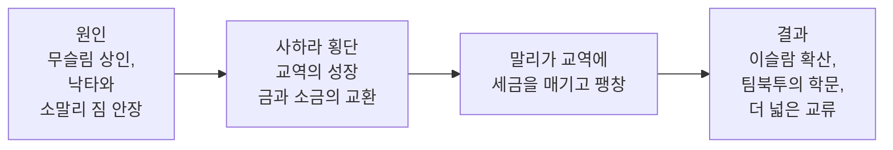
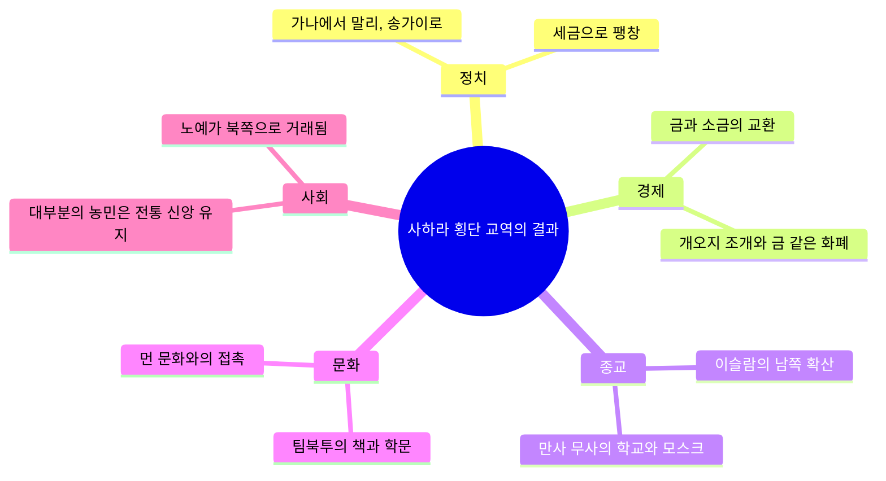
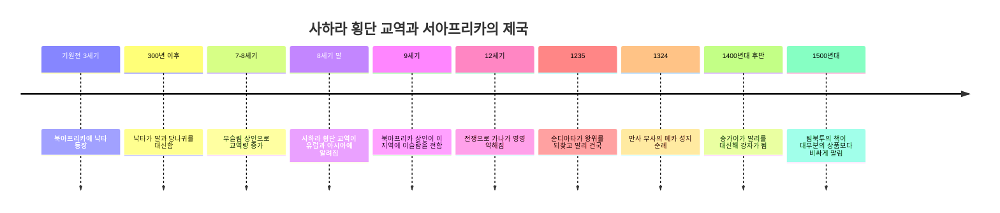
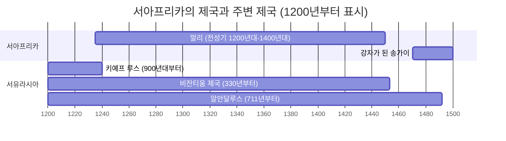

# AP 세계사: 모던 — 토픽 2.4 사하라 횡단 교역 (Trans-Saharan Trade Routes)

**Focus Question (교재 Essential Question):** 사하라 횡단 교역의 원인과 결과는 무엇이었으며, 제국의 성장은 교역과 통신에 어떤 영향을 주었는가?

> 출처: College Board CED 기준 · 교재 반영 (교재 Topic 2.4)

**Unit 2: 교류의 네트워크 (Networks of Exchange, c. 1200–1450)**

---

## 학습 목표 (Learning Objectives)

| 코드 | 학습 목표 |
|---|---|
| 2.4 LO-A | 사하라 횡단 교역이 성장한 원인과 결과를 설명하라. |
| 2.4 LO-B | 제국의 팽창이 시간에 따라 교역과 통신에 어떤 영향을 주었는지 설명하라. |

> ⚠️ 이전 버전에는 "환경 요인"에 관한 학습 목표 하나를 넣고 확인이 필요하다고 표시했다. 이번 두 학습 목표는 교재의 Essential Question과 아래 CED 역사적 개념을 바탕으로 다시 정리한 것이다. 정확한 문구는 공식 CED PDF와 대조해 확인이 필요하다.

## 역사적 개념 (Historical Developments, CED)

| # | 역사적 개념 | LO | 다루는 곳 |
|---|---|---|---|
| HD1 | 상업 관행이 개선되면서 교역량이 늘었고, 기존 교역망과 새로 활발해진 교역망의 지리적 범위가 넓어졌다. | A | §1, §4 |
| HD2 | 낙타 안장 (Camel saddle) 사용 같은 운송 혁신이 지역 간 교역의 성장을 촉진했다. | A | §2, §3 |
| HD3 | 서아프리카의 말리 (Mali) 같은 제국의 팽창이 사하라 횡단 교역을 촉진했다. | B | §4, §5 |

---

## 큰 그림 요약

> "팀북투에서 나는 통나무 하나를 파서 만든 작은 배를 타고 나일강[니제르강]을 따라 내려갔다... 나는 계속 가서 나일강[니제르강] 가의 큰 도시인 가우가우[가오]에 이르렀다... 그곳 주민들은 개오지 조개껍데기로 물건을 사고팔며, 말리[말리의 도시]에서도 마찬가지이다."
> — 이븐 바투타 (Ibn Battuta) (교재 연도: 1304–1353)

> ⚠️ 교재는 이븐 바투타의 생몰 연도를 1304–1353으로 쓴다. 많은 자료는 그가 1368년이나 1369년에 죽었다고 본다. 1353년은 대략 그의 여행이 끝난 해다. 선생님께 확인이 필요하다.

**사하라 사막 (Sahara Desert)**은 기후가 건조해 농사가 거의 불가능했기 때문에 그곳에 사는 사회가 드물었다. 유목민들이 어느 정도 교역을 했지만, **7–8세기**에 **무슬림 상인**이 오면서 **교역량이 늘었고**, **1200년대 초** **말리** 같은 제국이 이 지역을 차지하면서 교역이 **크게 늘었다.** 이 교역을 가능하게 한 것은 두 가지였다. 하나는 기원전 3세기에 북아프리카에 들어온 **낙타**이고, 다른 하나는 **낙타 안장**, 특히 **600파운드**를 실을 수 있는 **소말리 안장 (Somali saddle)**이다. 수천 마리의 낙타로 이루어진 대상이 서아프리카의 **금, 상아, 가죽, 노예**를 아랍인과 베르베르인의 **소금, 옷감, 종이, 말**과 맞바꾸었다. 말리는 이 교역에 **세금**을 매겨 부유해졌고, 그 수입으로 영토를 **넓혔다.** **순디아타 (Sundiata)**(1235)와 **만사 무사 (Mansa Musa)**(1324년 성지 순례) 시기에 말리는 **이슬람**의 중심지가 되었고, **팀북투 (Timbuktu)**는 세계적으로 유명한 학문의 중심지가 되었다. 1400년대 후반에는 **송가이 (Songhai)**가 말리를 대신했다.

---

## §1. 사하라, 오아시스, 대상의 교역로

- 사하라의 넓이는 약 **360만 제곱마일**로, 중국과 비슷하다.
- 그중 **오아시스 (Oases)**는 약 **800제곱마일**뿐이다. 오아시스는 땅속 깊은 곳의 물이 지표로 올라와 땅이 비옥해진 곳이다. 어떤 오아시스는 물이 저절로 솟아오르고, 어떤 곳은 사람들이 **우물**을 팠다.
- **대상 (Caravan)**은 낙타가 **수천 마리**에 이르는 경우가 많았다. 교역품과 함께 다음 오아시스까지 버틸 식량과 **물**을 실었고, 대상을 이끄는 사람들은 대개 **처음부터 끝까지 걸었다.**
- 사하라에는 **남북 교역로 7개**와 **동서 교역로 2개**가 있었다. 이 길들은 사하라 이남 아프리카 사람들을 더 많은 문화와 교역 상대와 이어 주었다.

*첫머리 인용문에 나온 이븐 바투타의 경로*

| 북쪽으로 (서아프리카에서) | 남쪽으로 (북아프리카에서) |
|---|---|
| **금** (가장 귀한 상품) | **소금** |
| 상아 | 옷감과 직물 |
| 가죽 | 종이 |
| 노예 | 말 |

- 서아프리카 상인들은 지금의 세네갈과 모리타니 부근을 흐르는 **세네갈강 (Senegal River)**에서 금을 얻었다.
- **8세기 말**에 사하라 횡단 교역은 이미 **유럽과 아시아 전역에 널리 알려져** 있었다.
- 이 교역은 **700년이 넘는 동안** 서아프리카, 특히 **가나와 말리**에 큰 부를 가져다주었고, **이슬람**을 사하라 이남 아프리카로 전했다.

## §2. 낙타

- 낙타는 이슬람의 중심지인 **아라비아**가 원산지이며, **기원전 3세기**에 **북아프리카**에 나타났다.
- 혹독하고 건조한 **아라비아 사막 (Arabian Desert)**에 익숙했던 낙타는 사하라에도 잘 적응했다.
- 낙타는 **3분 만에 50갤런이 넘는 물**을 마시고, 그 뒤 오랫동안 물 없이 지낼 수 있다.
- **300년 이후** 낙타가 **말과 당나귀를 대신하기 시작했다.**

## §3. 낙타 안장

사람들은 용도에 따라 **15가지나 되는 낙타 안장**을 만들었다.

| 안장 | 만든 사람 | 설계 | 용도 |
|---|---|---|---|
| **남아라비아 안장** | 남아라비아인 | 타는 사람이 **혹 뒤쪽**에 앉음 | 혹의 털을 잡을 수 있어 타기가 쉬움 |
| **북아라비아 안장** | 북아라비아인 | 타는 사람이 **혹 위**에 높이, 머리 가까이 앉음 | **전투에서 시야**가 넓고 낙타를 가장 잘 조종할 수 있음 |
| **소말리 안장** | 동아프리카의 반유목민 **소말리인** | **최대 600파운드**의 짐을 싣도록 만듦 | **교역에 가장 큰 영향**을 줌. 이 안장이 없었다면 낙타로 무거운 교역품을 나를 수 없었음 |

> **핵심:** 낙타 안장은 CED가 드는 **운송 혁신**의 대표 예시다. 교재에 따르면 교역을 바꾼 안장은 **소말리 짐 안장**이다.

> **이전 버전에서 바뀐 점:** 이전 노트는 북아라비아 안장을 교역의 핵심 안장으로 설명했다. 이번 버전은 소말리 안장을 꼽는 교재를 따른다.

### 교재 표: 짐 운반 동물 비교

| 동물 | 지역 | 장점 | 단점 |
|---|---|---|---|
| **낙타** | 북아프리카와 사하라 이남 서아프리카 | 먼 거리를 이동함. 가시 있는 식물을 먹고 사막의 짠물을 마실 수 있음. 긴 속눈썹이 사막 바람을 막아 줌. 사막을 건널 수 있는 유일한 동물임. 잘 놀라지 않음. 최대 600파운드를 실음 | 건강을 유지하려면 소금이 많이 필요함. 매우 공격적이고 앙심을 품기도 함. 재갈로 조종할 수 없음. 마구간에 둘 수 없음 |
| **(이름 누락) ⚠️** | 유라시아와 아메리카 | 지구력이 강함. 가장 무거운 짐을 끎. 길을 잃거나 도둑맞을 일이 적음. 그 지역의 풀만으로 살 수 있음. 여러 기후와 먹이에 적응함 | 느림. 다른 짐 운반 동물보다 물과 먹이가 더 많이 필요함 |
| **말** | 전 세계 | 빨리 달림. 재갈로 조종할 수 있음. 전투에 쓸 수 있음. 대부분의 기후와 지형에 적응함 | 체력을 유지하려면 곡물이 필요함. 잘 놀람. 쉽게 도둑맞음. 쉽게 길을 잃음. 발걸음이 덜 안정적임. 더위에 약함 |
| **라마** | 아메리카 | 산에서 잘 미끄러지지 않음. 성격이 온순함. 물이 적게 필요함. 춥고 높은 산악 기후에 잘 맞음 | 무거운 짐을 끌 수 없음. 다른 동물보다 적게 실음. 더위에 약함 |

> ⚠️ 추출된 텍스트에 두 번째 동물의 이름이 빠져 있다. 지구력이 강하고, 가장 무거운 짐을 끌며, 느리다는 설명으로 보아 **소 (Ox)**로 보인다. 인쇄된 교재로 확인이 필요하다.

## §4. 서아프리카 제국의 팽창: 말리

- **12세기**가 되자 이웃 사회와의 전쟁으로 **가나가 영영 약해졌다** (1.5 참고). 그 자리에 여러 새 교역 사회가 생겼고, 그중 가장 강력한 나라가 **말리**였다.
- 북아프리카 상인들은 **9세기**에 이 지역에 **이슬람**을 전했다.

> ⚠️ 교재는 9세기에 이슬람이 "말리에" 전해졌다고 쓴다. 그러나 말리 제국은 1235년경에 세워졌다. 훗날 말리가 되는 지역을 뜻하는 것으로 보인다.

### 말리의 부

- 말리 정부는 **금 교역**으로 이익을 얻었을 뿐 아니라, 서아프리카로 들어오는 **거의 모든 교역에 세금**을 매겼다. 그래서 **가나보다도 더 부유해졌다.**
- 주민 대부분은 **수수와 쌀**을 기르는 **농민**이었다.
- 큰 도시인 **팀북투**와 **가오 (Gao)**에 부가 가장 많이 모였고, 두 도시는 이 지역 **무슬림 생활**의 중심지가 되었다.
- 특히 **팀북투**는 **세계적으로 유명한 이슬람 학문의 중심지**가 되었다. **1500년대**에는 팀북투에서 만들어 판 책이 **대부분의 다른 상품보다 비싸게** 팔렸다.

### 국가 역할의 확대

- 통치자들은 가치가 널리 인정되는 **화폐**를 정해야 했다. 말리의 화폐는 **개오지 조개껍데기, 면포, 금, 유리구슬, 소금**이었다.
- 통치자들은 **교역로**와, 화폐와 교역 자원이 만들어지거나 나오는 곳을 **보호**해야 했다.
- 제국은 때때로 **자원이 풍부한 지역으로 영토를 넓혔다.** 이때 **세금으로 사들인 말과 철제 무기**를 갖춘 군대를 썼다.
- 영토가 넓어질 때마다 **더 많은 사람이 제국의 경제와 교역망에 편입되었고**, 먼 곳의 문화와 접촉하게 되었다.

### 순디아타, "사자 왕자"

- 그의 아버지는 지금의 **기니**에 있던 작은 사회를 다스렸다. 아버지가 죽자 경쟁 세력이 쳐들어와 왕족 대부분을 죽이고 왕위를 빼앗았다.
- 순디아타는 **다리가 불편해** 위협이 되지 않는다고 여겨져 목숨을 건졌다. 그러나 그는 싸우는 법을 익혀 두려운 전사가 되었고, 적들은 그를 **망명**길에 오르게 했다. 망명 생활은 오히려 그와 그의 동맹을 더 강하게 만들었다.
- **1235년**에 그는 돌아와 적을 물리치고 **왕위를 되찾았다.**
- 그는 유능한 통치자이기도 했다. **대부분의 학자는 그가 무슬림이었다고 보며**, 그는 같은 신앙을 가진 사람들과의 관계를 이용해 **북아프리카·아랍 상인과 교역 관계**를 맺었다. 그가 **금 교역**을 번성시키면서 말리의 부는 크게 늘었다.

## §5. 만사 무사와 말리의 쇠퇴

### 만사 무사의 성지 순례 (1324)

- 순디아타의 **종손**인 **만사 무사**는 **14세기**에 다스렸다. 그는 정치나 경제보다 **종교 지도자**로 더 유명했다.
- 독실한 무슬림이었던 그는 **1324년** 이슬람의 가장 거룩한 도시 **메카 (Mecca)**로 **성지 순례 (Hajj)**를 떠났다.
- 그의 대상은 매우 화려했다. **낙타 100마리**, **수천 명의 노예와 병사**, 그리고 가는 길에 자신을 맞아 준 모든 사람에게 나누어 줄 **금**이 있었다.
- 이 순례는 **말리의 부를 바깥 세계에 보여 주었다.**
- 돌아온 뒤 그는 **팀북투에 종교 학교**를 세우고, 무슬림 교역 도시에 **모스크**를 지었으며, 다른 곳에서 종교를 더 공부하려는 사람들을 후원했다.
- 대부분의 서아프리카 사람들은 **전통 신앙을 지켰지만**, 그의 통치로 말리에서 **이슬람에 대한 지지가 깊어졌다.**
- *추가 (교재에 없음):* 1375년 유럽 지도인 **카탈루냐 지도 (Catalan Atlas)**에는 금을 든 만사 무사가 그려져 있어 그의 명성을 보여 준다.

### 말리의 쇠퇴

- 만사 무사가 죽은 뒤 **100년도 안 되어** 말리는 쇠퇴하기 시작했다.
- **1400년대 후반**에는 **송가이 왕국 (Songhai Kingdom)**이 서아프리카의 강자가 되었다. 송가이는 말리와 비슷한 과정을 거쳐 **말리보다 더 크고 부유해졌다.**
- 말리는 무너졌지만 이슬람을 강화하려던 만사 무사의 노력은 성공했다. **이슬람은 지금도 이 지역에서 중요한 위치를 차지한다.**

## §6. 사하라 횡단 교역의 결과

| 영역 | 결과 |
|---|---|
| **정치** | 교역 제국이 차례로 일어나(**가나** → **말리** → **송가이**) 교역 세금으로 영토를 넓힘 |
| **경제** | 금으로 막대한 부를 얻음. 국가가 **화폐**(개오지 조개껍데기, 옷감, 금, 구슬, 소금)를 정함 |
| **종교** | **이슬람**이 사하라 이남 아프리카로 퍼짐. 특히 통치자와 도시 사람들 사이에서 퍼짐 |
| **문화** | **팀북투**가 세계적인 이슬람 학문의 중심지가 됨. 책이 매우 귀하게 여겨짐 |
| **사회** | 대부분 농민이었던 서아프리카 사람들은 **전통 신앙을 지킴**. 노예가 북쪽으로 보내지는 상품에 포함됨 |

## §7. 교재 표: 13세기 서유라시아와 아프리카의 제국

| 항목 | 말리 | 알안달루스 | 비잔티움 제국 | 키예프 루스 |
|---|---|---|---|---|
| 위치 | 서아프리카 | 에스파냐 | 중동 | 러시아 |
| 전성기 | 1200년대–1400년대 | 711–1492 | 330–1453 | 900년대–1200년대 |
| 주요 도시 | 팀북투 | 코르도바 | 콘스탄티노폴리스 | 키예프 |
| 주요 인물 | **순디아타**: 강한 교역망을 만든 건국자. **만사 무사**: 정치·종교 지도자 | **이븐 루시드 (Ibn Rushd)**: 이슬람 법학자이자 철학자. **마이모니데스 (Maimonides)**: 유대인 윤리학자 | **유스티니아누스 (Justinian)**: 『로마법 대전 (Body of Civil Law)』을 만든 통치자. **헤라클리우스 (Heraclius)**: 동방으로 관심을 돌림 | **블라디미르 1세 (Vladimir I)**: 989년 기독교로 개종. **야로슬라프 1세 (Yaroslav I)**: 법 체계를 정리함 |
| 유산 | 교역으로 서아프리카와 북아프리카를 연결함. 서아프리카에 이슬람을 퍼뜨림 | 활기차고 관용적인 사회를 이룸. 고전 그리스 학문을 보존함 | 아시아·유럽·아프리카 사이의 교역을 촉진함. 로마의 유산을 이어 감 | 러시아 최초의 큰 문명을 이룸. 기독교를 동쪽으로 퍼뜨림 |

---

## 연표

---

## 비교표: 가나와 말리

| 항목 | 가나 | 말리 |
|---|---|---|
| 시기 | 12세기까지 전쟁으로 영영 약해짐 | 1200년대 초–1400년대 |
| 부의 원천 | 금 교역 | 금 교역에 더해 **거의 모든 교역에 세금**을 매겨 가나보다 부유했음 |
| 종교 | 북아프리카 상인이 이 지역에 이슬람을 전함 (9세기) | 통치자가 무슬림 (순디아타는 아마도, 만사 무사는 독실한 무슬림) |
| 유명한 통치자 | — | 순디아타, 만사 무사 |
| 주요 도시 | — | 팀북투, 가오 |
| 뒤를 이은 나라 | 말리와 여러 새 교역 사회 | 송가이 (1400년대 후반) |

---

## Key Terms (핵심 용어)

| 주제 | 용어 | 정의 |
|---|---|---|
| 정치 (사하라 이남) | 말리 (Mali) | 거의 모든 교역에 세금을 매긴 서아프리카의 교역 제국 (1200년대–1400년대) |
| 정치 (사하라 이남) | 순디아타 (Sundiata) | "사자 왕자", 말리의 건국자 (1235) |
| 정치 (사하라 이남) | 만사 무사 (Mansa Musa) | 순디아타의 종손이자 종교 지도자. 1324년 성지 순례로 유명함 |
| 정치 (사하라 이남) | 송가이 왕국 (Songhai Kingdom) | 1400년대 후반 말리를 대신한 나라. 말리보다 크고 부유했음 |
| 환경 (아프리카) | 사하라 사막 (Sahara Desert) | 넓이 약 360만 제곱마일로 중국과 비슷한 사막 |
| 환경 (아프리카) | 오아시스 (Oases) | 땅속의 물이 지표로 올라와 비옥해진 곳 (사하라 중 약 800제곱마일) |
| 환경 (서남아시아) | 아라비아 사막 (Arabian Desert) | 낙타의 원래 서식지인 사막 |
| 문화 (이슬람) | 팀북투 (Timbuktu) | 말리의 교역 도시이자 세계적으로 유명한 이슬람 학문의 중심지 |
| 문화 (이슬람) | 메카 (Mecca) | 이슬람의 가장 거룩한 도시이자 성지 순례의 목적지 |
| 기술 (짐 운반 동물) | 낙타 안장 (Camel saddle) | 여러 안장 설계 중 소말리 안장은 최대 600파운드를 실었음 |
| 경제 (교역) | 사하라 횡단 교역 (Trans-Saharan trade) | 사하라를 건너 주로 서아프리카의 금과 소금을 맞바꾼 교역 |
| 추가 | 대상 (Caravan) | 함께 이동하는 상인과 낙타의 큰 무리 |
| 추가 | 하지 (Hajj) | 메카 성지 순례 |
| 추가 | 개오지 조개껍데기 (Cowrie shells) | 말리와 가오에서 화폐로 쓰인 조개껍데기 |
| 추가 | 가오 (Gao) | 니제르강 가에 있던 말리의 큰 교역 도시 |
