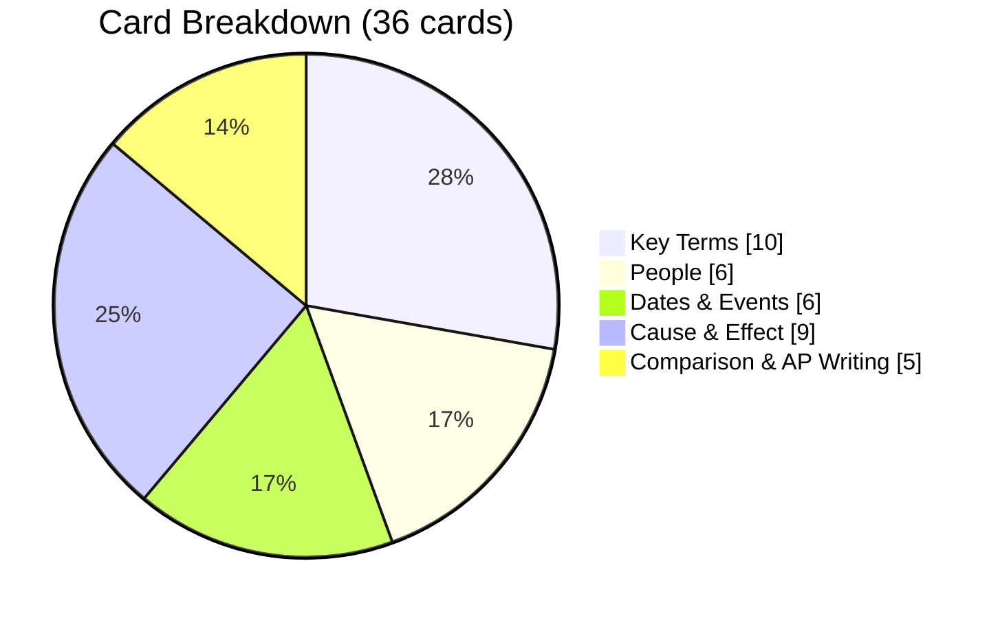

# AP World History: Modern — Topic 2.5 Cultural Consequences of Connectivity · Flashcards

> Source: Based on the College Board CED · Textbook incorporated (Topic 2.5 reading)

---

## 1. Key Terms

- [ ] **What is Chan (Zen) Buddhism?**

▶ Answer
A syncretic faith formed when Buddhist teachings fused with Daoist traditions in China. It stayed popular with ordinary Chinese and spread to Japan as Zen.

- [ ] **What is Neo-Confucianism?**

▶ Answer
A syncretic belief system from China (it began in the Tang and developed in the Song) that fused rational thought with abstract ideas from Daoism and Buddhism. It spread to Japan and Vietnam and became Korea's official state ideology.

- [ ] **What is syncretism? Give one example from 2.5.**

▶ Answer
The blending of different religious or cultural traditions. Examples: Chan Buddhism (Buddhism and Daoism), Neo-Confucianism, Swahili (Bantu and Arabic), and Urdu (Hindi, Arabic, and Farsi).

- [ ] **What is Angkor Thom, and what does it show?**

▶ Answer
The royal city of the Khmer Empire (Angkor Kingdom). Hindu sculptures decorated it, and later Buddhist rulers added Buddhist art while keeping the Hindu art. It shows Hindu and Buddhist influence existing side by side.

- [ ] **What is Swahili?**

▶ Answer
A language that blends Bantu and Arabic and is still widely spoken today. It is an example of Islam's cultural influence in Africa.

- [ ] **What is Urdu?**

▶ Answer
A South Asian language influenced by Sanskrit-based Hindi, Arabic, and Farsi (a Persian language).

- [ ] **Who were the Bhakti poets?**

▶ Answer
Poets and missionaries in South Asia who looked for links between Hinduism and Islam.

- [ ] **What does "vernacular" mean, and how did Buddhist writers use it?**

▶ Answer
Everyday spoken language. Chinese Buddhist writers wrote in the vernacular instead of the formal language of Confucian scholars, and the practice became widespread.

- [ ] **Which four nautical technologies does the textbook list?**

▶ Answer
The lateen sail, the stern rudder, the astrolabe, and the magnetic compass.

- [ ] **What was the Black Death, and how did it reach Europe?**

▶ Answer
The bubonic plague. It came to Europe along trade routes, with a major epidemic in 1347–1351, and killed up to 25 million Europeans.

## 2. People

- [ ] **Who was Xuanzang?**

▶ Answer
A 7th-century Buddhist monk who helped make Buddhism popular in China.

- [ ] **Who was Marco Polo, and what was his point of view?**

▶ Answer
A Venetian merchant who visited Kublai Khan's court and returned in 1295. As a merchant, he focused on trade and cities (paper money, silk, Hangzhou). Many Europeans did not believe him at first.

- [ ] **Who was Ibn Battuta, and what was his point of view?**

▶ Answer
A Moroccan Muslim scholar who set out alone at 21 and traveled for more than 30 years, mostly in Muslim lands. As a devoted Muslim, he wanted to learn about Islam and its people. He dictated *A Gift to Those Who Contemplate the Wonders of Cities and the Marvels of Traveling*.

- [ ] **Who was Margery Kempe?**

▶ Answer
An English mystic (c. 1373–c. 1440) who could not read or write. She dictated *The Book of Margery Kempe*, one of the earliest English autobiographies, about her pilgrimages and her life as a middle-class woman with 14 children.

- [ ] **Who were Lu You and Xin Qiji?**

▶ Answer
Poets of Hangzhou, the cultural center of southern China. (The textbook spells Lu You as "Lu Yu.")

- [ ] **What role did Tamerlane play in 2.5?**

▶ Answer
He ravaged Kashgar in 1389–1390, an example of a city declining because of invasion.

## 3. Dates & Events

- [ ] **960–1279**

▶ Answer
The Song Dynasty. Many Confucian scholar-gentry adopted Buddhist ideals, and Neo-Confucianism developed further.

- [ ] **1204**

▶ Answer
Mutinous Crusader armies attacked Constantinople in the Fourth Crusade and weakened it.

- [ ] **13th century (paper)**

▶ Answer
Papermaking reached Europe from China, and together with printing it raised literacy.

- [ ] **1347–1351**

▶ Answer
A major Black Death epidemic in Europe, with up to 25 million deaths.

- [ ] **1389–1390**

▶ Answer
Tamerlane ravages Kashgar.

- [ ] **1453**

▶ Answer
Constantinople falls to the Ottomans after a 53-day siege. Some historians see this as the end of the High Middle Ages.

## 4. Cause & Effect

- [ ] **Cause: Why could goods, people, and ideas move so freely between 1200 and 1450?**

▶ Answer
The Mongol Empire was stable and protected merchants and travelers. It also reached beyond old borders and brought in new peoples, goods, and ideas.

- [ ] **Effect: What three effects could a spreading religion have, according to the textbook?**

▶ Answer
(1) It unified people and justified a ruler's power, (2) it influenced literature and art, and (3) it fused or coexisted with native religions.

- [ ] **Cause → Effect: Why did Confucian scholar-gentry in the Song adopt Buddhist ideas?**

▶ Answer
Printing had made Buddhist scriptures widely available, so many scholar-gentry read them and brought Buddhist ideals into daily life.

- [ ] **Cause: Why did Buddhists and lower-caste Hindus in South Asia convert to Islam?**

▶ Answer
Buddhists were disillusioned by corruption among Buddhist priests, and lower-caste Hindus were attracted by Islam's emphasis on equality.

- [ ] **Effect: What did Islamic scholars contribute to science?**

▶ Answer
They translated Greek classics into Arabic (saving Aristotle and other writers from being lost), brought back Indian math and Chinese papermaking, and advanced hospital care, including surgery.

- [ ] **Cause → Effect: How did Champa rice affect cities and industry?**

▶ Answer
It gave a reliable food supply, so population grew, and so did cities and industries such as porcelain, silk, steel, and iron.

- [ ] **Cause → Effect: How did paper and printing affect travel writing?**

▶ Answer
They spread literacy, which created eager readers, so more travelers wrote about their journeys.

- [ ] **Cause: Why did cities such as Hangzhou grow?**

▶ Answer
Political stability, safe transportation, rising commerce, plenty of labor, and more farm output. Hangzhou was at the southern end of the Grand Canal and had a thriving Arab merchant community.

- [ ] **Effect: What were the effects of the Crusades on Europe?**

▶ Answer
More knowledge of the Byzantine and Islamic worlds, more demand for Eastern goods, exposure to the Black Death through trade (which weakened feudalism because of labor shortages), and new ideas that contributed to the Renaissance and secularism.

## 5. Comparison & AP Writing

- [ ] **Compare: How did the points of view of Marco Polo, Ibn Battuta, and Margery Kempe differ?**

▶ Answer
Polo had a merchant's view focused on trade and cities. Ibn Battuta had a devoted Muslim's view focused on learning about Islam. Kempe had a mystic's view focused on spiritual visions and a woman's daily life.

- [ ] **Compare: How did the causes of urban growth and urban decline differ?**

▶ Answer
Growth: stability, safe transportation, commerce, labor, and farm output (Hangzhou). Decline: invasions, disease, and lower farm output (Kashgar under Tamerlane; Constantinople after the 1204 Crusade, the plague, and the Ottomans).

- [ ] **AP Short Answer: Explain one cultural effect of networks of exchange from 1200 to 1450.**

▶ Answer

**Claim:** Networks of exchange spread Buddhism into East Asia, where it blended with local traditions. 
**Evidence:** Buddhism came to China from India along the Silk Roads, fused with Daoism to form Chan (Zen) Buddhism, and influenced Neo-Confucianism, which became Korea's state ideology. 
**Reasoning:** Contact along trade routes brought new beliefs, and monks explained them in familiar Daoist terms, so the new religion did not replace local traditions but merged with them.

- [ ] **AP Short Answer: Explain one intellectual or technological effect of networks of exchange.**

▶ Answer

**Claim:** Networks of exchange spread papermaking and printing, which increased literacy. 
**Evidence:** Papermaking reached Europe from China in the 13th century, and travelers such as Marco Polo and Ibn Battuta wrote books for eager readers. 
**Reasoning:** Cheaper writing materials and printing made texts more available, so more people could read, and knowledge about distant lands spread further.

- [ ] **AP Long Essay Thesis: Evaluate the extent to which networks of exchange transformed cultures in Afro-Eurasia from 1200 to 1450.**

▶ Answer

**Claim:** Networks of exchange transformed cultures mainly by blending traditions rather than replacing them, but they also brought destructive change through disease and invasion. 
**Evidence:** Chan Buddhism, Neo-Confucianism, Swahili, Urdu, and Angkor Thom's mixed Hindu and Buddhist art all show blending. The Black Death (up to 25 million European deaths) and the fall of Kashgar and Constantinople show destruction. 
**Reasoning:** Trade let ideas mix with local cultures in lasting ways, while the same connections carried disease and conquest. This shows that connectivity brought both creative and destructive change.

