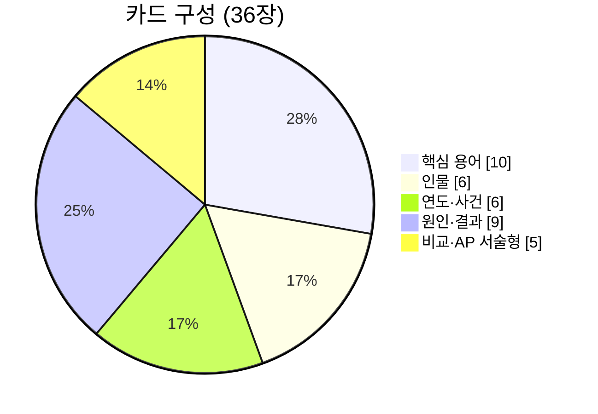

# AP 세계사: 모던 — 토픽 2.5 연결이 낳은 문화적 결과 (Cultural Consequences of Connectivity) · 플래시카드

> 출처: College Board CED 기준 · 교재 반영 (교재 Topic 2.5)

---

## 1. 핵심 용어

- [ ] **선종 (Chan/Zen Buddhism)이란 무엇인가?**

▶ 정답
중국에서 불교 교리가 도교 전통과 섞여 생긴 혼합 신앙이다. 평범한 중국인 사이에서 계속 인기가 있었고, 일본에는 Zen으로 전해졌다.

- [ ] **성리학 (Neo-Confucianism)이란 무엇인가?**

▶ 정답
중국에서 생긴 혼합 사상으로, 당나라 때 시작되어 송나라 때 발전했다. 합리적 사고와 도교·불교의 추상적 개념을 결합했고, 일본과 베트남에 퍼졌으며, 한국의 국가 공식 이념이 되었다.

- [ ] **혼합주의 (Syncretism)란 무엇인가? 2.5에서 예를 하나 들어라.**

▶ 정답
서로 다른 종교나 문화 전통이 섞이는 것이다. 예: 선종(불교와 도교), 성리학, 스와힐리어(반투어와 아랍어), 우르두어(힌디어, 아랍어, 페르시아어).

- [ ] **앙코르 톰 (Angkor Thom)은 무엇이며, 무엇을 보여 주는가?**

▶ 정답
크메르 제국(앙코르 왕국)의 왕도다. 힌두교 조각으로 장식되었는데, 훗날 불교도가 된 통치자들이 힌두교 미술을 그대로 둔 채 불교 미술을 덧붙였다. 힌두교와 불교의 영향이 공존했음을 보여 준다.

- [ ] **스와힐리어 (Swahili)란 무엇인가?**

▶ 정답
반투어와 아랍어가 섞인 언어로, 지금도 널리 쓰인다. 이슬람이 아프리카에 준 문화적 영향의 예다.

- [ ] **우르두어 (Urdu)란 무엇인가?**

▶ 정답
산스크리트어 계통의 힌디어, 아랍어, 페르시아어(파르시어)의 영향을 받은 남아시아의 언어다.

- [ ] **박티 (Bhakti) 시인들은 누구였는가?**

▶ 정답
힌두교와 이슬람의 연결점을 찾은 남아시아의 시인과 선교사들이다.

- [ ] **구어 (Vernacular)란 무엇이며, 불교 작가들은 이를 어떻게 썼는가?**

▶ 정답
일상에서 쓰는 말이다. 중국의 불교 작가들은 유교 학자들의 격식 있는 문어 대신 구어로 글을 썼고, 이 방식이 널리 퍼졌다.

- [ ] **교재가 드는 네 가지 항해 기술은 무엇인가?**

▶ 정답
삼각돛, 선미타, 아스트롤라베, 나침반.

- [ ] **흑사병 (Black Death)이란 무엇이며, 어떻게 유럽에 들어왔는가?**

▶ 정답
선페스트다. 교역로를 따라 유럽에 들어와 1347–1351년에 크게 유행했고, 유럽에서 최대 2,500만 명이 죽었다.

## 2. 인물

- [ ] **현장 (Xuanzang)은 누구인가?**

▶ 정답
중국에서 불교를 널리 알리는 데 기여한 7세기의 불교 승려다.

- [ ] **마르코 폴로 (Marco Polo)는 누구이며, 그의 관점은 무엇이었는가?**

▶ 정답
쿠빌라이 칸의 궁정을 방문하고 1295년에 돌아온 베네치아 상인이다. 상인답게 교역과 도시(지폐, 비단, 항저우)에 집중했다. 처음에는 많은 유럽인이 그의 말을 믿지 않았다.

- [ ] **이븐 바투타 (Ibn Battuta)는 누구이며, 그의 관점은 무엇이었는가?**

▶ 정답
21세에 혼자 길을 떠나 30년 넘게 주로 이슬람 지역을 여행한 모로코의 무슬림 학자다. 독실한 무슬림으로서 이슬람과 무슬림에 대해 배우려 했다. 『도시의 경이와 여행의 놀라움을 생각하는 이들에게 주는 선물』을 구술했다.

- [ ] **마저리 켐프 (Margery Kempe)는 누구인가?**

▶ 정답
읽고 쓸 줄 몰랐던 잉글랜드의 신비주의자(c. 1373–c. 1440)다. 순례와, 자녀 14명을 둔 중산층 여성으로서의 삶을 담은 『마저리 켐프의 서』를 구술했다. 영어로 된 가장 이른 자서전 중 하나다.

- [ ] **육유 (Lu You)와 신기질 (Xin Qiji)은 누구인가?**

▶ 정답
남중국의 문화 중심지인 항저우의 시인들이다. (교재는 육유를 "Lu Yu"로 표기한다.)

- [ ] **2.5에서 티무르 (Tamerlane)는 어떤 역할을 했는가?**

▶ 정답
1389–1390년에 카슈가르를 짓밟았다. 침입 때문에 도시가 쇠퇴한 예다.

## 3. 연도·사건

- [ ] **960–1279년**

▶ 정답
송나라. 많은 유교 사대부가 불교의 이상을 받아들였고, 성리학이 더 발전했다.

- [ ] **1204년**

▶ 정답
제4차 십자군 때 반란을 일으킨 십자군이 콘스탄티노폴리스를 공격해 약하게 만들었다.

- [ ] **13세기 (종이)**

▶ 정답
제지술이 중국에서 유럽으로 전해졌고, 인쇄술과 함께 문해력을 높였다.

- [ ] **1347–1351년**

▶ 정답
유럽의 흑사병 대유행. 최대 2,500만 명이 죽었다.

- [ ] **1389–1390년**

▶ 정답
티무르가 카슈가르를 짓밟았다.

- [ ] **1453년**

▶ 정답
53일간의 포위 끝에 콘스탄티노폴리스가 오스만에 함락되었다. 일부 역사가는 이를 중세 전성기의 끝으로 본다.

## 4. 원인·결과

- [ ] **원인: 1200–1450년에 상품, 사람, 사상이 그렇게 자유롭게 오갈 수 있었던 이유는?**

▶ 정답
몽골 제국이 안정되어 있었고 상인과 여행자를 보호했기 때문이다. 몽골은 이전의 경계를 넘어 새로운 사람, 상품, 사상을 받아들였다.

- [ ] **결과: 교재에 따르면 종교가 퍼질 때 나타날 수 있는 세 가지 결과는?**

▶ 정답
(1) 사람들을 하나로 묶고 통치자의 권위를 정당화했다. (2) 문학과 미술에 영향을 주었다. (3) 현지 종교와 섞이거나 공존했다.

- [ ] **원인 → 결과: 송나라의 유교 사대부가 불교 사상을 받아들인 이유는?**

▶ 정답
인쇄술 덕분에 불경을 쉽게 구할 수 있었다. 그래서 많은 사대부가 불경을 읽고 불교의 이상을 일상에 받아들였다.

- [ ] **원인: 남아시아의 불교도와 하층 카스트 힌두교도가 이슬람으로 개종한 이유는?**

▶ 정답
불교도는 불교 승려의 부패에 실망했고, 하층 카스트 힌두교도는 평등을 강조하는 이슬람에 끌렸다.

- [ ] **결과: 이슬람 학자들은 과학에 무엇을 기여했는가?**

▶ 정답
그리스 고전을 아랍어로 번역해 아리스토텔레스 등의 저작이 사라지지 않게 지켰고, 인도 수학과 중국 제지술을 들여왔으며, 외과 수술을 포함한 병원 진료를 발전시켰다.

- [ ] **원인 → 결과: 참파 쌀은 도시와 산업에 어떤 영향을 주었는가?**

▶ 정답
식량 공급이 안정되어 인구가 늘었고, 도시와 도자기·비단·강철·철 같은 산업도 성장했다.

- [ ] **원인 → 결과: 종이와 인쇄술은 여행기에 어떤 영향을 주었는가?**

▶ 정답
문해력이 퍼지면서 열성적인 독자가 생겼고, 그래서 더 많은 여행자가 여행기를 썼다.

- [ ] **원인: 항저우 같은 도시가 성장한 이유는?**

▶ 정답
정치적 안정, 안전한 교통, 상업의 발달, 풍부한 노동력, 농업 생산의 증가 덕분이다. 항저우는 대운하 남쪽 끝에 있었고 아랍 상인 공동체가 번성했다.

- [ ] **결과: 십자군은 유럽에 어떤 결과를 가져왔는가?**

▶ 정답
비잔티움과 이슬람 세계에 대한 지식이 늘었고, 동방 상품에 대한 수요가 커졌다. 교역을 통해 흑사병에 노출되었고(노동력 부족으로 봉건제가 약해짐), 새로운 사상이 르네상스와 세속주의에 기여했다.

## 5. 비교·AP 서술형

- [ ] **비교: 마르코 폴로, 이븐 바투타, 마저리 켐프의 관점은 어떻게 달랐는가?**

▶ 정답
폴로는 교역과 도시에 집중한 상인의 관점이었다. 이븐 바투타는 이슬람에 대해 배우려 한 독실한 무슬림의 관점이었다. 켐프는 영적 환상과 여성의 일상에 집중한 신비주의자의 관점이었다.

- [ ] **비교: 도시가 성장한 원인과 쇠퇴한 원인은 어떻게 달랐는가?**

▶ 정답
성장: 안정, 안전한 교통, 상업, 노동력, 농업 생산(항저우). 쇠퇴: 침입, 질병, 농업 생산성 감소(티무르에게 짓밟힌 카슈가르, 1204년 십자군과 흑사병과 오스만을 겪은 콘스탄티노폴리스).

- [ ] **AP 단답형: 1200–1450년 교류 네트워크가 낳은 문화적 결과 하나를 설명하라.**

▶ 정답

**주장:** 교류 네트워크는 불교를 동아시아에 퍼뜨렸고, 불교는 그곳에서 현지 전통과 섞였다. 
**근거:** 불교는 인도에서 실크로드를 따라 중국에 전해져 도교와 결합해 선종이 되었고, 한국의 국가 이념이 된 성리학에도 영향을 주었다. 
**설명:** 교역로를 통한 접촉이 새로운 신앙을 들여왔고, 승려들이 이를 익숙한 도교 용어로 설명했다. 그래서 새 종교는 현지 전통을 대신하지 않고 그것과 합쳐졌다.

- [ ] **AP 단답형: 교류 네트워크가 낳은 지적·기술적 결과 하나를 설명하라.**

▶ 정답

**주장:** 교류 네트워크는 제지술과 인쇄술을 퍼뜨려 문해력을 높였다. 
**근거:** 13세기에 제지술이 중국에서 유럽으로 전해졌고, 마르코 폴로와 이븐 바투타 같은 여행자들이 열성적인 독자를 위해 책을 썼다. 
**설명:** 더 싼 필기 재료와 인쇄술로 책을 구하기 쉬워져 더 많은 사람이 글을 읽게 되었고, 먼 지역에 대한 지식이 더 널리 퍼졌다.

- [ ] **AP 논술형 논지: 1200–1450년 교류 네트워크가 아프로-유라시아의 문화를 어느 정도 변화시켰는지 평가하라.**

▶ 정답

**주장:** 교류 네트워크는 주로 전통을 대체하기보다 섞는 방식으로 문화를 바꾸었다. 그러나 질병과 침입을 통해 파괴적인 변화도 가져왔다. 
**근거:** 선종, 성리학, 스와힐리어, 우르두어, 그리고 힌두교와 불교 미술이 함께 있는 앙코르 톰은 모두 혼합을 보여 준다. 흑사병(유럽에서 최대 2,500만 명 사망)과 카슈가르·콘스탄티노폴리스의 몰락은 파괴를 보여 준다. 
**설명:** 교역은 사상이 현지 문화와 오래가는 방식으로 섞이게 했지만, 같은 연결망이 질병과 정복도 옮겼다. 이는 연결이 창조적 변화와 파괴적 변화를 함께 가져왔음을 보여 준다.

