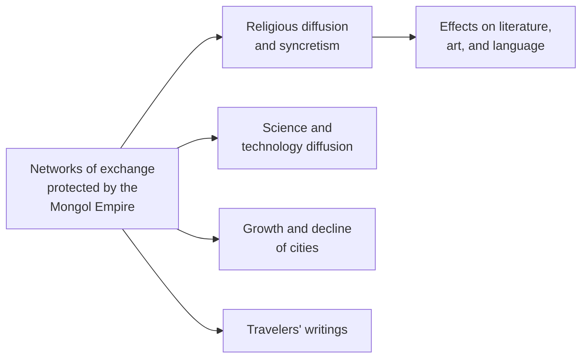
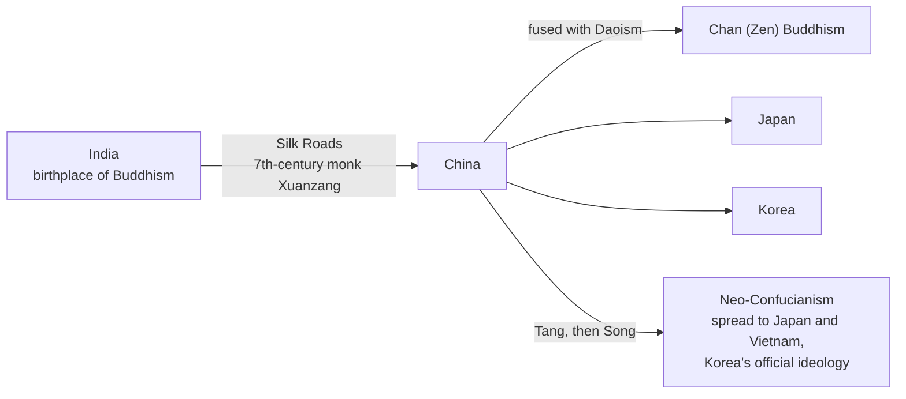
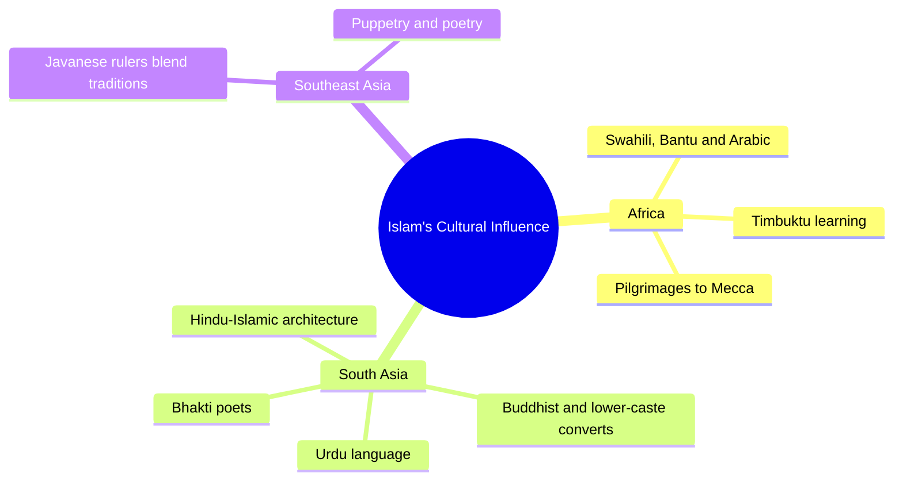
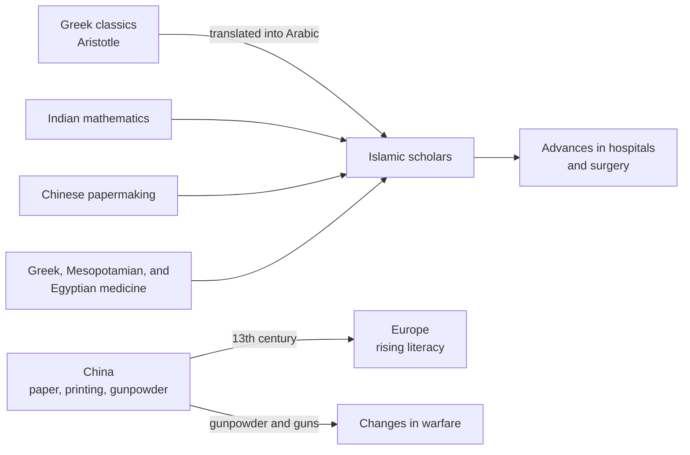
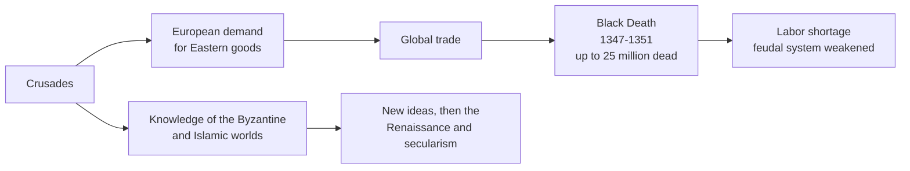
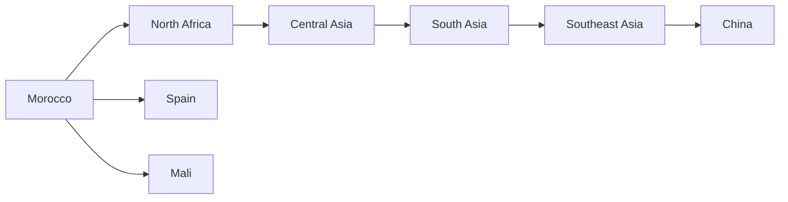
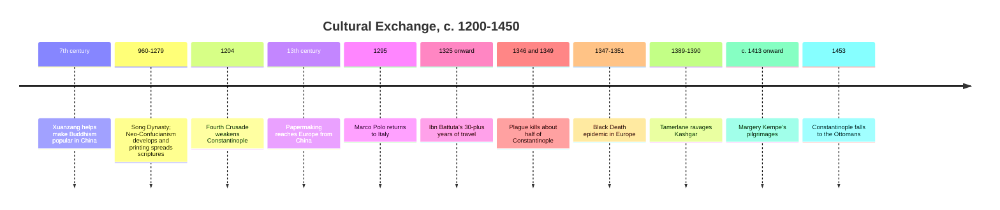
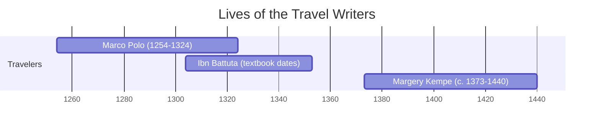

# AP World History: Modern — Topic 2.5 Cultural Consequences of Connectivity

**Focus Question (textbook Essential Question):** What were the intellectual and cultural effects of the trade networks from c. 1200 to c. 1450?

> Source: Based on the College Board CED · Textbook incorporated (Topic 2.5 reading)

**Unit 2: Networks of Exchange (c. 1200–1450)**

---

## Learning Objective

| Code | Learning Objective |
|---|---|
| 2.5 LO | Explain the intellectual and cultural effects of the various networks of exchange in Afro-Eurasia from c. 1200 to c. 1450. |

## Historical Developments (CED)

| # | Historical Development | Covered in |
|---|---|---|
| HD1 | As exchange networks intensified, an increasing number of travelers within Afro-Eurasia wrote about their travels. Examples: Ibn Battuta, Marco Polo, Margery Kempe. | §6 |
| HD2 | Increased cross-cultural interactions resulted in the diffusion of literary, artistic, and cultural traditions. Examples: the influence of Buddhism in East Asia, Hinduism and Buddhism in Southeast Asia, and Islam in Sub-Saharan Africa and Southeast Asia. | §1, §2, §3 |
| HD3 | Increased cross-cultural interactions also resulted in the diffusion of scientific and technological traditions. Examples: the influence of Greek and Indian mathematics on Muslim scholars; the return of Greek science and philosophy to Western Europe via Muslim al-Andalus in Iberia; the spread of printing and gunpowder technologies from East Asia into the Islamic empires and Western Europe. | §4 |

---

## The Big Picture

> "I have not told half of what I saw, for I knew I would not be believed."
> — Marco Polo (1254–1324; the textbook prints 1245)

> ⚠️ The textbook gives Marco Polo's birth year as 1245. Most sources say 1254. Check with your teacher.

From about 1200 to 1450, **goods, people, and ideas** moved with relative freedom along Afro-Eurasia's networks of exchange: by caravan across the Sahara and Gobi deserts, and by junk or dhow on the China Sea and the Indian Ocean. One reason was the **stability of the Mongol Empire** and the protection it gave merchants and travelers. **Religions** spread and often **fused** with local faiths (**Chan/Zen Buddhism**, **Neo-Confucianism**, Hindu and Buddhist art at **Angkor**, Islam blending into the **Swahili** and **Urdu** languages). **Technology** (paper, printing, gunpowder, Champa rice, nautical tools) spread through trade. **Trade cities** such as **Hangzhou** grew, while others, such as **Kashgar** and **Constantinople**, declined. **Travelers** such as **Marco Polo**, **Ibn Battuta**, and **Margery Kempe** wrote about it all. "The known world became a larger place."

**Three possible effects of a spreading religion (textbook):**
1. It **unified people** and **justified a kingdom's leadership**.
2. It **influenced literature and art**, inspiring their themes, subjects, and styles.
3. It **fused or coexisted** with native religions.

---

## §1. Buddhism in East Asia

- Buddhism reached China from India along the **Silk Roads**. The **7th-century monk Xuanzang** helped make it popular.
- Monks explained Buddhism using familiar **Daoist** principles. Over time, the two fused into the syncretic faith **Chan Buddhism** (**Zen** in Japan).
- Some Chinese leaders feared Buddhism would weaken China's native religions, but Chan stayed **popular with ordinary people**.
- Under the **Song Dynasty (960–1279)**, many **Confucian scholar-gentry** adopted Buddhist ideals in daily life. **Printing** had made Buddhist scriptures widely available to them.
- Buddhist writers used the **vernacular** (everyday language) instead of the formal language of Confucian scholars, a practice that became widespread.
- **Japan and Korea** adopted Buddhism along with Confucianism. In **Korea**, the educated elite studied Confucian classics, while Buddhism attracted **peasants**.
- **Neo-Confucianism:** another syncretic belief system from China. It first appeared in the **Tang** and developed further in the **Song**. It fused **rational thought** with abstract ideas from **Daoism and Buddhism**, spread widely in **Japan and Vietnam**, and became **Korea's official state ideology**.

## §2. Hinduism and Buddhism in Southeast Asia and South Asia

| State | Location | Religion | Notes |
|---|---|---|---|
| **Srivijaya Empire** | Sumatra (sea-based) | **Hindu** kingdom (textbook) ⚠️ | Spread through trade |
| **Majapahit Kingdom** | Java (later) | **Buddhist** (textbook) ⚠️ | — |
| **Sinhala dynasties** | Sri Lanka (land-based) | **Buddhist** | Centers of Buddhist study with many monasteries; Buddhist priests often **advised monarchs** on government |
| **Khmer Empire (Angkor Kingdom)** | Present-day Cambodia | **Hindu, then Buddhist** | The most successful kingdom in Southeast Asia; see below |

> ⚠️ Many sources describe Srivijaya as mainly **Buddhist** (Mahayana) and Majapahit as mainly **Hindu** (Shaiva, with Buddhist elements), the reverse of the textbook. Check how your teacher presents this.

**Angkor Thom (Khmer Empire):**
- The royal monuments at **Angkor Thom** show both **Hindu and Buddhist** influence in Southeast Asia.
- Hindu artwork and sculptures of Hindu gods decorated the city. When later Khmer rulers became Buddhist, they **added Buddhist sculptures and art while keeping the Hindu art**. This is an example of **coexistence**.

> **Changed from the earlier version:** The earlier note used Angkor **Wat** as the example. The textbook uses Angkor **Thom**, the royal city. Both show the shift from Hindu to Buddhist art.

## §3. The Spread of Islam and Its Cultural Influence

Islam spread across Africa, South Asia, and Southeast Asia through **merchants, missionaries, and conquests**.

### Textbook Table: Cultural Influences of Islam in Afro-Eurasia

| Region | Influences |
|---|---|
| **Africa** | **Swahili** language: a blend of Bantu and Arabic, still widely spoken; **Timbuktu** became a center of Islamic learning; African leaders deepened Islamic ties through **pilgrimages to Mecca** |
| **South Asia** | Before Islam, Hinduism and Buddhism were popular. After Islam arrived, **Buddhists converted more readily** than Hindus because they were disillusioned by corruption among Buddhist priests; Islam's emphasis on **equality** attracted **lower-caste Hindus**; architecture blended **Hindu designs with Islamic patterns**; the **Urdu** language drew on Sanskrit-based Hindi, Arabic, and Farsi (a Persian language); **Bhakti** poets and missionaries looked for links between Hinduism and Islam |
| **Southeast Asia** | Muslim rulers on **Java** combined Mughal Indian features, local traditions, and Chinese Buddhist and Confucian traits; traditional Javanese stories, **puppetry**, and poetry took in Muslim characters and techniques |

> ⚠️ The textbook says Javanese rulers combined "Mughal" features, but the Mughal Empire began in 1526, after this unit's time period. This probably refers to later developments or to Indian Islamic influence in general.

## §4. Scientific and Technological Diffusion

| Area | What spread | Effect |
|---|---|---|
| **Translation and learning** | **Islamic scholars** translated Greek classics into Arabic and **saved Aristotle's works and other Greek writings from being lost**; they also brought back Indian math texts and Chinese papermaking | Preserved and built on world knowledge |
| **Medicine** | Studied medicine from ancient Greeks, Mesopotamians, and Egyptians | Advances in **hospital care, including surgery** |
| **Agriculture** | **Champa rice** spread from India to Vietnam and China | A reliable food supply, which grew population, cities, and industries (porcelain, silk, steel, iron) |
| **Paper and printing** | Papermaking reached **Europe** from China in the **13th century** | Together with printing, **literacy rose** |
| **Seafaring** | **Lateen sail, stern rudder, astrolabe, magnetic compass** | Chinese, Indian, and Southwest Asian sailors expanded their knowledge of astronomy and the natural world |
| **Warfare** | **Gunpowder and guns** spread from China | Changed warfare |
| **CED: al-Andalus** | Greek science and philosophy **returned to Western Europe** through Muslim Iberia (see 2.4: Ibn Rushd and al-Andalus) | Later contributed to the Renaissance |

> ⚠️ The textbook says Champa rice spread "from India to Vietnam and China." Most sources say it came from **Champa (central Vietnam)** to Song China. The 2.6 reading explains the difference: because Champa was under Hindu influence, some scholars think the rice may have come from India originally. Note 2.6 covers both views.

## §5. Cities: Growth and Decline

### Hangzhou: Trade Supports Cities

- Thanks partly to **Marco Polo**, historians have a clear picture of **Hangzhou**, a city that shows how **trade supported urbanization**.
- Population: about **1 million** (Chang'an was larger, about **2 million**).
- It was the **cultural center of southern China**, home to poets such as **Lu You** (spelled "Lu Yu" in the textbook) and **Xin Qiji**.
- It sat at the **southern end of the Grand Canal** and was a **center of trade**, with a thriving community of **Arabs**.
- Other cities that grew through trade: **Novgorod** (Russia), **Timbuktu** (Africa), **Calicut** (India), **Samarkand**, and **Kashgar** (see 2.1).

### Declining Cities

| City | What happened |
|---|---|
| **Kashgar** | Declined after a series of conquests by **nomadic invaders**; **ravaged by Tamerlane in 1389–1390** (see 2.2) |
| **Constantinople** | Weakened by mutinous Crusader armies in the **Fourth Crusade (1204)**; the **bubonic plague** in 1346 and 1349 killed about **half** its people; fell to the **Ottomans in 1453** after a 53-day siege, an event some historians see as the **end of the High Middle Ages** |

### Textbook Tables: Factors in the Growth and Decline of Cities

| Factors in growth | Factors in decline |
|---|---|
| Political stability and fewer invasions | Political instability and invasions |
| Safe and reliable transportation | Disease |
| Rise of commerce | Lower agricultural productivity |
| Plentiful labor supply | — |
| Higher agricultural output | — |

### Effects of the Crusades

- Crusaders met the **Byzantine and Islamic** cultures, which increased European knowledge of the wider world and demand for Eastern goods.
- Opening to trade also opened Europe to **disease**. The **Black Death** arrived along trade routes, with a major epidemic in **1347–1351** and more outbreaks later.
- As many as **25 million** Europeans may have died. Economic activity fell, and the shortage of farm workers had **lasting effects on the feudal system**.
- New ideas from Byzantium and the Muslim world helped bring about the **Renaissance** and the later rise of **secularism**.

## §6. Travelers' Tales

As exchange networks grew and **literacy spread** because of paper and printing, more travelers wrote about their journeys for eager readers.

| Traveler | Background | Journey | Point of view | Significance |
|---|---|---|---|---|
| **Marco Polo** (Venice) | Italian merchant | Visited **Kublai Khan's** court in the late 13th century; returned to Italy in **1295** and wrote a book | **A merchant's view**, focused on trade (paper money, silk, cities) | Many Europeans **did not believe** his descriptions of China's size and wealth until others followed his route; he wrote a lot about **urbanization** |
| **Ibn Battuta** (1304–1353 in the textbook) | Muslim scholar from Morocco; set out alone at **21** | Traveled for **more than 30 years** through Central, Southeast, and South Asia, China, Spain, North Africa, and Mali, mostly Muslim lands | **A devoted Muslim's view**: his goal was to learn about Islam and its people | Dictated his book at the Sultan of Morocco's command: *A Gift to Those Who Contemplate the Wonders of Cities and the Marvels of Traveling* |
| **Margery Kempe** (c. 1373–c. 1440) | English mystic who **could not read or write** | Pilgrimages to **Jerusalem, Rome, Germany, and Spain** | **A mystic's view**: intense spiritual visions | *The Book of Margery Kempe*, dictated to scribes, is one of the **earliest autobiographies in English**, if not the first, and a **firsthand account of a middle-class medieval woman's life** (with 14 children) |

> **Marco Polo on Hangzhou:** "They use paper money as currency. The men as well as the women are fair-skinned and handsome. Most of them always dress themselves in silk, as a result of the vast quantities of that material produced in Hangzhou..."

> **Ibn Battuta on setting out:** "I set out alone, having neither fellow-traveller in whose companionship I might find cheer, nor caravan whose part I might join, but swayed by an overmastering impulse within me..."

> **Kempe's detail:** she was so overwhelmed by the sight of Jerusalem that she nearly fell off her donkey.

*Regions on Ibn Battuta's journey listed in the textbook (simplified, not in order)*

---

## Timeline

---

## Comparison Table: Three Travelers

| Feature | Marco Polo | Ibn Battuta | Margery Kempe |
|---|---|---|---|
| Origin | Venice (Italy) | Morocco | England |
| Religion | Christian | Muslim | Christian |
| Identity | Merchant | Scholar | Mystic and pilgrim |
| Point of view | Trade and cities | Faith; learning about the Islamic world | Spiritual visions and a woman's daily life |
| How the book was made | Wrote it after returning in 1295 | Dictated it at the Sultan of Morocco's command | Dictated it to scribes because she could not read or write |
| Significance | Opened European eyes to China | Recorded the reach of Dar al-Islam | One of the earliest autobiographies in English |

---

## Key Terms

| Theme | Term | Definition |
|---|---|---|
| Environment (Disease) | Black Death | The plague that spread to Europe along trade routes (1347–1351; up to 25 million dead) |
| Culture (Travel writers) | Marco Polo | A Venetian merchant who visited Kublai Khan's court |
| Culture (Travel writers) | Ibn Battuta | A Moroccan Muslim scholar who traveled for more than 30 years |
| Culture (Travel writers) | Margery Kempe | An English mystic; *The Book of Margery Kempe* is an early English autobiography |
| Culture (Language) | Swahili | A blend of Bantu and Arabic, still widely spoken |
| Culture (Language) | Urdu | A language drawing on Hindi, Arabic, and Farsi |
| Technology (Nautical) | Lateen sail | A triangular sail that catches wind from many directions |
| Technology (Nautical) | Stern rudder | A Chinese invention for stable steering |
| Technology (Nautical) | Astrolabe | A tool for finding latitude |
| Technology (Nautical) | Magnetic compass | A navigation tool pointing to magnetic north |
| Society (Cities) | Hangzhou | A trade and culture center of southern China (about 1 million people) |
| Society (Cities) | Samarkand | A Silk Roads center of Islamic scholarship |
| Society (Cities) | Kashgar | A Silk Roads oasis city, ravaged by Tamerlane (1389–1390) |
| Society (Cities) | Constantinople | Weakened by the Crusade (1204) and plague; fell to the Ottomans (1453) |
| Additional | Chan (Zen) Buddhism | A syncretic blend of Buddhism and Daoism |
| Additional | Neo-Confucianism | A blend of rational thought with Daoist and Buddhist ideas; Korea's state ideology |
| Additional | Syncretism | The blending of different religious or cultural traditions |
| Additional | Angkor Thom | A Khmer royal city with both Hindu and Buddhist art |
| Additional | Bhakti | A devotional movement whose poets looked for links between Hinduism and Islam |
| Additional | Vernacular | Everyday spoken language, as opposed to formal scholarly language |
| CED | al-Andalus | Muslim Iberia, through which Greek learning returned to Western Europe |
