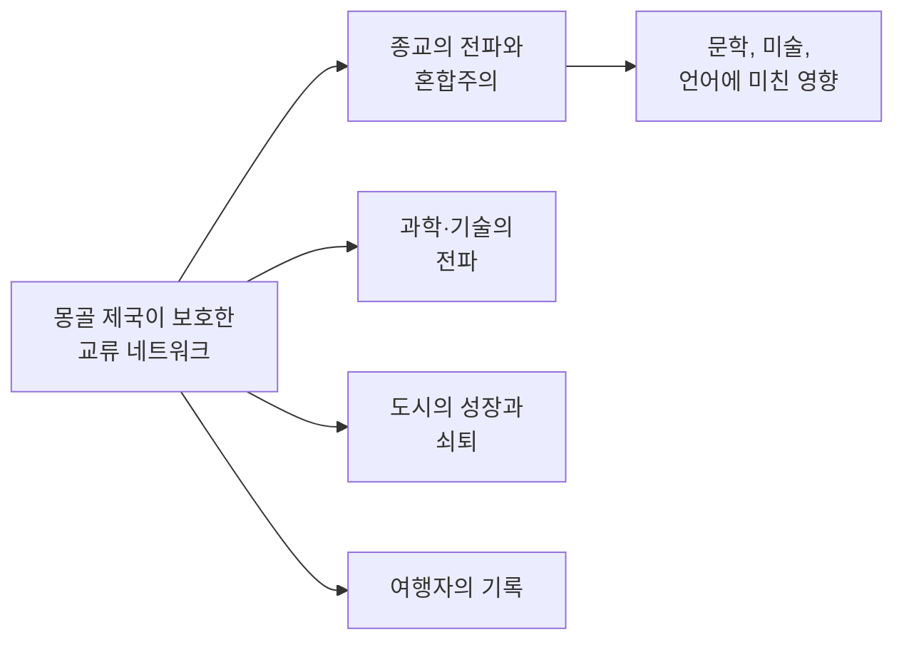
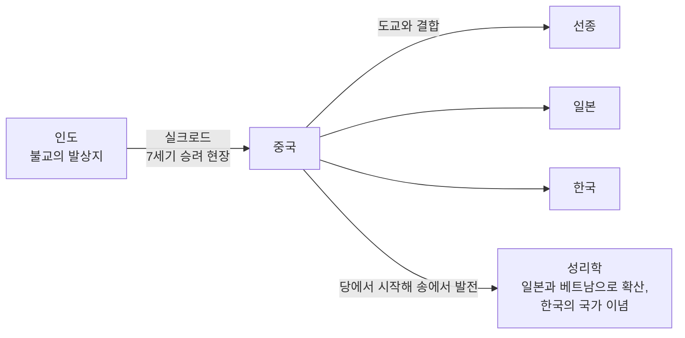
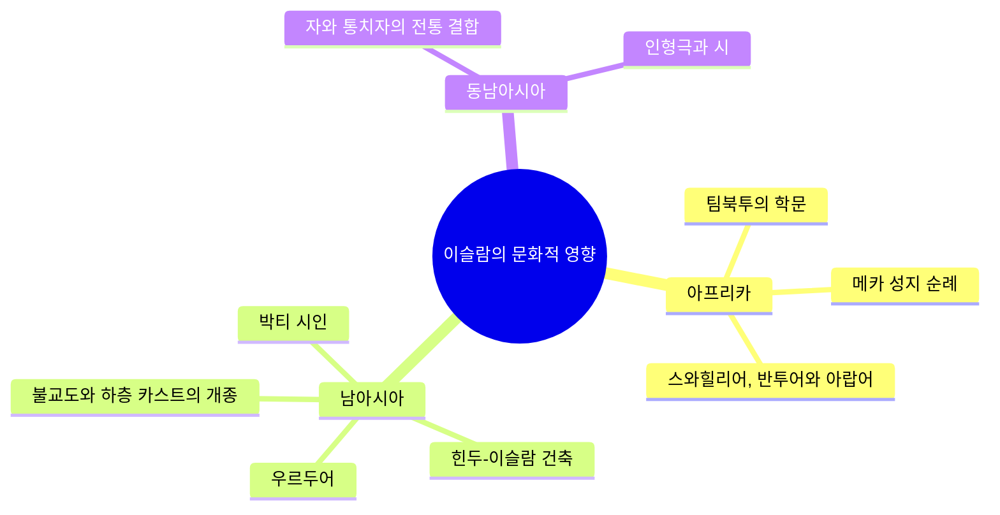
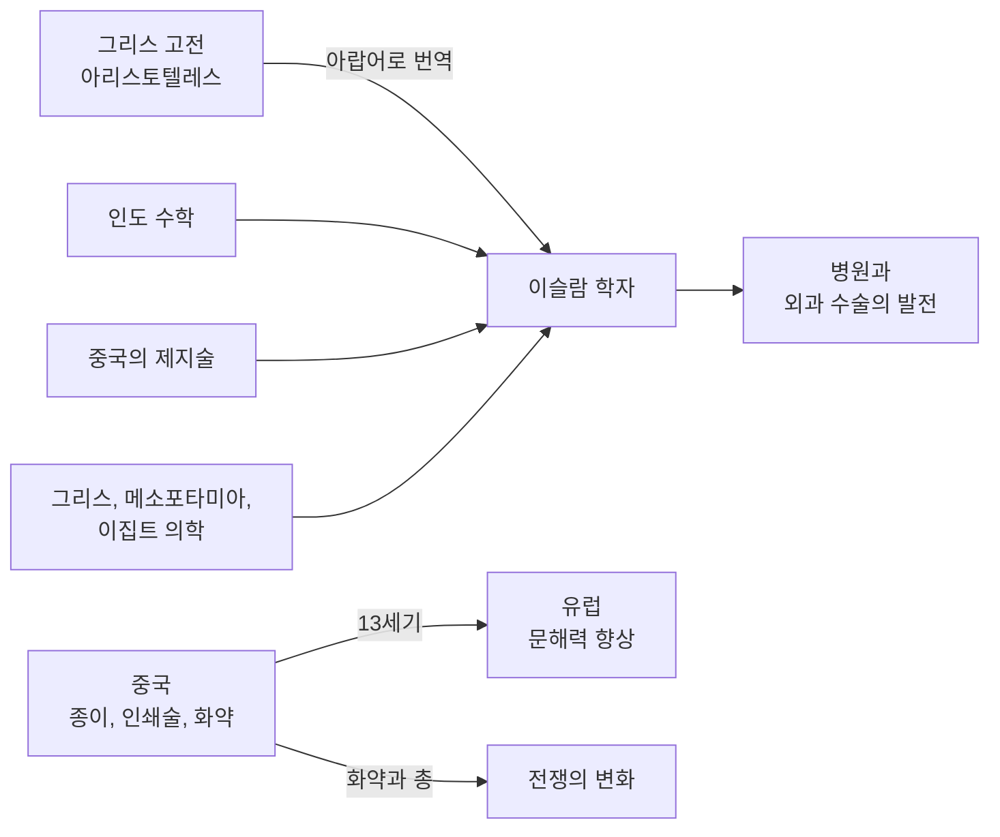
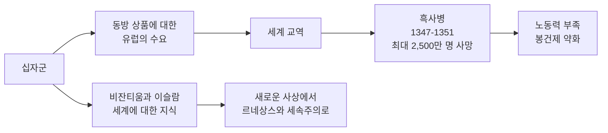
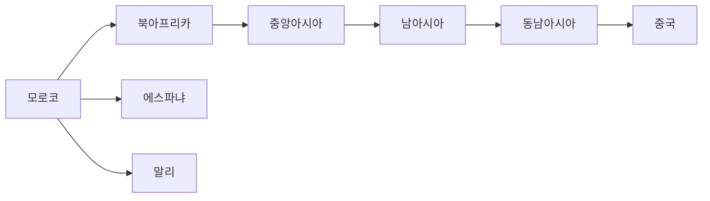
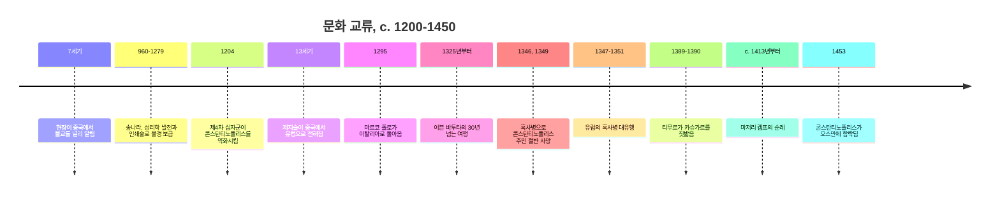
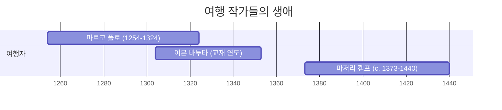

# AP 세계사: 모던 — 토픽 2.5 연결이 낳은 문화적 결과 (Cultural Consequences of Connectivity)

**Focus Question (교재 Essential Question):** c. 1200–1450년 교역 네트워크가 낳은 지적·문화적 결과는 무엇이었는가?

> 출처: College Board CED 기준 · 교재 반영 (교재 Topic 2.5)

**Unit 2: 교류의 네트워크 (Networks of Exchange, c. 1200–1450)**

---

## 학습 목표 (Learning Objective)

| 코드 | 학습 목표 |
|---|---|
| 2.5 LO | c. 1200–1450년 아프로-유라시아의 여러 교류 네트워크가 낳은 지적·문화적 영향을 설명하라. |

## 역사적 개념 (Historical Developments, CED)

| # | 역사적 개념 | 다루는 곳 |
|---|---|---|
| HD1 | 교류 네트워크가 활발해지면서 아프로-유라시아에서 여행을 기록한 여행자가 늘었다. 예: 이븐 바투타 (Ibn Battuta), 마르코 폴로 (Marco Polo), 마저리 켐프 (Margery Kempe). | §6 |
| HD2 | 문화 간 교류가 늘면서 문학·예술·문화 전통이 전파되었다. 예: 동아시아의 불교, 동남아시아의 힌두교와 불교, 사하라 이남 아프리카와 동남아시아의 이슬람. | §1, §2, §3 |
| HD3 | 문화 간 교류가 늘면서 과학·기술 전통도 전파되었다. 예: 그리스·인도 수학이 무슬림 학자에게 준 영향, 이슬람 이베리아 알안달루스 (al-Andalus)를 거쳐 그리스 과학·철학이 서유럽으로 돌아간 것, 인쇄술과 화약 기술이 동아시아에서 이슬람 제국과 서유럽으로 전파된 것. | §4 |

---

## 큰 그림 요약

> "나는 내가 본 것의 절반도 말하지 않았다. 아무도 믿지 않을 것을 알았기 때문이다."
> — 마르코 폴로 (Marco Polo) (1254–1324, 교재 표기는 1245)

> ⚠️ 교재는 마르코 폴로의 출생 연도를 1245년으로 쓴다. 대부분의 자료는 1254년으로 본다. 선생님께 확인이 필요하다.

약 1200년부터 1450년까지 **상품, 사람, 사상**은 아프로-유라시아의 교류 네트워크를 따라 비교적 자유롭게 오갔다. 사하라 사막과 고비 사막은 대상으로, 중국해와 인도양은 정크선이나 다우선으로 건넜다. 그 이유 중 하나는 **몽골 제국의 안정**과, 몽골이 상인과 여행자에게 준 보호였다. **종교**가 퍼지면서 현지 신앙과 **섞이는** 경우가 많았다. **선종 (Chan/Zen Buddhism)**, **성리학 (Neo-Confucianism)**, **앙코르**의 힌두교·불교 미술, 그리고 **스와힐리어**와 **우르두어**에 녹아든 이슬람이 그 예다. **기술**(종이, 인쇄술, 화약, 참파 쌀, 항해 도구)은 교역을 따라 퍼졌다. **항저우** 같은 **교역 도시**는 성장했고, **카슈가르**와 **콘스탄티노폴리스** 같은 도시는 쇠퇴했다. **마르코 폴로**, **이븐 바투타**, **마저리 켐프** 같은 **여행자**들이 이 모든 것을 기록했다. "알려진 세계가 더 넓어졌다."

**교재가 말하는, 종교가 퍼질 때 나타날 수 있는 세 가지 결과:**
1. 사람들을 **하나로 묶고**, **왕국 지도층의 권위를 정당화**했다.
2. **문학과 미술**에 영향을 주어 주제, 소재, 양식을 바꾸었다.
3. 현지 종교와 **섞이거나 공존**했다.

---

## §1. 동아시아의 불교

- 불교는 인도에서 **실크로드**를 따라 중국에 전해졌다. **7세기 승려 현장 (Xuanzang)**이 불교를 널리 알리는 데 기여했다.
- 승려들은 익숙한 **도교** 원리로 불교를 설명했다. 시간이 지나면서 둘이 섞여 혼합 신앙인 **선종 (Chan Buddhism)**(일본에서는 **Zen**)이 생겼다.
- 일부 중국 지도자는 불교 때문에 중국 고유 종교가 약해질까 걱정했지만, 선종은 **평범한 사람들 사이에서 계속 인기**가 있었다.
- **송나라 (960–1279)** 때 많은 **유교 사대부**가 불교의 이상을 일상생활에 받아들였다. **인쇄술** 덕분에 불경을 쉽게 구할 수 있었기 때문이다.
- 불교 작가들은 유교 학자들의 격식 있는 문어 대신 **구어 (Vernacular)**로 글을 썼고, 이 방식이 널리 퍼졌다.
- **일본과 한국**은 유교와 함께 불교를 받아들였다. **한국**에서는 교육받은 엘리트가 유교 경전을 공부했고, 불교는 **농민**에게 인기가 있었다.
- **성리학 (Neo-Confucianism):** 중국에서 생긴 또 하나의 혼합 사상이다. **당나라** 때 처음 나타나 **송나라** 때 더 발전했다. **합리적 사고**와 **도교·불교**의 추상적 개념을 결합했고, **일본과 베트남**에 널리 퍼졌으며, **한국의 국가 공식 이념**이 되었다.

## §2. 동남아시아와 남아시아의 힌두교와 불교

| 국가 | 위치 | 종교 | 특징 |
|---|---|---|---|
| **스리위자야 제국 (Srivijaya)** | 수마트라 (해상 국가) | **힌두교** 왕국 (교재) ⚠️ | 교역을 통해 종교가 전해짐 |
| **마자파힛 왕국 (Majapahit)** | 자와 (더 나중) | **불교** (교재) ⚠️ | — |
| **싱할라 왕조 (Sinhala dynasties)** | 스리랑카 (육상 국가) | **불교** | 사원이 많은 불교 연구의 중심지. 불교 승려가 정치에 관해 **왕에게 조언**하는 일이 많았음 |
| **크메르 제국 (앙코르 왕국, Angkor Kingdom)** | 지금의 캄보디아 | **힌두교에서 불교로** | 동남아시아에서 가장 번성한 왕국. 아래 참고 |

> ⚠️ 많은 자료는 스리위자야를 주로 **불교**(대승) 국가로, 마자파힛을 주로 **힌두교**(시바파, 불교 요소 포함) 국가로 본다. 교재와 정반대다. 선생님이 어떻게 가르치는지 확인이 필요하다.

**앙코르 톰 (Angkor Thom, 크메르 제국):**
- **앙코르 톰**의 왕실 건축물에는 동남아시아에 들어온 **힌두교와 불교**의 영향이 함께 남아 있다.
- 도시는 힌두교 미술과 힌두교 신들의 조각으로 장식되었다. 훗날 크메르 통치자들이 불교도가 되자, **힌두교 미술은 그대로 두고 불교 조각과 미술을 덧붙였다.** **공존**을 보여 주는 예다.

> **이전 버전에서 바뀐 점:** 이전 노트는 앙코르 **와트**를 예로 들었다. 교재는 왕도인 앙코르 **톰**을 예로 든다. 둘 다 힌두교에서 불교로 바뀐 미술을 보여 준다.

## §3. 이슬람의 확산과 문화적 영향

이슬람은 **상인, 선교사, 정복**을 통해 아프리카, 남아시아, 동남아시아의 넓은 지역에 퍼졌다.

### 교재 표: 아프로-유라시아에 미친 이슬람의 문화적 영향

| 지역 | 영향 |
|---|---|
| **아프리카** | 반투어와 아랍어가 섞인 **스와힐리어 (Swahili)**는 지금도 널리 쓰임. **팀북투**가 이슬람 학문의 중심지가 됨. 아프리카 국가의 지도자들이 **메카 성지 순례**로 이슬람과의 유대를 깊게 함 |
| **남아시아** | 이슬람 이전에는 힌두교와 불교가 널리 믿어짐. 이슬람이 들어온 뒤에는 불교 승려의 부패에 실망한 **불교도가 힌두교도보다 더 쉽게 개종**함. **평등**을 강조하는 이슬람은 **하층 카스트 힌두교도**에게도 매력이 있었음. 건축에서 **힌두교 양식과 이슬람 문양**이 섞임. **우르두어 (Urdu)**는 산스크리트어 계통의 힌디어, 아랍어, 페르시아어(파르시어)의 영향을 받음. **박티 (Bhakti)** 시인과 선교사들이 힌두교와 이슬람의 연결점을 찾음 |
| **동남아시아** | **자와**의 무슬림 통치자들이 무굴 인도의 특징, 현지 전통, 중국의 불교·유교적 특성을 결합함. 자와의 전통 이야기, **인형극**, 시가 무슬림 인물과 기법을 받아들임 |

> ⚠️ 교재는 자와의 통치자들이 "무굴"의 특징을 받아들였다고 쓰지만, 무굴 제국은 이 단원의 시기보다 늦은 1526년에 세워졌다. 더 나중의 발전이나 인도 이슬람의 영향 전반을 가리키는 것으로 보인다.

## §4. 과학·기술의 전파

| 분야 | 전파된 것 | 결과 |
|---|---|---|
| **번역과 학문** | **이슬람 학자**들이 그리스 고전을 아랍어로 번역해 **아리스토텔레스 등 그리스 사상가의 저작이 사라지지 않게 지킴**. 인도의 수학책과 중국의 제지술도 들여옴 | 세계의 지식을 보존하고 발전시킴 |
| **의학** | 고대 그리스, 메소포타미아, 이집트의 의학을 연구함 | **외과 수술을 포함한 병원 진료**가 발전함 |
| **농업** | **참파 쌀 (Champa rice)**이 인도에서 베트남과 중국으로 퍼짐 | 식량 공급이 안정되어 인구, 도시, 산업(도자기, 비단, 강철, 철)이 성장함 |
| **종이와 인쇄술** | 제지술이 **13세기**에 중국에서 **유럽**에 전해짐 | 인쇄술과 함께 **문해력이 높아짐** |
| **항해** | **삼각돛, 선미타, 아스트롤라베, 나침반** | 중국·인도·서남아시아 사람들이 천문학과 자연에 대한 지식을 넓힘 |
| **전쟁** | **화약과 총**이 중국에서 퍼짐 | 전쟁 방식을 바꿈 |
| **CED: 알안달루스** | 그리스 과학과 철학이 이슬람 이베리아를 거쳐 **서유럽으로 돌아감** (2.4의 이븐 루시드와 알안달루스 참고) | 훗날 르네상스에 기여함 |

> ⚠️ 교재는 참파 쌀이 "인도에서 베트남과 중국으로" 퍼졌다고 쓴다. 대부분의 자료는 **참파(베트남 중부)**에서 송나라로 전해졌다고 본다. 2.6 교재가 그 차이를 설명한다. 참파가 힌두교의 영향을 받았기 때문에 일부 학자는 이 쌀이 원래 인도에서 왔을 수 있다고 본다. 2.6 노트는 두 설명을 함께 다룬다.

## §5. 도시의 성장과 쇠퇴

### 항저우: 교역이 도시를 키우다

- 역사가들은 **마르코 폴로**의 기록 덕분에 **항저우 (Hangzhou)**를 잘 알고 있다. 항저우는 **교역이 도시화를 이끈** 모습을 보여 준다.
- 인구는 약 **100만 명**이었다(창안이 더 커서 약 **200만 명**이었다).
- **남중국의 문화 중심지**로, **육유 (Lu You)**(교재 표기 "Lu Yu")와 **신기질 (Xin Qiji)** 같은 시인들이 살았다.
- **대운하 (Grand Canal) 남쪽 끝**에 있는 **교역 중심지**였고, **아랍인** 공동체가 번성했다.
- 교역으로 성장한 다른 도시: **노브고로드** (러시아), **팀북투** (아프리카), **캘리컷** (인도), **사마르칸트**, **카슈가르** (2.1 참고).

### 쇠퇴한 도시

| 도시 | 내용 |
|---|---|
| **카슈가르** | **유목민 침입자**에게 여러 차례 정복당한 뒤 쇠퇴했고, **1389–1390년 티무르 (Tamerlane)**에게 짓밟힘 (2.2 참고) |
| **콘스탄티노폴리스** | **제4차 십자군 (1204)** 때 반란을 일으킨 십자군에게 공격받아 약해짐. 1346년과 1349년 **흑사병**으로 주민의 약 **절반**이 죽음. 53일간의 포위 끝에 **1453년 오스만 제국**에 함락됨. 일부 역사가는 이를 **중세 전성기의 끝**으로 봄 |

### 교재 표: 도시의 성장과 쇠퇴 요인

| 성장 요인 | 쇠퇴 요인 |
|---|---|
| 정치적 안정과 침입의 감소 | 정치적 불안과 침입 |
| 안전하고 믿을 수 있는 교통 | 질병 |
| 상업의 발달 | 농업 생산성의 감소 |
| 풍부한 노동력 | — |
| 농업 생산의 증가 | — |

### 십자군의 결과

- 십자군은 **비잔티움과 이슬람** 문화와 접촉했고, 그 결과 유럽인은 바깥 세계를 더 많이 알게 되었고 동방 상품을 더 원하게 되었다.
- 교역에 문을 열면서 유럽은 **질병**에도 문을 열었다. **흑사병**은 교역로를 따라 들어왔으며, **1347–1351년**에 크게 유행했고 이후에도 여러 차례 다시 퍼졌다.
- 유럽에서 최대 **2,500만 명**이 죽었을 수 있다. 경제 활동이 줄었고, 땅을 경작할 일손이 모자라 **봉건제에 오래가는 영향**을 주었다.
- 비잔티움과 이슬람 세계에서 들어온 새로운 사상은 **르네상스 (Renaissance)**와 이후 **세속주의 (Secularism)**의 등장에 기여했다.

## §6. 여행자들의 이야기

교류 네트워크가 활발해지고 종이와 인쇄술 덕분에 **문해력이 퍼지면서**, 더 많은 여행자가 열성적인 독자를 위해 여행기를 썼다.

| 여행자 | 배경 | 여정 | 관점 | 의의 |
|---|---|---|---|---|
| **마르코 폴로** (베네치아) | 이탈리아 상인 | 13세기 후반 **쿠빌라이 칸**의 궁정을 방문하고, **1295년** 이탈리아로 돌아와 책을 씀 | **상인의 관점**으로, 교역(지폐, 비단, 도시)에 집중함 | 많은 유럽인이 중국의 크기와 부에 대한 그의 설명을 **믿지 않다가**, 다른 유럽인들이 같은 길을 간 뒤에야 받아들임. **도시화**에 대해 많이 씀 |
| **이븐 바투타** (교재 연도 1304–1353) | 모로코의 무슬림 학자. **21세**에 혼자 떠남 | **30년 넘게** 중앙아시아, 동남아시아, 남아시아, 중국, 에스파냐, 북아프리카, 말리 등 주로 이슬람 지역을 여행함 | **독실한 무슬림의 관점**으로, 이슬람과 무슬림에 대해 배우려 함 | 모로코 술탄의 명으로 책을 구술함: 『도시의 경이와 여행의 놀라움을 생각하는 이들에게 주는 선물』 |
| **마저리 켐프** (c. 1373–c. 1440) | **읽고 쓸 줄 몰랐던** 잉글랜드의 신비주의자 | **예루살렘, 로마, 독일, 에스파냐**로 순례함 | **신비주의자의 관점**으로, 강렬한 영적 환상을 기록함 | 서기들에게 구술한 『마저리 켐프의 서 (The Book of Margery Kempe)』는 **영어로 된 가장 이른 자서전 중 하나**(어쩌면 최초)이며, (자녀 14명을 둔) **중세 중산층 여성의 삶을 직접 기록한 자료**임 |

> **마르코 폴로가 본 항저우:** "그들은 지폐를 화폐로 쓴다. 남자와 여자 모두 피부가 희고 잘생겼다. 대부분은 늘 비단옷을 입는데, 항저우에서 그 옷감이 엄청나게 많이 생산되기 때문이다..."

> **이븐 바투타의 출발:** "나는 혼자 길을 떠났다. 함께 다니며 기운을 북돋워 줄 길동무도, 합류할 대상도 없었다. 다만 마음속의 거역할 수 없는 충동에 이끌렸다..."

> **켐프의 일화:** 예루살렘이 눈앞에 보이자 너무 감격한 나머지 당나귀에서 떨어질 뻔했다.

*교재에 나온 이븐 바투타의 여행 지역 (단순화, 순서는 실제와 다를 수 있음)*

---

## 연표

---

## 비교표: 세 여행자

| 항목 | 마르코 폴로 | 이븐 바투타 | 마저리 켐프 |
|---|---|---|---|
| 출신 | 베네치아 (이탈리아) | 모로코 | 잉글랜드 |
| 종교 | 기독교 | 이슬람 | 기독교 |
| 신분 | 상인 | 학자 | 신비주의자이자 순례자 |
| 관점 | 교역과 도시 | 신앙, 이슬람 세계에 대한 배움 | 영적 환상과 여성의 일상 |
| 책을 만든 방식 | 1295년 귀국 후 집필 | 모로코 술탄의 명으로 구술 | 읽고 쓸 줄 몰라 서기에게 구술 |
| 의의 | 유럽인에게 중국을 알림 | 이슬람 세계의 범위를 기록함 | 영어로 된 가장 이른 자서전 중 하나 |

---

## Key Terms (핵심 용어)

| 주제 | 용어 | 정의 |
|---|---|---|
| 환경 (질병) | 흑사병 (Black Death) | 교역로를 따라 유럽에 퍼진 전염병 (1347–1351, 최대 2,500만 명 사망) |
| 문화 (여행 작가) | 마르코 폴로 (Marco Polo) | 쿠빌라이 칸의 궁정을 방문한 베네치아 상인 |
| 문화 (여행 작가) | 이븐 바투타 (Ibn Battuta) | 30년 넘게 여행한 모로코의 무슬림 학자 |
| 문화 (여행 작가) | 마저리 켐프 (Margery Kempe) | 잉글랜드의 신비주의자. 『마저리 켐프의 서』는 초기 영어 자서전임 |
| 문화 (언어) | 스와힐리어 (Swahili) | 반투어와 아랍어가 섞인 언어로, 지금도 널리 쓰임 |
| 문화 (언어) | 우르두어 (Urdu) | 힌디어, 아랍어, 페르시아어(파르시어)의 영향을 받은 언어 |
| 기술 (항해) | 삼각돛 (Lateen sail) | 여러 방향에서 부는 바람을 받는 삼각형 돛 |
| 기술 (항해) | 선미타 (Stern rudder) | 배를 안정적으로 조종하게 한 중국의 발명품 |
| 기술 (항해) | 아스트롤라베 (Astrolabe) | 위도를 알아내는 도구 |
| 기술 (항해) | 나침반 (Magnetic compass) | 자북을 가리키는 항해 도구 |
| 사회 (도시) | 항저우 (Hangzhou) | 남중국의 교역·문화 중심지 (인구 약 100만 명) |
| 사회 (도시) | 사마르칸트 (Samarkand) | 실크로드의 이슬람 학문 중심지 |
| 사회 (도시) | 카슈가르 (Kashgar) | 실크로드의 오아시스 도시. 티무르에게 짓밟힘 (1389–1390) |
| 사회 (도시) | 콘스탄티노폴리스 (Constantinople) | 십자군(1204)과 흑사병으로 약해지고 오스만에 함락됨 (1453) |
| 추가 | 선종 (Chan/Zen Buddhism) | 불교와 도교가 섞인 혼합 신앙 |
| 추가 | 성리학 (Neo-Confucianism) | 합리적 사고와 도교·불교 사상을 결합한 사상. 한국의 국가 이념 |
| 추가 | 혼합주의 (Syncretism) | 서로 다른 종교나 문화 전통이 섞이는 것 |
| 추가 | 앙코르 톰 (Angkor Thom) | 힌두교와 불교 미술이 함께 있는 크메르의 왕도 |
| 추가 | 박티 (Bhakti) | 힌두교와 이슬람의 연결점을 찾은 시인들이 속한 신앙 운동 |
| 추가 | 구어 (Vernacular) | 학자들의 격식 있는 문어와 달리 일상에서 쓰는 말 |
| CED | 알안달루스 (al-Andalus) | 그리스 학문이 서유럽으로 돌아간 통로가 된 이슬람 이베리아 |
