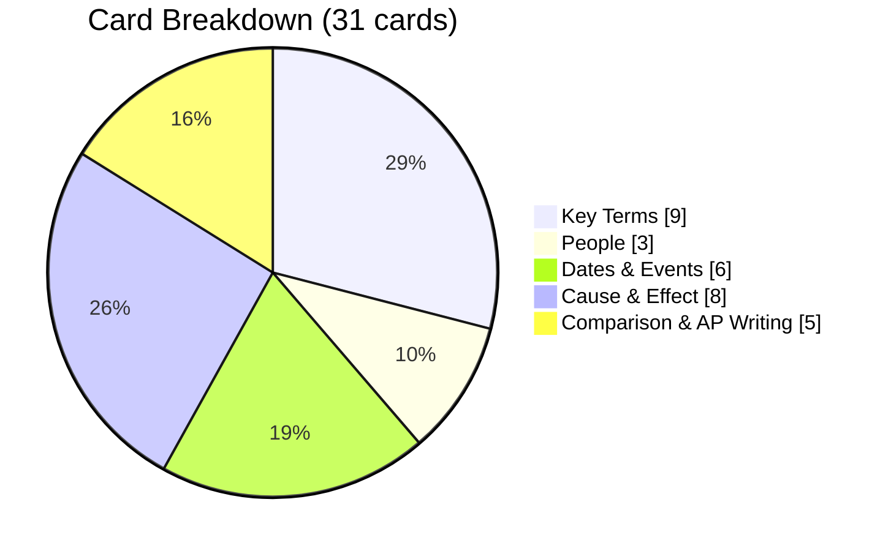

# AP World History: Modern — Topic 2.6 Environmental Consequences of Connectivity · Flashcards

> Source: Based on the College Board CED · Textbook incorporated (Topic 2.6 reading)

---

## 1. Key Terms

- [ ] **What is Champa rice, and why was it so important?**

▶ Answer
A fast-ripening rice that resists drought and floods and gives two harvests a year. It was planted widely in China to feed a growing population, which then grew even more.

- [ ] **How did terraced farming and paddies change land use in China?**

▶ Answer
Upland terraces and lowland paddies let Champa rice grow in many parts of China where the land had been thought unusable for rice.

- [ ] **How did bananas reach Sub-Saharan Africa?**

▶ Answer
Indonesian seafarers crossing the Indian Ocean brought them, and many Indonesians settled on Madagascar. The nutrition-rich food caused a sharp rise in population.

- [ ] **Which crops did the caliphs spread, and how?**

▶ Answer
Cotton, sugar, and citrus. As caliphs conquered lands beyond the Arabian Peninsula, they spread these crops along with Islam and the Arabic language.

- [ ] **What is overgrazing? Give an example.**

▶ Answer
Too many animals eating the plant cover of an area. Overgrazing outside Great Zimbabwe was so severe that people abandoned the city in the late 1400s.

- [ ] **What is deforestation?**

▶ Answer
Clearing forests. In feudal Europe, deforestation and overused farmland caused soil erosion.

- [ ] **What is soil erosion, and what did it cause?**

▶ Answer
The loss of topsoil. In feudal Europe, it lowered farm production.

- [ ] **What was the Little Ice Age?**

▶ Answer
A cooler period (c. 1300–c. 1800) that reduced harvests.

- [ ] **What was the bubonic plague (Black Death)?**

▶ Answer
A deadly disease carried by fleas along trade routes. It killed an estimated 75 to 200 million people in Eurasia and peaked in Europe in 1347–1351.

## 2. People

- [ ] **Who was Giovanni Boccaccio?**

▶ Answer
An Italian writer (1313–1375) who lived through the plague and wrote "Dead bodies filled every corner." His famous work *The Decameron* was inspired by the plague.

- [ ] **What role did Indonesian seafarers play?**

▶ Answer
They crossed the Indian Ocean, brought bananas to Sub-Saharan Africa, and settled on Madagascar.

- [ ] **How did bananas affect the Bantu-speaking peoples?**

▶ Answer
Bananas let these peoples, who had metalworking skills and farming techniques, migrate to places where yams (a traditional food) did not grow well.

## 3. Dates & Events

- [ ] **1332–1347**

▶ Answer
About 25 million people in China and other parts of Asia die of the plague.

- [ ] **1347**

▶ Answer
The plague reaches Europe.

- [ ] **1347–1351**

▶ Answer
The plague is at its worst in Europe, killing about one-third of the population.

- [ ] **c. 1300–c. 1800**

▶ Answer
The Little Ice Age, which reduced harvests.

- [ ] **Late 1400s**

▶ Answer
Great Zimbabwe is abandoned after severe overgrazing.

- [ ] **1500s and later (sugar)**

▶ Answer
European demand for sugar becomes a key factor in the mass use of enslaved people in the Americas.

## 4. Cause & Effect

- [ ] **Cause → Effect: How did Champa rice affect population and migration in China?**

▶ Answer
More food caused population growth. As the population grew, people moved south to the original rice-growing region, which helped cities grow.

- [ ] **Cause → Effect: How did bananas change Sub-Saharan Africa?**

▶ Answer
Population rose sharply, Bantu-speaking peoples could move into areas where yams did not grow well, and farmers cleared more land, which enriched diets.

- [ ] **Cause → Effect: What did Samarkand's markets do for Europe?**

▶ Answer
They passed new fruits and vegetables, along with rice and citrus from Southwest Asia, on to Europe.

- [ ] **Cause → Effect: How did the spread of sugar have long-term effects?**

▶ Answer
European demand for sugar grew so large that it became a key factor in the mass use of enslaved people in the Americas from the 1500s on.

- [ ] **Cause → Effect: How did population growth harm the environment?**

▶ Answer
It put pressure on resources: overgrazing led to the abandonment of Great Zimbabwe, and deforestation and overused farmland caused soil erosion in Europe.

- [ ] **Cause: How did the Mongols and caravanserai help spread the plague?**

▶ Answer
Mongol conquests carried infected fleas from southern China to Central Asia, then to Southeast Asia and Europe. Caravanserai housed people and animals together, and the animals probably carried infected fleas.

- [ ] **Cause → Effect: How did the Black Death change work in Europe?**

▶ Answer
With one-third of people dead, workers were scarce, so each worker's labor was worth more. Workers demanded higher wages, which helped lay the groundwork for economic change as feudalism declined. Farm production also kept falling.

- [ ] **Cause: According to the textbook, why were South Asia and Sub-Saharan Africa spared?**

▶ Answer
The textbook says these regions had few trading ports. (Note: its opening also says the plague struck India, so check with your teacher.)

## 5. Comparison & AP Writing

- [ ] **Compare: How did the effects of crop diffusion and disease diffusion differ?**

▶ Answer
Crop diffusion was gradual and increased population and farmland. Disease diffusion was fast and decreased population (75–200 million dead), causing labor shortages and falling farm production.

- [ ] **Compare: How was environmental degradation at Great Zimbabwe similar to that in feudal Europe?**

▶ Answer
In both places, population growth put pressure on resources. Great Zimbabwe suffered overgrazing and was abandoned. Europe suffered deforestation and soil erosion, made worse by the Little Ice Age, and farm production fell.

- [ ] **AP Short Answer: Explain one environmental effect of crop diffusion from 1200 to 1450.**

▶ Answer

**Claim:** The spread of Champa rice changed land use and increased population in China. 
**Evidence:** The rice ripened fast, resisted drought and floods, gave two harvests a year, and was grown on upland terraces and in lowland paddies. 
**Reasoning:** Farming spread to land once thought unusable, which produced more food. Population then grew, and migration south helped cities grow.

- [ ] **AP Short Answer: Explain how trade networks contributed to the spread of the bubonic plague.**

▶ Answer

**Claim:** Trade networks spread the bubonic plague across Eurasia. 
**Evidence:** Mongol conquests carried infected fleas from southern China to Central Asia and on to Europe (1347), and caravanserai housed people and animals together. 
**Reasoning:** Connected routes moved fleas, animals, and people quickly between regions, so the disease killed an estimated 75 to 200 million people.

- [ ] **AP Long Essay Thesis: Evaluate the extent to which networks of exchange had positive or negative environmental effects from 1200 to 1450.**

▶ Answer

**Claim:** Networks of exchange had both positive and negative environmental effects, but the plague was the most dramatic effect. 
**Evidence:** Champa rice and bananas increased food supply and population. Population pressure, however, caused overgrazing at Great Zimbabwe and soil erosion in Europe. The Black Death killed an estimated 75 to 200 million people. 
**Reasoning:** The same connections that spread useful crops also spread deadly disease, and population growth itself strained the land. This shows that connectivity had mixed effects.

