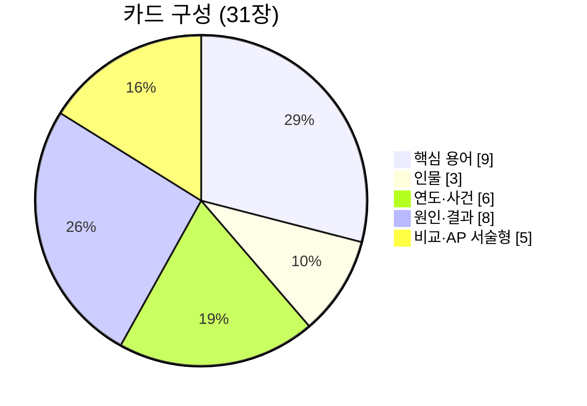

# AP 세계사: 모던 — 토픽 2.6 연결이 낳은 환경적 결과 (Environmental Consequences of Connectivity) · 플래시카드

> 출처: College Board CED 기준 · 교재 반영 (교재 Topic 2.6)

---

## 1. 핵심 용어

- [ ] **참파 쌀 (Champa rice)은 무엇이며, 왜 그렇게 중요했는가?**

▶ 정답
빨리 익고 가뭄과 홍수에 강하며 1년에 두 번 수확하는 벼다. 늘어나는 인구를 먹이려고 중국 전역에 널리 심어졌고, 그 결과 인구가 더 늘었다.

- [ ] **계단식 농업 (Terraced farming)과 논 (Paddies)은 중국의 토지 이용을 어떻게 바꾸었는가?**

▶ 정답
고지대의 계단식 밭과 저지대의 논 덕분에, 벼농사가 불가능하다고 여겨지던 중국의 많은 지역에서도 참파 쌀을 기를 수 있었다.

- [ ] **바나나는 어떻게 사하라 이남 아프리카에 전해졌는가?**

▶ 정답
인도양을 건너던 인도네시아 항해자들이 들여왔고, 많은 인도네시아인이 마다가스카르에 정착했다. 영양이 풍부한 바나나 덕분에 인구가 급격히 늘었다.

- [ ] **칼리프들이 퍼뜨린 작물은 무엇이며, 어떻게 퍼뜨렸는가?**

▶ 정답
면화, 사탕수수, 감귤류다. 칼리프들이 아라비아반도 바깥의 땅을 정복하면서 이슬람, 아랍어와 함께 이 작물들을 퍼뜨렸다.

- [ ] **과잉 방목 (Overgrazing)이란 무엇인가? 예를 들어라.**

▶ 정답
가축이 너무 많아 그 지역의 식물을 다 먹어 치우는 것이다. 그레이트 짐바브웨 주변의 과잉 방목이 매우 심해 1400년대 후반에 사람들이 도시를 버렸다.

- [ ] **삼림 벌채 (Deforestation)란 무엇인가?**

▶ 정답
숲을 베어 내는 것이다. 봉건 유럽에서는 삼림 벌채와 농지 과다 사용이 토양 침식을 일으켰다.

- [ ] **토양 침식 (Soil erosion)이란 무엇이며, 어떤 결과를 낳았는가?**

▶ 정답
겉흙이 쓸려 나가는 것이다. 봉건 유럽에서 농업 생산을 줄였다.

- [ ] **소빙하기 (Little Ice Age)란 무엇이었는가?**

▶ 정답
수확을 줄인 서늘한 시기다 (c. 1300–c. 1800).

- [ ] **선페스트 (Bubonic plague, 흑사병)란 무엇이었는가?**

▶ 정답
교역로를 따라 벼룩이 옮긴 치명적인 질병이다. 유라시아에서 약 7,500만–2억 명이 죽은 것으로 추정되며, 유럽에서는 1347–1351년에 절정에 이르렀다.

## 2. 인물

- [ ] **조반니 보카치오 (Giovanni Boccaccio)는 누구인가?**

▶ 정답
흑사병을 직접 겪고 "구석구석 시체가 가득했다"고 쓴 이탈리아 작가(1313–1375)다. 유명한 작품 『데카메론』은 흑사병 경험에서 나왔다.

- [ ] **인도네시아 항해자들은 어떤 역할을 했는가?**

▶ 정답
인도양을 건너 사하라 이남 아프리카에 바나나를 들여왔고, 마다가스카르에 정착했다.

- [ ] **바나나는 반투어 사용 민족 (Bantu-speaking peoples)에게 어떤 영향을 주었는가?**

▶ 정답
금속 기술과 농업 기술을 가진 이 민족들이 전통 식량인 얌이 잘 자라지 않는 곳으로도 이주할 수 있게 해 주었다.

## 3. 연도·사건

- [ ] **1332–1347년**

▶ 정답
중국과 아시아의 다른 지역에서 약 2,500만 명이 흑사병으로 죽었다.

- [ ] **1347년**

▶ 정답
흑사병이 유럽에 도달했다.

- [ ] **1347–1351년**

▶ 정답
유럽에서 흑사병이 절정에 이르러 인구의 약 3분의 1이 죽었다.

- [ ] **c. 1300–c. 1800년**

▶ 정답
수확을 줄인 소빙하기.

- [ ] **1400년대 후반**

▶ 정답
심각한 과잉 방목으로 그레이트 짐바브웨가 버려졌다.

- [ ] **1500년대 이후 (설탕)**

▶ 정답
유럽의 설탕 수요가 아메리카에서 노예를 대규모로 부리는 핵심 요인이 되었다.

## 4. 원인·결과

- [ ] **원인 → 결과: 참파 쌀은 중국의 인구와 이주에 어떤 영향을 주었는가?**

▶ 정답
식량이 늘어 인구가 증가했다. 인구가 늘면서 사람들이 원래의 벼농사 지역인 남쪽으로 옮겨 갔고, 이것이 도시의 성장에 기여했다.

- [ ] **원인 → 결과: 바나나는 사하라 이남 아프리카를 어떻게 바꾸었는가?**

▶ 정답
인구가 급격히 늘었고, 반투어 사용 민족이 얌이 잘 자라지 않는 곳으로도 이주할 수 있었으며, 농민들이 경작지를 넓혀 식단이 풍부해졌다.

- [ ] **원인 → 결과: 사마르칸트의 시장은 유럽에 무엇을 전했는가?**

▶ 정답
새로운 과일과 채소, 그리고 서남아시아의 쌀과 감귤류를 유럽에 전했다.

- [ ] **원인 → 결과: 사탕수수의 전파는 어떤 장기적 결과를 낳았는가?**

▶ 정답
유럽의 설탕 수요가 크게 늘어, 1500년대 이후 아메리카에서 노예를 대규모로 부리는 핵심 요인이 되었다.

- [ ] **원인 → 결과: 인구 증가는 환경을 어떻게 해쳤는가?**

▶ 정답
자원에 압력을 주었다. 과잉 방목으로 그레이트 짐바브웨가 버려졌고, 유럽에서는 삼림 벌채와 농지 과다 사용으로 토양 침식이 일어났다.

- [ ] **원인: 몽골과 캐러밴서라이는 흑사병 확산에 어떻게 기여했는가?**

▶ 정답
몽골의 정복이 감염된 벼룩을 중국 남부에서 중앙아시아로, 다시 동남아시아와 유럽으로 옮겼다. 캐러밴서라이는 사람과 동물을 한곳에 묵게 했는데, 동물들이 감염된 벼룩을 옮겼을 가능성이 크다.

- [ ] **원인 → 결과: 흑사병은 유럽의 노동을 어떻게 바꾸었는가?**

▶ 정답
인구의 3분의 1이 죽어 일할 사람이 모자라자 노동자 한 사람의 노동 가치가 높아졌다. 노동자들이 더 높은 임금을 요구하면서 봉건제 쇠퇴에 따른 경제적 변화의 바탕이 마련되었다. 농업 생산도 계속 줄었다.

- [ ] **원인: 교재에 따르면 남아시아와 사하라 이남 아프리카가 흑사병을 피한 이유는?**

▶ 정답
교재는 이 지역들에 교역 항구가 적었기 때문이라고 한다. (주의: 교재 첫머리에는 흑사병이 인도를 덮쳤다고도 쓰여 있으니 선생님께 확인하자.)

## 5. 비교·AP 서술형

- [ ] **비교: 작물 전파와 질병 전파의 결과는 어떻게 달랐는가?**

▶ 정답
작물 전파는 서서히 진행되어 인구와 경작지를 늘렸다. 질병 전파는 빠르게 진행되어 인구를 줄였고(7,500만–2억 명 사망), 노동력 부족과 농업 생산 감소를 낳았다.

- [ ] **비교: 그레이트 짐바브웨와 봉건 유럽의 환경 훼손은 어떤 점에서 비슷했는가?**

▶ 정답
두 곳 모두 인구 증가가 자원에 압력을 주었다. 그레이트 짐바브웨는 과잉 방목 끝에 버려졌다. 유럽은 삼림 벌채와 토양 침식에 소빙하기까지 겹쳐 농업 생산이 줄었다.

- [ ] **AP 단답형: 1200–1450년 작물 전파가 낳은 환경적 결과 하나를 설명하라.**

▶ 정답

**주장:** 참파 쌀의 전파는 중국의 토지 이용을 바꾸고 인구를 늘렸다. 
**근거:** 참파 쌀은 빨리 익고 가뭄과 홍수에 강해 1년에 두 번 수확할 수 있었으며, 고지대의 계단식 밭과 저지대의 논에서 재배되었다. 
**설명:** 쓸모없다고 여겨지던 땅까지 농사가 퍼지면서 식량이 늘었다. 그 결과 인구가 늘었고, 남쪽으로의 이주가 도시의 성장을 이끌었다.

- [ ] **AP 단답형: 교역 네트워크가 흑사병 확산에 어떻게 기여했는지 설명하라.**

▶ 정답

**주장:** 교역 네트워크는 흑사병을 유라시아 전역에 퍼뜨렸다. 
**근거:** 몽골의 정복이 감염된 벼룩을 중국 남부에서 중앙아시아로, 다시 유럽으로(1347) 옮겼고, 캐러밴서라이는 사람과 동물을 한곳에 묵게 했다. 
**설명:** 연결된 교역로를 따라 벼룩, 동물, 사람이 여러 지역을 빠르게 오갔기 때문에, 이 질병으로 약 7,500만–2억 명이 죽었다.

- [ ] **AP 논술형 논지: 1200–1450년 교류 네트워크가 환경에 미친 영향이 어느 정도 긍정적이었는지, 부정적이었는지 평가하라.**

▶ 정답

**주장:** 교류 네트워크는 환경에 긍정적·부정적 영향을 모두 주었지만, 가장 극적인 영향은 흑사병이었다. 
**근거:** 참파 쌀과 바나나는 식량과 인구를 늘렸다. 그러나 인구 압력은 그레이트 짐바브웨의 과잉 방목과 유럽의 토양 침식을 낳았다. 흑사병으로는 약 7,500만–2억 명이 죽었다. 
**설명:** 유용한 작물을 퍼뜨린 바로 그 연결망이 치명적인 질병도 퍼뜨렸고, 인구 증가 자체가 땅을 지치게 했다. 이는 연결이 엇갈린 영향을 주었음을 보여 준다.

