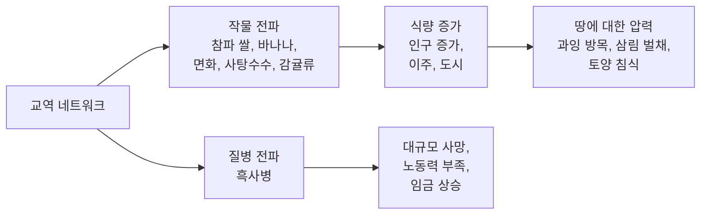
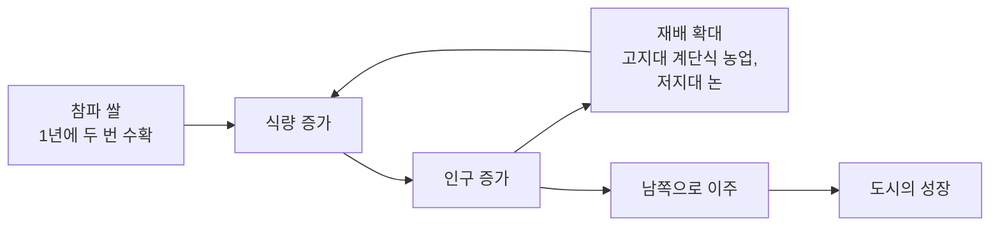
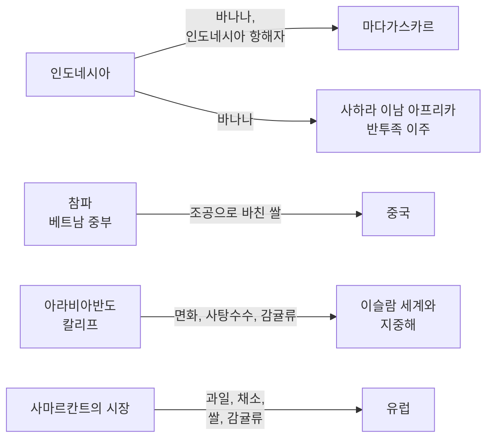
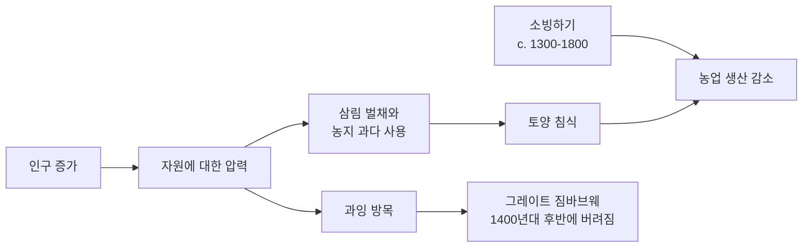
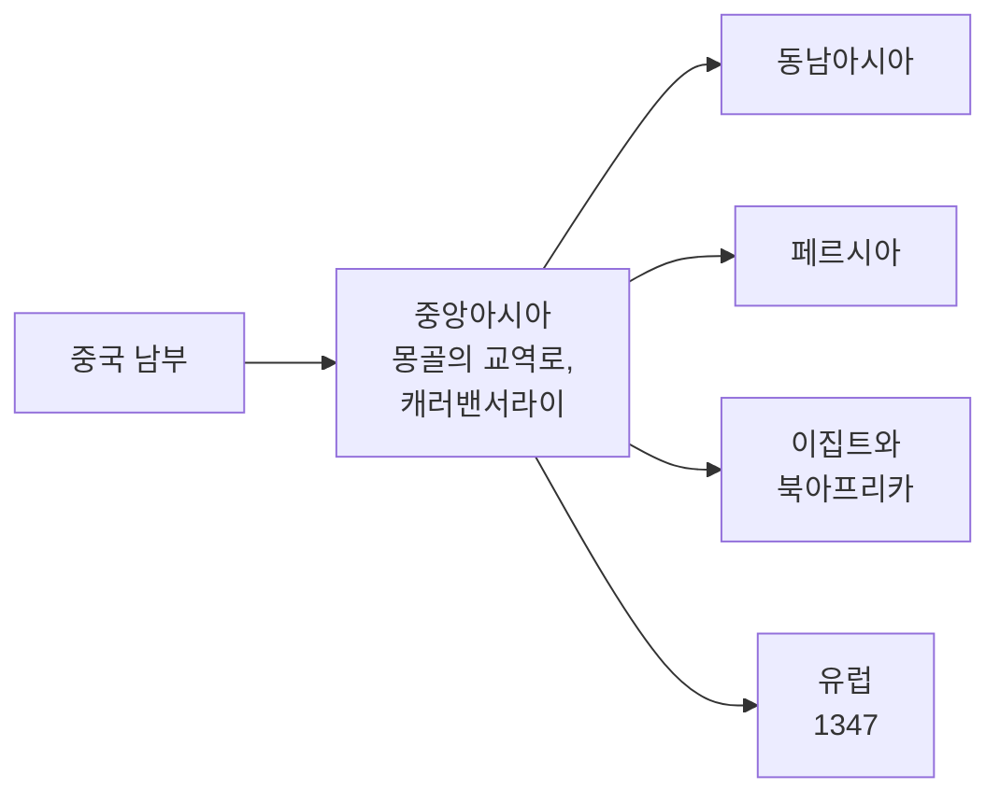
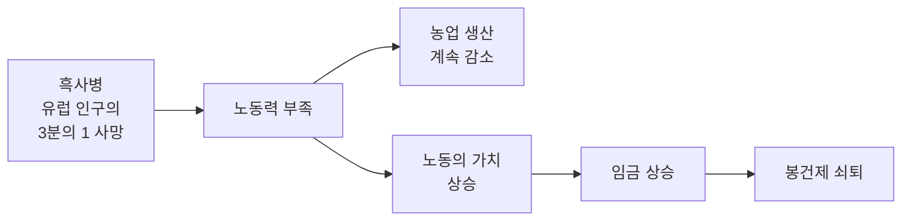
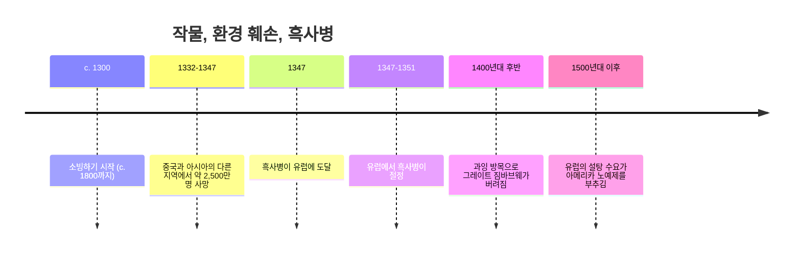
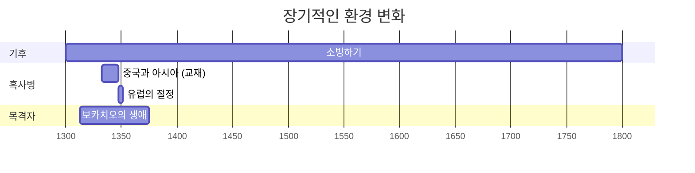

# AP 세계사: 모던 — 토픽 2.6 연결이 낳은 환경적 결과 (Environmental Consequences of Connectivity)

**Focus Question (교재 Essential Question):** c. 1200–1450년 아프로-유라시아의 교역은 환경에 어떤 결과를 가져왔는가?

> 출처: College Board CED 기준 · 교재 반영 (교재 Topic 2.6)

**Unit 2: 교류의 네트워크 (Networks of Exchange, c. 1200–1450)**

---

## 학습 목표 (Learning Objective)

| 코드 | 학습 목표 |
|---|---|
| 2.6 LO | c. 1200–1450년 아프로-유라시아의 여러 교류 네트워크가 낳은 환경적 영향을 설명하라. |

## 역사적 개념 (Historical Developments, CED)

| # | 역사적 개념 | 다루는 곳 |
|---|---|---|
| HD1 | 작물과 병원체 (Pathogens)의 전파가 계속되었고, 흑사병 (Bubonic plague)을 비롯한 전염병이 교역로를 따라 퍼졌다. | §1, §3 |
| HD2 | 작물 전파의 예(CED 예시): 아프리카의 바나나 (Bananas), 동아시아의 새로운 벼 품종 (New rice varieties), 이슬람 세계와 지중해 전역에 퍼진 면화·사탕수수·감귤류 (Cotton, sugar, citrus). | §1 |
| 교재 확장 | 인구 압력으로 환경이 훼손되었다: 과잉 방목 (Overgrazing), 삼림 벌채 (Deforestation), 토양 침식 (Soil erosion). | §2 |

> ⚠️ HD1과 HD2는 CED를 의역한 것이다. 교재도 같은 작물과 흑사병을 다루어 이 구성을 뒷받침하지만, 정확한 문구는 공식 CED PDF와 대조해 확인이 필요하다.

---

## 큰 그림 요약

> "구석구석 시체가 가득했다."
> — 조반니 보카치오 (Giovanni Boccaccio) (1313–1375)

교역 네트워크는 **새로운 작물**을 새로운 곳으로 퍼뜨렸다. 중국에는 **참파 쌀 (Champa rice)**이, 사하라 이남 아프리카에는 **바나나**가, 이슬람 세계와 지중해 전역에는 **면화, 사탕수수, 감귤류**가 퍼졌다. 이 작물들은 **토지 이용**을 바꾸었고 **인구 증가와 이주**를 낳았다. 늘어난 인구는 땅에도 부담을 주었다. 그레이트 짐바브웨 주변에서는 **과잉 방목**이, 봉건 유럽에서는 **삼림 벌채와 토양 침식**이 일어났고, **소빙하기 (Little Ice Age)**가 이를 더 악화시켰다. 그러나 **가장 극적인** 환경적 결과는 식량이 아니라 **질병**이었다. **흑사병 (Black Death)**은 중앙아시아에서 퍼져 나와 중국, 인도, 페르시아, 이집트를 덮쳤고 **1347년 유럽**에 이르렀다. 유라시아에서 약 **7,500만–2억 명**이 죽은 것으로 추정되며, 유럽에서는 **1347–1351년**에 절정에 이르렀다. 이 시기를 직접 겪은 보카치오는 그 경험을 바탕으로 유명한 작품 『데카메론 (The Decameron)』을 썼다.

---

## §1. 작물 전파

상인들은 사치품, 향신료, 직물, 종교와 함께 **이전에 자라지 않던 곳에 작물을 들여왔다.** 새로운 작물은 **토지 이용**과 **인구의 증가·분포**에 영향을 주었다. 어떤 곳은 높은 생산을 오래 유지했지만, 다른 곳에서는 땅을 지나치게 써서 **환경이 훼손되었다** (§2).

### 참파 쌀

- **빨리 익고**, **가뭄과 홍수에 강하며**, **1년에 두 번 수확**할 수 있었다.
- **기원 (교재):** 참파에서 **조공으로 중국에 보내졌다.** 참파(지금의 베트남 중부)가 **힌두교의 영향**을 받았기 때문에, 일부 학자는 이 쌀이 원래 **인도에서 왔을 수도 있다**고 본다.
- 늘어나는 **인구를 먹여 살리기 위해** 중국 전역에 널리 심어졌고, 이것이 다시 **인구를 더 늘렸다.**
- **토지 이용:** **고지대의 계단식 농업**과 **저지대의 논** 덕분에, 벼농사가 **불가능하다고 여겨지던** 중국의 많은 지역에서 벼를 기를 수 있었다.
- **이주:** 중국의 인구가 늘면서 사람들이 원래의 벼농사 지역인 **남쪽**으로 옮겨 갔고, 이것이 **도시의 성장**에 기여했다.

> ⚠️ 교재 문장은 "힌두교 국가인 베트남이 참파 국가들에 들여왔다"로 되어 있다. 문장이 뒤섞인 것으로 보인다. 힌두교의 영향을 받은 나라는 **참파**였고, 그 북쪽의 베트남 국가(대월, Đại Việt)는 힌두교 국가가 아니었다. 대부분의 자료는 이 쌀이 **참파에서** 송나라로 조공으로 전해졌다고 본다. 쌀이 인도에서 왔을 수 있다는 교재의 설명은 2.5 교재가 "인도에서" 퍼졌다고 쓴 이유도 보여 준다.

### 사하라 이남 아프리카의 바나나

- 인도양을 건너던 **인도네시아 항해자들**이 **사하라 이남 아프리카에 바나나**를 들여왔고, 많은 인도네시아인이 **마다가스카르에 정착했다.**
- 바나나는 **영양이 풍부해** 인구가 **급격히 늘었다.**
- 바나나 덕분에 금속 기술과 농업 기술을 가진 **반투어 사용 민족 (Bantu-speaking peoples)**이 전통 식량인 **얌**이 잘 자라지 않는 곳으로도 이주할 수 있었다.
- 바나나를 기르려고 **경작지를 넓히면서** **식단이 풍부해지고** **인구가 늘었다.**

### 면화, 사탕수수, 감귤류

- **칼리프들**이 아라비아반도 바깥의 땅을 정복하면서 **이슬람**, **아랍어**, 그리고 **면화·사탕수수·감귤류** 재배를 퍼뜨렸다.
- 교역로를 따라 있는 시장에서는 새로운 음식을 팔았다. **사마르칸트의 시장**은 새로운 과일과 채소, 그리고 **서남아시아의 쌀과 감귤류**를 **유럽**에 전했다.
- 훗날 유럽의 **설탕** 수요가 크게 늘어, 1500년대 이후 **아메리카에서 노예를 대규모로 부리는 핵심 요인**이 되었다 (Unit 4 참고).

| 작물 | 전한 주체 | 출발지 → 도착지 | 결과 |
|---|---|---|---|
| **참파 쌀** | 중국에 바친 조공 | 참파(베트남 중부, 원래는 인도일 가능성) → 중국 | 1년에 두 번 수확, 인구 증가, 고지대 계단식 농업과 저지대 논, 남쪽으로 이주, 도시의 성장 |
| **바나나** | 인도네시아 항해자 | 인도네시아 → 사하라 이남 아프리카와 마다가스카르 | 인구 급증, 얌 재배 지역 너머로 반투족 이주, 경작지 확대 |
| **면화** | 칼리프국의 팽창 | 이슬람 세계와 지중해 전역 | 이슬람, 아랍어와 함께 퍼짐 |
| **사탕수수** | 칼리프국의 팽창 | 이슬람 세계와 지중해 전역 | 훗날 유럽의 수요가 아메리카 노예제를 부추김 |
| **감귤류** | 칼리프국, 사마르칸트의 시장 | 서남아시아 → 지중해와 유럽 | 유럽 시장에 새로운 음식이 들어옴 |

## §2. 환경 훼손

인구가 늘면서 **자원에 대한 압력이 커졌다.**

| 장소 | 문제 | 결과 |
|---|---|---|
| **그레이트 짐바브웨** | 도시 주변의 심각한 **과잉 방목** | **1400년대 후반에 도시가 버려짐** (1.5 참고) |
| **봉건 유럽** | **농지의 과다 사용**과 **삼림 벌채** | **토양 침식**으로 농업 생산이 줄어듦 |
| **유럽 (기후)** | **소빙하기** (c. 1300–c. 1800) | 수확이 줄어듦 |
| **마야 (아메리카)** | 환경 훼손 | 쇠퇴 요인 중 하나 |

## §3. 교류 네트워크를 통한 전염병의 확산

- **이슬람 세계와 인도**의 학자들은 의학을 발전시키고 있었지만, 교역과 함께 퍼진 치명적인 질병을 막을 수 있는 지식은 **당시 어디에도 없었다.**
- **몽골의 정복**은 흑사병을 옮기는 **벼룩**이 **중국 남부에서 중앙아시아로**, 그리고 다시 **동남아시아와 유럽으로** 퍼지는 데 기여했다.
- **캐러밴서라이**는 사람과 동물을 한곳에 묵게 했기 때문에, 일부 역사가는 이곳이 질병 **확산을 도왔을** 수 있다고 본다. 동물들이 감염된 벼룩을 옮겼을 가능성이 크기 때문이다.

| 지역 | 사망자 (교재) |
|---|---|
| **유라시아 전체** | 약 **7,500만–2억 명** (추정) |
| **유럽** | 몇 년 만에 인구의 **3분의 1** (절정 1347–1351) |
| **중국과 아시아의 다른 지역** | 약 **2,500만 명**, 1332–1347 |
| **북아프리카, 중앙아시아** | 비슷하게 큰 피해 |
| **남아시아, 사하라 이남 아프리카** | 교역 항구가 적어 **피해를 면함** |

> ⚠️ 교재의 첫머리는 흑사병이 "인도를 덮쳤다"고 하지만, 뒤에서는 교역 항구가 적어 남아시아가 **피해를 면했다**고 한다. 두 설명이 서로 맞지 않으며, 남아시아에는 캘리컷 같은 큰 항구가 있었다 (2.3 참고). 자료가 부족해 인도의 피해 정도는 역사가들 사이에서 아직 논쟁 중이다. 선생님이 어떻게 답하길 원하는지 확인이 필요하다.

### 유럽에 미친 영향

- **일할 사람이 줄면서** 농업 생산이 계속 줄었다.
- 그러나 노동자 한 사람 한 사람의 **노동 가치가 높아져**, 노동자들은 **더 높은 임금을 요구**할 수 있었다. 노동자와 고용주의 관계가 바뀐 것이다.
- 이 변화는 **봉건제가 쇠퇴**하면서 나타난 **경제적 변화의 바탕**이 되었다.

---

## 연표

---

## 비교표

### 작물 전파와 질병 전파

| 항목 | 작물 전파 | 질병 전파 |
|---|---|---|
| 이동한 것 | 참파 쌀, 바나나, 면화, 사탕수수, 감귤류 | 흑사병 (동물이 옮긴 벼룩) |
| 전한 주체 | 조공, 인도네시아 항해자, 칼리프, 시장 상인 | 몽골의 정복, 상인, 캐러밴서라이의 동물 |
| 속도 | 서서히 | 빠름 (몇 년 만에 유럽 전역으로) |
| 인구에 미친 영향 | **증가** | **감소** (7,500만–2억 명 사망) |
| 땅과 노동에 미친 영향 | 경작지 확대, 계단식 농업, 논 | 노동력 부족, 농업 생산 감소 |
| 장기적 결과 | 이주, 도시의 성장, 훗날 사탕수수 플랜테이션 | 임금 상승, 봉건제 쇠퇴 |

### 환경 훼손: 그레이트 짐바브웨와 봉건 유럽

| 항목 | 그레이트 짐바브웨 | 봉건 유럽 |
|---|---|---|
| 원인 | 과잉 방목 | 농지 과다 사용, 삼림 벌채, 소빙하기 |
| 결과 | 도시가 버려짐 (1400년대 후반) | 토양 침식, 농업 생산 감소 |
| 공통점 | 두 곳 모두 인구 증가가 자원에 압력을 줌 | (동일) |

---

## Key Terms (핵심 용어)

| 주제 | 용어 | 정의 |
|---|---|---|
| 환경 (작물 전파) | 참파 쌀 (Champa rice) | 빨리 익고 가뭄과 홍수에 강하며 1년에 두 번 수확하는 벼. 중국 전역에 퍼짐 |
| 환경 (작물 전파) | 바나나 (Bananas) | 인도네시아 항해자들이 사하라 이남 아프리카에 들여옴. 인구를 급격히 늘림 |
| 환경 (작물 전파) | 사탕수수·설탕 (Sugar) | 칼리프국이 퍼뜨림. 훗날 유럽의 수요가 아메리카 노예제를 부추김 |
| 환경 (작물 전파) | 감귤류 (Citrus crops) | 칼리프국이 퍼뜨림. 사마르칸트 같은 시장을 거쳐 유럽에 전해짐 |
| 환경 (환경 훼손) | 과잉 방목 (Overgrazing) | 가축이 너무 많아 식물이 사라지는 것. 그레이트 짐바브웨가 버려진 원인 |
| 환경 (환경 훼손) | 삼림 벌채 (Deforestation) | 숲을 베어 내는 것. 봉건 유럽에서 토양 침식을 일으킴 |
| 환경 (환경 훼손) | 토양 침식 (Soil erosion) | 겉흙이 쓸려 나가 농업 생산이 줄어드는 것 |
| 환경 (질병) | 선페스트 (Bubonic plague) | 교역로를 따라 벼룩이 옮긴 흑사병 |
| 추가 | 면화 (Cotton) | CED 예시. 이슬람과 함께 퍼짐 |
| 추가 | 계단식 농업 (Terraced farming) | 산비탈에 계단 모양으로 만든 밭. 고지대에서 참파 쌀을 기르는 데 쓰임 |
| 추가 | 논 (Paddies) | 벼를 기르려고 물을 댄 저지대의 밭 |
| 추가 | 소빙하기 (Little Ice Age) | 수확을 줄인 서늘한 시기 (c. 1300–c. 1800) |
| 추가 | 병원체 (Pathogen) | 질병을 일으키는 균 (CED 용어) |
| 추가 | 흑사병 (Black Death) | 14세기 페스트 대유행을 부르는 이름 |
| 추가 | 『데카메론 (The Decameron)』 | 흑사병을 겪은 경험에서 나온 보카치오의 작품 |
| 추가 | 노동력 부족 (Labor shortage) | 일할 사람이 모자란 상태. 흑사병 이후 임금을 올림 |
