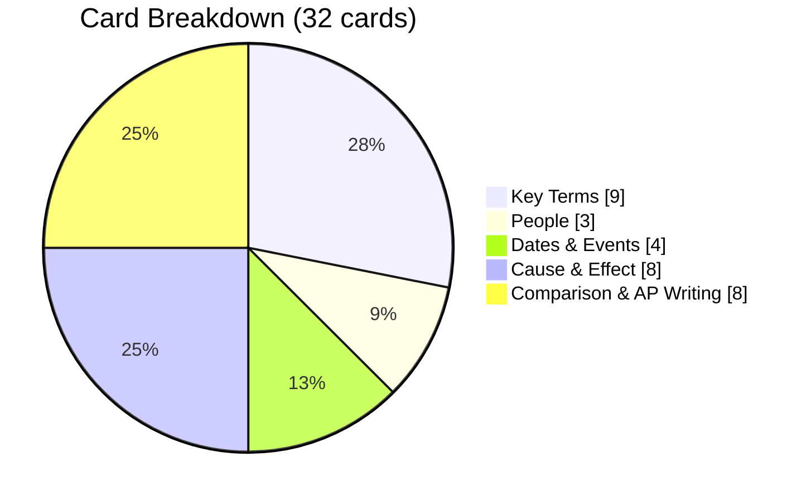

# AP World History: Modern — Topic 2.7 Comparison of Economic Exchange · Flashcards

> Source: Based on the College Board CED · Textbook incorporated (Topic 2.7 reading)

---

## 1. Key Terms

- [ ] **What is a polity?**

▶ Answer
A governmental unit, such as a kingdom, caliphate, city-state, or empire.

- [ ] **Why does the textbook call trading cities the "knots" of a network?**

▶ Answer
A network is like a fabric of cords crossing at regular distances and knotted for strength at the crossings. Trading cities were the knots that held the trade routes together.

- [ ] **What is centralization, and how did trade encourage it?**

▶ Answer
Concentrating power in a central government. Trade wealth paid for navies, defenses, and standard currencies, all of which needed central planning.

- [ ] **Why were standardized currencies important?**

▶ Answer
Widely accepted currencies sped up transactions and let merchants measure the value of goods.

- [ ] **What were tin ingots used for?**

▶ Answer
A currency standard in parts of Southeast Asia.

- [ ] **What three commodities served as currencies on different networks?**

▶ Answer
Silk (once both a trade good and a currency), tin ingots (Southeast Asia), and cowrie shells (West Africa).

- [ ] **What is proto-industrialization? Give the textbook example.**

▶ Answer
Large-scale, more efficient production before machines. China went through it to meet demand for iron, steel, and porcelain.

- [ ] **What new business practice appeared to share investment risk?**

▶ Answer
Partnerships, in which several people shared the risk of an investment.

- [ ] **What is a cottage industry?**

▶ Answer
Craft production done by artisans at home. It was one of the forms of labor that continued in this period.

## 2. People

- [ ] **Who was Abdu Razzak, and what did he observe in Calicut?**

▶ Answer
The author of "Description of Calicut" (1442). He saw wealthy merchants unload cargo and send it to market without guarding it, which shows how secure Calicut was.

- [ ] **Who was Domingo Paes, and what did he describe?**

▶ Answer
A writer (1520–22) who described 15,000–20,000 workers building a reservoir in the Vijayanagara Empire in South India. The king assigned sections to captains, who supervised the workers. (The textbook says "1300s," but the account dates from the 1520s.)

- [ ] **What role did Mongol women play, according to 2.7?**

▶ Answer
They moved freely, rejected the burka and foot binding, and were often top advisors to the Great Khan, although the empire was still a patriarchy.

## 3. Dates & Events

- [ ] **1442**

▶ Answer
Abdu Razzak writes "Description of Calicut."

- [ ] **1330s and 1350s**

▶ Answer
Plague outbreaks in China cause tens of millions of deaths.

- [ ] **1520–22**

▶ Answer
Domingo Paes describes the Vijayanagara reservoir project.

- [ ] **"Before the Common Era"**

▶ Answer
When interregional trade began, as farming cultures settled into stable settlements. Later networks built on these routes.

## 4. Cause & Effect

- [ ] **Cause: Why did trade networks need stable states?**

▶ Answer
Stable states protected routes and merchants, which is why Calicut's merchants could leave cargo unguarded, and they supported technology upgrades such as compasses, lateen sails, high-yield crops, and saddles.

- [ ] **Cause → Effect: How did Malacca's wealth lead to centralization?**

▶ Answer
Fees on ships in the Strait of Malacca made it rich, and it used the wealth to build a strong navy against piracy, which required centralized planning.

- [ ] **Effect: Besides goods, what did merchants, diplomats, and missionaries exchange?**

▶ Answer
Ways of life. Diplomats negotiated alliances, and missionaries sought converts.

- [ ] **Cause → Effect: Why did maritime trade come to exceed overland trade?**

▶ Answer
Production of textiles, porcelain, and spices grew, and ships could carry more goods. This required larger ships and better navigation.

- [ ] **Cause → Effect: How did rising demand affect labor?**

▶ Answer
Demand for labor rose. Free peasants, artisans, debt labor, and slavery continued, and the slave trade was common on the Indian Ocean and trans-Saharan routes.

- [ ] **Cause: How were large projects such as canals and reservoirs organized?**

▶ Answer
Thousands of organized workers were needed, and kinship ties often helped coordinate them (for example, the Vijayanagara reservoir).

- [ ] **Effect: How did the connections between networks lead to population decline?**

▶ Answer
Merchants, diplomats, and missionaries carried the plague along trade routes. At least one-third of Europe died, and once-great cities such as Constantinople declined.

- [ ] **Cause → Effect: How did political instability and expanded farming strain the environment?**

▶ Answer
Deforestation and overgrazing caused soil erosion, which forced growing populations to migrate.

## 5. Comparison & AP Writing

- [ ] **Compare: What did each of the three networks specialize in?**

▶ Answer
Silk Roads: luxury goods. Indian Ocean: goods too heavy to move by land, depending on the monsoons. Trans-Saharan: North African salt for gold from the south.

- [ ] **Compare: Name two trading cities on each route.**

▶ Answer
Silk Roads: Chang'an, Samarkand (also Aleppo, Mosul). Indian Ocean: Malacca, Calicut (also Hormuz, Mombasa, Alexandria). Trans-Saharan: Timbuktu, Gao (also Marrakesh, Cairo).

- [ ] **Compare: How did transport and technology differ among the routes?**

▶ Answer
Silk Roads: horses and camels, with saddles and caravanserai. Indian Ocean: dhows and junks, with the stern rudder, lateen sail, astrolabe, and compass. Trans-Saharan: camel caravans with people on foot, and load-bearing saddles.

- [ ] **Compare: How did the religions spread differ among the routes?**

▶ Answer
Silk Roads: Buddhism, Neo-Confucianism, and Islam into South Asia. Indian Ocean: Buddhism, Neo-Confucianism, Islam into Southeast Asia, and Christianity from the Mediterranean. Trans-Saharan: Islam into Sub-Saharan Africa.

- [ ] **Compare: Where did women have more influence, and what was the general rule?**

▶ Answer
Mongol women (freedom of movement, advisors to the khan), European women (farmers, artisans, their own guilds), and Southeast Asian women (ran markets). Elsewhere, societies were patriarchies, and women had far fewer opportunities.

- [ ] **AP Short Answer: Explain one similarity among networks of exchange from 1200 to 1450.**

▶ Answer

**Claim:** All three networks depended on stable states that protected trade. 
**Evidence:** Calicut's merchants left cargo unguarded, Malacca built a navy against pirates, and Mali protected the trans-Saharan routes. 
**Reasoning:** Protection lowered the risk for merchants, so trade grew. Trade wealth then strengthened states, which created a cycle of trade and centralization on every route.

- [ ] **AP Short Answer: Explain one difference among networks of exchange from 1200 to 1450.**

▶ Answer

**Claim:** The networks differed in the goods they carried because of their means of transport. 
**Evidence:** The Silk Roads, using horses and camels, specialized in luxury goods; the Indian Ocean, using dhows and junks, carried goods too heavy for land; and trans-Saharan caravans traded salt for gold. 
**Reasoning:** Ships could carry far more than animals, so heavy goods went by sea, while costly land routes focused on high-value or essential goods. This is also why maritime trade came to exceed overland trade.

- [ ] **AP Long Essay Thesis: Compare the similarities and differences among the Silk Roads, Indian Ocean, and trans-Saharan networks from 1200 to 1450.**

▶ Answer

**Claim:** The three networks were similar in their origins, purpose, and effects, all built on older routes, protected by stable states, and producing trading cities and centralization, but they differed in goods, transport, technology, religion, and currency. 
**Evidence:** Similarities: trading cities such as Samarkand, Calicut, and Timbuktu were the network's "knots," and Malacca's navy shows centralization. Differences: luxury goods by camel versus heavy goods by dhow and junk versus salt for gold; Buddhism and Neo-Confucianism versus Islam in Sub-Saharan Africa; silk versus tin ingots versus cowrie shells. 
**Reasoning:** Shared economic goals and the need for security created similar patterns everywhere, while geography and environment shaped what each network carried and spread.

