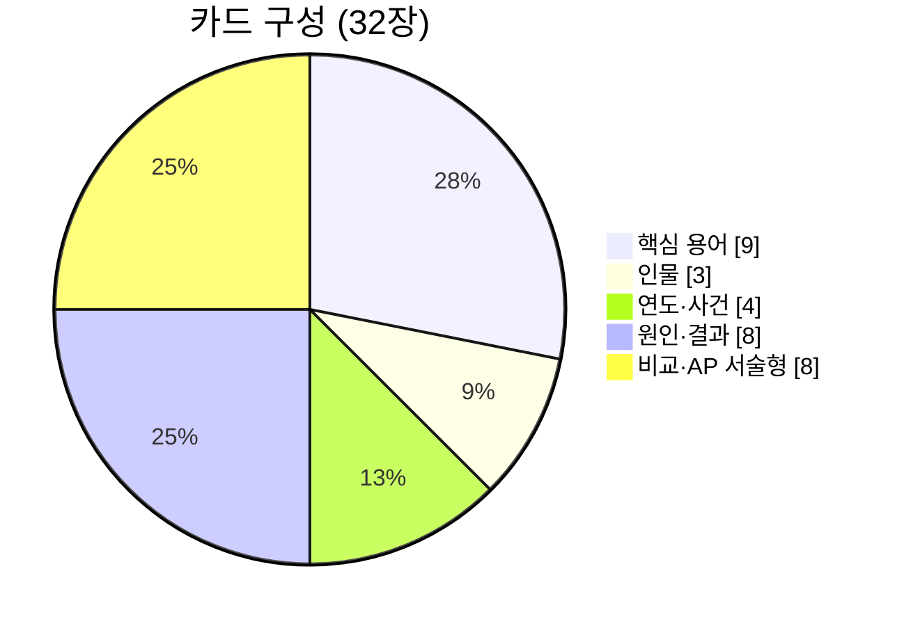

# AP 세계사: 모던 — 토픽 2.7 경제 교류 비교 (Comparison of Economic Exchange) · 플래시카드

> 출처: College Board CED 기준 · 교재 반영 (교재 Topic 2.7)

---

## 1. 핵심 용어

- [ ] **정치체 (Polity)란 무엇인가?**

▶ 정답
왕국, 칼리프국, 도시국가, 제국 같은 정치 단위다.

- [ ] **교재가 교역 도시를 네트워크의 "매듭"이라고 부르는 이유는?**

▶ 정답
네트워크는 일정한 간격으로 교차하고 교차점마다 튼튼하게 매듭지어진 끈의 그물과 같다. 교역 도시는 교역로를 붙잡아 주는 매듭이었다.

- [ ] **중앙집권화 (Centralization)란 무엇이며, 교역은 이를 어떻게 촉진했는가?**

▶ 정답
권력을 중앙 정부에 모으는 것이다. 교역으로 얻은 부가 해군, 방어 시설, 표준 화폐에 쓰였는데, 이 모두에 중앙의 계획이 필요했다.

- [ ] **표준 화폐 (Standardized currency)가 중요했던 이유는?**

▶ 정답
널리 인정되는 화폐는 거래를 빠르게 하고, 상인들이 상품의 가치를 잴 수 있게 했다.

- [ ] **주석 주괴 (Tin ingots)는 무엇에 쓰였는가?**

▶ 정답
동남아시아 일부 지역에서 화폐의 기준으로 쓰였다.

- [ ] **여러 네트워크에서 화폐로 쓰인 세 가지 상품은?**

▶ 정답
비단(한때 교역품이자 화폐), 주석 주괴(동남아시아), 개오지 조개껍데기(서아프리카).

- [ ] **원산업화 (Proto-industrialization)란 무엇인가? 교재의 예를 들어라.**

▶ 정답
기계 이전의 더 효율적인 대규모 생산이다. 중국이 철, 강철, 도자기 수요를 맞추려고 이를 겪었다.

- [ ] **투자 위험을 나누려고 생긴 새로운 상업 관행은?**

▶ 정답
여러 사람이 투자 위험을 함께 나누는 동업 (Partnership).

- [ ] **가내 수공업 (Cottage industry)이란 무엇인가?**

▶ 정답
장인이 집에서 하는 수공업 생산이다. 이 시기에도 이어진 노동 형태 중 하나다.

## 2. 인물

- [ ] **압두르 라자크 (Abdu Razzak)는 누구이며, 캘리컷에서 무엇을 보았는가?**

▶ 정답
「캘리컷 견문기」(1442)를 쓴 사람이다. 부유한 상인들이 화물을 내려 지키지도 않고 시장으로 보내는 모습을 보았다. 캘리컷이 얼마나 안전했는지 보여 준다.

- [ ] **도밍구 파이스 (Domingo Paes)는 누구이며, 무엇을 기록했는가?**

▶ 정답
남인도 비자야나가라 제국에서 1만 5천–2만 명의 노동자가 저수지를 짓는 모습을 기록한 사람이다(1520–22). 왕이 구역을 장수들에게 나누어 맡겼고, 장수들이 노동자를 감독했다. (교재는 "1300년대"라고 쓰지만 기록은 1520년대의 것이다.)

- [ ] **2.7에 따르면 몽골 여성은 어떤 역할을 했는가?**

▶ 정답
제국이 가부장제였는데도 자유롭게 돌아다녔고, 부르카와 전족을 거부했으며, 대칸의 최고 조언자인 경우가 많았다.

## 3. 연도·사건

- [ ] **1442년**

▶ 정답
압두르 라자크가 「캘리컷 견문기」를 썼다.

- [ ] **1330년대와 1350년대**

▶ 정답
중국에서 흑사병이 유행해 수천만 명이 죽었다.

- [ ] **1520–22년**

▶ 정답
도밍구 파이스가 비자야나가라의 저수지 공사를 기록했다.

- [ ] **"기원전"**

▶ 정답
농경 문화가 안정된 정착지로 자리 잡으면서 지역 간 교역이 시작된 때다. 이후의 네트워크는 이 교역로 위에 세워졌다.

## 4. 원인·결과

- [ ] **원인: 교역 네트워크에 안정된 국가가 필요했던 이유는?**

▶ 정답
안정된 국가가 교역로와 상인을 보호했기 때문이다(캘리컷 상인들이 화물을 지키지 않아도 된 이유). 또 나침반, 삼각돛, 수확량이 많은 작물, 안장 같은 기술 발전을 뒷받침했다.

- [ ] **원인 → 결과: 말라카의 부는 어떻게 중앙집권화로 이어졌는가?**

▶ 정답
말라카 해협을 지나는 배에 매긴 통행료로 부유해졌고, 그 부로 해적을 막는 강한 해군을 키웠다. 이를 위해서는 중앙의 계획이 필요했다.

- [ ] **결과: 상인, 외교관, 선교사는 상품 말고 무엇을 주고받았는가?**

▶ 정답
생활 방식이다. 외교관은 동맹을 협상했고, 선교사는 개종자를 찾았다.

- [ ] **원인 → 결과: 해상 교역이 육상 교역을 앞지르게 된 이유는?**

▶ 정답
직물, 도자기, 향신료 생산이 늘었고 배는 더 많은 상품을 실을 수 있었다. 그래서 더 큰 배와 더 나은 항해술이 필요해졌다.

- [ ] **원인 → 결과: 수요 증가는 노동에 어떤 영향을 주었는가?**

▶ 정답
노동 수요가 늘었다. 자유농, 장인, 빚 노동, 노예제가 이어졌고, 인도양과 사하라 횡단 교역로에서는 노예 무역이 흔했다.

- [ ] **원인: 수로나 저수지 같은 대규모 사업은 어떻게 조직되었는가?**

▶ 정답
수천 명의 조직된 노동자가 필요했고, 친족 관계가 이들을 조직하는 데 큰 역할을 하는 경우가 많았다(예: 비자야나가라의 저수지).

- [ ] **결과: 네트워크 사이의 연결은 어떻게 인구 감소로 이어졌는가?**

▶ 정답
상인, 외교관, 선교사가 교역로를 따라 흑사병을 옮겼다. 유럽 인구의 적어도 3분의 1이 죽었고, 콘스탄티노폴리스 같은 한때 위대했던 도시들이 쇠퇴했다.

- [ ] **원인 → 결과: 정치적 불안과 농업 확대는 환경에 어떤 부담을 주었는가?**

▶ 정답
삼림 벌채와 과잉 방목으로 토양 침식이 일어나, 늘어난 인구가 다른 곳으로 이주해야 했다.

## 5. 비교·AP 서술형

- [ ] **비교: 세 네트워크는 각각 무엇을 전문으로 다루었는가?**

▶ 정답
실크로드: 사치품. 인도양: 계절풍에 의존해 육로로 옮기기에 너무 무거운 상품. 사하라 횡단: 북아프리카의 소금과 남쪽의 금을 맞바꿈.

- [ ] **비교: 교역로마다 교역 도시를 두 개씩 들어라.**

▶ 정답
실크로드: 창안, 사마르칸트 (알레포, 모술도 있음). 인도양: 말라카, 캘리컷 (호르무즈, 몸바사, 알렉산드리아도 있음). 사하라 횡단: 팀북투, 가오 (마라케시, 카이로도 있음).

- [ ] **비교: 교역로마다 운송과 기술은 어떻게 달랐는가?**

▶ 정답
실크로드: 말과 낙타, 안장과 캐러밴서라이. 인도양: 다우선과 정크선, 선미타, 삼각돛, 아스트롤라베, 나침반. 사하라 횡단: 사람이 걸어서 함께 가는 낙타 대상, 짐을 더 싣는 안장.

- [ ] **비교: 교역로마다 퍼진 종교는 어떻게 달랐는가?**

▶ 정답
실크로드: 불교, 성리학, 남아시아로 간 이슬람. 인도양: 불교, 성리학, 동남아시아로 간 이슬람, 지중해의 기독교. 사하라 횡단: 사하라 이남 아프리카로 간 이슬람.

- [ ] **비교: 여성의 영향력이 더 컸던 곳은 어디이며, 일반적인 원칙은 무엇이었는가?**

▶ 정답
몽골 여성(자유로운 이동, 칸의 조언자), 유럽 여성(농민, 장인, 자신들의 길드), 동남아시아 여성(시장 운영). 그 밖의 지역은 가부장제였고, 여성의 기회가 훨씬 적었다.

- [ ] **AP 단답형: 1200–1450년 교류 네트워크 사이의 공통점 하나를 설명하라.**

▶ 정답

**주장:** 세 네트워크 모두 교역을 보호하는 안정된 국가에 의존했다. 
**근거:** 캘리컷의 상인들은 화물을 지키지 않고 두었고, 말라카는 해적에 맞서 해군을 키웠으며, 말리는 사하라 횡단 교역로를 보호했다. 
**설명:** 보호 덕분에 상인의 위험이 줄어 교역이 늘었다. 교역으로 얻은 부는 다시 국가를 강하게 만들어, 모든 교역로에서 교역과 중앙집권화가 서로를 키우는 순환이 생겼다.

- [ ] **AP 단답형: 1200–1450년 교류 네트워크 사이의 차이점 하나를 설명하라.**

▶ 정답

**주장:** 네트워크마다 운송 수단이 달라 다루는 상품도 달랐다. 
**근거:** 말과 낙타를 쓴 실크로드는 사치품을 전문으로 다루었고, 다우선과 정크선을 쓴 인도양은 육로로 옮기기에 너무 무거운 상품을 실었으며, 사하라 횡단 대상은 소금과 금을 맞바꾸었다. 
**설명:** 배는 동물보다 훨씬 많이 실을 수 있어 무거운 상품은 바다로 갔고, 비용이 많이 드는 육로는 값비싸거나 꼭 필요한 상품에 집중했다. 해상 교역이 육상 교역을 앞지르게 된 것도 이 때문이다.

- [ ] **AP 논술형 논지: 1200–1450년 실크로드, 인도양, 사하라 횡단 네트워크의 공통점과 차이점을 비교하라.**

▶ 정답

**주장:** 세 네트워크는 기원, 목적, 결과에서 비슷했다. 모두 오래된 교역로 위에 세워졌고, 안정된 국가의 보호를 받았으며, 교역 도시와 중앙집권화를 낳았다. 그러나 상품, 운송, 기술, 종교, 화폐에서는 달랐다. 
**근거:** 공통점: 사마르칸트, 캘리컷, 팀북투 같은 교역 도시가 네트워크의 "매듭"이었고, 말라카의 해군은 중앙집권화를 보여 준다. 차이점: 낙타로 옮긴 사치품, 다우선과 정크선으로 옮긴 무거운 상품, 소금과 금의 교환. 불교와 성리학, 사하라 이남 아프리카의 이슬람. 비단, 주석 주괴, 개오지 조개껍데기. 
**설명:** 공통된 경제적 목표와 안전의 필요가 어디서나 비슷한 패턴을 만들었고, 지리와 환경이 각 네트워크가 무엇을 옮기고 퍼뜨릴지를 결정했다.

