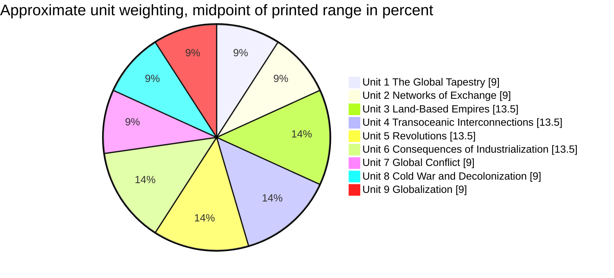

# AP World History: Modern — Course & Exam Overview (CED)

> Source: AP World History: Modern Course and Exam Description, effective Fall 2026 (College Board), pp. 2, 13–15, 18–19, 22–25, 30–31, 195–200, 211–247

Page numbers in this file are the printed footer numbers of the CED. Skill, reasoning-process, theme, task-verb, and rubric wording is copied verbatim; only text-extraction artifacts were fixed. Per-topic learning objectives and historical developments are in the unit files, not here.

---

## 1. Exam at a Glance

The exam is 3 hours and 15 minutes long. Students answer 55 multiple-choice questions, 3 short-answer questions, 1 document-based question, and 1 long essay question (p. 195).

| Section | Question Type | Number of Questions | Exam Weighting | Timing |
|---|---|---|---|---|
| I | Part A: Multiple-choice questions | 55 | 40% | 55 minutes |
| I | Part B: Short-answer questions | 3 | 20% | 40 minutes |
|  | Question 1: Secondary source |  |  |  |
|  | Question 2: Primary source |  |  |  |
|  | Question 3: Primary or Secondary Source (Non-text) |  |  |  |
| II | Free-response questions | 2 |  |  |
|  | Question 1: Document-based |  | 25% | 60 minutes (includes 15-minute reading period) |
|  | Question 2: Long essay |  | 15% | 40 minutes |

What each part contains (pp. 196–198):

- **Multiple-choice:** 55 questions, typically in sets of three to four questions, each with one or more stimuli (primary texts, secondary texts, images, charts or other quantitative data, and maps). There will be at least one set of paired text-based stimuli.
- **Short-answer:** all three are required. Question 1 includes a secondary text source, Question 2 a primary text source, and Question 3 a primary or secondary non-text source. The three questions cover 1200 to 2001, and each focuses on a different historical period.
- **Document-based question:** seven documents offering various perspectives on a historical development or process, on a topic between 1200 and 2001.
- **Long essay question:** required; covers approximately half of the chronological scope of the course. Responses are not expected to address the entire time period in the prompt.
- **Scoring (p. 2):** multiple-choice questions are scored by machine; free-response questions are scored by college faculty and expert AP teachers. The weighted raw score is converted into a composite AP score on a 1–5 scale. AP Exams are criterion-referenced, not graded on a curve.

### Unit Weighting

| Unit | Chronological Period* | Exam Weighting |
|---|---|---|
| Unit 1: The Global Tapestry | c. 1200 to c. 1450 | 8–10% |
| Unit 2: Networks of Exchange | c. 1200 to c. 1450 | 8–10% |
| Unit 3: Land-Based Empires | c. 1450 to c. 1750 | 12–15% |
| Unit 4: Transoceanic Interconnections | c. 1450 to c. 1750 | 12–15% |
| Unit 5: Revolutions | c. 1750 to c. 1900 | 12–15% |
| Unit 6: Consequences of Industrialization | c. 1750 to c. 1900 | 12–15% |
| Unit 7: Global Conflict | c. 1900 to the present | 8–10% |
| Unit 8: Cold War and Decolonization | c. 1900 to the present | 8–10% |
| Unit 9: Globalization | c. 1900 to the present | 8–10% |

> *Events, processes, and developments are not constrained by the given dates and may begin before, or continue after, the approximate dates assigned to each unit. (pp. 18, 196)

The chart below uses the midpoint of each printed range (8–10% → 9; 12–15% → 13.5). The midpoints sum to 99, so the slices are **approximate**; the CED gives only the ranges.

---

## 2. Historical Thinking Skills

"The AP historical thinking skills describe what students should be able to do while exploring course concepts." (p. 13) The table is from p. 14.

| Code | Skill or sub-skill (verbatim) |
|---|---|
| **Skill 1** | **Developments and Processes:** Identify and explain historical developments and processes. |
| 1.A | Identify a historical concept, development, or process. |
| 1.B | Explain a historical concept, development, or process. |
| **Skill 2** | **Sourcing and Situation:** Analyze sourcing and situation of primary and secondary sources. |
| 2.A | Identify a source’s point of view, purpose, historical situation, and/or audience. |
| 2.B | Explain the point of view, purpose, historical situation, and/or audience of a source. |
| 2.C | Explain the significance of a source’s point of view, purpose, historical situation, and/or audience, including how these might limit the use(s) of a source. |
| **Skill 3** | **Claims and Evidence in Sources:** Analyze arguments in primary and secondary sources. |
| 3.A | Identify and describe a claim and/or argument in a text-based or non-text-based source. |
| 3.B | Identify the evidence used in a source to support an argument. |
| 3.C | Compare the arguments or main ideas of two sources. |
| 3.D | Explain how claims or evidence support, modify, or refute a source’s argument. |
| **Skill 4** | **Contextualization:** Analyze the context of historical events, developments, or processes. |
| 4.A | Identify and describe a historical context for a specific historical development or process. |
| 4.B | Explain how a specific historical development or process is situated within a broader historical context. |
| **Skill 5** | **Making Connections:** Using historical reasoning processes (comparison, causation, continuity and change), analyze patterns and connections between and among historical developments and processes. |
| 5.A | Identify patterns among or connections between historical developments and processes. |
| 5.B | Explain how a historical development or process relates to another historical development or process. |
| **Skill 6** | **Argumentation:** Develop an argument. |
| 6.A | Make a historically defensible claim. |
| 6.B | Support an argument using specific and relevant evidence. ▪ Describe specific examples of historically relevant evidence. ▪ Explain how specific examples of historically relevant evidence support an argument. |
| 6.C | Use historical reasoning to explain relationships among pieces of historical evidence. |
| 6.D | Corroborate, qualify, or modify an argument using diverse and alternative evidence in order to develop a complex argument. This argument might: ▪ Explain nuance of an issue by analyzing multiple variables. ▪ Explain relevant and insightful connections within and across periods. ▪ Explain the relative historical significance of a source’s credibility and limitations. ▪ Explain how or why a historical claim or argument is or is not effective. |

### How the skills are assessed on the exam

Summarized from the table on p. 199 (not verbatim).

| Skill | Multiple-choice | Free-response |
|---|---|---|
| Skill 1: Developments and Processes | Yes | Short-answer questions, DBQ, and LEQ |
| Skill 2: Sourcing and Situation | Yes, including how sourcing and situation might limit the use(s) of a source | Short-answer questions (sourcing or situation); DBQ (how point of view, purpose, historical situation, and/or audience is relevant to an argument) |
| Skill 3: Claims and Evidence in Sources | Yes, including comparing arguments | Short-answer questions; the DBQ also gives opportunities to analyze arguments in primary sources |
| Skill 4: Contextualization | Yes | DBQ and LEQ; one or two short-answer questions may also assess it |
| Skill 5: Making Connections | Yes | DBQ, LEQ, and one or more short-answer questions |
| Skill 6: Argumentation | No multiple-choice questions explicitly assess it | DBQ and LEQ |

---

## 3. Reasoning Processes

"Reasoning processes describe the cognitive operations that students will be required to apply when engaging with the historical thinking skills on the AP Exam. The reasoning processes ultimately represent the way practitioners think in the discipline. Specific aspects of the cognitive process are defined under each reasoning process." (p. 15) The CED numbers Comparison as process 1, Causation as 2, and Continuity and Change as 3.

| Code | Reasoning process (verbatim) |
|---|---|
| **Reasoning Process 1** | **Comparison** |
| 1.i | Describe similarities and/or differences between different historical developments or processes. |
| 1.ii | Explain relevant similarities and/or differences between specific historical developments and processes. |
| 1.iii | Explain the relative historical significance of similarities and/or differences between different historical developments or processes. |
| **Reasoning Process 2** | **Causation** |
| 2.i | Describe causes and/or effects of a specific historical development or process. |
| 2.ii | Explain the relationship between causes and effects of a specific historical development or process. |
| 2.iii | Explain the difference between primary and secondary causes and between short- and long-term effects. |
| 2.iv | Explain how a relevant context influenced a specific historical development or process. |
| 2.v | Explain the relative historical significance of different causes and/or effects. |
| **Reasoning Process 3** | **Continuity and Change** |
| 3.i | Describe patterns of continuity and/or change over time. |
| 3.ii | Explain patterns of continuity and/or change over time. |
| 3.iii | Explain the relative historical significance of specific historical developments in relation to a larger pattern of continuity and/or change. |

---

## 4. Course Themes

"The themes serve as the connective tissue of the course and enable students to create meaningful connections across units." (p. 19) The exam assesses content from all six themes (p. 196).

| Theme | Name | Code | Definition (verbatim) |
|---|---|---|---|
| 1 | Humans and the Environment | ENV | The environment shapes human societies, and as populations grow and change, these populations in turn shape their environments. |
| 2 | Cultural Developments and Interactions | CDI | The development of ideas, beliefs, and religions illustrates how groups in society view themselves, and the interactions of societies and their beliefs often have political, social, and cultural implications. |
| 3 | Governance | GOV | A variety of internal and external factors contribute to state formation, expansion, and decline. Governments maintain order through a variety of administrative institutions, policies, and procedures, and governments obtain, retain, and exercise power in different ways and for different purposes. |
| 4 | Economic Systems | ECN | As societies develop, they affect and are affected by the ways that they produce, exchange, and consume goods and services. |
| 5 | Social Interactions and Organization | SIO | The process by which societies group their members and the norms that govern the interactions between these groups and between individuals influence political, economic, and cultural institutions and organization. |
| 6 | Technology and Innovation | TEC | Human adaptation and innovation have resulted in increased efficiency, comfort, and security, and technological advances have shaped human development and interactions with both intended and unintended consequences. |

---

## 5. Course at a Glance

Topic titles as printed on pp. 22–25. Suggested class periods assume 45-minute classes meeting five days a week for a full academic year (p. 22).

| Unit | Period | Exam Weighting | Class Periods | Topics |
|---|---|---|---|---|
| 1. The Global Tapestry | c. 1200 to c. 1450 | 8–10% | ~10–13 | 1.1 Developments in East Asia from c. 1200 to c. 1450 1.2 Developments in Dar al-Islam from c. 1200 to c. 1450 1.3 Developments in South and Southeast Asia from c. 1200 to c. 1450 1.4 State Building in the Americas 1.5 State Building in Africa 1.6 Developments in Europe from c. 1200 to c. 1450 1.7 Comparison in the Period from c. 1200 to c. 1450 |
| 2. Networks of Exchange | c. 1200 to c. 1450 | 8–10% | ~10–13 | 2.1 The Silk Roads 2.2 The Mongol Empire and the Making of the Modern World 2.3 Exchange in the Indian Ocean 2.4 Trans-Saharan Trade Routes 2.5 Cultural Consequences of Connectivity 2.6 Environmental Consequences of Connectivity 2.7 Comparison of Economic Exchange |
| 3. Land-Based Empires | c. 1450 to c. 1750 | 12–15% | ~8–11 | 3.1 Empires Expand 3.2 Empires: Administration 3.3 Empires: Belief Systems 3.4 Comparison in Land-Based Empires |
| 4. Transoceanic Interconnections | c. 1450 to c. 1750 | 12–15% | ~22–25 | 4.1 Technological Innovations from 1450 to 1750 4.2 Exploration: Causes and Events from 1450 to 1750 4.3 Columbian Exchange 4.4 Maritime Empires Established 4.5 Maritime Empires Maintained and Developed 4.6 Internal and External Challenges to State Power from 1450 to 1750 4.7 Changing Social Hierarchies from 1450 to 1750 4.8 Continuity and Change from 1450 to 1750 |
| 5. Revolutions | c. 1750 to c. 1900 | 12–15% | ~20–23 | 5.1 The Enlightenment 5.2 Nationalism and Revolutions in the Period from 1750 to 1900 5.3 Industrial Revolution Begins 5.4 Industrialization Spreads in the Period from 1750 to 1900 5.5 Technology of the Industrial Age 5.6 Industrialization: Government’s Role from 1750 to 1900 5.7 Economic Developments and Innovations in the Industrial Age 5.8 Reactions to the Industrial Economy from 1750 to 1900 5.9 Society and the Industrial Age 5.10 Continuity and Change in the Industrial Age |
| 6. Consequences of Industrialization | c. 1750 to c. 1900 | 12–15% | ~12–15 | 6.1 Rationales for Imperialism from 1750 to 1900 6.2 State Expansion from 1750 to 1900 6.3 Indigenous Responses to State Expansion from 1750 to 1900 6.4 Global Economic Development from 1750 to 1900 6.5 Economic Imperialism from 1750 to 1900 6.6 Causes of Migration in an Interconnected World 6.7 Effects of Migration 6.8 Causation in the Imperial Age |
| 7. Global Conflict | c. 1900 to the present | 8–10% | ~9–12 | 7.1 Shifting Power After 1900 7.2 Causes of World War I 7.3 Conducting World War I 7.4 The Economy in the Interwar Period 7.5 Unresolved Tensions After World War I 7.6 Causes of World War II 7.7 Conducting World War II 7.8 Mass Atrocities After 1900 7.9 Causation in Global Conflict |
| 8. Cold War and Decolonization | c. 1900 to the present | 8–10% | ~14–17 | 8.1 Setting the Stage for the Cold War and Decolonization 8.2 The Cold War 8.3 Effects of the Cold War 8.4 Spread of Communism After 1900 8.5 Decolonization After 1900 8.6 Newly Independent States 8.7 Global Resistance to Established Order After 1900 8.8 End of the Cold War 8.9 Causation in the Age of the Cold War and Decolonization |
| 9. Globalization | c. 1900 to the present | 8–10% | ~8–11 | 9.1 Advances in Technology and Exchange After 1900 9.2 Technological Advances and Limitations After 1900: Disease 9.3 Technological Advances: Debates About the Environment After 1900 9.4 Economics in the Global Age 9.5 Calls for Reform and Responses After 1900 9.6 Globalized Culture After 1900 9.7 Resistance to Globalization After 1900 9.8 Institutions Developing in a Globalized World 9.9 Continuity and Change in a Globalized World |

The last topic of every unit (1.7, 2.7, 3.4, 4.8, 5.10, 6.8, 7.9, 8.9, 9.9) is an argumentation topic (Skill 6) that reviews the unit's key concepts (pp. 22–25, 30).

---

## 6. Geographic Coverage

The course requires "world history from a global perspective," with balanced regional coverage so that "a single region is not situated at the center of the historical narrative" (p. 31). Because naming conventions are not universal, two reference maps define the regions and the names students are likely to see on the exam.

- **Map 1, World Regions—A Big Picture View:** five major regions: Africa, the Americas, Asia, Europe, and Oceania. The map draws the Europe–Asia line at the Ural Mountains.
- **Map 2, World Regions—A Closer Look:** subregions within the five regions. Labeled on the map: North America, Mexico, the Caribbean, and Latin America (including regions of Mesoamerica and the Caribbean); North Africa, West Africa, Central Africa, East Africa, and Southern Africa; the Middle East, Central Asia, East Asia, South Asia, and Southeast Asia. Europe and Oceania have no labeled subregions.
- **Regional overlaps:** Map 2 hatches areas that belong to more than one region, for example between North America and Mexico and around the Middle East (read from the map image).

---

## 7. How Each Free-Response Question Is Scored

General notes that apply to every rubric (pp. 218, 224, 230, 242):

- Except where otherwise noted, each point of the rubric is earned independently. For instance, a student could earn a point for evidence beyond the documents without earning a point for thesis/claim.
- **Accuracy:** The components of this rubric each require that students demonstrate historically defensible content knowledge. Given the timed nature of the exam, a response may contain errors that do not detract from its overall quality, as long as the historical content used to advance the argument is accurate.
- **Clarity:** Exam essays should be considered first drafts and thus may contain grammatical errors. Those errors will not be counted against a student unless they obscure the successful demonstration of the content knowledge, skills, and reasoning processes described in the rubrics.

Task verbs used in free-response questions (p. 200):

| Task verb | Meaning (verbatim) |
|---|---|
| Compare | Provide a description or explanation of similarities and/or differences. |
| Describe | Provide the relevant characteristics of a specified topic. |
| Evaluate | Judge or determine the significance or importance of information, or the quality or accuracy of a claim. |
| Explain | Provide information about how or why a relationship, process, pattern, position, situation, or outcome occurs, using evidence and/or reasoning. Explain “how” typically requires analyzing the relationship, process, pattern, position, situation, or outcome, whereas explain “why” typically requires analysis of motivations or reasons for the relationship, process, pattern, position, situation, or outcome. |
| Identify | Indicate or provide information about a specified topic, without elaboration or explanation. |
| Support an argument | Provide specific examples and explain how they support a claim. |

### Short-Answer Question (SAQ)

The AP History Rubrics section has no general SAQ rubric. The only SAQ scoring in the CED is the guideline for the sample SAQ 2 (Arai Hakuseki, Japanese scholar and adviser to the Tokugawa shogun, report, circa 1720; pp. 211, 223–225). It is worth **3 points, 1 per part**, and the scoring notes define what "describe" and "explain" require (p. 224).

| Part (sample SAQ) | Task | Points | What earns the point (verbatim from the scoring notes) |
|---|---|---|---|
| (a) | Describe | 1 | Describe: Provide the relevant characteristics of a specified topic. Description requires more than simply mentioning an isolated term. |
| (b) | Explain | 1 | Explain: Provide information about how or why a historical development or process occurs or how or why a relationship exists. |
| (c) | Explain | 1 | Explain: Provide information about how or why a historical development or process occurs or how or why a relationship exists. |
| Total |  | 3 | Each point is earned independently. |

Common ways points are missed (from the SAQ scoring notes):

- A "describe" answer that only mentions an isolated term; "Description requires more than simply mentioning an isolated term."

### Document-Based Question (DBQ)

The CED's sample DBQ asks students to evaluate the extent to which the experience of the First World War changed relationships between Europeans and colonized peoples, using seven documents (pp. 212–215, scored on pp. 226–240). AP History DBQ Rubric (7 points), pp. 218–220. Scoring criteria and decision rules are verbatim.

| Reporting Category | Points | Scoring Criteria | Decision Rules |
|---|---|---|---|
| A. Thesis/Claim | 0–1 | 1 pt. Responds to the prompt with a historically defensible thesis/claim that establishes a line of reasoning. | To earn this point, the thesis must make a claim that responds to the prompt rather than restating or rephrasing the prompt. The thesis must consist of one or more sentences located in one place, either in the introduction or the conclusion. |
| B. Contextualization | 0–1 | 1 pt. Describes a broader historical context relevant to the prompt. | To earn this point, the response must describe broader historical events, developments, or processes that occur before, during, or continue after the time frame of the prompt that are relevant to the topic. This point is not awarded for merely a phrase or reference. |
| C. Evidence: Evidence From the Documents | 0–2 | 1 pt. Uses the content of at least three documents to address the topic of the prompt. **OR** 2 pts. Supports an argument in response to the prompt using at least four documents. | To earn one point, the response must accurately describe — rather than simply quote — the content from at least three of the documents. To earn two points, the response must accurately describe — rather than simply quote — the content from at least four documents. In addition, the response must use the content of the four documents to support an argument in response to the prompt. |
| C. Evidence: Evidence Beyond the Documents | 0–1 | 1 pt. Uses at least one additional piece of specific historical evidence (beyond that found in the documents) relevant to an argument in response to the prompt. | To earn this point, the response must describe the evidence and must use more than a phrase or reference. This additional piece of evidence must be different from the evidence used to earn the point for contextualization. |
| D. Analysis and Reasoning: Sourcing | 0–1 | 1 pt. For at least two documents, explains how or why the document’s point of view, purpose, historical situation, and/or audience is relevant to an argument. | To earn this point, the response must explain how or why (rather than simply identifying) the document’s point of view, purpose, historical situation, or audience is relevant to an argument about the prompt for each of the two documents sourced. |
| D. Analysis and Reasoning: Complexity | 0–1 | 1 pt. Demonstrates a complex understanding of the historical development that is the focus of the prompt through sophisticated argumentation and/or effective use of evidence. | A response may demonstrate a complex understanding through sophisticated argumentation that is relevant to the prompt (ways listed below). A response may demonstrate a complex understanding through effective use of evidence relevant to an argument that addresses the prompt (ways listed below). This complex understanding must be part of the argument and may be demonstrated in any part of the response. While it is not necessary for this complex understanding to be woven throughout the response, it must be more than merely a phrase or reference. |
| Total | 7 |  |  |

Ways to earn the DBQ complexity point (verbatim, p. 220). Through sophisticated argumentation:

- Explaining multiple themes or perspectives to explore complexity or nuance; OR
- Explaining multiple causes or effects, multiple similarities or differences, or multiple continuities or changes; OR
- Explaining both cause and effect, both similarity and difference, or both continuity and change; OR
- Explaining relevant and insightful connections within and across periods or geographical areas. These connections should clearly relate to an argument that responds to the prompt.

Through effective use of evidence:

- Effectively using seven documents to support an argument that responds to the prompt; OR
- Explaining how the point of view, purpose, historical situation, and/or audience of at least four documents supports an argument that responds to the prompt; OR
- Using documents and evidence beyond the documents effectively to demonstrate a sophisticated understanding of different perspectives relevant to the prompt.

Common ways points are missed (from the sample DBQ scoring guidelines, pp. 231–238):

- **Thesis:** responses that are not historically defensible, only restate or rephrase the prompt, do not respond to the prompt, do not establish a line of reasoning, or are overgeneralized.
- **Contextualization:** an overgeneralized statement about the time period, context that is not relevant to the prompt, or a passing phrase or reference.
- **Evidence from the documents:** using fewer than three documents, misinterpreting a document, quoting without describing the content, or addressing documents collectively rather than considering each one separately.
- **Evidence beyond the documents:** evidence that is not relevant, is outside the time period or region of the prompt, repeats information from the prompt or the documents, or is only a passing phrase or reference. It must also differ from the evidence used for contextualization.
- **Sourcing:** sourcing fewer than two documents, identifying point of view, purpose, historical situation, or audience without explaining how or why it is relevant to an argument, or summarizing a document's content without tying it to sourcing.
- **Complexity:** a complex understanding that is only a phrase or reference. Using all seven documents earns the point only if there is an attempt to use all seven to support an argument (use may be uneven).

### Long Essay Question (LEQ)

The CED's sample LEQ asks how agriculture or agricultural practices shaped social, gender, or family structures in the period circa 1200 to 1800 (p. 216, scored on pp. 241–247). AP History LEQ Rubric (6 points), pp. 221–222. Scoring criteria and decision rules are verbatim.

| Reporting Category | Points | Scoring Criteria | Decision Rules |
|---|---|---|---|
| A. Thesis/Claim | 0–1 | 1 pt. Responds to the prompt with a historically defensible thesis/claim that establishes a line of reasoning. | To earn this point, the thesis must make a claim that responds to the prompt, rather than restating or rephrasing the prompt. The thesis must consist of one or more sentences located in one place, either in the introduction or the conclusion. |
| B. Contextualization | 0–1 | 1 pt. Describes a broader historical context relevant to the prompt. | To earn this point, the response must describe broader historical events, developments, or processes that occur before, during, or continue after the time frame of the prompt that are relevant to the topic. This point is not awarded for merely a phrase or a reference. |
| C. Evidence | 0–2 | 1 pt. Provides specific examples of at least two pieces of evidence relevant to the topic of the prompt. **OR** 2 pts. Supports an argument in response to the prompt using at least two pieces of specific and relevant evidence. | To earn one point, the response must identify specific historical examples relevant to the topic of the prompt. To earn two points the response must use specific historical evidence to support an argument in response to the prompt. |
| D. Analysis and Reasoning | 0–2 | 1 pt. Uses historical reasoning (e.g. comparison, causation, CCOT) to frame or structure an argument that addresses the prompt. **OR** 2 pts. Demonstrates a complex understanding of the historical development that is the focus of the prompt through sophisticated argumentation and/or effective use of evidence. | To earn the first point, the response must demonstrate the use of historical reasoning to frame or structure an argument, although the reasoning might be uneven or imbalanced, or the evidence may be overly general or lacking specificity. To earn the second point, the response may demonstrate a complex understanding through sophisticated argumentation that is relevant to the prompt (ways listed below). A response may demonstrate a complex or nuanced understanding through effective use of evidence relevant to an argument that addresses the prompt (ways listed below). This complex understanding must be part of the argument and may be demonstrated in any part of the response. While it is not necessary for this complex understanding to be woven throughout the response, it must be more than merely a phrase or reference. |
| Total | 6 |  |  |

In this CED the LEQ's row D is printed as "1 pt. … OR 2 pts.", the same layout as the Evidence rows, while the DBQ prints sourcing and complexity as two separate 1-point items (pp. 220, 222).

Ways to earn the second LEQ analysis point (verbatim, p. 222). Through sophisticated argumentation:

- Explaining multiple themes or perspectives to explore complexity or nuance; OR
- Explaining multiple causes or effects, multiple similarities or differences, or multiple continuities or changes; OR
- Explaining both cause and effect, both similarity and difference, or both continuity and change; OR
- Explaining relevant and insightful connections within and across periods or geographical areas. These connections should clearly relate to an argument that responds to the prompt.

Through effective use of evidence:

- Explaining how multiple pieces of specific and relevant evidence (at least four) support a nuanced or complex argument that responds to the prompt; OR
- Using evidence effectively to demonstrate a sophisticated understanding of different perspectives relevant to the prompt.

Common ways points are missed (from the sample LEQ scoring guidelines, pp. 243–247):

- **Thesis:** responses that are not historically defensible, only restate or rephrase the prompt, do not respond to the prompt, do not establish a line of reasoning, or are overgeneralized.
- **Contextualization:** an overgeneralized statement about the time period, context that is not relevant to the prompt, or a passing phrase or reference.
- **Evidence:** identifying only a single piece of evidence, evidence not relevant to the topic, evidence outside the time period or region of the prompt, or repeating information given in the prompt.
- **Analysis and reasoning:** including evidence but offering no reasoning to connect it to an argument, or asserting the use of historical reasoning without using it to frame or structure an argument.

---

## 8. What Changed vs. Earlier CEDs

The CED does not list changes. Its cover only notes that course and exam descriptions are updated periodically and that AP Central may have a more recent version.
