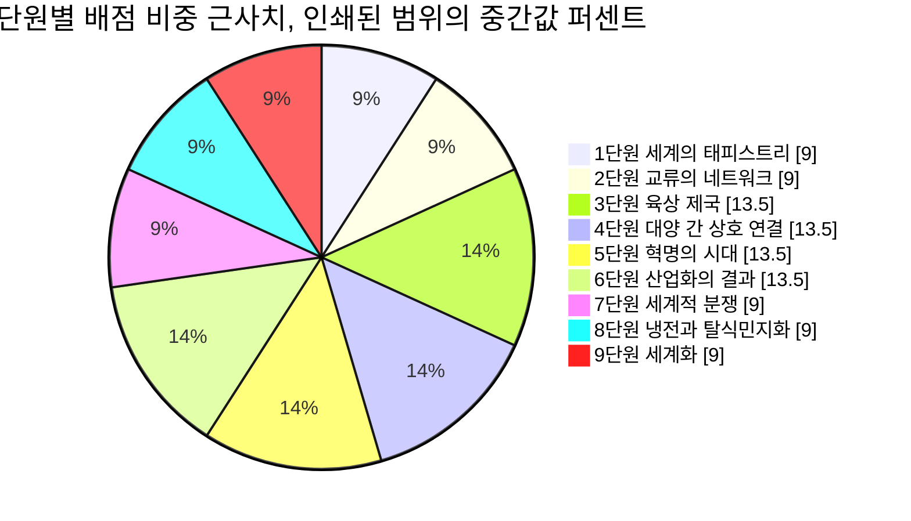

# AP 세계사: 모던 — 과목 및 시험 개요 (AP World History: Modern — Course & Exam Overview, CED)

> 출처: AP World History: Modern Course and Exam Description, effective Fall 2026 (College Board), pp. 2, 13–15, 18–19, 22–25, 30–31, 195–200, 211–247

이 파일의 쪽수는 CED 하단에 인쇄된 쪽 번호이다. 역사적 사고 기능, 추론 과정, 주제, 과제 동사, 채점 기준의 영어 문구는 원문 그대로 옮겼고, 텍스트 추출 과정에서 생긴 오류만 고쳤다. 한국어는 이해를 돕기 위한 번역이다. 토픽별 학습 목표와 역사적 개념은 각 단원 파일에 있고, 여기서는 다루지 않는다.

---

## 1. 시험 한눈에 보기 (Exam at a Glance)

시험 시간은 3시간 15분이다. 학생은 객관식 (Multiple-choice) 55문항, 단답형 (Short-answer) 3문항, 문서 기반 문항 (Document-based question, DBQ) 1문항, 장문 에세이 문항 (Long essay question, LEQ) 1문항에 답한다 (p. 195).

| 섹션 (Section) | 문항 유형 (Question Type) | 문항 수 (Number of Questions) | 배점 비중 (Exam Weighting) | 시간 (Timing) |
|---|---|---|---|---|
| I | Part A: 객관식 문항 (Multiple-choice questions) | 55 | 40% | 55분 |
| I | Part B: 단답형 문항 (Short-answer questions) | 3 | 20% | 40분 |
|  | 1번: 2차 사료 (Secondary source) |  |  |  |
|  | 2번: 1차 사료 (Primary source) |  |  |  |
|  | 3번: 1차 또는 2차 사료, 비문자 자료 (Primary or Secondary Source (Non-text)) |  |  |  |
| II | 서술형 문항 (Free-response questions) | 2 |  |  |
|  | 1번: 문서 기반 (Document-based) |  | 25% | 60분 (15분 읽기 시간 포함, includes 15-minute reading period) |
|  | 2번: 장문 에세이 (Long essay) |  | 15% | 40분 |

각 파트의 구성은 다음과 같다 (pp. 196–198).

- **객관식:** 55문항이며, 보통 3~4문항이 한 세트를 이룬다. 각 세트에는 하나 이상의 자극 자료 (Stimulus)가 붙는다. 자료는 1차 문헌, 2차 문헌, 이미지, 도표나 기타 수량 자료, 지도이다. 짝을 이룬 문자 자료 세트 (Paired text-based stimuli)가 적어도 하나 나온다.
- **단답형:** 세 문항 모두 필수이다. 1번은 2차 문자 사료, 2번은 1차 문자 사료, 3번은 1차 또는 2차 비문자 사료를 포함한다. 세 문항은 1200년부터 2001년까지를 다루며, 문항마다 서로 다른 시기에 초점을 둔다.
- **문서 기반 문항:** 한 역사적 발전이나 과정에 대해 다양한 관점을 담은 문서 7개가 주어진다. 주제는 1200년부터 2001년 사이에서 나온다.
- **장문 에세이 문항:** 필수이며, 과목 전체 시간 범위의 약 절반을 다룬다. 답안이 문제에 제시된 시기 전체를 다룰 필요는 없다.
- **채점 (p. 2):** 객관식은 기계로 채점하고, 서술형은 대학 교수와 숙련된 AP 교사가 채점한다. 가중치를 적용한 원점수를 1~5점의 AP 종합 점수로 환산한다. AP 시험은 상대평가 (Curve)가 아니라 준거 참조 (Criterion-referenced) 방식이다.

### 단원별 배점 비중 (Unit Weighting)

| 단원 (Unit) | 시기 (Chronological Period)* | 배점 비중 (Exam Weighting) |
|---|---|---|
| Unit 1: 세계의 태피스트리 (The Global Tapestry) | c. 1200 to c. 1450 | 8–10% |
| Unit 2: 교류의 네트워크 (Networks of Exchange) | c. 1200 to c. 1450 | 8–10% |
| Unit 3: 육상 제국 (Land-Based Empires) | c. 1450 to c. 1750 | 12–15% |
| Unit 4: 대양 간 상호 연결 (Transoceanic Interconnections) | c. 1450 to c. 1750 | 12–15% |
| Unit 5: 혁명의 시대 (Revolutions) | c. 1750 to c. 1900 | 12–15% |
| Unit 6: 산업화의 결과 (Consequences of Industrialization) | c. 1750 to c. 1900 | 12–15% |
| Unit 7: 세계적 분쟁 (Global Conflict) | c. 1900 to the present | 8–10% |
| Unit 8: 냉전과 탈식민지화 (Cold War and Decolonization) | c. 1900 to the present | 8–10% |
| Unit 9: 세계화 (Globalization) | c. 1900 to the present | 8–10% |

> *사건, 과정, 발전은 제시된 연도에 묶이지 않으며, 각 단원에 배정된 대략적 연도보다 먼저 시작되거나 그 뒤까지 이어질 수 있다. (Events, processes, and developments are not constrained by the given dates and may begin before, or continue after, the approximate dates assigned to each unit.) (pp. 18, 196)

아래 차트는 인쇄된 각 범위의 중간값을 썼다 (8–10% → 9, 12–15% → 13.5). 중간값의 합은 99이므로 각 조각은 **대략적인 값**이다. CED는 범위만 제시한다.

---

## 2. 역사적 사고 기능 (Historical Thinking Skills)

"AP 역사적 사고 기능은 학생이 과목 개념을 탐구하면서 할 수 있어야 하는 것을 설명한다 (The AP historical thinking skills describe what students should be able to do while exploring course concepts)." (p. 13) 표는 p. 14에서 옮겼다.

| 코드 (Code) | 기능 또는 하위 기능 (Skill or sub-skill, 원문 그대로) |
|---|---|
| **Skill 1** | **Developments and Processes:** Identify and explain historical developments and processes. **발전과 과정:** 역사적 발전과 과정을 식별하고 설명한다. |
| 1.A | Identify a historical concept, development, or process. 역사적 개념, 발전 또는 과정을 식별한다. |
| 1.B | Explain a historical concept, development, or process. 역사적 개념, 발전 또는 과정을 설명한다. |
| **Skill 2** | **Sourcing and Situation:** Analyze sourcing and situation of primary and secondary sources. **출처와 상황:** 1차 사료와 2차 사료의 출처와 상황을 분석한다. |
| 2.A | Identify a source’s point of view, purpose, historical situation, and/or audience. 사료의 관점, 목적, 역사적 상황, 독자 중 하나 이상을 식별한다. |
| 2.B | Explain the point of view, purpose, historical situation, and/or audience of a source. 사료의 관점, 목적, 역사적 상황, 독자 중 하나 이상을 설명한다. |
| 2.C | Explain the significance of a source’s point of view, purpose, historical situation, and/or audience, including how these might limit the use(s) of a source. 사료의 관점, 목적, 역사적 상황, 독자가 갖는 의미를 설명하며, 이것들이 사료의 활용을 어떻게 제한할 수 있는지도 포함한다. |
| **Skill 3** | **Claims and Evidence in Sources:** Analyze arguments in primary and secondary sources. **사료 속 주장과 근거:** 1차 사료와 2차 사료의 논증을 분석한다. |
| 3.A | Identify and describe a claim and/or argument in a text-based or non-text-based source. 문자 사료나 비문자 사료에 담긴 주장이나 논증을 식별하고 서술한다. |
| 3.B | Identify the evidence used in a source to support an argument. 사료가 논증을 뒷받침하려고 사용한 근거를 식별한다. |
| 3.C | Compare the arguments or main ideas of two sources. 두 사료의 논증이나 중심 생각을 비교한다. |
| 3.D | Explain how claims or evidence support, modify, or refute a source’s argument. 주장이나 근거가 사료의 논증을 어떻게 뒷받침, 수정, 반박하는지 설명한다. |
| **Skill 4** | **Contextualization:** Analyze the context of historical events, developments, or processes. **맥락화:** 역사적 사건, 발전, 과정의 맥락을 분석한다. |
| 4.A | Identify and describe a historical context for a specific historical development or process. 특정 역사적 발전이나 과정의 역사적 맥락을 식별하고 서술한다. |
| 4.B | Explain how a specific historical development or process is situated within a broader historical context. 특정 역사적 발전이나 과정이 더 넓은 역사적 맥락 속에 어떻게 자리하는지 설명한다. |
| **Skill 5** | **Making Connections:** Using historical reasoning processes (comparison, causation, continuity and change), analyze patterns and connections between and among historical developments and processes. **연결 짓기:** 역사적 추론 과정 (비교, 인과관계, 지속성과 변화)을 사용해 역사적 발전과 과정 사이의 패턴과 연결을 분석한다. |
| 5.A | Identify patterns among or connections between historical developments and processes. 역사적 발전과 과정 사이의 패턴이나 연결을 식별한다. |
| 5.B | Explain how a historical development or process relates to another historical development or process. 한 역사적 발전이나 과정이 다른 역사적 발전이나 과정과 어떻게 관련되는지 설명한다. |
| **Skill 6** | **Argumentation:** Develop an argument. **논증:** 논증을 전개한다. |
| 6.A | Make a historically defensible claim. 역사적으로 옹호할 수 있는 주장을 세운다. |
| 6.B | Support an argument using specific and relevant evidence. ▪ Describe specific examples of historically relevant evidence. ▪ Explain how specific examples of historically relevant evidence support an argument. 구체적이고 관련 있는 근거로 논증을 뒷받침한다. ▪ 역사적으로 관련 있는 근거의 구체적 사례를 서술한다. ▪ 역사적으로 관련 있는 근거의 구체적 사례가 논증을 어떻게 뒷받침하는지 설명한다. |
| 6.C | Use historical reasoning to explain relationships among pieces of historical evidence. 역사적 추론을 사용해 여러 역사적 근거 사이의 관계를 설명한다. |
| 6.D | Corroborate, qualify, or modify an argument using diverse and alternative evidence in order to develop a complex argument. This argument might: ▪ Explain nuance of an issue by analyzing multiple variables. ▪ Explain relevant and insightful connections within and across periods. ▪ Explain the relative historical significance of a source’s credibility and limitations. ▪ Explain how or why a historical claim or argument is or is not effective. 복합적 논증을 전개하기 위해 다양하고 대안적인 근거로 논증을 입증, 한정, 수정한다. 이 논증은 다음을 할 수 있다. ▪ 여러 변수를 분석해 쟁점의 미묘한 차이를 설명한다. ▪ 한 시기 안에서, 그리고 여러 시기에 걸쳐 관련 있고 통찰력 있는 연결을 설명한다. ▪ 사료의 신뢰성과 한계가 갖는 상대적인 역사적 의미를 설명한다. ▪ 역사적 주장이나 논증이 왜, 어떻게 효과적인지 또는 효과적이지 않은지 설명한다. |

### 시험에서 기능을 평가하는 방식 (How the skills are assessed on the exam)

p. 199의 표를 요약했다 (원문 그대로가 아님).

| 기능 (Skill) | 객관식 (Multiple-choice) | 서술형 (Free-response) |
|---|---|---|
| Skill 1: 발전과 과정 (Developments and Processes) | 평가한다 | 단답형, DBQ, LEQ |
| Skill 2: 출처와 상황 (Sourcing and Situation) | 평가한다. 출처와 상황이 사료의 활용을 어떻게 제한하는지도 포함한다 | 단답형 (출처 또는 상황), DBQ (관점, 목적, 역사적 상황, 독자가 논증과 어떻게 관련되는지) |
| Skill 3: 사료 속 주장과 근거 (Claims and Evidence in Sources) | 평가한다. 논증 비교도 포함한다 | 단답형. DBQ도 1차 사료의 논증을 분석할 기회를 준다 |
| Skill 4: 맥락화 (Contextualization) | 평가한다 | DBQ와 LEQ. 단답형 1~2문항도 평가할 수 있다 |
| Skill 5: 연결 짓기 (Making Connections) | 평가한다 | DBQ, LEQ, 단답형 1문항 이상 |
| Skill 6: 논증 (Argumentation) | 이 기능을 명시적으로 평가하는 객관식 문항은 없다 | DBQ와 LEQ |

---

## 3. 추론 과정 (Reasoning Processes)

"추론 과정은 학생이 AP 시험에서 역사적 사고 기능을 다룰 때 적용해야 하는 인지 작용을 설명한다. 추론 과정은 결국 이 분야 전문가가 생각하는 방식을 나타낸다. 각 추론 과정 아래에 인지 과정의 구체적 측면이 정의되어 있다 (Reasoning processes describe the cognitive operations that students will be required to apply when engaging with the historical thinking skills on the AP Exam. The reasoning processes ultimately represent the way practitioners think in the discipline. Specific aspects of the cognitive process are defined under each reasoning process)." (p. 15) CED는 비교 (Comparison)를 1번, 인과관계 (Causation)를 2번, 지속성과 변화 (Continuity and Change)를 3번 추론 과정으로 번호를 매긴다.

| 코드 (Code) | 추론 과정 (Reasoning process, 원문 그대로) |
|---|---|
| **Reasoning Process 1** | **Comparison** **비교** |
| 1.i | Describe similarities and/or differences between different historical developments or processes. 서로 다른 역사적 발전이나 과정 사이의 유사점이나 차이점을 서술한다. |
| 1.ii | Explain relevant similarities and/or differences between specific historical developments and processes. 특정 역사적 발전과 과정 사이의 관련 있는 유사점이나 차이점을 설명한다. |
| 1.iii | Explain the relative historical significance of similarities and/or differences between different historical developments or processes. 서로 다른 역사적 발전이나 과정 사이의 유사점이나 차이점이 갖는 상대적인 역사적 의미를 설명한다. |
| **Reasoning Process 2** | **Causation** **인과관계** |
| 2.i | Describe causes and/or effects of a specific historical development or process. 특정 역사적 발전이나 과정의 원인이나 결과를 서술한다. |
| 2.ii | Explain the relationship between causes and effects of a specific historical development or process. 특정 역사적 발전이나 과정의 원인과 결과 사이의 관계를 설명한다. |
| 2.iii | Explain the difference between primary and secondary causes and between short- and long-term effects. 주된 원인과 부차적 원인의 차이, 단기적 결과와 장기적 결과의 차이를 설명한다. |
| 2.iv | Explain how a relevant context influenced a specific historical development or process. 관련 맥락이 특정 역사적 발전이나 과정에 어떻게 영향을 주었는지 설명한다. |
| 2.v | Explain the relative historical significance of different causes and/or effects. 여러 원인이나 결과가 갖는 상대적인 역사적 의미를 설명한다. |
| **Reasoning Process 3** | **Continuity and Change** **지속성과 변화** |
| 3.i | Describe patterns of continuity and/or change over time. 시간에 따른 지속성이나 변화의 패턴을 서술한다. |
| 3.ii | Explain patterns of continuity and/or change over time. 시간에 따른 지속성이나 변화의 패턴을 설명한다. |
| 3.iii | Explain the relative historical significance of specific historical developments in relation to a larger pattern of continuity and/or change. 더 큰 지속성이나 변화의 패턴과 관련해 특정 역사적 발전이 갖는 상대적인 역사적 의미를 설명한다. |

---

## 4. 과목 주제 (Course Themes)

"주제는 과목의 결합 조직 역할을 하며, 학생이 단원을 넘나들며 의미 있는 연결을 만들 수 있게 한다 (The themes serve as the connective tissue of the course and enable students to create meaningful connections across units)." (p. 19) 시험은 여섯 주제 모두에서 내용을 평가한다 (p. 196).

| 주제 (Theme) | 이름 (Name) | 코드 (Code) | 정의 (Definition, 원문 그대로) |
|---|---|---|---|
| 1 | Humans and the Environment 인간과 환경 | ENV | The environment shapes human societies, and as populations grow and change, these populations in turn shape their environments. 환경은 인간 사회를 형성하고, 인구가 늘고 변하면서 그 인구가 다시 환경을 형성한다. |
| 2 | Cultural Developments and Interactions 문화의 발전과 상호작용 | CDI | The development of ideas, beliefs, and religions illustrates how groups in society view themselves, and the interactions of societies and their beliefs often have political, social, and cultural implications. 사상, 신앙, 종교의 발전은 사회 집단이 스스로를 어떻게 보는지 보여 주며, 사회와 그 신앙 사이의 상호작용은 흔히 정치적, 사회적, 문화적 영향을 낳는다. |
| 3 | Governance 통치 | GOV | A variety of internal and external factors contribute to state formation, expansion, and decline. Governments maintain order through a variety of administrative institutions, policies, and procedures, and governments obtain, retain, and exercise power in different ways and for different purposes. 다양한 내부 요인과 외부 요인이 국가의 형성, 팽창, 쇠퇴에 작용한다. 정부는 다양한 행정 기구, 정책, 절차를 통해 질서를 유지하며, 서로 다른 방식과 목적으로 권력을 얻고, 지키고, 행사한다. |
| 4 | Economic Systems 경제 체제 | ECN | As societies develop, they affect and are affected by the ways that they produce, exchange, and consume goods and services. 사회는 발전하면서 재화와 서비스를 생산, 교환, 소비하는 방식에 영향을 주고 또 그 방식의 영향을 받는다. |
| 5 | Social Interactions and Organization 사회적 상호작용과 조직 | SIO | The process by which societies group their members and the norms that govern the interactions between these groups and between individuals influence political, economic, and cultural institutions and organization. 사회가 구성원을 집단으로 나누는 과정, 그리고 집단 사이와 개인 사이의 상호작용을 규율하는 규범은 정치, 경제, 문화 제도와 조직에 영향을 준다. |
| 6 | Technology and Innovation 기술과 혁신 | TEC | Human adaptation and innovation have resulted in increased efficiency, comfort, and security, and technological advances have shaped human development and interactions with both intended and unintended consequences. 인간의 적응과 혁신은 효율, 편의, 안전을 높였고, 기술 발전은 의도한 결과와 의도하지 않은 결과를 모두 낳으며 인간의 발전과 상호작용을 형성했다. |

---

## 5. 과목 한눈에 보기 (Course at a Glance)

토픽 제목은 pp. 22–25에 인쇄된 것이다. 권장 수업 차시는 45분 수업을 주 5일, 1년 동안 하는 것을 기준으로 한다 (p. 22).

| 단원 (Unit) | 시기 (Period) | 배점 비중 (Exam Weighting) | 수업 차시 (Class Periods) | 토픽 (Topics) |
|---|---|---|---|---|
| 1. 세계의 태피스트리 (The Global Tapestry) | c. 1200 to c. 1450 | 8–10% | ~10–13 | 1.1 동아시아의 발전, c. 1200–1450 (Developments in East Asia from c. 1200 to c. 1450) 1.2 다르 알 이슬람의 발전, c. 1200–1450 (Developments in Dar al-Islam from c. 1200 to c. 1450) 1.3 남아시아와 동남아시아의 발전, c. 1200–1450 (Developments in South and Southeast Asia from c. 1200 to c. 1450) 1.4 아메리카의 국가 형성 (State Building in the Americas) 1.5 아프리카의 국가 형성 (State Building in Africa) 1.6 유럽의 발전, c. 1200–1450 (Developments in Europe from c. 1200 to c. 1450) 1.7 c. 1200–1450년 시기의 비교 (Comparison in the Period from c. 1200 to c. 1450) |
| 2. 교류의 네트워크 (Networks of Exchange) | c. 1200 to c. 1450 | 8–10% | ~10–13 | 2.1 실크로드 (The Silk Roads) 2.2 몽골 제국과 근대 세계의 형성 (The Mongol Empire and the Making of the Modern World) 2.3 인도양 교역 (Exchange in the Indian Ocean) 2.4 사하라 횡단 교역 (Trans-Saharan Trade Routes) 2.5 연결이 낳은 문화적 결과 (Cultural Consequences of Connectivity) 2.6 연결이 낳은 환경적 결과 (Environmental Consequences of Connectivity) 2.7 경제 교류 비교 (Comparison of Economic Exchange) |
| 3. 육상 제국 (Land-Based Empires) | c. 1450 to c. 1750 | 12–15% | ~8–11 | 3.1 제국의 팽창 (Empires Expand) 3.2 제국: 통치 (Empires: Administration) 3.3 제국: 신앙 체계 (Empires: Belief Systems) 3.4 육상 제국 비교 (Comparison in Land-Based Empires) |
| 4. 대양 간 상호 연결 (Transoceanic Interconnections) | c. 1450 to c. 1750 | 12–15% | ~22–25 | 4.1 1450–1750년의 기술 혁신 (Technological Innovations from 1450 to 1750) 4.2 탐험: 1450–1750년의 원인과 사건 (Exploration: Causes and Events from 1450 to 1750) 4.3 콜럼버스 교환 (Columbian Exchange) 4.4 해양 제국의 수립 (Maritime Empires Established) 4.5 해양 제국의 유지와 발전 (Maritime Empires Maintained and Developed) 4.6 1450–1750년 국가 권력에 대한 내부와 외부의 도전 (Internal and External Challenges to State Power from 1450 to 1750) 4.7 1450–1750년 사회 위계의 변화 (Changing Social Hierarchies from 1450 to 1750) 4.8 1450–1750년의 연속성과 변화 (Continuity and Change from 1450 to 1750) |
| 5. 혁명의 시대 (Revolutions) | c. 1750 to c. 1900 | 12–15% | ~20–23 | 5.1 계몽주의 (The Enlightenment) 5.2 1750–1900년의 민족주의와 혁명 (Nationalism and Revolutions in the Period from 1750 to 1900) 5.3 산업 혁명의 시작 (Industrial Revolution Begins) 5.4 1750–1900년 산업화의 확산 (Industrialization Spreads in the Period from 1750 to 1900) 5.5 산업 시대의 기술 (Technology of the Industrial Age) 5.6 산업화: 1750–1900년 정부의 역할 (Industrialization: Government’s Role from 1750 to 1900) 5.7 산업 시대의 경제 발전과 혁신 (Economic Developments and Innovations in the Industrial Age) 5.8 1750–1900년 산업 경제에 대한 반응 (Reactions to the Industrial Economy from 1750 to 1900) 5.9 산업 시대의 사회 (Society and the Industrial Age) 5.10 산업 시대의 연속성과 변화 (Continuity and Change in the Industrial Age) |
| 6. 산업화의 결과 (Consequences of Industrialization) | c. 1750 to c. 1900 | 12–15% | ~12–15 | 6.1 1750–1900년 제국주의의 정당화 논리 (Rationales for Imperialism from 1750 to 1900) 6.2 1750–1900년 국가의 팽창 (State Expansion from 1750 to 1900) 6.3 1750–1900년 국가의 팽창에 대한 토착민의 대응 (Indigenous Responses to State Expansion from 1750 to 1900) 6.4 1750–1900년 세계 경제의 발전 (Global Economic Development from 1750 to 1900) 6.5 1750–1900년 경제적 제국주의 (Economic Imperialism from 1750 to 1900) 6.6 서로 연결된 세계에서 이주의 원인 (Causes of Migration in an Interconnected World) 6.7 이주의 영향 (Effects of Migration) 6.8 제국주의 시대의 인과관계 (Causation in the Imperial Age) |
| 7. 세계적 분쟁 (Global Conflict) | c. 1900 to the present | 8–10% | ~9–12 | 7.1 1900년 이후 권력의 이동 (Shifting Power After 1900) 7.2 제1차 세계 대전의 원인 (Causes of World War I) 7.3 제1차 세계 대전의 수행 (Conducting World War I) 7.4 전간기의 경제 (The Economy in the Interwar Period) 7.5 제1차 세계 대전 이후 해결되지 않은 긴장 (Unresolved Tensions After World War I) 7.6 제2차 세계 대전의 원인 (Causes of World War II) 7.7 제2차 세계 대전의 수행 (Conducting World War II) 7.8 1900년 이후의 대량 잔학 행위 (Mass Atrocities After 1900) 7.9 세계적 분쟁의 인과관계 (Causation in Global Conflict) |
| 8. 냉전과 탈식민지화 (Cold War and Decolonization) | c. 1900 to the present | 8–10% | ~14–17 | 8.1 냉전과 탈식민지화의 배경 (Setting the Stage for the Cold War and Decolonization) 8.2 냉전 (The Cold War) 8.3 냉전의 영향 (Effects of the Cold War) 8.4 1900년 이후 공산주의의 확산 (Spread of Communism After 1900) 8.5 1900년 이후의 탈식민지화 (Decolonization After 1900) 8.6 신생 독립국 (Newly Independent States) 8.7 1900년 이후 기존 권력 구조에 대한 세계적 저항 (Global Resistance to Established Order After 1900) 8.8 냉전의 종식 (End of the Cold War) 8.9 냉전과 탈식민지화 시대의 인과관계 (Causation in the Age of the Cold War and Decolonization) |
| 9. 세계화 (Globalization) | c. 1900 to the present | 8–10% | ~8–11 | 9.1 1900년 이후 기술과 교류의 발전 (Advances in Technology and Exchange After 1900) 9.2 1900년 이후 기술 발전과 그 한계: 질병 (Technological Advances and Limitations After 1900: Disease) 9.3 기술 발전: 1900년 이후 환경을 둘러싼 논쟁 (Technological Advances: Debates About the Environment After 1900) 9.4 세계화 시대의 경제 (Economics in the Global Age) 9.5 1900년 이후 개혁 요구와 그에 대한 대응 (Calls for Reform and Responses After 1900) 9.6 1900년 이후 세계화된 문화 (Globalized Culture After 1900) 9.7 1900년 이후 세계화에 대한 저항 (Resistance to Globalization After 1900) 9.8 세계화된 세계에서 발전한 기구 (Institutions Developing in a Globalized World) 9.9 세계화된 세계의 연속성과 변화 (Continuity and Change in a Globalized World) |

각 단원의 마지막 토픽 (1.7, 2.7, 3.4, 4.8, 5.10, 6.8, 7.9, 8.9, 9.9)은 단원의 핵심 개념 (Key concepts)을 복습하는 논증 (Skill 6) 토픽이다 (pp. 22–25, 30).

---

## 6. 지리적 범위 (Geographic Coverage)

이 과목은 "세계사를 전 지구적 관점에서 (world history from a global perspective)" 배우도록 요구하며, 지역을 균형 있게 다루어 "한 지역이 역사 서술의 중심에 놓이지 않게 (a single region is not situated at the center of the historical narrative)" 한다 (p. 31). 지명 관례가 통일되어 있지 않기 때문에, 두 참고 지도가 지역을 정의하고 학생이 시험에서 만날 가능성이 높은 지역 이름을 보여 준다.

- **지도 1, 세계 지역 — 큰 그림 (World Regions—A Big Picture View):** 다섯 개의 주요 지역, 즉 아프리카 (Africa), 아메리카 (the Americas), 아시아 (Asia), 유럽 (Europe), 오세아니아 (Oceania)이다. 지도는 우랄산맥 (Ural Mountains)을 유럽과 아시아의 경계로 그린다.
- **지도 2, 세계 지역 — 자세히 보기 (World Regions—A Closer Look):** 다섯 지역 안의 하위 지역이다. 지도에 표시된 이름은 북아메리카 (North America), 멕시코 (Mexico), 카리브해 (the Caribbean), 라틴아메리카 (Latin America, 메소아메리카와 카리브해 지역 포함), 북아프리카 (North Africa), 서아프리카 (West Africa), 중앙아프리카 (Central Africa), 동아프리카 (East Africa), 남아프리카 (Southern Africa), 중동 (the Middle East), 중앙아시아 (Central Asia), 동아시아 (East Asia), 남아시아 (South Asia), 동남아시아 (Southeast Asia)이다. 유럽과 오세아니아에는 표시된 하위 지역이 없다.
- **지역 중첩 (Regional overlaps):** 지도 2는 둘 이상의 지역에 속하는 곳을 빗금으로 표시한다. 예를 들어 북아메리카와 멕시코 사이, 그리고 중동 주변이다 (지도 이미지를 보고 읽은 것이다).

---

## 7. 서술형 문항별 채점 방식 (How Each Free-Response Question Is Scored)

모든 채점 기준에 적용되는 일반 원칙이다 (pp. 218, 224, 230, 242).

- Except where otherwise noted, each point of the rubric is earned independently. For instance, a student could earn a point for evidence beyond the documents without earning a point for thesis/claim. 따로 언급하지 않는 한, 채점 기준의 각 점수는 독립적으로 얻는다. 예를 들어 학생은 논제/주장 점수를 받지 못해도 문서 밖 근거 점수는 받을 수 있다.
- **Accuracy:** The components of this rubric each require that students demonstrate historically defensible content knowledge. Given the timed nature of the exam, a response may contain errors that do not detract from its overall quality, as long as the historical content used to advance the argument is accurate. **정확성:** 채점 기준의 각 요소는 역사적으로 옹호할 수 있는 내용 지식을 요구한다. 시간 제한이 있는 시험이므로, 논증을 전개하는 데 쓰인 역사적 내용이 정확하다면 답안의 전체 질을 떨어뜨리지 않는 오류는 있어도 된다.
- **Clarity:** Exam essays should be considered first drafts and thus may contain grammatical errors. Those errors will not be counted against a student unless they obscure the successful demonstration of the content knowledge, skills, and reasoning processes described in the rubrics. **명료성:** 시험 에세이는 초고로 보므로 문법 오류가 있을 수 있다. 그 오류가 채점 기준에 나온 내용 지식, 기능, 추론 과정을 보여 주는 것을 가리지 않는 한 감점하지 않는다.

서술형 문항에 쓰이는 과제 동사 (Task verbs)이다 (p. 200).

| 과제 동사 (Task verb) | 뜻 (Meaning, 원문 그대로) |
|---|---|
| Compare 비교하라 | Provide a description or explanation of similarities and/or differences. 유사점이나 차이점을 서술하거나 설명한다. |
| Describe 서술하라 | Provide the relevant characteristics of a specified topic. 지정된 주제의 관련 특징을 제시한다. |
| Evaluate 평가하라 | Judge or determine the significance or importance of information, or the quality or accuracy of a claim. 정보의 의미나 중요성, 또는 주장의 질이나 정확성을 판단하거나 결정한다. |
| Explain 설명하라 | Provide information about how or why a relationship, process, pattern, position, situation, or outcome occurs, using evidence and/or reasoning. Explain “how” typically requires analyzing the relationship, process, pattern, position, situation, or outcome, whereas explain “why” typically requires analysis of motivations or reasons for the relationship, process, pattern, position, situation, or outcome. 근거나 추론을 사용해 관계, 과정, 패턴, 입장, 상황, 결과가 어떻게 또는 왜 일어나는지 정보를 제시한다. "어떻게"를 설명하려면 보통 그 관계, 과정, 패턴, 입장, 상황, 결과 자체를 분석해야 하고, "왜"를 설명하려면 보통 그 동기나 이유를 분석해야 한다. |
| Identify 식별하라 | Indicate or provide information about a specified topic, without elaboration or explanation. 지정된 주제에 대한 정보를 상세화나 설명 없이 제시한다. |
| Support an argument 논증을 뒷받침하라 | Provide specific examples and explain how they support a claim. 구체적 사례를 제시하고 그것이 주장을 어떻게 뒷받침하는지 설명한다. |

### 단답형 문항 (Short-Answer Question, SAQ)

AP 역사 채점 기준 (AP History Rubrics) 부분에는 단답형의 일반 채점 기준이 없다. CED에 있는 단답형 채점 자료는 예시 단답형 2번의 채점 지침뿐이다 (아라이 하쿠세키 (Arai Hakuseki), 도쿠가와 쇼군의 자문을 맡은 일본 학자, 보고서, 1720년경; pp. 211, 223–225). 이 문항은 **3점이며 소문항마다 1점**이다. 채점 노트는 "서술 (describe)"과 "설명 (explain)"이 무엇을 요구하는지 정의한다 (p. 224).

| 소문항 (Part, 예시 SAQ) | 과제 (Task) | 점수 (Points) | 점수를 얻는 조건 (What earns the point, 채점 노트 원문 그대로) |
|---|---|---|---|
| (a) | Describe 서술 | 1 | Describe: Provide the relevant characteristics of a specified topic. Description requires more than simply mentioning an isolated term. 서술: 지정된 주제의 관련 특징을 제시한다. 서술은 고립된 용어를 단순히 언급하는 것 이상이어야 한다. |
| (b) | Explain 설명 | 1 | Explain: Provide information about how or why a historical development or process occurs or how or why a relationship exists. 설명: 역사적 발전이나 과정이 어떻게 또는 왜 일어나는지, 또는 어떤 관계가 어떻게 또는 왜 존재하는지 정보를 제시한다. |
| (c) | Explain 설명 | 1 | Explain: Provide information about how or why a historical development or process occurs or how or why a relationship exists. 설명: 역사적 발전이나 과정이 어떻게 또는 왜 일어나는지, 또는 어떤 관계가 어떻게 또는 왜 존재하는지 정보를 제시한다. |
| 합계 (Total) |  | 3 | Each point is earned independently. 각 점수는 독립적으로 얻는다. |

점수를 놓치는 흔한 경우 (단답형 채점 노트 기준)이다.

- "서술"하라는 문항에 고립된 용어만 언급하는 경우이다. "Description requires more than simply mentioning an isolated term (서술은 고립된 용어를 단순히 언급하는 것 이상이어야 한다)."

### 문서 기반 문항 (Document-Based Question, DBQ)

CED의 예시 DBQ는 제1차 세계대전의 경험이 유럽인과 식민지 민족의 관계를 어느 정도 바꾸었는지 평가하라고 요구하며, 문서 7개를 쓴다 (pp. 212–215, 채점은 pp. 226–240). AP 역사 DBQ 채점 기준 (AP History DBQ Rubric, 7점), pp. 218–220이다. 채점 기준과 판정 규칙의 영어 문구는 원문 그대로이다.

| 보고 범주 (Reporting Category) | 점수 (Points) | 채점 기준 (Scoring Criteria) | 판정 규칙 (Decision Rules) |
|---|---|---|---|
| A. Thesis/Claim A. 논제/주장 | 0–1 | 1 pt. Responds to the prompt with a historically defensible thesis/claim that establishes a line of reasoning. 1점. 논리의 흐름을 세우는, 역사적으로 옹호할 수 있는 논제/주장으로 문제에 답한다. | To earn this point, the thesis must make a claim that responds to the prompt rather than restating or rephrasing the prompt. The thesis must consist of one or more sentences located in one place, either in the introduction or the conclusion. 이 점수를 얻으려면 논제는 문제를 되풀이하거나 바꿔 말하는 것이 아니라 문제에 답하는 주장을 해야 한다. 논제는 서론이나 결론 중 한곳에 모여 있는 하나 이상의 문장이어야 한다. |
| B. Contextualization B. 맥락화 | 0–1 | 1 pt. Describes a broader historical context relevant to the prompt. 1점. 문제와 관련된 더 넓은 역사적 맥락을 서술한다. | To earn this point, the response must describe broader historical events, developments, or processes that occur before, during, or continue after the time frame of the prompt that are relevant to the topic. This point is not awarded for merely a phrase or reference. 이 점수를 얻으려면 답안은 문제의 시간 범위 이전, 그 기간 중, 또는 그 이후까지 이어지는 더 넓은 역사적 사건, 발전, 과정 가운데 주제와 관련된 것을 서술해야 한다. 짧은 구절이나 언급만으로는 이 점수를 주지 않는다. |
| C. Evidence: Evidence From the Documents C. 근거: 문서 속 근거 | 0–2 | 1 pt. Uses the content of at least three documents to address the topic of the prompt. **OR** 2 pts. Supports an argument in response to the prompt using at least four documents. 1점. 문서 최소 3개의 내용을 사용해 문제의 주제를 다룬다. **또는** 2점. 문서 최소 4개를 사용해 문제에 답하는 논증을 뒷받침한다. | To earn one point, the response must accurately describe — rather than simply quote — the content from at least three of the documents. To earn two points, the response must accurately describe — rather than simply quote — the content from at least four documents. In addition, the response must use the content of the four documents to support an argument in response to the prompt. 1점을 얻으려면 답안은 문서 최소 3개의 내용을 단순히 인용하지 않고 정확하게 서술해야 한다. 2점을 얻으려면 문서 최소 4개의 내용을 단순히 인용하지 않고 정확하게 서술해야 하며, 그 4개 문서의 내용으로 문제에 답하는 논증을 뒷받침해야 한다. |
| C. Evidence: Evidence Beyond the Documents C. 근거: 문서 밖 근거 | 0–1 | 1 pt. Uses at least one additional piece of specific historical evidence (beyond that found in the documents) relevant to an argument in response to the prompt. 1점. 문제에 답하는 논증과 관련된 구체적인 역사적 근거를 (문서에 있는 것 외에) 최소 하나 더 사용한다. | To earn this point, the response must describe the evidence and must use more than a phrase or reference. This additional piece of evidence must be different from the evidence used to earn the point for contextualization. 이 점수를 얻으려면 답안은 근거를 서술해야 하며 짧은 구절이나 언급 이상이어야 한다. 이 추가 근거는 맥락화 점수를 얻는 데 쓴 근거와 달라야 한다. |
| D. Analysis and Reasoning: Sourcing D. 분석과 추론: 출처 분석 | 0–1 | 1 pt. For at least two documents, explains how or why the document’s point of view, purpose, historical situation, and/or audience is relevant to an argument. 1점. 문서 최소 2개에 대해, 문서의 관점, 목적, 역사적 상황, 독자가 논증과 어떻게 또는 왜 관련되는지 설명한다. | To earn this point, the response must explain how or why (rather than simply identifying) the document’s point of view, purpose, historical situation, or audience is relevant to an argument about the prompt for each of the two documents sourced. 이 점수를 얻으려면 답안은 출처를 분석한 두 문서 각각에 대해, 문서의 관점, 목적, 역사적 상황, 독자가 문제에 관한 논증과 어떻게 또는 왜 관련되는지 (단순히 식별하는 데 그치지 않고) 설명해야 한다. |
| D. Analysis and Reasoning: Complexity D. 분석과 추론: 복합적 이해 | 0–1 | 1 pt. Demonstrates a complex understanding of the historical development that is the focus of the prompt through sophisticated argumentation and/or effective use of evidence. 1점. 정교한 논증이나 효과적인 근거 활용을 통해, 문제의 초점인 역사적 발전에 대한 복합적 이해를 보여 준다. | A response may demonstrate a complex understanding through sophisticated argumentation that is relevant to the prompt (ways listed below). A response may demonstrate a complex understanding through effective use of evidence relevant to an argument that addresses the prompt (ways listed below). This complex understanding must be part of the argument and may be demonstrated in any part of the response. While it is not necessary for this complex understanding to be woven throughout the response, it must be more than merely a phrase or reference. 답안은 문제와 관련된 정교한 논증으로 복합적 이해를 보여 줄 수 있다 (방법은 아래 목록). 또 문제를 다루는 논증과 관련된 근거를 효과적으로 활용해 복합적 이해를 보여 줄 수 있다 (방법은 아래 목록). 이 복합적 이해는 논증의 일부여야 하며 답안의 어느 부분에서든 보여 줄 수 있다. 답안 전체에 엮여 있을 필요는 없지만, 짧은 구절이나 언급 이상이어야 한다. |
| 합계 (Total) | 7 |  |  |

DBQ 복합적 이해 점수를 얻는 방법이다 (원문 그대로, p. 220). 정교한 논증을 통해서는 다음과 같다.

- Explaining multiple themes or perspectives to explore complexity or nuance; OR 여러 주제나 관점을 설명해 복잡성이나 미묘한 차이를 탐구한다. 또는
- Explaining multiple causes or effects, multiple similarities or differences, or multiple continuities or changes; OR 여러 원인이나 결과, 여러 유사점이나 차이점, 여러 지속성이나 변화를 설명한다. 또는
- Explaining both cause and effect, both similarity and difference, or both continuity and change; OR 원인과 결과, 유사점과 차이점, 지속성과 변화를 둘 다 설명한다. 또는
- Explaining relevant and insightful connections within and across periods or geographical areas. These connections should clearly relate to an argument that responds to the prompt. 한 시기나 지역 안에서, 그리고 여러 시기나 지역에 걸쳐 관련 있고 통찰력 있는 연결을 설명한다. 이 연결은 문제에 답하는 논증과 분명히 관련되어야 한다.

효과적인 근거 활용을 통해서는 다음과 같다.

- Effectively using seven documents to support an argument that responds to the prompt; OR 문서 7개를 효과적으로 사용해 문제에 답하는 논증을 뒷받침한다. 또는
- Explaining how the point of view, purpose, historical situation, and/or audience of at least four documents supports an argument that responds to the prompt; OR 문서 최소 4개의 관점, 목적, 역사적 상황, 독자가 문제에 답하는 논증을 어떻게 뒷받침하는지 설명한다. 또는
- Using documents and evidence beyond the documents effectively to demonstrate a sophisticated understanding of different perspectives relevant to the prompt. 문서와 문서 밖 근거를 효과적으로 사용해 문제와 관련된 여러 관점에 대한 정교한 이해를 보여 준다.

점수를 놓치는 흔한 경우 (예시 DBQ 채점 지침 기준, pp. 231–238)이다.

- **논제:** 역사적으로 옹호할 수 없거나, 문제를 되풀이하거나 바꿔 말하기만 하거나, 문제에 답하지 않거나, 논리의 흐름을 세우지 않거나, 지나치게 일반화된 경우이다.
- **맥락화:** 해당 시기에 대한 지나치게 일반화된 진술, 문제와 관련 없는 맥락, 지나가는 구절이나 언급뿐인 경우이다.
- **문서 속 근거:** 문서를 3개보다 적게 쓰거나, 문서를 잘못 해석하거나, 내용을 서술하지 않고 인용만 하거나, 문서를 하나씩 따로 다루지 않고 한데 묶어 다루는 경우이다.
- **문서 밖 근거:** 근거가 논증과 관련 없거나, 문제의 시기나 지역을 벗어나거나, 문제나 문서에 있는 정보를 반복하거나, 지나가는 구절이나 언급뿐인 경우이다. 또 맥락화에 쓴 근거와 달라야 한다.
- **출처 분석:** 출처 분석이 문서 2개보다 적거나, 관점, 목적, 역사적 상황, 독자를 식별만 하고 논증과 어떻게 또는 왜 관련되는지 설명하지 않거나, 문서 내용을 요약만 하고 출처 분석과 연결하지 않는 경우이다.
- **복합적 이해:** 복합적 이해가 구절이나 언급에 그치는 경우이다. 문서 7개 사용으로 점수를 받으려면 7개 모두를 논증 뒷받침에 쓰려는 시도가 있어야 한다 (활용 수준은 고르지 않아도 된다).

### 장문 에세이 문항 (Long Essay Question, LEQ)

CED의 예시 LEQ는 1200년경부터 1800년경까지 농업이나 농업 관행이 사회, 젠더, 가족 구조를 어떻게 형성했는지 묻는다 (p. 216, 채점은 pp. 241–247). AP 역사 LEQ 채점 기준 (AP History LEQ Rubric, 6점), pp. 221–222이다. 채점 기준과 판정 규칙의 영어 문구는 원문 그대로이다.

| 보고 범주 (Reporting Category) | 점수 (Points) | 채점 기준 (Scoring Criteria) | 판정 규칙 (Decision Rules) |
|---|---|---|---|
| A. Thesis/Claim A. 논제/주장 | 0–1 | 1 pt. Responds to the prompt with a historically defensible thesis/claim that establishes a line of reasoning. 1점. 논리의 흐름을 세우는, 역사적으로 옹호할 수 있는 논제/주장으로 문제에 답한다. | To earn this point, the thesis must make a claim that responds to the prompt, rather than restating or rephrasing the prompt. The thesis must consist of one or more sentences located in one place, either in the introduction or the conclusion. 이 점수를 얻으려면 논제는 문제를 되풀이하거나 바꿔 말하는 것이 아니라 문제에 답하는 주장을 해야 한다. 논제는 서론이나 결론 중 한곳에 모여 있는 하나 이상의 문장이어야 한다. |
| B. Contextualization B. 맥락화 | 0–1 | 1 pt. Describes a broader historical context relevant to the prompt. 1점. 문제와 관련된 더 넓은 역사적 맥락을 서술한다. | To earn this point, the response must describe broader historical events, developments, or processes that occur before, during, or continue after the time frame of the prompt that are relevant to the topic. This point is not awarded for merely a phrase or a reference. 이 점수를 얻으려면 답안은 문제의 시간 범위 이전, 그 기간 중, 또는 그 이후까지 이어지는 더 넓은 역사적 사건, 발전, 과정 가운데 주제와 관련된 것을 서술해야 한다. 짧은 구절이나 언급만으로는 이 점수를 주지 않는다. |
| C. Evidence C. 근거 | 0–2 | 1 pt. Provides specific examples of at least two pieces of evidence relevant to the topic of the prompt. **OR** 2 pts. Supports an argument in response to the prompt using at least two pieces of specific and relevant evidence. 1점. 문제의 주제와 관련된 근거 최소 2개의 구체적 사례를 제시한다. **또는** 2점. 구체적이고 관련 있는 근거 최소 2개를 사용해 문제에 답하는 논증을 뒷받침한다. | To earn one point, the response must identify specific historical examples relevant to the topic of the prompt. To earn two points the response must use specific historical evidence to support an argument in response to the prompt. 1점을 얻으려면 답안은 문제의 주제와 관련된 구체적인 역사적 사례를 식별해야 한다. 2점을 얻으려면 구체적인 역사적 근거를 사용해 문제에 답하는 논증을 뒷받침해야 한다. |
| D. Analysis and Reasoning D. 분석과 추론 | 0–2 | 1 pt. Uses historical reasoning (e.g. comparison, causation, CCOT) to frame or structure an argument that addresses the prompt. **OR** 2 pts. Demonstrates a complex understanding of the historical development that is the focus of the prompt through sophisticated argumentation and/or effective use of evidence. 1점. 역사적 추론 (예: 비교, 인과관계, 시간에 따른 지속성과 변화 (CCOT))을 사용해 문제를 다루는 논증의 틀이나 구조를 짠다. **또는** 2점. 정교한 논증이나 효과적인 근거 활용을 통해, 문제의 초점인 역사적 발전에 대한 복합적 이해를 보여 준다. | To earn the first point, the response must demonstrate the use of historical reasoning to frame or structure an argument, although the reasoning might be uneven or imbalanced, or the evidence may be overly general or lacking specificity. To earn the second point, the response may demonstrate a complex understanding through sophisticated argumentation that is relevant to the prompt (ways listed below). A response may demonstrate a complex or nuanced understanding through effective use of evidence relevant to an argument that addresses the prompt (ways listed below). This complex understanding must be part of the argument and may be demonstrated in any part of the response. While it is not necessary for this complex understanding to be woven throughout the response, it must be more than merely a phrase or reference. 첫 번째 점수를 얻으려면 답안은 역사적 추론으로 논증의 틀이나 구조를 짠 것을 보여 주어야 한다. 이때 추론이 고르지 않거나 균형이 맞지 않아도 되고, 근거가 지나치게 일반적이거나 구체성이 부족해도 된다. 두 번째 점수를 얻으려면 문제와 관련된 정교한 논증으로 복합적 이해를 보여 줄 수 있다 (방법은 아래 목록). 또 문제를 다루는 논증과 관련된 근거를 효과적으로 활용해 복합적이거나 미묘한 이해를 보여 줄 수 있다 (방법은 아래 목록). 이 복합적 이해는 논증의 일부여야 하며 답안의 어느 부분에서든 보여 줄 수 있다. 답안 전체에 엮여 있을 필요는 없지만, 짧은 구절이나 언급 이상이어야 한다. |
| 합계 (Total) | 6 |  |  |

이 CED에서 LEQ의 D행은 근거 행과 같은 "1 pt. … OR 2 pts." 형식으로 인쇄되어 있다. 반면 DBQ는 출처 분석과 복합적 이해를 각각 1점짜리 별도 항목으로 인쇄한다 (pp. 220, 222).

LEQ 분석과 추론의 두 번째 점수를 얻는 방법이다 (원문 그대로, p. 222). 정교한 논증을 통해서는 다음과 같다.

- Explaining multiple themes or perspectives to explore complexity or nuance; OR 여러 주제나 관점을 설명해 복잡성이나 미묘한 차이를 탐구한다. 또는
- Explaining multiple causes or effects, multiple similarities or differences, or multiple continuities or changes; OR 여러 원인이나 결과, 여러 유사점이나 차이점, 여러 지속성이나 변화를 설명한다. 또는
- Explaining both cause and effect, both similarity and difference, or both continuity and change; OR 원인과 결과, 유사점과 차이점, 지속성과 변화를 둘 다 설명한다. 또는
- Explaining relevant and insightful connections within and across periods or geographical areas. These connections should clearly relate to an argument that responds to the prompt. 한 시기나 지역 안에서, 그리고 여러 시기나 지역에 걸쳐 관련 있고 통찰력 있는 연결을 설명한다. 이 연결은 문제에 답하는 논증과 분명히 관련되어야 한다.

효과적인 근거 활용을 통해서는 다음과 같다.

- Explaining how multiple pieces of specific and relevant evidence (at least four) support a nuanced or complex argument that responds to the prompt; OR 구체적이고 관련 있는 여러 근거 (최소 4개)가 문제에 답하는 미묘하거나 복합적인 논증을 어떻게 뒷받침하는지 설명한다. 또는
- Using evidence effectively to demonstrate a sophisticated understanding of different perspectives relevant to the prompt. 근거를 효과적으로 사용해 문제와 관련된 여러 관점에 대한 정교한 이해를 보여 준다.

점수를 놓치는 흔한 경우 (예시 LEQ 채점 지침 기준, pp. 243–247)이다.

- **논제:** 역사적으로 옹호할 수 없거나, 문제를 되풀이하거나 바꿔 말하기만 하거나, 문제에 답하지 않거나, 논리의 흐름을 세우지 않거나, 지나치게 일반화된 경우이다.
- **맥락화:** 해당 시기에 대한 지나치게 일반화된 진술, 문제와 관련 없는 맥락, 지나가는 구절이나 언급뿐인 경우이다.
- **근거:** 근거를 하나만 식별하거나, 주제와 관련 없는 근거, 문제의 시기나 지역을 벗어난 근거를 쓰거나, 문제에 주어진 정보를 반복하는 경우이다.
- **분석과 추론:** 근거는 있지만 그것을 논증에 연결하는 추론이 없거나, 역사적 추론을 쓴다고 주장만 하고 실제로 논증의 틀이나 구조를 짜는 데 쓰지 않는 경우이다.

---

## 8. 이전 CED 대비 변경 사항 (What Changed vs. Earlier CEDs)

CED는 변경 사항을 제시하지 않는다 (The CED does not list changes). 표지에는 과목 및 시험 설명서가 주기적으로 갱신되며 AP Central에 더 최신 판이 있을 수 있다는 안내만 있다.
