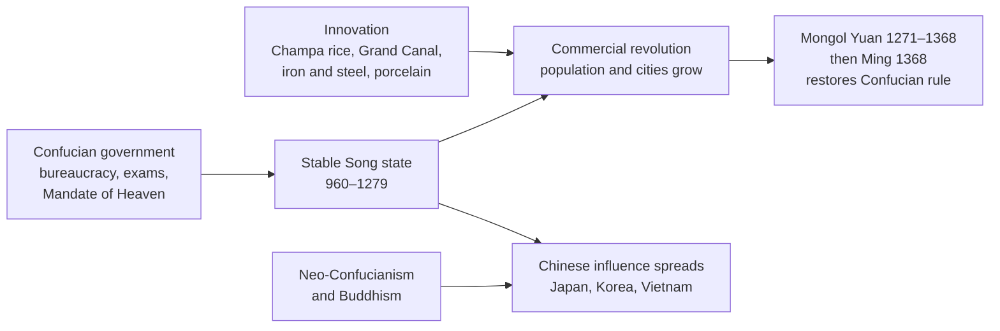
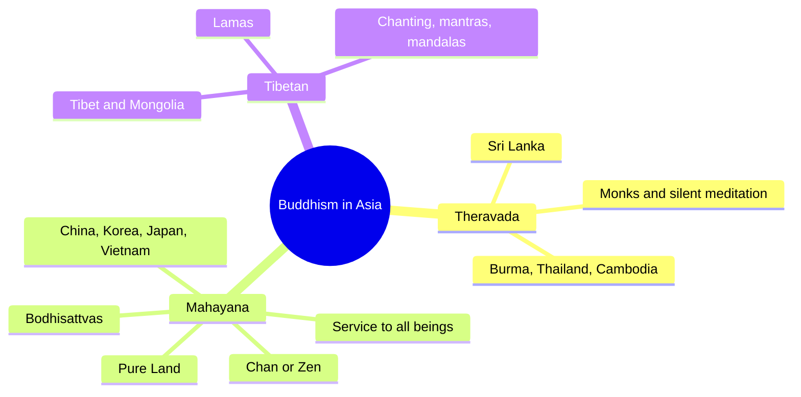
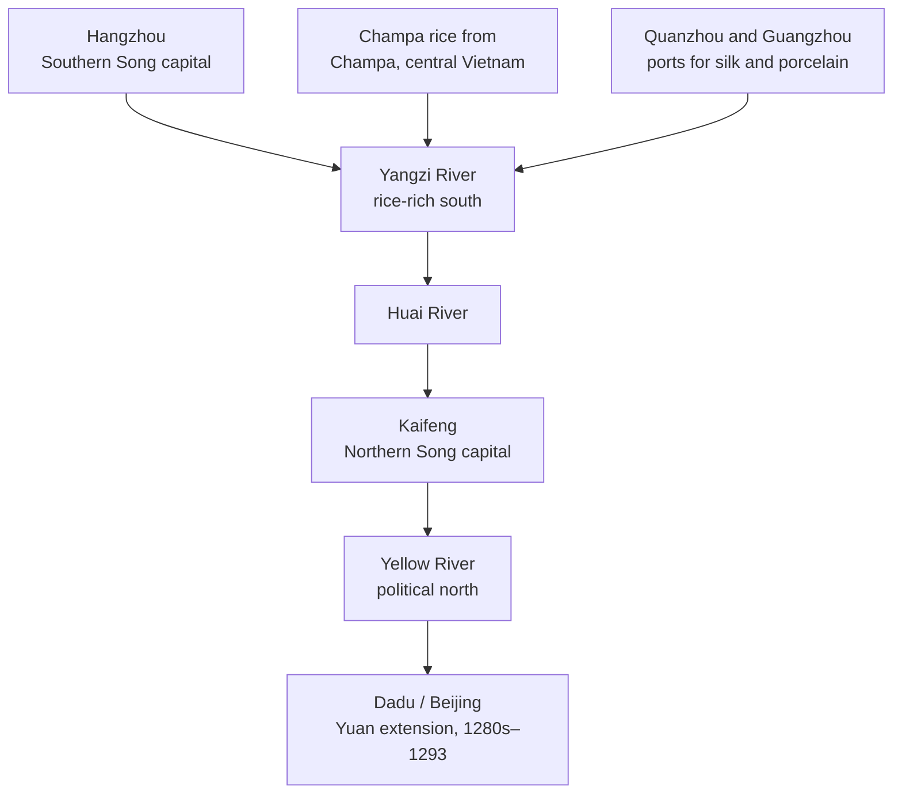
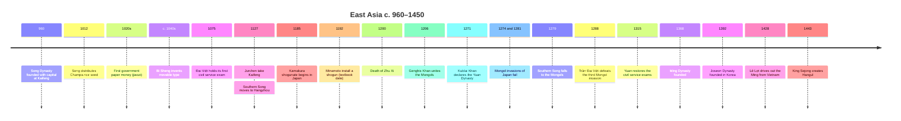
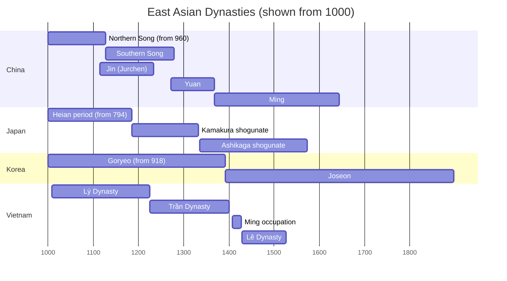
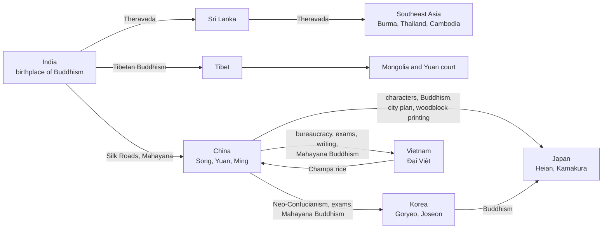

# AP World History: Modern — Topic 1.1 Developments in East Asia from c. 1200 to c. 1450

**Focus Question (textbook Essential Question):** How did developments in China and the rest of East Asia between c. 1200 and c. 1450 reflect continuity, innovation, and diversity?

> Source: Based on the College Board CED · Textbook incorporated (Topic 1.1 reading)

**Unit 1: The Global Tapestry (c. 1200–1450)**

---

## Learning Objectives

| Code | Learning Objective |
|---|---|
| 1.1 LO-A (GOV) | Explain the systems of government employed by Chinese dynasties and how they developed over time. |
| 1.1 LO-B (CDI) | Explain the effects of Chinese cultural traditions on East Asia over time. |
| 1.1 LO-C (ECN) | Explain the effects of innovation on the Chinese economy over time. |

## Historical Developments (CED)

| # | Historical Development | LO | Covered in |
|---|---|---|---|
| HD1 | KC-3.2.I.A: Empires and states in Afro-Eurasia and the Americas demonstrated continuity, innovation, and diversity in the 13th century. This included the Song Dynasty of China, which utilized traditional methods of Confucianism and an imperial bureaucracy to maintain and justify its rule. | A | §1, §2, §7 |
| HD2 | KC-3.1.III.D.i: Chinese cultural traditions continued, and they influenced neighboring regions. | B | §3, §5 |
| HD2a | Illustrative example (Cultural traditions): Filial piety in East Asia | B | §3, §5 |
| HD2b | Illustrative example (Cultural traditions): Influence of Neo-Confucianism and Buddhism in East Asia | B | §3, §4, §5 |
| HD2c | Illustrative example (Cultural traditions): Confucian traditions of both respect for and expected deference from women | B | §3 |
| HD2d | Illustrative example (Cultural traditions): Chinese literary and scholarly traditions and their spread to Heian Japan and Korea | B | §3, §5 |
| HD3 | KC-3.1.III.D.ii: Buddhism and its core beliefs continued to shape societies in Asia and included a variety of branches, schools, and practices. | B | §4 |
| HD3a | Illustrative example (Branches of Buddhism): Theravada | B | §4 |
| HD3b | Illustrative example (Branches of Buddhism): Mahayana | B | §4, §5 |
| HD3c | Illustrative example (Branches of Buddhism): Tibetan | B | §4, §7 |
| HD4 | KC-3.3.III.A.i: The economy of Song China became increasingly commercialized while continuing to depend on free peasant and artisanal labor. | C | §3, §6 |
| HD5 | KC-3.1.I.D: The economy of Song China flourished as a result of increased productive capacity, expanding trade networks, and innovations in agriculture and manufacturing. | C | §6 |
| HD5a | Illustrative example (Technological innovations): Champa rice | C | §6 |
| HD5b | Illustrative example (Technological innovations): Transportation innovations, like the Grand Canal expansion | C | §6 |
| HD5c | Illustrative example (Technological innovations): Steel and iron production | C | §6 |
| HD5d | Illustrative example (Technological innovations): Textiles and porcelains for export | C | §6 |

---

## The Big Picture

> "From now on, our ordinances will be properly enforced and the morality of our people will be restored."
> — Ming Dynasty "Prohibition Ordinance" (1368–1644)

In the 13th century, **Song China** (960–1279) was the leading example of **continuity, innovation, and diversity** in Afro-Eurasia. It was the richest, most populous, and most urbanized state in the world, and it had the world's greatest manufacturing capability. The Song ruled through **traditional Confucian methods**: an **imperial bureaucracy** staffed by **scholar-officials** chosen through **civil service examinations**, and a claim to rule by the **Mandate of Heaven**. **Neo-Confucianism**, the kind of teaching the opening quotation illustrates, supported the government and reinforced **filial piety**, **patriarchy**, social classes, and the duty of rulers to be **benevolent** and of subjects to be **respectful**. These Chinese traditions, together with **Buddhism**, spread to **Japan, Korea, and Vietnam**, which each faced **sinification** and **adapted** Chinese ways to their own cultures. The textbook calls the spread of Confucianism and Buddhism perhaps the most enduring testimony to Chinese influence. At the same time, innovation drove a **commercial revolution**: **Champa rice** fed a growing population, the **Grand Canal** linked north and south, **iron and steel** output soared, and **silk and porcelain** were exported across Afro-Eurasia. The Song fell to the **Mongols**, whose **Yuan Dynasty** (1271–1368) was replaced by the **Ming** (1368), which restored Confucian government.

---

## §1. The Song Dynasty (960–1279): Northern and Southern Song

| Period | Dates | Capital | Key facts |
|---|---|---|---|
| **Northern Song** | 960–1127 | **Kaifeng** | Founded by the general **Zhao Kuangyin (Emperor Taizu)**; ruled most of China but not the far north, which the **Khitan Liao** held; paid the Liao yearly silk and silver after the **Treaty of Shanyuan (1005)** |
| **Southern Song** | 1127–1279 | **Hangzhou** (also called Lin'an) | The **Jurchen**, pastoralists from **Manchuria** who set up the **Jin Empire**, captured Kaifeng in **1127**; the court fled south of the Yangzi River; the south became China's economic heart |

- The Song ruled a **smaller region than the Tang**, but its reign of more than three centuries was **prosperous**, and the **arts flourished**.
- Taizu had seized power as a general, so he **put civil officials above military commanders** to prevent coups. This made the Song state stable but **militarily weak** against northern steppe peoples.
- The Song often paid **tribute** to northern states (Liao, Western Xia, Jin) to buy peace.
- Even after losing the north, the Southern Song was **richer** than any other state of its time, thanks to trade and agriculture in the south (see §6).
- The **Mongols** destroyed the Jin in **1234** and conquered the Southern Song in **1279** (see §7).

> ⚠️ The textbook says the Song Dynasty replaced the Tang in 960. Many accounts say the Tang fell in **907** and that the **Five Dynasties and Ten Kingdoms** period (907–960) came in between. Check how your teacher presents this.

> ⚠️ Needs verification: Kaifeng fell in 1127 and the court moved south that year, but Hangzhou was formally made the capital only in **1138**. Both dates appear in AP materials.

## §2. Government: Confucianism and the Imperial Bureaucracy

### How the Song Justified Its Rule

- **Mandate of Heaven:** the emperor ruled because Heaven approved of him. If he ruled badly (floods, famine, rebellion), Heaven could withdraw the mandate and a new dynasty could replace him.
- **Confucian ideals:** the emperor was expected to rule by **virtue** and act as a **benevolent** father to his people. In return, subjects owed him **respect and obedience**.
- **Ritual:** the emperor performed state rituals to Heaven and to his ancestors, which showed that he followed Confucian tradition.

### How the Song Ran the Empire

| Feature | Details | Why it mattered |
|---|---|---|
| **Imperial bureaucracy** | A large, centralized system of appointed, salaried officials who carried out the empire's policies (taxes, law, and local government); a feature of Chinese government since the **Qin** (221–207 B.C.E.); it **expanded** under the Song | Gave the emperor direct control over a huge territory; a **continuity** across centuries and dynasties |
| **Civil service examinations** | Tests on the **Confucian classics**, poetry, and policy essays; begun under the Sui and Tang, **greatly expanded** under the Song; three levels: local (prefectural), capital, and **palace exam** before the emperor | Officials were chosen by **merit** rather than by birth alone |
| **Wider access to education** | Emperor **Song Taizu** expanded educational opportunities so that young men of the **lower economic classes** could prepare for the exams and win a highly desired government job | More **upward mobility** than any other hiring system of its time, though the poor were still vastly underrepresented |
| **Anti-cheating rules** | Song examiners covered candidates' names and had clerks recopy answers so handwriting could not be recognized | Made the system fairer and more trusted |
| **Scholar-gentry** | Educated, often landowning men who passed the exams and served as officials or led local society; a **new social class** created by the growth of the bureaucracy (see §3) | Became China's ruling elite, loyal to the Confucian state |
| **Rule of avoidance** | Officials usually did not serve in their home region | Reduced local corruption and loyalty to family over state |

- **Meritocracy in theory, not fully in practice:** because officials earned their posts by showing merit on the exams, the system is called a **meritocracy**. Almost any man could take the exams, but studying took years, so **wealthy families** had a big advantage. **Women could not take the exams.**
- **Printing** (see §3 and §6) made Confucian books cheaper, so more men could prepare for the exams.
- **Continuity and innovation:** the Song **continued** older traditions (Confucianism, the bureaucracy of the Qin, Han, and Tang) but **innovated** by making the exams the main route into government.
- **Strength became weakness:** early in the dynasty the bigger bureaucracy strengthened the Song. By the end of the Song, it had grown so large, and officials were paid so well, that the cost of government began **drying up China's surplus wealth** and contributed to the empire's weakness.

## §3. Confucian Traditions, Neo-Confucianism, and Society

### Core Confucian Traditions

| Tradition | Meaning | Example |
|---|---|---|
| **Filial piety** | Children owe obedience, care, and respect to parents and ancestors; the textbook defines it as the duty of family members to put their own desires below those of the **male head of the family** and of the **ruler** | Mourning parents for years; ancestor veneration at family shrines; respect for elders helped the Song keep its rule |
| **Five Relationships** | Ruler–subject, father–son, husband–wife, elder brother–younger brother, friend–friend; all but the last are unequal | Order in society comes from each person filling their role |
| **Respect and benevolence** | Inferiors owe **respect** to authority figures; authority figures are **expected to be benevolent** in return | A ruler who is cruel loses the Mandate of Heaven; a father must care for his family |

### Neo-Confucianism

- **Neo-Confucianism** was a revival of Confucianism during the Song. Its greatest thinker was **Zhu Xi (1130–1200)**.
- It **borrowed ideas from Buddhism and Daoism** (such as questions about the nature of the universe and self-cultivation) but rejected Buddhist withdrawal from family and society. The textbook calls it a **syncretic** system that combined **rational thought** with the more abstract ideas of Daoism and Buddhism and that stressed **ethics**.
- It taught that a universal **principle (li)** runs through all things, and that people should **study** and **cultivate themselves** morally to understand it.
- Zhu Xi's commentaries on the **Four Books** became the official basis of the civil service exams in **1313 (Yuan)** and stayed so under the Ming and later dynasties.
- Neo-Confucianism became immensely popular in the countries in China's orbit: **Korea** (the Joseon Dynasty), **Vietnam** (Đại Việt), and **Japan** (see §5).

> ⚠️ The textbook says Neo-Confucianism evolved between **770 and 840** and emphasized ethics "rather than the mysteries of God and nature." Many accounts trace its roots to Tang thinkers such as **Han Yu** (768–824) but say it took its full form under the **Song**, with Zhu Xi's theory of the universe (li) at its center. Check how your teacher presents this.

### Social Classes and Welfare

Most Chinese lived in rural areas, and the growth of the bureaucracy made rural society more complex as well (for cities, see §6).

| Class | Who they were | Status |
|---|---|---|
| **Scholar-gentry** | A **new class** created by the expanding bureaucracy; men educated in Confucian philosophy | The **most influential** class; they soon **outnumbered** the aristocracy |
| **Aristocracy** | Landowners who **inherited** their wealth | Lost influence to the scholar-gentry |
| **Farmers** | Most of the population | The first of the three classes that ranked below the scholar-gentry |
| **Artisans** | Skilled craftworkers who made steel, porcelain, silk, and other goods | Ranked below farmers |
| **Merchants** | Traders who exchanged goods without growing or making anything new | **Low status**, because Confucians respected hard work and the creation of value |
| **Lower rungs** | Peasants who worked for wealthy landowners, often to pay off debts, and the **urban poor** | The Song government gave **aid to the poor** and set up **public hospitals** with free care |

### Patriarchy and the Status of Women

- Chinese society was **patriarchal**: families traced descent through men, and women were expected to obey their fathers, then husbands, then sons.
- Confucian traditions included both **respect for women** and the expectation that they would **defer to men**. This patriarchal pattern **strengthened during the Tang and Song**.
- **Neo-Confucianism** stressed **female chastity** and discouraged **widows from remarrying**.
- **Foot binding:** from a very young age, girls' feet were wrapped so tightly that the bones did not grow naturally. It became common among **elite (aristocratic) families during the Song**. A bound foot signified **social status**, which suitors desired, but it restricted women's movement and their part in the **public sphere** and work outside the home. Foot binding was finally **banned in 1912**.
- Women still had some rights: Song women could keep a **dowry** as property, and many women produced **silk and textiles** at home, which was important to the economy.

> ⚠️ Needs verification: the exact origin of foot binding is uncertain. Most historians place it among court entertainers in the late Tang or Five Dynasties (10th century), with spread among Song elites; it became widespread among ordinary families only in later centuries. The textbook says only that it became common among aristocratic families during the Song.

### Learning and Literature

- Wealth, a well-educated elite, and wide foreign contact under the Tang and Song made **technology, literature, and the visual arts** thrive.
- **Paper and printing:** the Chinese invented **paper** as early as the **2nd century C.E.** and a system of printing in the **7th century**. They were the first culture to use **woodblock printing**. In the Song era, printed **booklets on efficient farming** were distributed in rice-growing regions. (The Gutenberg press is in Topic 1.6.)
- **Reading:** paper and printing made books more available. Most peasants were illiterate, but the privileged classes read more, and **Confucian scholars** were both the main readers and the main writers of literature.
- **Well-rounded scholar-officials:** Tang and Song schooling produced scholar-bureaucrats with many skills, like the people Europeans later called **"Renaissance men."**

> ⚠️ The textbook says a 7th-century Buddhist scripture is thought to be the world's first woodblock printed work, and that Japan learned woodblock printing in Prince Shōtoku's era (see §5). Many accounts date the oldest surviving woodblock prints to the **8th century** (in Japan, the *Hyakumantō Darani*, 764–770) and call the *Diamond Sutra* (**868**) the oldest dated printed book. Check how your teacher presents this.

## §4. Buddhism: Branches, Schools, and Practices

### Core Beliefs

- **Four Noble Truths:** life involves suffering; suffering comes from desire; ending desire ends suffering; the **Eightfold Path** ends desire.
- **Eightfold Path:** precepts such as **right speech, right livelihood, right effort, and right mindfulness** that lead to enlightenment, or **nirvana**. The textbook stresses that all three branches below share the Four Noble Truths and the Eightfold Path.
- **Karma and rebirth:** actions shape future lives; the goal is **nirvana**, release from the cycle of rebirth.
- Buddhism began in **India** and reached China along the **Silk Roads** in the Han era. Its presence is clear in the disunited period between the later Han and the **Sui**, and it became widely popular under the **Tang**. The 7th-century monk **Xuanzang**, who traveled to India for scriptures, helped build its popularity. By 1200 it was far more important in East, Southeast, and Central Asia than in India.

### The Main Branches

| Branch | Key ideas and practices | Where (c. 1200–1450) |
|---|---|---|
| **Theravada** ("Teaching of the Elders") | Strict monastic life; focus on **personal spiritual growth** through **silent meditation** and self-discipline; follows the oldest (Pali) scriptures | **Sri Lanka** and mainland **Southeast Asia** (Burma, Thailand, Cambodia); the textbook says it was strongest in Southeast Asia |
| **Mahayana** ("Great Vehicle") | Focus on spiritual growth for **all beings** and on **service**; **bodhisattvas** delay their own nirvana to help others; open to laypeople; many schools | **China, Korea, Japan, Vietnam**; the textbook says it was strongest in China and Korea |
| **Tibetan** (Vajrayana) | Mahayana-based; focus on **chanting** (mantras), plus rituals and sacred diagrams (mandalas); **lamas** (teachers) are highly honored | **Tibet** and **Mongolia**; patronized by the Yuan court |

### Important Mahayana Schools

| School | Key idea | Where it mattered |
|---|---|---|
| **Chan / Zen** | A **syncretic** school: Buddhist doctrine fused with **Daoism**; enlightenment through **meditation** and **direct experience** rather than studying texts | China (Chan); spread to Kamakura **Japan** (Zen) from the late 1100s and became popular with **samurai** |
| **Pure Land** | Salvation through **faith** in Amitabha Buddha and chanting his name | Popular with ordinary people in China, Korea, and Japan |

### Buddhism Under the Tang and Song

- **Syncretism:** monks introduced Buddhism to the Chinese by relating it to **Daoist** ideas; for example, the Buddhist idea of **dharma** was translated as **dao** ("the way"). Buddhism also blended with **Confucian** ancestor veneration, and many people followed all three traditions.
- Because of this fusion, Buddhism became very popular, and **monasteries** (buildings where monks lived together) appeared in most major cities.
- **Tang reaction:** many Tang leaders, who saw China as the **"Middle Kingdom,"** had trouble accepting that a **foreign religion** was so prominent, and Daoists and Confucians were jealous of its popularity. The Tang **closed monasteries and seized their lands** (the largest persecution came in 845), but **Chan Buddhism** stayed popular with ordinary people.
- **Song attitude:** the Song was somewhat friendlier to Buddhism but preferred China's **native traditions** such as Confucianism. Printing made Buddhist scriptures widely available to the scholar-gentry, and many Confucians adopted Buddhist ideals in daily life.
- **Korea:** Goryeo carved the **Tripitaka Koreana** (1236–1251), more than 80,000 woodblocks of Buddhist scripture, hoping for protection against the Mongols.
- **Yuan China:** Kublai Khan honored the Tibetan monk **Phagpa** as Imperial Preceptor, which linked Tibetan Buddhism to Mongol rule (see §7).
- **Tension with Confucianism:** Confucian critics called Buddhism foreign and said monks neglected family duties. Neo-Confucianism was partly a response to Buddhism, and the **Joseon** Dynasty in Korea later restricted it.

## §5. Chinese Influence on Neighboring States

China saw itself as the **"Middle Kingdom"** at the center of the world. When China was unified, its political strength, wealth, religious traditions, learning, and technology made it the world's most powerful realm. Its smaller neighbors benefited from being close to China but faced the challenge of keeping their own cultures; each had to deal with **sinification**, the assimilation of Chinese traditions and practices. Each neighbor **borrowed** from China but **adapted** what it took.

### The Tributary System

- Under the **tributary system**, neighboring states had to pay money or provide goods to honor the Chinese emperor and acknowledge his superiority; in return they received gifts, trade access, and recognition.
- It began under the **Han**. By the Song, the textbook lists **Japan, Korea, and kingdoms throughout Southeast Asia** as tributary states.
- Envoys showed respect by performing the **kowtow**, bowing until the head reached the floor.
- Tribute was a source of government income and cemented China's economic and political power, but it also created **stability** and **stimulated trade** for all parties.
- Later, the great fleets of **Zheng He** (Ming, 1405–1433) displayed the emperor's power and collected tribute (see Topic 2.3).

> ⚠️ The textbook lists Japan as a Song tributary state. Many accounts say Japan ended official missions to China in **894** and did not send tribute under the Song; Ashikaga shoguns sent tribute missions to the **Ming** in the 1400s. The Song itself also paid tribute to the Liao and Jin (see §1). Check how your teacher presents this.

### Japan: Heian and Kamakura

- **Geography:** Japan was separated from China by **sea** rather than land, so it could control its contacts with China more than Korea or Vietnam could.
- **Prince Shōtoku Taishi (574–622)** promoted **Buddhism** and **Confucianism** alongside Japan's traditional **Shinto** religion. The textbook says Japan learned **woodblock printing** from China in this era (see the ⚠️ in §3).
- **Heian period (794–1185):** Japan **emulated** Chinese traditions in politics, art, and literature. The capital **Heian-kyō (Kyoto)** was laid out on a grid modeled on the Tang capital Chang'an. Japan adopted **Chinese characters**, **Buddhism**, Confucian ideas, and Chinese-style court ranks.
- **Adaptation:** Japan ended official missions to China in **894** and developed its own **kana** script. Court women such as **Murasaki Shikibu** wrote in Japanese; her *The Tale of Genji* (early 1000s), which the textbook calls the **world's first novel**, tells of a prince's life at court, especially his many romances.
- **No real exam system:** office depended on **aristocratic birth**, and the powerful **Fujiwara clan** dominated the court.
- **Shinto** (worship of **kami**, nature spirits) continued alongside Buddhism. The emperor claimed descent from the sun goddess **Amaterasu**, so Japan did not adopt the Mandate of Heaven.
- **Kamakura shogunate (1185–1333):** when the Heian court declined, the powerful landowning **Minamoto clan** took charge and in **1192** installed a **shogun** (military ruler). Japan still had an emperor, but he had little power. Real power lay with the shogun and his **samurai** warriors in a **feudal** system. Zen Buddhism spread. Japan repelled Mongol invasions in **1274 and 1281**.
- **Weak central government:** unlike China, with its emperor and large civilian bureaucracy, Japan suffered about **four centuries of regional rivalries** among aristocrats. Only in the **17th century** did shoguns create a strong central government that unified the country.

> ⚠️ The textbook dates the shogunate from **1192**, when the Minamoto (Minamoto no Yoritomo) were named shogun. Many accounts now date the Kamakura shogunate from **1185** (victory in the Genpei War). Check how your teacher presents this.

#### Japanese Feudalism

- Landowning aristocrats, the **daimyo**, battled for control of land, while most people worked as **rice farmers**.
- Like European feudalism (Topic 1.6), Japanese feudalism had **very little social mobility** and was built on **hereditary** hierarchies: peasants (the textbook calls them serfs) were born into economic dependency, **samurai** were born as protectors, and daimyo were born into privilege.
- **Difference:** the daimyo were more powerful than Europe's nobles, and in reality more powerful than the emperor or the shogun; in Europe the **monarch** stood above the nobility.
- **Warrior codes:** the samurai followed **bushido** (frugality, loyalty, the martial arts, and honor unto death); European knights followed **chivalry** (see the comparison table).

> ⚠️ The textbook says the daimyo were more powerful than the emperor or the shogun and that Japan lacked a central government. Many accounts say this fits the Ashikaga period, especially the Warring States era (1467–1568), better than the Kamakura period, and that the term daimyo came into use only from the 1300s. Check how your teacher presents this.

### Korea: Goryeo and Joseon

- **Close contact:** Korea shares a **land border** with China and, as a **tributary** state, emulated Chinese politics and culture and **centralized** its government in the Chinese style.
- **Two traditions:** the **educated elite** studied the **Confucian classics**, while **Buddhism** attracted the **peasant masses**.
- **Writing:** Koreans adopted the **Chinese writing system**, which proved awkward because the two languages were structurally very different. In the 15th century Korea developed its own script (Hangul, below).
- **Goryeo (918–1392):** adopted a **civil service exam** in **958**, but **aristocratic families** still dominated government. Korea's **landed aristocracy** was more powerful than China's and blocked some Chinese reforms: the exam was **not open to peasants**, so there was no truly merit-based route into the bureaucracy. **Buddhism** was the state religion. Goryeo produced fine **celadon** pottery inspired by Song porcelain and printed the *Jikji* (1377), the oldest surviving book printed with **metal movable type**.
- Mongol invasions began in **1231**, and Goryeo became a **vassal** of the Yuan.
- **Joseon (1392–1897):** founded by the general **Yi Seong-gye (King Taejo)**. Joseon made **Neo-Confucianism** its official ideology, **restricted Buddhism**, used exams to choose officials, and sent tribute to the **Ming**. King **Sejong** created the **Hangul** alphabet (1443, published 1446).

### Vietnam: Đại Việt

- China ruled northern Vietnam for about a thousand years (111 B.C.E.–939 C.E.). The Vietnamese won independence in **939**.
- **Borrowing:** Vietnam traded with and learned from China and **adapted** the Chinese writing system and architectural styles.
- The **Lý Dynasty (1009–1225)** built the **Temple of Literature** (1070) to honor Confucius and held its first **civil service exam** in **1075**. **Mahayana Buddhism** was also strong.
- **Scholar-officials:** Vietnam adopted a merit-based bureaucracy of educated men, but its scholar-officials owed more allegiance to **village peasants** than to the emperor and often **led revolts** against a government they thought too oppressive. The textbook says villages ran largely **independently** of the national government.
- The **Trần Dynasty (1225–1400)** defeated **Mongol invasions** three times (1258, 1285, 1287–1288). The Vietnamese showed a strong capacity for **guerrilla warfare**, perhaps because they knew their own land so well.
- The **Ming** occupied Vietnam (**1407–1427**); **Lê Lợi** drove them out and founded the **Lê Dynasty (1428)**, which adopted Neo-Confucian government.
- **Gender and family:** Vietnamese women had **greater independence** in married life than Chinese women in the Confucian tradition. The Chinese lived in **extended families**, while the Vietnamese preferred **nuclear families** (wife, husband, and children). Vietnamese women resented their inferior status under the Chinese and rejected **foot binding** and **polygyny** (having more than one wife at the same time).
- **Adaptation and resistance:** Đại Việt **copied the Chinese bureaucracy** and sent tribute, but had a more **adversarial** relationship with China than Japan or Korea did: it launched violent rebellions, **fought hard against Chinese rule**, kept its own language, and gave **women more rights** (such as property rights). Even so, **sinification** did occur.

> ⚠️ The textbook says Vietnamese rebels pushed out China's army as the Tang began to crumble in the **8th century**, and that political centralization in Vietnam was nonexistent. Many accounts date independence to **939** (Ngô Quyền's victory at Bạch Đằng), after the Tang fell in 907, and describe the Lý, Trần, and Lê as centralized monarchies with Chinese-style bureaucracies. Check how your teacher presents this.

## §6. The Song Economy: Innovation and the Commercial Revolution

- **Continuity from the Tang:** the Tang had promoted farming, improved roads and canals, encouraged foreign trade, and spread technology. These achievements led to rapid prosperity and population growth under the Song.

| Innovation | Details | Effect |
|---|---|---|
| **Champa rice** | Fast-ripening, drought-resistant rice from **Champa** (central Vietnam), introduced some time before the 11th century; the government distributed seed in **1012**; it and newer strains let rice grow on lowlands, riverbanks, and hills | Two harvests a year in some areas (a **summer** and a **winter** crop), sometimes three; food surplus; **population roughly doubled** |
| **Farming methods** | **Manure** (human and animal) to enrich the soil; **irrigation** with ditches, water wheels, pumps, and **terraces**; new **heavy plows** pulled by water buffalo or oxen | Previously unusable land was farmed; an abundance of food; rapid population growth |
| **Expansion of the Grand Canal** | An inexpensive, efficient inland waterway (first completed under the Sui, c. 610) that linked the **Yangzi** and **Yellow** rivers; the Song improved it with **pound locks** (984); the Yuan later extended it north to Beijing | Moved rice and goods from the rich south to the political north cheaply; tied the economy together; made Song China the **most populous trading area** in the world |
| **Iron and steel** | China had used coal ("**black earth**") since the 4th century B.C.E. to make **cast iron**; Song blast furnaces burned **coal**, and output rose sharply in the 11th century; the Chinese learned to remove carbon from cast iron to make **steel** for bridges, gates, ship anchors, pagodas, Buddhist figurines, and farm tools | Cheap tools, farm implements, and weapons; the **greatest manufacturing capability** in the world (though coal-powered machines came only in the 18th century); **proto-industrialization** |
| **Textiles and porcelain for export** | **Silk** from state and household workshops; **porcelain** from kilns such as **Jingdezhen**, prized because it was **light-weight yet strong** and light-colored, so it was easy to paint with elaborate designs; exported, especially by sea, through **Quanzhou** and **Guangzhou** | China joined Indian Ocean and Silk Road trade (see Unit 2) |
| **Paper money** | Merchants in Sichuan used paper notes; the government took over and issued the first state paper money (**jiaozi**, 1020s) | Made large trades easier; later overprinting caused **inflation** |
| **Paid labor for public works** | Instead of requiring people to labor on roads and irrigation canals, the Song government **paid workers** | More money in circulation, which promoted a commercial economy |
| **Commercialization** | Markets spread beyond walled market wards; merchant **guilds**; taxes paid more in cash; the economy shifted from **local consumption** to **market production**, with **porcelain, textiles, and tea** as chief exports | China became the world's **most commercialized society**; more people worked for the market, not just for their own food |
| **Urbanization** | Most people still lived in the countryside, but **Kaifeng** and **Hangzhou** (at the southern end of the Grand Canal) grew into huge cities with shops, restaurants, and night markets; several cities passed **100,000** people; the textbook names **Chang'an**, Hangzhou, and the port of **Guangzhou** as the largest cosmopolitan centers | China was the most urbanized society in the world |

- **Productive capacity:** more food (Champa rice, irrigation, iron tools) and more manufacturing (iron, silk, porcelain) meant more goods to sell.
- **Expanding trade networks:** the Grand Canal for internal trade, and **junks** with the **magnetic compass** for sea trade to Southeast Asia, India, and East Africa. The Chinese redesigned ships to carry **more cargo**, and **printed paper navigation charts** let sailors cross open water out of sight of land. Naval technology let China **control trade in the South China Sea**, and Tang and Song military power protected traders from **bandits**.
- **Free labor:** even as the economy commercialized, it still rested on the work of **free peasant** households, which grew rice and made silk and other goods for sale, and of **artisans** in workshops and kilns. Unlike Europe's serfs (Topic 1.6), most Song peasants were not legally bound to a lord's land, although many farmed as tenants of large landowners.

> ⚠️ The textbook says the Grand Canal extended over **30,000 miles**. Many accounts give about **1,100 miles** (about 1,800 km) for the Grand Canal itself; a larger figure may count China's whole network of connected waterways. Check this against the printed textbook.

> ⚠️ The textbook names **Chang'an** among the largest Song cities. Many accounts say Chang'an declined after the Tang and that **Kaifeng** (Northern Song) and **Hangzhou** (Southern Song) were the great Song cities. Check how your teacher presents this.

### Proto-Industrialization

- Under the Song, and **earlier than in Western Europe**, China experienced **proto-industrialization**, in which rural people made goods for the market.
- Unlike later industrialization, with large factories and complex machinery, it relied on **home-based or community-based** production using **simple equipment**.
- Example: **artisans** (skilled craftworkers) made steel in widely dispersed smelting sites **supervised by the imperial government**, and also made porcelain and silk that reached consumers through expanding trade networks.

> ⚠️ The extracted textbook text defines proto-industrialization as changes in which rural people "made more goods than they could sell." This wording may be garbled; the usual definition is rural households making goods for the market rather than for their own use. Check against the printed textbook.

### Technology in Brief

| Technology | Song development | Later spread |
|---|---|---|
| **Printing** | **Woodblock printing** (China was first; see §3) became common, including printed farming booklets; **Bi Sheng** invented **movable type** (c. 1040s) | Spread knowledge and Confucian texts for exams |
| **Gunpowder** | Invented before the Song, but Song innovators made the **first guns**; gunpowder formulas recorded (1044); **fire lances** and bombs used against the Jurchen and Mongols | Spread across Eurasia through **Silk Roads traders** and the Mongols (see Unit 2) |
| **Magnetic compass** | Used for navigation at sea by about 1100, together with printed navigation charts | Spread through Indian Ocean trade (see Unit 2) |

> ⚠️ Needs verification: population and output figures are estimates. China's population is usually said to have passed **100 million** by c. 1100; iron output is often estimated at about **125,000 tons in 1078** (Robert Hartwell); Kaifeng and Hangzhou may each have reached about **1 million** people. The textbook gives a share instead: China grew from about **25 percent** to nearly **40 percent** of the world's population during Song rule.

## §7. Transition: Mongol Conquest, the Yuan, and the Early Ming

- **Genghis Khan** united the Mongols in **1206**. The Mongols destroyed the Jin (**1234**), and **Kublai Khan** declared the **Yuan Dynasty (1271)** with its capital at **Dadu (Beijing)**. The Southern Song fell in **1279**.
- The **Yuan kept** the Chinese-style bureaucracy and claimed the Mandate of Heaven, but **ranked Mongols and Central Asians above Chinese** and **suspended the exams** until **1315**.
- The Yuan **patronized Tibetan Buddhism** and failed to conquer **Japan** (1274, 1281) and **Đại Việt**.
- **Decline:** overprinted paper money and **inflation**, Yellow River floods, epidemics, and the **Red Turban Rebellion** weakened the Yuan.
- **Zhu Yuanzhang**, a rebel of peasant origin, founded the **Ming Dynasty (1368)** as the **Hongwu Emperor**. The Ming **restored Confucian exams and the bureaucracy** and removed Mongol influence. Ming ordinances aimed to enforce the law strictly and **restore the people's morality** (see the opening quote). (The Ming moved the capital to **Beijing** in 1421; Zheng He's voyages are in Topic 2.3.)

### Government Over Time: Song vs. Yuan vs. Ming

| Feature | Song (960–1279) | Yuan (1271–1368) | Ming (1368–1644) |
|---|---|---|---|
| Rulers | Han Chinese Zhao family | **Mongols** (Kublai Khan) | Han Chinese Zhu family (Hongwu) |
| Bureaucracy | Large Confucian bureaucracy | Kept the structure, but top posts went to Mongols and Central Asians | Restored and **centralized** under the emperor |
| Exams | **Expanded**; main route to office | **Suspended** until 1315, then limited by ethnic quotas | **Restored**; Zhu Xi's Neo-Confucianism tested |
| Legitimacy | Mandate of Heaven, Confucian virtue | Mandate of Heaven plus Mongol conquest | Mandate of Heaven; revival of Chinese tradition |
| Continuity or change | Continuity with innovation | **Change** (foreign rule) with continuity in structure | Return to **continuity** |

---

## Timeline

---

## Map: The Spread of Chinese Influence and Buddhism

---

## Comparison Tables

### Confucianism vs. Neo-Confucianism vs. Buddhism

| Feature | Confucianism | Neo-Confucianism | Buddhism |
|---|---|---|---|
| Origin | Confucius, China (c. 500 B.C.E.) | Song thinkers, especially **Zhu Xi** (12th century); roots in the Tang | Siddhartha Gautama, India (c. 500 B.C.E.) |
| Main goal | A harmonious, well-ordered society | Moral self-cultivation and social order | Escape suffering and reach **nirvana** |
| Focus | This world: family and government | This world and **ethics**, with a theory of the universe (**li**) | Spiritual liberation; detachment from desire |
| Family | **Filial piety**, Five Relationships | Even stronger stress on filial piety, patriarchy, and female chastity | Monks and nuns leave family life |
| Role in government | Basis of the bureaucracy and exams | Official exam curriculum from 1313 | Supported by some rulers; seen by Confucians as foreign |
| Spread | Korea, Japan, Vietnam | Joseon Korea, Lê Vietnam, Japan | All of Asia, in Theravada, Mahayana, and Tibetan forms |

### China's Influence on Japan vs. Korea vs. Vietnam

| Feature | Japan | Korea | Vietnam |
|---|---|---|---|
| Geography and contact | Separated by **sea**, so it could control its contacts | Shares a **land border**; very direct relationship | Borders China; the most **adversarial** relationship |
| Political relationship with China | Independent; ended official missions in 894 | **Tributary** state; Yuan vassal; Ming tributary | Ruled by China for ~1,000 years; independent from 939 but sent tribute |
| Civil service exams | **Not** really adopted; birth decided office | Adopted (958) but closed to peasants; central under Joseon | Adopted (1075); officials loyal to village peasants |
| Writing | Chinese characters, then its own **kana** | Chinese characters (awkward fit), then **Hangul** in the 15th century | Adapted Chinese characters |
| Confucianism | Borrowed ideas, but less central | **Neo-Confucian** state ideology under Joseon (1392) | Neo-Confucian government under the Lê (1428) |
| Buddhism | Mahayana; **Zen** and Pure Land | Mahayana; popular with peasants; state religion in Goryeo, restricted in Joseon | Mahayana; strong under the Lý and Trần |
| What stayed local | **Shinto**, emperor from Amaterasu, **feudal shogunate**, kana | Strong aristocracy, **Hangul** | Own language, **nuclear families**, women's independence and property rights, rejection of foot binding and polygyny, **resistance to Chinese rule** |
| Overall | **Adapted selectively** | **Adopted most closely** | **Adopted the system but resisted control** |

### Japanese vs. European Feudalism (textbook)

| Feature | Japan | Europe |
|---|---|---|
| Social groups | Peasants (serfs), **samurai** (protectors), **daimyo** (privileged landowners) | Serfs, **knights**, **nobles** |
| Social mobility | Very little; **hereditary** hierarchy | Very little; **hereditary** hierarchy |
| Who held the most power | The **daimyo**, in reality more powerful than the emperor or the shogun | The **monarch**, above the nobility, though royal power sometimes waned |
| Warrior code | **Bushido**: frugality, loyalty, the martial arts, honor unto death | **Chivalry**: duty to countrymen, to God, and to women (courtly love, gentleness, graciousness) |
| Central government | Weak; regional rivalries until shoguns unified Japan in the 17th century | The main centralized structure lasted until the Modern Industrial Era |

---

## Key Terms

| Theme | Term | Definition |
|---|---|---|
| Government | Song Dynasty | Chinese dynasty (960–1279); Northern Song at Kaifeng, Southern Song at Hangzhou |
| Government | Imperial bureaucracy | A centralized system of appointed, salaried officials who governed for the emperor; a continuity since the Qin |
| Government | Civil service examinations | Tests on the Confucian classics used to choose government officials |
| Government | Scholar-gentry | Confucian-educated elite who passed the exams and served as officials; a new Song class that outnumbered the hereditary aristocracy |
| Government | Meritocracy | A system in which positions are earned by ability rather than birth, such as China's exam-based bureaucracy |
| Government | Mandate of Heaven | The belief that Heaven grants a virtuous ruler the right to rule and can take it away |
| Government | Tributary system | Neighbors paid money or goods to honor China's emperor in return for trade and recognition |
| Government | Kowtow | A ritual in which a person greeting the Chinese emperor bowed until the head reached the floor |
| Government | Shogunate | Japanese military government led by a shogun (Kamakura, from 1185 or 1192 to 1333) |
| Government | Daimyo | Landowning Japanese aristocrats who battled for control of land in feudal Japan |
| Government | Yuan Dynasty | Mongol dynasty in China (1271–1368) founded by Kublai Khan |
| Government | Ming Dynasty | Chinese dynasty founded in 1368 that restored Confucian government |
| Culture | Neo-Confucianism | Song revival of Confucianism, led by Zhu Xi; a syncretic system that borrowed ideas from Buddhism and Daoism |
| Culture | Filial piety | The duty of children to respect, obey, and care for parents and ancestors, and to put the male head of the family and the ruler first |
| Culture | Five Relationships | The five basic Confucian relationships that order society |
| Culture | Syncretic | Fused from more than one belief system, such as Chan Buddhism or Neo-Confucianism |
| Culture | Sinification | The assimilation of Chinese traditions and practices by neighboring peoples |
| Culture | Theravada Buddhism | The "Teaching of the Elders"; branch focused on personal spiritual growth through silent meditation; Sri Lanka and Southeast Asia |
| Culture | Mahayana Buddhism | The "Great Vehicle"; branch focused on spiritual growth for all beings and service, with bodhisattvas; China, Korea, Japan, and Vietnam |
| Culture | Tibetan Buddhism | Mahayana-based branch focused on chanting, with rituals and lamas; Tibet and Mongolia |
| Culture | Chan / Zen Buddhism | Syncretic Mahayana school, blending Buddhism and Daoism, that seeks enlightenment through meditation and direct experience |
| Culture | Bodhisattva | An enlightened being who delays nirvana to help others |
| Culture | Shinto | Japanese worship of kami (nature spirits), kept alongside Buddhism |
| Culture | Heian period | Japanese era (794–1185) that emulated Chinese politics, art, and literature |
| Culture | Bushido | The samurai code stressing frugality, loyalty, the martial arts, and honor unto death |
| Society | Patriarchy | A social system in which men hold authority over women and the family |
| Society | Foot binding | Tight wrapping of girls' feet to keep them small; common among Song elites; banned in 1912 |
| Society | Artisans | Skilled craftworkers who made steel, porcelain, silk, and other goods |
| Society | Nuclear family | A family of just a wife, a husband, and their children; preferred in Vietnam |
| Society | Polygyny | The practice of having more than one wife at the same time; rejected by Vietnamese women |
| Economy | Champa rice | Fast-ripening, drought-resistant rice from Champa that allowed multiple harvests |
| Economy | Grand Canal | Inexpensive inland waterway linking the Yangzi and Yellow rivers; improved by the Song, extended by the Yuan |
| Economy | Proto-industrialization | Production for market before mechanized industry, based in homes and communities with simple equipment |
| Economy | Porcelain | Fine, high-fired ceramic, light yet strong; a major Chinese export |
| Economy | Paper money | Government-issued paper currency, first issued by the Song (jiaozi) |
| Economy | Commercialization | Growth of production and trade for the market |
| Economy | Urbanization | Growth of cities such as Kaifeng and Hangzhou |
| Technology | Woodblock printing | Printing from carved wooden blocks; China was the first culture to use it |
| Technology | Movable type | Printing with reusable individual characters, invented by Bi Sheng (c. 1040s) |
| Technology | Gunpowder | Chinese explosive used in fire lances, bombs, and the first guns |
| Technology | Pound lock | Canal lock with two gates that raises or lowers boats (Song, 984) |
