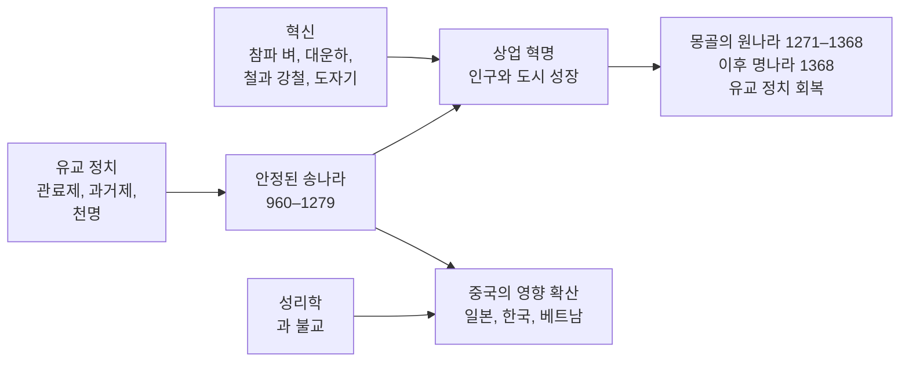
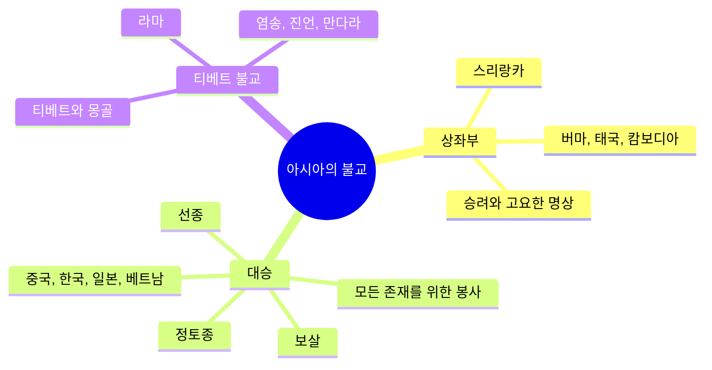
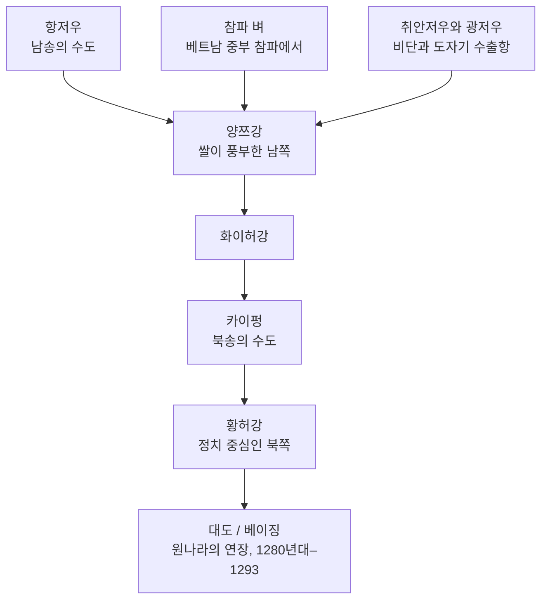
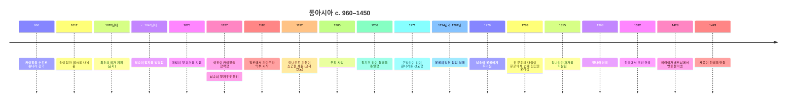
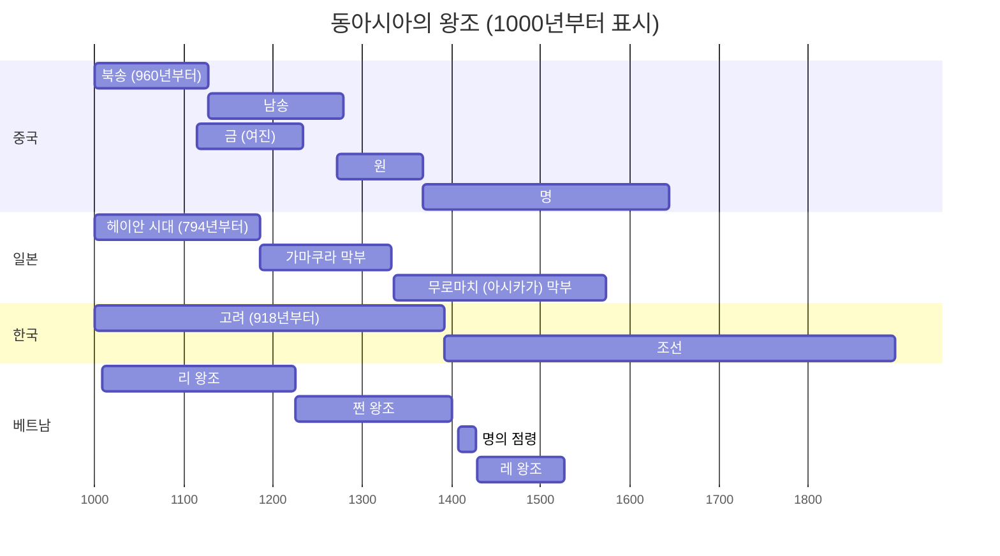
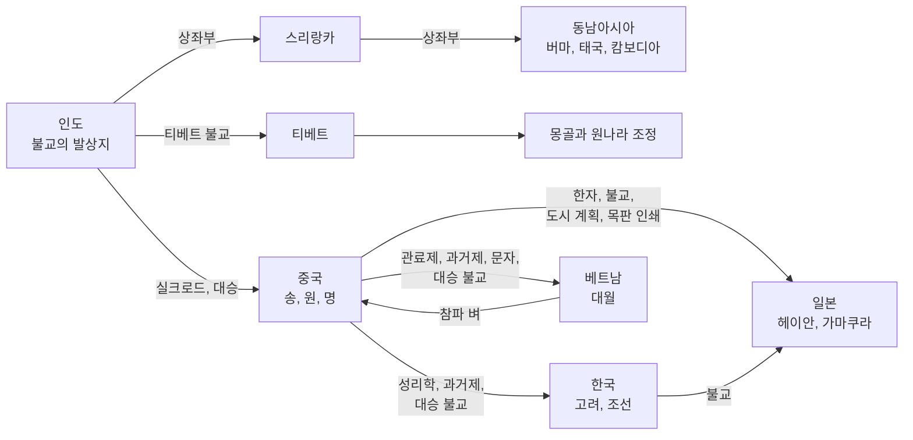

# AP 세계사: 모던 — 토픽 1.1 동아시아의 발전, c. 1200–1450 (Developments in East Asia from c. 1200 to c. 1450)

**Focus Question (교재 Essential Question):** c. 1200년부터 c. 1450년까지 중국과 동아시아 다른 지역의 발전은 어떻게 연속성, 혁신, 다양성을 보여 주었는가?

> 출처: College Board CED 기준 · 교재 반영 (교재 Topic 1.1)

**Unit 1: 세계의 태피스트리 (The Global Tapestry, c. 1200–1450)**

---

## 학습 목표 (Learning Objectives)

| 코드 | 학습 목표 |
|---|---|
| 1.1 LO-A (GOV) | 중국 왕조들이 사용한 통치 체제와 그것이 시간에 따라 어떻게 발전했는지 설명하라. |
| 1.1 LO-B (CDI) | 중국의 문화 전통이 시간에 따라 동아시아에 끼친 영향을 설명하라. |
| 1.1 LO-C (ECN) | 혁신이 시간에 따라 중국 경제에 끼친 영향을 설명하라. |

## 역사적 개념 (Historical Developments, CED)

| # | 역사적 개념 | LO | 다루는 곳 |
|---|---|---|---|
| HD1 | KC-3.2.I.A: 13세기 아프로-유라시아와 아메리카의 제국과 국가들은 연속성, 혁신, 다양성을 보였다. 그 예로 중국의 송나라 (Song Dynasty)는 유교 (Confucianism)의 전통적 방식과 황제 관료제 (Imperial bureaucracy)를 이용해 통치를 유지하고 정당화했다. | A | §1, §2, §7 |
| HD2 | KC-3.1.III.D.i: 중국의 문화 전통은 계속 이어졌고, 주변 지역에 영향을 주었다. | B | §3, §5 |
| HD2a | 예시 (문화 전통): 동아시아의 효 (Filial piety) | B | §3, §5 |
| HD2b | 예시 (문화 전통): 동아시아에서 성리학 (Neo-Confucianism)과 불교 (Buddhism)의 영향 | B | §3, §4, §5 |
| HD2c | 예시 (문화 전통): 여성을 존중하면서도 여성에게 순종 (Deference)을 기대한 유교 전통 | B | §3 |
| HD2d | 예시 (문화 전통): 중국의 문학·학문 전통과 그것의 헤이안 일본 (Heian Japan)·한국 전파 | B | §3, §5 |
| HD3 | KC-3.1.III.D.ii: 불교와 그 핵심 교리는 계속해서 아시아 사회를 형성했고, 다양한 종파, 학파, 수행 방식을 포함했다. | B | §4 |
| HD3a | 예시 (불교 종파): 상좌부 불교 (Theravada) | B | §4 |
| HD3b | 예시 (불교 종파): 대승 불교 (Mahayana) | B | §4, §5 |
| HD3c | 예시 (불교 종파): 티베트 불교 (Tibetan) | B | §4, §7 |
| HD4 | KC-3.3.III.A.i: 송나라의 경제는 점점 상업화되었지만, 여전히 자유 농민과 장인의 노동 (Free peasant and artisanal labor)에 의존했다. | C | §3, §6 |
| HD5 | KC-3.1.I.D: 송나라의 경제는 생산 능력의 증가, 교역망의 확대, 농업과 제조업의 혁신 덕분에 번영했다. | C | §6 |
| HD5a | 예시 (기술 혁신): 참파 벼 (Champa rice) | C | §6 |
| HD5b | 예시 (기술 혁신): 대운하 (Grand Canal) 확장 같은 운송 혁신 | C | §6 |
| HD5c | 예시 (기술 혁신): 강철과 철 (Steel and iron) 생산 | C | §6 |
| HD5d | 예시 (기술 혁신): 수출용 직물과 도자기 (Textiles and porcelains) | C | §6 |

---

## 큰 그림 요약

> "이제부터 우리의 법령은 제대로 시행될 것이며, 우리 백성의 도덕은 회복될 것이다."
> — 명나라 "금령 (Prohibition Ordinance)" (1368–1644)

13세기에 **송나라 (Song Dynasty, 960–1279)**는 아프로-유라시아에서 **연속성, 혁신, 다양성**을 가장 잘 보여 준 나라였다. 송은 세계에서 가장 부유하고, 인구가 많고, 도시화된 나라였으며, 세계 최대의 제조 능력을 갖추고 있었다. 송은 **전통적인 유교 방식**으로 나라를 다스렸다. **과거제 (Civil service examinations)**로 뽑은 **사대부 (Scholar-gentry)**가 **황제 관료제 (Imperial bureaucracy)**를 운영했고, 황제는 **천명 (Mandate of Heaven)**을 근거로 통치를 정당화했다. 위의 인용문이 보여 주는 것과 같은 **성리학 (Neo-Confucianism)**의 가르침은 정부를 뒷받침했고, **효 (Filial piety)**, **가부장제 (Patriarchy)**, 사회 계층, 그리고 통치자는 **자애**롭고 백성은 **존경**해야 한다는 의무를 강화했다. 이런 중국의 전통은 **불교 (Buddhism)**와 함께 **일본, 한국, 베트남**으로 퍼졌다. 각 나라는 **중국화 (Sinification)** 문제에 부딪혔고, 중국의 방식을 자기 문화에 맞게 **변형**했다. 교재는 유교와 불교의 확산이 중국의 영향을 보여 주는 가장 오래 남은 증거일 것이라고 말한다. 같은 시기에 혁신이 **상업 혁명 (Commercial revolution)**을 이끌었다. **참파 벼 (Champa rice)**가 늘어난 인구를 먹여 살렸고, **대운하 (Grand Canal)**가 남북을 이었으며, **철과 강철** 생산이 급증했고, **비단과 도자기**가 아프로-유라시아 전역으로 수출되었다. 송은 **몽골**에게 무너졌다. 몽골의 **원나라 (Yuan Dynasty, 1271–1368)**는 **명나라 (Ming Dynasty, 1368)**로 바뀌었고, 명은 유교 정치를 되살렸다.

---

## §1. 송나라 (960–1279): 북송과 남송

| 시기 | 연도 | 수도 | 핵심 내용 |
|---|---|---|---|
| **북송 (Northern Song)** | 960–1127 | **카이펑 (Kaifeng)** | 장군 **조광윤 (Zhao Kuangyin, 송 태조 Emperor Taizu)**이 세움. 중국 대부분을 다스렸지만 거란의 **요 (Khitan Liao)**가 차지한 북쪽 끝은 다스리지 못함. **전연의 맹약 (Treaty of Shanyuan, 1005)** 이후 요에 해마다 비단과 은을 바침 |
| **남송 (Southern Song)** | 1127–1279 | **항저우 (Hangzhou)** (임안 Lin'an이라고도 함) | **만주 (Manchuria)**의 유목민으로 **금 (Jin Empire)**을 세운 **여진 (Jurchen)**이 **1127년** 카이펑을 함락함. 조정은 양쯔강 남쪽으로 피신함. 남쪽이 중국 경제의 중심이 됨 |

- 송은 **당나라보다 좁은 지역**을 다스렸지만, 3세기가 넘는 통치 기간 동안 **번영했고** **예술이 꽃피었다.**
- 태조는 장군으로서 권력을 잡았다. 그래서 쿠데타를 막기 위해 **문관을 무관보다 높은 자리에 두었다.** 이 때문에 송은 안정되었지만, 북방 유목 민족에 비해 **군사적으로 약했다.**
- 송은 평화를 얻기 위해 북방 국가들(요, 서하 Western Xia, 금)에 자주 **공물 (Tribute)**을 바쳤다.
- 북쪽을 잃은 뒤에도 남송은 남쪽의 교역과 농업 덕분에 당시 어느 나라보다 **부유했다** (§6 참고).
- **몽골**은 **1234년** 금을 멸망시켰고, **1279년** 남송을 정복했다 (§7 참고).

> ⚠️ 교재는 송나라가 960년에 당나라를 대신했다고 쓴다. 많은 설명에서는 당이 **907년**에 무너졌고, 그 사이에 **5대 10국 (Five Dynasties and Ten Kingdoms)** 시대(907–960)가 있었다고 본다. 선생님이 어떻게 가르치는지 확인이 필요하다.

> ⚠️ 확인 필요: 카이펑은 1127년에 함락되었고 조정도 그해 남쪽으로 옮겼다. 하지만 항저우가 공식 수도가 된 것은 **1138년**이다. AP 자료에는 두 연도가 모두 나온다.

## §2. 정치: 유교와 황제 관료제

### 송은 통치를 어떻게 정당화했는가

- **천명 (Mandate of Heaven):** 황제는 하늘이 인정했기 때문에 다스린다고 여겨졌다. 황제가 잘못 다스리면(홍수, 기근, 반란) 하늘이 천명을 거두고, 새 왕조가 그를 대신할 수 있었다.
- **유교 이상:** 황제는 **덕**으로 다스리고 백성에게 **자애로운** 아버지처럼 행동해야 했다. 그 대가로 백성은 황제를 **존경하고 복종**해야 했다.
- **의례:** 황제는 하늘과 조상에게 국가 의례를 올렸다. 이는 그가 유교 전통을 따른다는 것을 보여 주었다.

### 송은 제국을 어떻게 운영했는가

| 특징 | 내용 | 중요성 |
|---|---|---|
| **황제 관료제 (Imperial bureaucracy)** | 황제가 임명하고 봉급을 준 관리들이 제국의 정책(세금, 법, 지방 행정)을 집행한 거대한 중앙 집권 체제. **진나라 (Qin, 기원전 221–207)** 이후 중국 정치의 특징이었고, 송 때 **확대됨** | 황제가 넓은 영토를 직접 통제할 수 있게 함. 여러 세기와 왕조에 걸친 **연속성** |
| **과거제 (Civil service examinations)** | **유교 경전**, 시, 정책 논술 시험. 수·당 때 시작되어 송 때 **크게 확대됨**. 지방(주) 시험, 수도 시험, 황제 앞에서 치르는 **전시 (Palace exam)**의 세 단계 | 관리를 출신만이 아니라 **능력**으로 뽑음 |
| **교육 기회 확대 (Wider access to education)** | **송 태조 (Song Taizu)**는 **하층 계급**의 젊은 남성도 과거를 준비해 모두가 원하는 관직을 얻을 수 있도록 교육 기회를 넓힘 | 당시 어떤 관리 채용 제도보다 **신분 상승 (Upward mobility)**의 기회가 많았음. 다만 가난한 사람은 여전히 관료 사회에서 매우 적었음 |
| **부정 방지 규칙 (Anti-cheating rules)** | 송의 시험관은 응시자 이름을 가렸고, 서리가 답안을 옮겨 써서 필체를 알아볼 수 없게 함 | 제도를 더 공정하고 믿을 만하게 만듦 |
| **사대부 (Scholar-gentry)** | 과거에 합격해 관리가 되거나 지역 사회를 이끈, 교육받고 대개 땅을 가진 남성들. 관료제가 커지면서 생겨난 **새로운 사회 계층** (§3 참고) | 유교 국가에 충성하는 중국의 지배층이 됨 |
| **상피제 (Rule of avoidance)** | 관리는 보통 자기 고향에서 근무하지 않음 | 지방 부패와 국가보다 가문을 앞세우는 충성을 줄임 |

- **이론상 능력주의 (Meritocracy), 현실은 불완전:** 관리가 시험에서 능력을 증명해 자리를 얻었기 때문에 이 제도를 **능력주의**라고 부른다. 거의 모든 남성이 시험을 볼 수 있었지만, 공부에 여러 해가 걸려서 **부유한 집안**이 크게 유리했다. **여성은 시험을 볼 수 없었다.**
- **인쇄술** (§3, §6 참고)로 유교 책값이 싸지면서, 더 많은 남성이 과거를 준비할 수 있었다.
- **연속성과 혁신:** 송은 옛 전통(유교, 진·한·당의 관료제)을 **이어 갔지만**, 과거제를 관직에 오르는 주된 길로 만든 점에서 **혁신**했다.
- **강점이 약점이 되다:** 왕조 초기에는 커진 관료제가 송을 강하게 만들었다. 그러나 송 말기에는 관료제가 너무 커지고 관리에게 봉급을 후하게 주어서, 정부 비용이 **중국의 잉여 재산을 말려 버리기** 시작했고 제국이 약해지는 데 한몫했다.

## §3. 유교 전통, 성리학, 그리고 사회

### 유교의 핵심 전통

| 전통 | 뜻 | 예 |
|---|---|---|
| **효 (Filial piety)** | 자식은 부모와 조상에게 복종하고, 보살피고, 존경해야 함. 교재는 가족 구성원이 자기 바람을 **남성 가장**과 **통치자**의 바람 아래에 두어야 하는 의무로 정의함 | 여러 해 동안 부모의 상을 치름. 집안 사당에서 조상을 숭배함. 어른을 공경하는 태도가 송의 통치 유지에 도움이 됨 |
| **오륜 (Five Relationships)** | 군신, 부자, 부부, 형제, 친구 관계. 마지막을 빼면 모두 위아래가 있는 관계임 | 사회 질서는 각자가 자기 역할을 다할 때 생김 |
| **존경과 자애 (Respect and benevolence)** | 아랫사람은 권위 있는 사람을 **존경**해야 하고, 권위 있는 사람은 그 대가로 **자애로워야** 함 | 잔혹한 통치자는 천명을 잃음. 아버지는 가족을 돌봐야 함 |

### 성리학 (Neo-Confucianism)

- **성리학**은 송나라 때 유교를 되살린 사상이다. 가장 위대한 학자는 **주희 (Zhu Xi, 1130–1200)**였다.
- 성리학은 **불교와 도교 (Daoism)의 사상을 빌려 왔다**(우주의 본질에 관한 질문, 자기 수양 등). 그러나 가족과 사회를 떠나는 불교의 태도는 거부했다. 교재는 성리학을 **합리적 사고**와 도교·불교의 추상적인 사상을 결합한 **혼합적 (Syncretic)** 체계로 보고, **윤리**를 강조했다고 설명한다.
- 성리학은 모든 사물에 보편적인 **이 (理, Principle, li)**가 있으며, 사람은 이를 이해하기 위해 **공부**하고 도덕적으로 **자기 수양**을 해야 한다고 가르쳤다.
- 주희가 주석을 단 **사서 (Four Books)**는 **1313년(원나라)**에 과거 시험의 공식 기준이 되었고, 명나라와 그 이후 왕조에서도 그대로 이어졌다.
- 성리학은 중국의 영향권에 있던 **한국**(조선), **베트남**(대월), **일본**에서 큰 인기를 얻었다 (§5 참고).

> ⚠️ 교재는 성리학이 **770년에서 840년 사이**에 발전했고, "신과 자연의 신비보다" 윤리를 강조했다고 쓴다. 많은 설명에서는 성리학의 뿌리를 **한유 (Han Yu, 768–824)** 같은 당나라 학자에게서 찾지만, 주희의 우주론(이 理)을 중심으로 완성된 것은 **송나라** 때라고 본다. 선생님이 어떻게 가르치는지 확인이 필요하다.

### 사회 계층과 복지

대부분의 중국인은 농촌에 살았고, 관료제가 커지면서 농촌 사회도 더 복잡해졌다 (도시는 §6 참고).

| 계층 | 어떤 사람들이었나 | 지위 |
|---|---|---|
| **사대부 (Scholar-gentry)** | 관료제가 커지면서 생겨난 **새로운 계층**. 유교 철학을 교육받은 남성들 | **가장 영향력 있는** 계층. 곧 귀족보다 **수가 많아짐** |
| **귀족 (Aristocracy)** | 재산을 **물려받은** 지주들 | 사대부에게 영향력을 빼앗김 |
| **농민 (Farmers)** | 인구의 대부분 | 사대부 아래 세 계층 가운데 첫째 |
| **장인 (Artisans)** | 강철, 도자기, 비단 등을 만든 숙련 기술자 | 농민보다 아래 |
| **상인 (Merchants)** | 아무것도 기르거나 만들지 않고 물건만 교환한 사람들 | 유교가 성실한 노동과 가치 창출을 존중했기 때문에 **지위가 낮음** |
| **하층민 (Lower rungs)** | 흔히 빚을 갚으려고 부유한 지주 밑에서 일한 농민, 그리고 **도시 빈민** | 송 정부는 **빈민을 구제**하고 무료로 치료받을 수 있는 **공공 병원**을 세움 |

### 가부장제와 여성의 지위

- 중국 사회는 **가부장제 (Patriarchy)** 사회였다. 가문은 남성을 따라 이어졌고, 여성은 아버지, 남편, 아들을 차례로 따라야 했다.
- 유교 전통에는 **여성에 대한 존중**과 여성이 **남성을 따라야 한다는 기대**가 함께 있었다. 이런 가부장적 경향은 **당과 송 시대에 더 강해졌다.**
- **성리학**은 **여성의 정절**을 강조했고 **과부의 재혼**을 막았다.
- **전족 (Foot binding):** 아주 어릴 때부터 여자아이의 발을 뼈가 자연스럽게 자라지 못할 만큼 꽁꽁 묶었다. **송나라 때 상류층(귀족) 집안**에서 흔해졌다. 묶은 발은 **사회적 지위**를 나타냈고 구혼자들이 이를 원했다. 그러나 여성의 이동과 **공적 영역**에 참여하는 것, 집 밖 노동을 제한했다. 전족은 **1912년**에 마침내 금지되었다.
- 그래도 여성에게 몇 가지 권리는 있었다. 송의 여성은 **지참금 (Dowry)**을 자기 재산으로 가질 수 있었고, 많은 여성이 집에서 **비단과 직물**을 만들어 경제에 크게 기여했다.

> ⚠️ 확인 필요: 전족의 정확한 기원은 분명하지 않다. 대부분의 역사가는 당 말기나 오대(10세기)의 궁중 예인에게서 시작되어 송의 상류층으로 퍼졌다고 본다. 일반 가정에 널리 퍼진 것은 그 뒤의 일이다. 교재는 송나라 때 귀족 집안에서 흔해졌다고만 쓴다.

### 학문과 문학

- 당·송 시대의 부, 잘 교육받은 지배층, 외국과의 활발한 접촉 덕분에 **기술, 문학, 시각 예술**이 번성했다.
- **종이와 인쇄술:** 중국인은 이미 **2세기**에 **종이**를 발명했고, **7세기**에 인쇄 체계를 만들었다. 중국은 **목판 인쇄 (Woodblock printing)**를 처음 사용한 문화였다. 송 시대에는 효율적인 농사법을 담은 **인쇄 소책자**가 벼농사 지역에 배포되었다. (구텐베르크 인쇄기는 Topic 1.6에서 다룬다.)
- **독서:** 종이와 인쇄술 덕분에 책을 구하기 쉬워졌다. 대부분의 농민은 글을 몰랐지만 특권층은 더 많은 책을 읽었다. **유학자**는 문학의 주된 독자이자 주된 저자였다.
- **다재다능한 학자 관료:** 당·송의 교육은 여러 재능을 갖춘 학자 관료를 길러 냈다. 뒤에 유럽에서는 이런 사람을 **"르네상스인 (Renaissance men)"**이라고 불렀다.

> ⚠️ 교재는 7세기의 한 불경이 세계 최초의 목판 인쇄물로 여겨지며, 일본이 쇼토쿠 태자 시대에 목판 인쇄를 배웠다고 쓴다 (§5 참고). 많은 설명에서는 현존하는 가장 오래된 목판 인쇄물을 **8세기**의 것(일본에서는 764–770년의 『햐쿠만토 다라니 (Hyakumantō Darani)』)으로 보고, 『금강경 (Diamond Sutra)』(**868**)을 연도가 적힌 가장 오래된 인쇄본으로 본다. 선생님이 어떻게 가르치는지 확인이 필요하다.

## §4. 불교: 종파, 학파, 수행

### 핵심 교리

- **사성제 (Four Noble Truths):** 삶에는 고통이 있다. 고통은 욕망에서 나온다. 욕망을 끊으면 고통이 끝난다. **팔정도 (Eightfold Path)**가 욕망을 끊는 길이다.
- **팔정도 (Eightfold Path):** **바른 말 (Right speech), 바른 생활 (Right livelihood), 바른 노력 (Right effort), 바른 마음 챙김 (Right mindfulness)** 같은 계율로, 깨달음 곧 **열반 (Nirvana)**으로 이끈다. 교재는 아래 세 종파 모두가 사성제와 팔정도를 공유한다고 강조한다.
- **업과 윤회 (Karma and rebirth):** 행동이 다음 생을 결정한다. 목표는 윤회에서 벗어나는 **열반 (Nirvana)**이다.
- 불교는 **인도**에서 시작되어 한나라 때 **실크로드 (Silk Roads)**를 따라 중국에 들어왔다. 후한과 **수나라** 사이의 분열기에 그 존재가 뚜렷해졌고, **당나라** 때 널리 인기를 얻었다. 경전을 구하러 인도에 다녀온 7세기 승려 **현장 (Xuanzang)**이 불교의 인기를 높이는 데 이바지했다. 1200년 무렵에는 인도보다 동아시아, 동남아시아, 중앙아시아에서 훨씬 중요했다.

### 주요 종파

| 종파 | 핵심 사상과 수행 | 지역 (c. 1200–1450) |
|---|---|---|
| **상좌부 (Theravada)** ("장로들의 가르침") | 엄격한 승려 생활. **고요한 명상**과 계율을 통한 **개인의 정신적 성장**에 초점. 가장 오래된 (팔리어) 경전을 따름 | **스리랑카**와 **동남아시아** 대륙부 (버마, 태국, 캄보디아). 교재는 동남아시아에서 가장 강했다고 씀 |
| **대승 (Mahayana)** ("큰 수레") | **모든 존재**의 정신적 성장과 **봉사**에 초점. **보살 (Bodhisattva)**은 다른 사람을 돕기 위해 자신의 열반을 미룸. 일반 신자에게도 열려 있음. 학파가 많음 | **중국, 한국, 일본, 베트남**. 교재는 중국과 한국에서 가장 강했다고 씀 |
| **티베트 불교 (Tibetan, Vajrayana)** | 대승에 기반함. **염송 (Chanting)**, 곧 진언 (Mantra)에 초점을 두고 의례와 만다라 (Mandala)를 더함. 스승인 **라마 (Lama)**를 크게 존경함 | **티베트**와 **몽골**. 원나라 조정이 후원함 |

### 대승의 주요 학파

| 학파 | 핵심 사상 | 중요했던 곳 |
|---|---|---|
| **선종 (Chan / Zen)** | 불교 교리와 **도교**가 섞인 **혼합적 (Syncretic)** 학파. 경전 공부보다 **명상**과 **직접 체험**으로 깨달음을 얻음 | 중국(Chan). 1100년대 후반부터 가마쿠라 **일본**(Zen)으로 퍼져 **사무라이 (Samurai)**에게 인기를 얻음 |
| **정토종 (Pure Land)** | 아미타불 (Amitabha Buddha)을 **믿고** 그 이름을 부르면 구원받음 | 중국, 한국, 일본의 일반 백성에게 인기 |

### 당·송 시대의 불교

- **혼합주의 (Syncretism):** 승려들은 불교를 **도교** 사상과 연결해 중국인에게 소개했다. 예를 들어 불교의 **다르마 (Dharma, 법)**는 **도 (Dao, "길")**로 번역되었다. 불교는 **유교**의 조상 숭배와도 섞였고, 많은 사람이 세 전통을 모두 따랐다.
- 이런 융합 덕분에 불교는 큰 인기를 얻었고, 승려들이 함께 사는 **사원 (Monastery)**이 대부분의 큰 도시에 생겼다.
- **당나라의 반발:** 중국을 **"가운데 나라 (Middle Kingdom)"**로 여긴 당의 많은 지도자는 **외래 종교**가 그렇게 큰 자리를 차지하는 것을 받아들이기 어려워했다. 도교와 유교 쪽도 불교의 인기를 시기했다. 당은 **사원을 폐쇄하고 땅을 몰수했지만**(가장 큰 박해는 845년), **선종**은 일반 백성 사이에서 계속 인기를 누렸다.
- **송나라의 태도:** 송은 불교에 조금 더 우호적이었지만, 유교 같은 중국 **고유 전통**을 더 중시했다. 인쇄술 덕분에 사대부도 불경을 쉽게 볼 수 있었고, 많은 유학자가 일상생활에서 불교의 이상을 받아들였다.
- **한국:** 고려는 몽골의 침입을 막아 달라는 바람을 담아 8만 장이 넘는 불경 목판인 **팔만대장경 (Tripitaka Koreana, 1236–1251)**을 새겼다.
- **원나라:** 쿠빌라이 칸 (Kublai Khan)은 티베트 승려 **파스파 (Phagpa)**를 제사 (Imperial Preceptor)로 받들었다. 이로써 티베트 불교가 몽골의 통치와 연결되었다 (§7 참고).
- **유교와의 갈등:** 유학자들은 불교가 외래 종교이고 승려가 가족의 의무를 저버린다고 비판했다. 성리학은 부분적으로 불교에 대한 대응이었고, 뒤에 한국의 **조선**은 불교를 억눌렀다.

## §5. 주변 국가에 끼친 중국의 영향

중국은 스스로를 세계의 중심인 **"가운데 나라 (Middle Kingdom, 中國)"**로 여겼다. 통일된 중국은 정치력, 부, 종교 전통, 학문, 기술 덕분에 세계에서 가장 강력한 나라였다. 작은 이웃 나라들은 중국과 가까워서 이익을 얻었지만, 자기 문화를 지켜야 하는 과제도 안았다. 각 나라는 중국의 전통과 관습을 받아들이는 **중국화 (Sinification)** 문제를 다루어야 했다. 주변 나라들은 중국에서 **빌려 왔지만**, 받아들인 것을 **자기 방식으로 바꾸었다.**

### 조공 체제 (Tributary System)

- **조공 체제 (Tributary system)** 아래에서 주변 나라는 중국 황제를 기리기 위해 돈이나 물건을 바치고 황제의 우위를 인정해야 했다. 그 대가로 선물, 교역 기회, 승인을 받았다.
- 이 체제는 **한나라** 때 시작되었다. 교재는 송나라 때 **일본, 한국, 동남아시아 여러 왕국**이 조공국이었다고 쓴다.
- 사신들은 머리가 바닥에 닿을 때까지 절하는 **고두 (Kowtow)**로 존경을 표했다.
- 조공은 정부의 수입원이었고 중국의 경제적·정치적 힘을 굳혔다. 동시에 모든 참여국에 **안정**을 주고 **교역을 촉진**했다.
- 뒤에 **정화 (Zheng He)**의 대함대(명나라, 1405–1433)가 황제의 힘을 과시하고 조공을 받았다 (Topic 2.3 참고).

> ⚠️ 교재는 일본을 송나라의 조공국으로 쓴다. 많은 설명에서는 일본이 **894년**에 중국에 보내던 공식 사절을 끝냈고 송나라에는 조공을 바치지 않았으며, 1400년대에 아시카가 쇼군이 **명나라**에 조공 사절을 보냈다고 본다. 또한 송 자신도 요와 금에 공물을 바쳤다 (§1 참고). 선생님이 어떻게 가르치는지 확인이 필요하다.

### 일본: 헤이안과 가마쿠라

- **지리:** 일본은 중국과 땅이 아니라 **바다**로 떨어져 있었다. 그래서 한국이나 베트남보다 중국과의 교류를 더 잘 조절할 수 있었다.
- **쇼토쿠 태자 (Prince Shōtoku Taishi, 574–622)**는 일본 전통 종교인 **신토 (Shinto)**와 함께 **불교**와 **유교**를 장려했다. 교재는 이 시대에 일본이 중국에서 **목판 인쇄**를 배웠다고 쓴다 (§3의 ⚠️ 참고).
- **헤이안 시대 (Heian period, 794–1185):** 일본은 정치, 예술, 문학에서 중국 전통을 **본받았다.** 수도 **헤이안쿄 (Heian-kyō, 교토)**는 당의 수도 장안 (Chang'an)을 본떠 바둑판 모양으로 만들었다. 일본은 **한자**, **불교**, 유교 사상, 중국식 관등 제도를 받아들였다.
- **변형:** 일본은 **894년** 중국에 보내던 공식 사절을 끝내고, 고유 문자인 **가나 (Kana)**를 발전시켰다. **무라사키 시키부 (Murasaki Shikibu)** 같은 궁중 여성은 일본어로 글을 썼다. 교재가 **세계 최초의 소설**이라고 부르는 그녀의 『겐지 이야기 (The Tale of Genji)』(1000년대 초)는 한 왕자의 궁정 생활, 특히 그의 많은 연애를 그린다.
- **실질적인 과거제가 없었다:** 관직은 **귀족 출신**에 따라 정해졌고, 강력한 **후지와라 가문 (Fujiwara clan)**이 조정을 장악했다.
- **신토 (Shinto)**(자연의 신령인 **가미 (Kami)** 숭배)는 불교와 함께 계속되었다. 천황은 태양의 여신 **아마테라스 (Amaterasu)**의 후손이라고 주장했다. 그래서 일본은 천명 사상을 받아들이지 않았다.
- **가마쿠라 막부 (Kamakura shogunate, 1185–1333):** 헤이안 조정이 쇠퇴하자 땅을 가진 강력한 **미나모토 가문 (Minamoto clan)**이 권력을 잡았고, **1192년** 군사 지도자인 **쇼군 (Shogun)**을 세웠다. 천황은 여전히 있었지만 힘이 거의 없었다. 실권은 쇼군과 그의 **사무라이** 무사들에게 있었고, 일본은 **봉건 (Feudal)** 체제가 되었다. 선종이 퍼졌다. 일본은 **1274년과 1281년** 몽골의 침입을 막아 냈다.
- **약한 중앙 정부:** 황제와 거대한 문관 관료제를 갖춘 중국과 달리, 일본은 약 **4세기 동안 귀족들 사이의 지역 다툼**에 시달렸다. **17세기**가 되어서야 쇼군이 나라를 통일하는 강한 중앙 정부를 세웠다.

> ⚠️ 교재는 막부의 시작을 미나모토 가문(미나모토노 요리토모 Minamoto no Yoritomo)이 쇼군이 된 **1192년**으로 쓴다. 많은 설명에서는 요즘 가마쿠라 막부의 시작을 **1185년**(겐페이 전쟁 승리)으로 본다. 선생님이 어떻게 가르치는지 확인이 필요하다.

#### 일본의 봉건제

- 땅을 가진 귀족인 **다이묘 (Daimyo)**들이 땅을 차지하려고 싸웠고, 대부분의 사람은 **벼농사**를 지었다.
- 유럽의 봉건제(Topic 1.6)처럼 일본의 봉건제도 **신분 이동이 거의 없었고** **세습** 위계 위에 세워졌다. 농민(교재는 농노 Serf라고 부름)은 경제적으로 예속된 삶으로, **사무라이**는 보호자로, 다이묘는 특권층으로 태어났다.
- **차이점:** 다이묘는 유럽 귀족보다 훨씬 강했고, 실제로는 천황이나 쇼군보다도 강했다. 유럽에서는 **군주**가 귀족 위에 있었다.
- **무사의 규범:** 사무라이는 **무사도 (Bushido)**(검소, 충성, 무예, 죽음에 이르는 명예)를 따랐고, 유럽의 기사는 **기사도 (Chivalry)**를 따랐다 (비교표 참고).

> ⚠️ 교재는 다이묘가 천황이나 쇼군보다 강했고 일본에 중앙 정부가 없었다고 쓴다. 많은 설명에서는 이것이 가마쿠라 시대보다 아시카가 시대, 특히 전국 시대(1467–1568)에 더 잘 맞으며, 다이묘라는 말도 1300년대부터 쓰이기 시작했다고 본다. 선생님이 어떻게 가르치는지 확인이 필요하다.

### 한국: 고려와 조선

- **긴밀한 접촉:** 한국은 중국과 **국경이 맞닿아** 있었고, **조공국**으로서 중국의 정치와 문화를 본받았으며 중국식으로 정부를 **중앙 집권화**했다.
- **두 전통:** **교육받은 지배층**은 **유교 경전**을 공부했고, **불교**는 **일반 농민**을 끌어들였다.
- **문자:** 한국인은 **한자**를 받아들였지만, 두 언어의 구조가 매우 달라서 불편했다. 15세기에 한국은 고유 문자(아래의 한글)를 만들었다.
- **고려 (Goryeo, 918–1392):** **958년** **과거제**를 도입했지만, 여전히 **귀족 가문**이 정치를 장악했다. 한국의 **지주 귀족**은 중국보다 힘이 강해서 일부 중국식 개혁을 막았다. 과거는 **농민에게 열려 있지 않았고**, 그래서 관료가 되는 진정한 능력주의의 길은 없었다. **불교**가 국가 종교였다. 고려는 송의 도자기에 영향을 받은 뛰어난 **청자 (Celadon)**를 만들었고, **금속 활자 (Metal movable type)**로 찍은 현존하는 가장 오래된 책인 『직지 (Jikji)』(1377)를 인쇄했다.
- 몽골의 침입은 **1231년**에 시작되었고, 고려는 원나라의 **속국 (Vassal)**이 되었다.
- **조선 (Joseon, 1392–1897):** 장군 **이성계 (Yi Seong-gye, 태조 King Taejo)**가 세웠다. 조선은 **성리학**을 공식 이념으로 삼고, **불교를 억눌렀으며**, 과거로 관리를 뽑고, **명나라**에 조공을 바쳤다. **세종 (King Sejong)**은 **한글 (Hangul)**을 만들었다(1443년 창제, 1446년 반포).

### 베트남: 대월 (Đại Việt)

- 중국은 베트남 북부를 약 천 년 동안(기원전 111년–기원후 939년) 지배했다. 베트남은 **939년** 독립을 얻었다.
- **받아들인 것:** 베트남은 중국과 교역하며 배웠고, 중국의 문자와 건축 양식을 **변형해 받아들였다.**
- **리 왕조 (Lý Dynasty, 1009–1225)**는 공자를 기리는 **문묘 (Temple of Literature, 1070)**를 세우고, **1075년** 첫 **과거**를 치렀다. **대승 불교**도 강했다.
- **학자 관료:** 베트남은 교육받은 남성으로 이루어진 능력주의 관료제를 받아들였다. 하지만 학자 관료들은 황제보다 **마을 농민**에게 더 충성했고, 정부가 너무 억압적이라고 판단하면 자주 **반란을 이끌었다.** 교재는 마을들이 중앙 정부로부터 대체로 **독립적으로** 운영되었다고 쓴다.
- **쩐 왕조 (Trần Dynasty, 1225–1400)**는 **몽골의 침입**을 세 번(1258, 1285, 1287–1288) 물리쳤다. 베트남인은 자기 땅을 잘 알았기 때문인지 **게릴라전 (Guerrilla warfare)**에 뛰어난 능력을 보였다.
- **명나라**가 베트남을 점령했다(**1407–1427**). **레러이 (Lê Lợi)**가 명을 몰아내고 **레 왕조 (Lê Dynasty, 1428)**를 세웠다. 레 왕조는 성리학식 정치를 받아들였다.
- **성별과 가족:** 베트남 여성은 유교 전통 속의 중국 여성보다 결혼 생활에서 **더 독립적**이었다. 중국인은 **대가족 (Extended family)**으로 살았지만, 베트남인은 **핵가족 (Nuclear family)**(아내, 남편, 자녀)을 선호했다. 베트남 여성은 중국 지배 아래의 낮은 지위에 반발했고, **전족**과 **일부다처제 (Polygyny)**(동시에 여러 아내를 두는 관습)를 거부했다.
- **변형과 저항:** 대월은 **중국의 관료제를 본뜨고** 조공도 바쳤지만, 일본이나 한국보다 중국과 더 **적대적인** 관계였다. 격렬한 반란을 일으켰고, **중국의 지배에 강하게 맞섰으며**, 고유 언어를 지켰고, 중국보다 **여성에게 더 많은 권리**(재산권 등)를 주었다. 그래도 **중국화**는 일어났다.

> ⚠️ 교재는 당나라가 무너지기 시작한 **8세기**에 베트남 반란군이 중국 군대를 몰아냈고, 베트남에는 정치적 중앙 집권이 전혀 없었다고 쓴다. 많은 설명에서는 독립 시기를 당이 907년에 무너진 뒤인 **939년**(응오꾸옌 Ngô Quyền의 박당강 Bạch Đằng 승리)으로 보고, 리·쩐·레 왕조를 중국식 관료제를 갖춘 중앙 집권 왕조로 본다. 선생님이 어떻게 가르치는지 확인이 필요하다.

## §6. 송의 경제: 혁신과 상업 혁명

- **당나라로부터의 연속성:** 당은 농업을 장려하고, 도로와 운하를 개선하고, 대외 교역을 권장하고, 기술을 퍼뜨렸다. 이런 성과가 송나라 때의 빠른 번영과 인구 증가로 이어졌다.

| 혁신 | 내용 | 결과 |
|---|---|---|
| **참파 벼 (Champa rice)** | **참파 (Champa)**(베트남 중부)에서 11세기 이전 어느 때 들여온 빨리 익고 가뭄에 강한 벼. 정부가 **1012년**에 볍씨를 나눠 줌. 참파 벼와 새 품종 덕분에 저지대, 강둑, 언덕에서도 벼를 기를 수 있게 됨 | 일부 지역에서는 1년에 두 번(**여름 작물**과 **겨울 작물**), 때로 세 번 수확함. 식량이 남음. **인구가 약 두 배로 늘어남** |
| **농사 방법 (Farming methods)** | 땅을 기름지게 하는 **거름**(사람과 가축의 분뇨). 도랑, 물레방아, 양수기, **계단식 밭 (Terraces)**을 이용한 **관개**. 물소나 소가 끄는 새 **무거운 쟁기** | 전에 쓸 수 없던 땅을 경작함. 식량이 풍부해짐. 인구가 빠르게 늘어남 |
| **대운하 확장 (Expansion of the Grand Canal)** | 값싸고 효율적인 내륙 수로(수나라 때 c. 610 처음 완성)로, **양쯔강**과 **황허강**을 이음. 송은 **갑문 (Pound lock, 984)**으로 운하를 개량함. 뒤에 원나라가 북쪽 베이징까지 연장함 | 풍부한 남쪽의 쌀과 상품을 정치 중심인 북쪽으로 싸게 옮김. 경제를 하나로 묶음. 송나라 중국을 세계에서 **인구가 가장 많은 교역권**으로 만듦 |
| **철과 강철 (Iron and steel)** | 중국은 기원전 4세기부터 석탄("**검은 흙 black earth**")으로 **주철 (Cast iron)**을 만들었음. 송의 용광로는 **석탄**을 땠고, 11세기에 생산량이 급증함. 중국인은 주철에서 탄소를 빼내 **강철**을 만드는 법을 익혀 다리, 성문, 닻, 탑, 불상, 농기구를 만듦 | 값싼 도구, 농기구, 무기. 세계 **최대의 제조 능력** (석탄으로 기계를 돌린 것은 18세기의 일). **원산업화 (Proto-industrialization)** |
| **수출용 직물과 도자기 (Textiles and porcelain for export)** | 국영 공방과 가정에서 만든 **비단**. **징더전 (Jingdezhen)** 같은 가마에서 구운 **도자기**는 **가볍지만 튼튼하고** 빛깔이 밝아 화려한 무늬를 그리기 쉬워서 인기가 높았음. 주로 바닷길로 **취안저우 (Quanzhou)**와 **광저우 (Guangzhou)**를 통해 수출함 | 중국이 인도양 교역과 실크로드 교역에 참여함 (Unit 2 참고) |
| **지폐 (Paper money)** | 쓰촨의 상인들이 종이 어음을 썼음. 정부가 이를 넘겨받아 최초의 국가 지폐(**교자 Jiaozi**, 1020년대)를 발행함 | 큰 거래가 쉬워짐. 뒤에 지폐를 너무 많이 찍어 **인플레이션 (Inflation)**이 생김 |
| **공공사업의 유급 노동 (Paid labor for public works)** | 송 정부는 도로와 관개 수로 공사에 백성을 강제로 동원하는 대신 **임금을 주고** 일을 시킴 | 시중에 도는 돈이 늘어 상업 경제가 성장함 |
| **상업화 (Commercialization)** | 시장이 담으로 둘러싸인 시장 구역 밖으로 퍼짐. 상인 **길드 (Guild)**. 세금을 점점 더 돈으로 냄. 경제가 **지역 소비**에서 **시장 생산**으로 바뀜. **도자기, 직물, 차**가 주요 수출품 | 중국은 세계에서 **가장 상업화된 사회**가 됨. 더 많은 사람이 자기 먹을 것만이 아니라 시장을 위해 일함 |
| **도시화 (Urbanization)** | 대부분의 사람은 여전히 농촌에 살았지만, **카이펑**과 **항저우**(대운하 남쪽 끝)가 상점, 식당, 야시장이 있는 거대 도시로 성장함. 인구 **10만 명**이 넘는 도시가 여럿 있었음. 교재는 **장안 (Chang'an)**, 항저우, 항구 도시 **광저우**를 가장 큰 국제 도시로 꼽음 | 중국은 세계에서 도시화가 가장 많이 된 사회였음 |

- **생산 능력:** 식량(참파 벼, 관개, 철제 농기구)과 제조업(철, 비단, 도자기)이 늘면서 팔 수 있는 상품이 많아졌다.
- **교역망 확대:** 국내 교역에는 대운하가, 동남아시아·인도·동아프리카와의 해상 교역에는 **나침반 (Magnetic compass)**을 갖춘 **정크선 (Junk)**이 쓰였다. 중국인은 배를 **더 많은 화물**을 싣도록 다시 설계했고, **인쇄된 종이 항해도** 덕분에 선원들은 육지가 보이지 않는 먼 바다로 나갈 수 있었다. 해군 기술 덕분에 중국은 **남중국해 교역을 장악했고**, 당과 송의 군사력은 상인을 **도적**으로부터 보호했다.
- **자유 노동 (Free labor):** 경제가 상업화되는 동안에도 송나라 경제는 여전히 **자유 농민 (Free peasants)** 가구와 **장인 (Artisans)**의 노동에 기대고 있었다. 농민 가구는 쌀을 재배하고 비단 같은 상품을 만들어 시장에 팔았고, 장인은 작업장과 가마에서 일했다. 유럽의 농노 (Topic 1.6)와 달리 송나라 농민 대부분은 법적으로 영주의 땅에 묶여 있지 않았지만, 많은 농민이 대지주의 소작인으로 농사를 지었다.

> ⚠️ 교재는 대운하의 길이가 **3만 마일**이 넘는다고 쓴다. 많은 설명에서는 대운하 자체의 길이를 약 **1,100마일**(약 1,800km)로 본다. 더 큰 수치는 서로 이어진 중국 전체 수로망을 센 것일 수 있다. 인쇄된 교재와 대조해 확인이 필요하다.

> ⚠️ 교재는 **장안**을 송나라의 가장 큰 도시 가운데 하나로 꼽는다. 많은 설명에서는 장안이 당 이후 쇠퇴했고, 송의 대도시는 **카이펑**(북송)과 **항저우**(남송)였다고 본다. 선생님이 어떻게 가르치는지 확인이 필요하다.

### 원산업화 (Proto-Industrialization)

- 송나라 때 중국은 **서유럽보다 먼저** **원산업화**를 겪었다. 농촌 사람들이 시장에 내다 팔 물건을 만든 것이다.
- 대규모 공장과 복잡한 기계를 쓴 뒤의 산업화와 달리, 원산업화는 **간단한 도구**를 쓰는 **가정이나 마을 단위**의 생산에 기댔다.
- 예: **장인 (Artisans)**(숙련 기술자)은 **황실 정부의 감독** 아래 여러 곳에 흩어진 제련소에서 강철을 만들었고, 비단과 도자기도 만들어 확대되는 교역망을 통해 소비자에게 보냈다.

> ⚠️ 추출된 교재 텍스트는 원산업화를 농촌 사람들이 "팔 수 있는 것보다 더 많은 물건을 만든" 변화로 정의한다. 이 문구는 잘못 추출되었을 수 있다. 일반적인 정의는 농촌 가정이 자기가 쓰려고가 아니라 시장에 팔려고 물건을 만든 것이다. 인쇄된 교재와 대조해 확인이 필요하다.

### 기술 간단 정리

| 기술 | 송나라의 발전 | 이후의 전파 |
|---|---|---|
| **인쇄술 (Printing)** | **목판 인쇄 (Woodblock printing)**(중국이 처음 사용함, §3 참고)가 널리 쓰였고 농사 소책자도 인쇄됨. **필승 (Bi Sheng)**이 **활자 (Movable type)**를 발명함 (c. 1040년대) | 지식과 과거용 유교 경전을 퍼뜨림 |
| **화약 (Gunpowder)** | 송 이전에 발명되었지만 송의 발명가들이 **최초의 총**을 만듦. 화약 제조법이 기록됨 (1044). **화창 (Fire lance)**과 폭탄을 여진과 몽골에 맞서 사용함 | **실크로드 상인**과 몽골을 통해 유라시아 전역으로 퍼짐 (Unit 2 참고) |
| **나침반 (Magnetic compass)** | 1100년 무렵 인쇄된 항해도와 함께 바다 항해에 쓰임 | 인도양 교역을 통해 퍼짐 (Unit 2 참고) |

> ⚠️ 확인 필요: 인구와 생산량 수치는 추정치다. 중국 인구는 c. 1100년에 **1억 명**을 넘었다고 흔히 말한다. 철 생산량은 **1078년에 약 12만 5천 톤**으로 추정하는 경우가 많다(로버트 하트웰 Robert Hartwell). 카이펑과 항저우의 인구는 각각 약 **100만 명**에 이르렀을 수 있다. 교재는 대신 비율로 제시한다. 송나라 통치 기간에 중국 인구는 세계 인구의 약 **25퍼센트**에서 거의 **40퍼센트**로 늘었다.

## §7. 전환: 몽골의 정복, 원나라, 그리고 명나라 초기

- **칭기즈 칸 (Genghis Khan)**은 **1206년** 몽골을 통일했다. 몽골은 금을 멸망시켰고(**1234**), **쿠빌라이 칸**은 **대도 (Dadu, 베이징)**를 수도로 삼아 **원나라 (1271)**를 선포했다. 남송은 **1279년**에 무너졌다.
- **원나라는** 중국식 관료제를 **유지했고** 천명을 내세웠다. 하지만 **몽골인과 중앙아시아인을 중국인보다 높은 신분에 두었고**, **1315년**까지 **과거를 중단했다.**
- 원나라는 **티베트 불교를 후원했고**, **일본**(1274, 1281)과 **대월** 정복에 실패했다.
- **쇠퇴:** 지폐 남발과 **인플레이션**, 황허강의 홍수, 전염병, 그리고 **홍건적의 난 (Red Turban Rebellion)**이 원나라를 약하게 만들었다.
- 농민 출신 반란 지도자 **주원장 (Zhu Yuanzhang)**이 **홍무제 (Hongwu Emperor)**로서 **명나라 (1368)**를 세웠다. 명나라는 **유교식 과거와 관료제를 되살렸고**, 몽골의 영향을 없앴다. 명의 법령은 법을 엄격히 시행하고 **백성의 도덕을 회복**하려 했다 (첫머리 인용문 참고). (명나라는 1421년 **베이징**으로 수도를 옮겼다. 정화의 원정은 Topic 2.3에서 다룬다.)

### 시대별 정치: 송, 원, 명

| 항목 | 송 (960–1279) | 원 (1271–1368) | 명 (1368–1644) |
|---|---|---|---|
| 통치자 | 한족 조씨 가문 | **몽골인** (쿠빌라이 칸) | 한족 주씨 가문 (홍무제) |
| 관료제 | 거대한 유교 관료제 | 구조는 유지했지만 높은 자리는 몽골인과 중앙아시아인이 차지함 | 되살리고 황제 아래 **중앙 집권화**함 |
| 과거제 | **확대됨**. 관직에 오르는 주된 길 | 1315년까지 **중단**, 이후 민족별 정원으로 제한 | **부활**. 주희의 성리학을 시험함 |
| 정당성 | 천명, 유교적 덕 | 천명과 몽골의 정복 | 천명. 중국 전통의 부활 |
| 연속성 또는 변화 | 혁신을 동반한 연속성 | 구조의 연속성 속 **변화** (외래 지배) | **연속성**으로 복귀 |

---

## 연표

---

## 지도: 중국의 영향과 불교의 확산

---

## 비교표

### 유교, 성리학, 불교

| 항목 | 유교 (Confucianism) | 성리학 (Neo-Confucianism) | 불교 (Buddhism) |
|---|---|---|---|
| 기원 | 공자, 중국 (c. 기원전 500년) | 송의 학자들, 특히 **주희** (12세기). 뿌리는 당나라 | 싯다르타 고타마 (Siddhartha Gautama), 인도 (c. 기원전 500년) |
| 주요 목표 | 조화롭고 질서 있는 사회 | 도덕적 자기 수양과 사회 질서 | 고통에서 벗어나 **열반 (Nirvana)**에 이름 |
| 초점 | 현세: 가족과 정치 | 현세와 **윤리**. 우주에 관한 이론(**이 理**)을 더함 | 정신적 해탈. 욕망에서 벗어남 |
| 가족 | **효 (Filial piety)**, 오륜 (Five Relationships) | 효, 가부장제 (Patriarchy), 여성의 정절을 더 강하게 강조함 | 승려와 비구니는 가족을 떠남 |
| 정치에서의 역할 | 관료제와 과거제의 바탕 | 1313년부터 과거의 공식 교과 | 일부 통치자가 후원함. 유학자들은 외래 종교로 봄 |
| 확산 | 한국, 일본, 베트남 | 조선, 레 왕조 베트남, 일본 | 아시아 전역. 상좌부, 대승, 티베트 불교의 형태로 |

### 중국의 영향: 일본, 한국, 베트남

| 항목 | 일본 | 한국 | 베트남 |
|---|---|---|---|
| 지리와 접촉 | **바다**로 떨어져 있어 교류를 조절할 수 있었음 | **국경**이 맞닿음. 매우 직접적인 관계 | 중국과 국경이 맞닿음. 가장 **적대적인** 관계 |
| 중국과의 정치 관계 | 독립. 894년 공식 사절을 끝냄 | **조공국 (Tributary state)**. 원의 속국, 명의 조공국 | 약 1,000년 동안 중국의 지배를 받음. 939년부터 독립했지만 조공을 바침 |
| 과거제 (Civil service exams) | 실질적으로 **도입하지 않음**. 출신이 관직을 결정함 | 도입함 (958). 다만 농민에게는 닫혀 있었음. 조선에서 중심 제도가 됨 | 도입함 (1075). 관리들은 마을 농민에게 충성함 |
| 문자 | 한자, 이후 고유 문자 **가나 (Kana)** | 한자(잘 맞지 않음), 이후 15세기에 **한글 (Hangul)** | 한자를 변형해 받아들임 |
| 유교 (Confucianism) | 사상을 빌렸지만 덜 중심적이었음 | 조선(1392)의 **성리학** 국가 이념 | 레 왕조(1428)의 성리학식 정치 |
| 불교 (Buddhism) | 대승. **선종 (Zen)**과 정토종 (Pure Land) | 대승. 농민에게 인기. 고려의 국가 종교, 조선에서 억압됨 | 대승. 리 왕조와 쩐 왕조에서 강했음 |
| 고유하게 남은 것 | **신토 (Shinto)**, 아마테라스의 후손인 천황, **봉건 막부 (Feudal shogunate)**, 가나 (Kana) | 강한 귀족층, **한글 (Hangul)** | 고유 언어, **핵가족 (Nuclear family)**, 여성의 독립성과 재산권, 전족과 일부다처제 거부, **중국 지배에 대한 저항** |
| 전체 평가 | **선택적으로 변형함** | **가장 가깝게 받아들임** | **제도는 받아들이되 지배에는 저항함** |

### 일본과 유럽의 봉건제 (교재)

| 항목 | 일본 | 유럽 |
|---|---|---|
| 사회 집단 | 농민(농노 Serf), **사무라이 (Samurai)**(보호자), **다이묘 (Daimyo)**(특권층 지주) | 농노 (Serf), **기사 (Knight)**, **귀족 (Noble)** |
| 신분 이동 | 거의 없음. **세습** 위계 | 거의 없음. **세습** 위계 |
| 가장 큰 권력을 가진 자 | **다이묘**. 실제로는 천황이나 쇼군보다 강했음 | 귀족 위에 있는 **군주**. 다만 왕권이 약해진 시기도 있었음 |
| 무사의 규범 | **무사도 (Bushido)**: 검소, 충성, 무예, 죽음에 이르는 명예 | **기사도 (Chivalry)**: 동포, 신, 여성에 대한 의무 (궁정풍 사랑 Courtly love, 온화함, 우아함) |
| 중앙 정부 | 약함. 17세기에 쇼군이 통일할 때까지 지역 다툼이 이어짐 | 중앙 집권적 기본 구조가 근대 산업 시대까지 유지됨 |

---

## Key Terms (핵심 용어)

| 주제 | 용어 | 정의 |
|---|---|---|
| 정치 | 송나라 (Song Dynasty) | 중국 왕조 (960–1279). 북송은 카이펑, 남송은 항저우가 수도 |
| 정치 | 황제 관료제 (Imperial bureaucracy) | 황제가 임명하고 봉급을 준 관리들이 나라를 다스린 중앙 집권 체제. 진나라 이후의 연속성 |
| 정치 | 과거제 (Civil service examinations) | 관리를 뽑기 위해 유교 경전으로 치른 시험 |
| 정치 | 사대부 (Scholar-gentry) | 과거에 합격해 관리가 된 유교 교육을 받은 지배층. 세습 귀족보다 수가 많아진 송나라의 새 계층 |
| 정치 | 능력주의 (Meritocracy) | 출신이 아니라 능력으로 자리를 얻는 제도. 예: 과거제에 바탕을 둔 중국의 관료제 |
| 정치 | 천명 (Mandate of Heaven) | 하늘이 덕 있는 통치자에게 통치권을 주고, 거둘 수도 있다는 믿음 |
| 정치 | 조공 체제 (Tributary system) | 주변 나라가 중국 황제를 기리며 돈이나 물건을 바치는 대신 교역과 승인을 얻은 체제 |
| 정치 | 고두 (Kowtow) | 중국 황제를 맞이하는 사람이 머리가 바닥에 닿을 때까지 절하는 의례 |
| 정치 | 막부 (Shogunate) | 쇼군이 이끈 일본의 무사 정권 (가마쿠라, 1185년 또는 1192년부터 1333년까지) |
| 정치 | 다이묘 (Daimyo) | 봉건 일본에서 땅을 차지하려고 싸운 지주 귀족 |
| 정치 | 원나라 (Yuan Dynasty) | 쿠빌라이 칸이 세운 중국의 몽골 왕조 (1271–1368) |
| 정치 | 명나라 (Ming Dynasty) | 1368년에 세워져 유교 정치를 되살린 중국 왕조 |
| 문화 | 성리학 (Neo-Confucianism) | 주희가 이끈 송나라의 유교 부흥 사상. 불교와 도교의 사상을 빌려 온 혼합적 체계 |
| 문화 | 효 (Filial piety) | 자식이 부모와 조상을 존경하고, 따르고, 보살피며, 남성 가장과 통치자를 앞세워야 하는 의무 |
| 문화 | 오륜 (Five Relationships) | 사회 질서를 이루는 유교의 다섯 가지 기본 관계 |
| 문화 | 혼합적 (Syncretic) | 둘 이상의 신앙 체계가 섞인 것. 예: 선종, 성리학 |
| 문화 | 중국화 (Sinification) | 주변 민족이 중국의 전통과 관습을 받아들여 동화되는 것 |
| 문화 | 상좌부 불교 (Theravada Buddhism) | "장로들의 가르침". 고요한 명상을 통한 개인의 정신적 성장에 초점을 둔 종파. 스리랑카와 동남아시아 |
| 문화 | 대승 불교 (Mahayana Buddhism) | "큰 수레". 모든 존재의 정신적 성장과 봉사에 초점을 두고 보살을 중시하는 종파. 중국, 한국, 일본, 베트남 |
| 문화 | 티베트 불교 (Tibetan Buddhism) | 대승에 기반하고 염송, 의례, 라마를 중시하는 종파. 티베트와 몽골 |
| 문화 | 선종 (Chan / Zen Buddhism) | 불교와 도교가 섞인 대승의 혼합적 학파로, 명상과 직접 체험으로 깨달음을 구함 |
| 문화 | 보살 (Bodhisattva) | 다른 사람을 돕기 위해 열반을 미루는 깨달은 존재 |
| 문화 | 신토 (Shinto) | 가미(자연의 신령)를 숭배하는 일본 고유 신앙으로, 불교와 함께 유지됨 |
| 문화 | 헤이안 시대 (Heian period) | 중국의 정치, 예술, 문학을 본받은 일본의 시대 (794–1185) |
| 문화 | 무사도 (Bushido) | 검소, 충성, 무예, 죽음에 이르는 명예를 강조한 사무라이의 규범 |
| 사회 | 가부장제 (Patriarchy) | 남성이 여성과 가족에 대한 권위를 가진 사회 체제 |
| 사회 | 전족 (Foot binding) | 여자아이의 발을 묶어 작게 만든 풍습. 송의 상류층에서 흔해짐. 1912년 금지 |
| 사회 | 장인 (Artisans) | 강철, 도자기, 비단 등을 만든 숙련 기술자 |
| 사회 | 핵가족 (Nuclear family) | 아내, 남편, 자녀로만 이루어진 가족. 베트남에서 선호함 |
| 사회 | 일부다처제 (Polygyny) | 동시에 여러 아내를 두는 관습. 베트남 여성이 거부함 |
| 경제 | 참파 벼 (Champa rice) | 참파에서 들여온 빨리 익고 가뭄에 강한 벼로, 여러 번 수확할 수 있었음 |
| 경제 | 대운하 (Grand Canal) | 양쯔강과 황허강을 이은 값싼 내륙 수로. 송이 개량하고 원이 연장함 |
| 경제 | 원산업화 (Proto-industrialization) | 기계화 산업 이전에 간단한 도구로 가정과 마을에서 시장을 겨냥해 생산한 것 |
| 경제 | 도자기 (Porcelain) | 고온에서 구운 가볍고 튼튼한 고급 도자기로, 중국의 주요 수출품 |
| 경제 | 지폐 (Paper money) | 정부가 발행한 종이 화폐. 송이 처음 발행함 (교자 Jiaozi) |
| 경제 | 상업화 (Commercialization) | 시장을 위한 생산과 교역의 성장 |
| 경제 | 도시화 (Urbanization) | 카이펑, 항저우 같은 도시의 성장 |
| 기술 | 목판 인쇄 (Woodblock printing) | 나무판에 새겨 찍는 인쇄 방식. 중국이 처음 사용함 |
| 기술 | 활자 (Movable type) | 한 글자씩 다시 쓸 수 있는 활자로 찍는 인쇄 방식. 필승이 발명함 (c. 1040년대) |
| 기술 | 화약 (Gunpowder) | 화창, 폭탄, 최초의 총에 쓰인 중국의 폭발물 |
| 기술 | 갑문 (Pound lock) | 두 개의 문으로 배를 올리거나 내리는 운하 시설 (송, 984) |
