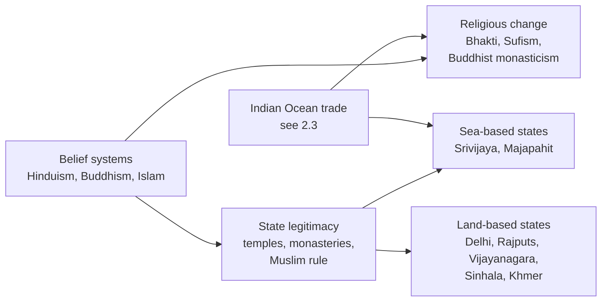
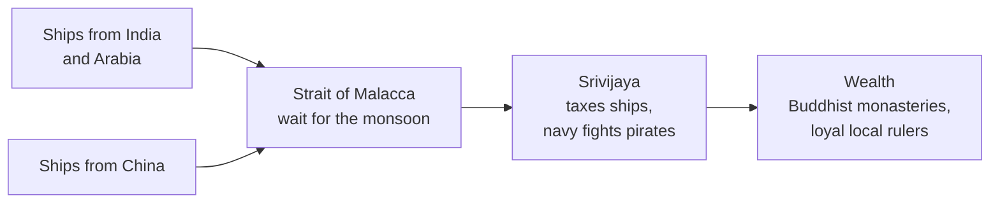
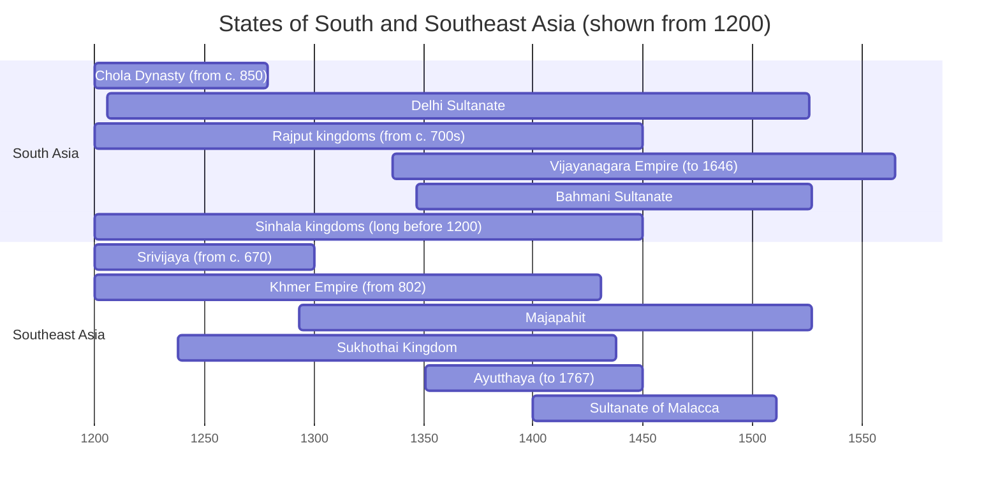
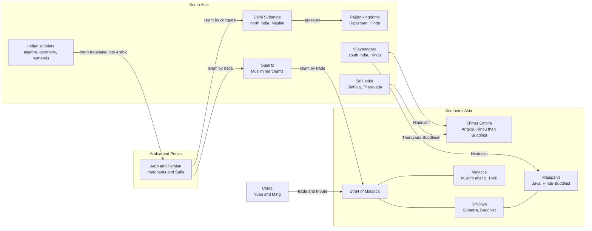
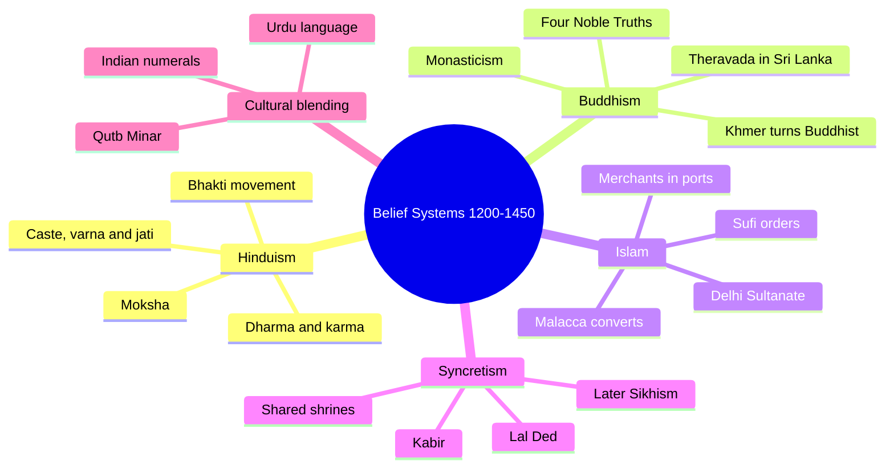

# AP World History: Modern — Topic 1.3 Developments in South and Southeast Asia from c. 1200 to c. 1450

**Focus Question (textbook Essential Question):** How did various beliefs and practices in South and Southeast Asia affect society and the development of states?

> Source: Based on the College Board CED · Textbook incorporated (Topic 1.3 reading)

**Unit 1: The Global Tapestry (c. 1200–1450)**

---

## Learning Objectives

| Code | Learning Objective |
|---|---|
| 1.3 LO-G (CDI) | Explain how the various belief systems and practices of South and Southeast Asia affected society over time. |
| 1.3 LO-H (GOV) | Explain how and why various states of South and Southeast Asia developed and maintained power over time. |

## Historical Developments (CED)

| # | Historical Development | LO | Covered in |
|---|---|---|---|
| HD1 (KC-3.1.III.D.iv) | Hinduism, Islam, and Buddhism, and their core beliefs and practices, continued to shape societies in South and Southeast Asia. | G | §1, §2, §3, §4 |
| HD1 example | Bhakti movement | G | §3 |
| HD1 example | Sufism | G | §4 |
| HD1 example | Buddhist monasticism | G | §2, §6 |
| HD2 (KC-3.2.I.B.i) | State formation and development demonstrated continuity, innovation, and diversity, including the new Hindu and Buddhist states that emerged in South and Southeast Asia. | H | §5, §6, §7, §8, §9 |
| HD2 example | Vijayanagara Empire | H | §5 |
| HD2 example | Srivijaya Empire | H | §7 |
| HD2 example | Rajput kingdoms | H | §5 |
| HD2 example | Khmer Empire | H | §8 |
| HD2 example | Majapahit | H | §7 |
| HD2 example | Sukhothai kingdom | H | §2, §8 |
| HD2 example | Sinhala dynasties | H | §6 |

---

## The Big Picture

> "What the books taught me, I've practised. / What they didn't teach me, I've taught myself. / I've gone into the forest and wrestled with the lion. / I didn't get this far by teaching one thing and doing another."
> — Lal Ded (1320–1392)

**Lal Ded**, known as **Mother Lalla**, was a Hindu poet from **Kashmir** in northern India. Her stress on personal **experience** appealed to many Muslims, especially **Sufis**. Her poetry shows the **interaction between religious traditions** that shaped the region. Contact between Hindus and Muslims was sometimes violent, but it produced new developments in religious thought, politics, economics, art, and architecture. After the **Gupta Dynasty** collapsed in **550**, South Asia was rarely united, and **Hinduism** gave the region cultural unity while local Hindu kingdoms kept a major role in a **decentralized** political landscape.

Between 1200 and 1450, three belief systems shaped South and Southeast Asia. **Hinduism** organized society through **dharma**, **karma**, and the **caste system**. **Buddhism** faded in India but stayed strong through **monasteries** in **Sri Lanka** and mainland Southeast Asia, where **Theravada** Buddhism spread. **Islam** arrived in two ways: by **conquest** in the north (the **Delhi Sultanate**, 1206–1526) and by **merchants and Sufis** in Indian Ocean ports. These faiths changed one another. The **Bhakti movement** made Hindu devotion open to all castes and to women, and **Sufism** made Islam attractive to ordinary people. States showed **continuity** (Hindu and Buddhist kingship), **innovation** (Muslim rule over a Hindu majority), and **diversity**. **Land-based states** such as the **Khmer Empire**, **Vijayanagara**, and the **Rajput kingdoms** drew power from farming, armies, and temples. **Sea-based states** such as **Srivijaya** and **Majapahit** drew power from controlling Indian Ocean trade (see 2.3).

---

## §1. Core Beliefs: Hinduism, Buddhism, and Islam

| Belief system | Core beliefs | Key practices | Effect on society c. 1200–1450 |
|---|---|---|---|
| **Hinduism** | **Dharma** (duty that fits one's place in life); **karma** (actions shape the next life); **samsara** (cycle of rebirth); **moksha** (release from the cycle); many gods seen as forms of one ultimate reality (**Brahman**) | Temple worship, rituals led by **Brahmin** priests, pilgrimage, devotion to gods such as **Vishnu** and **Shiva** | The majority faith in India; supported the **caste system**; Hindu kings built temples to show their legitimacy |
| **Buddhism** | **Four Noble Truths** (life is suffering; suffering comes from desire; suffering can end; the **Eightfold Path** ends it); goal of **nirvana** | **Monasticism** (monks and nuns in the **sangha**); laypeople earn merit by giving to monks | Declined in India; flourished in Sri Lanka and Southeast Asia (see §2) |
| **Islam** | One God (**Allah**); Muhammad as the final prophet; all believers equal before God | **Five Pillars**; the **Quran**; Islamic law (**sharia**) | Ruling faith of the Delhi Sultanate; spread along trade routes through merchants and **Sufis** (see §4) |

### Hinduism vs. Islam: Textbook Contrasts

- Before Islam arrived, most South Asians practiced **Hinduism**, and a smaller number were **Buddhists**. Islam was a **starkly different** religion.

| Feature | Hinduism | Islam |
|---|---|---|
| God | Hindus pray to **many gods** | Strictly **monotheistic** |
| Images | Temples and artwork are full of pictures of **deities** | Muslims disapprove of any **visual representation of Allah** |
| Social order | Associated with a **hierarchical caste system** | Calls for the **equality of all believers** |
| Sacred texts | Several sacred texts | Primarily the **Quran** |

### The Caste System

- Hindu society was divided into four **varnas**: **Brahmins** (priests), **Kshatriyas** (warriors and rulers), **Vaishyas** (merchants and farmers), and **Shudras** (laborers and servants).
- Groups seen as "untouchable" (today called **Dalits**) were placed **outside** the varna system.
- In daily life, people belonged to a **jati**, a birth group usually tied to an occupation. People married within their jati.
- Karma and dharma **justified** caste: a person's birth was seen as the result of past actions, and doing one's duty could bring a better rebirth.
- The caste system was a strong **continuity**. Later movements (Bhakti, Sufism) **challenged** it but did not end it.
- The textbook calls caste **India's strongest historical continuity**. It was unequal, but it gave **stability** to a politically decentralized land.
- Caste was **flexible** enough to absorb newcomers. **Muslim merchants and migrants** found a place in the hierarchy based on their **occupation**. These occupation-based **subcastes** worked like **workers' guilds** and became part of Indian society.
- The arrival of Islam **did little to change** the basic social structure. **Low-caste Hindus** who converted to Islam to raise their status **usually did not succeed**; they needed more education and better jobs, not just a new religion.
- **Connect (textbook):** Compare the caste system with social structures in China from 1200 to 1450 (see 1.1).

### Gender Relations

- Islam **did not greatly change gender relations**. Converts applied Islam's teachings in ways shaped by their earlier culture.
- In **South Asia**, Hindu women were confined to a **separate social sphere**, and Muslim women received similar treatment.
- In **Southeast Asia**, women had **more independence** before Islam, and this pattern **continued** after people became Muslims.
- Converts found ways to accept a new faith **without rejecting their traditions**.

## §2. Buddhist Monasticism and the Shift of Buddhism

- **Buddhist monasticism** means monks and nuns living in communities (the **sangha**). They gave up property, studied texts, and meditated.
- Monasteries were centers of **learning**, **education**, and **landholding**. Kings gave them land, and laypeople gave food and gifts to earn **merit**.
- In India, Buddhism **declined**. Hindu devotion (including Bhakti) absorbed many Buddhist ideas, and attacks during the Turkish conquests destroyed great monastic universities such as **Nalanda**.
- The textbook adds that **corruption among the monks** and **raids on monasteries** by early Muslim conquerors left Buddhism **disorganized**. It says the **largest number of converts to Islam were Buddhists**, and that the spread of Islam helped make Buddhism a **minority religion in its place of birth**.

> ⚠️ The textbook says the largest numbers of converts to Islam in South Asia were Buddhists. Many accounts say Buddhism was already shrinking in most of India before the Muslim conquests, and historians debate who converted and why. Check how your teacher presents this.

> ⚠️ Needs verification: Nalanda's destruction is usually dated c. 1193–1200 and linked to the forces of Bakhtiyar Khalji. Sources differ on the exact date and on how quickly the site was abandoned. The textbook mentions only "raids on monasteries" and does not name Nalanda.

- Buddhism **survived and grew** outside India. **Theravada** Buddhism spread from **Sri Lanka** to **Burma** (Pagan), **Thailand** (Sukhothai, Ayutthaya), and **Cambodia** (Khmer Empire) in the 12th–14th centuries, carried by monks.

| Branch | Main idea | Where strong c. 1200–1450 |
|---|---|---|
| **Theravada** ("Way of the Elders") | Follows the oldest texts; stresses monks working toward nirvana | Sri Lanka, Burma, Thailand, Cambodia |
| **Mahayana** ("Great Vehicle") | Stresses **bodhisattvas** who help others reach nirvana | China, Korea, Japan, Vietnam; earlier in Srivijaya and Angkor |

## §3. The Bhakti Movement

- **Bhakti** means "devotion." The movement taught **intense, personal love for a single god**, often **Vishnu** (or his form **Krishna**) or **Shiva**.
- It began with Tamil poet-saints in **south India** (the **Alvars** and **Nayanars**, c. 6th–9th centuries) and spread north between the 12th and 15th centuries.
- **Textbook view:** Beginning in the **12th century**, some Hindus drew on traditional teachings about the importance of **emotion** in spiritual life. Instead of studying texts or performing rituals, they built a strong attachment to **one particular deity**. The movement started in **southern India**.

> ⚠️ The textbook dates the start of the Bhakti Movement to the 12th century. Many accounts trace its roots to the Tamil Alvars and Nayanars of the 6th–9th centuries and say it spread north from the 12th century. Check how your teacher presents this.

- Key features:
  - **Rejected caste hierarchy**: anyone could reach god through devotion, without Brahmin priests or costly rituals.
  - **Open to women** and lower castes.
  - Used **vernacular** (local) languages such as Tamil, Kannada, Marathi, and Hindi instead of **Sanskrit**, so ordinary people could understand.
  - Spread through **poetry and song**.
- **Effect on society:** Bhakti made Hinduism more personal and popular, challenged caste, and helped Hinduism stay strong under Muslim rule. It also produced a rich **vernacular literature**.
- **Bhakti and Sufism (textbook):** Both were **mystical movements** that stressed **inner reflection** to reach a direct personal relationship with a deity. Because they placed less weight on strict rituals and beliefs, both **appealed to people outside their own traditions**. Just as the **Sufis helped spread Islam**, the **Bhaktis helped spread Hinduism**.

| Figure | Time | Region | Significance |
|---|---|---|---|
| **Alvars and Nayanars** | c. 6th–9th centuries | Tamil south India | Early Bhakti poet-saints devoted to Vishnu (Alvars) and Shiva (Nayanars) |
| **Basava** | 12th century | Karnataka (south India) | Led the **Lingayat** movement devoted to Shiva; rejected caste |
| **Lal Ded (Mother Lalla)** | 1320–1392 | Kashmir (north India) | A Hindu mystic poet whose stress on personal experience appealed to many Muslims, especially **Sufis** (textbook opening quote) |
| **Kabir** | c. 15th century | Varanasi (north India) | A weaver poet who **blended Hindu and Muslim ideas**; criticized empty ritual in both faiths; wrote in Hindi |
| **Mirabai** (textbook: **Mira Bai**) | c. 1498–1547 (after this period) | Rajasthan | A **Rajput princess** devoted to Krishna; famous female Bhakti poet; the textbook names her as one of the most famous Bhakti figures (16th century) |

> ⚠️ Needs verification: Kabir's birth and death dates are disputed (often given as c. 1398–1448 or c. 1440–1518); the textbook does not mention Kabir. The textbook agrees that Mira Bai lived in the 16th century, after 1450, so use her only as an example of Bhakti's continuing influence and its openness to women.

## §4. Sufism and Hindu-Muslim Syncretism

- **Sufism** is the **mystical** branch of Islam. Sufis seek a personal, emotional experience of God through **prayer, poetry, music, and dance**.
- Sufis were the **most important missionaries** of Islam in South and Southeast Asia:
  - They lived among ordinary people and built **shrines** and lodges open to everyone.
  - They were **flexible**: they accepted local customs and used local languages and music (for example, **qawwali** devotional songs).
  - Their stress on love of God and spiritual equality appealed to many people, including lower castes.
- The **Chishti** order was the most famous Sufi order in India. **Moinuddin Chishti** (d. 1236) settled at **Ajmer**, and **Nizamuddin Auliya** (d. 1325) taught in **Delhi**. Their shrines drew both Muslims and Hindus.
- **Merchants** also spread Islam. Muslim traders from Arabia, Persia, and **Gujarat** settled in Indian Ocean ports, married local women, and built mosques. By the late 13th century, **Samudera Pasai** in northern Sumatra had a Muslim ruler, and around 1400 the ruler of **Malacca** converted (see 2.3).
- Conversion was mostly **gradual and peaceful**. Most people in India **stayed Hindu**, so Muslims remained a **minority**.

### How Islam Arrived and Spread (Textbook)

- The relationship between Hindus and Muslims has shaped South Asia **since the 7th century** and still shapes regional culture and politics today.
- Islam first entered India **by force** but later took a **more peaceful** approach.
- Islam is a **universalizing religion**: it seeks to **proselytize** (actively seek converts). But Muslim rulers learned early that **forcing** Hindu and Buddhist subjects to convert **did not work**, so **most converts came voluntarily**.
- Many **Muslim merchants** in the Indian Ocean trade moved to Indian **port cities** and married there; their **wives often converted**.
- Islam's stress on the **equality of all believers** attracted **low-caste Hindus** who hoped to raise their status. The textbook compares this to **Christianity in the Roman Empire**: both appealed to the people who suffered most under the existing social structure.
- **Connect (textbook):** Compare the spread of Islam in South Asia with the spread of Buddhism in China (see 1.1).

### Islam in Southeast Asia (Textbook)

- The textbook says the **first Southeast Asian Muslims** were **local merchants** who converted in the **700s**, hoping for better trade relations with Muslim merchants who came to their shores.
- Islam was **most popular in urban areas** at first. It spread to **Sumatra, Java, and the Malay Peninsula**. Today **Indonesia** has **more Muslims than any other country**.
- **Sufi** missionaries were **tolerant of local faiths**, so people felt comfortable converting: they could be Muslims and **still honor local deities** (see 1.2).

> ⚠️ The textbook says local Southeast Asian merchants first converted in the 700s. Many accounts say foreign Muslim traders visited the region from the 7th–8th centuries, but the earliest clear evidence of local Muslim rulers and communities dates from the late 13th century (Samudera Pasai). Check how your teacher presents this.

### Cultural Exchange and Blending

- **Science and math:** Arab astronomers and mathematicians built on the work of Indian scholars. Indian **algebra and geometry** were translated into **Arabic** and spread through **Dar al-Islam**. The numerals called "**Arabic numerals**" in the West actually **originated in India**.
- **Architecture:** Sultans built structures that blended the **intricate details of Hindu art** with the **geometric patterns** of Islamic architecture. Delhi is full of Islamic buildings from the Delhi Sultanate.
- **Qutb Minar** (textbook: **Qutub Minar**), in southern Delhi: Delhi Sultanate rulers built an elaborate **mosque on top of a Hindu temple**, using materials from nearby Hindu and other shrines. The tall, slightly leaning **tower** rises over the mosque. Historians debate why it was built; one clear function was as a **symbol of Islamic influence** and, for a time, **dominance of north India**.

> ⚠️ The textbook calls the Qutub Minar "the tallest structure in India today." Many accounts describe it as the world's tallest brick minaret (about 73 m), but many modern structures in India are taller. Check how your teacher presents this.

- **Language:** A new language, **Urdu**, developed among the Muslims of South Asia. It combined the **grammar of Hindi** (the language of north Indians) with vocabulary from **Arabic** and some elements of **Farsi** (Persian). Today Urdu is the **official language of Pakistan**.

> ⚠️ The textbook stresses Arabic vocabulary in Urdu. Many accounts say most of Urdu's borrowed vocabulary is Persian, with many Arabic words coming in through Persian. Check how your teacher presents this.

### Syncretism

- **Syncretism** is the blending of beliefs from different traditions.
- Bhakti and Sufism had a lot in common: both stressed **love of God over ritual**, both used poetry and song, and both welcomed people of all ranks.
- **Kabir** is the clearest example: he taught that God is one, whether called Rama or Allah.
- **Lal Ded** of Kashmir, a Hindu poet, was admired by many Muslims, especially Sufis, because of her stress on personal experience.
- **Context only (after 1450):** **Sikhism**, founded by **Guru Nanak** (1469–1539) c. 1500 in Punjab, drew on both Bhakti and Sufi ideas.

## §5. States of South Asia: Delhi Sultanate, Rajputs, and Vijayanagara

### Background: A Divided Region

- South Asia was **only occasionally united** as one state. After the **Gupta Dynasty** collapsed in **550**, ending India's so-called **Golden Age** (Classical Era), **disunity** returned for most of the next **1,000 years**.
- **Northern and southern India** developed **separate political structures**. **Southern India** was **more stable**; **northern India** had far more upheaval.
- **Hinduism** gave cultural unity: many people combined local faith traditions with the same scriptures and core beliefs respected across the region.
- **Geography:** The **Himalayas** protected India from invasion from the north and east, but **mountain passes in the northwest** let **Muslim armies** invade.

| Period | Islamic presence in north India (textbook) |
|---|---|
| **8th century** | Islamic armies invaded present-day **Pakistan** but changed daily life little; the region was on the **eastern fringe of Dar al-Islam**, and **Rajput princes** limited the conquerors' influence |
| **11th century** | Islamic forces **plundered Hindu temples and Buddhist shrines** for their riches and built **mosques on Hindu and Buddhist holy sites**, angering followers of those faiths |
| **Early 13th century** | Islamic forces conquered **Delhi** and much of north India; the **Delhi Sultanate** ruled for about **300 years** (13th–16th centuries) |

- Delhi itself was taken in the 1190s; the sultanate is usually dated from **1206**.

### The Delhi Sultanate (1206–1526): Innovation

| Feature | Details |
|---|---|
| **Founding** | Turkic Muslim general **Qutb al-Din Aibak** founded it in **1206**, after Turkic invasions of north India |
| **Dynasties** | Five dynasties ruled in turn: Mamluk, Khalji, Tughluq, Sayyid, Lodi |
| **Muslim minority rule** | A small Muslim elite ruled a **Hindu majority**; Persian was the court language |
| **Jizya** | Non-Muslims paid the **jizya** (a tax on non-Muslims) and were treated as protected people; many Hindu chiefs kept local power |
| **Hindu-Muslim relations** | Some Hindus converted, but others **resented Muslims** and saw them as **foreigners**; the textbook says the **jizya on all non-Muslim subjects** added to this resentment |
| **Administration** | The textbook says the sultanate **never built an efficient bureaucracy** like China's, so sultans struggled to impose policies on so vast and diverse a land; **local kingdoms** kept a major role |
| **Military** | Large cavalry armies; **resisted the Mongols** (Alauddin Khalji defeated several Mongol invasions c. 1297–1306). The sultans wanted to expand south, but defending against the Mongols from the northwest took their focus; the sultanate **kept the Mongols from conquering South Asia** |
| **Weakness** | Frequent succession struggles; **Timur** (Tamerlane) **sacked Delhi in 1398**; it never fully recovered |
| **End** | **Babur** defeated the last Lodi sultan at **Panipat in 1526** and founded the Mughal Empire (see Unit 3); the textbook notes that the **Mughals traced their ancestry to the Mongols** |
| **Culture** | Indo-Islamic architecture such as the **Qutb Minar** (textbook: Qutub Minar; begun c. 1199); mixing of Persian and Indian culture; the **Urdu** language (see §4); female ruler **Razia Sultana** (r. 1236–1240) |

- **Why it was an innovation:** For the first time, a Muslim state ruled much of north India. It kept power through **military strength**, **taxation**, and **pragmatic tolerance** of the Hindu majority.

### The Rajput Kingdoms: Continuity

- The **Rajputs** were **Hindu warrior clans** in **Rajasthan** (northwest India). They claimed **Kshatriya** (warrior) status.
- **Textbook view:** After the fall of the Gupta Empire, Rajput kingdoms **gradually formed** in **northern India and present-day Pakistan**. Leaders of **numerous clans** were **often at war with one another**, so **no centralized government** arose. This lack of central power left them **vulnerable to Muslim attacks**, and it shows the **diversity and regionalism** of South Asia.
- They ruled several kingdoms (for example, **Mewar** and its fortress of **Chittor**) and **resisted the Delhi Sultanate**. Alauddin Khalji captured Chittor in **1303**, but Rajput kingdoms survived and recovered.
- Their power rested on **fortresses**, **clan loyalty**, and a code of **warrior honor**.
- They show **continuity**: Hindu kingship and caste-based warrior identity survived Muslim conquest.

### The Vijayanagara Empire (1336–1646): New Hindu State

- Founded in **1336** by two brothers, **Harihara and Bukka**, in **south India**; its capital, **Vijayanagara** (modern **Hampi**), lay on the Tungabhadra River. The name means "**the victorious city**."
- **Founding story (textbook):** The **Delhi Sultanate** sent the brothers south to **extend its rule** into southern India. They had been **born Hindu** and **converted to Islam** for **upward mobility**. Once they left Delhi's control, they **returned to Hinduism** and founded their own Hindu kingdom.

> ⚠️ The textbook presents the brothers' conversion to Islam and return to Hinduism as fact. Many historians treat this as a traditional story and debate it. Check how your teacher presents this.

- It was a **Hindu** state that presented itself as a defender of Hindu traditions against the Muslim sultanates of the north and the **Bahmani Sultanate** (from 1347) on its border.
- Power came from:
  - **Agriculture** supported by irrigation tanks and canals.
  - **Trade**: it exported **cotton textiles, pepper, and gems** and imported **warhorses** from Arabia and Persia through west-coast ports.
  - **Temple building**, which showed royal piety and legitimacy.
  - **Pragmatism**: it hired Muslim cavalry and adopted military methods from the sultanates.
- Persian envoy **Abdur Razzaq** (1443) described the capital as one of the greatest cities he had seen.
- It peaked under **Krishnadevaraya** (r. 1509–1529), lost the **Battle of Talikota in 1565**, and continued in weakened form until 1646. The textbook says it lasted until the **mid-1500s**, when **a group of Muslim kingdoms** (the Deccan sultanates) **overthrew it**.

### Context: The Chola Dynasty

- The **Chola** dynasty (Tamil, Hindu) ruled south India from the 9th century; the textbook gives **850–1267**, more than 400 years. It had a strong navy and **raided Srivijaya in 1025**.
- In the **11th century**, the Cholas extended their rule to **Ceylon** (today **Sri Lanka**).
- It **declined by 1279**, leaving space for new south Indian states such as Vijayanagara.

> ⚠️ The textbook ends the Chola Dynasty in 1267. Many accounts give 1279 as the end of Chola rule. Check how your teacher presents this.

## §6. Sri Lanka: The Sinhala Dynasties

- The **Sinhala** kings of **Sri Lanka** ruled a **Theravada Buddhist** kingdom. Kings saw protecting Buddhism as their main duty.
- **Origins (textbook):** The Sinhala dynasties had roots in **early immigrants from north India**, most likely **merchants**. **Buddhists arrived in the 3rd century B.C.E.**, and the island became a **center of Buddhist study**. **Monasteries and nunneries** flourished; both **men and women** found a life of contemplation and simple living attractive.
- Buddhism was so deeply rooted that **Buddhist priests often advised the monarchs**.
- The textbook discusses Sri Lanka among the **land-based kingdoms** in its Southeast Asia section; geographically, Sri Lanka is part of **South Asia**.
- **Buddhist monasticism** and kingship were linked:
  - Kings funded **monasteries** and gave them land.
  - The **Tooth Relic** of the Buddha was a symbol of royal power; whoever held it had the right to rule.
  - Sri Lankan monks carried Theravada Buddhism to Burma, Thailand, and Cambodia.
- **Irrigation:** Sinhala kings built huge **reservoirs (called "tanks")** and canals that stored monsoon rain for **rice farming**. King **Parakramabahu I** (r. 1153–1186) expanded these works at the capital **Polonnaruwa**. The textbook says this **irrigation system** contributed to **economic growth**.
- **Change after 1200:** After an invasion in **1215**, the Sinhala capital moved to the **southwest** (Dambadeniya, later **Kotte**), and a **Tamil Hindu kingdom** formed in **Jaffna** in the north. **Parakramabahu VI** (r. 1412–1467) briefly reunited the island from Kotte.
- **Weakening (textbook):** **Attacks by invaders from India** and **conflicts between the monarchy and the Buddhist priests** ultimately weakened the kingdoms.
- They show **continuity**: Buddhist kingship and irrigation farming lasted for centuries.

## §7. Sea-Based States of Maritime Southeast Asia: Srivijaya and Majapahit

### Indian Influence on Southeast Asia (Textbook)

- Like China, South Asia strongly influenced its neighbors in **Southeast Asia** (today's Indonesia, Malaysia, Cambodia, Thailand, Laos, and Vietnam).
- **Indian merchants** traded there as early as **500 B.C.E.** They sold **gold, silver, metal goods, and textiles** and brought back fine **spices**.
- These trade voyages brought **Hinduism and Buddhism** to Southeast Asia. The textbook says much of the region became and remains **mostly Buddhist** (today this is true mainly of mainland Southeast Asia; Indonesia and Malaysia are mostly Muslim).
- The region was **strategically important**: whoever controlled it could influence the valuable **trade between South Asia and East Asia**, so several kingdoms emerged there.

### Srivijaya (c. 7th–13th centuries)

- Capital at **Palembang** on **Sumatra**; it controlled the **Strait of Malacca** and the Sunda Strait, the main sea routes between India and China.
- Power came from **sea trade**, not land:
  - Ships had to wait in its ports for the **monsoon winds** to change.
  - It **taxed** passing ships and used its **navy** to suppress pirates and force ships to use its ports.
  - It kept local rulers loyal with gifts, oaths, and shared trade profits.
  - It sent **tribute** missions to China, which brought trade privileges.
- It was a major **Buddhist** center (mostly **Mahayana**). The textbook calls Srivijaya "**primarily a Buddhist kingdom**" and a **religious center** of the region. The Chinese monk **Yijing** studied there in 671 on his way to India.
- **Textbook dates and details:** **670–1025**; it **built up its navy** and prospered by **charging fees** on ships traveling between India and China.
- **Decline:** The **Chola raid of 1025** weakened it; in the 13th century rival ports grew, and by the late 14th century Majapahit controlled its former lands. The textbook says it was weakened by the **expansion of other powers**, including **Majapahit**.

> ⚠️ The 1.3 textbook reading calls Srivijaya "primarily a Buddhist kingdom" and Majapahit "a Hindu kingdom (but with strong Buddhist influences)," which matches most scholarship (Srivijaya mainly Mahayana Buddhist; Majapahit Hindu-Buddhist, mainly Shaiva Hindu with Buddhism). The 2.5 textbook reading, and so the 2.5 notes, says the reverse (Srivijaya Hindu, Majapahit Buddhist). The textbook contradicts itself. Check how your teacher presents this.

> ⚠️ The textbook dates Srivijaya to 670–1025 but also says Majapahit (founded 1293) helped weaken it. Many accounts say Srivijaya survived in weakened form after the 1025 Chola raid into the 13th century, and its exact end date is unclear. These notes follow the longer dating. Check how your teacher presents this.

### Majapahit (1293–c. 1527)

- Based on **Java**; founded in **1293** by **Raden Wijaya**, who used an invading **Mongol (Yuan)** army to defeat a rival and then drove the Mongols out.
- A **Hindu-Buddhist** kingdom: worship of **Shiva** and Buddhism existed side by side at court. The textbook calls it "**a Hindu kingdom (but with strong Buddhist influences)**," unlike Buddhist Srivijaya.
- Power came from **both land and sea**:
  - Java's fertile volcanic soil produced **rice** surpluses.
  - Its **navy** controlled trade in **spices** (cloves, nutmeg from the Maluku Islands) and collected tribute from islands across the archipelago.
- It peaked under King **Hayam Wuruk** (r. 1350–1389) and his chief minister **Gajah Mada**, who vowed to unite the archipelago. The court poem **Nagarakretagama** (1365) lists many tributary lands. The textbook says Majapahit had **98 tributaries** at its height and, like Srivijaya, kept its power by **controlling sea routes**.
- **Decline:** In the 15th century, **Muslim** port states such as **Malacca** and **Demak** grew richer, and Majapahit fell to them c. 1527. The textbook says it began a **slow decline** after the **deaths of several key leaders** and as **Islamic influence grew** in the region.

> ⚠️ Needs verification: Majapahit's end date is debated. The textbook gives 1293–1520; other accounts give c. 1478 or c. 1527. These notes use c. 1527.

## §8. A Land-Based State: The Khmer Empire (802–1431)

- Based at **Angkor** in present-day **Cambodia**; founded by **Jayavarman II** in **802**. The textbook also calls it the **Angkor Kingdom** and places it near the **Mekong River**; unlike Srivijaya and Majapahit, it **did not depend on sea power**.
- **Hindu, then Buddhist:**
  - King **Suryavarman II** (r. 1113–c. 1150) built **Angkor Wat**, the largest religious monument in the world, dedicated to the Hindu god **Vishnu**.
  - King **Jayavarman VII** (r. 1181–c. 1218), a **Mahayana Buddhist**, built **Angkor Thom** and the **Bayon** temple, plus roads, rest houses, and hospitals.
  - By the 13th–14th centuries, most Khmer people followed **Theravada** Buddhism, and Angkor Wat became a **Buddhist** temple.
  - **Textbook view:** The temples at the capital, **Angkor Thom**, showed the **variety of Indian cultural influences**, with Hindu artwork and sculptures of deities everywhere. When Khmer rulers became Buddhist, starting in the **12th and 13th centuries**, they **added Buddhist sculptures and artwork without destroying the Hindu artwork**. The textbook describes **Angkor Wat**, about half a mile from Angkor Thom, as an ornate **Buddhist** temple complex built in the same period.

> ⚠️ The textbook calls Angkor Wat a Buddhist temple complex built in the same period as the Buddhist additions at Angkor Thom. Many accounts say Angkor Wat was built earlier, in the first half of the 12th century under Suryavarman II, as a Hindu temple to Vishnu, and became Buddhist later; Angkor Thom was built later in the 12th century under Jayavarman VII. Check how your teacher presents this.

- **Irrigation:** Huge **reservoirs (barays)** and canals stored water for **rice** farming, supporting a large population. The textbook adds that irrigation let farmers harvest **rice several times a year**, and **drainage systems** reduced damage from heavy **monsoon rains**, making the Khmer one of the **most prosperous** kingdoms in Southeast Asia.
- **Maintaining power:** kings presented themselves as connected to the gods, built temples to show legitimacy, controlled labor for temples and waterworks, and collected rice as taxes.
- **Decline (15th century):** wars with the Thai kingdom of **Ayutthaya** (founded 1351), strain on the water system, and the shift to Theravada Buddhism (which needed fewer royal temples) weakened royal power. Ayutthaya **sacked Angkor c. 1431**, and the Khmer capital moved south.
- **Sukhothai kingdom (c. 1238–1438):** a Thai kingdom that broke away from Khmer control in the 13th century. Under King **Ramkhamhaeng** (late 13th century) it expanded and supported **Theravada Buddhism** from Sri Lanka, and its rulers presented themselves as patrons of the monks. In the 14th century it came under the rival Thai kingdom of **Ayutthaya**, which absorbed it in 1438.
- Chinese envoy **Zhou Daguan** visited Angkor in 1296–1297 and described its wealth.
- **Legacy (textbook):** The ruins of Angkor Thom and Angkor Wat still stand, showing both the **sophistication of Southeast Asian culture** and the **powerful influence of Indian culture** on the region.

> ⚠️ The textbook says the Thais of the **Sukhothai Kingdom** invaded in 1431 and forced the Khmers out. Many accounts say it was the Thai kingdom of **Ayutthaya**, which by then had made Sukhothai its vassal. Check how your teacher presents this.

> ⚠️ Needs verification: The textbook also gives 1431 for the Thai conquest of Angkor, but this date is traditional (often written c. 1431). Historians debate how sudden Angkor's decline was and how much climate and the water system contributed.

## §9. Land-Based vs. Sea-Based States and the Indian Ocean Link

| Type | Examples | Source of wealth | How power was maintained |
|---|---|---|---|
| **Land-based** | Delhi Sultanate, Rajput kingdoms, Vijayanagara, Sinhala dynasties, Khmer Empire | **Agriculture** (rice, irrigation), land taxes | Armies, forts, temples and monasteries, control of labor and irrigation |
| **Sea-based** | Srivijaya, Majapahit (also land-based in Java), later Malacca | **Trade** (taxes on shipping, spices) | Navies, control of straits and ports, alliances with local rulers, tribute to China |

- All these states sat on the **Indian Ocean trade network** (see 2.3). Trade brought **wealth** and also **religions**: Hinduism and Buddhism came to Southeast Asia from India, and later Islam came with merchants.
- **Continuity:** Hindu and Buddhist kingship, caste, irrigation farming.
- **Innovation:** Muslim rule in north India; new Hindu and Buddhist states (Vijayanagara, Majapahit).
- **Diversity:** Muslim, Hindu, and Buddhist states; land-based and sea-based states.
- **Textbook grouping:** The textbook names **Srivijaya** and **Majapahit** as **sea-based** kingdoms and the **Sinhala dynasties** and the **Khmer Empire** as **land-based** kingdoms that drew power from controlling land and irrigation.
- **Political continuity (textbook):** Despite the strong Islamic presence, **local Hindu kingdoms** kept a major role in India's **decentralized** political landscape.

---

## Timeline

```mermaid
timeline
    title South and Southeast Asia c. 1200-1450
    550 : Gupta Dynasty collapses and disunity returns to India
    670 : Srivijaya begins on Sumatra (textbook date)
    802 : Jayavarman II founds the Khmer Empire
    850 : Chola Dynasty begins in south India (textbook date)
    1025 : Chola navy raids Srivijaya
    1100s : Bhakti Movement grows in south India (textbook date)
    c. 1113-1150 : Angkor Wat built for Vishnu
    1181 : Jayavarman VII begins Buddhist rule at Angkor
    1206 : Delhi Sultanate founded
    1267 : Chola Dynasty ends (textbook date)
    1279 : Chola Dynasty ends (most accounts)
    1293 : Majapahit founded on Java
    c. 1297-1306 : Delhi Sultanate turns back Mongol invasions
    1303 : Alauddin Khalji captures Chittor
    1320-1392 : Life of Lal Ded, Hindu poet of Kashmir
    1336 : Vijayanagara founded
    1347 : Bahmani Sultanate founded
    1351 : Ayutthaya founded
    1365 : Nagarakretagama written in Majapahit
         : Majapahit at its height with about 98 tributaries
    1398 : Timur sacks Delhi
    c. 1400 : Malacca founded
    c. 1431 : Ayutthaya sacks Angkor
            : Textbook says Thais of Sukhothai force the Khmers out
    c. 1500 : Guru Nanak founds Sikhism
    1520 : Majapahit ends (textbook date)
    1526 : Delhi Sultanate ends at Panipat
         : Mughals take power
```

- Bars for the Rajput kingdoms, Sinhala kingdoms, and Ayutthaya stop at 1450 only to fit the period; these states continued after 1450.
- The gantt uses common scholarly dates. The textbook gives different dates for some states: Chola **850–1267**, Srivijaya **670–1025**, Majapahit **1293–1520**. It gives no dates for Sukhothai; the bar uses common dates (c. 1238–1438).

---

## Map: Religions and States of the Indian Ocean World

---

## Comparison Table: Four States

| Feature | Srivijaya | Majapahit | Khmer Empire | Vijayanagara |
|---|---|---|---|---|
| Location | Sumatra, Strait of Malacca | Java | Angkor, Cambodia | South India |
| Dates | c. 7th–13th centuries | 1293–c. 1527 | 802–1431 | 1336–1646 |
| Textbook dates | 670–1025 | 1293–1520 | 802–1431 | 1336–1646 (overthrown mid-1500s) |
| Religion | Mainly Mahayana Buddhist | Hindu-Buddhist | Hindu, then Buddhist | Hindu |
| Textbook detail | "Primarily a Buddhist kingdom"; charged fees on ships between India and China | "A Hindu kingdom (but with strong Buddhist influences)"; 98 tributaries at its height | Irrigation and drainage gave several rice harvests a year; Buddhist art added without destroying Hindu art | Name means "the victorious city"; founders sent south by the Delhi Sultanate |
| Power base | Sea | Sea and land | Land | Land (with trade) |
| Source of wealth | Taxes on shipping in the straits | Rice and the spice trade | Irrigated rice farming | Agriculture and trade in textiles, spices, horses |
| How power was maintained | Navy, alliances with local rulers, tribute to China | Navy, tribute from islands, strong ministers | God-linked kingship, temples, control of labor and water | Army, temples, hiring Muslim cavalry |
| Decline | Chola raid (1025), rival ports | Rise of Muslim ports | Ayutthaya's attacks (c. 1431) | Defeat at Talikota (1565) |

## Comparison Table: Bhakti vs. Sufism

| Feature | Bhakti | Sufism |
|---|---|---|
| Religion | Hinduism | Islam |
| Core idea | Personal devotion to one god | Mystical union with God |
| Methods | Poetry and song in local languages | Poetry, music (qawwali), dance, shrines |
| View of rank | Rejected caste hierarchy; open to women | Spiritual equality; open to all |
| Key figures | Alvars, Basava, Kabir, Mirabai (later) | Moinuddin Chishti, Nizamuddin Auliya |
| Type of movement | Mystical; inner reflection for a direct personal relationship with a deity | Mystical; inner reflection for a direct personal relationship with God |
| Effect | Made Hinduism popular and personal; strengthened Hinduism under Muslim rule; the textbook says Bhaktis helped spread Hinduism | Spread Islam through gradual conversion; in Southeast Asia, converts could still honor local deities |
| Similarity | Both stressed love of God over ritual and led to syncretism (Kabir, later Sikhism) | (same) |

---

## Key Terms

| Theme | Term | Definition |
|---|---|---|
| Culture | Dharma | In Hinduism, the duty that fits a person's place in life and caste |
| Culture | Karma | The idea that a person's actions shape their next life |
| Culture | Moksha | In Hinduism, release from the cycle of rebirth (samsara) |
| Culture | Four Noble Truths | The Buddha's teaching that life is suffering, desire causes suffering, suffering can end, and the Eightfold Path ends it |
| Culture | Buddhist monasticism | Life of Buddhist monks and nuns in communities (the sangha) supported by kings and laypeople |
| Culture | Theravada Buddhism | The branch of Buddhism that follows the oldest texts; strong in Sri Lanka and mainland Southeast Asia |
| Culture | Bhakti movement | A Hindu movement of personal devotion to one god that rejected caste hierarchy and used local languages |
| Culture | Sufism | The mystical branch of Islam; Sufis spread Islam through shrines, poetry, and music |
| Culture | Syncretism | The blending of beliefs from different traditions, such as Kabir's mix of Hindu and Muslim ideas |
| Culture | Proselytize | To actively seek converts to a religion |
| Culture | Universalizing religion | A religion that seeks converts from all peoples, such as Islam and Buddhism |
| Culture | Lal Ded (Mother Lalla) | A Hindu poet of Kashmir (1320–1392) whose stress on personal experience appealed to many Muslims, especially Sufis |
| Culture | Qutb Minar (Qutub Minar) | A huge tower in Delhi built by Delhi Sultanate rulers beside a mosque raised on a Hindu temple site; a symbol of Islamic influence in north India |
| Culture | Urdu | A language that combined Hindi grammar with Arabic and Persian (Farsi) vocabulary; today the official language of Pakistan |
| Culture | Arabic numerals | The numeral system that originated in India and spread west through Arabic translations |
| Society | Caste system | Hindu social ranking by birth into varnas and jatis |
| Society | Varna | One of the four broad Hindu social classes: Brahmins, Kshatriyas, Vaishyas, Shudras |
| Society | Jati | A birth group, usually tied to an occupation, within the caste system |
| Society | Subcaste | An occupation-based group within the caste system that worked like a workers' guild; Muslim merchants and migrants found places in such groups |
| Government | Delhi Sultanate | A Muslim state that ruled north India from 1206 to 1526 |
| Government | Jizya | A tax paid by non-Muslims under Muslim rule |
| Government | Rajput kingdoms | Kingdoms of Hindu warrior clans in Rajasthan that resisted the Delhi Sultanate |
| Government | Vijayanagara Empire | A Hindu empire in south India founded in 1336; its name means "the victorious city" |
| Government | Chola Dynasty | A Tamil Hindu dynasty of south India (textbook: 850–1267) that raided Srivijaya and extended its rule to Ceylon |
| Government | Sinhala dynasties | Theravada Buddhist kings of Sri Lanka |
| Government | Srivijaya Empire | A Buddhist sea-based state on Sumatra that controlled the Strait of Malacca (c. 7th–13th centuries) |
| Government | Majapahit | A Hindu-Buddhist kingdom on Java (1293–c. 1527) |
| Government | Khmer Empire | A Hindu, then Buddhist, land-based empire centered at Angkor (802–1431); also called the Angkor Kingdom |
| Government | Sukhothai Kingdom | A Thai kingdom (c. 1238–1438); the textbook says its Thais forced the Khmers out of Angkor in 1431 |
| Economy | Strait of Malacca | The narrow sea passage between Sumatra and the Malay Peninsula that linked Indian Ocean and China trade |
| Economy | Sea-based state | A state whose power came mainly from controlling trade routes and ports |
| Technology | Tank / baray | A large reservoir that stored water for irrigation in Sri Lanka (tank) and Angkor (baray) |
| Technology | Angkor Wat | A huge temple complex built for Vishnu in the 12th century, later used as a Buddhist temple |

### Textbook Key Terms by Theme

| Theme | Textbook key terms |
|---|---|
| Government: South Asia | Vijayanagara Empire; Rajput kingdoms (North India); Delhi Sultanate |
| Government: Southeast Asia | Srivijaya Empire (Sumatra); Majapahit Kingdom (Java); Sinhala dynasties (Sri Lanka); Khmer Empire (Cambodia); Sukhothai Kingdom (Thailand) |
| Culture: Religion | proselytize; Bhakti Movement (Southern India) |
| Culture: Blending | Qutub Minar; Urdu |

> ⚠️ The columns of this key-term list were jumbled in the extracted text, so the grouping above is reconstructed (for example, "(Southern India)" could belong to the Vijayanagara Empire rather than the Bhakti Movement). The list also spells "Majahapit," while the body text uses "Majapahit." Check against the printed textbook.
