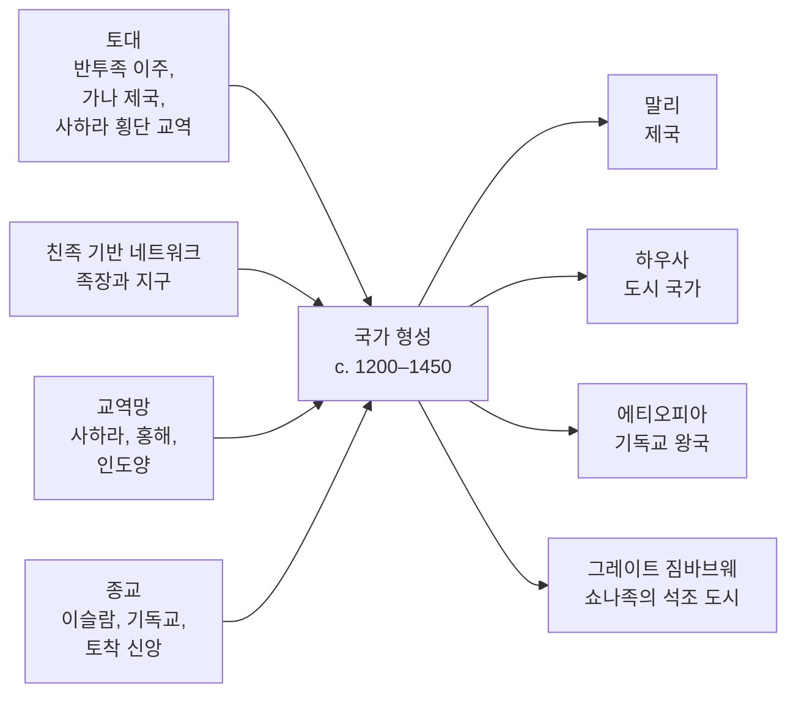
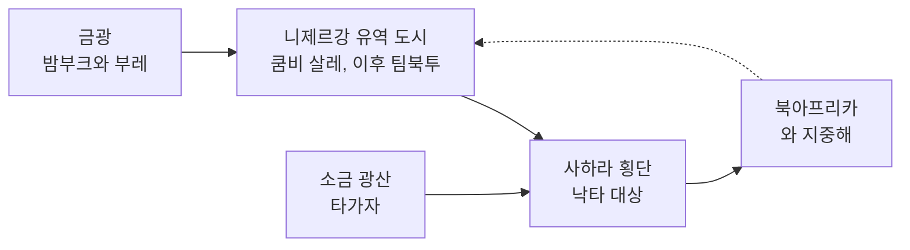
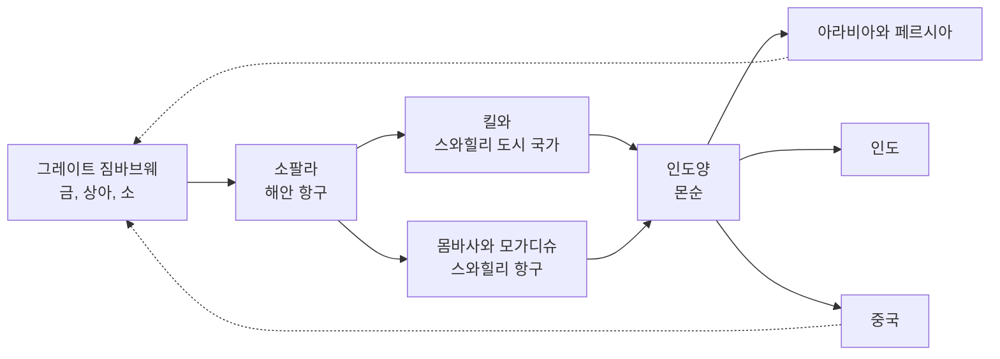
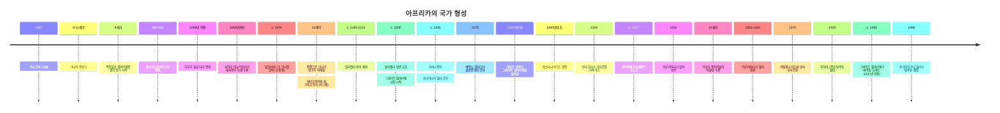
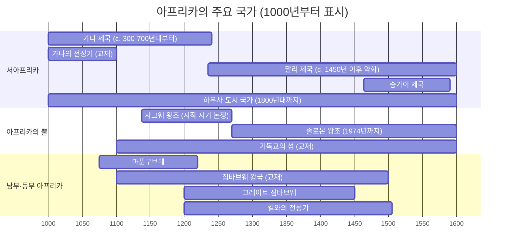
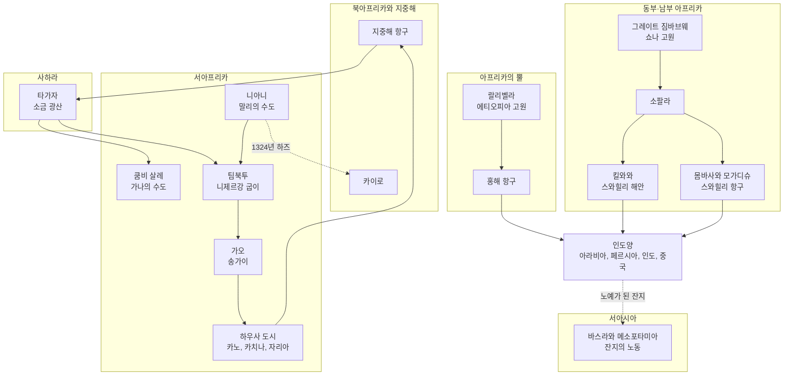
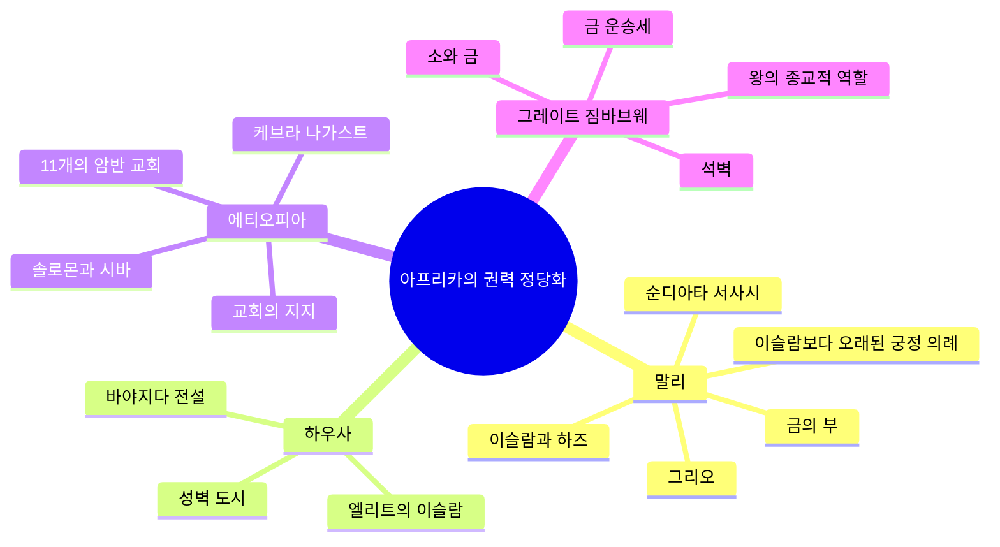

# AP 세계사: 모던 — 토픽 1.5 아프리카의 국가 형성 (State Building in Africa)

**Focus Question (교재 Essential Question):** 아프리카의 국가들은 어떻게, 그리고 왜 발전했으며 시간에 따라 어떻게 변화했는가?

> 출처: College Board CED 기준 · 교재 반영 (교재 Topic 1.5)

**Unit 1: 세계의 태피스트리 (The Global Tapestry, c. 1200–1450)**

---

## 학습 목표 (Learning Objective)

| 코드 | 학습 목표 |
|---|---|
| 1.5 LO-J (GOV) | 아프리카의 국가들이 어떻게, 그리고 왜 발전하고 변화했는지 설명하라. |

## 역사적 개념 (Historical Developments, CED)

| # | 역사적 개념 | 다루는 곳 |
|---|---|---|
| HD1 (KC-3.2.I.D.ii) | 유라시아와 아메리카에서처럼 아프리카에서도 국가 체제는 연속성 (Continuity), 혁신 (Innovation), 다양성 (Diversity)을 보였고, 그 범위와 영향력이 확대되었다 (Expanded in scope and reach). | §1–§9 |
| HD1-a | 예시: **그레이트 짐바브웨 (Great Zimbabwe)** | §5 |
| HD1-b | 예시: **에티오피아 (Ethiopia)** | §4 |
| HD1-c | 예시: **하우사 왕국 (Hausa kingdoms)** | §3 |

---

## 큰 그림 요약

> "그다음 시인들의 우두머리가 펨피 [통치자가 앉는 높은 단] 계단을 올라가 술탄의 무릎에 머리를 얹는다. 이어 펨피 꼭대기로 올라가 먼저 술탄의 오른쪽 어깨에, 그다음 왼쪽 어깨에 머리를 얹는다. 그동안 내내 그들의 말로 이야기하다가 마침내 다시 내려온다. 나는 이것이 이슬람이 들어오기 전부터 그들 사이에 내려온 아주 오래된 관습이며, 그들이 이를 계속 지켜 왔다고 들었다."
> — 이븐 바투타 (Ibn Battuta), c. 1352

**이븐 바투타**는 **모로코 (Morocco)** 출신 학자였고, **이슬람법 (Shariah, 샤리아)**에 밝았다. 동아프리카의 **모가디슈 (Mogadishu)**와 인도의 **델리 (Delhi)**처럼 멀리 떨어진 이슬람 정부들이 그에게 조언을 구했다. 이 글에서 그는 **말리**의 궁정 의식을 묘사한다. 그의 여행기는 **이슬람**의 빠른 성장이 아시아, 아프리카, 남유럽을 연결했음을 보여 준다. 또한 이슬람을 받아들인 아프리카 사회가 **자기 전통의 많은 부분을 지켰음**을 보여 준다. 아프리카의 일부 지역은 이슬람에 저항했다. 남부의 많은 지역은 더 나중까지 이슬람과 거의 접촉하지 않았다.

사하라 이남 아프리카의 많은 사람은 하나의 중앙 정부 대신 **족장 (Chief)**이 이끄는 **친족 기반 네트워크 (Kin-based networks)** 속에서 살았다. 그러나 **1000년** 이후에는 **더 큰 왕국**들이 중요해졌다. 1200–1450년 아프리카에는 **여러 형태의 국가**가 있었다. 서아프리카에서는 **말리 제국 (Mali Empire)**이 옛 **가나 제국 (Ghana Empire)**의 뒤를 이었다. 말리는 **사하라 횡단 금-소금 교역 (Trans-Saharan gold-salt trade)**을 장악해 부유해졌다. **순디아타 케이타 (Sundiata Keita)**와 **만사 무사 (Mansa Musa)** 같은 통치자는 **이슬람 (Islam)**과 토착 전통을 함께 이어 갔다. 그 동쪽의 **하우사 왕국 (Hausa kingdoms)**은 성벽을 두른 **도시 국가 (City-state)**들이었다. 이들은 교역하고 경쟁했지만 하나의 제국으로 **통일되지 않았다**. 아프리카의 뿔 지역의 **에티오피아 (Ethiopia)**는 이슬람 국가들에 둘러싸인 **기독교 왕국**이었다. **자그웨 왕조 (Zagwe dynasty)**는 **랄리벨라의 암반 교회 (Rock-hewn churches of Lalibela)**를 깎아 만들었다. **1270년**부터 다스린 **솔로몬 왕조 (Solomonic dynasty)**는 솔로몬 왕과 시바 여왕의 후손이라고 주장했다. 남부 아프리카에서는 **쇼나족 (Shona)**이 돌로 된 도시 **그레이트 짐바브웨 (Great Zimbabwe)**를 세웠다. 이 도시는 **소**와, **스와힐리 해안 (Swahili coast)**과 인도양으로 보낸 **금과 상아** 덕분에 부유해졌다. 이 국가들은 CED의 세 가지 개념을 보여 준다. **연속성**(오래된 전통과 교역로), **혁신**(새로운 종교, 건축, 통치 방식), **다양성**(제국, 도시 국가, 왕국과 서로 다른 신앙)이다.

---

## §1. 배경: 1200년 이전의 토대

| 배경 요인 | 내용 | 1200년 이후에 중요한 이유 |
|---|---|---|
| **반투족 이주 (Bantu migrations)** | 반투어를 쓰는 사람들이 서중부 아프리카에서 남쪽과 동쪽으로 퍼져 나갔다. 기원전 2000–1000년경 시작되어 수백 년 동안 이어졌다. **1000년**까지 사하라 이남 아프리카 대부분이 **농경 (Agriculture)**을 받아들였다 | **농경, 철기 제작, 반투어**를 퍼뜨렸다. **쇼나족**(그레이트 짐바브웨)과 **스와힐리** 해안 사람들은 반투어를 썼다. 정착 농경에는 더 복잡한 통치 방식이 필요했다 |
| **사하라 횡단 교역 (Trans-Saharan trade)** | 낙타 대상이 사하라 사막을 건넜다. 낙타는 기원후 초기 몇 세기 동안 널리 쓰이게 되었다 | 서아프리카를 북아프리카, 지중해와 연결했다 (2.4 참고) |
| **금-소금 교역 (Gold-salt trade)** | 서아프리카의 **금**(**밤부크 (Bambuk)**, **부레 (Bure)** 같은 금광)을 사하라의 **소금**(**타가자 (Taghaza)** 같은 소금 광산)과 교환했다 | 이 교역을 장악하고 세금을 거둔 세력이 부와 권력을 얻었다 |
| **이슬람의 확산 (Spread of Islam)** | 7–8세기 이후 무슬림 베르베르 상인과 아랍 상인이 사하라를 건너 이슬람을 전했다 | 서아프리카의 통치자와 상인이 개종했다. 이슬람은 아랍어 문자와 교역 관계를 가져왔다 |
| **악숨 (Aksum)** | 아프리카의 뿔 지역의 고대 왕국이다(교재 표기는 **Axum**). 4세기에 **에자나 (Ezana)** 왕이 **기독교**로 개종했다. **인도, 아라비아, 로마 제국, 아프리카 내륙**에서 온 물건을 교역해 번영했다 | 에티오피아의 기독교 왕국은 악숨의 전통에서 나왔다. **7세기**부터 이슬람이 퍼지면서 이 지역의 종교가 더 다양해졌다 |

### 친족 기반 네트워크와 족장

- 아시아와 유럽의 대부분 사회와 달리, 사하라 이남의 많은 사회는 한 명의 지도자나 중앙 정부 아래로 **권력을 집중하지 않았다**.
- 대신 공동체들은 **친족 기반 네트워크 (Kin-based networks)**를 이루었다. 그 안에서 **가족이 스스로를 다스렸다**. 네트워크의 남성 우두머리인 **족장 (Chief)**은 분쟁을 조정하고 이웃 집단을 상대했다.
- 여러 마을이 모여 **지구 (District)**를 이루었다. 족장들이 함께 모여 지구의 문제를 어떻게 풀지 결정했다.
- 인구가 늘면서 이 네트워크는 다스리기 더 어려워졌다. 마을과 지구 사이의 경쟁과 **싸움**이 늘었고, 작은 공동체는 살아남기 더 힘들어졌다.
- 많은 친족 기반 공동체는 **19세기**까지 이어졌다. 그러나 특히 **1000년** 이후에는 **더 큰 왕국**들이 중요해졌다.
- *교재의 "Connect" 질문:* 이 분권적 체제를 중앙 집권적인 **잉카 (Inca)** 국가와 대조해 보라 (1.4 참고).

### 가나 제국

- **가나 (Ghana)**는 서아프리카 최초의 큰 교역 제국이었다. **소닌케족 (Soninke)**은 이 나라를 **와가두 (Wagadu)**라고 불렀다. "가나"는 왕의 칭호였다.
- 이 왕국은 **사하라**와 서아프리카 해안의 **열대 우림** 사이에 있었다. **오늘날의 가나 공화국과는 위치가 다르다**.
- 교재에 따르면 역사가들은 가나가 무함마드보다 적어도 두 세기 앞선 **5세기**에 세워졌다고 본다. 가나의 **전성기는 8–11세기**였다.
- 가나는 영토를 지나는 **금과 소금에 세금**을 매겨 부유해졌다. 통치자들은 무슬림 상인에게 **금과 상아**를 팔고 **소금, 구리, 옷감, 도구**를 받았다. 왕은 금덩이를 자기 몫으로 두었고, 상인은 사금만 쓸 수 있었다.
- 수도 **쿰비 살레 (Koumbi Saleh)**에는 **두 개의 도시**가 있었다. 하나는 무슬림 상인의 도시였고, 다른 하나는 **토착 종교**를 지킨 왕의 도시였다. 무슬림 상인과 토착 신앙의 궁정이 함께 있는 이 모습은 말리에서도 이어졌다.
- 왕은 쿰비 살레에서 **귀족**과 **철제 무기**를 갖춘 군대의 도움을 받아 **중앙 집권 정부**를 이끌었다.
- 가나는 11세기 후반부터 1200년대에 걸쳐 **쇠퇴했다**. 북아프리카의 이슬람 운동인 **알모라비드 (Almoravids)**의 압력, 교역 감소, 가뭄이 가나를 약하게 만들었다. 교재는 **12세기**까지 **이웃 사회와의 전쟁**이 가나를 영구히 약하게 만들었다고 쓴다. 1200년대 초에는 **소소 (Sosso)** 왕국이 이 지역의 많은 부분을 장악했다. 여러 새 교역 사회가 생겨났고, 그중 가장 강한 나라가 **말리**였다.

> ⚠️ 확인 필요: 예전 서술은 알모라비드가 **c. 1076년**에 가나를 **정복했다**고 본다. 오늘날 많은 역사가는 군사 정복이 실제로 있었는지 의문을 제기한다. 이들은 점진적인 쇠퇴와 개종으로 설명한다. 교재는 알모라비드를 언급하지 않는다. 12세기까지 이웃과의 전쟁이 가나를 영구히 약하게 만들었다고만 쓴다.

> ⚠️ 추출된 교재 텍스트에는 가나가 "Sth" 세기에 세워졌다고 되어 있다. 교재가 "무함마드 시대보다 적어도 두 세기 전"이라고 덧붙이므로 **5세기**일 가능성이 높다. 인쇄된 교재와 대조해 확인이 필요하다.

## §2. 말리 제국 (Mali Empire, c. 1235–1600)

> **교재의 범위:** 교재는 Topic 1.5에서 말리를 교역으로 부유해진 네 왕국(가나, 말리, 짐바브웨, 에티오피아) 가운데 하나로 짧게만 다룬다. 교재는 "말리에 대해서는 Topic 2.4에서 더 읽게 될 것이다"라고 쓰고, 팀북투와 송가이 제국은 Topic **2.4**(사하라 횡단 교역로)로 넘긴다. 그래도 CED는 말리를 1.5의 예시로 들기 때문에, 이 노트는 말리 부분 전체를 여기에 그대로 둔다. 사하라 횡단 교역에서 말리가 한 역할은 2.4 노트를 참고하라.

### 건국: 순디아타와 키리나 전투

- **순디아타 케이타 (Sundiata Keita)**는 **말링케족 (Malinke, 만데족)**의 왕자였다.
- **키리나 전투 (Battle of Kirina, c. 1235)**에서 그는 **소소**의 왕 **수망구루 (Sumanguru, 수마오로 칸테)**를 물리쳤다.
- 순디아타는 **말리 제국**을 세우고 가나의 옛 교역로를 차지했다. 수도는 아마도 **니아니 (Niani)**였다.
- 교재에 따르면 **대부분의 학자는 순디아타가 무슬림이었다고 본다**. 그는 다른 무슬림과의 관계를 이용해 **북아프리카와 아랍 상인**과 교역 관계를 맺었다. 그는 번성하는 **금 교역**을 일구었고, 말리의 부는 크게 늘었다.
- 그의 이야기는 **순디아타 서사시 (Epic of Sundiata)**로 전해진다. 이 서사시는 **그리오 (Griot)**가 들려준 **구전 전통 (Oral tradition)**이다. 그리오는 대대로 이어지는 이야기꾼이자 음악가, 역사가였다. 이들은 민족의 역사를 기억하고 왕에게 조언했다 (§8 참고).

> ⚠️ 확인 필요: 말리 수도의 위치(전통적으로 **니아니**)는 고고학자들 사이에서 논쟁 중이다.

> ⚠️ 교재는 대부분의 학자가 순디아타를 무슬림으로 본다고 쓴다. 많은 설명에서는 그의 이슬람 신앙이 기껏해야 명목상이었다고 본다. 순디아타 서사시도 그가 주로 만데족의 토착 신앙과 사냥꾼의 주술에 기대는 모습으로 그린다. 선생님이 어떻게 가르치는지 확인이 필요하다.

### 만사 무사와 1324년의 하즈

- **만사 (Mansa)**는 "왕" 또는 "황제"라는 뜻이다. **만사 무사 (Mansa Musa)**는 말리의 전성기인 **c. 1312–1337년**에 다스렸다.
- **1324년** 만사 무사는 메카로 **하즈 (Hajj, 성지 순례)**를 떠났다. 그는 많은 사람과 금을 실은 거대한 대상을 이끌었다. 교재는 그가 금을 호화롭게 과시한 모습이 "오래 남는 인상을 남겼다"고 쓴다.
- **카이로 (Cairo)**에서 그는 금을 너무 많이 쓰고 나누어 주었다. 그 결과 **그곳의 금값이 몇 년 동안 떨어졌다**. 아랍 학자 **알우마리 (al-Umari)**는 그 영향이 약 12년 동안 이어졌다고 기록했다.
- 이 순례로 말리는 널리 알려졌다. 유럽 지도인 **카탈루냐 지도 (Catalan Atlas, 1375)**에는 금덩이를 든 만사 무사가 그려져 있다.
- 만사 무사는 **학자와 건축가**를 데려왔다. 그중 **아부 이스하크 알사힐리 (Abu Ishaq al-Sahili)**는 **팀북투 (Timbuktu)**의 **징게레베르 모스크 (Djinguereber Mosque, c. 1327)**를 설계한 인물로 알려져 있다.

> ⚠️ 확인 필요: 만사 무사의 재위 기간은 흔히 **c. 1312–1337년**으로 보지만, **c. 1307–1332년**으로 보는 역사가도 있다. 대상의 규모도 확실하지 않다. 교재는 그의 재위 연도를 제시하지 않는다.

> ⚠️ Topic 1.5 교재는 만사 무사를 순디아타의 **조카 (Nephew)**라고 쓰지만, Topic 2.4 교재는 순디아타의 **종손 (Grand-nephew)**이라고 쓴다. 많은 설명에서는 그를 종손(순디아타 형제의 손자)으로 본다. 인쇄된 교재와 대조해 확인이 필요하다.

### 팀북투: 이슬람 학문의 중심지

- **니제르강 (Niger River)**이 굽는 곳에 있는 **팀북투**는 사하라 대상과 강배가 만나는 곳이었다.
- 팀북투는 **이슬람 학문 (Islamic scholarship)**의 중심지가 되었다. **징게레베르**와 **산코레 (Sankore)** 같은 모스크에서 이슬람법, 신학, 천문학, 수학을 가르쳤다.
- 학자들은 **필사본 (Manuscripts)**을 베끼고 모았다. 책은 값비싼 교역품이었다.
- 산코레는 훗날 **송가이 제국 (Songhai Empire)** 시기(15–16세기)에 가장 유명해졌다.

### 정치, 경제, 종교

| 분야 | 내용 |
|---|---|
| **정치 (Government)** | **만사**가 수도에서 다스렸다. **총독**이 지방을 맡았다. 정복된 지역의 통치자는 **공물 (Tribute)**을 바치고 충성하면 권력을 유지하는 경우가 많았다 |
| **경제 (Economy)** | 말리는 **금광**을 장악하고, 영토를 지나는 **금, 소금, 구리**에 세금을 매겼다. 대부분의 사람은 니제르강 유역의 **농민**이었다 |
| **종교 (Religion)** | **통치자, 궁정, 상인**은 **이슬람**으로 개종했다. 많은 **농촌 백성은 토착 신앙을 지켰다** |
| **혼합주의 (Syncretism)** | 만사들은 **교역 관계, 문자, 위신**을 위해 이슬람을 받아들였다. 동시에 백성의 충성을 지키려고 궁정 의식이나 그리오 같은 **토착 의례**를 유지했다 |
| **궁정 의례 (Court ritual)** | 이븐 바투타는 시인들의 우두머리가 왕의 단(**펨피 (Pempi)**)에 올라 술탄의 무릎과 어깨에 머리를 얹는 모습을 보았다. 그는 이 관습이 **이슬람 이전**부터 내려온 것이라고 들었다 (첫머리 인용문 참고) |
| **질서 (Order)** | **1352–1353년**에 방문한 **이븐 바투타 (Ibn Battuta)**는 말리의 **안전과 정의**를 칭찬했다. 하지만 일부 현지 관습은 이슬람답지 않다고 비판했다 |

> **핵심:** 말리의 통치자들은 **이슬람**과 **토착 전통**을 섞었다. 이 **혼합주의**는 무슬림 상인과 비무슬림 농민을 함께 다스리는 데 도움이 되었다.

### 쇠퇴와 송가이의 등장

- 만사 무사와 그의 형제 **만사 술라이만 (Mansa Sulayman)** 이후 말리에는 **약한 통치자**와 **왕위 계승 분쟁**이 이어졌다.
- **투아레그족 (Tuareg)**이 **1433년 팀북투**를 빼앗았다.
- **가오 (Gao)**를 중심으로 한 **송가이**가 떨어져 나갔다. **순니 알리 (Sunni Ali)**가 이끄는 송가이는 **1468년 팀북투**를 차지하고 서아프리카 최대의 제국이 되었다(c. 1464–1591).
- 말리는 만데족의 본거지로 줄어들어 작은 나라로 남았다.

## §3. 하우사 왕국 (Hausa Kingdoms)

| 항목 | 내용 |
|---|---|
| **위치** | 니제르강과 차드호 사이의 나이지리아 북부. 이 지역은 **바다로 나가는 길이 없었다** |
| **건국** | 교재에 따르면 하우사족은 **1000년 이전 어느 때** **일곱 나라**를 세웠다 |
| **주요 도시** | **카노 (Kano), 카치나 (Katsina), 자리아 (Zaria, 자자우)**, 고비르 (Gobir), 다우라 (Daura), 라노 (Rano) 등 |
| **정치 형태** | 각각 **사르키 (Sarki)**라는 왕이 다스린 독립 **도시 국가 (City-state)**. 교재는 이들이 **친족 관계 (Kinship ties)**로 느슨하게만 연결되었고 **중앙 권력이 없었다**고 쓴다 |
| **도시** | **성벽을 두른** 큰 도시(**비르니 (Birni)**). 성벽 안에 농지가 있어서 포위되어도 버틸 수 있었다 |
| **경제** | 도시 국가마다 **특산 분야**가 있었다. 몇몇은 **목화**가 잘 자라는 평원에 있었다. **면직물 (Cotton cloth)**, **쪽빛 염색 (Indigo dyeing)**, **가죽 제품**, **콜라 열매 (Kola nuts)**와 노예 교역. **사하라 횡단** 교역로와 연결되었다 |
| **방어** | 교재에 따르면 서쪽 끝의 한 나라가 **군사**를 전문으로 맡아 다른 나라들을 지켰다. 그래도 중앙 권력이 없었기 때문에 이 나라들은 **외부 세력의 지배를 자주 받았다** |
| **종교** | **통치자와 상인**은 **14세기** 무렵 **이슬람**을 받아들였다(교재는 **선교사**가 전했다고 쓴다). 많은 농촌 사람은 토착 신앙을 지켰다 |
| **통일** | 도시 국가들은 교역과 땅을 두고 **경쟁했으며**, 1800년대 이전에는 하나의 제국으로 **통일되지 않았다** |

- 하우사 전설에 따르면 **최초의 하우사 일곱 나라**는 영웅 **바야지다 (Bayajidda)**의 아들과 손자들이 세웠다.
- **카노 연대기 (Kano Chronicle)**에 따르면 이슬람은 **사르키 야지 (Sarki Yaji)** 때(14세기) 카노에 들어왔다. **말리**에서 온 **왕가라 (Wangara, 만데족)** 상인들이 이슬람을 전했다. 이는 교역이 이슬람을 퍼뜨렸음을 보여 준다.
- 하우사 국가들은 **분권적 (Decentralized)**이었다. 하나의 수도가 없었다. 일부는 훗날 **카넴-보르누 (Kanem-Bornu)**나 **송가이** 같은 강한 이웃에게 공물을 바쳤다.

> ⚠️ 확인 필요: 카노 연대기는 훨씬 나중에 기록되었다(19세기 사본). 그래서 사르키 야지의 재위(c. 1349–1385)와 이슬람 전래 시기는 대략적인 것이다. 교재도 14세기로 보지만 "선교사"가 이슬람을 전했다고 쓴다. 카노 연대기는 왕가라 무슬림 상인과 성직자를 든다.

> ⚠️ 교재는 하우사 지역 서쪽 끝의 한 나라가 다른 나라들을 지키는 군사 담당이었다고 쓴다. 하우사 전통에서는 보통 북쪽의 **고비르 (Gobir)**가 사막 민족을 막는 "전쟁" 담당 나라였다. 선생님이 어떻게 가르치는지 확인이 필요하다.

## §4. 에티오피아: 기독교 왕국 (Ethiopia)

### 자그웨 왕조와 랄리벨라

- 기독교는 지중해 동쪽 해안에서 이집트와 그 남쪽으로 퍼졌다. 에티오피아는 **악숨**의 **기독교** 전통을 이어 갔다.
- 교재에 따르면 **12세기**에 새로운 **기독교 왕국**이 나타났다. 이것이 **1270년**까지 고원 지대를 다스린 **자그웨 왕조 (Zagwe dynasty)**이다.
- 다른 통치자들처럼 자그웨 왕들도 **건축**으로 권력을 드러냈다. **랄리벨라 왕 (King Lalibela, 재위 c. 1181–1221)**은 오늘날 **랄리벨라**라고 불리는 마을의 **암반 교회 (Rock-hewn churches, c. 1200)**를 만든 인물로 알려져 있다. **11개**의 거대한 교회를 **단단한 바위를 아래로 파 내려가며** 깎아 만들었다. 십자가 모양의 **성 게오르기우스 교회 (Church of St. George, 베테 기요르기스)**가 대표적이다.
- 전승에 따르면 랄리벨라는 이곳을 **"새 예루살렘 (New Jerusalem)"**으로 만들려 했다. 기독교인이 예루살렘에 가지 않고도 순례할 수 있게 하려는 것이었다.
- 교재에 따르면 이슬람에 저항한 일부 아프리카인은 이슬람 세력의 공격을 막으려고 **미로, 저수지, 터널**을 갖춘 교회를 지었다.

> ⚠️ 확인 필요 (교재로 일부 해결): 교재는 새 기독교 왕국의 등장을 **12세기**로 본다. 이는 아래 간트 차트에 쓴 c. 1137년이라는 시작 시기와 맞는다. 자그웨 왕조가 10세기에 시작되었다는 전승도 있고, 랄리벨라 교회의 정확한 건립 시기는 여전히 논쟁 중이다.

> ⚠️ 교재는 바위를 깎은 구조물이 "기원전 2천년기부터" 에티오피아 종교 건축의 특징이었다고 쓴다. 많은 설명에서는 에티오피아 최초의 암반 교회를 악숨이 기독교를 받아들인 뒤인 기원후 1천년기의 것으로 본다. 인쇄된 교재와 대조해 확인이 필요하다.

### 솔로몬 왕조와 케브라 나가스트

- **1270년** **예쿠노 암라크 (Yekuno Amlak)**가 자그웨 왕조를 무너뜨리고 **솔로몬 왕조 (Solomonic dynasty)**를 세웠다. 이 왕조는 중간에 끊긴 때도 있었지만 **1974년**까지 에티오피아를 다스렸다.
- 이 왕조는 이스라엘의 **솔로몬 왕 (King Solomon)**과 **시바 여왕 (Queen of Sheba)**의 아들 **메넬리크 1세 (Menelik I)**의 후손이라고 주장했다.
- **14세기 초** **게에즈어 (Ge'ez)**로 편찬된 **케브라 나가스트 (Kebra Nagast, "왕들의 영광")**가 이 이야기를 담았다. 이 책은 솔로몬 왕조의 통치를 **정당화 (Legitimize)**했다.
- **암다 시온 (Amda Seyon, 재위 1314–1344)** 같은 왕은 **이팟 (Ifat)** 같은 주변 **이슬람 술탄국**과 싸워 영토를 넓혔다.
- 솔로몬 왕조의 왕들은 고정된 수도 대신 **이동하는 왕실 진영**에서 다스리는 경우가 많았다.

### 이슬람 국가들 사이의 기독교 섬

| 항목 | 내용 |
|---|---|
| **교회** | **에티오피아 정교회 (Ethiopian Orthodox Church)**는 이집트의 **콥트 교회 (Coptic Church)**와 연결되어 있었다. 최고 주교인 **아부나 (Abuna)**는 **알렉산드리아 (Alexandria)**에서 파견되었다 |
| **기독교의 섬** | 교재에 따르면 에티오피아는 **12–16세기**에 아프리카의 **"기독교의 섬 (Island of Christianity)"**이었다. 유럽의 로마 가톨릭교회, 동방 정교회와 떨어져 있었기 때문에 에티오피아 기독교는 **독자적으로 발전했다** |
| **신앙의 혼합** | 사람들은 **조상 숭배 (Ancestor veneration)**와 **정령** 신앙 같은 전통 신앙을 기독교와 결합해 독특한 신앙을 만들었다 |
| **교회와 국가** | 왕은 교회와 **수도원 (Monasteries)**에 **땅**을 주었다. 교회는 왕의 통치권을 지지했다 |
| **이웃** | **이슬람 국가**와 무슬림 상인에게 둘러싸여 있었다. 특히 해안 지역이 그러했다 |
| **교역** | **홍해 (Red Sea)** 항구를 통해 **금, 상아, 노예**를 교역했다. 상대는 주로 무슬림 상인이었다 |
| **유럽의 시각** | 유럽인들은 **프레스터 존 (Prester John)**이라는 기독교 왕의 전설을 이야기했고, 훗날 그를 에티오피아와 연결했다 |

> ⚠️ 교재는 에티오피아 기독교가 유럽의 가톨릭교회, 정교회와 별개로 발전했다고 쓴다. 이는 맞는 말이다. 그러나 많은 설명에서는 에티오피아 교회가 이집트의 **콥트 교회**와 계속 연결되어 있었다는 점을 강조한다. 콥트 교회는 20세기까지 알렉산드리아에서 최고 주교(아부나)를 보냈다. 선생님이 어떻게 가르치는지 확인이 필요하다.

## §5. 그레이트 짐바브웨 (Great Zimbabwe, c. 1200–1450)

| 항목 | 내용 |
|---|---|
| **사람들** | **쇼나족 (Shona, 반투어 사용)**의 조상 |
| **위치** | **잠베지강 (Zambezi)**과 **림포포강 (Limpopo)** 사이의 고원(지금의 짐바브웨. 교재는 모잠비크 일부도 포함한다) |
| **왕국** | 교재에 따르면 짐바브웨는 **12–15세기**에 이 지역에서 가장 강한 왕국 가운데 하나였다 |
| **이름** | "짐바브웨"는 보통 **"돌로 된 집"**으로 옮기는 쇼나어에서 나왔다. 교재는 이를 **"거처 (Dwellings)"**라는 뜻의 반투어로 설명한다. **9세기**까지 족장들은 짐바브웨를 나무 대신 **돌**로 짓기 시작했다 |
| **건축** | 화강암 블록을 **모르타르 없이** 쌓은 **석조 울타리 (Stone enclosures)**. 이를 **건식 석벽 (Dry-stone walls)**이라고 한다. **그레이트 인클로저 (Great Enclosure)**의 벽은 높이가 약 **11미터**이다. **언덕 유적 (Hill Complex)**이 가장 오래된 부분이다. 교재에 따르면 **13세기** 말까지 **높이 30피트, 두께 15피트**의 거대한 석벽이 수도를 둘러쌌고, 그 안의 왕실 건물도 대부분 돌로 지어졌다 |
| **사회** | **왕과 엘리트**는 석벽 안에 살았다. 보통 사람들은 벽 밖의 흙집에 살았다. 전성기 인구는 약 **1만–2만 명**이었을 것이다(교재는 **거의 2만 명**이라고 쓴다) |
| **경제** | **농업**, **소 (Cattle)**와 **목축**, 그리고 무엇보다 **금**에서 부가 나왔다. **금 운송에 매긴 세금**과 **스와힐리 해안**으로 가는 **금과 상아** 교역의 장악이 왕국을 부유하게 했다 |
| **교역 상대** | **몸바사, 킬와, 모가디슈** 같은 해안 도시 국가들. 이들을 통해 짐바브웨는 동아프리카, 서아시아, 남아시아, 동아시아를 잇는 **인도양 교역 (Indian Ocean trade)**에 연결되었다 |
| **교역의 증거** | 고고학자들이 **중국 도자기 (Chinese porcelain)**, **페르시아 도기**, 서아시아의 **유리**, **유리구슬**을 발견했다 |
| **상징** | **동석 (Soapstone)**으로 조각한 새. 이 짐바브웨 새는 지금 국가 상징이다 |
| **쇠퇴** | **1450년** 무렵 버려졌다. **과도한 방목과 땅의 황폐화**, 그리고 금 교역의 중심이 북쪽 **잠베지강** 쪽(**무타파 (Mutapa)** 왕국)으로 **옮겨 간 것**이 원인으로 보인다. 교재는 **과도한 방목**을 강조하며 수도가 **1400년대 말까지** 버려졌다고 쓴다. 석벽은 지금도 남아 있다 |

- **육로와 바닷길:** 가나, 말리처럼 짐바브웨에도 풍부한 금광이 있었다. 그러나 가나와 말리는 **사하라를 건너는 육상 교역**에 기댔고, 짐바브웨는 스와힐리 해안을 통해 **바다로** 교역했다.
- 그보다 앞선 **마푼구브웨 (Mapungubwe, c. 1075–1220)**는 이 지역에 이미 금 교역과 석벽을 두른 엘리트 중심지가 있었음을 보여 준다. 그레이트 짐바브웨는 이 방식을 **이어받아 키웠다**.
- 식민지 시대에 일부 유럽인은 아프리카인이 그레이트 짐바브웨를 지었을 리 없다고 잘못 주장했다. 고고학은 **쇼나족이 이 도시를 지었음**을 증명한다.

> ⚠️ 확인 필요: 교재는 인구를 **거의 2만 명**으로 써서 위 범위의 최댓값을 든다. 그런데 그 시기를 그레이트 짐바브웨가 이미 쇠퇴하던 **15세기 후반**으로 쓴다. 많은 설명에서는 전성기를 **14세기**로 보고, 약 **1450년**부터 쇠퇴했다고 본다. 언덕 유적의 건설은 1200년보다 이르게 시작되었을 수도 있다.

> ⚠️ 교재는 석벽이 **높이 30피트(약 9미터), 두께 15피트(약 4.5미터)**였고, 수도 전체를 둘러쌌으며, 아프리카에서 모르타르 없이 지은 첫 대형 벽이었다고 쓴다. 많은 설명에서는 **그레이트 인클로저**의 벽이 약 **11미터(36피트)**에 이르고, 도시 전체가 아니라 왕실 구역을 둘러쌌다고 본다. 선생님이 어떻게 가르치는지 확인이 필요하다.

> ⚠️ 교재는 짐바브웨를 **동아프리카**에 두고, "짐바브웨"를 "거처"로 옮긴다. 대부분의 지도는 이곳을 **남부**(남동부) 아프리카에 두며, 많은 설명에서는 이 쇼나어를 "돌로 된 집"으로 옮긴다. 선생님이 어떻게 가르치는지 확인이 필요하다.

## §6. 스와힐리 해안 (2.3과의 연결)

> **교재의 범위:** 1.5 교재는 스와힐리 도시 국가를 짐바브웨의 교역 상대와 스와힐리어가 생겨난 곳으로만 언급한다. 교재도 CED도 이들을 1.5의 국가로 들지 않는다. 자세한 내용은 Topic **2.3**(인도양 교역)에서 다룬다.

- **스와힐리 도시 국가 (Swahili city-states)**는 동아프리카 해안을 따라 늘어서 있었다. **킬와 (Kilwa), 몸바사 (Mombasa), 말린디 (Malindi), 잔지바르 (Zanzibar), 모가디슈 (Mogadishu)** 등이 있었다. 교재는 짐바브웨와 교역한 항구로 **몸바사, 킬와, 모가디슈**를 든다.
- **스와힐리**는 "해안"을 뜻하는 아랍어에서 나왔다. 스와힐리어는 **아랍어** 단어가 많이 섞인 **반투어**이다. 교재에 따르면 동아프리카 상인들이 **반투어와 아랍어를 섞어** 이 언어를 만들었다. 이 언어는 지금도 **아프리카 대호수 지역 (African Great Lakes region)**과 남동부 아프리카의 다른 지역에서 쓰인다.
- 이 도시 국가들은 **무슬림** 지배 가문과 상인이 이끌었다. 이들은 **몬순 (Monsoon)**을 이용해 인도양을 건너 교역했다. **모가디슈**의 이슬람 정부는 이븐 바투타에게 법률 조언을 구했다.
- **킬와**는 그레이트 짐바브웨 지역에서 나온 **소팔라 (Sofala)의 금 교역**을 장악해 부유해졌다. 이븐 바투타는 **1331년** 킬와를 방문했다.
- 이들은 하나의 제국이 아니라 **독립된** 도시들이었다. 자세한 내용은 토픽 **2.3**에서 다룬다.

## §7. 사회: 친족, 연령 집단, 성별, 노예제

| 제도 | 내용 |
|---|---|
| **친족 (Kinship)** | 많은 아프리카인은 **가족, 혈통 (Lineage), 씨족 (Clan)**을 중심으로 생활했다. 사람들은 자신을 먼저 **씨족이나 가족**의 일원으로 여겼다. 친족 집단은 땅과 노동, 의무를 함께 나누었다 |
| **연령 집단 (Age sets)** | 같은 나이의 사람들이 함께 **성인식 (Initiation)**을 치르고 한 집단을 이루었다. 이들은 **농사, 방어, 전쟁** 같은 의무를 함께 맡았다. 연령 집단은 서로 다른 가족의 사람들을 하나로 묶었다. 교재는 이를 **연령 등급 (Age grades)**이라고도 부른다. 공동체는 나이에 따라 일을 나누었고, 젊은이들은 **어른의 조언**에 기댔다 |
| **성별 (Gender)** | 남성은 **가죽 무두질**이나 **대장일**처럼 **전문 기술**이 필요한 일을 주로 맡았다. 여성은 주로 **농사와 먹을거리 채집**, 대부분의 **집안일**, **자녀 양육**을 맡았다 |
| **그리오 (Griots)** | **구전 역사**, 족보, 통치자를 기리는 노래를 전했다 (특히 말리. §8 참고) |
| **아프리카의 노예제 (Slavery in Africa)** | 노예가 된 사람의 다수는 **전쟁 포로**, **빚진 사람, 범죄자**였다. 이들은 **집안 하인, 농부, 군인, 관리**로 일했다. 남성 대부분과 일부 여성은 농사를 지었고, 여성 대부분과 일부 남성은 집안일을 했다. 많은 친족 기반 사회에서는 **땅을 개인이 소유할 수 없었지만 사람은 소유할 수 있었다**. 그래서 노예를 많이 거느리면 **사회적 지위**가 높아졌다 |

### 인도양 노예 무역과 잔지 반란

- **서아시아 (Middle East)**에서 노예 노동력에 대한 수요가 커지면서 동아프리카와 서아시아 사이에 **인도양 노예 무역 (Indian Ocean slave trade)**이 생겨났다.
- 이 무역은 서아프리카와 아메리카 사이의 대서양 노예 무역보다 **몇 세기 앞서** 시작되었고, 일부 지역에서는 **20세기**까지 이어졌다.
- 노예가 된 동아프리카인은 아랍어로 **잔지 (Zanj)**라고 불렸다. 교재에 따르면 이들은 **메소포타미아 (Mesopotamia, 지금의 이라크 남부)의 사탕수수 플랜테이션**에서 일했다.
- **잔지 반란 (Zanj Rebellion, 869–883):** 잔지와 많은 아랍 노동자가 잇달아 봉기했다. 교재에 따르면 약 **1만 5천 명**의 노예가 **바스라 (Basra)**를 점령하고 **10년** 동안 지키다가 진압되었다.

> ⚠️ 추출된 교재 텍스트는 잔지 반란 뒤 문장 중간에서 끊긴다("The large size and long length of time before it was defeated m..."). 나머지 내용은 인쇄된 교재와 대조해 확인이 필요하다. 또한 많은 설명에서는 잔지가 주로 농지를 만들려고 **소금기 있는 땅**을 걷어 내는 일을 했고, 반란군은 바스라를 10년 동안 지킨 것이 아니라 871년에 **약탈했으며**, 자신들의 수도(알무크타라 (al-Mukhtara))에서 다스렸다고 본다. 선생님이 어떻게 가르치는지 확인이 필요하다.

### 교재 표: 세 가지 형태의 노예제 비교

| 질문 | 동산 노예제 (Chattel) | 가내 노예제 (Domestic) | 채무 노예제 (Debt bondage) |
|---|---|---|---|
| 설명 | 사람이 주인의 법적 재산이었다 | 사람이 요리사, 청소부 등 집안일을 하는 일꾼으로 일했다 | 빚을 갚으려고 노예가 되었다. 때로는 서로 합의해서 그렇게 되었다 |
| 예시 | 16–19세기 아메리카에서 흔했다 | 고대 그리스와 로마, 서아시아에서 흔했다 | 15세기 이전 동아프리카와 아메리카의 유럽 식민지에서 흔했다 |
| 노예 신분은 영구적이었는가? | 그렇다 | 대개 그렇다 | 원칙적으로는 아니지만 실제로는 자주 그렇게 되었다 |
| 노예의 자녀는 자동으로 노예가 되었는가? | 그렇다 | 대개 그렇다 | 자녀가 부모의 빚을 물려받는 경우가 많았다 |
| 노예에게 권리가 있었는가? | 없었다 | 일부 있었다. 법이나 관습이 주인의 노예 매매를 막기도 했다 | 일부 있었다. 법이나 관습이 주인의 처벌 강도를 제한하기도 했다 |

> ⚠️ 추출된 텍스트에서 표의 칸이 흩어져 있어서 "예시" 칸의 배치가 틀렸을 수 있다. 인쇄된 교재와 대조해 확인이 필요하다.

### 아프리카의 노예제와 이후의 대서양 노예제

| 항목 | 아프리카의 노예제 (c. 1200–1450) | 대서양 노예제 (Atlantic slavery, 1500년 이후) |
|---|---|---|
| 노예가 된 경로 | 주로 **전쟁 포로**, 범죄자, 빚진 사람 | 대서양 너머로 수출하기 위한 대규모 납치와 판매 |
| 노동 | **가내**, 농사, **군사**, 때로는 관리 업무 | 주로 **플랜테이션 (Plantation)** 노동(설탕, 이후 면화) |
| 신분 | **친족 집단에 흡수**될 수 있었다. 자녀가 자유인이 되기도 했다 | **세습**되고 평생 이어졌다 |
| 기준 | **인종 (Race)**에 따른 것이 아니었다 | 점점 **인종**에 따라 정해졌다 |
| 공통점 | 둘 다 사람을 재산으로 다루었다. 아프리카인은 **사하라**와 **인도양**을 건너 이슬람 세계로도 팔려 갔다 | (동일) |

## §8. 문화생활: 음악, 미술, 그리오

| 예술 형태 | 내용 |
|---|---|
| **음악 (Music)** | **결혼식과 장례식** 같은 의례를 기념했다. 전통 종교에 **조상 숭배 (Ancestor veneration)**가 있었기 때문에 노랫말은 **영혼의 세계와 소통**하는 수단이었다. 아프리카 음악에는 독특한 **리듬**이 있었고, 노래 사이사이에 **손뼉, 종, 항아리, 박** 같은 타악기 소리가 섞였다 |
| **시각 예술 (Visual arts)** | 주로 **종교적** 목적이 있었다. 금속 장인은 왕족이 지침을 얻을 수 있도록 **옛 통치자의 흉상**을 만들었다. 서아프리카 **베닌 (Benin)**의 예술가들은 정교한 **철과 청동** 조각으로 유명했다. 19세기 말 이 작품들은 일부 유럽인이 서아프리카 문화를 더 존중하게 만들었다 |
| **문학 (Literature)** | 사하라 이남 아프리카의 문학은 **구전**이었다. 그리오가 공동체의 역사를 지키는 사람이었다 |

### 그리오와 그리오트

- **그리오 (Griots)**는 **가문의 계보**와 위대한 지도자들의 삶과 업적에 대해 백과사전 같은 지식을 갖고 있었다. 이들은 대개 이야기를 **노래로 불렀고**, **북**이나 하프의 일종인 **코라 (Kora)** 같은 악기를 직접 연주했다.
- 그리오는 언어와 이야기의 힘을 가졌기 때문에 **존경받으면서도 두려움의 대상**이었다. 사람들은 그리오가 "당신의 성공을 노래할 수도, 몰락을 노래할 수도 있다"고 말했다. 왕들은 정치 문제에 대해 그리오의 **조언**을 구했다.
- 그리오는 이야기를 거듭 들려주며 민족의 역사를 대대로 전했다. "그리오가 죽으면 **도서관 하나가 불탄** 것과 같았다."
- **그리오트 (Griottes)**는 여성 그리오였다. 이들은 **결혼식** 전 같은 특별한 자리에서 노래하고 신부에게 조언했다. 예를 들어 시어머니가 괴롭혀도 말대꾸하지 말라고 하거나, 너무 힘들면 친정으로 돌아와도 된다고 안심시켰다. 교재는 그리오트가 **가부장적 (Patriarchal)** 사회에서 여성에게 **힘을 주는 존재**였다고 쓴다.

> ⚠️ 추출된 교재 텍스트는 코라를 "12현" 하프라고 쓴다. 코라는 보통 **21현**이므로 OCR이나 인쇄 오류일 수 있다. 인쇄된 교재와 대조해 확인이 필요하다.

## §9. 연속성, 혁신, 다양성

| CED 개념 | 예시 |
|---|---|
| **연속성 (Continuity)** | 말리는 **가나의 금-소금 교역**을 이어받았다. 에티오피아는 **악숨의 기독교**를 이어 갔다. 그레이트 짐바브웨는 **마푼구브웨**의 방식을 바탕으로 했다. 그리오는 오래된 **구전 전통**을 지켰다. 족장이 이끄는 **친족 기반 네트워크**는 19세기까지 이어졌다. 말리 궁정은 **이슬람 이전의 의례**를 지켰다 |
| **혁신 (Innovation)** | 팀북투에서 **이슬람 학문**을 후원한 **만사 무사**, 랄리벨라의 **암반 교회**, 그레이트 짐바브웨의 **건식 석벽** 건축, 통치를 정당화하는 새로운 방법인 **케브라 나가스트**, 반투어와 아랍어를 섞은 **스와힐리어** |
| **다양성 (Diversity)** | **제국**(말리), **도시 국가**(하우사, 스와힐리), **기독교 왕국**(에티오피아), **석조 도시 국가**(그레이트 짐바브웨), 중앙 정부가 없는 **친족 기반 네트워크**. 이슬람, 기독교, 토착 종교(**애니미즘 (Animism)** 포함) |

- **유라시아, 아메리카와 마찬가지로:** 아프리카의 통치자들도 송나라(1.1), 이슬람 국가들(1.2), 멕시카와 잉카(1.4)의 통치자처럼 **종교, 교역, 공물**을 이용해 권력을 세우고 지켰다.

---

## 연표

---

## 지도: 아프리카의 국가와 교역로

---

## 비교표

### 아프리카의 네 국가

| 항목 | 말리 (Mali) | 하우사 왕국 (Hausa kingdoms) | 에티오피아 (Ethiopia) | 그레이트 짐바브웨 (Great Zimbabwe) |
|---|---|---|---|---|
| 지역 | 서아프리카 (니제르강 상류·중류) | 서아프리카 (나이지리아 북부) | 아프리카의 뿔 (고원 지대) | 남부 아프리카 (짐바브웨 고원) |
| 정치 형태 | 만사가 다스린 **중앙 집권 제국 (Centralized empire)** | 각각 사르키 (Sarki)가 다스린 **분권적 (Decentralized)** 도시 국가 | 자그웨 왕조, 이후 솔로몬 왕조가 다스린 **왕국** | 석조 수도에서 다스린 **중앙 집권** 국가 |
| 종교 | 통치자와 상인은 이슬람 (Islam), 많은 백성은 토착 신앙 | 14세기부터 엘리트는 이슬람, 많은 사람은 토착 신앙 | **기독교** (에티오피아 정교회 (Ethiopian Orthodox Church), 콥트 교회와 연결) | **토착** 쇼나 신앙 |
| 경제 | 금-소금 교역 (Gold-salt trade), 교역세, 농업 | 직물, 염색, 가죽, 지역 교역과 사하라 횡단 교역 | 농업, 금과 상아의 홍해 교역 | 소, 스와힐리 해안으로 가는 금과 상아 교역 |
| 권력의 정당화 | 그리오 (Griot)가 전한 순디아타 서사시, 이슬람과 하즈 (Hajj), 금의 부 | 바야지다 (Bayajidda) 전설, 통치자의 이슬람, 튼튼한 성벽 | 솔로몬과 시바의 후손 (**케브라 나가스트 (Kebra Nagast)**), 교회의 지지 | 교역과 소의 장악, 거대한 석벽, 왕의 종교적 역할 |
| 대표 유적 | 팀북투의 징게레베르 (Djinguereber)와 산코레 (Sankore) 모스크 | 카노의 성벽 | 랄리벨라의 암반 교회 (Rock-hewn churches) | 그레이트 인클로저 (Great Enclosure) |
| 교재의 핵심 내용 | 순디아타의 무슬림 교역 관계, 하즈에서 보인 만사 무사의 호화로운 금 | 친족 관계로 이어진 일곱 나라, 군사 담당 나라가 나머지를 지킴 | 11개의 암반 교회, 조상 숭배를 받아들인 "기독교의 섬" | 30피트 높이의 석벽, 거의 2만 명의 인구, 금 운송세 |
| 이후의 흐름 | 송가이 (Songhai, c. 1464년부터) | 소코토 칼리프국 (Sokoto Caliphate, 1800년대) | 솔로몬 왕조가 1974년까지 이어짐 | 북쪽의 무타파 (Mutapa) 왕국 |

### 중앙 집권 국가와 분권적 국가

| 항목 | 중앙 집권 (Centralized: 말리, 에티오피아, 그레이트 짐바브웨) | 분권적 (Decentralized: 하우사, 스와힐리) |
|---|---|---|
| 통치자 | 한 명의 왕이나 황제가 넓은 지역을 다스림 | 도시마다 다른 통치자가 있음 |
| 장점 | 교역로를 장악하고 군대를 모을 수 있었음 | 유연했음. 한 도시가 무너져도 다른 도시는 남았음 |
| 약점 | 왕위 계승 분쟁이 나라 전체를 약하게 할 수 있었음 | 도시끼리 경쟁했고, 강한 이웃을 막기 어려웠음 |
| 교재의 예 | **가나**: 쿰비 살레의 왕이 귀족, 철제 무기를 갖춘 군대와 함께 다스림 | 족장과 지구 회의가 이끈 **친족 기반 네트워크**, 친족 관계로만 이어지고 외부 세력의 지배를 자주 받은 **하우사 일곱 나라** |

### 육로 금 교역과 바닷길 금 교역 (교재)

| 항목 | 가나와 말리 | 짐바브웨 |
|---|---|---|
| 금 | 풍부한 금광. 금과 상아를 무슬림 상인에게 팖 | 풍부한 금광. 금 운송에 세금을 매김 |
| 교역로 | **육상** 사하라 횡단 대상 교역 | 스와힐리 항구(몸바사, 킬와, 모가디슈)를 통한 **해상** 교역 |
| 더 넓은 교역망 | 북아프리카와 지중해 | **인도양 교역**: 동아프리카, 서아시아, 남아시아, 동아시아 |
| 받은 물건 | 소금, 구리, 옷감, 도구 | 중국 도자기, 페르시아 도기, 유리구슬 (고고학 자료) |
| 문화적 영향 | 통치자와 상인에게 이슬람이 퍼짐 | 해안에서 반투어와 아랍어가 섞인 스와힐리어가 생김 |

---

## Key Terms (핵심 용어)

| 주제 | 용어 | 정의 |
|---|---|---|
| 정치 | 친족 기반 네트워크 (Kin-based network) | 중앙 정부 대신 족장과 족장 회의가 이끌고, 가족이 스스로를 다스린 공동체 |
| 정치 | 족장 (Chief) | 친족 기반 네트워크의 남성 우두머리. 분쟁을 조정하고 이웃 집단을 상대함 |
| 정치 | 가나 제국 (Ghana Empire) | 금-소금 교역에 세금을 매긴 서아프리카의 교역 제국(전성기 8–11세기, 오늘날의 가나와 위치가 다름). 11세기 후반부터 쇠퇴함 |
| 정치 | 쿰비 살레 (Koumbi Saleh) | 가나의 수도. 왕이 귀족, 철제 무기를 갖춘 군대와 함께 다스림 |
| 정치 | 말리 제국 (Mali Empire) | c. 1235년 순디아타가 세운 서아프리카 제국. 금-소금 교역을 장악함 |
| 정치 | 만사 (Mansa) | 말리의 왕 또는 황제를 부르는 칭호 |
| 정치 | 키리나 전투 (Battle of Kirina) | 순디아타가 소소의 수망구루를 물리친 전투 (c. 1235) |
| 정치 | 송가이 제국 (Songhai Empire) | 가오를 중심으로 말리를 대신해 서아프리카의 중심 세력이 된 제국 (c. 1464–1591) |
| 정치 | 하우사 왕국 (Hausa kingdoms) | 카노, 카치나, 자리아 같은 나이지리아 북부의 독립된 성벽 도시 국가. 1000년 이전에 중앙 권력 없이 일곱 나라가 형성됨 |
| 정치 | 도시 국가 (City-state) | 주변 땅을 다스리는 스스로 통치하는 도시 |
| 정치 | 에티오피아 (Ethiopia) | 아프리카의 뿔 지역의 기독교 왕국. 12–16세기에 "기독교의 섬"이었음 |
| 정치 | 악숨 (Aksum, Axum) | 에티오피아 기독교 전통의 뿌리가 된 아프리카의 뿔 지역의 고대 기독교 교역 왕국 |
| 정치 | 솔로몬 왕조 (Solomonic dynasty) | 1270년부터 에티오피아를 다스린 왕조. 솔로몬과 시바의 후손이라고 주장함 |
| 정치 | 자그웨 왕조 (Zagwe dynasty) | 1270년 이전의 에티오피아 왕조. 랄리벨라 교회로 유명함 |
| 정치 | 짐바브웨 왕국 (Zimbabwe, kingdom) | 잠베지강과 림포포강 사이에서 금으로 부유해진 강한 왕국 (12–15세기) |
| 문화 | 그리오 (Griot) | 서아프리카의 구전 역사가이자 음악가, 이야기꾼 |
| 문화 | 그리오트 (Griotte) | 결혼식 같은 특별한 자리에서 노래하고 신부에게 조언한 여성 그리오 |
| 문화 | 코라 (Kora) | 그리오가 이야기를 노래하며 연주한 서아프리카의 하프 |
| 문화 | 순디아타 서사시 (Epic of Sundiata) | 그리오가 전해 온 말리 건국자의 구전 서사시 |
| 문화 | 팀북투 (Timbuktu) | 니제르강 유역의 교역 도시이자 이슬람 학문의 중심지 |
| 문화 | 징게레베르 모스크 (Djinguereber Mosque) | 만사 무사의 하즈 이후 팀북투에 세운 흙벽돌 모스크 (c. 1327) |
| 문화 | 샤리아 (Shariah) | 이슬람법. 이븐 바투타는 이 분야의 전문가였음 |
| 문화 | 혼합주의 (Syncretism) | 서로 다른 종교나 문화 전통이 섞이는 것 |
| 문화 | 암반 교회 (Rock-hewn churches) | 에티오피아 랄리벨라에서 단단한 바위를 깎아 만든 교회 (c. 1200) |
| 문화 | 케브라 나가스트 (Kebra Nagast) | 솔로몬, 시바, 메넬리크 1세의 이야기를 담은 14세기 초 에티오피아의 책 |
| 문화 | 에티오피아 정교회 (Ethiopian Orthodox Church) | 이집트의 콥트 교회와 연결된 에티오피아의 기독교 교회 |
| 경제 | 사하라 횡단 교역 (Trans-Saharan trade) | 서아프리카와 북아프리카 사이에서 사하라를 건넌 낙타 대상 교역 |
| 경제 | 금-소금 교역 (Gold-salt trade) | 서아프리카의 금과 사하라의 소금을 교환한 교역 |
| 경제 | 인도양 교역 (Indian Ocean trade) | 동아프리카, 서아시아, 남아시아, 동아시아를 잇는 해상 교역 |
| 경제 | 인도양 노예 무역 (Indian Ocean slave trade) | 노예가 된 동아프리카인을 서아시아로 보낸 무역. 대서양 노예 무역보다 몇 세기 앞서 시작됨 |
| 경제 | 하즈 (Hajj) | 메카로 가는 이슬람 성지 순례. 만사 무사의 1324년 하즈가 유명함 |
| 경제 | 스와힐리 도시 국가 (Swahili city-states) | 킬와 같은 동아프리카 해안의 무슬림 교역 도시 |
| 사회 | 반투족 이주 (Bantu migrations) | 반투어를 쓰는 사람들이 중부·동부·남부 아프리카로 오랫동안 퍼져 나간 것 |
| 사회 | 쇼나족 (Shona) | 그레이트 짐바브웨를 세운 반투어 사용 민족 |
| 사회 | 스와힐리어 (Swahili, language) | 동아프리카 해안의 상인들이 만든, 아랍어 단어가 많이 섞인 반투어 |
| 사회 | 친족 (Kinship) | 가족, 혈통, 씨족에 바탕을 둔 사회적 관계 |
| 사회 | 연령 집단 (Age set, Age grade) | 같은 나이에 함께 성인식을 치르고 의무를 나누는 사람들의 집단 |
| 사회 | 아프리카의 노예제 (Slavery in Africa) | 주로 전쟁 포로를 하인, 농부, 군인으로 부린 제도. 인종에 따른 것이 아니었음 |
| 사회 | 동산 노예제 (Chattel slavery) | 사람이 주인의 법적 재산이 된 노예제. 대개 평생 이어지고 자녀에게 세습됨 |
| 사회 | 가내 노예제 (Domestic slavery) | 노예가 요리사, 청소부 같은 집안 하인으로 일한 노예제 |
| 사회 | 채무 노예제 (Debt bondage) | 빚을 갚으려고, 때로는 합의에 따라 노예가 된 제도. 원칙적으로는 영구적이지 않음 |
| 사회 | 잔지 (Zanj) | 노예가 된 동아프리카인을 부르는 아랍어 이름 |
| 사회 | 잔지 반란 (Zanj Rebellion) | 메소포타미아에서 노예가 된 동아프리카인과 아랍 노동자가 일으킨 반란 (869–883) |
| 기술 | 그레이트 짐바브웨 (Great Zimbabwe) | 건식 석벽으로 지은 쇼나족의 석조 도시 (c. 1200–1450) |
| 기술 | 건식 석벽 (Dry-stone walls) | 모르타르 없이 돌 블록을 맞추어 쌓은 벽 |
